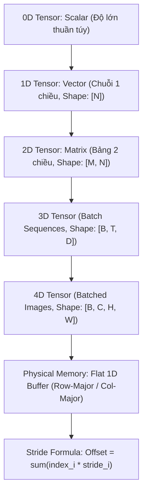
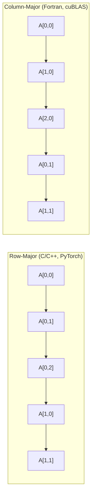
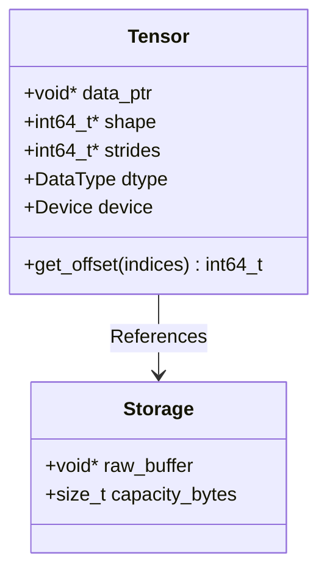
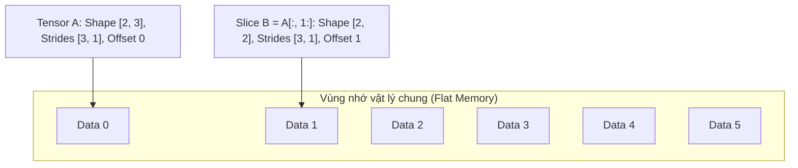
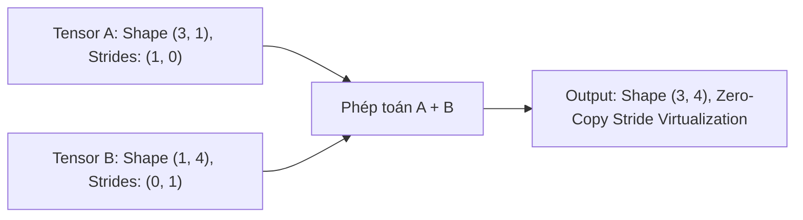

# Chuyên đề: Tensors & Bố cục Bộ nhớ (Tensors & Memory Layouts)

## 1. Tổng quan Chuyên đề
Trong Đại số tuyến tính hiện đại dành cho Deep Learning, **Tensor** là cấu trúc dữ liệu nền tảng nhất. Từ mô hình Perceptron đơn giản cho đến các kiến trúc Transformer hàng trăm tỷ tham số (LLMs), toàn bộ quá trình truyền dữ liệu (forward pass) và tính gradient (backward pass) đều là các chuỗi biến đổi tensor nhiều chiều.

Hiểu sâu về Tensor không chỉ dừng lại ở góc độ toán học thuần túy (multilinear maps) mà còn phải nắm vững cách phần cứng (CPU Cache, GPU HBM, SRAM) lưu trữ và truy cập các mảng đa chiều này thông qua **Strides**, **Contiguity**, và cơ chế **Broadcasting**.



---

## 2. Chi tiết từng Keyword

---

### 1. Scalars (Vô hướng)

#### a. Định nghĩa Bản chất Toán học
Một **Scalar** (đại lượng vô hướng) $s \in \mathbb{R}$ (hoặc $\mathbb{C}$) là một phần tử đơn lẻ của một trường số (field). Trong không gian đại số đa tuyến tính, scalar là một tensor bậc không (Rank-0 Tensor):
$$\text{Rank}(s) = 0, \quad \text{Shape}(s) = ()$$
Scalar chỉ mang độ lớn (magnitude), hoàn toàn không có hướng hay chiều không gian.

#### b. Cơ chế Tầng Sâu & Điện toán (Internals)
- **CPU/GPU**: Lưu trữ trực tiếp trong các thanh ghi đơn (General Purpose Register hoặc Floating Point Register như `XMM0-XMM15` trên x86_64, hoặc scalar registers `$s0` trên GPU warp scheduler).
- **Kích thước bộ nhớ**: Phụ thuộc vào độ chính xác:
  - FP64: 8 bytes (`double`).
  - FP32: 4 bytes (`float`) — chuẩn truyền thống trong Deep Learning.
  - FP16 / BF16: 2 bytes — chuẩn huấn luyện tăng tốc trên NVIDIA Tensor Cores.
  - FP8 (E4M3 / E5M2): 1 byte — chuẩn inference hiện đại (Hopper / Blackwell).

#### c. Code Thực chiến (C++ & Python)

```cpp
// C++17: Biểu diễn Scalar và kiểm tra kích thước bộ nhớ
#include <iostream>
#include <type_traits>

template <typename T>
void inspect_scalar(T val) {
    static_assert(std::is_fundamental<T>::value, "Must be a scalar type");
    std::cout << "Scalar Value: " << val 
              << " | Size: " << sizeof(val) << " bytes"
              << " | Alignment: " << alignof(T) << " bytes\n";
}

int main() {
    float s_fp32 = 3.14159f;
    double s_fp64 = 2.718281828459045;
    inspect_scalar(s_fp32);
    inspect_scalar(s_fp64);
    return 0;
}
```

```python
# Python / PyTorch: Rank-0 Tensor
import torch

s = torch.tensor(42.0, dtype=torch.float32)
print(f"Scalar: {s.item()}, Shape: {s.shape}, Rank: {s.dim()}, Elements: {s.numel()}")
```

#### d. Lỗi Thường gặp & Ứng dụng AI
- **Pitfall**: Gọi `.item()` quá nhiều lần trong vòng lặp PyTorch training loop sẽ gây ra GPU synchronization stall (CPU phải block chờ GPU tính xong giá trị scalar).
- **AI Application**: Loss value, learning rate, regularization weight $\lambda$.

---

### 2. Vectors (Véc-tơ)

#### a. Định nghĩa Bản chất Toán học
Một **Vector** $\mathbf{x} \in \mathbb{R}^n$ là một bộ có thứ tự gồm $n$ phần tử số thực:
$$\mathbf{x} = \begin{bmatrix} x_1 \\ x_2 \\ \vdots \\ x_n \end{bmatrix} \in \mathbb{R}^{n \times 1}$$
Vector biểu diễn một điểm hoặc một hướng trong không gian $n$ chiều, có bậc tensor là 1 ($\text{Rank} = 1$).

#### b. Cơ chế Tầng Sâu & Điện toán
- **Memory Layout**: Lưu trữ liên tục (contiguous block) trong RAM/VRAM. Địa chỉ của phần tử $i$ được tính bằng:
  $$\text{Address}(x_i) = \text{BaseAddress} + i \times \text{sizeof}(T)$$
- **SIMD Vectorization**: CPU có thể nạp đồng thời 8 số `float32` vào thanh ghi AVX-256 (`ymm`) hoặc 16 số vào AVX-512 (`zmm`) để thực thi các phép toán trong đúng 1 chu kỳ xung nhịp (Single Instruction, Multiple Data).

#### c. Code Thực chiến (C++ & Python)

```cpp
// C++20: Vector với SIMD Alignment (64-byte aligned cho AVX-512)
#include <iostream>
#include <vector>
#include <numeric>

template <typename T>
struct AlignedVector {
    alignas(64) std::vector<T> data;
    explicit AlignedVector(size_t n) : data(n) {}
    T& operator[](size_t i) { return data[i]; }
    const T& operator[](size_t i) const { return data[i]; }
    size_t size() const { return data.size(); }
};

int main() {
    AlignedVector<float> vec(8);
    for (size_t i = 0; i < vec.size(); ++i) vec[i] = static_cast<float>(i * 1.5f);
    std::cout << "Aligned vector memory at: " << vec.data.data() << "\n";
    return 0;
}
```

```python
import torch

v = torch.tensor([1.0, -2.5, 3.2], dtype=torch.float32)
print(f"Shape: {v.shape}, Stride: {v.stride()}, Contiguous: {v.is_contiguous()}")
```

#### d. Lỗi Thường gặp & Ứng dụng AI
- **Pitfall**: Nhầm lẫn giữa row-vector $\mathbf{x}^T \in \mathbb{R}^{1 \times n}$ và column-vector $\mathbf{x} \in \mathbb{R}^{n \times 1}$ dẫn đến sai kích thước khi nhân ma trận.
- **AI Application**: Word Embedding (Word2Vec), Token Embeddings trong LLM (kích thước $d_{model} = 4096$).

---

### 3. Matrices (Ma trận)

#### a. Định nghĩa Bản chất Toán học
Một **Matrix** $\mathbf{A} \in \mathbb{R}^{m \times n}$ là một mảng chữ nhật gồm $m$ hàng và $n$ cột:
$$\mathbf{A} = \begin{bmatrix} a_{11} & a_{12} & \cdots & a_{1n} \\ a_{21} & a_{22} & \cdots & a_{2n} \\ \vdots & \vdots & \ddots & \vdots \\ a_{m1} & a_{m2} & \cdots & a_{mn} \end{bmatrix}$$
Ma trận là một Rank-2 Tensor, đại diện cho toán tử ánh xạ tuyến tính $f: \mathbb{R}^n \to \mathbb{R}^m$.

#### b. Cơ chế Tầng Sâu & Điện toán: Row-Major vs Column-Major
Bộ nhớ vật lý của máy tính là tuyến tính 1 chiều (1D Flat Array). Ma trận 2D phải được trải phẳng (flatten):
1. **Row-Major (C/C++, Python NumPy, PyTorch)**: Các phần tử cùng hàng nằm kề nhau.
   $$\text{Index}(i, j) = i \times n + j, \quad \text{Stride} = (n, 1)$$
2. **Column-Major (Fortran, MATLAB, BLAS chuẩn)**: Các phần tử cùng cột nằm kề nhau.
   $$\text{Index}(i, j) = j \times m + i, \quad \text{Stride} = (1, m)$$



#### c. Code Thực chiến (C++ & Python)

```cpp
// C++17: Triển khai Row-Major Matrix với phẳng hóa bộ nhớ
#include <iostream>
#include <vector>
#include <cassert>

class Matrix {
private:
    size_t rows_, cols_;
    std::vector<float> data_;
public:
    Matrix(size_t rows, size_t cols) : rows_(rows), cols_(cols), data_(rows * cols, 0.0f) {}

    // Row-Major index: i * cols + j
    float& operator()(size_t i, size_t j) {
        assert(i < rows_ && j < cols_);
        return data_[i * cols_ + j];
    }

    float operator()(size_t i, size_t j) const {
        return data_[i * cols_ + j];
    }

    const float* data() const { return data_.data(); }
    size_t stride_row() const { return cols_; }
    size_t stride_col() const { return 1; }
};

int main() {
    Matrix mat(2, 3);
    mat(0, 1) = 5.0f;
    std::cout << "Element at (0, 1): " << mat(0, 1) << "\n";
    return 0;
}
```

```python
import numpy as np

# Kiểm tra Row-Major (C-contiguous) vs Column-Major (Fortran-contiguous)
A = np.zeros((3, 4), dtype=np.float32)
print("C-Contiguous:", A.flags['C_CONTIGUOUS'])  # True
print("Strides (bytes):", A.strides)             # (16, 4) vì 4 cột * 4 bytes = 16 bytes mỗi hàng
```

#### d. Lỗi Thường gặp & Ứng dụng AI
- **Pitfall**: Duyệt ma trận theo cột trong môi trường Row-Major (`for j: for i: A[i][j]`) sẽ gây ra **CPU Cache Miss** liên tục, làm giảm tốc độ thực thi từ 5 đến 10 lần.
- **AI Application**: Ma trận trọng số (Weights) trong Fully Connected Layer: $\mathbf{y} = \mathbf{W}\mathbf{x} + \mathbf{b}$.

---

### 4. Tensors (Ten-xơ)

#### a. Định nghĩa Bản chất Toán học
Trong toán học thuần túy, **Tensor** là một hàm đa tuyến tính (multilinear map) biến đổi nhiều vector và dual vector thành một số vô hướng:
$$\mathcal{T}: \underbrace{V^* \times \dots \times V^*}_{p} \times \underbrace{V \times \dots \times V}_{q} \to \mathbb{R}$$
Đây là tensor kiểu $(p, q)$ với bậc $p + q$.
Trong Khoa học Máy tính và AI, Tensor được định nghĩa thực dụng hơn: **Tensor là một mảng đa chiều (N-dimensional array)** chứa các phần tử số cùng kiểu dữ liệu (homogeneous data type).

#### b. Cơ chế Tầng Sâu & Strides Architecture
Mọi Tensor đa chiều trong PyTorch/TensorFlow đều được biểu diễn bởi 3 cấu phần lõi:
1. **Storage (Data Pointer)**: Con trỏ trỏ tới vùng đệm bộ nhớ 1D phẳng.
2. **Shape (Dimensions tuple)**: Kích thước từng trục $(d_0, d_1, \dots, d_{k-1})$.
3. **Strides tuple**: Số phần tử cần nhảy qua trong bộ nhớ phẳng để tiến lên 1 đơn vị ở trục tương ứng:
   $$\text{Offset}(i_0, i_1, \dots, i_{k-1}) = \sum_{j=0}^{k-1} i_j \times \text{Stride}_j$$



#### c. Code Thực chiến (C++ & Python)

```cpp
// C++17: Cấu trúc Tensor N-D tối giản mô phỏng PyTorch Tensor Internals
#include <iostream>
#include <vector>
#include <numeric>

struct TensorND {
    std::vector<int64_t> shape;
    std::vector<int64_t> strides;
    std::vector<float> storage;

    TensorND(const std::vector<int64_t>& dims) : shape(dims), strides(dims.size()) {
        int64_t current_stride = 1;
        for (int i = static_cast<int>(dims.size()) - 1; i >= 0; --i) {
            strides[i] = current_stride;
            current_stride *= dims[i];
        }
        storage.resize(current_stride, 0.0f);
    }

    int64_t compute_offset(const std::vector<int64_t>& indices) const {
        int64_t offset = 0;
        for (size_t i = 0; i < indices.size(); ++i) {
            offset += indices[i] * strides[i];
        }
        return offset;
    }
};

int main() {
    TensorND t({2, 3, 4}); // Tensor 3D: shape [2, 3, 4]
    std::cout << "Stride: [" << t.strides[0] << ", " << t.strides[1] << ", " << t.strides[2] << "]\n";
    // Stride sẽ là [12, 4, 1]
    return 0;
}
```

```python
import torch

T = torch.randn(2, 3, 4)
print("Shape:", T.shape)
print("Strides:", T.stride())  # (12, 4, 1)
print("Storage offset:", T.storage_offset())
```

#### d. Lỗi Thường gặp & Ứng dụng AI
- **Pitfall**: Thực hiện phép biến đổi hình dạng (như `view()`) trên một tensor không liên tục (`is_contiguous() == False`) sẽ ném ra runtime error. Cần gọi `.contiguous()` để cấp phát lại vùng nhớ liên tục.
- **AI Application**: Toàn bộ luồng dữ liệu (Data Pipeline), Feature maps trong CNN, Latent vectors trong VAE/GAN.

---

### 5. Tensor Dimensions, Shape, and Rank

#### a. Định nghĩa Bản chất Toán học
- **Tensor Rank (Số bậc / Số chiều)**: Số lượng trục (axes / indices) cần thiết để định danh duy nhất một phần tử.
  - Rank 0: Scalar.
  - Rank 1: Vector.
  - Rank 2: Matrix.
  - Rank $N$: N-D Tensor.
- **Tensor Shape (Hình dạng)**: Một tuple $(D_0, D_1, \dots, D_{N-1})$ chứa kích thước (size) của từng trục.
- **Tensor Dimensions**: Thường dùng để chỉ số lượng phần tử của một trục hoặc chính là Rank của tensor. Tổng số phần tử (numel):
  $$\text{Numel} = \prod_{k=0}^{N-1} D_k$$

#### b. Chi tiết So sánh Bộ ba Khái niệm
| Thuộc tính | Scalar | Vector | Matrix | Batched Video Tensor |
| :--- | :--- | :--- | :--- | :--- |
| **Rank (`ndim`)** | $0$ | $1$ | $2$ | $5$ |
| **Shape** | `()` | `(N,)` | `(M, N)` | `(Batch, Time, Channels, Height, Width)` |
| **Số chỉ số truy cập** | Không | $i$ | $i, j$ | $b, t, c, h, w$ |

#### c. Code Thực chiến (C++ & Python)

```cpp
#include <iostream>
#include <array>

template <size_t Rank>
struct TensorMetadata {
    std::array<size_t, Rank> shape;
    size_t numel() const {
        size_t total = 1;
        for (auto s : shape) total *= s;
        return total;
    }
};

int main() {
    TensorMetadata<4> img_batch{{{32, 3, 224, 224}}}; // B, C, H, W
    std::cout << "Rank: 4 | Total elements: " << img_batch.numel() << "\n";
    return 0;
}
```

```python
import torch

video = torch.zeros(8, 16, 3, 112, 112) # [B, T, C, H, W]
print("Rank (ndim):", video.ndim)
print("Shape:", video.shape)
print("Total Elements:", video.numel())
```

---

### 6. Tensor Indexing & Slicing

#### a. Định nghĩa Bản chất Toán học
- **Indexing (Chỉ mục)**: Truy xuất phần tử đơn lẻ $T_{i_0, i_1, \dots, i_{k-1}}$ tại tọa độ cụ thể.
- **Slicing (Cắt mảng)**: Trích xuất một tensor con bằng cách chọn các khoảng chỉ mục trên từng trục $[start:stop:step]$.

#### b. Cơ chế Tầng Sâu: Zero-Copy Views
Trong PyTorch và NumPy, **Slicing thông thường KHÔNG sao chép dữ liệu (Zero-Copy)**.
Thay vào đó, nó tạo ra một **View** trỏ cùng vào `storage` cũ, nhưng thay đổi `shape`, `strides`, và `storage_offset`:
$$\text{NewOffset} = \text{OldOffset} + \sum_{k} start_k \times \text{Stride}_k$$
$$\text{NewStride}_k = \text{OldStride}_k \times step_k$$



#### c. Code Thực chiến (C++ & Python)

```cpp
// C++17: Minh họa Zero-Copy Slice bằng cách điều chỉnh Metadata
#include <iostream>
#include <vector>

struct TensorView {
    const float* data;
    size_t offset;
    std::vector<size_t> shape;
    std::vector<size_t> strides;

    float get(size_t r, size_t c) const {
        return data[offset + r * strides[0] + c * strides[1]];
    }
};

int main() {
    std::vector<float> raw_memory = {1, 2, 3, 4, 5, 6}; // Matrix 2x3
    // Cắt slice: hàng 0..2, cột 1..3 -> submatrix 2x2: [[2, 3], [5, 6]]
    TensorView subview{raw_memory.data(), 1, {2, 2}, {3, 1}};
    std::cout << "Subview (0,0): " << subview.get(0, 0) << " (expected 2)\n";
    std::cout << "Subview (1,1): " << subview.get(1, 1) << " (expected 6)\n";
    return 0;
}
```

```python
import torch

X = torch.arange(12).reshape(3, 4)
# Slice cột 1 đến cột 3
Y = X[:, 1:3]

print("X data pointer:", X.data_ptr())
print("Y data pointer:", Y.data_ptr())  # Khác offset, nhưng chung storage
print("Y shares memory with X:", Y.untyped_storage().data_ptr() == X.untyped_storage().data_ptr()) # True
```

#### d. Lỗi Thường gặp & Ứng dụng AI
- **Pitfall**: Sửa đổi dữ liệu trên một Slice sẽ làm thay đổi luôn dữ liệu của Tensor gốc (In-place side effect). Cần gọi `.clone()` nếu muốn tách biệt bộ nhớ.
- **AI Application**: Cắt ảnh (Cropping), trích xuất Patch trong Vision Transformer (ViT), phân tách Query/Key/Value trong Multi-Head Attention.

---

### 7. Broadcasting (Cơ chế Mở rộng Chiều)

#### a. Định nghĩa Bản chất Toán học
Broadcasting là quy tắc số học cho phép thực hiện các phép toán theo từng phần tử (element-wise operations) giữa các tensor có hình dạng (shape) khác nhau mà không cần sao chép bộ nhớ thực tế.

#### b. Ba Quy tắc Vàng của Broadcasting (The 3 Rules of Broadcasting)
1. **Căn lề từ phải qua trái**: So khớp các trục từ chiều cuối cùng (trailing dimensions) ngược về chiều đầu tiên.
2. **Kích thước tương thích**: Hai chiều được coi là tương thích nếu:
   - Chúng bằng nhau: $D_1 == D_2$, hoặc
   - Một trong hai chiều bằng $1$: $D_1 == 1 \lor D_2 == 1$.
3. **Ảo hóa kích thước (Stride = 0)**: Chiều có kích thước bằng $1$ sẽ được mở rộng bằng cách thiết lập **$\text{Stride} = 0$**. Khi tăng chỉ mục ở trục này, con trỏ không nhảy sang vùng nhớ mới mà tiếp tục đọc lại phần tử cũ!



#### c. Code Thực chiến (C++ & Python)

```cpp
// C++17: Mô phỏng Stride = 0 cho phép Broadcasting
#include <iostream>

int main() {
    float col_vector[3] = {1.0f, 2.0f, 3.0f}; // Shape (3, 1)
    float row_vector[4] = {10.0f, 20.0f, 30.0f, 40.0f}; // Shape (1, 4)

    // Broadcast ngầm: Strides của col_vector: stride_row = 1, stride_col = 0
    // Strides của row_vector: stride_row = 0, stride_col = 1
    std::cout << "Broadcasting Result (3x4):\n";
    for (int i = 0; i < 3; ++i) {
        for (int j = 0; j < 4; ++j) {
            float val = col_vector[i * 1 + j * 0] + row_vector[i * 0 + j * 1];
            std::cout << val << "\t";
        }
        std::cout << "\n";
    }
    return 0;
}
```

```python
import torch

A = torch.tensor([[1.0], [2.0], [3.0]]) # Shape [3, 1]
B = torch.tensor([10.0, 20.0, 30.0, 40.0]) # Shape [4] -> được coi là [1, 4]

C = A + B # Shape [3, 4]
print("Shape C:", C.shape)
print("Output:\n", C)
```

#### d. Lỗi Thường gặp & Ứng dụng AI
- **Pitfall**: Tensor vô tình có shape `(N,)` cộng với tensor shape `(N, 1)` sẽ không báo lỗi mà tự động broadcast thành ma trận `(N, N)`, gây tốn bộ nhớ đột biến và dẫn đến lỗi tràn RAM/VRAM âm thầm (Silent Out-Of-Memory).
- **AI Application**: Thêm Bias vector $\mathbf{b} \in \mathbb{R}^{d}$ vào Batch ma trận đầu ra $\mathbf{X} \in \mathbb{R}^{B \times d}$, Chuẩn hóa LayerNorm / BatchNorm.
