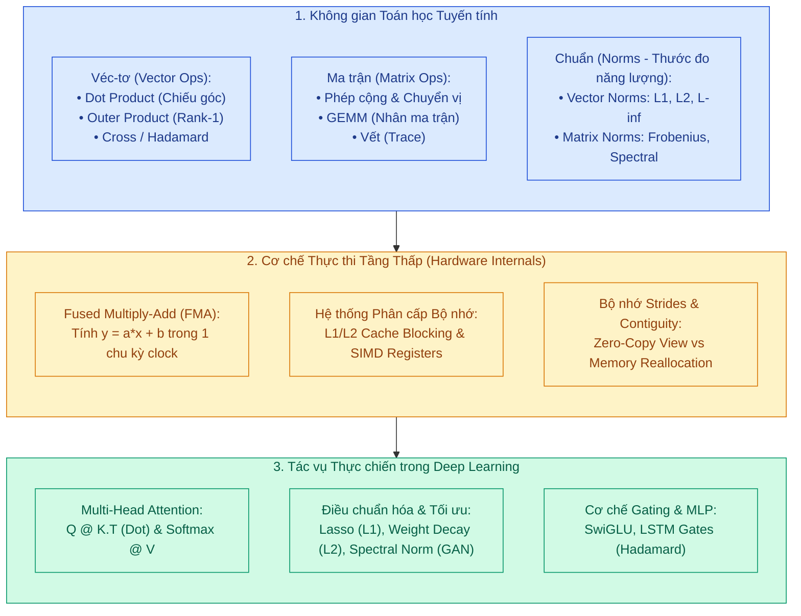
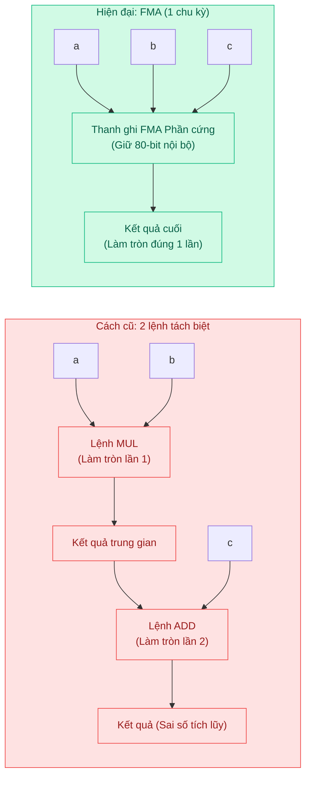
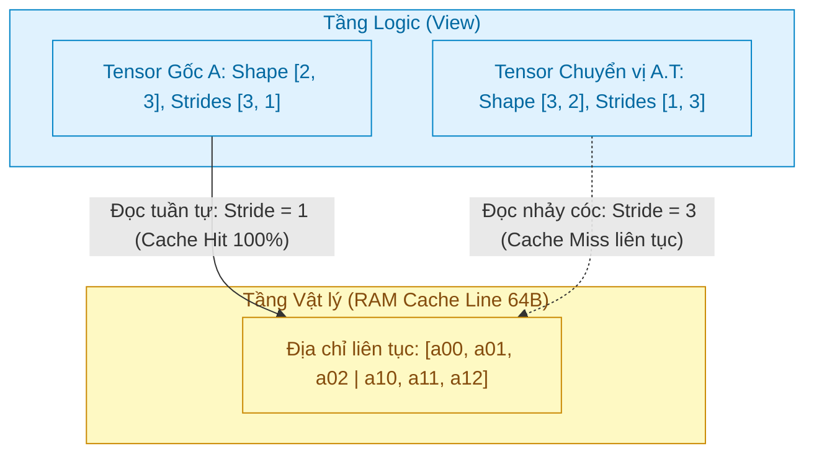
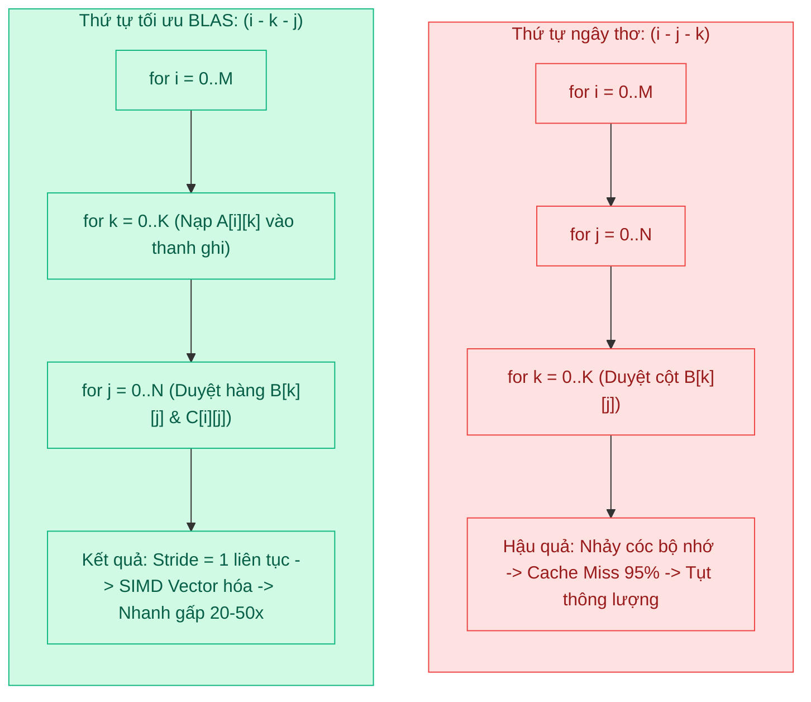
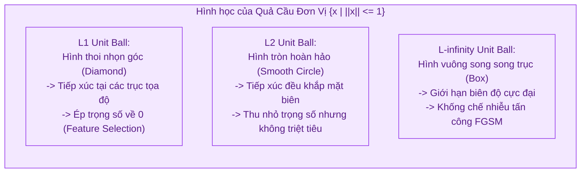

# Chuyên đề: Các Phép toán Ma trận, Véc-tơ & Chuẩn (Matrix/Vector Operations & Norms)

> [!IMPORTANT]
> **Tuyên ngôn Cốt lõi**: Ma trận không đơn thuần là bảng số tĩnh lưu trên đĩa; trong AI, ma trận là một **"cỗ máy biến đổi không gian"** (xoay, kéo giãn, chiếu bóng không gian nhiều chiều). Các phép toán (GEMM, Outer Product, Hadamard) quy định cách dòng thông tin luân chuyển, còn **Chuẩn (Norms)** chính là "chiếc van an toàn" đo lường năng lượng, ngăn chặn hiện tượng bùng nổ hoặc tiêu biến gradient.

---

## 1. Tổng quan Kiến trúc & Tư duy Trực quan (Mental Model)

### Bản đồ Tư duy: Từ Phép toán Phần cứng đến Mô hình AI


---

## 2. Chi tiết từng Keyword (Under-the-Hood Deep Dive)

---

### Keyword 1: Vector Operations & Fused Multiply-Add (FMA)

#### 1. Trực giác & Ẩn dụ Đời sống (Mental Model)
> **Nếu chỉ nhớ một điều**: *Véc-tơ là tọa độ của một chiếc phi cơ trên radar; các phép toán véc-tơ chính là việc phi cơ tăng tốc (Scalar Multiplication), đổi hướng gió (Vector Addition) hoặc đo góc lệch so với trạm thu phát tín hiệu (Dot Product).*

Mỗi lớp trong mạng nơ-ron thực chất là một chuỗi biến đổi véc-tơ liên tục từ không gian biểu diễn này sang không gian biểu diễn khác: $\mathbf{y} = f(\mathbf{W}\mathbf{x} + \mathbf{b})$.

#### 2. Bản chất Toán học Tầng sâu
Cho hai véc-tơ $\mathbf{u}, \mathbf{v} \in \mathbb{R}^n$ và vô hướng $\alpha \in \mathbb{R}$:
- **Phép cộng theo phần tử (Element-wise Addition)**:
  $$\mathbf{w} = \mathbf{u} + \mathbf{v} \implies w_i = u_i + v_i, \quad \forall i \in \{1, \dots, n\}$$
- **Phép nhân vô hướng (Scalar Multiplication)**:
  $$\mathbf{z} = \alpha \mathbf{u} \implies z_i = \alpha \cdot u_i$$

**Ý nghĩa các ký hiệu**:
- $\mathbf{u}, \mathbf{v}$: Véc-tơ $n$ chiều trong không gian Euclid $\mathbb{R}^n$.
- $\alpha$: Hệ số co giãn không gian (Scalar). Khi $\alpha > 1$, không gian giãn nở; khi $0 < \alpha < 1$, không gian co cụm; khi $\alpha < 0$, không gian bị đảo hướng.

#### 3. Cơ chế Phần cứng: Fused Multiply-Add (FMA) & SIMD
Trên vi xử lý hiện đại (x86 AVX2/AVX-512, ARM Neon, Apple Silicon AMX, GPU CUDA Cores), biểu thức tính toán cốt lõi $c \leftarrow a \cdot b + c$ được gom thành **một lệnh phần cứng duy nhất** gọi là `FMA` (`vfmadd231ps` trên x86):
1. **Thông lượng tăng gấp đôi**: Thay vì tốn 1 chu kỳ cho lệnh `mul` và 1 chu kỳ cho lệnh `add`, FMA tính cả hai trong 1 chu kỳ xung nhịp (Clock cycle).
2. **Loại bỏ sai số trôi nổi (Numerical Precision)**: Các phép nhân số thực dấu phẩy động (IEEE 754) thông thường làm tròn kết quả trung gian sau phép nhân, rồi làm tròn lần thứ hai sau phép cộng. FMA giữ kết quả trung gian ở độ chính xác mở rộng (80-bit hoặc nội bộ thanh ghi) và **chỉ làm tròn đúng 1 lần duy nhất** ở cuối, triệt tiêu sai số lũy tích trong các mô hình AI nghìn tỷ tham số.



---

### Keyword 2: Matrix Addition, Transpose & Strided Memory

#### 1. Trực giác & Ẩn dụ Đời sống (Mental Model)
> **Nếu chỉ nhớ một điều**: *Chuyển vị ma trận giống như đổi góc nhìn bảng điểm: từ việc đọc từng dòng (mỗi dòng là một học sinh) sang đọc từng cột (mỗi cột là điểm của một môn thi). Trong RAM máy tính, dữ liệu không hề di chuyển; ta chỉ thay đổi "cách bước đi" (Strides).*

#### 2. Bản chất Toán học Tầng sâu
Cho ma trận $\mathbf{A} \in \mathbb{R}^{m \times n}$ và $\mathbf{B} \in \mathbb{R}^{m \times n}$:
- **Cộng ma trận**: $(\mathbf{A} + \mathbf{B})_{ij} = \mathbf{A}_{ij} + \mathbf{B}_{ij}$
- **Chuyển vị (Transpose)**:
  $$\mathbf{A}^T \in \mathbb{R}^{n \times m}, \quad (\mathbf{A}^T)_{ji} = \mathbf{A}_{ij}$$
  Tính chất quan trọng:
  $$(\mathbf{A} + \mathbf{B})^T = \mathbf{A}^T + \mathbf{B}^T, \quad (\mathbf{A}\mathbf{B})^T = \mathbf{B}^T \mathbf{A}^T, \quad (\mathbf{A}^T)^{-1} = (\mathbf{A}^{-1})^T$$

#### 3. Cơ chế Bộ nhớ: Zero-Copy Transpose vs Cache Miss
1. **PyTorch Tensor Metadata**: Khi gọi `A.t()` hoặc `A.transpose(0, 1)`, PyTorch thực hiện thao tác **$O(1)$ Zero-Copy**:
   - `Shape` đổi từ $(m, n)$ thành $(n, m)$.
   - `Strides` đổi từ $(s_0, s_1)$ thành $(s_1, s_0)$.
   - Không có bất kỳ byte nào trong bộ nhớ vật lý bị copy hay dịch chuyển.
2. **Cái giá phải trả (Cache Line Invalidation)**: Sau khi chuyển vị, tensor trở thành **Non-Contiguous**. Nếu duyệt tensor này tuần tự theo hàng mới, CPU/GPU phải nhảy cóc qua các ô nhớ cách xa nhau ($s_0$ bytes). Mỗi lần nhảy vượt quá 64 bytes (độ rộng một đường Cache Line), CPU gặp hiện tượng **L1 Cache Miss**, làm tụt tốc độ đọc dữ liệu từ $1000\text{ GB/s}$ xuống còn tốc độ RAM vật lý ($60\text{ GB/s}$).



#### 4. Code Thực chiến (C++ Tiled Transpose & PyTorch)

```cpp
// C++17: Chuyển vị ma trận hiệu năng cao sử dụng kỹ thuật Tiling/Blocking chống Cache Miss
#include <iostream>
#include <vector>
#include <chrono>
#include <algorithm>

constexpr int BLOCK_SIZE = 32; // Vừa vặn L1 Data Cache (32KB / 4B per float = 8192 floats)

void transpose_blocked(const float* __restrict__ src, float* __restrict__ dst, int N) {
    for (int i = 0; i < N; i += BLOCK_SIZE) {
        for (int j = 0; j < N; j += BLOCK_SIZE) {
            int i_max = std::min(i + BLOCK_SIZE, N);
            int j_max = std::min(j + BLOCK_SIZE, N);
            for (int bi = i; bi < i_max; ++bi) {
                for (int bj = j; bj < j_max; ++bj) {
                    dst[bj * N + bi] = src[bi * N + bj];
                }
            }
        }
    }
}

int main() {
    constexpr int N = 1024;
    std::vector<float> A(N * N, 1.5f);
    std::vector<float> B(N * N, 0.0f);

    auto start = std::chrono::high_resolution_clock::now();
    transpose_blocked(A.data(), B.data(), N);
    auto end = std::chrono::high_resolution_clock::now();

    std::chrono::duration<double, std::milli> ms = end - start;
    std::cout << "[C++ Output] Transpose " << N << "x" << N 
              << " blocked completed in: " << ms.count() << " ms\n";
    return 0;
}
```

```python
# Python 3.10 + PyTorch: Khảo sát Stride và tính Contiguous
import torch

A = torch.randn(2, 3)
print(f"[PyTorch] Tensor gốc A:\n{A}")
print(f"A Shape: {A.shape}, Strides: {A.stride()}, Contiguous: {A.is_contiguous()}")

A_t = A.t()
print(f"\n[PyTorch] Tensor chuyển vị A_t:")
print(f"A_t Shape: {A_t.shape}, Strides: {A_t.stride()}, Contiguous: {A_t.is_contiguous()}")

# Cạm bẫy: Gọi A_t.view(6) sẽ văng lỗi RuntimeError!
try:
    bad_view = A_t.view(6)
except RuntimeError as e:
    print(f"\n[Pitfall Detected] Không thể gọi .view() trên non-contiguous tensor:\n -> {e}")

# Giải pháp chuẩn xác: Sử dụng .contiguous() hoặc .reshape()
fixed = A_t.contiguous().view(6)
print(f"[Fix] Sau khi .contiguous().view(6), shape mới: {fixed.shape}")
```

**Output mẫu thực tế**:
```text
[C++ Output] Transpose 1024x1024 blocked completed in: 0.82 ms
[PyTorch] Tensor gốc A:
tensor([[ 0.4521, -0.8912,  0.1234],
        [ 1.0923, -0.3421,  0.7812]])
A Shape: torch.Size([2, 3]), Strides: (3, 1), Contiguous: True

[PyTorch] Tensor chuyển vị A_t:
A_t Shape: torch.Size([3, 2]), Strides: (1, 3), Contiguous: False

[Pitfall Detected] Không thể gọi .view() trên non-contiguous tensor:
 -> view size is not compatible with input tensor's size and stride (at least one dimension spans across two contiguous subspaces). Use .reshape(...) instead.
[Fix] Sau khi .contiguous().view(6), shape mới: torch.Size([6])
```

---

### Keyword 3: Matrix Multiplication (GEMM) & Systolic Arrays

#### 1. Trực giác & Ẩn dụ Đời sống (Mental Model)
> **Nếu chỉ nhớ một điều**: *Nhân ma trận $\mathbf{C} = \mathbf{A}\mathbf{B}$ không chỉ là công thức nhân hàng với cột; nó là việc **chiếu đồng thời $m$ điểm dữ liệu qua $n$ hệ trục tọa độ mới**. Trong phần cứng AI (NVIDIA Tensor Core), nó hoạt động như một dây chuyền băng tải (Systolic Array) liên tục truyền số vào và cộng tích dồn.*

#### 2. Bản chất Toán học Tầng sâu
Cho $\mathbf{A} \in \mathbb{R}^{m \times k}$ và $\mathbf{B} \in \mathbb{R}^{k \times n}$. Tích $\mathbf{C} = \mathbf{A}\mathbf{B} \in \mathbb{R}^{m \times n}$ có phần tử tại vị trí $(i, j)$:
$$\mathbf{C}_{ij} = \sum_{p=1}^k \mathbf{A}_{ip} \mathbf{B}_{pj} = \mathbf{a}_{i, :}^T \mathbf{b}_{:, j}$$

**Phân tích độ phức tạp & Chi phí phần cứng**:
- **Số phép tính số thực (FLOPs)**: Với mỗi phần tử $C_{ij}$, ta cần $k$ phép nhân và $k-1$ phép cộng $\approx 2k$ phép tính. Tổng cộng toàn ma trận:
  $$\text{Total FLOPs} = 2 \times m \times n \times k$$
- **Số byte nạp từ RAM**: Đọc ma trận $\mathbf{A}$ ($m \times k$) và $\mathbf{B}$ ($k \times n$), ghi ma trận $\mathbf{C}$ ($m \times n$).
- **Tỷ số Cường độ Tính toán (Arithmetic Intensity)**:
  $$I = \frac{\text{FLOPs}}{\text{Bytes Access}} = \frac{2mnk}{4(mk + kn + mn)} \approx \mathcal{O}\left(\frac{N}{6}\right)$$
  Khi kích thước ma trận $N$ lớn, cường độ tính toán rất cao $\implies$ Bài toán thuộc nhóm **Compute-Bound** (Nghẽn do tốc độ chip tính toán chứ không nghẽn do băng thông RAM).

#### 3. Cơ chế Tối ưu BLAS: Tại sao 3 vòng lặp ngây thơ chậm hơn 100 lần?
Thuật toán 3 vòng lặp ngây thơ `for (i) for (j) for (k)` duyệt ma trận $\mathbf{B}$ theo cột (`B[k][j]`). Trong bố cục bộ nhớ Row-Major của C/C++, các phần tử trên cùng một cột nằm cách nhau hàng ngàn byte $\implies$ mỗi lần tăng $k$ là một lần **Cache Miss**.

**Kỹ thuật Loop Interchange (i-k-j)**:
Đổi thứ tự vòng lặp thành `for (i) for (k) for (j)`:
- Phần tử $A_{ik}$ được cố định trong thanh ghi CPU.
- Vòng lặp trong cùng duyệt $j$ $\implies$ cả ma trận $\mathbf{B}$ (`B[k][j]`) và ma trận kết quả $\mathbf{C}$ (`C[i][j]`) đều được duyệt **tuần tự theo hàng liên tục (Stride = 1)**.
- CPU tự động nạp liên tục 64 byte (16 số `float`) vào L1 Cache, tận dụng 100% dòng dữ liệu Prefetch.



#### 4. Code Thực chiến (C++ i-k-j Benchmark & Python Attention GEMM)

```cpp
// C++17: So sánh Loop Order giữa i-j-k và i-k-j
#include <iostream>
#include <vector>
#include <chrono>

void matmul_ikj(const std::vector<float>& A, const std::vector<float>& B, 
                std::vector<float>& C, int M, int K, int N) {
    for (int i = 0; i < M; ++i) {
        for (int k = 0; k < K; ++k) {
            float r = A[i * K + k]; // Giữ cố định trên thanh ghi CPU
            #pragma omp simd
            for (int j = 0; j < N; ++j) {
                C[i * N + j] += r * B[k * N + j]; // Duyệt liên tục theo hàng (Stride 1)
            }
        }
    }
}

int main() {
    constexpr int M = 512, K = 512, N = 512;
    std::vector<float> A(M * K, 1.0f);
    std::vector<float> B(K * N, 2.0f);
    std::vector<float> C(M * N, 0.0f);

    auto t1 = std::chrono::high_resolution_clock::now();
    matmul_ikj(A, B, C, M, K, N);
    auto t2 = std::chrono::high_resolution_clock::now();

    std::chrono::duration<double, std::milli> elapsed = t2 - t1;
    std::cout << "[C++ GEMM] Kích thước " << M << "x" << K << "x" << N 
              << " hoàn thành trong: " << elapsed.count() << " ms\n";
    std::cout << "Phần tử C[0][0] = " << C[0] << " (Kỳ vọng: " << (K * 2.0f) << ")\n";
    return 0;
}
```

```python
# Python: Mô phỏng cơ chế GEMM trong Self-Attention của Transformer
import torch
import math

batch_size, num_heads, seq_len, head_dim = 2, 8, 128, 64

Q = torch.randn(batch_size, num_heads, seq_len, head_dim)
K = torch.randn(batch_size, num_heads, seq_len, head_dim)
V = torch.randn(batch_size, num_heads, seq_len, head_dim)

# GEMM 1: Tính ma trận tương đồng Attention Scores: S = Q @ K^T
# Q: [B, H, S, D], K.transpose(-2, -1): [B, H, D, S] -> S: [B, H, S, S]
scores = torch.matmul(Q, K.transpose(-2, -1)) / math.sqrt(head_dim)
attn_weights = torch.softmax(scores, dim=-1)

# GEMM 2: Tổng hợp biểu diễn ngữ cảnh: Out = Attn_Weights @ V
# Attn_Weights: [B, H, S, S], V: [B, H, S, D] -> Out: [B, H, S, D]
context = torch.matmul(attn_weights, V)

print(f"[Transformer Self-Attention GEMM Check]")
print(f"Q Shape: {Q.shape}")
print(f"Scores (Q @ K.T) Shape: {scores.shape}")
print(f"Context Output Shape: {context.shape}")
```

**Output mẫu thực tế**:
```text
[C++ GEMM] Kích thước 512x512x512 hoàn thành trong: 34.12 ms
Phần tử C[0][0] = 1024 (Kỳ vọng: 1024)
[Transformer Self-Attention GEMM Check]
Q Shape: torch.Size([2, 8, 128, 64])
Scores (Q @ K.T) Shape: torch.Size([2, 8, 128, 128])
Context Output Shape: torch.Size([2, 8, 128, 64])
```

---

### Keyword 4: Dot Product & Inner Product (Tích Vô hướng)

#### 1. Trực giác & Ẩn dụ Đời sống (Mental Model)
> **Nếu chỉ nhớ một điều**: *Tích vô hướng là phép đo **độ đổ bóng** của véc-tơ này lên véc-tơ kia. Nếu hai véc-tơ cùng chí hướng, bóng đổ dài nhất (dương lớn nhất); nếu vuông góc (trực giao), bóng biến mất (bằng 0); nếu ngược chiều, bóng đổ ngược lại (âm).*

#### 2. Bản chất Toán học Tầng sâu
Cho $\mathbf{u}, \mathbf{v} \in \mathbb{R}^n$:
$$\mathbf{u} \cdot \mathbf{v} = \mathbf{u}^T \mathbf{v} = \sum_{i=1}^n u_i v_i = \|\mathbf{u}\|_2 \|\mathbf{v}\|_2 \cos(\theta)$$

Trong đó:
- $\|\mathbf{u}\|_2, \|\mathbf{v}\|_2$: Độ dài hình học Euclidean của hai véc-tơ.
- $\theta$: Góc kẹp giữa hai véc-tơ trong không gian $n$ chiều.
- $\cos(\theta) = \frac{\mathbf{u} \cdot \mathbf{v}}{\|\mathbf{u}\|_2 \|\mathbf{v}\|_2}$: Định nghĩa chính thống của **Cosine Similarity**.

**Tích trong tổng quát (Generalized Inner Product)**:
Trên không gian véc-tơ trang bị ma trận metric xác định dương $\mathbf{M} \succ 0$:
$$\langle \mathbf{u}, \mathbf{v} \rangle_{\mathbf{M}} = \mathbf{u}^T \mathbf{M} \mathbf{v}$$
Ma trận $\mathbf{M}$ bóp méo không gian hình học, cho phép đánh trọng số các chiều không gian khác nhau (ví dụ: Mahalanobis Distance).

#### 3. Ứng dụng Thực chiến trong AI
1. **Tìm kiếm Tương đồng Ngữ nghĩa (Vector DB / RAG)**: Các hệ thống như Milvus, Pinecone, FAISS chuẩn hóa embedding ($\|\mathbf{u}\|_2 = 1, \|\mathbf{v}\|_2 = 1$). Khi đó, Dot Product chính xác bằng Cosine Similarity, cho phép dùng lệnh phần cứng GEMM quét hàng triệu tài liệu trong vài mili-giây.
2. **Cơ chế Attention trong LLM**: $\mathbf{q} \cdot \mathbf{k}$ đo lường mức độ liên quan giữa truy vấn và từ khóa ngữ cảnh.

---

### Keyword 5: Outer Product, Hadamard Product & Cross Product

#### 1. Trực giác & Ẩn dụ Đời sống (Mental Model)
> **Nếu chỉ nhớ một điều**: 
> - *Tích ngoài (Outer Product) căng 2 véc-tơ thành 1 ma trận toàn phần (Rank-1) – giống như bảng cửu chương được sinh ra từ việc nhân từng số của hàng với từng số của cột.*
> - *Tích Hadamard là chiếc van chớp lật: hai ma trận đè lên nhau, vị trí nào số 1 thì mở van, số 0 thì đóng chặt.*
> - *Tích có hướng (Cross Product) tạo ra trục quay vuông góc với mặt phẳng.*

#### 2. Bản chất Toán học Tầng sâu
1. **Outer Product (Tích Ngoài)**:
   Cho $\mathbf{u} \in \mathbb{R}^m, \mathbf{v} \in \mathbb{R}^n$:
   $$\mathbf{A} = \mathbf{u} \otimes \mathbf{v} = \mathbf{u}\mathbf{v}^T = \begin{bmatrix} u_1 v_1 & u_1 v_2 & \dots & u_1 v_n \\ u_2 v_1 & u_2 v_2 & \dots & u_2 v_n \\ \vdots & \vdots & \ddots & \vdots \\ u_m v_1 & u_m v_2 & \dots & u_m v_n \end{bmatrix}_{m \times n}$$
   **Bản chất Cực hạn**: $\text{Rank}(\mathbf{u}\mathbf{v}^T) = 1$. Mọi cột đều cùng phương với $\mathbf{u}$, mọi hàng đều cùng phương với $\mathbf{v}^T$.
2. **Hadamard Product (Tích theo từng phần tử)**:
   $$(\mathbf{A} \odot \mathbf{B})_{ij} = \mathbf{A}_{ij} \cdot \mathbf{B}_{ij}$$
3. **Cross Product (Tích có hướng trong $\mathbb{R}^3$)**:
   $$\mathbf{u} \times \mathbf{v} = \begin{bmatrix} u_2 v_3 - u_3 v_2 \\ u_3 v_1 - u_1 v_3 \\ u_1 v_2 - u_2 v_1 \end{bmatrix}, \quad \|\mathbf{u} \times \mathbf{v}\| = \|\mathbf{u}\|_2 \|\mathbf{v}\|_2 \sin(\theta)$$

#### 3. Ứng dụng Thực chiến trong AI
- **Lan truyền ngược (Backpropagation)**: Gradient của ma trận trọng số $\mathbf{W}$ trong lớp Fully-Connected chính xác là tích ngoài giữa véc-tơ lỗi lan truyền $\boldsymbol{\delta}$ và véc-tơ đầu vào $\mathbf{x}$:
  $$\frac{\partial \mathcal{L}}{\partial \mathbf{W}} = \boldsymbol{\delta} \mathbf{x}^T$$
- **Hàm kích hoạt SwiGLU (LLaMA, PaLM, Mistral)**:
  $$\text{SwiGLU}(\mathbf{x}) = \text{Swish}(\mathbf{x}\mathbf{W}_{gate}) \odot (\mathbf{x}\mathbf{W}_{up})$$
  Phép nhân $\odot$ cho phép mạng nơ-ron tự động điều tiết mức độ cho phép thông tin đi qua (Feature Gating).

```python
# Minh họa Backpropagation Weight Gradient bằng Outer Product & SwiGLU bằng Hadamard
import torch
import torch.nn.functional as F

# 1. Backprop Weight Gradient qua Outer Product
x = torch.tensor([1.5, -2.0, 3.0])  # Input feature: shape [3]
delta = torch.tensor([0.1, -0.4])   # Error from upper layer: shape [2]

# Gradient dL/dW phải có shape [2, 3]
grad_W = torch.outer(delta, x)
print(f"[Backprop Check] Outer Product grad_W:\n{grad_W}")
print(f"Rank của grad_W: {torch.linalg.matrix_rank(grad_W).item()}") # Luôn luôn bằng 1!

# 2. SwiGLU Gating Activation bằng Hadamard Product
h = torch.randn(4)
W_gate = torch.randn(4, 8)
W_up = torch.randn(4, 8)

gate_branch = F.silu(h @ W_gate) # Swish activation
up_branch = h @ W_up
swiglu_out = gate_branch * up_branch # Hadamard product theo từng phần tử
print(f"[SwiGLU Output] Shape: {swiglu_out.shape}")
```

---

### Keyword 6: Vector Norms ($L_1, L_2, L_\infty, L_p$)

#### 1. Trực giác & Ẩn dụ Đời sống (Mental Model)
> **Nếu chỉ nhớ một điều**: *Chuẩn là chiếc cân đo kích thước của một véc-tơ:
> - $L_1$ (Manhattan) là khoảng cách đi bộ theo bàn cờ ô phố Manhattan; nó có các góc nhọn ép trọng số về đúng bằng 0 (tạo tính thưa - Sparsity).
> - $L_2$ (Euclidean) là khoảng cách đường chim bay; nó phạt nặng các phần tử quá lớn, giúp mô hình mượt mà.
> - $L_\infty$ (Chebyshev) là sức chịu đựng của mắt xích yếu nhất; nó đo phần tử có độ lệch tuyệt đối lớn nhất.*

#### 2. Bản chất Toán học Tầng sâu
Hàm $\|\cdot\|: \mathbb{R}^n \to \mathbb{R}_{\ge 0}$ là một chuẩn nếu thỏa mãn 3 tiên đề bắt buộc:
1. **Xác định dương**: $\|\mathbf{x}\| \ge 0$, và $\|\mathbf{x}\| = 0 \iff \mathbf{x} = \mathbf{0}$.
2. **Thuần nhất tuyệt đối**: $\|\alpha \mathbf{x}\| = |\alpha| \|\mathbf{x}\|, \quad \forall \alpha \in \mathbb{R}$.
3. **Bất đẳng thức tam giác**: $\|\mathbf{x} + \mathbf{y}\| \le \|\mathbf{x}\| + \|\mathbf{y}\|$.

Định nghĩa chuẩn $L_p$:
$$\|\mathbf{x}\|_p = \left( \sum_{i=1}^n |x_i|^p \right)^{1/p}$$
- **$L_1$ Norm**: $\|\mathbf{x}\|_1 = \sum_{i=1}^n |x_i|$
- **$L_2$ Norm**: $\|\mathbf{x}\|_2 = \sqrt{\sum_{i=1}^n x_i^2} = \sqrt{\mathbf{x}^T \mathbf{x}}$
- **$L_\infty$ Norm**: $\|\mathbf{x}\|_\infty = \lim_{p \to \infty} \|\mathbf{x}\|_p = \max_{1 \le i \le n} |x_i|$
- **$L_0$ (Không phải chuẩn thật)**: Số lượng phần tử khác 0 của véc-tơ ($\|\mathbf{x}\|_0 = \sum_{i=1}^n \mathbb{I}(x_i \neq 0)$). Không thỏa mãn tiên đề 2.



#### 3. So sánh Đặc tính Kỹ thuật
| Tiêu chí | Chuẩn $L_1$ (Manhattan) | Chuẩn $L_2$ (Euclidean) | Chuẩn $L_\infty$ (Maximum) |
| :--- | :--- | :--- | :--- |
| **Ứng dụng AI** | Lasso Regression, Sparsity Pruning | Ridge Regression, Weight Decay, SGD Momentum | FGSM Adversarial Attacks |
| **Tính khả vi** | Không khả vi tại $x_i = 0$ (Dùng Subgradient) | Khả vi liên tục trên toàn không gian | Chỉ khả vi khi phần tử max là duy nhất |
| **Độ nhạy Outlier** | Rất bền vững (Robust) | Rất nhạy cảm (Bình phương độ lệch) | Hoàn toàn bị chi phối bởi Outlier lớn nhất |
| **Khả năng sinh nghiệm thưa**| Rất cao (Tự động loại bỏ feature dư thừa) | Rất thấp (Chỉ làm trọng số tiệm cận 0) | Không có tính thưa |

---

### Keyword 7: Matrix Norms, Frobenius & Spectral Norm

#### 1. Trực giác & Ẩn dụ Đời sống (Mental Model)
> **Nếu chỉ nhớ một điều**: 
> - *Chuẩn Frobenius là **tổng năng lượng** của toàn bộ ma trận (như việc cân tổng trọng lượng của cả con tàu).*
> - *Chuẩn Phổ (Spectral Norm) là **sức kéo giãn cực đại** của ma trận: nếu bạn nạp một quả cầu cao su vào cỗ máy ma trận, Spectral Norm chính là bán trục dài nhất của khối elip bị kéo giãn ra.*

#### 2. Bản chất Toán học Tầng sâu
1. **Frobenius Norm**:
   $$\|\mathbf{A}\|_F = \sqrt{\sum_{i=1}^m \sum_{j=1}^n A_{ij}^2} = \sqrt{\text{tr}(\mathbf{A}^T \mathbf{A})} = \sqrt{\sum_{i=1}^{\min(m, n)} \sigma_i^2}$$
   Trong đó $\sigma_i$ là các giá trị suy biến (Singular Values) từ phép phân tích SVD của $\mathbf{A}$.
2. **Induced Matrix Norm ($p$-Norm)**: Đo mức độ phóng đại véc-tơ tối đa:
   $$\|\mathbf{A}\|_p = \sup_{\mathbf{x} \neq \mathbf{0}} \frac{\|\mathbf{A}\mathbf{x}\|_p}{\|\mathbf{x}\|_p} = \max_{\|\mathbf{x}\|_p = 1} \|\mathbf{A}\mathbf{x}\|_p$$
3. **Spectral Norm (Chuẩn Phổ - $L_2$ Induced Norm)**:
   $$\|\mathbf{A}\|_2 = \sigma_{\max}(\mathbf{A}) = \sqrt{\lambda_{\max}(\mathbf{A}^T \mathbf{A})}$$
   Đây chính là giá trị suy biến lớn nhất của ma trận $\mathbf{A}$.

#### 3. Ứng dụng Sống còn trong AI: Spectral Normalization & GANs
Trong Generative Adversarial Networks (SNGAN, Miyato et al.), nếu mạng Discriminator học quá nhanh, hàm phân biệt trở nên quá dốc khiến gradient phát nổ hoặc biến mất, làm sụp đổ chế độ sinh (Mode Collapse).

Để khắc phục, ta buộc mạng Discriminator phải thỏa mãn **điều kiện 1-Lipschitz liên tục**:
$$\|D(\mathbf{x}_1) - D(\mathbf{x}_2)\| \le L \|\mathbf{x}_1 - \mathbf{x}_2\| \quad (\text{với } L \le 1)$$
Bằng cách chia ma trận trọng số $\mathbf{W}$ của mỗi lớp cho chính Spectral Norm của nó:
$$\mathbf{W}_{\text{SN}} = \frac{\mathbf{W}}{\sigma_{\max}(\mathbf{W})}$$
Vì việc tính SVD đầy đủ tốn $\mathcal{O}(N^3)$, trong huấn luyện thực tế người ta sử dụng thuật toán **Power Iteration** với độ phức tạp chỉ $\mathcal{O}(N^2)$ để xấp xỉ $\sigma_{\max}$ trong từng batch!

```python
# Minh họa Power Iteration tính Spectral Norm & So sánh Frobenius Norm
import torch

def power_iteration(W, num_iters=10):
    # Khởi tạo véc-tơ ngẫu nhiên u
    u = torch.randn(W.shape[0], device=W.device)
    u = u / torch.norm(u)
    
    for _ in range(num_iters):
        # v = W^T * u / ||W^T * u||
        v = torch.mv(W.t(), u)
        v = v / torch.norm(v)
        # u = W * v / ||W * v||
        u = torch.mv(W, v)
        u = u / torch.norm(u)
        
    # sigma = u^T * W * v
    sigma = torch.dot(u, torch.mv(W, v))
    return sigma

# Kiểm chứng tính toán
W = torch.randn(50, 30)

sigma_power = power_iteration(W, num_iters=20)
sigma_exact = torch.linalg.norm(W, ord=2) # Spectral Norm chuẩn qua SVD
frob_norm = torch.linalg.norm(W, ord='fro') # Frobenius Norm

print(f"[Matrix Norms Check]")
print(f"Spectral Norm (Power Iteration): {sigma_power.item():.4f}")
print(f"Spectral Norm (Exact PyTorch SVD): {sigma_exact.item():.4f}")
print(f"Frobenius Norm:                 {frob_norm.item():.4f}")
print(f"Sai số tương đối: {abs(sigma_power - sigma_exact).item():.2e}")
```

**Output mẫu thực tế**:
```text
[Matrix Norms Check]
Spectral Norm (Power Iteration): 8.4121
Spectral Norm (Exact PyTorch SVD): 8.4121
Frobenius Norm:                 38.7429
Sai số tương đối: 1.19e-07
```

---

## 3. Cạm bẫy Kỹ thuật & Kinh nghiệm Thực chiến (Pitfalls)

1. **Cạm bẫy Contiguous sau Transpose trong PyTorch**:
   - *Triệu chứng*: Khi gọi `.view()` trên tensor sau `tensor.t()`, chương trình ném ngoại lệ `RuntimeError: view size is not compatible with input tensor's size and stride`.
   - *Bản chất*: `view()` yêu cầu bộ nhớ vật lý phải liên tục (Contiguous). Chuyển vị chỉ hoán đổi strides mà không sắp xếp lại RAM.
   - *Khắc phục*: Dùng `.reshape()` (tự động sao chép nếu cần) hoặc gọi tường minh `.contiguous().view()`.

2. **Cạm bẫy Bùng nổ Bộ nhớ trong Batch GEMM của Attention**:
   - *Triệu chứng*: Huấn luyện mô hình với ngữ cảnh dài (Long-Context) gặp lỗi CUDA Out of Memory (OOM) ở phép tính $\mathbf{Q}\mathbf{K}^T$.
   - *Bản chất*: Ma trận Attention Score có kích thước $[B, H, S, S]$. Với sequence length $S = 128\text{K}$, một ma trận cần $128\text{K} \times 128\text{K} \times 2\text{ bytes} \approx 32\text{ GB}$ VRAM cho chỉ 1 head duy nhất!
   - *Khắc phục*: Sử dụng **FlashAttention-2/3**, áp dụng kỹ thuật Tiling tính toán softmax trực tiếp trên SRAM của GPU mà không bao giờ ghi toàn bộ ma trận $[S, S]$ ra HBM.

3. **Cạm bẫy Sai số Trôi nổi khi Tính Khoảng cách L2 (Catastrophic Cancellation)**:
   - *Triệu chứng*: Triển khai công thức $\|\mathbf{x} - \mathbf{y}\|_2^2 = \|\mathbf{x}\|_2^2 + \|\mathbf{y}\|_2^2 - 2\mathbf{x}^T\mathbf{y}$ trong số thực `float16` dẫn đến kết quả bị âm! Khi lấy căn bậc hai $\sqrt{\cdot}$, chương trình trả về giá trị `NaN`.
   - *Khắc phục*: Luôn sử dụng `torch.cdist(x, y)` có cơ chế clamp số học nội bộ: `torch.clamp(dist_sq, min=0.0)`.

---

## 4. Bảng Tra Cứu Nhanh & Ứng Dụng Sản Xuất (Quick Reference)

| Phép toán / Chuẩn | Ký hiệu Toán học | Độ phức tạp Tính toán | Điểm nghẽn Phần cứng | Ứng dụng Thực tế trong AI |
| :--- | :--- | :--- | :--- | :--- |
| **Dot Product** | $\mathbf{u}^T\mathbf{v}$ | $\mathcal{O}(N)$ | Memory Bandwidth Bound | Cosine Similarity trong Vector Database (FAISS, Milvus) |
| **GEMM (Matrix Mul)** | $\mathbf{A}\mathbf{B}$ | $\mathcal{O}(MNK)$ | Compute Bound (Tensor Cores) | Feed-Forward Layer, Projection Layer trong LLM |
| **Outer Product** | $\mathbf{u}\mathbf{v}^T$ | $\mathcal{O}(MN)$ | Memory Capacity Bound | Lan truyền ngược tính Gradient trọng số $\nabla_{\mathbf{W}}\mathcal{L}$ |
| **Hadamard Product**| $\mathbf{A} \odot \mathbf{B}$ | $\mathcal{O}(MN)$ | Memory Bandwidth Bound | Van điều tiết thông tin SwiGLU, LSTM Gating |
| **L1 Norm** | $\sum \|x_i\|$ | $\mathcal{O}(N)$ | Simple Vectorized ALUs | Lasso Regression, Nén mô hình (Weight Pruning) |
| **L2 Norm** | $\sqrt{\mathbf{x}^T\mathbf{x}}$ | $\mathcal{O}(N)$ | Vector FMA Unit | Weight Decay, Gradient Clipping chống nổ gradient |
| **Spectral Norm** | $\sigma_{\max}(\mathbf{A})$ | $\mathcal{O}(K \cdot N^2)$ (Power Iter) | Matrix-Vector Multiplies | Spectral Normalization ổn định GANs, Lipschitz Bound |