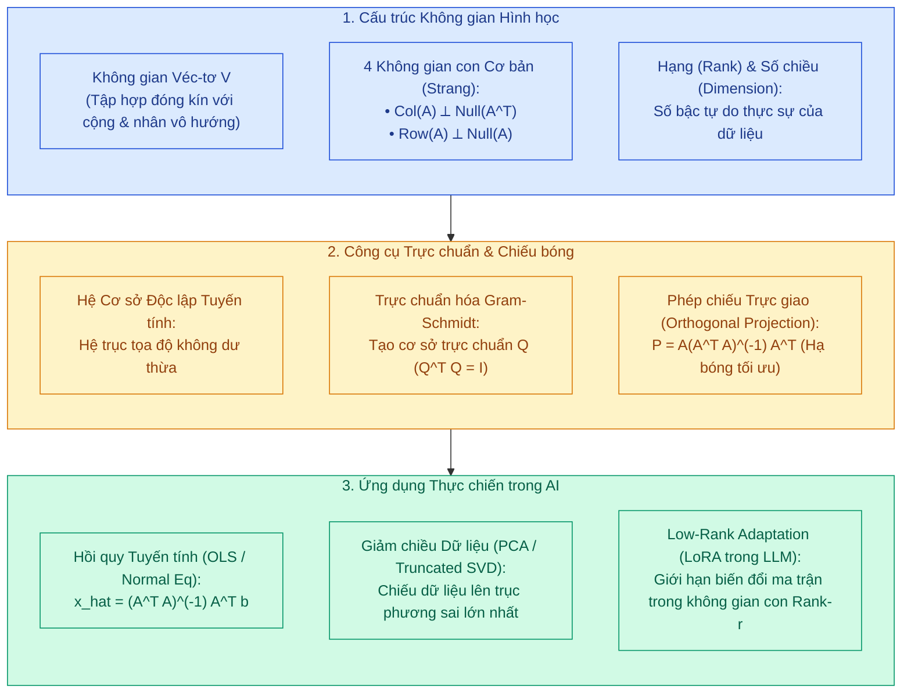
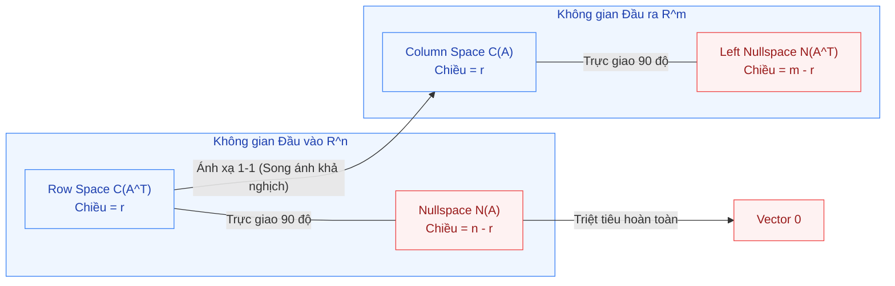
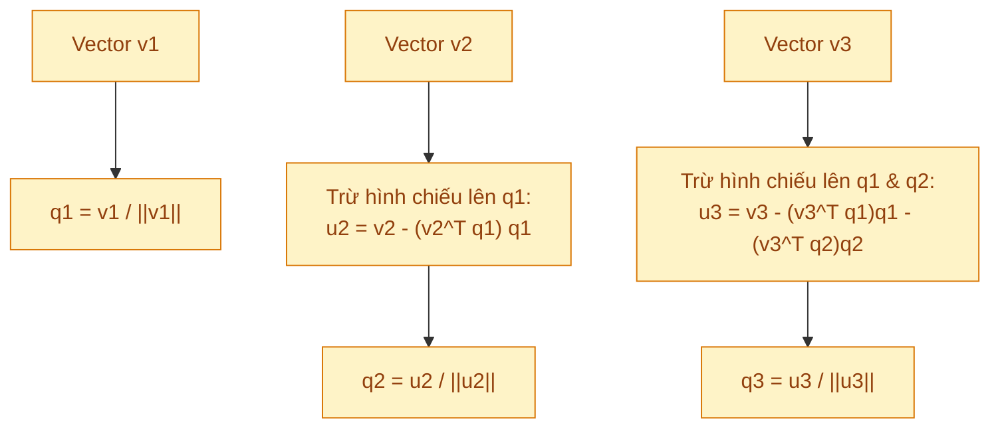
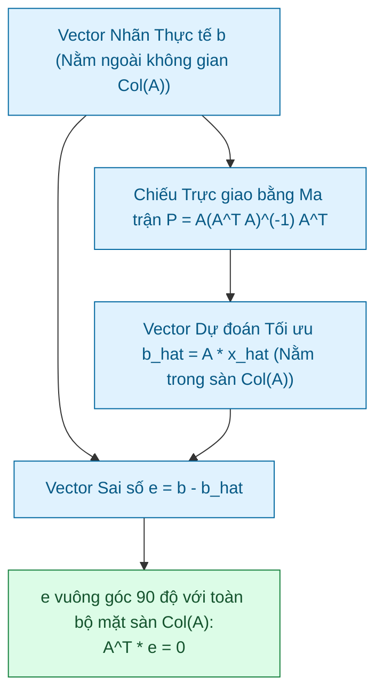

# Chuyên đề: Không gian Véc-tơ, Cơ sở & Phép chiếu Trực giao (Vector Spaces, Bases & Projections)

> [!IMPORTANT]
> **Tuyên ngôn Cốt lõi**: Mọi dữ liệu AI (từ văn bản, hình ảnh đến sóng âm) đều là các điểm trôi nổi trong không gian véc-tơ nhiều chiều $\mathbb{R}^d$. Việc hiểu rõ **Không gian con (Subspaces)**, **Hệ cơ sở trực chuẩn (Orthonormal Basis)** và **Phép chiếu trực giao (Orthogonal Projection)** giúp ta nắm trọn bí quyết: làm thế nào để nén hàng triệu chiều dữ liệu xuống vài chiều quan trọng nhất (PCA, LoRA) mà không đánh mất thông tin bản chất, và tại sao phép chiếu bóng hình học lại là cội nguồn của Hồi quy Bình phương Tối thiểu (OLS).

---

## 1. Tổng quan Kiến trúc & Tư duy Trực quan (Mental Model)

### Bản đồ Tư duy: Từ Không gian Con đến Thuật toán AI


---

## 2. Chi tiết từng Keyword (Under-the-Hood Deep Dive)

---

### Keyword 1: Vector Spaces & The 4 Fundamental Subspaces (Strang)

#### 1. Trực giác & Ẩn dụ Đời sống (Mental Model)
> **Nếu chỉ nhớ một điều**: *Một ma trận $\mathbf{A}_{m \times n}$ giống như một cổng dịch chuyển không gian từ phòng $n$ chiều sang phòng $m$ chiều. Bốn không gian con cơ bản của Gilbert Strang mô tả trọn vẹn bản đồ địa lý của cổng dịch chuyển đó: những gì có thể tới được (Column Space), những gì bị triệt tiêu về số 0 hoàn toàn (Nullspace), và phần bù trực giao của chúng.*

#### 2. Bản chất Toán học Tầng sâu
Cho ma trận ánh xạ tuyến tính $\mathbf{A} \in \mathbb{R}^{m \times n}$ với hạng $\text{rank}(\mathbf{A}) = r$:

1. **Column Space (Không gian Cột - Range)** $\mathcal{C}(\mathbf{A}) \subseteq \mathbb{R}^m$:
   $$\mathcal{C}(\mathbf{A}) = \{ \mathbf{A}\mathbf{x} \mid \mathbf{x} \in \mathbb{R}^n \}, \quad \dim \mathcal{C}(\mathbf{A}) = r$$
   Là toàn bộ các điểm đích trong không gian $m$ chiều mà ma trận $\mathbf{A}$ có thể chạm tới.
2. **Nullspace (Không gian Hạt nhân - Kernel)** $\mathcal{N}(\mathbf{A}) \subseteq \mathbb{R}^n$:
   $$\mathcal{N}(\mathbf{A}) = \{ \mathbf{x} \in \mathbb{R}^n \mid \mathbf{A}\mathbf{x} = \mathbf{0} \}, \quad \dim \mathcal{N}(\mathbf{A}) = n - r$$
   Chứa tất cả các véc-tơ bị $\mathbf{A}$ "bóp nát" thành véc-tơ $\mathbf{0}$ (mất thông tin hoàn toàn).
3. **Row Space (Không gian Hàng)** $\mathcal{C}(\mathbf{A}^T) \subseteq \mathbb{R}^n$:
   $$\mathcal{C}(\mathbf{A}^T) = \{ \mathbf{A}^T\mathbf{y} \mid \mathbf{y} \in \mathbb{R}^m \}, \quad \dim \mathcal{C}(\mathbf{A}^T) = r$$
   Chứa các véc-tơ đầu vào thực sự tạo ra sự biến đổi khác $\mathbf{0}$.
4. **Left Nullspace (Không gian Hạt nhân Trái)** $\mathcal{N}(\mathbf{A}^T) \subseteq \mathbb{R}^m$:
   $$\mathcal{N}(\mathbf{A}^T) = \{ \mathbf{y} \in \mathbb{R}^m \mid \mathbf{A}^T\mathbf{y} = \mathbf{0} \}, \quad \dim \mathcal{N}(\mathbf{A}^T) = m - r$$

**Định lý Cơ bản của Đại số Tuyến tính (Gilbert Strang Fundamental Theorem)**:
$$\mathcal{C}(\mathbf{A}^T) \perp \mathcal{N}(\mathbf{A}) \quad \text{trong } \mathbb{R}^n, \qquad \mathcal{C}(\mathbf{A}) \perp \mathcal{N}(\mathbf{A}^T) \quad \text{trong } \mathbb{R}^m$$
Mọi véc-tơ $\mathbf{x} \in \mathbb{R}^n$ đều phân rã duy nhất thành: $\mathbf{x} = \mathbf{x}_{\text{row}} + \mathbf{x}_{\text{null}}$ với $\mathbf{x}_{\text{row}} \in \mathcal{C}(\mathbf{A}^T)$ và $\mathbf{x}_{\text{null}} \in \mathcal{N}(\mathbf{A})$.



---

### Keyword 2: Linear Independence, Span & Dimension

#### 1. Trực giác & Ẩn dụ Đời sống (Mental Model)
> **Nếu chỉ nhớ một điều**: *Độc lập tuyến tính nghĩa là **không có ai dư thừa**. Nếu bạn có 3 cảm biến đo nhiệt độ, nhưng cảm biến thứ ba luôn bằng trung bình cộng của hai cái đầu, thì cảm biến thứ ba là "phụ thuộc tuyến tính" và không hề cung cấp thêm một chiều thông tin mới nào.*

#### 2. Bản chất Toán học Tầng sâu
- **Tổ hợp tuyến tính (Linear Combination)**:
  $$\mathbf{w} = \sum_{i=1}^k c_i \mathbf{v}_i = c_1 \mathbf{v}_1 + c_2 \mathbf{v}_2 + \dots + c_k \mathbf{v}_k$$
- **Không gian sinh (Span)**: Tập hợp tất cả các tổ hợp tuyến tính khả dĩ:
  $$\text{span}(\{\mathbf{v}_1, \dots, \mathbf{v}_k\}) = \left\{ \sum_{i=1}^k c_i \mathbf{v}_i \ \middle|\ c_i \in \mathbb{R} \right\}$$
- **Độc lập Tuyến tính (Linear Independence)**: Tập véc-tơ $\{\mathbf{v}_1, \dots, \mathbf{v}_k\}$ độc lập khi và chỉ khi:
  $$\sum_{i=1}^k c_i \mathbf{v}_i = \mathbf{0} \iff c_1 = c_2 = \dots = c_k = 0$$
  Nếu tồn tại ít nhất một $c_j \ne 0$ thỏa mãn phương trình, hệ là **Phụ thuộc tuyến tính** (Linearly Dependent).

**Bản chất Hình học & Trực giác Ma trận**:
Ghép các véc-tơ thành ma trận $\mathbf{V} = [\mathbf{v}_1, \dots, \mathbf{v}_k] \in \mathbb{R}^{d \times k}$:
- Hệ độc lập tuyến tính $\iff \text{Nullspace}(\mathbf{V}) = \{\mathbf{0}\} \iff \text{Rank}(\mathbf{V}) = k$.
- Hệ phụ thuộc tuyến tính $\iff$ Thể tích khối hộp đa diện ($k$-dimensional Parallelepiped) bị bẹp dúm về 0 $\iff \det(\mathbf{V}^T \mathbf{V}) = 0$.

#### 3. Ứng dụng Thực tế: Hiện tượng Đa cộng tuyến (Multicollinearity)
Trong Hồi quy Đa biến, nếu hai đặc trưng (features) phụ thuộc tuyến tính (ví dụ: nhiệt độ tính bằng $^{\circ}\text{C}$ và $^{\circ}\text{F}$), ma trận dữ liệu $\mathbf{X}^T\mathbf{X}$ sẽ bị suy biến ($\det = 0$), không thể đảo nghịch ma trận để tìm trọng số, dẫn đến phương sai trọng số phát nổ vô tận.

---

### Keyword 3: Basis, Orthonormal Basis & Orthogonal Matrices

#### 1. Trực giác & Ẩn dụ Đời sống (Mental Model)
> **Nếu chỉ nhớ một điều**: *Hệ cơ sở là một "hệ trục tọa độ tối giản". Cơ sở trực chuẩn (Orthonormal Basis) giống như thước kẻ và ê-ke chuẩn của thợ mộc: các trục vừa vuông góc 90 độ, vừa có chiều dài đúng bằng 1 đơn vị. Trong ma trận trực chuẩn $\mathbf{Q}$, việc tìm nghịch đảo trở nên siêu tốc: chỉ cần lật ngược ma trận ($\mathbf{Q}^{-1} = \mathbf{Q}^T$)!*

#### 2. Bản chất Toán học Tầng sâu
- **Hệ cơ sở (Basis)** $\mathcal{B} = \{\mathbf{b}_1, \dots, \mathbf{b}_n\}$ của không gian $V$:
  1. $\mathcal{B}$ độc lập tuyến tính.
  2. $\text{span}(\mathcal{B}) = V$.
  Mọi $\mathbf{x} \in V$ có biểu diễn **duy nhất**: $\mathbf{x} = \sum_{i=1}^n \alpha_i \mathbf{b}_i$. Véc-tơ $\boldsymbol{\alpha} = [\alpha_1, \dots, \alpha_n]^T$ là tọa độ của $\mathbf{x}$ theo cơ sở $\mathcal{B}$.
- **Cơ sở Trực chuẩn (Orthonormal Basis)**:
  $$\mathbf{q}_i^T \mathbf{q}_j = \delta_{ij} = \begin{cases} 1 & \text{nếu } i = j \\ 0 & \text{nếu } i \ne j \end{cases}$$
- **Ma trận Trực giao (Orthogonal Matrix)** $\mathbf{Q} \in \mathbb{R}^{n \times n}$:
  $$\mathbf{Q}^T \mathbf{Q} = \mathbf{Q} \mathbf{Q}^T = \mathbf{I} \implies \mathbf{Q}^{-1} = \mathbf{Q}^T$$

**Tính chất Bảo toàn Năng lượng (Isometry)**:
Nhân một véc-tơ với ma trận trực giao $\mathbf{Q}$ chỉ làm **xoay hoặc phản xạ** không gian mà **hoàn toàn không làm co giãn véc-tơ**:
$$\|\mathbf{Q}\mathbf{x}\|_2^2 = (\mathbf{Q}\mathbf{x})^T (\mathbf{Q}\mathbf{x}) = \mathbf{x}^T \mathbf{Q}^T \mathbf{Q} \mathbf{x} = \mathbf{x}^T \mathbf{I} \mathbf{x} = \|\mathbf{x}\|_2^2$$
Góc giữa hai véc-tơ cũng được bảo toàn 100%: $\langle \mathbf{Q}\mathbf{u}, \mathbf{Q}\mathbf{v} \rangle = \langle \mathbf{u}, \mathbf{v} \rangle$.

---

### Keyword 4: The Gram-Schmidt Process (Thuật toán Trực chuẩn hóa)

#### 1. Trực giác & Ẩn dụ Đời sống (Mental Model)
> **Nếu chỉ nhớ một điều**: *Gram-Schmidt giống như việc dựng một khung nhà gỗ: cắm thanh cọc đầu tiên xuống đất, thanh thứ hai bị gọt bỏ phần bóng nghiêng trùng với thanh thứ nhất để vuông góc tuyệt đối, thanh thứ ba bị đục bỏ bóng trên cả mặt phẳng tạo bởi hai thanh trước đó.*

#### 2. Bản chất Toán học Tầng sâu
Cho tập véc-tơ độc lập tuyến tính $\{\mathbf{v}_1, \dots, \mathbf{v}_k\}$:
1. **Bước 1**: Chọn véc-tơ đầu tiên làm gốc và chuẩn hóa:
   $$\mathbf{u}_1 = \mathbf{v}_1, \quad \mathbf{q}_1 = \frac{\mathbf{u}_1}{\|\mathbf{u}_1\|_2}$$
2. **Bước $i$**: Trừ đi toàn bộ hình chiếu của $\mathbf{v}_i$ lên các véc-tơ trực chuẩn trước đó $\mathbf{q}_1, \dots, \mathbf{q}_{i-1}$:
   $$\mathbf{u}_i = \mathbf{v}_i - \sum_{j=1}^{i-1} (\mathbf{v}_i^T \mathbf{q}_j) \mathbf{q}_j$$
   $$\mathbf{q}_i = \frac{\mathbf{u}_i}{\|\mathbf{u}_i\|_2}$$

#### 3. Phân tích Thuật toán: CGS vs MGS (Độ ổn định Số học)
- **Classical Gram-Schmidt (CGS)**: Dùng công thức toán lý thuyết trên. Do sai số làm tròn số thực `float`, các véc-tơ tìm được sau đó sẽ **mất tính trực giao** (Orthogonality Loss) nghiêm trọng khi $k$ lớn.
- **Modified Gram-Schmidt (MGS)**: Trực giao hóa tại chỗ (In-place). Ở mỗi bước, ta chiếu véc-tơ mới lên véc-tơ trực chuẩn vừa sinh ra ngay lập tức, triệt tiêu sai số lũy tích.



#### 4. Code Thực chiến (C++ Modified Gram-Schmidt & PyTorch QR)

```cpp
// C++17: Modified Gram-Schmidt trực giao hóa hệ véc-tơ
#include <iostream>
#include <vector>
#include <cmath>
#include <iomanip>

using Vector = std::vector<double>;
using Matrix = std::vector<Vector>;

double dot(const Vector& a, const Vector& b) {
    double sum = 0.0;
    for (size_t i = 0; i < a.size(); ++i) sum += a[i] * b[i];
    return sum;
}

double norm(const Vector& a) { return std::sqrt(dot(a, a)); }

Matrix modified_gram_schmidt(Matrix V) {
    size_t k = V.size(); // Số lượng vector
    Matrix Q = V;
    for (size_t i = 0; i < k; ++i) {
        double r_ii = norm(Q[i]);
        for (auto& val : Q[i]) val /= r_ii; // Chuẩn hóa thành đơn vị

        for (size_t j = i + 1; j < k; ++j) {
            double r_ij = dot(Q[i], Q[j]);
            for (size_t d = 0; d < Q[j].size(); ++d) {
                Q[j][d] -= r_ij * Q[i][d]; // Trực giao hóa tại chỗ (MGS)
            }
        }
    }
    return Q;
}

int main() {
    Matrix V = {
        {1.0, 1.0, 0.0},
        {1.0, 0.0, 1.0},
        {0.0, 1.0, 1.0}
    };

    Matrix Q = modified_gram_schmidt(V);

    std::cout << "[C++ MGS] Các véc-tơ trực chuẩn thu được (Q):\n";
    for (size_t i = 0; i < Q.size(); ++i) {
        std::cout << "q_" << i << ": [ ";
        for (double val : Q[i]) std::cout << std::fixed << std::setprecision(4) << val << " ";
        std::cout << "]\n";
    }

    std::cout << "\nKiểm tra tích vô hướng q_0 . q_1 = " << dot(Q[0], Q[1]) << " (Kỳ vọng: 0.0000)\n";
    return 0;
}
```

```python
# Python 3.10: So sánh Gram-Schmidt thủ công và Phân tích QR chuẩn của PyTorch
import torch

def gram_schmidt_pytorch(V):
    Q = []
    for i in range(V.shape[0]):
        v = V[i].clone()
        for q in Q:
            v -= torch.dot(V[i], q) * q
        q = v / torch.norm(v, p=2)
        Q.append(q)
    return torch.stack(Q)

# Tạo 3 véc-tơ độc lập tuyến tính trong R^3
V = torch.tensor([[1.0, 1.0, 0.0],
                  [1.0, 0.0, 1.0],
                  [0.0, 1.0, 1.0]])

Q_custom = gram_schmidt_pytorch(V)
# Trong công nghiệp, người ta dùng Phân rã QR (Householder Reflection) thay cho Gram-Schmidt
Q_torch, R_torch = torch.linalg.qr(V.t()) # V.t() để các véc-tơ là các cột

print(f"[Gram-Schmidt PyTorch Check]")
print(f"Q custom:\n{Q_custom}")
print(f"\nKiểm tra Q @ Q.T (phải ra ma trận đơn vị I):\n{torch.round(Q_custom @ Q_custom.t(), decimals=4)}")
```

**Output mẫu thực tế**:
```text
[C++ MGS] Các véc-tơ trực chuẩn thu được (Q):
q_0: [ 0.7071 0.7071 0.0000 ]
q_1: [ 0.4082 -0.4082 0.8165 ]
q_2: [ -0.5774 0.5774 0.5774 ]

Kiểm tra tích vô hướng q_0 . q_1 = 0.0000 (Kỳ vọng: 0.0000)

[Gram-Schmidt PyTorch Check]
Q custom:
tensor([[ 0.7071,  0.7071,  0.0000],
        [ 0.4082, -0.4082,  0.8165],
        [-0.5774,  0.5774,  0.5774]])

Kiểm tra Q @ Q.T (phải ra ma trận đơn vị I):
tensor([[ 1.,  0., -0.],
        [ 0.,  1.,  0.],
        [-0.,  0.,  1.]])
```

---

### Keyword 5: Orthogonal Projection & Ordinary Least Squares (OLS)

#### 1. Trực giác & Ẩn dụ Đời sống (Mental Model)
> **Nếu chỉ nhớ một điều**: *Khi bạn muốn dự đoán nhãn mục tiêu $\mathbf{b}$ bằng các đặc trưng $\mathbf{A}\mathbf{x}$, hầu hết trường hợp $\mathbf{b}$ nằm ngoài tầm với (hệ vô nghiệm vì số dữ liệu nhiều hơn số thuộc tính). Phép chiếu trực giao là cách buông bỏ hoàn hảo nhất: tìm điểm bóng $\hat{\mathbf{b}}$ trên mặt sàn $\mathcal{C}(\mathbf{A})$ gần với $\mathbf{b}$ nhất có thể. Đoạn nối giữa thực tế và dự đoán chính là véc-tơ sai số $\mathbf{e}$, và nó phải rơi vuông góc xuống mặt sàn!*

#### 2. Bản chất Toán học Tầng sâu
Cho ma trận đặc trưng $\mathbf{A} \in \mathbb{R}^{m \times n}$ ($m > n$, full column rank) và véc-tơ nhãn $\mathbf{b} \in \mathbb{R}^m$.
Mục tiêu: Tìm $\hat{\mathbf{x}} \in \mathbb{R}^n$ sao cho khoảng cách Euclidean giữa dự đoán $\mathbf{A}\hat{\mathbf{x}}$ và thực tế $\mathbf{b}$ là nhỏ nhất:
$$\hat{\mathbf{x}} = \arg\min_{\mathbf{x}} \|\mathbf{b} - \mathbf{A}\mathbf{x}\|_2^2$$

**Thiết lập Hình học & Phương trình Chuẩn tắc (Normal Equation)**:
Véc-tơ sai lệch $\mathbf{e} = \mathbf{b} - \mathbf{A}\hat{\mathbf{x}}$ đạt độ dài tối thiểu khi và chỉ khi $\mathbf{e}$ vuông góc với mọi cột của ma trận $\mathbf{A}$:
$$\mathbf{A}^T \mathbf{e} = \mathbf{0} \implies \mathbf{A}^T (\mathbf{b} - \mathbf{A}\hat{\mathbf{x}}) = \mathbf{0}$$
$$\mathbf{A}^T \mathbf{A} \hat{\mathbf{x}} = \mathbf{A}^T \mathbf{b} \implies \hat{\mathbf{x}} = (\mathbf{A}^T \mathbf{A})^{-1} \mathbf{A}^T \mathbf{b}$$

**Ma trận Chiếu Trực giao (Projection Matrix $\mathbf{P}$)**:
Điểm bóng chiếu $\hat{\mathbf{b}} = \mathbf{A}\hat{\mathbf{x}}$ được biểu diễn qua phép nhân ma trận:
$$\hat{\mathbf{b}} = \mathbf{P} \mathbf{b}, \quad \text{với } \mathbf{P} = \mathbf{A}(\mathbf{A}^T \mathbf{A})^{-1} \mathbf{A}^T$$

**Hai Tính chất Cốt lõi của Ma trận Chiếu $\mathbf{P}$**:
1. **Tính Đối xứng (Symmetric)**: $\mathbf{P}^T = \mathbf{P}$.
2. **Tính Lũy đẳng (Idempotent)**: $\mathbf{P}^2 = \mathbf{P}$. (Chiếu một điểm đã nằm trên sàn thì điểm đó không đổi: $\mathbf{P}(\mathbf{P}\mathbf{b}) = \mathbf{P}\mathbf{b}$).



#### 3. Code Thực chiến (Mô phỏng OLS bằng Phép chiếu Trực giao)

```python
# Python: Chứng minh tính Idempotent của Projection Matrix và giải OLS
import numpy as np

# Tạo ma trận dữ liệu A (5 mẫu, 2 đặc trưng) và nhãn b
np.random.seed(42)
A = np.array([
    [1.0, 2.0],
    [2.0, 1.0],
    [3.0, 4.0],
    [4.0, 3.0],
    [5.0, 5.0]
])
b = np.array([5.1, 4.8, 11.2, 10.5, 15.3])

# 1. Tính Projection Matrix P = A (A^T A)^(-1) A^T
AtA_inv = np.linalg.inv(A.T @ A)
P = A @ AtA_inv @ A.T

# Kiểm tra tính đối xứng và lũy đẳng
is_symmetric = np.allclose(P, P.T)
is_idempotent = np.allclose(P, P @ P)
print(f"[Projection Matrix Properties]")
print(f"P đối xứng (P = P^T): {is_symmetric}")
print(f"P lũy đẳng (P^2 = P): {is_idempotent}")

# 2. Dự đoán tối ưu b_hat và sai số e
b_hat = P @ b
e = b - b_hat

# Kiểm tra tính trực giao: A^T @ e phải xấp xỉ véc-tơ 0
orthogonality_check = A.T @ e
print(f"\nKiểm tra A^T @ e: {np.round(orthogonality_check, decimals=6)} (Kỳ vọng: [0., 0.])")

# 3. Tính hệ số hồi quy x_hat theo Normal Equation
x_hat = AtA_inv @ A.T @ b
print(f"Trọng số hồi quy tối ưu x_hat: {np.round(x_hat, decimals=4)}")
```

**Output mẫu thực tế**:
```text
[Projection Matrix Properties]
P đối xứng (P = P^T): True
P lũy đẳng (P^2 = P): True

Kiểm tra A^T @ e: [-0.  0.] (Kỳ vọng: [0., 0.])
Trọng số hồi quy tối ưu x_hat: [1.8624 1.1578]
```

---

## 3. Cạm bẫy Kỹ thuật & Kinh nghiệm Tối ưu (Pitfalls)

1. **Cạm bẫy Nghịch đảo Trực tiếp $\mathbf{A}^T\mathbf{A}$ trong Hồi quy Tuyến tính**:
   - *Sai lầm phổ biến*: Viết `x = inv(A.T @ A) @ A.T @ b`.
   - *Hậu quả*: Điều kiện số (Condition Number) của $\mathbf{A}^T\mathbf{A}$ bị bình phương: $\kappa(\mathbf{A}^T\mathbf{A}) = \kappa(\mathbf{A})^2$. Nếu $\kappa(\mathbf{A}) = 10^5$, thì $\kappa(\mathbf{A}^T\mathbf{A}) = 10^{10}$, làm mất sạch 10 chữ số thập phân chính xác của số thực dấu phẩy động!
   - *Cách làm chuẩn sản xuất*: Sử dụng **Phân rã QR** ($\mathbf{A} = \mathbf{Q}\mathbf{R} \implies \mathbf{R}\mathbf{x} = \mathbf{Q}^T\mathbf{b}$) hoặc **SVD Pseudoinverse** (`torch.linalg.lstsq(A, b)`), tuyệt đối không bao giờ gọi hàm `inv()` trên $\mathbf{A}^T\mathbf{A}$.

2. **Cạm bẫy Mất Trực giao trong Thuật toán Gram-Schmidt Cổ điển (CGS)**:
   - *Nguyên nhân*: Trong không gian nhiều chiều ($d > 50$), sai số tích lũy từ phép trừ hình chiếu khiến các véc-tơ $\mathbf{q}_k$ không còn vuông góc với $\mathbf{q}_1$.
   - *Khắc phục*: Dùng **Modified Gram-Schmidt (MGS)** hoặc thuật toán phản xạ **Householder Reflection** (thuật toán nền tảng của `LAPACK` và PyTorch QR).

3. **Cạm bẫy Giảm Chiều Ngây thơ Bằng Phép Chiếu Tùy ý**:
   - *Rủi ro*: Nếu chiếu dữ liệu lên một không gian con trực giao với phương sai chính của dữ liệu, toàn bộ tín hiệu phân loại sẽ bị triệt tiêu thành các điểm trùng nhau. Phép chiếu giảm chiều bắt buộc phải chọn không gian con tối đa hóa phương sai (Principal Subspace qua PCA/SVD).

---

## 4. Bảng Tra Cứu Nhanh & Ứng Dụng Sản Xuất (Quick Reference)

| Khái niệm | Công thức Toán học | Chi phí Tính toán | Độ ổn định Số học | Ứng dụng Thực chiến trong AI |
| :--- | :--- | :--- | :--- | :--- |
| **Rank Ma trận** | $\dim \mathcal{C}(\mathbf{A})$ | $\mathcal{O}(mn \min(m, n))$ (SVD) | Cao nếu lọc theo ngưỡng tolerance | Phát hiện biến dư thừa, Low-Rank Adaptation (LoRA) |
| **Ma trận Trực giao** | $\mathbf{Q}^T \mathbf{Q} = \mathbf{I}$ | $\mathcal{O}(1)$ để tìm nghịch đảo | Tuyệt đối ($\kappa(\mathbf{Q}) = 1$) | Khởi tạo trọng số Orthogonal Initialization (RNN) |
| **Gram-Schmidt (MGS)**| $\mathbf{q}_i \leftarrow \text{Orthogonalize}(\mathbf{v}_i)$ | $\mathcal{O}(k^2 d)$ | Trung bình (Tốt hơn CGS rất nhiều) | Sinh cơ sở trực giao trong thuật toán Krylov / Arnoldi |
| **Phép chiếu Trực giao**| $\mathbf{P} = \mathbf{A}(\mathbf{A}^T\mathbf{A})^{-1}\mathbf{A}^T$ | $\mathcal{O}(mn^2 + n^3)$ | Kém nếu dùng `inv`, Tốt nếu dùng QR | Hồi quy OLS, Feature Projection, Dimensionality Reduction |