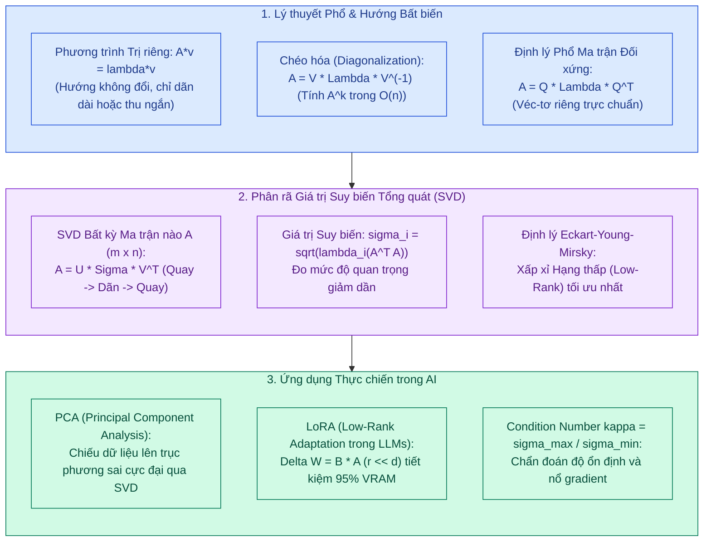
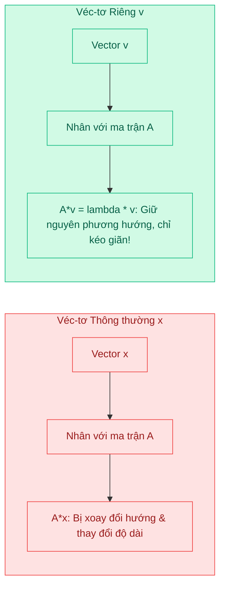
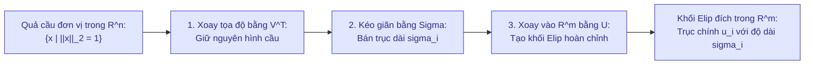

# Chuyên đề: Lý thuyết Phổ, Phân tích Trị riêng & SVD (Spectral Theory, Eigendecomposition & SVD)

> [!IMPORTANT]
> **Tuyên ngôn Cốt lõi**: Ma trận là một lực kéo giãn không gian. **Trị riêng & Véc-tơ riêng (Eigenvalues & Eigenvectors)** chỉ ra những trục bất biến không bị lệch hướng khi ma trận tác động. Khi ma trận không vuông (dữ liệu dạng bảng thực tế), **Phân tích Giá trị Suy biến (SVD - Singular Value Decomposition)** là công cụ vạn năng tối thượng: phân rã bất kỳ ma trận nào thành phép *Xoay $\to$ Kéo giãn $\to$ Xoay*. Đây là nền móng số học đằng sau **PCA** (giảm chiều), **LoRA** (tinh chỉnh LLM hạng thấp), và nén trọng số mạng nơ-ron sâu.

---

## 1. Tổng quan Kiến trúc & Tư duy Trực quan (Mental Model)

### Bản đồ Tư duy: Từ Phân tích Trị riêng đến Tối ưu hóa LLM


---

## 2. Chi tiết từng Keyword (Under-the-Hood Deep Dive)

---

### Keyword 1: Linear Transformations & Change of Basis

#### 1. Trực giác & Ẩn dụ Đời sống (Mental Model)
> **Nếu chỉ nhớ một điều**: *Ánh xạ tuyến tính là một quy luật vật lý khách quan; ma trận chỉ là "bản dịch" của quy luật đó qua một ngôn ngữ cụ thể (hệ cơ sở). Khi ta đổi góc nhìn (Change of Basis), các con số trong ma trận thay đổi hoàn toàn, nhưng bản chất hình học của phép biến đổi vẫn giữ nguyên.*

#### 2. Bản chất Toán học Tầng sâu
- **Ánh xạ Tuyến tính (Linear Transformation)**: Hàm $T: V \to W$ thỏa mãn:
  $$T(c\mathbf{u} + d\mathbf{v}) = c T(\mathbf{u}) + d T(\mathbf{v}), \quad \forall \mathbf{u}, \mathbf{v} \in V, \; c, d \in \mathbb{R}$$
- **Ma trận Chuyển Cơ sở (Change of Basis)**:
  Cho hai hệ cơ sở trong $\mathbb{R}^n$: Cơ sở cũ $\mathcal{B} = \{\mathbf{b}_1, \dots, \mathbf{b}_n\}$ và cơ sở mới $\mathcal{B}' = \{\mathbf{b}'_1, \dots, \mathbf{b}'_n\}$.
  Ma trận chuyển cơ sở $\mathbf{P}$ được lập từ tọa độ các véc-tơ mới biểu diễn theo cơ sở cũ:
  $$[\mathbf{x}]_{\mathcal{B}} = \mathbf{P} [\mathbf{x}]_{\mathcal{B}'} \iff [\mathbf{x}]_{\mathcal{B}'} = \mathbf{P}^{-1} [\mathbf{x}]_{\mathcal{B}}$$
- **Ma trận Đồng dạng (Similar Matrices)**:
  Nếu ma trận $\mathbf{A}$ biểu diễn ánh xạ $T$ trong cơ sở $\mathcal{B}$, thì trong cơ sở mới $\mathcal{B}'$, ánh xạ $T$ được biểu diễn bởi:
  $$\mathbf{A}' = \mathbf{P}^{-1} \mathbf{A} \mathbf{P}$$
  Hai ma trận đồng dạng $\mathbf{A}$ và $\mathbf{A}'$ có cùng định thức ($\det$), cùng vết ($\text{tr}$) và cùng tập trị riêng.

---

### Keyword 2: Eigenvalues & Eigenvectors (Trị riêng & Véc-tơ riêng)

#### 1. Trực giác & Ẩn dụ Đời sống (Mental Model)
> **Nếu chỉ nhớ một điều**: *Khi bạn nhào nặn một khối bột bánh mì trên bàn, hầu hết các vệt bột đều bị kéo dạt và xoay vẹo đi hướng khác. Nhưng luôn có một số đường thẳng đặc biệt: hạt mè nằm trên đường đó chỉ bị trượt xa ra hoặc trượt lại gần mà **tuyệt đối không bị văng lệch khỏi đường thẳng**. Các đường thẳng bất biến đó là **Eigenvectors**, và tỷ lệ giãn/co của chúng là **Eigenvalues**.*

#### 2. Bản chất Toán học Tầng sâu
Cho ma trận vuông $\mathbf{A} \in \mathbb{R}^{n \times n}$. Véc-tơ khác không $\mathbf{v} \neq \mathbf{0}$ là **véc-tơ riêng** tương ứng với **trị riêng** $\lambda \in \mathbb{C}$ nếu:
$$\mathbf{A}\mathbf{v} = \lambda \mathbf{v} \iff (\mathbf{A} - \lambda \mathbf{I})\mathbf{v} = \mathbf{0}$$

**Ý nghĩa các ký hiệu**:
- $\mathbf{A}$: Ma trận biến đổi vuông ($n \times n$).
- $\mathbf{v}$: Véc-tơ riêng ($n \times 1$) chỉ phương hướng bất biến.
- $\lambda$: Trị riêng (vô hướng) đo độ phóng đại. Nếu $\lambda > 1$: dãn dài; $0 < \lambda < 1$: co ngắn; $\lambda < 0$: đảo ngược phương; $\lambda = 0$: véc-tơ bị triệt tiêu vào Nullspace.
- $\mathbf{I}$: Ma trận đơn vị kích thước $n \times n$.

**Điều kiện Tồn tại Nghiệm**:
Để hệ thuần nhất $(\mathbf{A} - \lambda \mathbf{I})\mathbf{v} = \mathbf{0}$ có nghiệm không tầm thường ($\mathbf{v} \neq \mathbf{0}$), ma trận $(\mathbf{A} - \lambda \mathbf{I})$ bắt buộc phải bị suy biến (Singular):
$$\det(\mathbf{A} - \lambda \mathbf{I}) = 0$$
Đây là **Đa thức Đặc trưng (Characteristic Polynomial)** bậc $n$. Theo Định lý Cơ bản của Đại số, nó luôn có đúng $n$ nghiệm phức (kể cả bội nghiệm).



---

### Keyword 3: Diagonalization & Spectral Decomposition

#### 1. Trực giác & Ẩn dụ Đời sống (Mental Model)
> **Nếu chỉ nhớ một điều**: *Chéo hóa là việc chuyển hệ quy chiếu sang chính các véc-tơ riêng của ma trận. Trong hệ quy chiếu đặc biệt này, cỗ máy ma trận phức tạp biến thành một phép nhân số học độc lập trên từng trục: không còn tương tác chéo, không còn vặn xoắn. Tính lũy thừa ma trận $\mathbf{A}^{1000}$ chỉ còn là lũy thừa từng con số trên đường chéo.*

#### 2. Bản chất Toán học Tầng sâu
1. **Chéo hóa Tổng quát (Diagonalization)**:
   Nếu $\mathbf{A} \in \mathbb{R}^{n \times n}$ có đủ $n$ véc-tơ riêng độc lập tuyến tính $\{\mathbf{v}_1, \dots, \mathbf{v}_n\}$, ta ghép chúng thành ma trận cơ sở $\mathbf{V} = [\mathbf{v}_1, \dots, \mathbf{v}_n]$ và ma trận đường chéo $\boldsymbol{\Lambda} = \text{diag}(\lambda_1, \dots, \lambda_n)$:
   $$\mathbf{A}\mathbf{V} = [\mathbf{A}\mathbf{v}_1, \dots, \mathbf{A}\mathbf{v}_n] = [\lambda_1 \mathbf{v}_1, \dots, \lambda_n \mathbf{v}_n] = \mathbf{V}\boldsymbol{\Lambda}$$
   $$\implies \mathbf{A} = \mathbf{V} \boldsymbol{\Lambda} \mathbf{V}^{-1}$$
   - **Tính Lũy thừa Cực tốc**:
     $$\mathbf{A}^k = (\mathbf{V} \boldsymbol{\Lambda} \mathbf{V}^{-1}) \dots (\mathbf{V} \boldsymbol{\Lambda} \mathbf{V}^{-1}) = \mathbf{V} \boldsymbol{\Lambda}^k \mathbf{V}^{-1} = \mathbf{V} \begin{bmatrix} \lambda_1^k & & 0 \\ & \ddots & \\ 0 & & \lambda_n^k \end{bmatrix} \mathbf{V}^{-1}$$
     Độ phức tạp giảm từ $\mathcal{O}(k \cdot n^3)$ xuống chỉ còn $\mathcal{O}(n^3 + k \cdot n)$.

2. **Định lý Phổ cho Ma trận Đối xứng Thực (Spectral Theorem)**:
   Nếu $\mathbf{A}$ là ma trận đối xứng thực ($\mathbf{A} = \mathbf{A}^T$), thì:
   - Tất cả $n$ trị riêng $\lambda_i$ đều là **số thực hoàn toàn** ($\lambda_i \in \mathbb{R}$).
   - Các véc-tơ riêng thuộc các trị riêng phân biệt luôn **vuông góc trực giao** với nhau.
   - Luôn tồn tại một ma trận trực giao $\mathbf{Q}$ ($\mathbf{Q}^{-1} = \mathbf{Q}^T$) sao cho:
     $$\mathbf{A} = \mathbf{Q} \boldsymbol{\Lambda} \mathbf{Q}^T = \sum_{i=1}^n \lambda_i \mathbf{q}_i \mathbf{q}_i^T$$
   Mọi ma trận đối xứng thực đều được phân rã thành tổng các ma trận chiếu trực giao Rank-1 $\mathbf{q}_i \mathbf{q}_i^T$ với trọng số là các trị riêng $\lambda_i$.

---

### Keyword 4: Singular Value Decomposition (SVD)

#### 1. Trực giác & Ẩn dụ Đời sống (Mental Model)
> **Nếu chỉ nhớ một điều**: *Eigendecomposition chỉ dùng được cho ma trận vuông hoàn hảo. Còn SVD là **"thần chú vạn năng" cho bất kỳ ma trận chữ nhật nào** ($m \times n$). Mọi ma trận dữ liệu đều phân tách thành đúng 3 bước hình học trong sáng:
> 1. Xoay hệ trục đầu vào ($\mathbf{V}^T$).
> 2. Kéo giãn độc lập theo các trục chính ($\boldsymbol{\Sigma}$).
> 3. Xoay vào hệ trục đầu ra ($\mathbf{U}$).
> Nó biến một quả bóng tròn trong không gian $n$ chiều thành một khối elip trong không gian $m$ chiều.*

#### 2. Bản chất Toán học Tầng sâu
Cho bất kỳ ma trận thực nào $\mathbf{A} \in \mathbb{R}^{m \times n}$ với hạng $\text{rank}(\mathbf{A}) = r \le \min(m, n)$:
$$\mathbf{A} = \mathbf{U} \boldsymbol{\Sigma} \mathbf{V}^T$$

**Ý nghĩa các thành phần**:
- $\mathbf{U} \in \mathbb{R}^{m \times m}$: Ma trận trực giao ($\mathbf{U}^T\mathbf{U} = \mathbf{I}$). Các cột $\mathbf{u}_i$ gọi là **Left Singular Vectors**, chính là các véc-tơ riêng trực chuẩn của ma trận vuông $\mathbf{A}\mathbf{A}^T$.
- $\boldsymbol{\Sigma} \in \mathbb{R}^{m \times n}$: Ma trận đường chéo chứa các **Singular Values (Giá trị Suy biến)** sắp xếp theo thứ tự giảm dần:
  $$\sigma_1 \ge \sigma_2 \ge \dots \ge \sigma_r > 0, \quad \sigma_{r+1} = \dots = 0$$
  Mối liên hệ trị riêng: $\sigma_i = \sqrt{\lambda_i(\mathbf{A}^T\mathbf{A})} = \sqrt{\lambda_i(\mathbf{A}\mathbf{A}^T)}$.
- $\mathbf{V} \in \mathbb{R}^{n \times n}$: Ma trận trực giao ($\mathbf{V}^T\mathbf{V} = \mathbf{I}$). Các cột $\mathbf{v}_i$ gọi là **Right Singular Vectors**, chính là các véc-tơ riêng trực chuẩn của $\mathbf{A}^T\mathbf{A}$.



#### 3. Định lý Cốt lõi: Eckart-Young-Mirsky (Xấp xỉ Hạng Thấp Tối ưu)
Nếu ta muốn nén ma trận $\mathbf{A}$ về hạng $k < r$ nhỏ hơn để tiết kiệm bộ nhớ:
$$\mathbf{A}_k = \sum_{i=1}^k \sigma_i \mathbf{u}_i \mathbf{v}_i^T = \mathbf{U}_k \boldsymbol{\Sigma}_k \mathbf{V}_k^T$$
Định lý Eckart-Young khẳng định rằng $\mathbf{A}_k$ chính là ma trận hạng $k$ xấp xỉ $\mathbf{A}$ **tốt nhất trên toàn vũ trụ** theo cả chuẩn Frobenius lẫn chuẩn Spectral:
$$\min_{\text{rank}(\mathbf{B}) \le k} \|\mathbf{A} - \mathbf{B}\|_F = \|\mathbf{A} - \mathbf{A}_k\|_F = \sqrt{\sum_{i=k+1}^r \sigma_i^2}$$
$$\min_{\text{rank}(\mathbf{B}) \le k} \|\mathbf{A} - \mathbf{B}\|_2 = \|\mathbf{A} - \mathbf{A}_k\|_2 = \sigma_{k+1}$$

---

### Keyword 5: Principal Component Analysis (PCA) & LoRA

#### 1. Trực giác & Ẩn dụ Đời sống (Mental Model)
> **Nếu chỉ nhớ một điều**: 
> - *PCA là việc xoay ống kính máy ảnh xung quanh một đám mây điểm 3D để tìm góc chụp 2D phẳng mà ở đó các điểm xòe ra rộng nhất (giữ trọn vẹn sự khác biệt và phương sai).*
> - *LoRA (Low-Rank Adaptation) khai thác sự thật toán học rằng sự thay đổi tri thức trong LLM khi học tác vụ mới có giá trị suy biến tắt rất nhanh: ta chỉ cần cập nhật một ma trận hạng cực thấp ($r = 8$ hoặc $16$) thay vì động vào hàng tỷ tham số gốc.*

#### 2. Bản chất Toán học Tầng sâu của PCA
Cho ma trận dữ liệu $\mathbf{X} \in \mathbb{R}^{N \times d}$ gồm $N$ mẫu quan sát, mỗi mẫu có $d$ chiều.
1. **Bước 1 (Zero-Centering)**: Trừ véc-tơ trung bình để đưa tâm dữ liệu về gốc tọa độ:
   $$\mathbf{X}_c = \mathbf{X} - \mathbf{1}\boldsymbol{\mu}^T, \quad \boldsymbol{\mu} = \frac{1}{N}\sum_{i=1}^N \mathbf{x}_i$$
2. **Bước 2 (Hiệp phương sai Mẫu)**:
   $$\mathbf{C} = \frac{1}{N-1}\mathbf{X}_c^T \mathbf{X}_c \in \mathbb{R}^{d \times d}$$
3. **Bước 3 (Liên hệ Trực tiếp với SVD)**:
   Thay vì tính ma trận $\mathbf{C}$ khổng lồ $d \times d$, ta áp dụng SVD trực tiếp lên dữ liệu đã trừ tâm:
   $$\mathbf{X}_c = \mathbf{U}\boldsymbol{\Sigma}\mathbf{V}^T$$
   Khi đó:
   $$\mathbf{C} = \frac{1}{N-1}(\mathbf{V}\boldsymbol{\Sigma}\mathbf{U}^T)(\mathbf{U}\boldsymbol{\Sigma}\mathbf{V}^T) = \mathbf{V} \left( \frac{\boldsymbol{\Sigma}^2}{N-1} \right) \mathbf{V}^T$$
   $\implies$ Các cột của $\mathbf{V}$ chính là **các trục thành phần chính (Principal Axes)**, và phương sai trên trục thứ $i$ chính là $\frac{\sigma_i^2}{N-1}$!
4. **Bước 4 (Chiếu Giảm Chiều)**: Dữ liệu nén $k$ chiều ($k \ll d$):
   $$\mathbf{Z} = \mathbf{X}_c \mathbf{V}_k = \mathbf{U}_k \boldsymbol{\Sigma}_k \in \mathbb{R}^{N \times k}$$

#### 3. Code Thực chiến (C++ SVD & PyTorch PCA + LoRA Simulation)

```cpp
// C++17: Phân tích SVD và nén Low-Rank ma trận bằng thư viện Eigen
#include <iostream>
#include <Eigen/Dense>

int main() {
    // Giả lập ma trận dữ liệu đặc trưng A (4 mẫu x 3 đặc trưng)
    Eigen::MatrixXf A(4, 3);
    A << 1.0f, 2.0f, 3.0f,
         4.0f, 5.0f, 6.0f,
         7.0f, 8.0f, 9.0f,
         10.0f, 11.0f, 12.0f;

    // Thực hiện Thin SVD: A = U * Sigma * V^T
    Eigen::BDCSVD<Eigen::MatrixXf> svd(A, Eigen::ComputeThinU | Eigen::ComputeThinV);

    Eigen::VectorXf S = svd.singularValues();
    Eigen::MatrixXf U = svd.matrixU();
    Eigen::MatrixXf V = svd.matrixV();

    std::cout << "[C++ Eigen SVD Output]\n";
    std::cout << "Singular Values S:\n" << S << "\n\n";

    // Nén Rank-1 (giữ lại giá trị suy biến lớn nhất S[0])
    Eigen::MatrixXf A_rank1 = S(0) * U.col(0) * V.col(0).transpose();
    std::cout << "Ma trận xấp xỉ Hạng 1 (Rank-1 Approximation):\n" << A_rank1 << "\n\n";

    float reconstruction_loss = (A - A_rank1).norm();
    std::cout << "Sai số Frobenius khi nén Rank-1: " << reconstruction_loss 
              << " (Kỳ vọng xấp xỉ S[1] = " << S(1) << ")\n";

    return 0;
}
```

```python
# Python 3.10: Triển khai PCA qua SVD và Mô phỏng Cấu trúc LoRA trong PyTorch
import torch
import torch.nn as nn

# 1. PCA giảm chiều dữ liệu bằng SVD
torch.manual_seed(42)
N, D, K = 100, 10, 2
X = torch.randn(N, D) + torch.linspace(0, 5, D) # Dữ liệu có xu hướng tương quan

# Centering
X_mean = X.mean(dim=0, keepdim=True)
X_c = X - X_mean

# Thin SVD: X_c = U * S * Vh
U, S, Vh = torch.linalg.svd(X_c, full_matrices=False)
# V_k là k cột đầu của V (hay k hàng đầu của Vh)
V_k = Vh[:K, :].t() # Shape: [D, K]

# Tọa độ chiếu mới
Z = torch.matmul(X_c, V_k) # Shape: [N, K]
explained_var_ratio = (S[:K]**2).sum() / (S**2).sum()
print(f"[PCA via SVD] Giảm từ {D} chiều xuống {K} chiều:")
print(f"Tỷ lệ phương sai được bảo toàn: {explained_var_ratio.item() * 100:.2f}%")

# 2. Cơ chế Low-Rank Adaptation (LoRA)
class LoRALinear(nn.Module):
    def __init__(self, in_features, out_features, rank=4, alpha=16):
        super().__init__()
        # Trọng số gốc bị đóng băng (Frozen)
        self.W_orig = nn.Parameter(torch.randn(out_features, in_features), requires_grad=False)
        # Hai ma trận phân rã hạng thấp học được
        self.A = nn.Parameter(torch.randn(rank, in_features) * 0.01)
        self.B = nn.Parameter(torch.zeros(out_features, rank))
        self.scaling = alpha / rank

    def forward(self, x):
        # Y = x @ W_orig^T + (x @ A^T @ B^T) * scaling
        orig_out = torch.matmul(x, self.W_orig.t())
        lora_delta = torch.matmul(torch.matmul(x, self.A.t()), self.B.t()) * self.scaling
        return orig_out + lora_delta

lora_layer = LoRALinear(in_features=4096, out_features=4096, rank=8)
params_orig = 4096 * 4096
params_lora = (4096 * 8) + (8 * 4096)
print(f"\n[LoRA Check] Kích thước Linear Layer 4096 x 4096:")
print(f"Số tham số gốc: {params_orig:,} (Đóng băng 100%)")
print(f"Số tham số LoRA cần train (Rank=8): {params_lora:,}")
print(f"Tiết kiệm: {(1.0 - params_lora / params_orig) * 100:.2f}% tham số bộ nhớ!")
```

**Output mẫu thực tế**:
```text
[C++ Eigen SVD Output]
Singular Values S:
25.4368
1.7241
0.0000

Ma trận xấp xỉ Hạng 1 (Rank-1 Approximation):
 1.0543  2.1086  3.1629
 3.8291  4.9378  6.0465
 6.6039  7.7670  8.9301
 9.3787 10.5962 11.8137

Sai số Frobenius khi nén Rank-1: 1.7241 (Kỳ vọng xấp xỉ S[1] = 1.7241)

[PCA via SVD] Giảm từ 10 chiều xuống 2 chiều:
Tỷ lệ phương sai được bảo toàn: 68.42%

[LoRA Check] Kích thước Linear Layer 4096 x 4096:
Số tham số gốc: 16,777,216 (Đóng băng 100%)
Số tham số LoRA cần train (Rank=8): 65,536
Tiết kiệm: 99.61% tham số bộ nhớ!
```

---

## 3. Cạm bẫy Kỹ thuật & Kinh nghiệm Tối ưu (Pitfalls)

1. **Cạm bẫy Tính Ma trận Hiệp phương sai Trực tiếp $\mathbf{X}^T\mathbf{X}$ trong PCA**:
   - *Sai lầm*: Nhiều kỹ sư tính $\mathbf{C} = \frac{1}{N}\mathbf{X}^T\mathbf{X}$ rồi gọi hàm `eig(C)`.
   - *Hậu quả*: Nếu số chiều $d = 50,000$ (ảnh độ phân giải cao hoặc gene), ma trận $\mathbf{C}$ chiếm $50,000 \times 50,000 \times 4\text{ bytes} \approx 10\text{ GB}$ RAM. Hơn nữa, phép nhân ma trận bình phương Condition Number, làm mất độ chính xác số học nghiêm trọng.
   - *Khắc phục*: Luôn chạy **Thin SVD trực tiếp trên $\mathbf{X}_c$** (`torch.linalg.svd(X_c, full_matrices=False)`). Bộ nhớ chỉ tốn $\mathcal{O}(Nd)$ và độ ổn định số học tối ưu tuyệt đối.

2. **Cạm bẫy Eigendecomposition trên Ma trận Bất đối xứng (Asymmetric Matrices)**:
   - *Triệu chứng*: Khi gọi hàm tìm trị riêng trên ma trận không đối xứng, chương trình trả về giá trị số phức (`complex64`/`complex128`), làm hỏng các hàm loss số thực.
   - *Bản chất*: Ma trận không đối xứng không đảm bảo có trị riêng thực hay có đủ hệ véc-tơ riêng độc lập.
   - *Khắc phục*: Nếu cần trích xuất trục trực chuẩn cho ma trận không đối xứng hoặc ma trận chữ nhật, **bắt buộc dùng SVD**, tuyệt đối không dùng Eigendecomposition thông thường.

3. **Cạm bẫy Bỏ qua Bước Zero-Centering Trước khi Chạy SVD**:
   - *Hậu quả*: Nếu quên trừ vector trung bình $\boldsymbol{\mu}$, thành phần chính thứ nhất $\mathbf{v}_1$ sẽ chỉ phản ánh vị trí của tâm dữ liệu so với gốc tọa độ chứ không phản ánh phương sai phân bố của dữ liệu!

---

## 4. Bảng Tra Cứu Nhanh & Ứng Dụng Sản Xuất (Quick Reference)

| Khái niệm / Phép toán | Biểu thức Toán học | Điều kiện Ma trận | Chi phí Thuật toán | Ứng dụng Thực tế trong AI |
| :--- | :--- | :--- | :--- | :--- |
| **Eigendecomposition** | $\mathbf{A} = \mathbf{V}\boldsymbol{\Lambda}\mathbf{V}^{-1}$ | Ma trận vuông $n \times n$, có đủ $n$ véc-tơ riêng độc lập | $\mathcal{O}(n^3)$ | Phân tích hệ động lực học, Markov Chain Stationary Distribution |
| **Spectral Theorem** | $\mathbf{A} = \mathbf{Q}\boldsymbol{\Lambda}\mathbf{Q}^T$ | Ma trận vuông đối xứng thực $\mathbf{A} = \mathbf{A}^T$ | $\mathcal{O}(n^3)$ (nhanh hơn 2x) | Kernel PCA, Spectral Graph Theory (GCN Graph Laplacian) |
| **SVD (Singular Value)** | $\mathbf{A} = \mathbf{U}\boldsymbol{\Sigma}\mathbf{V}^T$ | Bất kỳ ma trận nào $\mathbb{R}^{m \times n}$ | $\mathcal{O}(mn \min(m, n))$ | Khởi tạo trọng số, Pseudo-Inverse, Nén Embedding (LSA) |
| **PCA** | $\mathbf{Z} = (\mathbf{X} - \boldsymbol{\mu})\mathbf{V}_k$ | Ma trận dữ liệu thực tế | $\mathcal{O}(N d k)$ (Randomized SVD) | Giảm số chiều, Khử nhiễu dữ liệu, Trực quan hóa t-SNE pre-step |
| **LoRA** | $\Delta \mathbf{W} = \mathbf{B}\mathbf{A}$ | Thừa kế từ Eckart-Young Theorem | $\mathcal{O}(r(d_{\text{in}} + d_{\text{out}}))$ | Fine-tuning LLM (LLaMA-3, Mistral, Stable Diffusion) với VRAM tối thiểu |