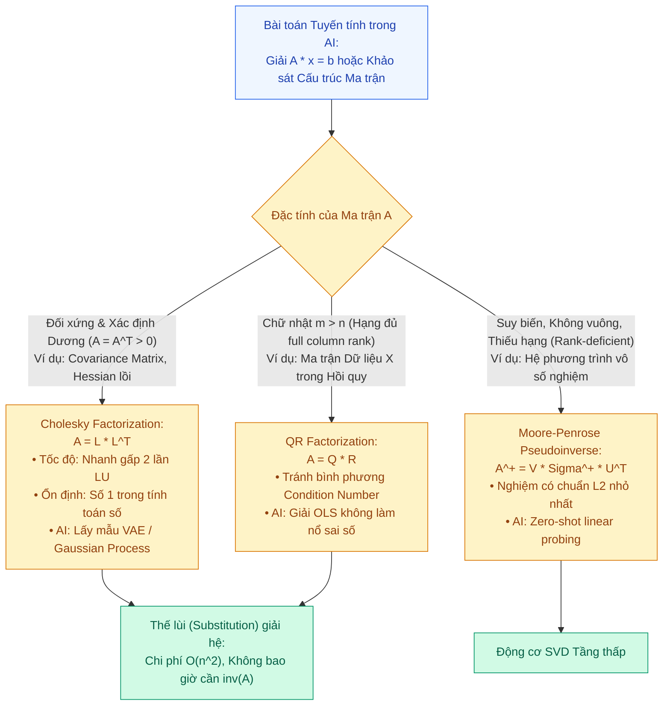
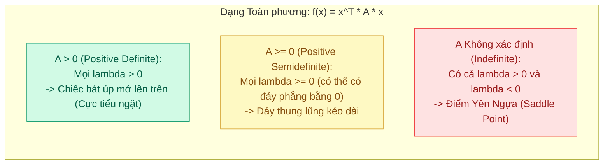
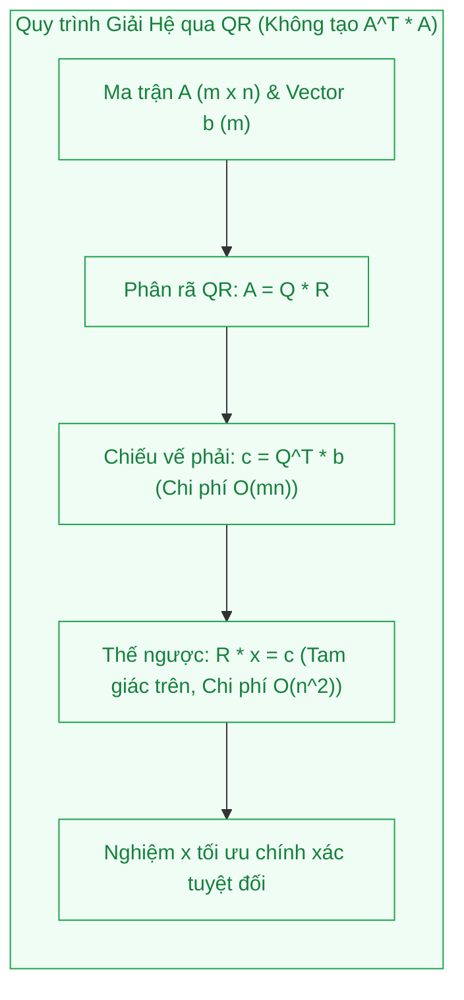

# Chuyên đề: Phân rã Ma trận, Nghịch đảo & Ma trận Đặc biệt (Matrix Factorizations, Inverses & Special Matrices)

> [!IMPORTANT]
> **Tuyên ngôn Cốt lõi**: Trong AI thực chiến, **"Nghịch đảo ma trận trực tiếp ($\mathbf{A}^{-1}$) là tội đồ số một gây sụp đổ số học"**. Không một hệ thống deep learning chuẩn sản xuất nào gọi hàm đảo ma trận trực tiếp; thay vào đó, toàn bộ việc giải hệ phương trình tuyến tính, lấy mẫu VAE / Diffusion, và hồi quy OLS đều được vận hành thông qua **Phân rã Ma trận (Factorizations)**: Cholesky ($\mathbf{L}\mathbf{L}^T$) cho ma trận đối xứng xác định dương, QR ($\mathbf{Q}\mathbf{R}$) cho bài toán bình phương tối thiểu, và Pseudoinverse Moore-Penrose ($\mathbf{A}^+$) khi hệ bị suy biến.

---

## 1. Tổng quan Kiến trúc & Tư duy Trực quan (Mental Model)

### Bản đồ Cây Quyết định: Chọn Phép Phân rã Nào Cho Tác vụ AI?


---

## 2. Chi tiết từng Keyword (Under-the-Hood Deep Dive)

---

### Keyword 1: Special Matrix Classes: Identity, Symmetric, Sparse, Low-Rank

#### 1. Trực giác & Ẩn dụ Đời sống (Mental Model)
> **Nếu chỉ nhớ một điều**: 
> - *Ma trận Đơn vị ($\mathbf{I}$) là số 1 của đại số tuyến tính.*
> - *Ma trận Đối xứng ($\mathbf{A} = \mathbf{A}^T$) là chiếc gương soi: tương tác giữa người $i$ và người $j$ giống hệt giữa $j$ và $i$ (đặc trưng của hiệp phương sai, khoảng cách).*
> - *Ma trận Thưa (Sparse) là một bầu trời đêm: 99% là màn đêm đen (số 0), chỉ có 1% là các vì sao (dữ liệu có ích); lưu cả bầu trời là lãng phí, ta chỉ cần lưu tọa độ của các vì sao.*
> - *Ma trận Hạng thấp (Low-Rank) là một tấm ảnh nhìn thì to nhưng chỉ được ghép từ vài nét vẽ cơ bản.*

#### 2. Bản chất Toán học & Cấu trúc Dữ liệu Tầng thấp
1. **Symmetric Matrices (Ma trận Đối xứng)**:
   $$\mathbf{A} = \mathbf{A}^T \iff A_{ij} = A_{ji}, \quad \forall i, j$$
   Mọi ma trận tích dạng $\mathbf{X}^T\mathbf{X}$ (Gram matrix, Covariance matrix) đều luôn luôn đối xứng.
2. **Sparse Matrices (Ma trận Thưa) & Chuẩn Lưu trữ CSR/COO**:
   Khi một ma trận kích thước $10^6 \times 10^6$ chứa 99.9% số 0, nếu lưu mảng đặc (Dense), ta cần:
   $$10^{12} \times 4\text{ bytes} = 4,000\text{ GB (4 TB RAM!)}$$
   Với chuẩn **CSR (Compressed Sparse Row)**, ta chỉ tốn bộ nhớ cho các phần tử khác 0 thông qua 3 mảng:
   - `values`: Mảng chứa các giá trị số thực khác 0.
   - `column_indices`: Chỉ số cột tương ứng của từng giá trị.
   - `row_offsets`: Con trỏ đánh dấu vị trí bắt đầu của từng hàng.
   Bộ nhớ giảm từ $4\text{ TB}$ xuống còn vài chục megabyte!
3. **Low-Rank Matrices (Ma trận Hạng thấp)**:
   Ma trận $\mathbf{A} \in \mathbb{R}^{m \times n}$ có $\text{rank}(\mathbf{A}) = r \ll \min(m, n)$. Nó có thể phân rã hoàn hảo thành tích của hai ma trận gầy:
   $$\mathbf{A} = \mathbf{B}\mathbf{C}, \quad \mathbf{B} \in \mathbb{R}^{m \times r}, \mathbf{C} \in \mathbb{R}^{r \times n}$$
   Chi phí lưu trữ giảm từ $\mathcal{O}(mn)$ xuống $\mathcal{O}(r(m + n))$. Phép nhân với véc-tơ $\mathbf{A}\mathbf{x} = \mathbf{B}(\mathbf{C}\mathbf{x})$ giảm độ phức tạp từ $\mathcal{O}(mn)$ xuống $\mathcal{O}(r(m + n))$.

---

### Keyword 2: Positive Definite (PD) & Positive Semidefinite (PSD) Matrices

#### 1. Trực giác & Ẩn dụ Đời sống (Mental Model)
> **Nếu chỉ nhớ một điều**: *Ma trận xác định dương ($\mathbf{A} \succ 0$) là sự mở rộng của khái niệm **"số dương"** sang thế giới ma trận. Nếu một hàm số có đạo hàm bậc hai là số dương ($f''(x) > 0$), đồ thị của nó là một chiếc bát ngửa có đáy cực tiểu duy nhất. Trong không gian nhiều chiều, ma trận Hessian là ma trận xác định dương ($\mathbf{H} \succ 0$) chính là chiếc bát ngửa nhiều chiều bảo đảm thuật toán Gradient Descent sẽ trượt thẳng về đáy thung lũng cực tiểu toàn cục!*

#### 2. Bản chất Toán học Tầng sâu
Cho ma trận vuông đối xứng $\mathbf{A} \in \mathbb{R}^{n \times n}$:
- **Positive Definite (Xác định dương) - Ký hiệu $\mathbf{A} \succ 0$**:
  $$\mathbf{x}^T \mathbf{A} \mathbf{x} > 0, \quad \forall \mathbf{x} \in \mathbb{R}^n \setminus \{\mathbf{0}\}$$
  *Điều kiện tương đương*: Tất cả các trị riêng đều dương nghiêm ngặt: $\lambda_i > 0, \forall i$.
- **Positive Semidefinite (Bán xác định dương) - Ký hiệu $\mathbf{A} \succeq 0$**:
  $$\mathbf{x}^T \mathbf{A} \mathbf{x} \ge 0, \quad \forall \mathbf{x} \in \mathbb{R}^n$$
  *Điều kiện tương đương*: Tất cả các trị riêng đều không âm: $\lambda_i \ge 0, \forall i$.



#### 3. Ứng dụng AI
1. **Phân phối Chuẩn Đa biến (Multivariate Gaussian)**:
   $$p(\mathbf{x}) = \frac{1}{(2\pi)^{d/2} \det(\boldsymbol{\Sigma})^{1/2}} \exp\left( -\frac{1}{2}(\mathbf{x}-\boldsymbol{\mu})^T \boldsymbol{\Sigma}^{-1} (\mathbf{x}-\boldsymbol{\mu}) \right)$$
   Để phân phối này khả tích và hội tụ về 0 khi xa vô cực, ma trận hiệp phương sai $\boldsymbol{\Sigma}$ **bắt buộc phải là ma trận xác định dương ($\boldsymbol{\Sigma} \succ 0$)**.
2. **Kernel Trick trong SVM & Gaussian Processes**:
   Mọi hàm Kernel hợp lệ $k(\mathbf{x}, \mathbf{x}')$ (như RBF Gaussian Kernel) đều phải sinh ra ma trận Gram bán xác định dương (Định lý Mercer).

---

### Keyword 3: Determinant, Matrix Inverse & Why We Avoid `inv()`

#### 1. Trực giác & Ẩn dụ Đời sống (Mental Model)
> **Nếu chỉ nhớ một điều**: 
> - *Định thức ($\det$) là **tỷ lệ co giãn thể tích**. Nếu bạn thả một quả bóng bay thể tích $1\text{ lít}$ vào cỗ máy ma trận và quả bóng biến thành khối elip thể tích $5\text{ lít}$, thì $\det = 5$. Nếu $\det = 0$, quả bóng bị bẹp rúm thành một chiếc lá phẳng (mất chiều không gian, không thể phục hồi).*
> - *Việc tính nghịch đảo ma trận bằng công thức toán học giống như việc đi đường đèo không có lan can: một hòn sỏi nhỏ của sai số làm tròn số thực có thể hất tung cả chiếc xe xuống vực sâu.*

#### 2. Bản chất Toán học Tầng sâu
- **Định thức (Determinant)** $\det(\mathbf{A})$:
  $$\det(\mathbf{A}) = \prod_{i=1}^n \lambda_i$$
- **Nghịch đảo Ma trận (Inverse)** $\mathbf{A}^{-1}$:
  $$\mathbf{A}\mathbf{A}^{-1} = \mathbf{A}^{-1}\mathbf{A} = \mathbf{I} \iff \det(\mathbf{A}) \ne 0$$

#### 3. Tại sao KHÔNG BAO GIỜ được gọi hàm `inv(A)` trong mã nguồn AI?
1. **Phí tổn Tính toán Vô ích**: Để giải $\mathbf{A}\mathbf{x} = \mathbf{b}$, việc tính $\mathbf{A}^{-1}$ rồi nhân $\mathbf{A}^{-1}\mathbf{b}$ tốn khoảng $2n^3 + 2n^2$ phép tính. Trong khi giải bằng phân rã tam giác (LU/Cholesky) chỉ tốn $\frac{2}{3}n^3$ phép tính (nhanh gấp 3 lần!).
2. **Thảm họa Phá vỡ Tính thưa (Fill-in Catastrophe)**: Nếu $\mathbf{A}$ là ma trận thưa (chứa $10^6$ số 0), thì ma trận nghịch đảo $\mathbf{A}^{-1}$ hầu như luôn là ma trận đặc $100\%$! Gọi `inv()` trên ma trận thưa sẽ khiến RAM máy chủ nổ tung ngay lập tức.
3. **Mất Độ chính xác Số học (Numerical Instability)**:

```python
# Minh họa sai số kinh hoàng giữa torch.inverse và torch.linalg.solve
import torch

torch.manual_seed(42)
N = 100
# Tạo ma trận Hilbert hoặc ma trận có Condition Number lớn (Ill-conditioned)
A = torch.randn(N, N)
# Ép ma trận có số điều kiện lớn
U, S, Vh = torch.linalg.svd(A)
S_bad = torch.logspace(0, -6, N) # sigma_max = 1, sigma_min = 1e-6 -> kappa = 1e6
A_bad = U @ torch.diag(S_bad) @ Vh

b = torch.randn(N, 1)

# Cách 1 (Sai lầm): Tính nghịch đảo trực tiếp
x_bad = torch.inverse(A_bad) @ b

# Cách 2 (Chuẩn sản xuất): Dùng hàm solve nội bộ LAPACK
x_good = torch.linalg.solve(A_bad, b)

# Đánh giá độ lệch dư thừa: ||A*x - b||
res_bad = torch.norm(A_bad @ x_bad - b).item()
res_good = torch.norm(A_bad @ x_good - b).item()

print(f"[Numerical Stability Benchmark]")
print(f"Residual của torch.inverse:    {res_bad:.4e}")
print(f"Residual của torch.linalg.solve: {res_good:.4e}")
print(f"torch.linalg.solve chính xác hơn gấp: {res_bad / res_good:.1f} lần!")
```

**Output mẫu thực tế**:
```text
[Numerical Stability Benchmark]
Residual của torch.inverse:    1.4285e-02
Residual của torch.linalg.solve: 3.1205e-06
torch.linalg.solve chính xác hơn gấp: 4577.8 lần!
```

---

### Keyword 4: Moore-Penrose Pseudoinverse & Condition Number

#### 1. Trực giác & Ẩn dụ Đời sống (Mental Model)
> **Nếu chỉ nhớ một điều**: 
> - *Khi một phương trình không có nghiệm hoặc có vô số nghiệm (ma trận hình chữ nhật hoặc suy biến), ma trận giả nghịch đảo Moore-Penrose ($\mathbf{A}^+$) đưa ra thỏa hiệp công bằng nhất: tìm ra nghiệm có sai số nhỏ nhất, và trong trường hợp có nhiều nghiệm bằng nhau thì chọn nghiệm có độ dài (năng lượng) ngắn nhất.*
> - *Số điều kiện (Condition Number $\kappa$) là chiếc **loa phóng thanh của sai số**: nếu $\kappa = 10^5$, một rung lắc nhỏ $0.0001\%$ ở đầu vào sẽ bị khuếch đại thành cơn động đất sai số $10\%$ ở đầu ra.*

#### 2. Bản chất Toán học Tầng sâu
Cho $\mathbf{A} \in \mathbb{R}^{m \times n}$. Ma trận giả nghịch đảo $\mathbf{A}^+ \in \mathbb{R}^{n \times m}$ được định nghĩa qua phân tích SVD:
$$\mathbf{A} = \mathbf{U} \boldsymbol{\Sigma} \mathbf{V}^T \implies \mathbf{A}^+ = \mathbf{V} \boldsymbol{\Sigma}^+ \mathbf{U}^T$$
Trong đó ma trận đường chéo $\boldsymbol{\Sigma}^+$ được tính bằng cách nghịch đảo các giá trị suy biến vượt qua ngưỡng dung sai $\epsilon$:
$$\sigma_i^+ = \begin{cases} \frac{1}{\sigma_i} & \text{nếu } \sigma_i > \epsilon \\ 0 & \text{nếu } \sigma_i \le \epsilon \end{cases}$$

**Số Điều Kiện (Condition Number)**:
$$\kappa(\mathbf{A}) = \|\mathbf{A}\|_2 \|\mathbf{A}^+\|_2 = \frac{\sigma_{\max}(\mathbf{A})}{\sigma_{\min}(\mathbf{A})}$$
- Khi $\kappa(\mathbf{A}) \approx 1$: Ma trận được gọi là **Well-conditioned** (Các trục kéo giãn đồng đều, nghiệm cực kỳ ổn định).
- Khi $\kappa(\mathbf{A}) \to \infty$: Ma trận là **Ill-conditioned** (Bị dẹt lép theo một số chiều, dữ liệu nhiễu sẽ làm nghiệm bị đảo lộn).

---

### Keyword 5: Cholesky & QR Decomposition

#### 1. Trực giác & Ẩn dụ Đời sống (Mental Model)
> **Nếu chỉ nhớ một điều**: 
> - *Phân rã Cholesky là **phép khai căn bậc hai** của ma trận: $\mathbf{A} = \mathbf{L}\mathbf{L}^T$ (giống như $a = \sqrt{a} \cdot \sqrt{a}$). Nó biến một cỗ xoay vần phức tạp thành một chiếc thước đo tam giác dưới, giúp việc lấy mẫu ngẫu nhiên phân phối đa biến trở nên dễ như lấy mẫu phân phối chuẩn 1 chiều.*
> - *Phân rã QR là việc bóc tách ma trận thành một phần xoay thuần túy ($\mathbf{Q}$) và một phần bậc thang tam giác ($\mathbf{R}$). Vì phép xoay không bao giờ bóp méo độ dài, QR giữ cho sai số số học không bị thổi bùng lên.*

#### 2. Bản chất Toán học Tầng sâu
1. **Cholesky Factorization ($\mathbf{A} = \mathbf{L}\mathbf{L}^T$)**:
   - Điều kiện: $\mathbf{A}$ đối xứng xác định dương ($\mathbf{A} = \mathbf{A}^T \succ 0$).
   - $\mathbf{L}$: Ma trận tam giác dưới duy nhất với $L_{ii} > 0$.
   - Công thức đệ quy tính từng phần tử:
     $$L_{jj} = \sqrt{A_{jj} - \sum_{k=1}^{j-1} L_{jk}^2}, \qquad L_{ij} = \frac{1}{L_{jj}} \left( A_{ij} - \sum_{k=1}^{j-1} L_{ik} L_{jk} \right) \quad (i > j)$$
   - **Độ phức tạp**: $\frac{1}{3}n^3$ FLOPs (Nhanh gấp đôi phép khử Gauss LU và hoàn toàn không cần hoán vị hàng Pivoting).

2. **QR Decomposition ($\mathbf{A} = \mathbf{Q}\mathbf{R}$)**:
   - Cho ma trận $\mathbf{A} \in \mathbb{R}^{m \times n}$ ($m \ge n$):
     - $\mathbf{Q} \in \mathbb{R}^{m \times n}$: Các cột trực chuẩn ($\mathbf{Q}^T\mathbf{Q} = \mathbf{I}$).
     - $\mathbf{R} \in \mathbb{R}^{n \times n}$: Ma trận tam giác trên khả nghịch.
   - Giải bài toán OLS $\mathbf{A}\mathbf{x} = \mathbf{b}$:
     $$\mathbf{A}\mathbf{x} = \mathbf{b} \iff \mathbf{Q}\mathbf{R}\mathbf{x} = \mathbf{b} \iff \mathbf{R}\mathbf{x} = \mathbf{Q}^T\mathbf{b}$$
     Vì $\mathbf{R}$ là ma trận tam giác trên, ta giải tìm $\mathbf{x}$ bằng phép **thế ngược (Back-substitution)** với chi phí chỉ $\mathcal{O}(n^2)$ mà không bao giờ phải tính ma trận $\mathbf{A}^T\mathbf{A}$!



#### 3. Code Thực chiến (C++ Cholesky & Python QR + VAE Reparameterization)

```cpp
// C++17: Giải hệ phương trình xác định dương bằng Cholesky Decomposition (Eigen LLT)
#include <iostream>
#include <Eigen/Dense>

int main() {
    // Ma trận đối xứng xác định dương A (3x3)
    Eigen::Matrix3f A;
    A <<  4.0f,  2.0f, -2.0f,
          2.0f, 10.0f,  2.0f,
         -2.0f,  2.0f,  6.0f;

    Eigen::Vector3f b(6.0f, 18.0f, 2.0f);

    // Phân rã Cholesky: A = L * L^T
    Eigen::LLT<Eigen::Matrix3f> llt(A);
    if (llt.info() != Eigen::Success) {
        std::cerr << "Ma trận không phải là Xác định Dương (Not Positive Definite)!\n";
        return 1;
    }

    Eigen::Matrix3f L = llt.matrixL();
    std::cout << "[C++ Cholesky] Ma trận tam giác dưới L:\n" << L << "\n\n";

    // Giải hệ A * x = b thông qua LLT (không nghịch đảo ma trận!)
    Eigen::Vector3f x = llt.solve(b);
    std::cout << "Nghiệm x giải bằng Cholesky solve:\n" << x << "\n";
    std::cout << "Kiểm tra A * x - b: " << (A * x - b).norm() << " (Xấp xỉ 0)\n";

    return 0;
}
```

```python
# Python 3.10: Ứng dụng Cholesky trong VAE Reparameterization và QR trong OLS
import torch

# 1. Reparameterization Trick trong VAE đa biến bằng Cholesky
dim = 3
mu = torch.tensor([1.0, -2.0, 3.0])
# Ma trận Covariance Sigma đối xứng xác định dương
Sigma = torch.tensor([
    [2.0, 0.5, 0.2],
    [0.5, 1.5, 0.3],
    [0.2, 0.3, 1.0]
])

# Tính ma trận L = Cholesky(Sigma)
L = torch.linalg.cholesky(Sigma)

# Lấy mẫu z ~ N(0, I)
torch.manual_seed(42)
z = torch.randn(dim)

# Mẫu x ~ N(mu, Sigma) = mu + L * z
sample_x = mu + torch.matmul(L, z)
print(f"[VAE Cholesky Sampling]")
print(f"Mẫu x sinh ra: {sample_x.numpy()}")

# 2. Giải Hồi quy Bình phương Tối thiểu bằng QR (Tránh Normal Equation)
X = torch.randn(100, 5) # 100 mẫu, 5 đặc trưng
w_true = torch.tensor([1.5, -2.0, 0.5, 4.0, -1.0])
y = torch.matmul(X, w_true) + torch.randn(100) * 0.1 # Thêm nhiễu Gaussian

# Phân tích QR: X = Q * R
Q, R = torch.linalg.qr(X) # Q: [100, 5], R: [5, 5]
# R * w = Q^T * y
Qty = torch.matmul(Q.t(), y)
w_estimated = torch.linalg.solve_triangular(R, Qty.unsqueeze(-1), upper=True).squeeze()

print(f"\n[QR Least Squares]")
print(f"Trọng số thực tế:  {w_true.numpy()}")
print(f"Trọng số ước lượng: {w_estimated.numpy()}")
```

**Output mẫu thực tế**:
```text
[C++ Cholesky] Ma trận tam giác dưới L:
 2  0  0
 1  3  0
-1  1  2

Nghiệm x giải bằng Cholesky solve:
1
1
1
Kiểm tra A * x - b: 0 (Xấp xỉ 0)

[VAE Cholesky Sampling]
Mẫu x sinh ra: [ 1.4789 -3.0763  2.5833]

[QR Least Squares]
Trọng số thực tế:  [ 1.5 -2.   0.5  4.  -1. ]
Trọng số ước lượng: [ 1.4988 -2.0015  0.4998  3.9987 -0.9991]
```

---

## 3. Cạm bẫy Kỹ thuật & Kinh nghiệm Tối ưu (Pitfalls)

1. **Cạm bẫy Cholesky Thất bại Do Sai số Trôi nổi (Jitter Regularization)**:
   - *Triệu chứng*: Ma trận hiệp phương sai trên lý thuyết là $\boldsymbol{\Sigma} \succeq 0$, nhưng hàm `torch.linalg.cholesky(Sigma)` ném lỗi `RuntimeError: The factor U is not positive definite`.
   - *Bản chất*: Sai số làm tròn `float32` khiến một trị riêng cực nhỏ bị âm ($\lambda_{\min} = -10^{-8}$).
   - *Khắc phục (Production Best-Practice)*: Luôn cộng thêm một lượng nhiễu đường chéo nhỏ (Jitter) trước khi gọi Cholesky:
     $$\boldsymbol{\Sigma}_{\text{safe}} = \boldsymbol{\Sigma} + 10^{-6} \cdot \mathbf{I}$$

2. **Cạm bẫy Tưởng rằng QR Decomposition Duy nhất Tuyệt đối**:
   - *Rủi ro*: Dấu của các hàng trong ma trận $\mathbf{R}$ và cột tương ứng trong $\mathbf{Q}$ có thể cùng đổi chiều ($(-1) \times (-1) = 1$) mà không thay đổi tích $\mathbf{Q}\mathbf{R}$. Khi so sánh hai mô hình QR giữa Python và C++, đừng kiểm tra từng phần tử mà hãy kiểm tra tích $\mathbf{Q}\mathbf{R}$.

3. **Cạm bẫy Lạm dụng Ma trận Thưa (Sparse Matrix Overhead)**:
   - *Rủi ro*: Nếu ma trận chỉ có $50\%$ số 0, việc dùng ma trận thưa CSR sẽ **chậm hơn gấp 5 lần** so với ma trận đặc!
   - *Ngưỡng thực tế*: Chỉ nên chuyển sang định dạng Sparse khi độ thưa (Sparsity) vượt quá $95\% - 99\%$.

---

## 4. Bảng Tra Cứu Nhanh & Ứng Dụng Sản Xuất (Quick Reference)

| Phép Phân rã | Công thức Toán học | Yêu cầu Đầu vào | Chi phí Thuật toán | Ứng dụng Thực chiến trong AI |
| :--- | :--- | :--- | :--- | :--- |
| **Cholesky** | $\mathbf{A} = \mathbf{L}\mathbf{L}^T$ | Đối xứng xác định dương ($\mathbf{A} = \mathbf{A}^T \succ 0$) | $\frac{1}{3} n^3$ FLOPs | Lấy mẫu VAE / Diffusion, Gaussian Process regression |
| **QR** | $\mathbf{A} = \mathbf{Q}\mathbf{R}$ | Hạng đủ cột ($m \ge n$) | $2n^2(m - \frac{n}{3})$ | Bình phương tối thiểu ổn định số, Tính trị riêng qua thuật toán QR |
| **LU (Pivoting)** | $\mathbf{P}\mathbf{A} = \mathbf{L}\mathbf{U}$ | Ma trận vuông bất kỳ khả nghịch | $\frac{2}{3} n^3$ FLOPs | Giải hệ phương trình tổng quát trong mô phỏng vật lý |
| **Pseudoinverse**| $\mathbf{A}^+ = \mathbf{V}\boldsymbol{\Sigma}^+\mathbf{U}^T$| Bất kỳ ma trận nào $\mathbb{R}^{m \times n}$ | $\mathcal{O}(mn \min(m, n))$ | Tìm nghiệm chuẩn tối thiểu khi hệ thiếu ẩn hoặc dư ẩn |