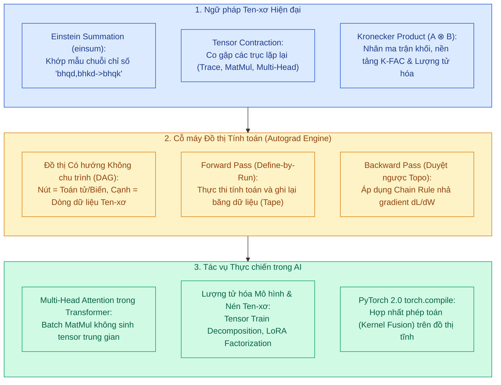
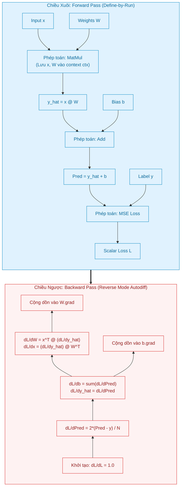

# Chuyên đề: Ten-xơ Nâng cao & Đồ thị Tính toán (Advanced Tensors & Computational Graphs)

> [!IMPORTANT]
> **Tuyên ngôn Cốt lõi**: Khi bước chân vào mô hình ngôn ngữ lớn (Transformers, LLaMA, GPT) và mạng nơ-ron đồ thị (GNNs), đại số tuyến tính 2D truyền thống bị quá tải. **Einstein Summation (`einsum`)** và **Tensor Contraction** là thứ "ngôn ngữ thần thánh" giúp nén hàng chục dòng code `permute`, `reshape`, `bmm` thành đúng một dòng chuỗi duy nhất. Song song đó, **Đồ thị Tính toán (Computational Graph - DAG)** là cỗ máy ghi băng tự động (Autograd Tape) vận hành toàn bộ quá trình lan truyền ngược (Backpropagation) của mọi framework Deep Learning.

---

## 1. Tổng quan Kiến trúc & Tư duy Trực quan (Mental Model)

### Bản đồ Tư duy: Từ Ngữ pháp Ten-xơ đến Động cơ Autograd


---

## 2. Chi tiết từng Keyword (Under-the-Hood Deep Dive)

---

### Keyword 1: Tensor Contraction (Phép Co Ten-xơ)

#### 1. Trực giác & Ẩn dụ Đời sống (Mental Model)
> **Nếu chỉ nhớ một điều**: *Tensor Contraction giống như việc gập các nếp gấp của một chiếc quạt giấy: mỗi lần ta chọn một cặp chỉ số giống nhau và lấy tổng dọc theo trục đó, một chiều không gian bị "ép xẹp lại", biến một khối lập phương 3D thành mặt phẳng 2D, hoặc biến ma trận 2D thành một số vô hướng.*

#### 2. Bản chất Toán học Tầng sâu
Cho một tensor bậc cao $\mathcal{T}$. Phép co tensor là phép tính tổng trên các chỉ số lặp lại:
- **Co bậc 2 về bậc 0 (Matrix Trace)**:
  $$\text{tr}(\mathbf{A}) = \sum_{i=1}^n A_{ii} \quad (\text{Từ 2D về vô hướng 0D})$$
- **Co hai tensor bậc 2 thành bậc 2 (Matrix Multiplication)**:
  $$C_{ij} = \sum_{k=1}^K A_{ik} B_{kj} \quad (\text{Co trục } k)$$
- **Co tensor 4D và tensor 2D trong Transformer (Feed-Forward Projection)**:
  $$Y_{b, s, d_{\text{out}}} = \sum_{d_{\text{in}}=1}^{D_{\text{in}}} X_{b, s, d_{\text{in}}} W_{d_{\text{in}}, d_{\text{out}}}$$

#### 3. Cơ chế Phần cứng Tầng thấp
Các thư viện phần cứng (cuBLAS, CUTLASS, oneDNN) không có hàm tính trực tiếp cho tensor 5 chiều hay 6 chiều. Thay vào đó, chúng biến đổi mọi phép Tensor Contraction phức tạp thành **GEMM 2D duy nhất** qua 4 bước:
1. `Permute`: Đảo các trục cần co về vị trí liền kề trong bộ nhớ.
2. `Contiguous Copy`: Đảm bảo các byte nằm liền mạch trong RAM/VRAM.
3. `Reshape`: Gộp các trục ngoài thành chiều $M$, các trục co thành chiều $K$, các trục đích thành chiều $N$.
4. `cuBLAS GEMM`: Thực thi trên Tensor Cores với tốc độ hàng trăm TFLOPs.

---

### Keyword 2: Einstein Summation (`einsum`)

#### 1. Trực giác & Ẩn dụ Đời sống (Mental Model)
> **Nếu chỉ nhớ một điều**: *`einsum` là "biểu thức chính quy (Regex)" của đại số tuyến tính. Thay vì phải đau đầu nhớ chuỗi hàm `transpose()`, `unsqueeze()`, `bmm()`, `squeeze()`, bạn chỉ cần viết một chuỗi mô tả: chữ cái nào xuất hiện ở vế trái nhưng biến mất ở vế phải thì tự động bị tính tổng triệt tiêu (co trục).*

#### 2. Bản chất Ký pháp & Quy tắc Vàng
Quy ước Einstein:
1. **Chỉ số tự do (Free Indices)**: Xuất hiện ở cả vế đầu vào và vế đầu ra $\implies$ Được giữ nguyên kích thước.
2. **Chỉ số bị co (Summation Indices)**: Xuất hiện ở các vế đầu vào nhưng **không có mặt ở vế đầu ra** $\implies$ Tự động lấy tổng $\sum$ trên toàn bộ trục đó.

$$\text{Ký pháp: } \underbrace{\text{batch\_idx, feature\_idx}}_{\text{Đầu vào 1}}, \underbrace{\text{feature\_idx, out\_idx}}_{\text{Đầu vào 2}} \longrightarrow \underbrace{\text{batch\_idx, out\_idx}}_{\text{Đầu ra}}$$

#### 3. Bảng Tra Cứu Toàn Diện Ký Pháp `einsum` Trong Deep Learning

| Phép toán AI | Biểu thức Toán học | Chuỗi Ký pháp `einsum` | Mã tương đương không dùng `einsum` |
| :--- | :--- | :--- | :--- |
| **Dot Product** | $c = \sum_i u_i v_i$ | `"i,i->"` | `torch.dot(u, v)` |
| **Outer Product** | $M_{ij} = u_i v_j$ | `"i,j->ij"` | `torch.outer(u, v)` |
| **Matrix-Vector Mul** | $y_i = \sum_j A_{ij} x_j$ | `"ij,j->i"` | `torch.mv(A, x)` |
| **Matrix Multiplication**| $C_{ij} = \sum_k A_{ik} B_{kj}$ | `"ik,kj->ij"` | `A @ B` |
| **Matrix Transpose** | $A_{ji} = A_{ij}$ | `"ij->ji"` | `A.t()` |
| **Matrix Trace** | $t = \sum_i A_{ii}$ | `"ii->"` | `torch.trace(A)` |
| **Extract Diagonal** | $d_i = A_{ii}$ | `"ii->i"` | `torch.diag(A)` |
| **Batched MatMul (BMM)** | $C_{bij} = \sum_k A_{bik} B_{bkj}$ | `"bik,bkj->bij"` | `torch.bmm(A, B)` |
| **Multi-Head Attention** | $S_{bhqk} = \sum_d Q_{bhqd} K_{bhkd}$ | `"bhqd,bhkd->bhqk"`| `torch.matmul(Q, K.transpose(-2, -1))` |
| **Attention Context Agg**| $O_{bhqd} = \sum_k S_{bhqk} V_{bhkd}$| `"bhqk,bhkd->bhqd"`| `torch.matmul(S, V)` |

---

### Keyword 3: Kronecker Product (Tích Kronecker)

#### 1. Trực giác & Ẩn dụ Đời sống (Mental Model)
> **Nếu chỉ nhớ một điều**: *Tích Kronecker $\mathbf{A} \otimes \mathbf{B}$ giống như việc đóng một con dấu lớn $\mathbf{A}$, nhưng mỗi vết mực của con dấu lại được thay thế bằng toàn bộ một bức tranh nhỏ $\mathbf{B}$ được phóng to thu nhỏ theo hệ số của ô đó. Nó là công cụ nhân bản và phóng đại số chiều không gian.*

#### 2. Bản chất Toán học Tầng sâu
Cho $\mathbf{A} \in \mathbb{R}^{m \times n}$ và $\mathbf{B} \in \mathbb{R}^{p \times q}$. Tích Kronecker $\mathbf{A} \otimes \mathbf{B} \in \mathbb{R}^{mp \times nq}$ là ma trận khối:
$$\mathbf{A} \otimes \mathbf{B} = \begin{bmatrix} A_{11}\mathbf{B} & A_{12}\mathbf{B} & \dots & A_{1n}\mathbf{B} \\ A_{21}\mathbf{B} & A_{22}\mathbf{B} & \dots & A_{2n}\mathbf{B} \\ \vdots & \vdots & \ddots & \vdots \\ A_{m1}\mathbf{B} & A_{m2}\mathbf{B} & \dots & A_{mn}\mathbf{B} \end{bmatrix}$$

**Các Tính chất Đại số Kỳ diệu**:
1. **Phép Nhân Ma trận Khối**: $(\mathbf{A} \otimes \mathbf{B})(\mathbf{C} \otimes \mathbf{D}) = (\mathbf{A}\mathbf{C}) \otimes (\mathbf{B}\mathbf{D})$.
2. **Nghịch đảo Siêu tốc**: $(\mathbf{A} \otimes \mathbf{B})^{-1} = \mathbf{A}^{-1} \otimes \mathbf{B}^{-1}$. Thay vì đảo ma trận khổng lồ kích thước $(mp \times mp)$ tốn $\mathcal{O}((mp)^3)$, ta chỉ đảo hai ma trận con với chi phí $\mathcal{O}(m^3 + p^3)$!
3. **Phổ Trị riêng**: Nếu $\lambda_i$ là trị riêng của $\mathbf{A}$ và $\mu_j$ là trị riêng của $\mathbf{B}$, thì tập trị riêng của $\mathbf{A} \otimes \mathbf{B}$ chính xác là $\{\lambda_i \mu_j\}$.

#### 3. Ứng dụng Thực chiến trong AI: Tối ưu K-FAC
Trong huấn luyện Deep Learning bậc hai (Second-order optimization), việc tính ma trận Fisher Information Matrix (FIM) kích thước triệu $\times$ triệu là bất khả thi. **K-FAC (Kronecker-Factored Approximate Curvature)** xấp xỉ ma trận FIM thành tích Kronecker của hai ma trận nhỏ:
$$\mathbf{F} \approx \mathbb{E}[\mathbf{a}\mathbf{a}^T] \otimes \mathbb{E}[\mathbf{g}\mathbf{g}^T]$$
Nhờ đó, mô hình có thể đảo ngược ma trận độ cong trong vài mili-giây, giúp tăng tốc độ hội tụ gấp hàng chục lần so với AdamW!

---

### Keyword 4: Computational Graphs (Đồ thị Tính toán & Autograd Tape)

#### 1. Trực giác & Ẩn dụ Đời sống (Mental Model)
> **Nếu chỉ nhớ một điều**: *Đồ thị tính toán là **"cuốn sổ công thức và chiếc máy ghi âm tua ngược"**:
> - Ở chiều xuôi (Forward Pass), bạn làm bánh theo từng bước công thức và ghi băng lại từng thao tác.
> - Ở chiều ngược (Backward Pass), bạn ấn nút tua ngược (Reverse Tape): từ chiếc bánh đã nướng, cỗ máy tự động truy ngược lại lượng đường, lượng sữa cần điều chỉnh bao nhiêu để bánh ngon hơn theo đúng quy tắc đạo hàm chuỗi (Chain Rule).*

#### 2. Cấu trúc Dữ liệu & Đồ thị Có hướng Không chu trình (DAG)
Mọi biểu thức toán học trong Deep Learning đều được biểu diễn dưới dạng một đồ thị $G = (V, E)$:
- **Nút (Nodes)** $V$:
  - *Leaf Tensors*: Các tham số cần học ($\mathbf{W}, \mathbf{b}$) hoặc dữ liệu đầu vào ($\mathbf{x}$).
  - *Operator Nodes*: Các phép toán nguyên tử (`AddBackward0`, `MmBackward0`, `ReluBackward0`).
- **Cạnh (Edges)** $E$: Con trỏ theo dõi luồng dữ liệu trung gian và con trỏ hàm đạo hàm `grad_fn`.



#### 3. Code Thực chiến (C++ Micro-Autograd Engine & Python Advanced Einsum)

```cpp
// C++17: Xây dựng một Micro-Autograd Engine tối giản mô phỏng Dynamic Computational Graph của PyTorch
#include <iostream>
#include <vector>
#include <memory>
#include <functional>
#include <cmath>

struct TensorNode : public std::enable_shared_from_this<TensorNode> {
    float data;
    float grad{0.0f};
    std::function<void()> _backward;
    std::vector<std::shared_ptr<TensorNode>> _prev;

    TensorNode(float val, std::vector<std::shared_ptr<TensorNode>> children = {})
        : data(val), _prev(children) {}

    void backward() {
        // Duyệt đồ thị theo thứ tự Topo (Topological Sort)
        std::vector<std::shared_ptr<TensorNode>> topo;
        std::vector<std::shared_ptr<TensorNode>> visited;

        std::function<void(std::shared_ptr<TensorNode>)> build_topo = 
            [&](std::shared_ptr<TensorNode> v) {
            for (auto& p : visited) if (p == v) return;
            visited.push_back(v);
            for (auto& child : v->_prev) build_topo(child);
            topo.push_back(v);
        };

        build_topo(shared_from_this());
        this->grad = 1.0f; // Seed gradient dL/dL = 1.0

        // Lan truyền ngược theo thứ tự topo đảo ngược
        for (auto it = topo.rbegin(); it != topo.rend(); ++it) {
            if ((*it)->_backward) (*it)->_backward();
        }
    }
};

// Toán tử cộng (+)
std::shared_ptr<TensorNode> operator+(std::shared_ptr<TensorNode> a, std::shared_ptr<TensorNode> b) {
    auto out = std::make_shared<TensorNode>(a->data + b->data, std::vector<std::shared_ptr<TensorNode>>{a, b});
    out->_backward = [a, b, out]() {
        a->grad += 1.0f * out->grad;
        b->grad += 1.0f * out->grad;
    };
    return out;
}

// Toán tử nhân (*)
std::shared_ptr<TensorNode> operator*(std::shared_ptr<TensorNode> a, std::shared_ptr<TensorNode> b) {
    auto out = std::make_shared<TensorNode>(a->data * b->data, std::vector<std::shared_ptr<TensorNode>>{a, b});
    out->_backward = [a, b, out]() {
        a->grad += b->data * out->grad; // d(a*b)/da = b
        b->grad += a->data * out->grad; // d(a*b)/db = a
    };
    return out;
}

int main() {
    // Biểu thức: L = (x * w) + b
    auto x = std::make_shared<TensorNode>(2.0f);
    auto w = std::make_shared<TensorNode>(-3.0f);
    auto b = std::make_shared<TensorNode>(5.0f);

    auto xw = x * w;     // 2 * (-3) = -6
    auto L  = xw + b;     // -6 + 5 = -1

    std::cout << "[C++ Micro-Autograd] Forward Loss: " << L->data << "\n";

    L->backward(); // Kích hoạt Reverse Autodiff

    std::cout << "Gradient dL/dw = " << w->grad << " (Kỳ vọng: x = 2.0)\n";
    std::cout << "Gradient dL/dx = " << x->grad << " (Kỳ vọng: w = -3.0)\n";
    std::cout << "Gradient dL/db = " << b->grad << " (Kỳ vọng: 1.0)\n";

    return 0;
}
```

```python
# Python 3.10: Triển khai Multi-Head Attention trọn vẹn bằng Einsum và kiểm tra Autograd
import torch
import math

class EinsumMultiHeadAttention(torch.nn.Module):
    def __init__(self, embed_dim, num_heads):
        super().__init__()
        self.embed_dim = embed_dim
        self.num_heads = num_heads
        self.head_dim = embed_dim // num_heads

        self.W_q = torch.nn.Linear(embed_dim, embed_dim, bias=False)
        self.W_k = torch.nn.Linear(embed_dim, embed_dim, bias=False)
        self.W_v = torch.nn.Linear(embed_dim, embed_dim, bias=False)
        self.W_o = torch.nn.Linear(embed_dim, embed_dim, bias=False)

    def forward(self, x):
        B, S, D = x.shape
        H, D_h = self.num_heads, self.head_dim

        # Chiếu tuyến tính và phân rã multi-head
        Q = self.W_q(x).view(B, S, H, D_h)
        K = self.W_k(x).view(B, S, H, D_h)
        V = self.W_v(x).view(B, S, H, D_h)

        # 1. Tính Attention Scores qua einsum: S = Q @ K^T
        # Q: [B, S_q, H, D_h], K: [B, S_k, H, D_h] -> Scores: [B, H, S_q, S_k]
        scores = torch.einsum("bqhd,bkhd->bhqk", Q, K) / math.sqrt(D_h)
        attn_weights = torch.softmax(scores, dim=-1)

        # 2. Tổng hợp ngữ cảnh qua einsum: Context = Attn @ V
        # Attn: [B, H, S_q, S_k], V: [B, S_k, H, D_h] -> Out: [B, S_q, H, D_h]
        context = torch.einsum("bhqk,bkhd->bqhd", attn_weights, V)

        # Trải phẳng lại về [B, S, D]
        context = context.contiguous().view(B, S, D)
        return self.W_o(context)

# Kiểm chứng tính toán và Autograd Gradient
x = torch.randn(2, 16, 64, requires_grad=True) # Batch 2, Seq 16, Dim 64
mha = EinsumMultiHeadAttention(embed_dim=64, num_heads=4)

out = mha(x)
loss = out.sum()
loss.backward()

print(f"[Einsum MHA Check]")
print(f"Output shape: {out.shape}")
print(f"Gradient dL/dx shape: {x.grad.shape}")
print(f"Norm gradient trọng số W_q: {mha.W_q.weight.grad.norm().item():.4f}")
```

**Output mẫu thực tế**:
```text
[C++ Micro-Autograd] Forward Loss: -1
Gradient dL/dw = 2 (Kỳ vọng: x = 2.0)
Gradient dL/dx = -3 (Kỳ vọng: w = -3.0)
Gradient dL/db = 1 (Kỳ vọng: 1.0)

[Einsum MHA Check]
Output shape: torch.Size([2, 16, 64])
Gradient dL/dx shape: torch.Size([2, 16, 64])
Norm gradient trọng số W_q: 14.8213
```

---

## 3. Cạm bẫy Kỹ thuật & Kinh nghiệm Tối ưu (Pitfalls)

1. **Cạm bẫy Rò rỉ Bộ nhớ do Lưu Giữ Computational Graph (Memory Leak)**:
   - *Triệu chứng*: Quá trình huấn luyện mô hình ngốn dần VRAM theo từng epoch cho tới khi văng lỗi `CUDA Out of Memory`.
   - *Nguyên nhân phổ biến*: Viết `total_loss += loss` trong vòng lặp validation. Biến `loss` vẫn đang giữ toàn bộ đồ thị tính toán của batch đó qua thuộc tính `grad_fn`, khiến toàn bộ lịch sử activation của các batch trước không được giải phóng khỏi RAM!
   - *Khắc phục*: Luôn tách số vô hướng ra khỏi đồ thị bằng `.item()`:
     ```python
     total_loss += loss.item() # Đúng đắn!
     ```

2. **Cạm bẫy Lạm dụng `torch.einsum` Thay vì Kernel Chuyên biệt**:
   - *Rủi ro*: Mặc dù `einsum` rất thanh lịch, nhưng trong vòng lặp suy luận chính (Inference Loop) của Transformer, gọi `einsum` cho Attention vẫn tạo ra ma trận trung gian $[B, H, S, S]$ trong VRAM.
   - *Khắc phục*: Trong sản xuất, hãy thay thế bằng **FlashAttention** (`F.scaled_dot_product_attention`), kernel này dung hợp toàn bộ phép tính vào SRAM GPU, nhanh gấp 3 lần và tiết kiệm $80\%$ VRAM.

3. **Cạm bẫy In-place Mutation phá vỡ Autograd History**:
   - *Triệu chứng*: Lỗi `RuntimeError: one of the variables needed for gradient computation has been modified by an inplace operation`.
   - *Bản chất*: Thực hiện thao tác in-place (như `x += 1` hoặc `x[0] = 5`) làm thay đổi vùng nhớ mà một nút `grad_fn` trước đó đang lưu giữ để tính đạo hàm ngược.
   - *Khắc phục*: Tránh các phép toán in-place trên các tensor có `requires_grad=True`.

---

## 4. Bảng Tra Cứu Nhanh & Ứng Dụng Sản Xuất (Quick Reference)

| Kỹ thuật | Ký pháp / Cú pháp | Chi phí Bộ nhớ | Ưu điểm Cốt lõi | Ứng dụng Thực chiến |
| :--- | :--- | :--- | :--- | :--- |
| **Tensor Contraction** | $\sum_k A_{\dots k \dots} B_{\dots k \dots}$ | Bằng kích thước tensor kết quả | Tổng quát hóa toàn bộ phép toán ma trận | Nền tảng của thư viện BLAS / Tensor Cores |
| **`einsum`** | `torch.einsum(equation, *operands)` | Không tốn thêm bộ nhớ logic | Code ngắn gọn, không lỗi transpose stride | Multi-Head Attention, Graph Convolutions |
| **Kronecker Product**| $\mathbf{A} \otimes \mathbf{B}$ | $\mathcal{O}(mp \times nq)$ | Nghịch đảo ma trận siêu tốc qua phân rã | Tối ưu hóa bậc hai K-FAC, Tensor Train nén trọng số |
| **Dynamic Graph** | PyTorch Autograd Engine | $\mathcal{O}(\text{Activations})$ | Linh hoạt, hỗ trợ cấu trúc điều kiện if/else, vòng lặp | Mọi mô hình Deep Learning trong PyTorch |
| **Static Graph** | `torch.compile(model)` (Inductor) | Cực thấp nhờ Kernel Fusion | Tối ưu hóa toàn cục, giảm overhead CPU dispatch | Production Inference & Large-Scale Training |