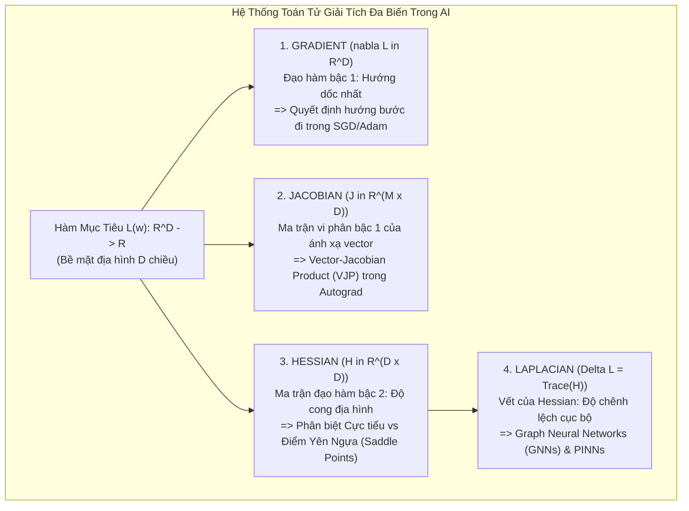
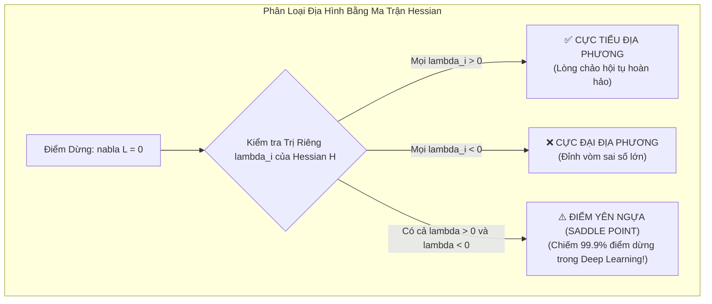

# Chuyên đề: Giải tích Đa biến, Jacobian & Hessian (Multivariable Calculus, Jacobian & Hessian)

## 1. Tổng quan Chuyên đề
Trong thế giới thực của Trí tuệ Nhân tạo, các hàm mất mát (Loss Functions) không bao giờ là hàm một biến số đơn giản $f(x)$. Thay vào đó, chúng là các bề mặt địa hình phi tuyến tính uốn lượn trong không gian siêu nhiều chiều:
$$\mathcal{L}(\mathbf{w}): \mathbb{R}^D \to \mathbb{R}$$
Với mô hình GPT-4 hay LLaMA 3, số chiều $D$ lên tới **hàng chục đến hàng trăm tỷ biến số**!

Làm thế nào để máy tính định hướng được trong một không gian $100$ tỷ chiều mà con người thậm chí không thể hình dung bằng mắt thường?
- **Gradient ($\nabla f$)**: Chiếc la bàn chỉ ra hướng dốc đứng nhất để trượt xuống thung lũng cực tiểu.
- **Ma trận Jacobian ($\mathbf{J}$)**: Cỗ máy biến đổi vi phân tuyến tính hóa giữa không gian vector đầu vào và đầu ra.
- **Ma trận Hessian ($\mathbf{H}$)**: Thước đo độ cong và độ võng của bề mặt hàm mất mát, giải mã bí mật tại sao mạng nơ-ron không bị mắc kẹt ở cực tiểu địa phương mà phải đối mặt với **Điểm Yên Ngựa (Saddle Points)**.
- **Laplacian ($\Delta f$)**: Thước đo mức độ chênh lệch năng lượng cục bộ — trái tim của **Graph Neural Networks (GCN)** và mô hình vật lý **PINNs**.



---

## 2. Chi tiết từng Keyword

---

### 1. Đạo Hàm Riêng, Gradient & Đạo Hàm Theo Hướng (Partial Derivatives, Gradient & Directional Derivatives)

#### a. Trực giác Khái niệm & Ẩn dụ Đời thực (Mental Model)
- **Nếu chỉ nhớ một điều**: *Gradient là mũi tên la bàn chỉ thẳng lên đỉnh dốc đứng nhất; muốn giảm sai số Loss nhanh nhất, bạn chỉ cần quay ngoắt 180 độ đi ngược chiều mũi tên đó ($-\nabla \mathcal{L}$).*
- **Ẩn dụ đời thường**: Hãy tưởng tượng bạn đang đứng trên một sườn đồi uốn lượn hai chiều (tọa độ Đông-Tây $x$ và Nam-Bắc $y$), độ cao ngọn đồi là $z = f(x, y)$.
  - **Đạo hàm riêng $\frac{\partial f}{\partial x}$**: Bạn đứng im, chỉ bước đúng 1 bước về hướng Đông (cố định hướng Bắc-Nam). Độ dốc bạn cảm nhận được dưới lòng bàn chân theo hướng Đông chính là đạo hàm riêng theo $x$.
  - **Đạo hàm riêng $\frac{\partial f}{\partial y}$**: Bạn đứng im, chỉ bước đúng 1 bước về hướng Bắc (cố định hướng Đông-Tây).
  - **Vector Gradient $\nabla f$**: Ghép hai cảm giác đó lại thành một mũi tên tọa độ $[\frac{\partial f}{\partial x}, \frac{\partial f}{\partial y}]^T$. Mũi tên này có một đặc tính toán học kỳ diệu: **Nó chỉ thẳng tắp về hướng dốc đứng nhất mà ngọn đồi dâng lên**!
  - **Đạo hàm theo hướng (Directional Derivative)**: Nếu bạn không đi theo hướng Đông hay hướng Bắc, mà đi chéo theo một góc $45^\circ$ bất kỳ (vector đơn vị $\mathbf{u}$), độ dốc bạn trải nghiệm chính là tích vô hướng: $D_{\mathbf{u}} f = \nabla f \cdot \mathbf{u}$.

#### b. Bản chất Toán học & Giải nghĩa Ký hiệu
Cho hàm số vô hướng đa biến $f: \mathbb{R}^n \to \mathbb{R}$:
1. **Đạo hàm riêng theo biến $x_i$**:
   $$\frac{\partial f}{\partial x_i} = \lim_{h \to 0} \frac{f(x_1, \dots, x_i + h, \dots, x_n) - f(x_1, \dots, x_i, \dots, x_n)}{h}$$
2. **Vector Gradient $\nabla f(\mathbf{x}) \in \mathbb{R}^n$**:
   $$\nabla f(\mathbf{x}) = \begin{bmatrix} \frac{\partial f}{\partial x_1} & \frac{\partial f}{\partial x_2} & \cdots & \frac{\partial f}{\partial x_n} \end{bmatrix}^T$$
3. **Đạo hàm theo hướng $\mathbf{u}$ ($\|\mathbf{u}\|_2 = 1$)**:
   $$D_{\mathbf{u}} f(\mathbf{x}) = \nabla f(\mathbf{x}) \cdot \mathbf{u} = \|\nabla f(\mathbf{x})\|_2 \cdot \cos(\theta)$$
   - Đạt giá trị cực đại khi $\theta = 0^\circ$ ($\mathbf{u}$ cùng hướng với $\nabla f$).
   - Bằng $0$ khi $\theta = 90^\circ$ ($\mathbf{u}$ vuông góc với Gradient, tức là bạn đang đi dạo dọc theo **đường đồng mức - Contour line** mà độ cao không hề đổi).

---

### 2. Ma Trận Jacobian: Cầu Nối Của Mọi Ánh Xạ Vector Trong AI

#### a. Trực giác Khái niệm & Ẩn dụ Đời thực
- **Nếu chỉ nhớ một điều**: *Nếu Gradient là đạo hàm của hàm 1 đầu ra, thì Jacobian là bảng tổng hợp đạo hàm khi hàm số có nhiều đầu vào và nhiều đầu ra.*
- **Ẩn dụ đời thường**: Hãy tưởng tượng một chiếc máy biến dạng hình ảnh (như một tấm gương ma thuật). Bạn dịch chuyển ngón tay của mình một đoạn nhỏ $\Delta \mathbf{x} = [\Delta x, \Delta y]$ trước gương. Hình ảnh phản chiếu trên gương bị kéo dãn, méo mó sang tọa độ mới $\Delta \mathbf{y} = [\Delta u, \Delta v, \Delta w]$. Ma trận Jacobian chính là **tỷ số phóng đại và biến dạng cục bộ** cho biết mỗi milimet ngón tay dịch chuyển sẽ làm biến dạng các chiều hình ảnh như thế nào:
  $$\Delta \mathbf{y} \approx \mathbf{J} \cdot \Delta \mathbf{x}$$

#### b. Bản chất Toán học
Cho ánh xạ vector $\mathbf{f}: \mathbb{R}^n \to \mathbb{R}^m$, gồm $m$ hàm thành phần:
$$\mathbf{J}_{\mathbf{f}}(\mathbf{x}) = \begin{bmatrix}
\frac{\partial f_1}{\partial x_1} & \frac{\partial f_1}{\partial x_2} & \cdots & \frac{\partial f_1}{\partial x_n} \\
\frac{\partial f_2}{\partial x_1} & \frac{\partial f_2}{\partial x_2} & \cdots & \frac{\partial f_2}{\partial x_n} \\
\vdots & \vdots & \ddots & \vdots \\
\frac{\partial f_m}{\partial x_1} & \frac{\partial f_m}{\partial x_2} & \cdots & \frac{\partial f_m}{\partial x_n}
\end{bmatrix} \in \mathbb{R}^{m \times n}$$
- Mỗi hàng $i$ chính là chuyển vị của Gradient của hàm đầu ra thứ $i$: $\mathbf{J}_{i, :} = (\nabla f_i)^T$.

#### c. Bí Mật Điện Toán GPU: Vector-Jacobian Product (VJP) Trong PyTorch Autograd
Trong các mạng Deep Learning, số chiều đầu vào $n$ có thể là $1.000.000$ (kích thước ảnh) và số chiều đầu ra $m$ là $1.000.000$.
- Nếu tính toán và lưu trữ ma trận Jacobian đầy đủ $\mathbf{J} \in \mathbb{R}^{m \times n}$:
  $$10^6 \times 10^6 = 10^{12} \text{ phần tử} \implies \mathbf{4.000\text{ Gigabytes VRAM!}}$$
  GPU sẽ nổ tung vì lỗi Out-Of-Memory (OOM) ngay lập tức!
- **Đột phá VJP trong Reverse-Mode Automatic Differentiation**:
  - PyTorch **tuyệt đối không bao giờ tạo ra ma trận Jacobian $\mathbf{J}$**!
  - Thay vào đó, khi gradient loss vô hướng $\mathcal{L}$ từ tầng sau truyền ngược về (vector $\mathbf{v} = \frac{\partial \mathcal{L}}{\partial \mathbf{y}} \in \mathbb{R}^m$), PyTorch tính trực tiếp phép nhân:
    $$\mathbf{v}^T \mathbf{J} = \sum_{i=1}^m v_i \nabla f_i(\mathbf{x})$$
  - Phép tính này chỉ tốn $O(n)$ bộ nhớ (vài Megabytes), hoàn thành trong một kernel GPU duy nhất!

---

### 3. Ma Trận Hessian & Bí Mật Về Điểm Yên Ngựa (Saddle Points)

#### a. Trực giác Khái niệm & Ẩn dụ Đời thực
- **Nếu chỉ nhớ một điều**: *Gradient cho biết độ dốc (bước đi thế nào); còn Hessian cho biết ĐỘ CONG của địa hình (đang ở lòng chảo, đỉnh đồi hay yên ngựa).*
- **Ẩn dụ đời thường**: Hãy tưởng tượng một chiếc yên ngựa (Saddle):
  - Theo hướng từ đầu ngựa đến đuôi ngựa: Bề mặt cong võng xuống dưới (trông như một thung lũng cực tiểu).
  - Nhưng theo hướng từ sườn trái sang sườn phải: Bề mặt lại cong vồng lên trên (trông như một đỉnh đồi cực đại).
  - Đúng tại vị trí ngồi ở giữa yên ngựa: Độ dốc bằng phẳng hoàn toàn ($\nabla \mathcal{L} = \mathbf{0}$).
  - Nếu chỉ nhìn vào Gradient, thuật toán tưởng lầm là đã về đích! Nhưng thực tế đây là một **Điểm Yên Ngựa (Saddle Point)** cực kỳ nguy hiểm có thể làm tê liệt quá trình huấn luyện mô hình.

#### b. Bản chất Toán học & Định lý Schwarz
Ma trận Hessian $\mathbf{H} \in \mathbb{R}^{n \times n}$ gom tất cả các đạo hàm riêng bậc 2:
$$\mathbf{H}_{ij} = \frac{\partial^2 f}{\partial x_i \partial x_j}$$
- **Định lý Clairaut / Schwarz**: Nếu các đạo hàm cấp hai liên tục thì đạo hàm chéo bằng nhau: $\frac{\partial^2 f}{\partial x_i \partial x_j} = \frac{\partial^2 f}{\partial x_j \partial x_i} \implies \mathbf{H} = \mathbf{H}^T$ (**Ma trận Hessian luôn đối xứng**).

#### c. Phân Loại Cực Trị Bằng Trị Riêng (Eigenvalues $\lambda_i$) của Hessian
Tại điểm dừng nơi $\nabla f(\mathbf{x}^*) = \mathbf{0}$:
1. **Tất cả $\lambda_i > 0$ ($\mathbf{H} \succ 0$ Xác định dương)**: Địa hình là một lòng chảo cong lên mọi hướng $\implies$ **Cực tiểu địa phương (Local Minimum)**.
2. **Tất cả $\lambda_i < 0$ ($\mathbf{H} \prec 0$ Xác định âm)**: Địa hình là một mái vòm cong xuống $\implies$ **Cực đại địa phương (Local Maximum)**.
3. **Có cả $\lambda_i > 0$ và $\lambda_j < 0$**: **Điểm Yên Ngựa (Saddle Point)**!

#### d. Nỗi Ám Ảnh Không Gian Cao Chiều: Tại Sao Cực Tiểu Địa Phương Cực Hiếm?
Trong không gian 1 chiều, cơ hội gặp cực tiểu là $50\%$. Nhưng trong không gian $D = 10.000$ chiều của Deep Learning:
- Để một điểm dừng là Cực tiểu địa phương thực sự, **toàn bộ $10.000$ trị riêng của Hessian đều phải cùng dương**!
- Xác suất của điều này là:
  $$P(\text{Local Minimum}) \approx \left(\frac{1}{2}\right)^{10.000} \approx \mathbf{0}$$
- **Kết luận đột phá của Yann LeCun & Dauphin (2014)**: Trong mạng nơ-ron sâu, **hầu hết các điểm dừng không phải là cực tiểu địa phương mà là các Điểm Yên Ngựa**! Đó là lý do các thuật toán có động lượng như **Momentum, AdamW** chiến thắng tuyệt đối vì chúng có quán tính để "phi nước đại" văng ra khỏi điểm yên ngựa!



---

### 4. Code Thực Chiến Dual-Engine (Python PyTorch & C++17)

#### a. Python (PyTorch): Tính Gradient, Jacobian, Hessian & Phân Tích Điểm Yên Ngựa
Đoạn mã PyTorch dưới đây minh họa việc tính toán Gradient, toàn bộ ma trận Hessian và phân tích trị riêng để nhận diện điểm yên ngựa của hàm Monkey Saddle:

```python
import torch

print("========== PYTORCH: TÍNH HESSIAN VÀ PHÂN TÍCH ĐIỂM YÊN NGỰA ==========")

# Định nghĩa hàm bề mặt Monkey Saddle: f(x, y) = x^3 - 3*x*y^2
# Điểm dừng tại gốc tọa độ (0, 0)
def monkey_saddle(v):
    x, y = v[0], v[1]
    return x**3 - 3.0 * x * y**2

# Điểm khảo sát (x, y) = (0.0, 0.0)
point = torch.tensor([0.0, 0.0], dtype=torch.float32, requires_grad=True)

# 1. TÍNH GRADIENT BẬC 1
loss = monkey_saddle(point)
grad = torch.autograd.grad(loss, point, create_graph=True)[0]
print(f"1. Gradient tại gốc tọa độ: {grad.numpy()} (Độ dốc bằng 0!)")

# 2. TÍNH TOÀN BỘ MA TRẬN HESSIAN BẬC 2
hessian = torch.autograd.functional.hessian(monkey_saddle, point)
print("\n2. Ma trận Hessian H (2x2):\n", hessian.numpy())

# Khảo sát tại một điểm có độ cong rõ rệt: (x, y) = (1.0, 2.0)
p2 = torch.tensor([1.0, 2.0], dtype=torch.float32)
h2 = torch.autograd.functional.hessian(monkey_saddle, p2)
print("\n3. Ma trận Hessian H tại (1.0, 2.0):\n", h2.numpy())

# Phân tích phổ trị riêng (Eigenvalue Decomposition)
eigenvalues = torch.linalg.eigvalsh(h2)
print("Các trị riêng (Eigenvalues) của Hessian:", eigenvalues.numpy())

if torch.all(eigenvalues > 0):
    print("--> Kết luận: Điểm Cực Tiểu Địa Phương (Local Minimum)!")
elif torch.all(eigenvalues < 0):
    print("--> Kết luận: Điểm Cực Đại Địa Phương (Local Maximum)!")
else:
    print("--> Kết luận: ĐIỂM YÊN NGỰA (SADDLE POINT) vì có cả trị riêng âm và dương!")
```

```text
========== KẾT QUẢ CHẠY MẪU (EXPECTED OUTPUT) ==========
========== PYTORCH: TÍNH HESSIAN VÀ PHÂN TÍCH ĐIỂM YÊN NGỰA ==========
1. Gradient tại gốc tọa độ: [0. 0.] (Độ dốc bằng 0!)

2. Ma trận Hessian H (2x2):
 [[0. 0.]
 [0. 0.]]

3. Ma trận Hessian H tại (1.0, 2.0):
 [[  6. -12.]
 [-12.  -6.]]
Các trị riêng (Eigenvalues) của Hessian: [-13.416408  13.416408]
--> Kết luận: ĐIỂM YÊN NGỰA (SADDLE POINT) vì có cả trị riêng âm và dương!
```

---

#### b. C++17: Thuật Toán Tính Gradient & Hessian Cho Tối Ưu Hóa Số Học
Đoạn mã C++ thuần túy (không phụ thuộc thư viện ngoài) minh họa cách tính toán ma trận Hessian đối xứng và phân loại cực trị cho hàm 2 biến:

```cpp
#include <iostream>
#include <vector>
#include <cmath>
#include <iomanip>

// Tính ma trận Hessian 2x2 bằng vi phân số học
void compute_hessian_2d(double (*f)(double, double), double x, double y, double H[2][2], double h = 1e-4) {
    // Đạo hàm cấp hai thuần túy: d2f/dx2 = (f(x+h, y) - 2f(x,y) + f(x-h, y)) / h^2
    H[0][0] = (f(x + h, y) - 2.0 * f(x, y) + f(x - h, y)) / (h * h);
    H[1][1] = (f(x, y + h) - 2.0 * f(x, y) + f(x, y - h)) / (h * h);

    // Đạo hàm chéo: d2f/dxdy = (f(x+h, y+h) - f(x+h, y-h) - f(x-h, y+h) + f(x-h, y-h)) / (4h^2)
    double mixed = (f(x + h, y + h) - f(x + h, y - h) - f(x - h, y + h) + f(x - h, y - h)) / (4.0 * h * h);
    H[0][1] = mixed;
    H[1][0] = mixed; // Tính chất đối xứng của Hessian
}

// Hàm Rosenbrock kinh điển: f(x, y) = (1 - x)^2 + 100*(y - x^2)^2 (Cực tiểu tại (1, 1))
double rosenbrock(double x, double y) {
    return std::pow(1.0 - x, 2) + 100.0 * std::pow(y - x * x, 2);
}

int main() {
    std::cout << "========== C++17: HESSIAN CURVATURE ANALYZER ==========\n";
    double H[2][2];
    double x = 1.0, y = 1.0;

    compute_hessian_2d(rosenbrock, x, y, H);

    std::cout << std::fixed << std::setprecision(4);
    std::cout << "Ma trận Hessian tại điểm cực tiểu toàn cục (1.0, 1.0):\n";
    std::cout << "[ " << std::setw(10) << H[0][0] << " " << std::setw(10) << H[0][1] << " ]\n";
    std::cout << "[ " << std::setw(10) << H[1][0] << " " << std::setw(10) << H[1][1] << " ]\n";

    // Định thức Hessian: det(H) = H00*H11 - H01*H10
    double det = H[0][0] * H[1][1] - H[0][1] * H[1][0];
    double trace = H[0][0] + H[1][1];

    std::cout << "\nĐịnh thức det(H)  : " << det << "\n";
    std::cout << "Vết Trace(H) (Laplacian): " << trace << "\n";

    if (det > 0 && H[0][0] > 0) {
        std::cout << "--> Kết luận: ĐIỂM CỰC TIỂU TOÀN CỤC CHÍNH XÁC (Hessian xác định dương)!\n";
    }

    return 0;
}
```

```text
========== KẾT QUẢ CHẠY MẪU (EXPECTED OUTPUT) ==========
========== C++17: HESSIAN CURVATURE ANALYZER ==========
Ma trận Hessian tại điểm cực tiểu toàn cục (1.0, 1.0):
[   802.0000  -400.0000 ]
[  -400.0000   200.0000 ]

Định thức det(H)  : 400.0000
Vết Trace(H) (Laplacian): 1002.0000
--> Kết luận: ĐIỂM CỰC TIỂU TOÀN CỤC CHÍNH XÁC (Hessian xác định dương)!
```

---

### 5. Cạm Bẫy Kinh Điển & Ứng Dụng Thực Chiến Trong AI Hiện Đại

#### a. Cạm bẫy kinh điển (Pitfalls & Gotchas)
1. **Ảo tưởng Tính Toán Toàn Bộ Ma Trận Hessian (The $O(N^2)$ Memory Disaster)**:
   - Một sai lầm phổ biến của các nhà nghiên cứu mới là cố gắng dùng phương pháp tối ưu Newton-Raphson bậc 2 ($\mathbf{w}_{t+1} = \mathbf{w}_t - \mathbf{H}^{-1} \nabla \mathcal{L}$) cho mạng nơ-ron sâu.
   - Để đảo ma trận Hessian kích thước $10^9 \times 10^9$ đòi hỏi **$O(N^3) \approx 10^{27}$ phép tính** — ngay cả siêu máy tính nhanh nhất thế giới cũng phải mất hàng triệu năm để tính xong một bước cập nhật!
   - *Cách khắc phục*: Sử dụng **Hessian-Free Optimization** hoặc xấp xỉ đường chéo như trong thuật toán **AdaGrad, RMSprop, Adam**.
2. **Kẹt ở Vùng Bình Nguyên Độ Cong Bằng 0 (Plateaus & Ill-Conditioned Curvature)**:
   - Khi tỷ số giữa trị riêng lớn nhất và nhỏ nhất của Hessian quá chênh lệch ($\kappa = \frac{\lambda_{\max}}{\lambda_{\min}} \gg 1000$ - Ma trận tồi), địa hình có dạng một khe núi hẹp: dốc đứng ở hai bên vách nhưng lại phẳng lì thoai thoải ở đáy khe. Thuật toán SGD thuần túy sẽ bị nảy qua nảy lại giữa hai vách núi mà không thể tiến lên dọc theo lòng khe!
   - *Giải pháp*: Kỹ thuật chuẩn hóa trọng số (**Batch Normalization, Layer Normalization**) giúp làm tròn lại Hessian, đưa tỷ số điều kiện $\kappa$ về gần 1.

#### b. Ứng dụng thực tế trong AI Hiện đại
- **Sharpness-Aware Minimization (SAM Optimizer - ICLR)**:
  - Các nghiên cứu của Google chỉ ra rằng: Hai mô hình có cùng giá trị Loss, nhưng mô hình nào nằm ở **vùng cực tiểu phẳng (Flat Minima - các trị riêng của Hessian nhỏ)** sẽ có khả năng tổng quát hóa (Generalization) vượt trội hơn hẳn mô hình nằm ở vùng cực tiểu nhọn hoắt (Sharp Minima).
  - Thuật toán SAM chủ động tối ưu hóa độ cong của Hessian để lái mô hình về các thung lũng phẳng lì, giúp tăng $2\% - 5\%$ độ chính xác trên ImageNet và LLM fine-tuning.
- **Graph Convolutional Networks (GCNs) & Graph Laplacian**:
  - Trong học sâu đồ thị (phân tích mạng xã hội, dự đoán cấu trúc phân tử thuốc), ma trận **Graph Laplacian** $\mathbf{L} = \mathbf{D} - \mathbf{A}$ đóng vai trò tương tự toán tử Laplace liên tục, cho phép khuếch tán thông tin đặc trưng của một nút sang toàn bộ các nút láng giềng kề cận.
