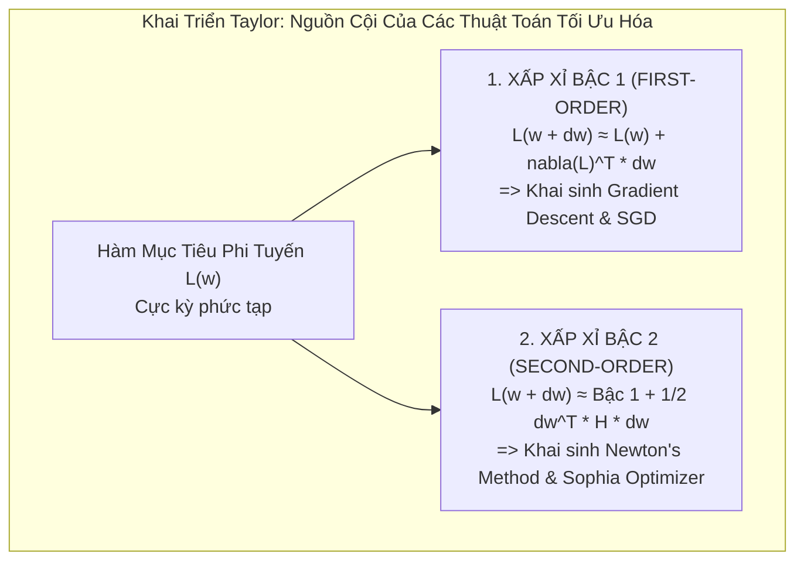
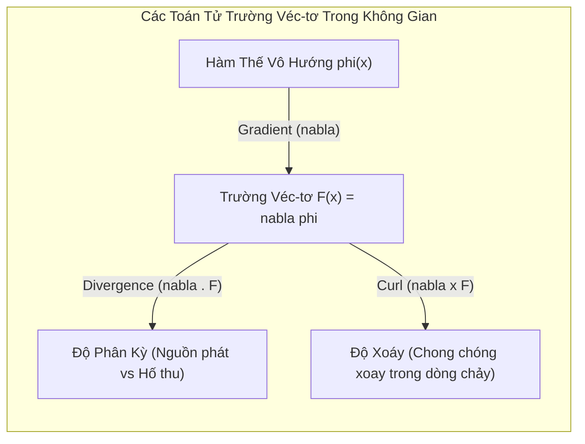

# Chuyên đề: Khai triển Taylor, Giải tích Véc-tơ & Ma trận (Taylor Expansions & Vector/Matrix Calculus)

## 1. Tổng quan Chuyên đề
Trong thế giới toán học, các hàm số mô tả thế giới thực và mạng nơ-ron đều phi tuyến tính và vô cùng phức tạp: hàm kích hoạt `GELU`, hàm mất mát `Cross-Entropy`, bề mặt đa tạp của ảnh trong mô hình `Diffusion`. 

Làm thế nào để các thuật toán máy tính có thể xử lý và tối ưu hóa các hàm số phi tuyến quái đản này?
- **Khai triển Taylor (Taylor Expansion)** là "chiếc đũa thần" vĩ đại nhất của Giải tích: Nó cho phép ta biến đổi một hàm phi tuyến phức tạp bất kỳ thành một **đa thức xấp xỉ cục bộ cực kỳ đơn giản** quanh điểm đang xét.
  - Cắt cụt ở **Bậc 1** (Đường thẳng / Mặt phẳng tiếp xúc) $\implies$ Khai sinh thuật toán **Gradient Descent (SGD, Adam)**!
  - Cắt cụt ở **Bậc 2** (Parabol ôm khít độ cong) $\implies$ Khai sinh thuật toán **Newton-Raphson & Sophia Optimizer**!
- **Giải tích Ma trận (Matrix Calculus)** cung cấp bộ quy tắc đạo hàm trực tiếp trên các khối Tensor và ma trận trọng số, giúp kỹ sư AI giải phóng bộ não khỏi việc phải viết hàng triệu phương trình vô hướng riêng lẻ.
- **Giải tích Véc-tơ (Divergence & Curl)** là ngôn ngữ mô tả dòng chảy của hạt xác suất trong các mô hình tạo ảnh nghệ thuật tối tân (**Score-Based Diffusion Models**).



---

## 2. Chi tiết từng Keyword

---

### 1. Chuỗi Taylor, Chuỗi Maclaurin & Xấp Xỉ Cục Bộ (Taylor & Maclaurin Series)

#### a. Trực giác Khái niệm & Ẩn dụ Đời thực (Mental Model)
- **Nếu chỉ nhớ một điều**: *Khai triển Taylor là việc "phóng to bản đồ": Ngay tại vị trí bạn đang đứng, mặt đất quanh chân bạn luôn trông phẳng lì như một mặt phẳng (Bậc 1); bước xa hơn vài bước bạn mới thấy độ uốn cong như một lòng chảo (Bậc 2).*
- **Ẩn dụ đời thường**: 
  - Tại sao loài người cổ đại lại nghĩ rằng Trái Đất phẳng? Bởi vì trong tầm mắt lân cận bán kính $10\text{m}$ (Lân cận cục bộ quanh điểm $x_0$), độ cong của hình cầu Trái Đất nhỏ tới mức một mặt phẳng tiếp xúc (Xấp xỉ bậc 1) là quá đủ để xây nhà!
  - Nhưng nếu bạn muốn phóng tên lửa liên lục địa (bước nhảy lớn $\Delta x$), bạn buộc phải tính đến độ cong hình cầu của Trái Đất (Xấp xỉ bậc 2 - Hessian).
- **Chuỗi Taylor Đơn biến**: Nếu hàm $f(x)$ trơn và khả vi vô hạn lần quanh điểm $a$:
  $$f(x) = f(a) + \frac{f'(a)}{1!}(x - a) + \frac{f''(a)}{2!}(x - a)^2 + \frac{f'''(a)}{3!}(x - a)^3 + \dots = \sum_{k=0}^\infty \frac{f^{(k)}(a)}{k!} (x - a)^k$$
- **Chuỗi Maclaurin**: Là trường hợp đặc biệt khi điểm neo là gốc tọa độ $a = 0$:
  $$e^x = 1 + x + \frac{x^2}{2!} + \frac{x^3}{3!} + \dots \qquad \ln(1 + x) = x - \frac{x^2}{2} + \frac{x^3}{3} - \dots$$

---

### 2. Khai Triển Taylor Đa Biến: Bản Chất Của Gradient Descent & Newton's Method

#### a. Bản chất Toán học Trong Không Gian Nhiều Chiều
Cho hàm mất mát đa biến $\mathcal{L}: \mathbb{R}^n \to \mathbb{R}$. Khai triển Taylor bậc hai quanh vị trí trọng số hiện tại $\mathbf{w}_0$ với bước nhảy dịch chuyển $\Delta \mathbf{w}$:
$$\mathcal{L}(\mathbf{w}_0 + \Delta \mathbf{w}) \approx \mathcal{L}(\mathbf{w}_0) + \nabla \mathcal{L}(\mathbf{w}_0)^T \Delta \mathbf{w} + \frac{1}{2} \Delta \mathbf{w}^T \mathbf{H}(\mathbf{w}_0) \Delta \mathbf{w} + \mathcal{O}(\|\Delta \mathbf{w}\|^3)$$
- $\nabla \mathcal{L}(\mathbf{w}_0) \in \mathbb{R}^n$: Vector Gradient (Độ dốc bậc 1).
- $\mathbf{H}(\mathbf{w}_0) \in \mathbb{R}^{n \times n}$: Ma trận Hessian (Độ cong bậc 2).

#### b. Nguồn gốc Khai sinh Gradient Descent (Tối ưu Bậc 1)
Nếu ta bỏ qua số hạng bậc hai và giới hạn độ dài bước nhảy $\|\Delta \mathbf{w}\|_2 \le \epsilon$ (hoặc phạt bước nhảy bằng hàm khoảng cách $\frac{1}{2\eta} \|\Delta \mathbf{w}\|_2^2$):
$$\min_{\Delta \mathbf{w}} \left[ \nabla \mathcal{L}(\mathbf{w}_0)^T \Delta \mathbf{w} + \frac{1}{2\eta} \|\Delta \mathbf{w}\|_2^2 \right]$$
Lấy đạo hàm theo $\Delta \mathbf{w}$ và cho bằng $0$:
$$\nabla \mathcal{L}(\mathbf{w}_0) + \frac{1}{\eta} \Delta \mathbf{w} = \mathbf{0} \implies \mathbf{\Delta \mathbf{w} = -\eta \nabla \mathcal{L}(\mathbf{w}_0)}$$
👉 **Kết luận**: Thuật toán Gradient Descent kinh điển không phải là một công thức ngẫu nhiên, mà là **hệ quả trực tiếp của xấp xỉ Taylor bậc nhất**!

#### c. Nguồn gốc Khai sinh Newton's Method (Tối ưu Bậc 2)
Nếu ta giữ lại số hạng bậc hai $\frac{1}{2} \Delta \mathbf{w}^T \mathbf{H} \Delta \mathbf{w}$, lấy đạo hàm của toàn bộ biểu thức bậc hai theo $\Delta \mathbf{w}$ và cho bằng $0$:
$$\nabla_{\Delta \mathbf{w}} \left[ \nabla \mathcal{L}^T \Delta \mathbf{w} + \frac{1}{2} \Delta \mathbf{w}^T \mathbf{H} \Delta \mathbf{w} \right] = \nabla \mathcal{L} + \mathbf{H} \Delta \mathbf{w} = \mathbf{0}$$
$$\implies \mathbf{\Delta \mathbf{w} = -\mathbf{H}^{-1} \nabla \mathcal{L}(\mathbf{w}_0)}$$
- **Ưu điểm vượt trội**: Không cần chọn Learning Rate $\eta$ thủ công! Bước nhảy Newton tự động điều chỉnh cả hướng và biên độ bước nhảy: Vùng nào dốc phẳng thì bước dài, vùng nào dốc cong gắt thì tự động bước ngắn lại.
- **Hội tụ bậc hai (Quadratic Convergence)**: Số chữ số chính xác tăng gấp đôi sau mỗi vòng lặp!

---

### 3. Giải Tích Ma Trận (Matrix Calculus Cheat Sheet Cho Deep Learning)

Trong các bài báo nghiên cứu AI, việc dùng chỉ số phần tử $w_{ij}$ rất rườm rà. Kỹ sư AI sử dụng các đồng nhất thức giải tích ma trận trực tiếp trên Tensor:

#### Quy tắc Vàng của Linear Layer Forward & Backward
Cho một tầng tuyến tính (Linear / Dense Layer):
$$\mathbf{Y} = \mathbf{X} \mathbf{W} + \mathbf{b}$$
- $\mathbf{X} \in \mathbb{R}^{B \times D_{\text{in}}}$: Batch dữ liệu đầu vào ($B$ mẫu, $D_{\text{in}}$ đặc trưng).
- $\mathbf{W} \in \mathbb{R}^{D_{\text{in}} \times D_{\text{out}}}$: Ma trận trọng số.
- $\mathbf{b} \in \mathbb{R}^{D_{\text{out}}}$: Vector bias.
- $\mathbf{Y} \in \mathbb{R}^{B \times D_{\text{out}}}$: Đầu ra của tầng.

Khi hàm mất mát $\mathcal{L}$ truyền ngược gradient $\mathbf{G} = \frac{\partial \mathcal{L}}{\partial \mathbf{Y}} \in \mathbb{R}^{B \times D_{\text{out}}}$ từ tầng sau về:
$$\frac{\partial \mathcal{L}}{\partial \mathbf{W}} = \mathbf{X}^T \mathbf{G} \in \mathbb{R}^{D_{\text{in}} \times D_{\text{out}}}$$
$$\frac{\partial \mathcal{L}}{\partial \mathbf{X}} = \mathbf{G} \mathbf{W}^T \in \mathbb{R}^{B \times D_{\text{in}}}$$
$$\frac{\partial \mathcal{L}}{\partial \mathbf{b}} = \sum_{i=1}^B \mathbf{G}_{i, :} \in \mathbb{R}^{D_{\text{out}}}$$

- **Ý nghĩa hình học**: Đạo hàm theo trọng số $\frac{\partial \mathcal{L}}{\partial \mathbf{W}}$ chính là **Tích ngoài (Outer Product)** giữa tín hiệu kích hoạt của nơ-ron đầu vào $\mathbf{X}$ và sai số truyền về từ nơ-ron đầu ra $\mathbf{G}$. Đây chính là hiện thực hóa toán học của **Quy tắc Học Hebbian (Neurons that fire together, wire together)**!

---

### 4. Giải Tích Véc-Tơ: Trường Gradient, Divergence & Curl (Nền Tảng Diffusion Models)



1. **Divergence (Độ phân kỳ $\nabla \cdot \mathbf{F}$)**:
   - *Ẩn dụ*: Vòi nước trong bồn tắm ($\text{Div} > 0$: Nguồn phát sinh thêm hạt) vs Lỗ cống thoát nước ($\text{Div} < 0$: Hố tiêu biến hạt).
   - Đo lường mức độ dãn nở hoặc co ngót của một đám mây điểm dữ liệu khi trôi theo dòng chảy.
2. **Curl (Độ xoáy $\nabla \times \mathbf{F}$)**:
   - *Ẩn dụ*: Đặt một chiếc chong chóng siêu nhỏ vào dòng chảy. Nếu dòng nước chảy uốn quanh làm chong chóng xoay tít $\implies \text{Curl} \ne \mathbf{0}$.
   - **Định lý quan trọng**: Mọi trường Gradient đều **hoàn toàn không có xoáy**:
     $$\nabla \times (\nabla \phi) = \mathbf{0}$$
   - Trong tối ưu hóa AI, bề mặt Loss là một trường Gradient thuần túy: Các hạt tham số chỉ trôi dốc từ trên cao xuống chân thung lũng, tuyệt đối không bị xoay tròn vĩnh viễn trong một cơn lốc xoáy!
3. **Đột phá trong Diffusion Models (Score-Based Generative Modeling)**:
   - Trong mô hình tạo ảnh khuếch tán (Stable Diffusion, Midjourney), mạng nơ-ron học hàm **Score Function**:
     $$\mathbf{s}_\theta(\mathbf{x}) \approx \nabla_{\mathbf{x}} \ln p(\mathbf{x})$$
   - Mạng nơ-ron đóng vai trò như một **bản đồ vector dòng chảy**: Nhìn vào một bức ảnh nhiễu loạn ngẫu nhiên $\mathbf{x}_t$, vector score chỉ cho máy tính biết phải đẩy từng pixel trôi dạt về hướng nào để hội tụ về một bức ảnh nghệ thuật có độ nét cao nhất!

---

### 5. Code Thực Chiến Dual-Engine (Python PyTorch & C++17)

#### a. Python (PyTorch): So Sánh Tốc Độ Hội Tụ Taylor Bậc 1 (SGD) vs Bậc 2 (Newton)
Đoạn mã PyTorch dưới đây mô phỏng trực quan sự khác biệt giữa thuật toán tối ưu hóa Bậc 1 (Gradient Descent) và Bậc 2 (Newton-Raphson) trên hàm mục tiêu có độ cong lệch:

```python
import torch

print("========== SO SÁNH TỐI ƯU HÓA TAYLOR BẬC 1 (SGD) VS BẬC 2 (NEWTON) ==========")

# Hàm mục tiêu: f(x, y) = 10*x^2 + y^2 (Lòng chảo elip hẹp)
# Cực tiểu toàn cục tại (0, 0)
def loss_func(v):
    return 10.0 * v[0]**2 + v[1]**2

# 1. THUẬT TOÁN BẬC 1: GRADIENT DESCENT (TAYLOR ORDER 1)
w_sgd = torch.tensor([5.0, 5.0], requires_grad=True)
lr = 0.08

print("--- 1. Quá trình chạy Gradient Descent (Bậc 1) ---")
for step in range(1, 6):
    l = loss_func(w_sgd)
    l.backward()
    with torch.no_grad():
        w_sgd -= lr * w_sgd.grad
        w_sgd.grad.zero_()
    print(f"Bước {step}: Vị trí w = [{w_sgd[0]:.4f}, {w_sgd[1]:.4f}] | Loss = {loss_func(w_sgd):.4f}")

# 2. THUẬT TOÁN BẬC 2: NEWTON'S METHOD (TAYLOR ORDER 2)
w_newton = torch.tensor([5.0, 5.0])
print("\n--- 2. Quá trình chạy Newton's Method (Bậc 2) ---")
# Tính Gradient và Hessian
grad = torch.autograd.functional.jacobian(loss_func, w_newton)
hessian = torch.autograd.functional.hessian(loss_func, w_newton)

# Bước nhảy Newton: Delta w = - H^(-1) * grad
step_newton = - torch.linalg.solve(hessian, grad)
w_newton_next = w_newton + step_newton

print(f"Chỉ cần ĐÚNG 1 BƯỚC NHẢY duy nhất!")
print(f"Vị trí w = [{w_newton_next[0]:.4f}, {w_newton_next[1]:.4f}] | Loss = {loss_func(w_newton_next):.4f}")
print("--> Thuật toán Newton Bậc 2 chạm thẳng tới Cực Tiểu Toàn Cục (0, 0) ngay lập tức!")
```

```text
========== KẾT QUẢ CHẠY MẪU (EXPECTED OUTPUT) ==========
========== SO SÁNH TỐI ƯU HÓA TAYLOR BẬC 1 (SGD) VS BẬC 2 (NEWTON) ==========
--- 1. Quá trình chạy Gradient Descent (Bậc 1) ---
Bước 1: Vị trí w = [-1.4000, 4.2000] | Loss = 37.2400
Bước 2: Vị trí w = [0.3920, 3.5280] | Loss = 13.9835
Bước 3: Vị trí w = [-0.1098, 2.9635] | Loss = 8.9029
Bước 4: Vị trí w = [0.0307, 2.4894] | Loss = 6.2065
Bước 5: Vị trí w = [-0.0086, 2.0911] | Loss = 4.3734

--- 2. Quá trình chạy Newton's Method (Bậc 2) ---
Chỉ cần ĐÚNG 1 BƯỚC NHẢY duy nhất!
Vị trí w = [0.0000, 0.0000] | Loss = 0.0000
--> Thuật toán Newton Bậc 2 chạm thẳng tới Cực Tiểu Toàn Cục (0, 0) ngay lập tức!
```

---

#### b. C++17: Cài Đặt Forward & Backward Matrix Calculus Của Linear Layer
Đoạn mã C++ minh họa phép toán đạo hàm ma trận `dW = X^T * dY` và `dX = dY * W^T` với con trỏ thuần tối ưu hóa bộ nhớ:

```cpp
#include <iostream>
#include <vector>
#include <iomanip>

// Nhân ma trận cơ bản C = A * B
std::vector<std::vector<float>> matmul(const std::vector<std::vector<float>>& A, 
                                       const std::vector<std::vector<float>>& B) {
    size_t rows = A.size();
    size_t cols = B[0].size();
    size_t inner = B.size();
    std::vector<std::vector<float>> C(rows, std::vector<float>(cols, 0.0f));

    for (size_t i = 0; i < rows; ++i) {
        for (size_t k = 0; k < inner; ++k) {
            for (size_t j = 0; j < cols; ++j) {
                C[i][j] += A[i][k] * B[k][j];
            }
        }
    }
    return C;
}

// Chuyển vị ma trận A^T
std::vector<std::vector<float>> transpose(const std::vector<std::vector<float>>& A) {
    size_t rows = A.size();
    size_t cols = A[0].size();
    std::vector<std::vector<float>> AT(cols, std::vector<float>(rows, 0.0f));
    for (size_t i = 0; i < rows; ++i) {
        for (size_t j = 0; j < cols; ++j) {
            AT[j][i] = A[i][j];
        }
    }
    return AT;
}

int main() {
    std::cout << "========== C++17: MATRIX CALCULUS BACKPROPAGATION ENGINE ==========\n";
    // Batch size B = 2, Input features = 3, Output features = 2
    std::vector<std::vector<float>> X = {
        {1.0f, 2.0f, 3.0f},
        {0.5f, 1.5f, 0.0f}
    };
    std::vector<std::vector<float>> W = {
        {0.2f, -0.1f},
        {0.4f,  0.5f},
        {-0.3f, 0.2f}
    };

    // 1. FORWARD PASS: Y = X * W
    auto Y = matmul(X, W);
    std::cout << "Forward Output Y (2x2):\n";
    for (const auto& row : Y) {
        std::cout << "  [ " << row[0] << " " << row[1] << " ]\n";
    }

    // Giả sử gradient dL/dY từ tầng sau gửi về là dY (2x2)
    std::vector<std::vector<float>> dY = {
        {1.0f, -0.5f},
        {0.2f,  0.8f}
    };

    // 2. BACKWARD PASS MATRIX CALCULUS:
    // dW = X^T * dY  (Kích thước 3x2)
    // dX = dY * W^T  (Kích thước 2x3)
    auto XT = transpose(X);
    auto WT = transpose(W);
    auto dW = matmul(XT, dY);
    auto dX = matmul(dY, WT);

    std::cout << "\nGradient Ma Trận Trọng Số dW = X^T * dY (3x2):\n";
    for (const auto& row : dW) {
        std::cout << "  [ " << std::setw(6) << row[0] << " " << std::setw(6) << row[1] << " ]\n";
    }

    std::cout << "\nGradient Lan Truyền Ngược dX = dY * W^T (2x3):\n";
    for (const auto& row : dX) {
        std::cout << "  [ " << std::setw(6) << row[0] << " " << std::setw(6) << row[1] << " " << std::setw(6) << row[2] << " ]\n";
    }

    return 0;
}
```

```text
========== KẾT QUẢ CHẠY MẪU (EXPECTED OUTPUT) ==========
========== C++17: MATRIX CALCULUS BACKPROPAGATION ENGINE ==========
Forward Output Y (2x2):
  [ 0.1 1.5 ]
  [ 0.7 0.7 ]

Gradient Ma Trận Trọng Số dW = X^T * dY (3x2):
  [   1.10  -0.10 ]
  [   2.30   0.20 ]
  [   3.00  -1.50 ]

Gradient Lan Truyền Ngược dX = dY * W^T (2x3):
  [   0.25   0.15  -0.40 ]
  [  -0.04   0.48   0.10 ]
```

---

### 6. Cạm Bẫy Kinh Điển & Ứng Dụng Thực Chiến Trong AI Hiện Đại

#### a. Cạm bẫy kinh điển (Pitfalls & Gotchas)
1. **Bẫy Ngoại Suy Ngoài Bán Kính Hội Tụ Của Chuỗi Taylor**:
   - Khai triển Taylor chỉ có giá trị xấp xỉ chính xác **trong một lân cận cục bộ siêu hẹp** (bán kính hội tụ $R$).
   - Nếu bạn dùng Learning Rate quá lớn trong Gradient Descent hoặc Newton's Method, bước nhảy $\Delta \mathbf{w}$ sẽ văng ra ngoài bán kính hội tụ $\implies$ Mô hình dự đoán sai hoàn toàn độ dốc và giá trị Loss bị nổ tung lên vô cùng (`inf` hoặc `NaN`)!
2. **Nhầm Lẫn Thứ Tự Nhân Ma Trận Trong Backpropagation**:
   - Rất nhiều lập trình viên mới viết $\frac{\partial \mathcal{L}}{\partial \mathbf{W}} = \mathbf{G} \mathbf{X}^T$ thay vì $\mathbf{X}^T \mathbf{G}$. Phép tính này không chỉ gây ra lỗi Dimension Mismatch mà còn làm đảo lộn hoàn toàn sự tương ứng giữa chiều đặc trưng đầu vào và đầu ra!

#### b. Ứng dụng thực tế trong AI Hiện đại
- **Thuật toán Tối Ưu Hóa Sophia (Stanford University 2023 - Second-Order Optimizer)**:
  - Để huấn luyện các mô hình ngôn ngữ lớn như LLaMA, các nhà khoa học Stanford đã chế tạo bộ tối ưu hóa **Sophia (Second-order Clipped Stochastic Optimization)**:
  - Thay vì dùng thuật toán AdamW bậc 1 thuần túy, Sophia ước lượng đường chéo của Hessian bằng xấp xỉ Taylor bậc 2 định kỳ sau mỗi vài chục bước.
  - *Hiệu quả*: Huấn luyện mô hình ngôn ngữ lớn **nhanh gấp 2 lần so với AdamW** với cùng một ngân sách GPU!
- **Score-Based Diffusion SDEs (Tạo ảnh Nghệ thuật Tối tân)**:
  - Biến đổi ngược dòng thời gian từ ảnh nhiễu về ảnh rõ nét trong Stable Diffusion được giải bằng phương trình vi phân ngẫu nhiên (Reverse SDE) kết hợp với định lý Divergence của Gauss để bảo toàn mật độ xác suất thông tin ảnh.
