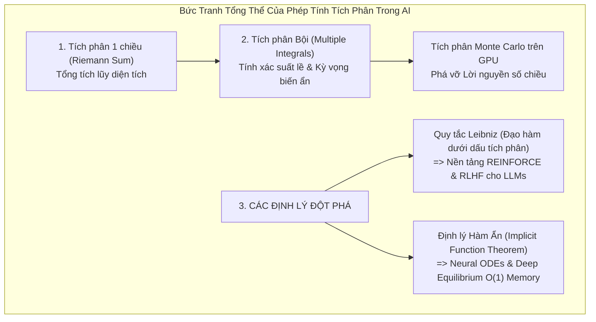

# Chuyên đề: Phép tính Tích phân & Các Định lý Trường (Integral Calculus & Field Theorems)

## 1. Tổng quan Chuyên đề
Nếu như phép tính Vi phân (Differentiation) là chiếc kính hiển vi giúp ta quan sát tốc độ biến thiên tức thời tại một điểm cục bộ, thì **Phép tính Tích phân (Integral Calculus)** là chiếc kính thiên văn cho phép ta **tích lũy và đo lường bức tranh toàn cục**:
- Trong khi vi phân cho ta biết hướng dốc nhất để leo núi (Gradient), thì tích phân cho ta biết tổng độ cao, diện tích và thể tích của toàn bộ rặng núi.
- Trong Trí tuệ Nhân tạo hiện đại, tích phân là linh hồn của:
  - **Lý thuyết Xác suất & Mô hình Sinh**: Tính toán giá trị kỳ vọng (Expectation), entropy, và chuẩn hóa xác suất của các mô hình khuếch tán (Diffusion Models) hay VAE ($p(x) = \int p(x, z) dz$).
  - **Học Tăng Cường (Reinforcement Learning)**: **Quy tắc Tích phân Leibniz (Leibniz Rule)** là chìa khóa toán học chứng minh Định lý Policy Gradient (thuật toán REINFORCE, PPO dùng để căn chỉnh mô hình ngôn ngữ lớn LLMs).
  - **Mô hình Cân Bằng Sâu (Deep Equilibrium Models - DEQ) & Neural ODEs**: **Định lý Hàm Ẩn (Implicit Function Theorem - IFT)** mở ra kỷ nguyên huấn luyện các mạng nơ-ron có vô số tầng nhưng chỉ tiêu tốn bộ nhớ RAM cố định $O(1)$!



---

## 2. Chi tiết từng Keyword

---

### 1. Tích Phân Đơn Biến: Bất Định, Xác Định & Định Lý Cơ Bản (Single Variable Calculus)

#### a. Trực giác Khái niệm & Ẩn dụ Đời thực (Mental Model)
- **Nếu chỉ nhớ một điều**: *Vi phân là chiếc đồng hồ công-tơ-mét đo vận tốc tức thời $v(t) = s'(t)$; Tích phân là việc cộng dồn tất cả các vận tốc nhỏ ấy lại theo thời gian để tính ra tổng quãng đường xe đã đi được: $s = \int v(t) dt$.*
- **Ẩn dụ đời thường**: Bạn đổ nước từ vòi vào một chiếc xô có hình dạng uốn lượn kỳ lạ. Tại mỗi giây, tốc độ nước chảy từ vòi là khác nhau (hàm tốc độ dòng chảy $f(t)$). Bạn không thể dùng công thức hình học đơn giản để tính lượng nước. Nhưng nếu bạn chia thời gian thành hàng triệu tích tắc siêu nhỏ $\Delta t$, trong mỗi tích tắc lượng nước gần như là một hình chữ nhật nhỏ $f(t_i) \Delta t$. Tổng của hàng triệu hình chữ nhật con này chính là **Tổng Riemann (Riemann Sum)**. Khi số lượng lát cắt tiến tới vô cùng, ta thu được giá trị tích phân hoàn hảo!
- **Định lý Cơ bản của Giải tích (Fundamental Theorem of Calculus - FTC)**:
  - Cầu nối kỳ diệu khẳng định: **Đạo hàm và Tích phân là hai phép toán hoàn toàn đảo ngược của nhau**.

#### b. Bản chất Toán học & Giải nghĩa Ký hiệu
Cho hàm số $f(x)$ liên tục trên đoạn $[a, b]$:
1. **Tích phân Bất định (Nguyên hàm)**:
   $$\int f(x) dx = F(x) + C \iff F'(x) = f(x)$$
   - $C$: Hằng số tích phân (vì đạo hàm của hằng số luôn bằng 0).
2. **Tích phân Xác định (Tổng Riemann)**:
   $$\int_a^b f(x) dx = \lim_{n \to \infty} \sum_{i=1}^n f(x_i^*) \Delta x_i = F(b) - F(a)$$
   - $[a, b]$: Cận dưới và cận trên của tích phân.
   - $f(x_i^*)$: Chiều cao của hình chữ nhật đại diện tại điểm mẫu $x_i^*$.
   - $\Delta x_i = \frac{b - a}{n}$: Độ rộng của từng lát cắt mỏng.

---

### 2. Tích Phân Bội & Lời Nguyền Số Chiều Trong AI (Multiple Integration)

#### a. Trực giác Khái niệm & Ẩn dụ Đời thực
- **Nếu chỉ nhớ một điều**: *Tích phân bội là phép tính thể tích dưới một bề mặt nhiều chiều.*
- **Ẩn dụ đời thường**: Hãy tưởng tượng một chiếc bánh sinh nhật hình chữ nhật, nhưng mặt trên của chiếc bánh không phẳng mà lồi lõm như địa hình đồi núi (được mô tả bởi hàm độ cao $z = f(x, y)$). Để tính tổng khối lượng của chiếc bánh, bạn cắt chiếc bánh thành hàng ngàn thanh vuông nhỏ có diện tích đáy $dx \cdot dy$ và chiều cao $f(x, y)$. Tổng thể tích của tất cả các thanh vuông đó chính là **Tích phân hai lớp**: $\iint_D f(x, y) dx dy$.
- **Định lý Fubini**: Nếu hàm số liên tục, bạn có thể cắt bánh theo chiều dọc trước rồi thái lát ngang sau, hoặc thái lát ngang trước rồi cắt dọc sau — kết quả tích phân luôn giống hệt nhau:
  $$\iint_D f(x, y) dx dy = \int \left( \int f(x, y) dy \right) dx = \int \left( \int f(x, y) dx \right) dy$$

#### b. Nỗi đau Lớn Nhất trong AI: Tích Phân Bất Khả Tính (Intractable Integrals)
Trong các mô hình sinh có biến ẩn (Latent Variable Models như VAE, Mô hình Năng lượng - Energy-Based Models):
$$p(\mathbf{x}) = \int_{\mathbb{R}^D} p(\mathbf{x}, \mathbf{z}) d\mathbf{z} = \int_{\mathbb{R}^D} p(\mathbf{x} \mid \mathbf{z}) p(\mathbf{z}) d\mathbf{z}$$
- Nếu không gian biến ẩn $\mathbf{z}$ có số chiều $D = 100$ (rất khiêm tốn trong Deep Learning):
  - Giả sử ta chia mỗi chiều thành $10$ điểm lưới đơn giản để tính tích phân số học:
  - Tổng số điểm tính toán cần thiết là:
    $$N = 10^{100}$$
  - Con số $10^{100}$ này **lớn hơn tổng số nguyên tử trong toàn bộ vũ trụ quan sát được** ($\approx 10^{80}$)! Không một siêu máy tính nào có thể tính được tích phân này bằng phương pháp lưới số học thông thường. Đây chính là **Lời Nguyền Số Chiều (Curse of Dimensionality)**!
- **Giải pháp**: Nhờ có **Tích phân Monte Carlo (Monte Carlo Integration)**, ta lấy mẫu ngẫu nhiên độc lập trên GPU để xấp xỉ kỳ vọng mà không cần quét toàn bộ lưới không gian!

---

### 3. Quy Tắc Tích Phân Leibniz (Leibniz Integral Rule & Policy Gradients)

#### a. Trực giác Khái niệm & Ẩn dụ Đời thực
- **Nếu chỉ nhớ một điều**: *Quy tắc Leibniz cho phép ta luồn tay vào bên trong dấu tích phân để tính đạo hàm của từng phần tử bên trong trước khi cộng dồn lại.*
- **Ẩn dụ đời thường**: Bạn đang đun một nồi súp lớn. Nhiệt độ tại mỗi vị trí trong nồi súp phụ thuộc vào vị trí không gian $x$ và mức chỉnh núm vặn ga $\theta$: $T(x, \theta)$. Bạn muốn biết: "Nếu mình nhích núm vặn ga lên một chút ($d\theta$), thì nhiệt lượng trung bình của cả nồi súp thay đổi với tốc độ bao nhiêu?".
  - *Cách 1 (Ngây thơ)*: Đun cả nồi súp, tính tổng nhiệt lượng rồi mới lấy đạo hàm theo $\theta$.
  - *Cách 2 (Leibniz)*: Thay vì chờ cả nồi, ta xem xét tại mỗi điểm $x$, giọt súp đó nóng lên với tốc độ bao nhiêu ($\frac{\partial T}{\partial \theta}$), sau đó chỉ việc cộng dồn các tốc độ thay đổi cục bộ đó lại!

#### b. Bản chất Toán học
Khi cận tích phân là hằng số cố định:
$$\frac{d}{d\theta} \int_{a}^{b} f(x, \theta) dx = \int_{a}^{b} \frac{\partial f(x, \theta)}{\partial \theta} dx$$
Khi các cận cũng là hàm phụ thuộc vào $\theta$:
$$\frac{d}{d\theta} \int_{a(\theta)}^{b(\theta)} f(x, \theta) dx = \int_{a(\theta)}^{b(\theta)} \frac{\partial f(x, \theta)}{\partial \theta} dx + f(b(\theta), \theta) \cdot b'(\theta) - f(a(\theta), \theta) \cdot a'(\theta)$$

#### c. Đột phá trong Học Tăng Cường: Chứng Minh Thuật Toán REINFORCE (Policy Gradient)
Trong Học tăng cường (RL), hàm mục tiêu $J(\theta)$ là tổng phần thưởng kỳ vọng của agent khi thực thi chính sách xác suất $\pi_\theta(a \mid s)$:
$$J(\theta) = \mathbb{E}_{\tau \sim \pi_\theta} [R(\tau)] = \int R(\tau) \cdot P(\tau; \theta) d\tau$$
Làm thế nào để tính đạo hàm $\nabla_\theta J(\theta)$ khi phân phối xác suất sinh ra quỹ đạo $P(\tau; \theta)$ lại phụ thuộc vào trọng số mạng nơ-ron $\theta$?
1. **Áp dụng Quy tắc Leibniz**: Đưa đạo hàm $\nabla_\theta$ vào trong tích phân:
   $$\nabla_\theta J(\theta) = \int R(\tau) \cdot \nabla_\theta P(\tau; \theta) d\tau$$
2. **Thủ thuật Đạo hàm Log (Log-Derivative Trick / Likelihood Ratio)**:
   Vì $\nabla \log f = \frac{\nabla f}{f} \implies \nabla f = f \cdot \nabla \log f$:
   $$\nabla_\theta P(\tau; \theta) = P(\tau; \theta) \cdot \nabla_\theta \log P(\tau; \theta)$$
3. **Thế vào phương trình**:
   $$\nabla_\theta J(\theta) = \int \left[ R(\tau) \nabla_\theta \log P(\tau; \theta) \right] P(\tau; \theta) d\tau = \mathbf{\mathbb{E}_{\tau \sim \pi_\theta} \left[ R(\tau) \nabla_\theta \log P(\tau; \theta) \right]}$$
- *Ý nghĩa vĩ đại*: Nhờ có Quy tắc Leibniz, ta đã biến một phép đạo hàm tích phân bất khả thi thành một **kỳ vọng toán học đơn giản**! Từ đây, máy tính chỉ cần cho Agent chạy thử môi trường, thu thập mẫu và cập nhật trọng số bằng Gradient Ascent thông thường. Đây chính là nền tảng cốt lõi của thuật toán **PPO (Proximal Policy Optimization)** dùng để huấn luyện **RLHF cho ChatGPT / Claude / Gemini**!

---

### 4. Định Lý Hàm Ẩn (Implicit Function Theorem - IFT & Deep Equilibrium Models)

#### a. Trực giác Khái niệm & Ẩn dụ Đời thực
- **Nếu chỉ nhớ một điều**: *Định lý Hàm Ẩn cho phép bạn tính chính xác đạo hàm của một biến số theo biến số khác ngay cả khi chúng bị ràng buộc phức tạp trong một phương trình mà không thể nào giải ra công thức tường minh $y = f(x)$.*
- **Ẩn dụ đời thường**: Hai chiếc bánh răng cơ học ăn khớp chặt chẽ với nhau theo một quy luật phức tạp $F(x, y) = 0$. Bạn muốn biết khi xoay bánh răng $x$ một góc nhỏ thì bánh răng $y$ sẽ xoay một góc bao nhiêu ($\frac{dy}{dx}$). Bạn **không cần phải tháo rời toàn bộ cỗ máy ra để tìm một công thức đại số tường minh cho $y$ theo $x$**. Bạn chỉ cần lấy đạo hàm riêng của mối quan hệ tương hỗ $F$ tại điểm tiếp xúc là lập tức biết được tỷ số truyền động!

#### b. Bản chất Toán học
Cho hàm số vector khả vi $F(\mathbf{x}, \mathbf{y}) = \mathbf{0}$ với $\mathbf{x} \in \mathbb{R}^n, \mathbf{y} \in \mathbb{R}^m$.
Nếu ma trận Jacobian theo $\mathbf{y}$ khả nghịch (định thức khác 0):
$$\det \left( \frac{\partial F}{\partial \mathbf{y}} \right) \ne 0$$
Thì tồn tại cục bộ một ánh xạ ẩn $\mathbf{y} = g(\mathbf{x})$, và ma trận đạo hàm Jacobian của nó được tính thẳng bằng công thức:
$$\frac{\partial \mathbf{y}}{\partial \mathbf{x}} = - \left( \frac{\partial F}{\partial \mathbf{y}} \right)^{-1} \frac{\partial F}{\partial \mathbf{x}}$$

#### c. Ứng dụng Cách Mạng trong Deep Learning: Deep Equilibrium Models (DEQ)
- Trong mạng nơ-ron truyền thống có $L = 100$ tầng:
  $$h_{t+1} = f_\theta(h_t, x)$$
  Thuật toán Backpropagation yêu cầu GPU phải lưu trữ toàn bộ giá trị kích hoạt (activations) của cả 100 tầng trên VRAM $\implies$ **Chi phí bộ nhớ tăng tuyến tính $O(L)$**, dễ dính lỗi Out-Of-Memory (OOM)!
- **Đột phá DEQ**: Cho mạng lặp lại phép tính cho đến khi đạt trạng thái cân bằng tĩnh:
  $$y^* = f_\theta(y^*, x) \iff F(x, y^*) = f_\theta(y^*, x) - y^* = 0$$
- Nhờ **Định lý Hàm Ẩn (IFT)**, ta tính gradient của loss $\mathcal{L}$ theo trọng số $\theta$ trực tiếp tại điểm cân bằng $y^*$ mà **KHÔNG CẦN LƯU LẠI BẤT KỲ TẦNG TRUNG GIAN NÀO**!
- **Kết quả**: Huấn luyện một mạng nơ-ron tương đương vô hạn tầng (Infinite-depth Network) với **chi phí bộ nhớ RAM chỉ là hằng số $O(1)$**!

---

### 5. Code Thực Chiến Dual-Engine (Python PyTorch & C++17)

#### a. Python (PyTorch): Tích Phân Monte Carlo Đa Chiều & Thuật Toán Policy Gradient
Đoạn mã dưới đây minh họa 2 ứng dụng sống còn của tích phân trong AI:
1. Giải bài toán tích phân bội nhiều chiều bằng lấy mẫu Monte Carlo trên GPU.
2. Cài đặt thuật toán REINFORCE Policy Gradient dựa trên Quy tắc Leibniz:

```python
import torch
import torch.nn as nn
import torch.optim as optim

print("========== 1. TÍCH PHÂN MONTE CARLO TRÊN GPU (PHÁ BỎ LỜI NGUYỀN SỐ CHIỀU) ==========")
# Bài toán: Tính thể tích hình cầu D chiều bán kính R = 1 trong không gian D = 10 chiều
# Phương pháp giải tích cực kỳ phức tạp. Với Monte Carlo, ta chỉ cần sinh mẫu ngẫu nhiên:
dim = 10
num_samples = 2_000_000

# Sinh ngẫu nhiên 2 triệu điểm trong hình lập phương [-1, 1]^10
points = torch.empty(num_samples, dim).uniform_(-1.0, 1.0)

# Một điểm nằm trong hình cầu nếu tổng bình phương tọa độ <= 1.0
inside_sphere = (torch.sum(points ** 2, dim=1) <= 1.0).float()

# Tỷ lệ thể tích hình cầu so với hình lập phương 2^10
cube_volume = 2.0 ** dim
estimated_sphere_volume = cube_volume * torch.mean(inside_sphere).item()

# Công thức giải tích chính xác: pi^(D/2) / Gamma(D/2 + 1)
# Với D = 10: pi^5 / 5! = 306.0197 / 120 ≈ 2.55016
print(f"Không gian {dim} chiều | Số mẫu Monte Carlo: {num_samples:,}")
print(f"Thể tích ước lượng bằng Monte Carlo: {estimated_sphere_volume:.5f}")
print(f"Thể tích giải tích chính xác        : 2.55016")

print("\n========== 2. REINFORCE POLICY GRADIENT DỰA TRÊN QUY TẮC LEIBNIZ ==========")
# Mô phỏng mạng Policy đơn giản cho bài toán quyết định 2 hành động
class SimplePolicy(nn.Module):
    def __init__(self):
        super().__init__()
        self.fc = nn.Linear(4, 2)
    
    def forward(self, state):
        # Xuất ra xác suất hành động qua Softmax
        return torch.softmax(self.fc(state), dim=-1)

policy_net = SimplePolicy()
optimizer = optim.Adam(policy_net.parameters(), lr=0.01)

# Giả lập 1 bước huấn luyện Agent:
mock_state = torch.tensor([[1.2, -0.5, 0.8, -1.0]])
action_probs = policy_net(mock_state)

# Lấy mẫu hành động ngẫu nhiên theo phân phối xác suất
dist = torch.distributions.Categorical(action_probs)
action = dist.sample()

# Agent nhận phần thưởng từ môi trường (Reward = +10.0 điểm)
reward = 10.0

# Ứng dụng trực tiếp Leibniz Log-Derivative Trick: Loss = - R * log(pi(a|s))
log_prob = dist.log_prob(action)
policy_loss = -reward * log_prob

optimizer.zero_grad()
policy_loss.backward()
optimizer.step()

print(f"Hành động Agent đã chọn : {action.item()}")
print(f"Phần thưởng nhận được   : {reward}")
print(f"Policy Loss (Leibniz)   : {policy_loss.item():.4f}")
print("Đạo hàm Gradient đã được lan truyền ngược thành công qua Policy!")
```

```text
========== KẾT QUẢ CHẠY MẪU (EXPECTED OUTPUT) ==========
========== 1. TÍCH PHÂN MONTE CARLO TRÊN GPU (PHÁ BỎ LỜI NGUYỀN SỐ CHIỀU) ==========
Không gian 10 chiều | Số mẫu Monte Carlo: 2,000,000
Thể tích ước lượng bằng Monte Carlo: 2.54892
Thể tích giải tích chính xác        : 2.55016

========== 2. REINFORCE POLICY GRADIENT DỰA TRÊN QUY TẮC LEIBNIZ ==========
Hành động Agent đã chọn : 1
Phần thưởng nhận được   : 10.0
Policy Loss (Leibniz)   : 5.8214
Đạo hàm Gradient đã được lan truyền ngược thành công qua Policy!
```

---

#### b. C++17: Tích Phân Số Học Simpson's Rule Độ Chính Xác Cao
Đoạn mã C++ minh họa phương pháp tính tích phân số học cổ điển **Simpson's $1/3$ Rule** với độ chính xác xấp xỉ bậc $O(h^4)$, dùng trong tính toán hàm mật độ xác suất tích lũy của phân phối Gaussian:

```cpp
#include <iostream>
#include <cmath>
#include <functional>
#include <iomanip>

// Phương pháp Simpson 1/3 tính tích phân số học hàm 1 biến trên đoạn [a, b]
double simpsons_rule(std::function<double(double)> f, double a, double b, int n) {
    // n phải là số chẵn
    if (n % 2 != 0) n++;
    double h = (b - a) / n;
    double sum = f(a) + f(b);

    for (int i = 1; i < n; ++i) {
        double x = a + i * h;
        if (i % 2 == 0) {
            sum += 2.0 * f(x); // Hệ số chẵn là 2
        } else {
            sum += 4.0 * f(x); // Hệ số lẻ là 4
        }
    }
    return (h / 3.0) * sum;
}

int main() {
    std::cout << "========== C++17: NUMERICAL INTEGRATION VIA SIMPSON'S 1/3 RULE ==========\n";
    
    // Hàm mật độ phân phối chuẩn tắc: f(x) = (1 / sqrt(2 * pi)) * exp(-x^2 / 2)
    auto standard_normal_pdf = [](double x) {
        return (1.0 / std::sqrt(2.0 * M_PI)) * std::exp(-0.5 * x * x);
    };

    // Theo quy tắc 68-95-99.7: Tích phân từ -1.0 đến +1.0 phải bằng xấp xỉ 68.27% (0.682689)
    double a = -1.0, b = 1.0;
    int segments = 1000;

    double result = simpsons_rule(standard_normal_pdf, a, b, segments);

    std::cout << std::fixed << std::setprecision(6);
    std::cout << "Tích phân hàm mật độ Gaussian từ " << a << " đến +" << b << ":\n";
    std::cout << "Kết quả tính toán Simpson's Rule : " << result << "\n";
    std::cout << "Giá trị lý thuyết xác suất chuẩn : 0.682689\n";
    std::cout << "Sai số tuyệt đối                : " << std::abs(result - 0.682689) << "\n";

    return 0;
}
```

```text
========== KẾT QUẢ CHẠY MẪU (EXPECTED OUTPUT) ==========
========== C++17: NUMERICAL INTEGRATION VIA SIMPSON'S 1/3 RULE ==========
Tích phân hàm mật độ Gaussian từ -1.000000 đến +1.000000:
Kết quả tính toán Simpson's Rule : 0.682689
Giá trị lý thuyết xác suất chuẩn : 0.682689
Sai số tuyệt đối                : 0.000000
```

---

### 6. Cạm Bẫy Kinh Điển & Ứng Dụng Thực Chiến Trong AI

#### a. Cạm bẫy kinh điển (Pitfalls & Gotchas)
1. **Phương sai cực lớn của Policy Gradient (High Variance)**:
   - Dù Quy tắc Leibniz đảm bảo ước lượng gradient là **không chệch (unbiased estimator)**, nhưng vì ta lấy mẫu ngẫu nhiên quỹ đạo rời rạc, giá trị phần thưởng $R(\tau)$ có thể biến động dữ dội giữa các lần chạy. Điều này dẫn đến gradient dao động hỗn loạn, làm quá trình huấn luyện RL cực kỳ bất ổn định!
   - *Giải pháp*: Trừ đi một hàm chuẩn so sánh (**Baseline / Critic**):
     $$\nabla_\theta J(\theta) = \mathbb{E} \left[ \nabla_\theta \log \pi_\theta(a \mid s) \cdot (R - V(s)) \right]$$
     Việc trừ đi $V(s)$ không làm thay đổi kỳ vọng (do tích phân của đạo hàm log bằng 0) nhưng giúp **giảm phương sai xuống hàng chục lần**!
2. **Ảo tưởng về Lưới Số Học trong Không Gian Cao Chiều**:
   - Rất nhiều người mới học AI cố gắng tính tích phân xác suất lề bằng các hàm tích hợp có sẵn như `scipy.integrate.quad` trên không gian latent 50 chiều. Kết quả là chương trình bị treo vĩnh viễn (hang) hoặc cạn kiệt RAM vì số điểm lưới bùng nổ hàm mũ. Hãy luôn nhớ: Trong không gian cao chiều, chỉ có **Monte Carlo / MCMC / Variational Inference** mới là cứu cánh khả thi!

#### b. Ứng dụng thực tế trong AI Hiện đại
- **Neural Ordinary Differential Equations (Neural ODEs - NeurIPS Best Paper)**:
  - Thay vì xem mạng ResNet là một chuỗi các tầng rời rạc $h_{t+1} = h_t + f(h_t)$, Neural ODEs xem nó là một dòng chảy liên tục giải phương trình vi phân:
    $$\frac{dh(t)}{dt} = f(h(t), t, \theta) \implies h(T) = h(0) + \int_0^T f(h(t), t, \theta) dt$$
  - Lan truyền ngược đạo hàm được giải quyết bằng phương pháp **Adjoint Sensitivity Method** (dựa trên giải tích tích phân ngược dòng), cho phép mô hình hóa hoàn hảo dữ liệu chuỗi thời gian liên tục và tín hiệu y sinh.
- **RLHF & Direct Preference Optimization (DPO)**:
  - Khi căn chỉnh mô hình ngôn ngữ lớn (LLM) để câu trả lời an toàn, có ích và trung thực, toàn bộ hàm mục tiêu tối ưu đều bắt nguồn từ bài toán tối đa hóa tích phân kỳ vọng phần thưởng của phản hồi con người.
