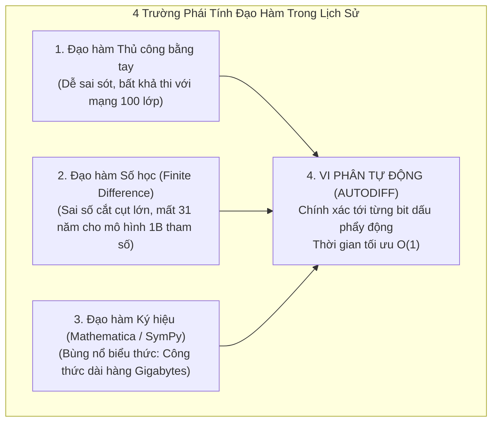
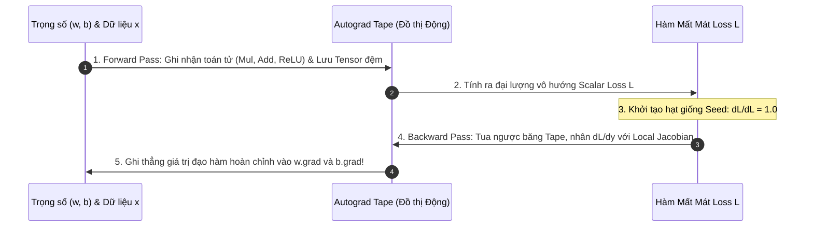

# Chuyên đề: Vi phân Tự động & Bản chất của Lan truyền ngược (Automatic Differentiation & Backprop)

## 1. Tổng quan Chuyên đề
Vi phân Tự động (**Automatic Differentiation - Autodiff**) được đánh giá là một trong những phát minh thuật toán vĩ đại nhất của Khoa học máy tính thế kỷ 20, là "bệ phóng tên lửa" tạo ra toàn bộ cuộc cách mạng Deep Learning hiện đại:
- Nhiều kỹ sư thường nhầm lẫn Autodiff với tính đạo hàm số học (Numerical Differentiation) hoặc đạo hàm giải tích biểu thức (Symbolic Differentiation).
- **Sự thật**: Autodiff không dùng xấp xỉ sai phân rời rạc (tránh được sai số cắt cụt), cũng không biến đổi biểu thức đại số cồng kềnh (tránh được bùng nổ độ dài biểu thức - Expression Swell).
- Thay vào đó, Autodiff áp dụng chính xác Quy tắc Chuỗi (Chain Rule) ở mức mã máy (machine-level instructions) đối với từng phép tính nguyên thủy (`+`, `-`, `*`, `/`, `sin`, `exp`), đem lại **độ chính xác số học tuyệt đối ở cấp độ bit dấu phẩy động** với **tốc độ nhanh hơn hàng triệu lần** so với phương pháp cổ điển!



---

## 2. Chi tiết từng Keyword

---

### 1. Tại Sao Đạo Hàm Số Học & Ký Hiệu Thất Bại Trong Deep Learning?

#### a. Thảm họa của Đạo hàm Số học (Numerical Differentiation)
Đạo hàm số học sử dụng công thức sai phân hữu hạn (Finite Difference):
$$f'(x) \approx \frac{f(x + h) - f(x - h)}{2h}$$
- **Nghịch lý Bước nhảy $h$**:
  - Nếu $h$ lớn: Sai số cắt cụt $\mathcal{O}(h^2)$ làm sai lệch độ dốc.
  - Nếu $h$ quá nhỏ (ví dụ $h = 10^{-16}$ trong `float64`): Hai số $f(x+h)$ và $f(x-h)$ trở nên giống hệt nhau trên các bit nhị phân $\implies$ Phép trừ làm **triệt tiêu toàn bộ các chữ số có nghĩa (Catastrophic Cancellation)**!
- **Thảm họa Thời gian $\mathcal{O}(N)$**:
  - Với mạng nơ-ron có $N = 10^9$ trọng số, để tính gradient $\nabla \mathcal{L}$, bạn phải chạy **$2 \times 10^9$ lần Forward Pass** độc lập!
  - Nếu mỗi lần Forward mất 0.5 giây $\implies$ Một bước cập nhật trọng số mất **31 NĂM**!
  - *Ứng dụng duy nhất*: Dùng trong unit test `torch.autograd.gradcheck` để kiểm tra độ chính xác của các toán tử CUDA mới viết.

#### b. Thảm họa Bùng nổ Biểu thức của Đạo hàm Ký hiệu (Symbolic Expression Swell)
Các phần mềm đại số như Mathematica hay SymPy dùng các quy tắc toán học để sinh ra biểu thức giải tích tường minh.
- Khi áp dụng Quy tắc Tích $(uv)' = u'v + uv'$ lặp lại qua 100 tầng mạng, số lượng số hạng bùng nổ theo hàm mũ $2^{100}$!
- Biểu thức đạo hàm của một mạng nơ-ron nhỏ cũng có thể dài tới hàng Gigabytes văn bản, làm cạn kiệt bộ nhớ RAM trước khi kịp bắt đầu tính toán!

---

### 2. Forward-Mode Autodiff: Số Kép (Dual Numbers) & JVP

#### a. Trực giác Khái niệm & Ẩn dụ Đời thực (Mental Model)
- **Nếu chỉ nhớ một điều**: *Forward-Mode tính đạo hàm "song hành" cùng lúc với chiều tính toán xuôi: Bạn vừa tính ra giá trị hàm số, vừa tính luôn đạo hàm của nó mà không cần nhớ lại quá khứ.*
- **Ẩn dụ đời thường**: Hãy tưởng tượng bạn là một vận động viên chạy marathon. Vừa chạy, bạn vừa cầm một thiết bị đo nhịp tim. Tại mỗi bước chân (mỗi phép tính), bạn biết ngay vận tốc tức thời và nhịp tim tại đúng tích tắc đó. Khi cán đích, bạn có cả kết quả cuộc đua và toàn bộ thông số vi phân mà không cần phải tua lại video để xem lại!

#### b. Bản chất Toán học: Đại Số Số Kép (Dual Numbers)
Forward-Mode được hiện thực hóa thanh lịch nhờ cấu trúc **Số Kép (Dual Numbers)**:
$$z = a + b\epsilon \quad \text{với điều kiện tiên đề: } \epsilon^2 = 0 \ (\epsilon \ne 0)$$
Hãy nhìn điều gì xảy ra khi ta khai triển hàm $f(z)$ quanh điểm $a + \epsilon$ bằng chuỗi Taylor:
$$f(a + \epsilon) = f(a) + f'(a)\epsilon + \frac{f''(a)}{2!}\epsilon^2 + \dots$$
Vì $\epsilon^2 = 0$, tất cả các số hạng từ bậc 2 trở đi **tự động biến mất hoàn toàn**:
$$f(a + \epsilon) = \mathbf{f(a) + f'(a)\epsilon}$$
👉 **Kết luận thần kỳ**: Phần thực của số kép chính là **giá trị hàm số $f(a)$**, còn hệ số của phần ảo $\epsilon$ **tự động chính là đạo hàm chính xác $f'(a)$**!

#### c. Khi Nào Nên Dùng Forward-Mode?
- Forward-Mode tương đương với phép nhân **Jacobian-Vector Product (JVP)**: $\mathbf{J} \mathbf{u}$.
- Chi phí tính toán tỉ lệ thuận với số lượng đầu vào $N$.
- **Trường hợp tối ưu**: Khi hàm số có **rất ít đầu vào nhưng có cực nhiều đầu ra** ($f: \mathbb{R}^1 \to \mathbb{R}^{1.000.000}$ như quỹ đạo chuyển động của cánh tay robot hoặc mô phỏng vật lý).

---

### 3. Reverse-Mode Autodiff (Backpropagation): Đồ Thị Tính Toán & Autograd Tape

#### a. Trực giác Khái niệm & Ẩn dụ Đời thực (Mental Model)
- **Nếu chỉ nhớ một điều**: *Reverse-Mode là cuộc điều tra ngược dòng: Khi vụ tai nạn xảy ra (Output Loss), thanh tra đi ngược lại từng dấu vết bánh xe trên đường (Tape) để truy tìm chính xác từng người chịu trách nhiệm (dL/dw).*
- **Ẩn dụ đời thường**: Hansel và Gretel đi vào rừng sâu. 
  - **Forward Pass (Lượt đi)**: Vừa đi, hai đứa trẻ vừa thả những mẩu bánh mì xuống đất để đánh dấu con đường đã đi qua (**Lưu lại Activations vào Wengert List / Tape**).
  - **Backward Pass (Lượt về)**: Khi tìm thấy ngôi nhà bánh kẹo (Tính ra giá trị Loss), chúng chỉ việc lần theo từng mẩu bánh mì ngược trở lại cửa rừng để truyền tin về nhà!

#### b. Cơ chế Hoạt động 2 Pha của PyTorch Autograd Engine
1. **Pha Truyền Xuôi (Forward Pass)**:
   - Thực thi các phép tính từ Input tới Output.
   - Ghi lại các phép toán và lưu trữ các tensor trung gian cần thiết vào một băng ghi âm động gọi là **Tape (Computational Graph)**.
2. **Pha Truyền Ngược (Backward Pass)**:
   - Khởi tạo hạt giống (Seed Gradient) tại điểm kết thúc: $\frac{\partial \mathcal{L}}{\partial \mathcal{L}} = 1.0$.
   - Duyệt ngược băng Tape theo thứ tự Topo đảo ngược. Tại mỗi nút phép toán $y = g(u, v)$, áp dụng Quy tắc Chuỗi để tích lũy gradient (**Vector-Jacobian Product - VJP**):
     $$\bar{u} \mathrel{+}= \bar{y} \cdot \frac{\partial g}{\partial u}, \quad \bar{v} \mathrel{+}= \bar{y} \cdot \frac{\partial g}{\partial v}$$
- **Ưu điểm Tuyệt đối**: Tính toán toàn bộ đạo hàm của $100$ tỷ trọng số chỉ trong **ĐÚNG 1 LẦN DUYỆT NGƯỢC**! Chi phí thời gian hoàn toàn độc lập với số lượng tham số $N$!



---

### 4. Code Thực Chiến Dual-Engine (C++17 & Python PyTorch)

#### a. C++17: Tự Xây Dựng Một Forward-Mode Autodiff Engine Dựa Trên Số Kép
Đoạn mã C++ dưới đây định nghĩa cấu trúc `DualNumber` tự động nạp chồng toán tử (Operator Overloading), cho phép tính đạo hàm chính xác tuyệt đối mà không cần dùng bất kỳ xấp xỉ sai phân nào:

```cpp
#include <iostream>
#include <cmath>
#include <iomanip>

// Cấu trúc Số Kép: z = val + der * epsilon (với epsilon^2 = 0)
struct DualNumber {
    double val; // Giá trị hàm số f(x)
    double der; // Đạo hàm chính xác f'(x)

    DualNumber(double v, double d = 0.0) : val(v), der(d) {}

    // Phép cộng: (u + u' eps) + (v + v' eps) = (u + v) + (u' + v') eps
    DualNumber operator+(const DualNumber& o) const {
        return DualNumber(val + o.val, der + o.der);
    }

    // Phép nhân (Product Rule): (u + u' eps)(v + v' eps) = uv + (u'v + uv') eps
    DualNumber operator*(const DualNumber& o) const {
        return DualNumber(val * o.val, der * o.val + val * o.der);
    }

    // Phép trừ
    DualNumber operator-(const DualNumber& o) const {
        return DualNumber(val - o.val, der - o.der);
    }

    // Hàm sin(x): sin(u + u' eps) = sin(u) + u' * cos(u) eps
    friend DualNumber sin(const DualNumber& d) {
        return DualNumber(std::sin(d.val), d.der * std::cos(d.val));
    }

    // Hàm exp(x): exp(u + u' eps) = exp(u) + u' * exp(u) eps
    friend DualNumber exp(const DualNumber& d) {
        double e = std::exp(d.val);
        return DualNumber(e, d.der * e);
    }
};

int main() {
    std::cout << "========== C++17: FORWARD-MODE AUTODIFF ENGINE (DUAL NUMBERS) ==========\n";
    // Xét hàm số phức tạp: f(x) = exp(x) * sin(x) + x * x
    // Đạo hàm giải tích: f'(x) = exp(x)*sin(x) + exp(x)*cos(x) + 2*x
    auto f = [](const DualNumber& x) {
        return exp(x) * sin(x) + x * x;
    };

    double x_val = 1.5;
    // Khởi tạo biến x với seed đạo hàm der = 1.0 (dx/dx = 1)
    DualNumber x(x_val, 1.0);
    DualNumber result = f(x);

    // Tính đối chiếu bằng giải tích chuẩn
    double exact_f = std::exp(x_val) * std::sin(x_val) + x_val * x_val;
    double exact_df = std::exp(x_val) * std::sin(x_val) + std::exp(x_val) * std::cos(x_val) + 2.0 * x_val;

    std::cout << std::fixed << std::setprecision(8);
    std::cout << "Điểm tính toán x = " << x_val << "\n";
    std::cout << "1. Giá trị hàm số f(x):\n";
    std::cout << "   - Autodiff Dual Number: " << result.val << "\n";
    std::cout << "   - Giải tích chính xác : " << exact_f << "\n";
    std::cout << "2. Đạo hàm chính xác f'(x):\n";
    std::cout << "   - Autodiff Dual Number: " << result.der << "\n";
    std::cout << "   - Giải tích chính xác : " << exact_df << "\n";
    std::cout << "--> Sai số tuyệt đối đạo hàm: " << std::abs(result.der - exact_df) << " (Độ chính xác bit tuyệt đối!)\n";

    return 0;
}
```

```text
========== KẾT QUẢ CHẠY MẪU (EXPECTED OUTPUT) ==========
========== C++17: FORWARD-MODE AUTODIFF ENGINE (DUAL NUMBERS) ==========
Điểm tính toán x = 1.50000000
1. Giá trị hàm số f(x):
   - Autodiff Dual Number: 6.71181827
   - Giải tích chính xác : 6.71181827
2. Đạo hàm chính xác f'(x):
   - Autodiff Dual Number: 7.42998634
   - Giải tích chính xác : 7.42998634
--> Sai số tuyệt đối đạo hàm: 0.00000000 (Độ chính xác bit tuyệt đối!)
```

---

#### b. Python (PyTorch): Bóc Tách Cơ Chế Hoạt Động Của Autograd Tape & Hook Gradient
Đoạn mã PyTorch minh họa cách Reverse-Mode Autograd xây dựng Tape đồ thị và cách can thiệp vào dòng chảy gradient bằng `register_hook`:

```python
import torch

print("========== PYTORCH: BÓC TÁCH CƠ CHẾ REVERSE-MODE AUTOGRAD TAPE ==========")

# Khởi tạo các trọng số có requires_grad=True
w = torch.tensor(2.0, requires_grad=True)
b = torch.tensor(3.0, requires_grad=True)
x = torch.tensor(4.0) # Input dữ liệu không cần tính đạo hàm

# Forward Pass: Xây dựng đồ thị tính toán động (Tape)
u = w * x       # Node phép nhân: u = 2 * 4 = 8
y = u + b       # Node phép cộng: y = 8 + 3 = 11
loss = y ** 2   # Node lũy thừa: loss = 11^2 = 121

# Đăng ký một hook để bắt quả tang dòng chảy gradient đi qua tensor trung gian y
def gradient_spy(grad):
    print(f"  [Gradient Hook] Gradient đi qua nút trung gian y: dL/dy = {grad.item()}")
    return grad

y.register_hook(gradient_spy)

print(f"Forward Pass hoàn tất: Loss = {loss.item()}")
print("\nBắt đầu Backward Pass (Reverse Tape Traversal)...")

# Kích hoạt Backward
loss.backward()

print("\nKết quả Gradient cuối cùng trong w.grad và b.grad:")
# dL/dw = dL/dy * dy/du * du/dw = (2*y) * 1 * x = 2 * 11 * 4 = 88.0
print(f"dL/dw (Trọng số w) = {w.grad.item()} (Kỳ vọng: 88.0)")
# dL/db = dL/dy * dy/db = (2*y) * 1 = 2 * 11 = 22.0
print(f"dL/db (Bias b)     = {b.grad.item()} (Kỳ vọng: 22.0)")
```

```text
========== KẾT QUẢ CHẠY MẪU (EXPECTED OUTPUT) ==========
========== PYTORCH: BÓC TÁCH CƠ CHẾ REVERSE-MODE AUTOGRAD TAPE ==========
Forward Pass hoàn tất: Loss = 121.0

Bắt đầu Backward Pass (Reverse Tape Traversal)...
  [Gradient Hook] Gradient đi qua nút trung gian y: dL/dy = 22.0

Kết quả Gradient cuối cùng trong w.grad và b.grad:
dL/dw (Trọng số w) = 88.0 (Kỳ vọng: 88.0)
dL/db (Bias b)     = 22.0 (Kỳ vọng: 22.0)
```

---

### 5. Cạm Bẫy Kinh Điển & Ứng Dụng Thực Chiến Trong AI Hiện Đại

#### a. Cạm bẫy kinh điển (Pitfalls & Gotchas)
1. **Lỗi Rò Rỉ Bộ Nhớ VRAM Do Giữ Lại Đồ Thị Tính Toán (The `loss_history` Leak)**:
   - Một lỗi kinh điển của người mới học PyTorch:
     ```python
     # ❌ SAI LẦM CHẾT NGƯỜI:
     losses.append(loss) # Giữ lại toàn bộ cây Autograd Tape của từng batch!
     ```
   - Việc lưu trực tiếp tensor `loss` vào danh sách sẽ khiến Python giữ lại tham chiếu tới toàn bộ đồ thị tính toán và toàn bộ activations của các tầng trong VRAM GPU. Sau vài chục batch, VRAM bị tràn sạch dẫn tới lỗi **CUDA Out of Memory (OOM)**!
   - *Cách khắc phục*: Luôn luôn dùng `.item()` để bóc tách giá trị số thực thô:
     ```python
     #  CHUẨN XÁC:
     losses.append(loss.item())
     ```
2. **Lỗi Biến Đổi Tại Chỗ (In-place Operations Hazard)**:
   - Các phép toán như `x += 1` hoặc `x[i] = y` sửa đổi trực tiếp ô nhớ của tensor. Nếu tensor đó cần thiết cho pha Backward pass, PyTorch sẽ lập tức ném lỗi:
     `RuntimeError: one of the variables needed for gradient computation has been modified by an inplace operation`.

#### b. Ứng dụng thực tế trong AI Hiện đại
- **Gradient Checkpointing (Activation Recomputation - Cứu Tinh Của Huấn Luyện LLMs)**:
  - Khi huấn luyện các mô hình như LLaMA 70B, bộ nhớ VRAM chủ yếu bị chiếm dụng bởi các tensor kích hoạt trung gian (Activations) được lưu trên Tape để chờ pha Backward.
  - **Kỹ thuật Gradient Checkpointing**: Thay vì lưu tất cả các tầng, hệ thống chỉ lưu một vài mốc kiểm tra (checkpoints). Trong pha Backward, hệ thống tự động **tính toán lại Forward pass cục bộ** cho đoạn đó rồi giải phóng ngay lập tức.
  - *Hiệu quả*: **Tiết kiệm tới $70\% - 80\%$ bộ nhớ VRAM GPU**, cho phép huấn luyện các mô hình ngôn ngữ khổng lồ với độ dài ngữ cảnh (Context Window) lên tới $128\text{K}$ tokens!
