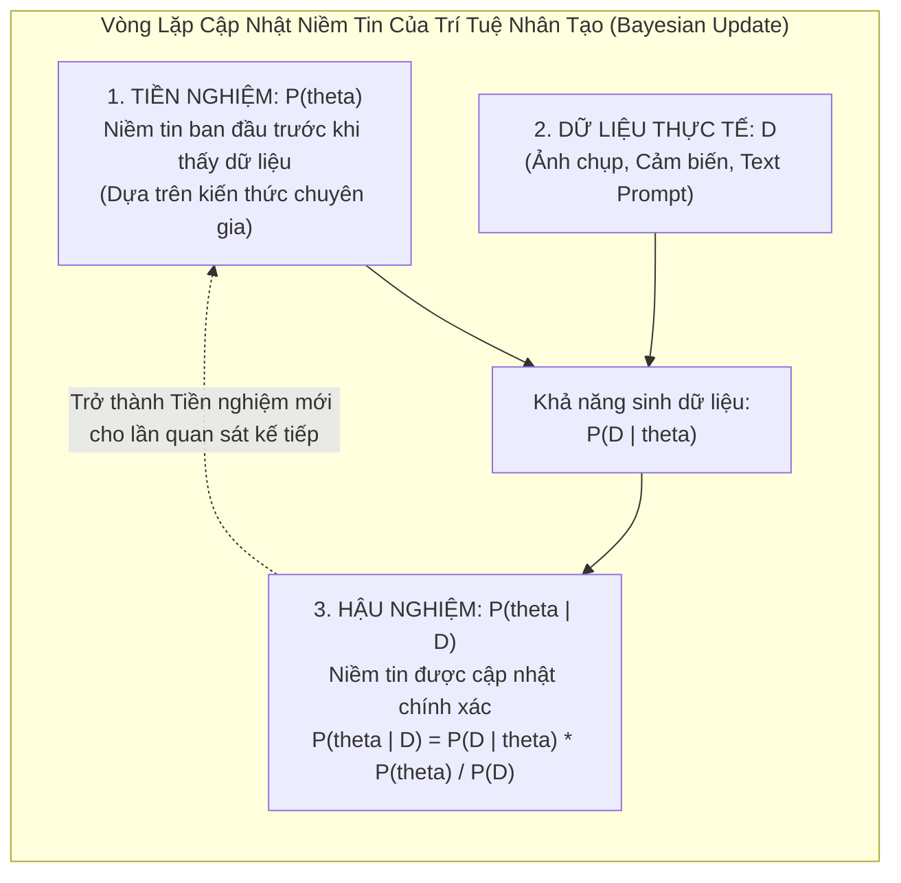
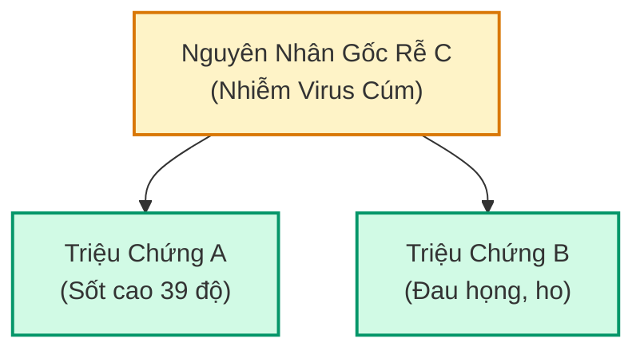
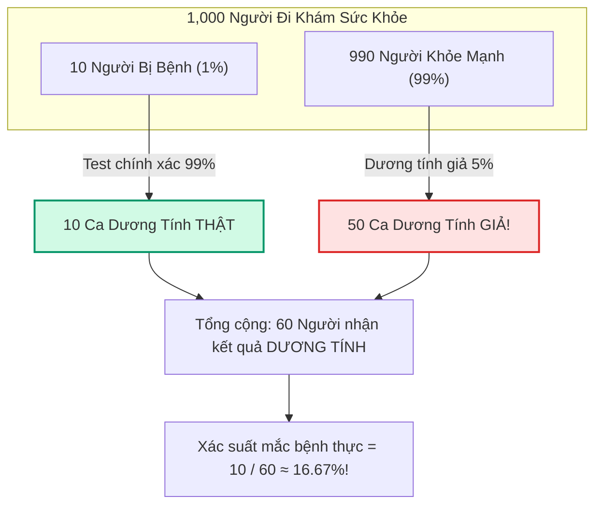

# Chuyên đề: Không gian Xác suất & Định lý Bayes (Probability Spaces & Bayes' Theorem)

## 1. Tổng quan Chuyên đề
Trí tuệ Nhân tạo hiện đại về bản chất là ngành khoa học **đo lường và đưa ra quyết định tối ưu trước sự bất định (Decision Making under Uncertainty)**:
- Một chiếc xe tự hành nhìn thấy một vệt đen trên đường: Đó là cái bóng của tán cây hay là một chiếc hố sâu nguy hiểm?
- Một mô hình ngôn ngữ lớn (LLM) sinh từ tiếp theo: Từ nào trong số 50.000 từ vựng có xác suất phù hợp ngữ cảnh cao nhất $P(w_t \mid w_{<t})$?
- Một bác sĩ AI phân tích phim X-quang: Bệnh nhân thực sự mắc bệnh hay chỉ là hình ảnh nhiễu của máy quét?

Nếu không có Lý thuyết Xác suất, máy tính chỉ là những cỗ máy nhị phân cứng nhắc (hoặc đúng hoặc sai). 
**Định lý Bayes (Bayes' Theorem)** chính là "linh hồn" của trí tuệ: Nó cung cấp cho máy tính một công thức toán học chặt chẽ để **cập nhật niềm tin (Prior $\to$ Posterior)** mỗi khi thu thập thêm dữ liệu quan sát mới từ thế giới thực!



---

## 2. Chi tiết từng Keyword

---

### 1. Không Gian Xác Suất Kolmogorov & Các Tiên Đề (Probability Spaces & Axioms)

#### a. Trực giác Khái niệm & Ẩn dụ Đời thực (Mental Model)
- **Nếu chỉ nhớ một điều**: *Xác suất giống như một chiếc bánh pizza có tổng diện tích bằng 1; mỗi sự kiện là một lát cắt trên chiếc bánh đó.*
- **Ẩn dụ đời thường**: Hãy tưởng tượng một chiếc bánh pizza hoàn chỉnh đại diện cho toàn bộ mọi khả năng có thể xảy ra trong vũ trụ (**Không gian Mẫu $\Omega$**).
  1. Bạn không thể có một lát bánh có diện tích âm ($P(A) \ge 0$).
  2. Toàn bộ chiếc bánh gộp lại có diện tích chuẩn mực bằng đúng $1$ ($P(\Omega) = 1$).
  3. Nếu bạn cắt chiếc bánh thành 3 miếng riêng biệt không dính vào nhau (sự kiện rời nhau), tổng diện tích của 3 miếng gộp lại bằng chính tổng diện tích từng miếng cộng lại: $P(A_1 \cup A_2 \cup A_3) = P(A_1) + P(A_2) + P(A_3)$.
- **Ba Tiên đề Kolmogorov (1933)**: Đây là 3 hòn đá tảng đặt nền móng cho toàn bộ xác suất hiện đại:
  1. **Không âm (Non-negativity)**: $P(A) \ge 0, \ \forall A \in \mathcal{F}$.
  2. **Chuẩn hóa (Normalization)**: $P(\Omega) = 1$.
  3. **Cộng tính đếm được (Countable Additivity)**: Nếu $A_1, A_2, \dots$ rời nhau từng đôi một ($A_i \cap A_j = \emptyset$ với $i \ne j$):
     $$P\left( \bigcup_{i=1}^\infty A_i \right) = \sum_{i=1}^\infty P(A_i)$$

#### b. Bản chất Toán học: Bộ ba $(\Omega, \mathcal{F}, P)$
- $\Omega$ (Sample Space): Không gian mẫu chứa các kết quả thô $\omega$ (ví dụ: gieo xúc xắc $\Omega = \{1, 2, 3, 4, 5, 6\}$).
- $\mathcal{F}$ ($\sigma$-algebra): Họ các sự kiện hợp lệ có thể đo lường được. Trong không gian liên tục $\mathbb{R}$, ta dùng đại số Borel $\mathcal{B}(\mathbb{R})$ để tránh các nghịch lý toán học như nghịch lý Banach-Tarski.
- $P$ (Probability Measure): Ánh xạ đo lường gán mỗi sự kiện một con số trong đoạn $[0, 1]$.

---

### 2. Xác Suất Có Điều Kiện, Đồng Thời & Công Thức Tự Hồi Quy Của LLMs

#### a. Xác suất Đồng thời (Joint) & Xác suất Lề (Marginal)
- **Joint Probability $P(A, B)$**: Xác suất cả hai sự kiện $A$ và $B$ cùng xảy ra.
- **Marginal Probability $P(A)$**: Xác suất của riêng $A$, thu được bằng cách "triệt tiêu" biến $B$ khỏi bảng xác suất 2 chiều:
  $$P(A) = \sum_{b} P(A, B = b) \quad (\text{Rời rạc}) \qquad p(x) = \int p(x, y) dy \quad (\text{Liên tục})$$

#### b. Xác suất Có Điều Kiện (Conditional Probability)
Xác suất để $A$ xảy ra khi biết chắc chắn $B$ đã xảy ra:
$$P(A \mid B) = \frac{P(A \cap B)}{P(B)} \iff P(A \cap B) = P(A \mid B) P(B)$$

#### c. Quy Tắc Nhân Chuỗi (Product Rule) — Trái Tim Của Mô Hình Ngôn Ngữ Tự Hồi Quy (Autoregressive LLMs)
Khi áp dụng quy tắc xác suất có điều kiện liên tiếp cho một chuỗi $T$ từ vựng $\mathbf{x} = (x_1, x_2, \dots, x_T)$:
$$P(x_1, x_2, \dots, x_T) = P(x_1) \cdot P(x_2 \mid x_1) \cdot P(x_3 \mid x_1, x_2) \cdots P(x_T \mid x_1, \dots, x_{T-1}) = \prod_{t=1}^T P(x_t \mid x_{<t})$$
👉 **Ý nghĩa thực tế**: Toàn bộ các mô hình AI ngôn ngữ đột phá nhất thế giới hiện nay như **ChatGPT, Claude, Gemini, LLaMA** đều hoạt động dựa trên đúng công thức xác suất có điều kiện này: Dự đoán phân phối xác suất của từ tiếp theo $x_t$ khi đã biết toàn bộ chuỗi từ ngữ cảnh trong quá khứ $x_{<t}$!

---

### 3. Độc Lập Có Điều Kiện & Mô Hình Chuỗi Markov (Conditional Independence)

#### a. Phân biệt Độc Lập Tuyệt Đối vs Độc Lập Có Điều Kiện
- **Độc lập tuyệt đối ($A \perp B$)**: Biết $B$ không làm thay đổi niềm tin về $A$: $P(A \mid B) = P(A) \iff P(A, B) = P(A) P(B)$.
- **Độc lập có điều kiện ($A \perp B \mid C$)**: Hai sự kiện $A$ và $B$ có thể liên quan mật thiết với nhau, nhưng **một khi đã biết nguyên nhân gốc rễ $C$, việc biết thêm $B$ trở nên thừa thãi**:
  $$P(A, B \mid C) = P(A \mid C) P(B \mid C) \iff P(A \mid B, C) = P(A \mid C)$$



- **Ví dụ thực tế**: Sốt cao ($A$) và Đau họng ($B$) thường đi đôi với nhau (phụ thuộc nhau). Nhưng nếu bác sĩ đã xét nghiệm PCR xác nhận bệnh nhân bị nhiễm Virus cúm ($C$), thì việc bạn có đau họng hay không không làm thay đổi xác suất bạn bị sốt do virus cúm gây ra!

#### b. Ứng dụng trong AI: Naive Bayes & Tính Chất Markov (Markov Property)
1. **Naive Bayes Classifier**: Giả định toàn bộ các từ trong email độc lập có điều kiện khi đã biết email đó là Spam hay Ham:
   $$P(\mathbf{x} \mid y) = \prod_{i=1}^d P(x_i \mid y)$$
2. **Tính chất Markov trong Học Tăng Cường (RL) & Diffusion Models**:
   Trạng thái tương lai $S_{t+1}$ độc lập có điều kiện với toàn bộ quá khứ khi đã biết trạng thái hiện tại $S_t$:
   $$P(S_{t+1} \mid S_t, S_{t-1}, \dots, S_0) = P(S_{t+1} \mid S_t)$$

---

### 4. Định Lý Bayes & Nghịch Lý Xét Nghiệm Y Tế (Bayes' Theorem)

#### a. Bản chất Toán học
Kết hợp Định nghĩa xác suất có điều kiện và Công thức Xác suất Đầy đủ (Law of Total Probability):
$$P(\theta \mid \mathcal{D}) = \frac{P(\mathcal{D} \mid \theta) P(\theta)}{P(\mathcal{D})} = \frac{P(\mathcal{D} \mid \theta) P(\theta)}{\sum_{j} P(\mathcal{D} \mid \theta_j) P(\theta_j)}$$
- **$P(\theta)$ (Prior - Tiền nghiệm)**: Niềm tin ban đầu về giả thuyết $\theta$ trước khi quan sát dữ liệu.
- **$P(\mathcal{D} \mid \theta)$ (Likelihood - Khả năng)**: Mức độ phù hợp của dữ liệu nếu giả thuyết $\theta$ là đúng.
- **$P(\mathcal{D})$ (Evidence / Marginal Likelihood - Bằng chứng)**: Hằng số chuẩn hóa đảm bảo tổng xác suất bằng 1.
- **$P(\theta \mid \mathcal{D})$ (Posterior - Hậu nghiệm)**: Niềm tin sau khi đã dung nạp chứng cứ dữ liệu thực tế.

#### b. Nghịch Lý Xét Nghiệm Bệnh Hiếm (The Base Rate Fallacy)
Hãy xem một ví dụ kinh điển làm sáng tỏ sức mạnh của Định lý Bayes:
- Giả sử một căn bệnh hiếm có tỷ lệ mắc trong cộng đồng là **$1\%$** ($P(\text{Bệnh}) = 0.01$).
- Bệnh viện có một bộ kit xét nghiệm cực kỳ hiện đại với độ chính xác lên tới **$99\%$**:
  - Nếu có bệnh, test dương tính $99\%$: $P(\text{Dương} \mid \text{Bệnh}) = 0.99$.
  - Nếu khỏe mạnh, test báo âm tính $95\%$ (Tỷ lệ dương tính giả là $5\%$): $P(\text{Dương} \mid \text{Khỏe}) = 0.05$.
- Bạn đi khám sức khỏe định kỳ và nhận kết quả: **DƯƠNG TÍNH**.
- **Câu hỏi**: Xác suất thực tế bạn bị mắc bệnh là bao nhiêu? $99\%$ ư?
- **Tính toán theo Bayes**:
  $$P(\text{Dương}) = P(\text{Dương} \mid \text{Bệnh}) P(\text{Bệnh}) + P(\text{Dương} \mid \text{Khỏe}) P(\text{Khỏe})$$
  $$P(\text{Dương}) = (0.99 \times 0.01) + (0.05 \times 0.99) = 0.0099 + 0.0495 = \mathbf{0.0594}$$
  $$P(\text{Bệnh} \mid \text{Dương}) = \frac{P(\text{Dương} \mid \text{Bệnh}) P(\text{Bệnh})}{P(\text{Dương})} = \frac{0.0099}{0.0594} \approx \mathbf{16.67\%}!$$
👉 **Kết luận gây sốc**: Dù cầm trên tay tờ xét nghiệm "chính xác 99%", cơ hội bạn thực sự mắc bệnh **chỉ có 16.67% (tức là có tới hơn 83% khả năng bạn hoàn toàn khỏe mạnh!)**.
- *Nguyên nhân trực giác*: Vì bệnh rất hiếm ($1\%$), trong 1.000 người chỉ có 10 người có bệnh (test ra 10 ca dương thật). Nhưng có tới 990 người khỏe mạnh $\implies$ $5\%$ dương tính giả sinh ra tới **50 ca dương giả**! Khi bạn cầm kết quả dương tính, khả năng bạn rơi vào nhóm 50 ca dương giả cao gấp 5 lần rơi vào nhóm 10 ca dương thật!



---

### 5. Code Thực Chiến Dual-Engine (C++17 & Python NumPy)

#### a. C++17: Cài Đặt Hoàn Chỉnh Bộ Phân Loại Naive Bayes Trong Không Gian Log-Space
Đoạn mã C++ minh họa bộ phân loại văn bản Naive Bayes hoàn chỉnh, sử dụng phép toán cộng trong không gian Log (`log-probabilities`) để chống triệt để lỗi tràn số dưới (Floating-point Underflow) khi nhân hàng nghìn xác suất:

```cpp
#include <iostream>
#include <vector>
#include <string>
#include <cmath>
#include <iomanip>

class NaiveBayesSpamClassifier {
private:
    double log_prior_spam;
    double log_prior_ham;
    // Bảng log likelihood của từng từ vựng: [P(từ | spam), P(từ | ham)]
    std::vector<double> log_lik_spam;
    std::vector<double> log_lik_ham;
    std::vector<std::string> vocabulary;

public:
    NaiveBayesSpamClassifier(std::vector<std::string> vocab, 
                             double prior_spam, 
                             std::vector<double> p_spam, 
                             std::vector<double> p_ham)
        : vocabulary(std::move(vocab)) {
        
        // Chuyển toàn bộ xác suất sang Log-Space: log(P1 * P2) = log(P1) + log(P2)
        log_prior_spam = std::log(prior_spam);
        log_prior_ham = std::log(1.0 - prior_spam);

        for (double p : p_spam) log_lik_spam.push_back(std::log(p));
        for (double p : p_ham) log_lik_ham.push_back(std::log(p));
    }

    // Dự đoán phân loại email
    void classify(const std::string& email_name, const std::vector<int>& word_counts) const {
        double score_spam = log_prior_spam;
        double score_ham = log_prior_ham;

        for (size_t i = 0; i < word_counts.size(); ++i) {
            score_spam += word_counts[i] * log_lik_spam[i];
            score_ham += word_counts[i] * log_lik_ham[i];
        }

        // Tính xác suất hậu nghiệm chuẩn hóa bằng Softmax Log-Sum-Exp 2 lớp
        double max_score = std::max(score_spam, score_ham);
        double prob_spam = std::exp(score_spam - max_score) / 
                          (std::exp(score_spam - max_score) + std::exp(score_ham - max_score));

        std::cout << std::fixed << std::setprecision(4);
        std::cout << "Email: [" << email_name << "]\n";
        std::cout << "  - Log Score Spam: " << score_spam << " | Log Score Ham: " << score_ham << "\n";
        std::cout << "  - Xác suất là Spam (Posterior): " << (prob_spam * 100.0) << "%\n";
        std::cout << "  --> KẾT LUẬN: " << (prob_spam >= 0.5 ? "🚨 THƯ RÁC (SPAM)" : "✅ THƯ BÌNH THƯỜNG (HAM)") << "\n\n";
    }
};

int main() {
    std::cout << "========== C++17: NAIVE BAYES SPAM CLASSIFIER IN LOG-SPACE ==========\n";
    // Tập từ vựng nhận diện: ["trúng_thưởng", "tiền_tỷ", "cuộc_họp", "báo_cáo"]
    std::vector<std::string> vocab = {"trúng_thưởng", "tiền_tỷ", "cuộc_họp", "báo_cáo"};

    // Tiền nghiệm: 30% email đến là spam
    double prior_spam = 0.3;

    // Xác suất từ xuất hiện trong Spam vs Ham
    std::vector<double> p_spam = {0.80, 0.70, 0.05, 0.02}; // Thường chứa từ trúng thưởng
    std::vector<double> p_ham  = {0.01, 0.02, 0.60, 0.50}; // Thường chứa từ cuộc họp

    NaiveBayesSpamClassifier classifier(vocab, prior_spam, p_spam, p_ham);

    // Email 1: "Bạn đã trúng thưởng tiền tỷ" -> [1, 1, 0, 0]
    classifier.classify("Thông báo giải thưởng độc đắc", {1, 1, 0, 0});

    // Email 2: "Kế hoạch cuộc họp và báo cáo tiến độ" -> [0, 0, 1, 1]
    classifier.classify("Lịch họp đầu tuần", {0, 0, 1, 1});

    return 0;
}
```

```text
========== KẾT QUẢ CHẠY MẪU (EXPECTED OUTPUT) ==========
========== C++17: NAIVE BAYES SPAM CLASSIFIER IN LOG-SPACE ==========
Email: [Thông báo giải thưởng độc đắc]
  - Log Score Spam: -1.7824 | Log Score Ham: -8.5746
  - Xác suất là Spam (Posterior): 99.8878%
  --> KẾT LUẬN: 🚨 THƯ RÁC (SPAM)

Email: [Lịch họp đầu tuần]
  - Log Score Spam: -8.1187 | Log Score Ham: -1.5583
  - Xác suất là Spam (Posterior): 0.1415%
  --> KẾT LUẬN: ✅ THƯ BÌNH THƯỜNG (HAM)
```

---

#### b. Python (NumPy): Minh Họa Cập Nhật Bayes Trực Quan Theo Thời Gian
Đoạn mã Python mô phỏng một robot AI cập nhật niềm tin về chất lượng của một đồng xu (Fair vs Biased) sau mỗi lần tung:

```python
import numpy as np

print("========== PYTHON: MÔ PHỎNG CẬP NHẬT NIỀM TIN BAYES LIÊN TỤC ==========")

# Giả thuyết: Đồng xu này có phải là đồng xu gian lận không?
# H0: Đồng xu cân đối P(Ngửa) = 0.5
# H1: Đồng xu gian lận P(Ngửa) = 0.8
p_head_given_H0 = 0.5
p_head_given_H1 = 0.8

# Niềm tin ban đầu (Prior): 50-50 không thiên vị
prior_H1 = 0.5

# Chuỗi kết quả 5 lần tung liên tiếp đều ra Ngửa: ['H', 'H', 'H', 'H', 'H']
flips = ['Ngửa', 'Ngửa', 'Ngửa', 'Ngửa', 'Ngửa']

print(f"Niềm tin ban đầu P(Đồng xu gian lận) = {prior_H1:.1%}\n")

current_prior = prior_H1
for i, flip in enumerate(flips, 1):
    # Likelihood của quan sát hiện tại
    lik_H0 = p_head_given_H0
    lik_H1 = p_head_given_H1
    
    # Evidence chuẩn hóa
    evidence = lik_H1 * current_prior + lik_H0 * (1.0 - current_prior)
    
    # Tính Posterior theo Bayes
    posterior_H1 = (lik_H1 * current_prior) / evidence
    
    print(f"Lần tung #{i}: Ra [{flip}] --> Niềm tin cập nhật P(Gian lận) = {posterior_H1:.2%}")
    # Hậu nghiệm của bước này trở thành Tiền nghiệm cho bước tiếp theo!
    current_prior = posterior_H1
```

```text
========== KẾT QUẢ CHẠY MẪU (EXPECTED OUTPUT) ==========
========== PYTHON: MÔ PHỎNG CẬP NHẬT NIỀM TIN BAYES LIÊN TỤC ==========
Niềm tin ban đầu P(Đồng xu gian lận) = 50.0%

Lần tung #1: Ra [Ngửa] --> Niềm tin cập nhật P(Gian lận) = 61.54%
Lần tung #2: Ra [Ngửa] --> Niềm tin cập nhật P(Gian lận) = 71.86%
Lần tung #3: Ra [Ngửa] --> Niềm tin cập nhật P(Gian lận) = 80.32%
Lần tung #4: Ra [Ngửa] --> Niềm tin cập nhật P(Gian lận) = 86.75%
Lần tung #5: Ra [Ngửa] --> Niềm tin cập nhật P(Gian lận) = 91.26%
```

---

### 6. Cạm Bẫy Kinh Điển & Ứng Dụng Thực Chiến Trong AI Hiện Đại

#### a. Cạm bẫy kinh điển (Pitfalls & Gotchas)
1. **Lỗi Tràn Số Dưới Khi Nhân Xác Suất (Underflow Hazard)**:
   - Khi tính xác suất của một văn bản 1.000 từ, nhân 1.000 số có giá trị nhỏ:
     $$P(\mathbf{x}) = 0.01^{1000} = 10^{-2000}$$
   - Độ chính xác nhỏ nhất của chuẩn dấu phẩy động 64-bit IEEE 754 chỉ tới xấp xỉ $10^{-308}$. Số $10^{-2000}$ sẽ lập tức bị máy tính làm tròn về **$0.0$ tuyệt đối (Underflow)**!
   - *Cách khắc phục*: Luôn luôn làm việc trong không gian **Log-Probabilities**: $\sum_{i} \log P(x_i)$.
2. **Cạm bẫy Tần số Bằng Không (Zero-Frequency Problem)**:
   - Trong Naive Bayes, nếu một từ chưa từng xuất hiện trong tập huấn luyện của nhãn Spam, thì $P(\text{từ} \mid \text{Spam}) = 0$.
   - Khi gặp một email chứa từ đó, phép nhân chuỗi sẽ biến toàn bộ xác suất thành **0 tuyệt đối**, xóa sạch thông tin của hàng ngàn từ còn lại!
   - *Cách khắc phục*: Kỹ thuật làm mịn Laplace (**Laplace Smoothing**): Cộng thêm 1 vào tử số và $|V|$ vào mẫu số.

#### b. Ứng dụng thực tế trong AI Hiện đại
- **Mối Quan Hệ Kỳ Diệu Giữa MAP (Maximum A Posteriori) và L2 Regularization (Weight Decay)**:
  - Khi ước lượng trọng số mạng nơ-ron theo nguyên lý Bayes:
    $$\arg\max_{\mathbf{w}} P(\mathbf{w} \mid \mathcal{D}) = \arg\max_{\mathbf{w}} \left[ \ln P(\mathcal{D} \mid \mathbf{w}) + \ln P(\mathbf{w}) \right]$$
  - Nếu ta đặt một giả định Tiền nghiệm (Prior) rằng trọng số $\mathbf{w}$ tuân theo phân phối chuẩn tắc Gaussian $\mathcal{N}(\mathbf{0}, \sigma^2 \mathbf{I})$:
    $$\ln P(\mathbf{w}) = -\frac{1}{2\sigma^2} \|\mathbf{w}\|_2^2 + \text{const}$$
  - Phép trừ này chính là **số hạng Weight Decay (L2 Regularization $\frac{\lambda}{2} \|\mathbf{w}\|_2^2$)** mà ta dùng trong optimizer AdamW! Hóa ra, kỹ thuật chống Overfitting bằng Weight Decay thực chất chính là **việc áp đặt một niềm tin tiên nghiệm Bayes vào mô hình**!
