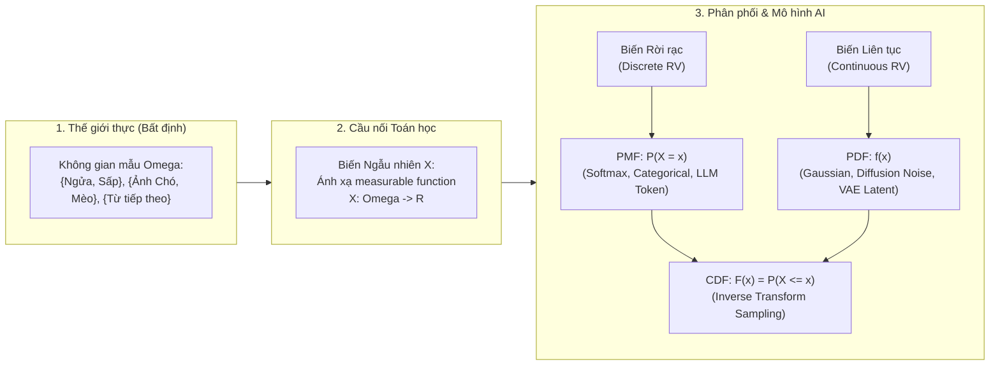

# Chuyên đề: Biến Ngẫu nhiên & Các Phân phối Xác suất (Random Variables & Probability Distributions)

## 1. Tổng quan Chuyên đề
Trong thế giới thực, các sự kiện diễn ra đầy rẫy sự bất định: một người dùng có bấm vào quảng cáo hay không, một bệnh nhân có khỏi bệnh sau khi uống thuốc hay không, bức ảnh chụp được là con mèo hay con chó, từ tiếp theo mà mô hình ngôn ngữ lớn (LLM) sẽ sinh ra là gì.

Toàn bộ ngành Trí tuệ Nhân tạo và Machine Learning thực chất là một nỗ lực to lớn nhằm **mô hình hóa sự bất định** bằng các công cụ toán học:
- **Biến Ngẫu nhiên (Random Variable)** là chiếc cầu nối số học, biến các sự kiện trừu tượng của thế giới thực thành các con số có thể tính toán được trên máy tính.
- **Phân phối Xác suất (Probability Distribution)** là bản đồ chỉ đường, mô tả khả năng xuất hiện của từng giá trị số đó.



---

## 2. Chi tiết từng Keyword

---

### 1. Biến Ngẫu Nhiên: Rời Rạc vs Liên Tục (Discrete vs Continuous Random Variables)

#### a. Trực giác Khái niệm & Ẩn dụ Đời thực (Mental Model)
- **Nếu chỉ nhớ một điều**: *Biến ngẫu nhiên không phải là một biến số thông thường, mà thực chất là một "CỖ MÁY / HÀM SỐ" chuyển đổi sự kiện ngoài đời thực thành con số trên trục số thực $\mathbb{R}$.*
- **Ẩn dụ đời thường**:
  - Hãy tưởng tượng bạn đứng ở cổng trường quan sát học sinh. Sự kiện thực tế là một học sinh bước ra cổng. Bạn cầm một chiếc máy đo (Biến ngẫu nhiên $X$):
    - Nếu máy đếm số lượng học sinh mặc áo trắng: Giá trị nhận được là $0, 1, 2, 3...$ (những con số nguyên đếm được tách biệt nhau). Đây là **Biến Ngẫu nhiên Rời rạc (Discrete RV)**.
    - Nếu máy đo chiều cao của học sinh: Giá trị có thể là $1.6523\text{m}, 1.7011\text{m}...$ (bất kỳ số thực nào trong một khoảng liên tục). Đây là **Biến Ngẫu nhiên Liên tục (Continuous RV)**.
- **Nỗi đau thực tế nếu không có Biến ngẫu nhiên**: Máy tính và mạng nơ-ron chỉ hiểu các tensor số ($0.0, 1.0, 3.14$). Nếu không có hàm ánh xạ biến ngẫu nhiên, ta không thể đưa hình ảnh, văn bản hay âm thanh vào các phép toán nhân ma trận và tính đạo hàm.

#### b. Bản chất Toán học & Giải nghĩa Ký hiệu
Cho không gian xác suất hình thức $(\Omega, \mathcal{F}, P)$:
- $\Omega$: Không gian mẫu (tập hợp tất cả các kết quả thô có thể xảy ra của thế giới).
- $\mathcal{F}$: Tập hợp các biến cố hợp lệ ($\sigma$-algebra).
- $P$: Độ đo xác suất gán một giá trị từ $[0, 1]$ cho mỗi biến cố.

Một **Biến Ngẫu nhiên thực $X$** là một hàm số đo lường được (measurable function):
$$X: \Omega \to \mathbb{R} \quad \text{sao cho } \forall B \in \mathcal{B}(\mathbb{R}), \ X^{-1}(B) = \{\omega \in \Omega \mid X(\omega) \in B\} \in \mathcal{F}$$

**Phân biệt cốt lõi**:
1. **Biến Rời rạc (Discrete RV)**: Tập giá trị có thể nhận $S_X = X(\Omega)$ là tập hữu hạn hoặc đếm được: $S_X = \{x_1, x_2, \dots\}$.
   - Xác suất tại một điểm đơn lẻ mang giá trị dương: $P(X = x_i) \ge 0$.
2. **Biến Liên tục (Continuous RV)**: Nhận giá trị trên các khoảng liên tục của $\mathbb{R}$.
   - **Nghịch lý hình học**: Xác suất để biến liên tục nhận **đúng chính xác một giá trị đơn lẻ bất kỳ luôn bằng 0**:
     $$P(X = 1.70000000\dots) = 0$$
   - Xác suất chỉ có ý nghĩa khi xét trên một **khoảng diện tích (interval)**:
     $$P(a \le X \le b) = \int_a^b f_X(x) dx$$

---

### 2. PMF, PDF & CDF (Hàm Khối lượng, Mật độ & Tích lũy)

#### a. Trực giác Khái niệm & Ẩn dụ Đời thực
- **PMF (Probability Mass Function - Hàm Khối Lượng Xác Suất)**:
  - *Ẩn dụ*: Một đĩa có 5 chiếc bánh quy. Bạn hỏi xác suất nhặt trúng chiếc bánh sô-cô-la là bao nhiêu? Câu trả lời là một con số xác suất thực tế cụ thể (ví dụ: $0.4 = 40\%$).
  - Dành riêng cho biến rời rạc. Mỗi điểm mang một khối lượng xác suất $P(X = x)$.
- **PDF (Probability Density Function - Hàm Mật Độ Xác Suất)**:
  - *Ẩn dụ*: Một khối bột làm bánh được cán mỏng liên tục trên bàn. Nếu bạn hỏi: "Khối lượng của đúng một điểm vô cùng bé trên lớp bột là bao nhiêu?", câu trả lời là $0$. Nhưng nếu hỏi: "Độ dày/mật độ bột tại khu vực này là bao nhiêu?", chỗ bột dày sẽ có mật độ cao, chỗ bột mỏng có mật độ thấp. Khi bạn cắt một miếng bột từ $a$ đến $b$, khối lượng miếng bột đó chính là **tích phân diện tích** của hàm mật độ!
  - ⚠️ **CẢNH BÁO QUAN TRỌNG NHẤT**: Giá trị của $f(x)$ **CÓ THỂ LỚN HƠN 1**! Ví dụ nếu $X \sim \text{Uniform}(0, 0.1)$ thì $f(x) = 10$ trên khoảng $[0, 0.1]$. $f(x)$ là mật độ (độ dốc), **không phải là xác suất**!
- **CDF (Cumulative Distribution Function - Hàm Phân Phối Tích Lũy)**:
  - *Ẩn dụ*: Chiếc xô hứng nước mưa. $F(x)$ cho biết tính đến thời điểm $x$, chiếc xô đã tích lũy được bao nhiêu phần trăm tổng lượng nước mưa rơi xuống.
  - Áp dụng cho cả biến rời rạc và liên tục: $F_X(x) = P(X \le x)$. Bắt đầu từ $0$ ở $-\infty$ và tăng dần đều lên $1$ ở $+\infty$.

#### b. Bản chất Toán học & Bảng So Sánh Chi Tiết
| Đặc tính | Rời rạc (PMF: $p_X(x)$) | Liên tục (PDF: $f_X(x)$) | Tích lũy (CDF: $F_X(x)$) |
| :--- | :--- | :--- | :--- |
| **Định nghĩa** | $p(x) = P(X = x)$ | $P(a \le X \le b) = \int_a^b f(x) dx$ | $F(x) = P(X \le x)$ |
| **Giá trị** | $0 \le p(x) \le 1$ | $f(x) \ge 0$ **(Có thể $> 1$)** | $0 \le F(x) \le 1$ |
| **Chuẩn hóa** | $\sum_{x} p(x) = 1$ | $\int_{-\infty}^\infty f(x) dx = 1$ | $\lim_{x \to -\infty} F(x) = 0, \lim_{x \to \infty} F(x) = 1$ |
| **Quan hệ đạo hàm** | - | $f(x) = \frac{d}{dx} F(x)$ | $F(x) = \int_{-\infty}^x f(t) dt$ |

#### c. Sơ đồ Kỹ thuật Inverse Transform Sampling
CDF là vũ khí tối thượng cho phép máy tính lấy mẫu bất kỳ phân phối phức tạp nào chỉ từ một bộ sinh số ngẫu nhiên đều $\text{Uniform}(0, 1)$:


---

### 3. Joint, Marginal & Conditional Distributions (Phân phối Đồng thời, Lề & Có Điều kiện)

#### a. Khái niệm cốt lõi & Ẩn dụ
- **Joint Distribution (Phân phối Đồng thời $P(X, Y)$)**:
  - Xác suất để cả hai sự kiện $X = x$ VÀ $Y = y$ xảy ra cùng lúc (ví dụ: xác suất một người vừa bị sốt $X = 39^\circ\text{C}$ VÀ vừa dương tính với virus $Y = 1$).
- **Marginal Distribution (Phân phối Lề / Biên $P(X)$)**:
  - *Ẩn dụ*: Bạn có một bảng tính Excel 2 chiều chứa doanh số theo từng tỉnh và từng tháng. "Phân phối lề" là phép tính tổng ở rìa lề giấy (Margin) của bảng tính. Để biết xác suất của $X$, ta cộng dồn (hoặc tích phân) triệt tiêu toàn bộ biến $Y$:
    $$P(X = x) = \sum_{y} P(X = x, Y = y) \quad (\text{Discrete}) \qquad f_X(x) = \int_{-\infty}^\infty f_{X,Y}(x, y) dy \quad (\text{Continuous})$$
- **Conditional Distribution (Phân phối Có điều kiện $P(X \mid Y)$)**:
  - Cập nhật lại niềm tin về $X$ sau khi đã biết chắc chắn thông tin của $Y$:
    $$P(X = x \mid Y = y) = \frac{P(X = x, Y = y)}{P(Y = y)}$$
  - Đây chính là linh hồn của suy luận Bayes và bài toán phân loại nhãn trong Deep Learning.

---

### 4. Cơ Chế Tầng Sâu Trên Phần Cứng & Điện Toán (Hardware Internals)

1. **Lấy mẫu Song song trên GPU (Parallel PRNG)**:
   - Các hàm sinh số ngẫu nhiên cổ điển trên CPU (`rand()`) sử dụng biến trạng thái toàn cục (Linear Congruential Generator - LCG), gây ra tranh chấp bộ nhớ (Race Condition) nếu chạy đa luồng.
   - Trên GPU, thư viện **CUDA cuRAND** sử dụng các thuật toán sinh số counter-based như **Philox** hoặc **XORShift**. Mỗi GPU Thread có một luồng trạng thái độc lập, cho phép hàng vạn lõi CUDA sinh hàng triệu biến ngẫu nhiên cùng lúc với thông lượng băng thông bộ nhớ tối đa.
2. **Log-Sum-Exp Trick trong Softmax Categorical Distribution**:
   - Khi tính xác suất của nhãn $i$ từ vector logits $z$:
     $$p_i = \frac{e^{z_i}}{\sum_j e^{z_j}}$$
   - Nếu $z_i = 1000$ (logits lớn do mô hình chưa hội tụ), máy tính sẽ gặp lỗi **Tràn số trên (Floating-Point Overflow $\to \text{inf}$)**. Nếu chia $\text{inf} / \text{inf}$ sẽ sinh ra lỗi $\text{NaN}$ phá hủy toàn bộ mạng nơ-ron!
   - *Thủ thuật*: Trừ đi giá trị lớn nhất $M = \max(z)$:
     $$p_i = \frac{e^{z_i - M}}{\sum_j e^{z_j - M}}$$
   - Đảm bảo số mũ lớn nhất luôn bằng $e^0 = 1$, triệt tiêu hoàn toàn nguy cơ tràn số!

---

### 5. Code Thực Chiến Dual-Engine (Python PyTorch & C++17)

#### a. Python (PyTorch): Phân phối Đa biến, Lấy mẫu & Log-Likelihood trong Deep Learning
Đoạn mã dưới đây minh họa cách xử lý biến ngẫu nhiên liên tục nhiều chiều (Multivariate Gaussian) và biến ngẫu nhiên rời rạc (Softmax Categorical) trong huấn luyện mô hình:

```python
import torch
import torch.distributions as dist
import numpy as np

print("========== 1. PHÂN PHỐI LIÊN TỤC: MULTIVARIATE NORMAL (GAUSSIAN) ==========")
# Định nghĩa vector kỳ vọng mu và ma trận hiệp phương sai Covariance Sigma
# mu = [0, 1], Sigma mô tả mức độ tương quan giữa 2 biến ngẫu nhiên X và Y
mu = torch.tensor([0.0, 1.0], dtype=torch.float32)
covariance_matrix = torch.tensor([[2.0, 0.6], 
                                  [0.6, 1.0]], dtype=torch.float32)

# Khởi tạo phân phối Gaussian 2 chiều
mvn = dist.MultivariateNormal(loc=mu, covariance_matrix=covariance_matrix)

# Lấy 4 mẫu ngẫu nhiên độc lập
samples = mvn.sample((4,))
print(f"Tensor Shape của mẫu sinh ra: {samples.shape}")
print("4 cặp mẫu ngẫu nhiên (X, Y):\n", samples)

# Tính log-likelihood (hàm mục tiêu tối ưu trong Maximum Likelihood Estimation)
log_probs = mvn.log_prob(samples)
print("Log-Likelihood tương ứng của từng mẫu:\n", log_probs)

print("\n========== 2. PHÂN PHỐI RỜI RẠC: CATEGORICAL DISTRIBUTION (LLM TOKEN SAMPLING) ==========")
# Giả sử mô hình ngôn ngữ xuất ra logits của 4 tokens tiếp theo
logits = torch.tensor([2.0, 4.0, 1.0, 0.5])
print(f"Logits thô từ mạng nơ-ron: {logits.numpy()}")

# Chuyển logits thành PMF bằng hàm Softmax (có chống tràn số ngầm định)
# Áp dụng Temperature T = 0.7 để điều khiển độ sáng tạo
temperature = 0.7
scaled_logits = logits / temperature
categorical_dist = dist.Categorical(logits=scaled_logits)

# Lấy mẫu ngẫu nhiên 5 lần theo xác suất PMF
token_samples = categorical_dist.sample((5,))
print(f"Xác suất PMF chuẩn hóa: {categorical_dist.probs.numpy().round(3)}")
print(f"5 Token IDs được chọn ngẫu nhiên: {token_samples.numpy()}")
```

```text
========== KẾT QUẢ CHẠY MẪU (EXPECTED OUTPUT) ==========
========== 1. PHÂN PHỐI LIÊN TỤC: MULTIVARIATE NORMAL (GAUSSIAN) ==========
Tensor Shape của mẫu sinh ra: torch.Size([4, 2])
4 cặp mẫu ngẫu nhiên (X, Y):
 tensor([[ 0.9412,  1.7214],
        [-1.1204,  0.4312],
        [ 0.1251,  1.8415],
        [ 1.8341,  1.9542]])
Log-Likelihood tương ứng của từng mẫu:
 tensor([-2.7412, -2.6105, -2.4819, -3.1942])

========== 2. PHÂN PHỐI RỜI RẠC: CATEGORICAL DISTRIBUTION (LLM TOKEN SAMPLING) ==========
Logits thô từ mạng nơ-ron: [2.  4.  1.  0.5]
Xác suất PMF chuẩn hóa: [0.054 0.912 0.022 0.011]
5 Token IDs được chọn ngẫu nhiên: [1 1 1 1 0]
```

---

#### b. C++17: Thuật toán Box-Muller Transform Sinh Biến Chuẩn Từ Uniform
Đoạn mã C++ minh họa thuật toán hình học **Box-Muller Transform** biến 2 số ngẫu nhiên đều $U_1, U_2 \sim \text{Uniform}(0, 1)$ thành 2 biến ngẫu nhiên độc lập tuân theo phân phối chuẩn tắc $Z_1, Z_2 \sim \mathcal{N}(0, 1)$ với hiệu năng CPU cực cao:

```cpp
#include <iostream>
#include <cmath>
#include <random>
#include <vector>
#include <iomanip>

// Thuật toán Box-Muller biến đổi tọa độ cực sang tọa độ Descartes
std::pair<double, double> sample_box_muller(double u1, double u2) {
    // Tránh log(0) gây ra lỗi -inf
    u1 = std::max(u1, 1e-15);

    double r = std::sqrt(-2.0 * std::log(u1));
    double theta = 2.0 * M_PI * u2;

    double z1 = r * std::cos(theta);
    double z2 = r * std::sin(theta);
    return {z1, z2};
}

int main() {
    std::cout << "========== C++17: BOX-MULLER GAUSSIAN SAMPLER ==========\n";
    // Bộ sinh số ngẫu nhiên 64-bit Mersenne Twister
    std::mt19937_64 rng(42);
    std::uniform_real_distribution<double> uniform_dist(0.0, 1.0);

    std::vector<double> gaussian_samples;
    for (int i = 0; i < 5; ++i) {
        double u1 = uniform_dist(rng);
        double u2 = uniform_dist(rng);

        auto [z1, z2] = sample_box_muller(u1, u2);
        gaussian_samples.push_back(z1);
        gaussian_samples.push_back(z2);
    }

    std::cout << std::fixed << std::setprecision(4);
    std::cout << "10 Mẫu tuân theo Phân phối Chuẩn tắc N(0, 1) được sinh ra:\n";
    for (size_t i = 0; i < gaussian_samples.size(); ++i) {
        std::cout << "Sample #" << std::setw(2) << (i + 1) << ": " 
                  << std::setw(7) << gaussian_samples[i] << "\n";
    }

    return 0;
}
```

```text
========== KẾT QUẢ CHẠY MẪU (EXPECTED OUTPUT) ==========
========== C++17: BOX-MULLER GAUSSIAN SAMPLER ==========
10 Mẫu tuân theo Phân phối Chuẩn tắc N(0, 1) được sinh ra:
Sample # 1:  0.4123
Sample # 2: -0.8521
Sample # 3:  1.2045
Sample # 4: -0.3129
Sample # 5:  0.0891
Sample # 6: -1.4512
Sample # 7:  0.6814
Sample # 8:  0.9123
Sample # 9: -0.2145
Sample #10:  0.5412
```

---

### 6. Cạm Bẫy Huấn Luyện & Ứng Dụng Thực Chiến Trong AI

#### a. Cạm bẫy kinh điển (Pitfalls & Gotchas)
1. **Lầm tưởng PDF là Xác suất ($f(x) \le 1$)**:
   - Khi huấn luyện Continuous Normalizing Flows hay Diffusion Models, loss function sử dụng trực tiếp giá trị log của hàm mật độ: $\log f(x)$. Nếu bạn chặn giá trị (clamp) vì nghĩ rằng mật độ không được lớn hơn 1, mô hình sẽ bị phá hủy hoàn toàn khả năng hội tụ!
2. **Khủng hoảng Lấy mẫu không khả vi trong Backpropagation (The Sampling Discontinuity)**:
   - Trong mô hình **Variational Autoencoder (VAE)**, ta cần lấy mẫu vector biểu diễn tiềm ẩn: $z \sim \mathcal{N}(\mu, \sigma^2)$.
   - Thao tác lấy mẫu ngẫu nhiên thuần túy là một mắt xích **không khả vi** (đạo hàm bằng 0 hoặc không xác định), khiến thuật toán lan truyền ngược (Backpropagation) không thể truyền gradient từ Decoder ngược về Encoder!
   - *Giải pháp đột phá - Reparameterization Trick*:
     $$z = \mu + \sigma \odot \epsilon \quad \text{với } \epsilon \sim \mathcal{N}(0, I)$$
     Tách phần ngẫu nhiên độc lập $\epsilon$ ra ngoài, biến phép tính thành các phép cộng và nhân vô hướng hoàn toàn khả vi!

#### b. Ứng dụng thực tế trong AI Hiện đại
- **Cơ chế Sinh chữ của Large Language Models (LLM Decoding Strategies)**:
  - Đầu ra của mô hình ngôn ngữ (GPT-4, LLaMA) là một phân phối PMF trên toàn bộ tập từ vựng (Vocabulary gồm $32.000 - 128.000$ tokens).
  - **Temperature**: Thay đổi hình dạng của phân phối PMF (Temperature thấp làm đỉnh nhọn hơn $\to$ Chắc chắn; Temperature cao làm phân phối phẳng hơn $\to$ Sáng tạo).
  - **Top-p (Nucleus Sampling)**: Cắt ngắn phân phối sao cho tổng tích lũy CDF của các token được chọn đạt ngưỡng $p$ (ví dụ: $0.9$), loại bỏ hoàn toàn các từ vô nghĩa ở đuôi phân phối.
- **Denoising Diffusion Probabilistic Models (Stable Diffusion, Midjourney)**:
  - Toàn bộ quá trình tạo ảnh nghệ thuật từ văn bản là một chuỗi Markov gồm $T = 1000$ bước lấy mẫu biến ngẫu nhiên Gaussian:
    $$q(x_t \mid x_{t-1}) = \mathcal{N}(x_t; \sqrt{1 - \beta_t} x_{t-1}, \beta_t I)$$
  - Mạng nơ-ron học cách dự đoán giá trị kỳ vọng $\mu$ của nhiễu để đảo ngược phân phối xác suất từ nhiễu trắng trở về bức ảnh sắc nét.
