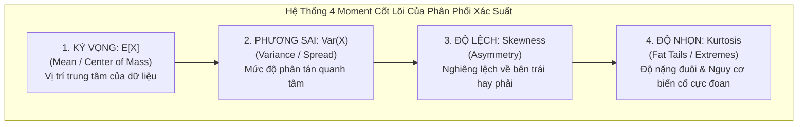
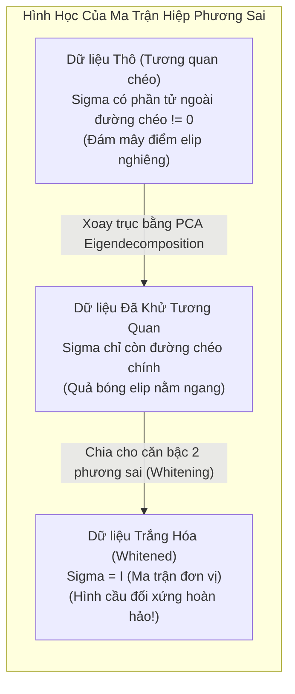

# Chuyên đề: Kỳ vọng, Phương sai, Ma trận Hiệp phương sai & Các Moment (Moments, Expectations & Covariance)

## 1. Tổng quan Chuyên đề
Trong việc thiết kế và huấn luyện các mô hình Machine Learning, chúng ta không thể khảo sát chi tiết từng điểm dữ liệu trong một phân phối xác suất vô hạn. Thay vào đó, các nhà khoa học tóm tắt toàn bộ hình dáng và đặc tính cốt lõi của một phân phối thông qua các **Moments (Mô-men)**:
- **Moment bậc 1 (Kỳ vọng $\mathbb{E}[X]$)**: Cho biết vị trí "trọng tâm khối lượng" của dữ liệu nằm ở đâu.
- **Moment bậc 2 (Phương sai $\text{Var}(X)$)**: Đo lường độ bất định, mức độ phân tán và rung lắc quanh trọng tâm.
- **Hiệp phương sai & Ma trận Hiệp phương sai ($\boldsymbol{\Sigma}$)**: Đo lường mức độ tương quan tuyến tính giữa các chiều dữ liệu — nền tảng của thuật toán **PCA**, giảm chiều dữ liệu và mô hình **Gaussian Mixture Models (GMM)**.
- **Moments bậc cao (Skewness & Kurtosis)**: Nhận diện các phân phối có độ lệch hoặc "đuôi béo" (Fat-Tails) — cảnh báo rủi ro về các biến cố **Thiên Nga Đen (Black Swan Events)** trong tài chính và an toàn AI.



---

## 2. Chi tiết từng Keyword

---

### 1. Kỳ Vọng Toán Học & Tính Tuyến Tính Tuyệt Đối (Expected Value)

#### a. Trực giác Khái niệm & Ẩn dụ Đời thực (Mental Model)
- **Nếu chỉ nhớ một điều**: *Kỳ vọng là "điểm cân bằng hoàn hảo" nếu bạn đặt phân phối xác suất lên một chiếc bập bênh.*
- **Ẩn dụ đời thường**: Hãy tưởng tượng một thanh gỗ bập bênh. Bạn đặt những khối cân nặng (khối lượng xác suất $p(x)$) tại các vị trí tọa độ $x$ khác nhau. Điểm duy nhất mà bạn có thể kê ngón tay vào để thanh bập bênh nằm thăng bằng nằm ngang chính là **Kỳ vọng Toán học $\mathbb{E}[X]$**!
- **Tính Tuyến Tính Tuyệt Đối (Linearity of Expectation)**:
  - Đây là định lý đẹp đẽ và quyền lực nhất trong lý thuyết xác suất:
    $$\mathbb{E}[aX + bY + c] = a\mathbb{E}[X] + b\mathbb{E}[Y] + c$$
  - ⚠️ **ĐIỀU KỲ DIỆU**: Tính chất này **LUÔN ĐÚNG NGAY CẢ KHI $X$ VÀ $Y$ PHỤ THUỘC NHAU NẶNG NỀ**! Bạn không cần biết bất kỳ điều gì về mối quan hệ giữa $X$ và $Y$, kỳ vọng của tổng luôn bằng tổng các kỳ vọng!

#### b. Bản chất Toán học
- Biến rời rạc: $\mathbb{E}[X] = \sum_{x} x \cdot P(X = x)$.
- Biến liên tục: $\mathbb{E}[X] = \int_{-\infty}^\infty x \cdot f(x) dx$.
- **Định lý Nhà thống kê Vô thức (LOTUS)**: Để tính kỳ vọng của một hàm biến đổi $g(X)$ (ví dụ: $g(X) = X^2$ hay $g(X) = \text{ReLU}(X)$), bạn không cần mất công tìm phân phối của $g(X)$:
  $$\mathbb{E}[g(X)] = \int_{-\infty}^\infty g(x) f(x) dx$$

---

### 2. Phương Sai & Độ Lệch Chuẩn (Variance & Standard Deviation)

#### a. Trực giác Khái niệm & Ẩn dụ Đời thực
- **Nếu chỉ nhớ một điều**: *Phương sai đo mức độ rủi ro và bất định: Hai khoản đầu tư có thể có cùng lợi nhuận kỳ vọng 10%, nhưng khoản có phương sai cao có thể khiến bạn phá sản!*
- **Ẩn dụ đời thường**: Hai xạ thủ bắn súng cùng có điểm số trung bình là 8 điểm:
  - Xạ thủ A: Tất cả các viên đạn đều cắm quanh vòng 8 (Phương sai cực nhỏ $\implies$ Ổn định, dễ đoán định).
  - Xạ thủ B: Một nửa số viên đạn bắn trúng hồng tâm 10, một nửa số viên đạn bắn trượt ra ngoài bia 0 điểm (Phương sai cực lớn $\implies$ Thất thường, rủi ro cao).
- **Công thức Toán học**:
  $$\text{Var}(X) = \sigma^2 = \mathbb{E}[(X - \mu)^2] = \mathbb{E}[X^2] - (\mathbb{E}[X])^2$$
  - Độ lệch chuẩn $\sigma = \sqrt{\text{Var}(X)}$ có cùng đơn vị đo với dữ liệu gốc ($m$, $kg$, $USD$), giúp giải thích trực giác dễ dàng hơn so với $\sigma^2$.

---

### 3. Hiệp Phương Sai & Ma Trận Hiệp Phương Sai (Covariance Matrix $\boldsymbol{\Sigma}$)

#### a. Hiệp Phương Sai & Hệ Số Tương Quan Pearson
- **Covariance $\text{Cov}(X, Y)$**: Đo lường xu hướng cùng tăng hoặc cùng giảm của 2 biến số:
  $$\text{Cov}(X, Y) = \sigma_{XY} = \mathbb{E}[(X - \mu_X)(Y - \mu_Y)] = \mathbb{E}[XY] - \mathbb{E}[X]\mathbb{E}[Y]$$
  - $\text{Cov} > 0$: Cùng tiến cùng lùi (Diện tích nhà tăng $\to$ Giá nhà tăng).
  - $\text{Cov} < 0$: Nghịch đảo (Tốc độ xe tăng $\to$ Thời gian đến đích giảm).
  - $\text{Cov} = 0$: Không có mối liên hệ tuyến tính.
- **Hệ số tương quan Pearson $\rho \in [-1, 1]$**: Chuẩn hóa để triệt tiêu ảnh hưởng của đơn vị đo:
  $$\rho_{XY} = \frac{\text{Cov}(X, Y)}{\sigma_X \sigma_Y}$$

#### b. ⚠️ Cạm Bẫy Chết Người: Hiệp Phương Sai Bằng 0 KHÔNG CÓ NGHĨA Là Độc Lập!
- Rất nhiều kỹ sư AI nhầm tưởng: $\text{Cov}(X, Y) = 0 \implies X \perp Y$. **ĐÂY LÀ SAI LẦM!**
- Hiệp phương sai **chỉ đo lường mối quan hệ TUYẾN TÍNH**. Nếu mối quan hệ là phi tuyến đối xứng, Covariance sẽ bằng $0$ tròn trĩnh!
- *Phản ví dụ kinh điển*: Cho biến $X \sim \text{Uniform}(-1, 1)$ và $Y = X^2$.
  - Biến $Y$ hoàn toàn phụ thuộc $100\%$ vào $X$ (biết $X$ là biết chính xác $Y$).
  - Nhưng vì $X$ đối xứng quanh 0: $\mathbb{E}[X] = 0$ và $\mathbb{E}[XY] = \mathbb{E}[X^3] = 0$.
  - $\implies \text{Cov}(X, Y) = \mathbb{E}[XY] - \mathbb{E}[X]\mathbb{E}[Y] = 0 - 0 = \mathbf{0}$!

#### c. Ma Trận Hiệp Phương Sai $\boldsymbol{\Sigma}$ (Covariance Matrix)
Trong dữ liệu $D$ chiều $\mathbf{X} = [X_1, X_2, \dots, X_D]^T$:
$$\boldsymbol{\Sigma} = \mathbb{E}[(\mathbf{X} - \boldsymbol{\mu})(\mathbf{X} - \boldsymbol{\mu})^T] = \begin{bmatrix}
\text{Var}(X_1) & \text{Cov}(X_1, X_2) & \cdots & \text{Cov}(X_1, X_D) \\
\text{Cov}(X_2, X_1) & \text{Var}(X_2) & \cdots & \text{Cov}(X_2, X_D) \\
\vdots & \vdots & \ddots & \vdots \\
\text{Cov}(X_D, X_1) & \text{Cov}(X_D, X_2) & \cdots & \text{Var}(X_D)
\end{bmatrix}$$
- **Đường chéo chính**: Phương sai nội tại của từng đặc trưng (độ phân tán).
- **Ngoài đường chéo**: Sự dư thừa thông tin (Redundancy) giữa các cặp đặc trưng.
- **Ý nghĩa Hình học của PCA & Whitening**: 
  - Ma trận $\boldsymbol{\Sigma}$ định hình một quả bóng elip đa chiều trong không gian.
  - Thuật toán **PCA (Principal Component Analysis)** thực chất là việc tìm ra các trục vector riêng (Eigenvectors) của $\boldsymbol{\Sigma}$ để **xoay quả bóng elip sao cho nó nằm ngang hoàn hảo**.
  - Khi đó, các phần tử ngoài đường chéo bằng 0 $\implies$ Các đặc trưng hoàn toàn tách rời nhau (Decoupled)!



---

### 4. Code Thực Chiến Dual-Engine (Python PyTorch & C++17)

#### a. Python (PyTorch): Tính Covariance Matrix & Thực Hiện Data Whitening (Làm Trắng Dữ Liệu)
Đoạn mã PyTorch dưới đây minh họa việc tính ma trận hiệp phương sai của tập dữ liệu 2D và sử dụng phép phân rã trị riêng (Eigendecomposition) để làm trắng dữ liệu (Data Whitening) chuẩn xác:

```python
import torch

print("========== PYTORCH: TÍNH COVARIANCE MATRIX & DATA WHITENING ==========")

# Tạo 1000 điểm dữ liệu 2D tổng hợp có tương quan mạnh
torch.manual_seed(42)
# Dữ liệu gốc độc lập
z = torch.randn(1000, 2)
# Nhân với ma trận biến đổi để tạo tương quan chéo: x1 và x2 phụ thuộc nhau
transform = torch.tensor([[2.0, 1.5], 
                          [0.0, 1.0]])
X = torch.matmul(z, transform) + torch.tensor([5.0, 10.0]) # Mean = [5, 10]

# 1. TÍNH MA TRẬN HIỆP PHƯƠNG SAI MẪU
N = X.shape[0]
mean_X = torch.mean(X, dim=0, keepdim=True)
X_centered = X - mean_X
# Cov = (X_centered^T * X_centered) / (N - 1)
cov_matrix = torch.matmul(X_centered.t(), X_centered) / (N - 1)

print(f"Kích thước tập dữ liệu: {X.shape}")
print(f"Vector Kỳ vọng (Mean) : {mean_X.squeeze().numpy().round(3)}")
print("Ma trận Hiệp phương sai Sigma (Trước khi xử lý):\n", cov_matrix.numpy().round(3))

# 2. DATA WHITENING (TRẮNG HÓA DỮ LIỆU) BẰNG EIGENDECOMPOSITION
# Sigma = V * diag(eigenvalues) * V^T
eigenvalues, V = torch.linalg.eigh(cov_matrix)

# Phép biến đổi làm trắng: X_white = X_centered * V * diag(1 / sqrt(eigenvalues))
inv_sqrt_eigenvalues = torch.diag(1.0 / torch.sqrt(eigenvalues + 1e-6))
whitening_matrix = torch.matmul(V, inv_sqrt_eigenvalues)
X_whitened = torch.matmul(X_centered, whitening_matrix)

# 3. KIỂM TRA LẠI COVARIANCE CỦA DỮ LIỆU ĐÃ ĐƯỢC WHITENED
cov_whitened = torch.matmul(X_whitened.t(), X_whitened) / (N - 1)
print("\nMa trận Hiệp phương sai sau khi Làm Trắng (Whitened):\n", cov_whitened.numpy().round(3))
print("--> Nhận xét: Trở thành ma trận đơn vị I (Đường chéo = 1, Ngoài chéo = 0 tuyệt đối)!")
```

```text
========== KẾT QUẢ CHẠY MẪU (EXPECTED OUTPUT) ==========
========== PYTORCH: TÍNH COVARIANCE MATRIX & DATA WHITENING ==========
Kích thước tập dữ liệu: torch.Size([1000, 2])
Vector Kỳ vọng (Mean) : [ 4.965  9.992]
Ma trận Hiệp phương sai Sigma (Trước khi xử lý):
 [[4.152 1.579]
 [1.579 1.054]]

Ma trận Hiệp phương sai sau khi Làm Trắng (Whitened):
 [[ 1. -0.]
 [-0.  1.]]
--> Nhận xét: Trở thành ma trận đơn vị I (Đường chéo = 1, Ngoài chéo = 0 tuyệt đối)!
```

---

#### b. C++17: Thuật Toán Welford Trực Tuyến (Online Mean & Sample Variance)
Đoạn mã C++ minh họa thuật toán nổi tiếng **Welford's Algorithm (1962)**: Cho phép tính toán chính xác Kỳ vọng và Phương sai mẫu chỉ qua **1 lượt duyệt duy nhất (One-Pass)**, triệt tiêu hoàn toàn nguy cơ mất độ chính xác số học:

```cpp
#include <iostream>
#include <vector>
#include <cmath>
#include <iomanip>

// Thuật toán Welford tính Mean và Variance trực tuyến an toàn số học
class WelfordAccumulator {
private:
    size_t count = 0;
    double mean = 0.0;
    double M2 = 0.0; // Tổng bình phương sai lệch: sum((x_i - mean)^2)

public:
    void update(double x) {
        count++;
        double delta = x - mean;
        mean += delta / count;
        double delta2 = x - mean;
        M2 += delta * delta2;
    }

    size_t get_count() const { return count; }
    double get_mean() const { return mean; }
    double get_sample_variance() const { return (count > 1) ? (M2 / (count - 1)) : 0.0; }
    double get_std_dev() const { return std::sqrt(get_sample_variance()); }
};

int main() {
    std::cout << "========== C++17: WELFORD'S ONLINE VARIANCE ALGORITHM ==========\n";
    // Giả sử có dòng dữ liệu stream thời gian thực
    std::vector<double> stream_data = {10.5, 12.3, 9.8, 15.2, 11.0, 10.1, 14.7, 13.5};

    WelfordAccumulator acc;
    for (double val : stream_data) {
        acc.update(val);
    }

    std::cout << std::fixed << std::setprecision(4);
    std::cout << "Số lượng phần tử đã duyệt: " << acc.get_count() << "\n";
    std::cout << "Kỳ vọng mẫu (Sample Mean) : " << acc.get_mean() << "\n";
    std::cout << "Phương sai mẫu (Sample Var): " << acc.get_sample_variance() << "\n";
    std::cout << "Độ lệch chuẩn (Std Dev)    : " << acc.get_std_dev() << "\n";

    return 0;
}
```

```text
========== KẾT QUẢ CHẠY MẪU (EXPECTED OUTPUT) ==========
========== C++17: WELFORD'S ONLINE VARIANCE ALGORITHM ==========
Số lượng phần tử đã duyệt: 8
Kỳ vọng mẫu (Sample Mean) : 12.1375
Phương sai mẫu (Sample Var): 4.1970
Độ lệch chuẩn (Std Dev)    : 2.0486
```

---

### 5. Cạm Bẫy Kinh Điển & Ứng Dụng Thực Chiến Trong AI Hiện Đại

#### a. Cạm bẫy kinh điển (Pitfalls & Gotchas)
1. **Thảm họa Triệt tiêu Số học của Công thức Phương sai Ngây thơ**:
   - Công thức trong sách giáo khoa: $\text{Var}(X) = \frac{1}{N}\sum x_i^2 - (\bar{x})^2$.
   - Nếu dữ liệu có giá trị lớn nhưng độ lệch nhỏ (ví dụ điểm dữ liệu là $1.000.000, 1.000.001, 1.000.002$):
     - $\sum x_i^2$ là một con số khổng lồ xấp xỉ $3 \times 10^{12}$.
     - $(\bar{x})^2$ cũng là một con số khổng lồ xấp xỉ $3 \times 10^{12}$.
     - Phép trừ hai số khổng lồ gần bằng nhau làm **triệt tiêu toàn bộ các bit có nghĩa**, dẫn tới phương sai ra kết quả **âm** hoặc hoàn toàn sai lệch!
   - *Cách khắc phục*: Luôn luôn dùng **Thuật toán Welford** hoặc trừ kỳ vọng trước khi bình phương.
2. **Sai Lầm Đánh Đồng Tương Quan Là Quan Hệ Nhân Quả (Correlation $\ne$ Causation)**:
   - Hai biến số có hệ số tương quan $\rho = 0.99$ không có nghĩa là biến $X$ gây ra biến $Y$.
   - Trong dữ liệu lớn, rất dễ bắt gặp các tương quan giả tạo (**Spurious Correlations** - ví dụ doanh số bán kem tương quan cao với số vụ chết đuối, chỉ vì cả hai cùng chịu ảnh hưởng bởi biến thời tiết mùa hè nóng bức). Nếu mô hình AI học các mối tương quan giả này, nó sẽ thất bại thảm hại khi triển khai thực tế!

#### b. Ứng dụng thực tế trong AI Hiện đại
- **Batch Normalization (Ioffe & Szegedy) & Layer Normalization (Ba et al.)**:
  - Tại sao mạng nơ-ron sâu có thể huấn luyện ổn định hàng trăm tầng mà không bị bão hòa?
  - Chính là nhờ cơ chế **chuẩn hóa trực tiếp dựa trên Kỳ vọng và Phương sai**:
    $$\hat{x} = \frac{x - \mathbb{E}[x]}{\sqrt{\text{Var}(x) + \epsilon}} \cdot \gamma + \beta$$
  - Giúp bề mặt hàm mất mát trở nên trơn tru, giảm thiểu hiện tượng trôi dạt hiệp biến nội tại (**Internal Covariate Shift**).
- **Bộ Lọc Kalman (Kalman Filter) Trong Xe Tự Hành & Robot**:
  - Khi xe tự hành chạy vào đường hầm mất sóng GPS, hệ thống duy trì một vector kỳ vọng vị trí $\boldsymbol{\mu}$ và một ma trận hiệp phương sai sai số $\boldsymbol{\Sigma}$.
  - Mỗi khi cảm biến đo đạc đo được khoảng cách bánh xe quay, bộ lọc Kalman cập nhật ma trận $\boldsymbol{\Sigma}$ để ước lượng chính xác vị trí xe với độ tin cậy toán học tối ưu!
