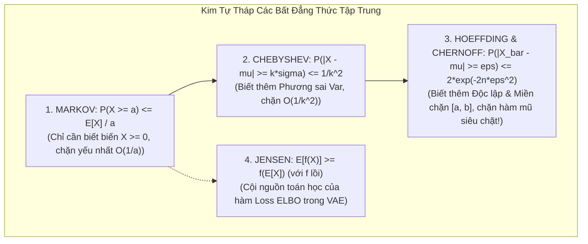
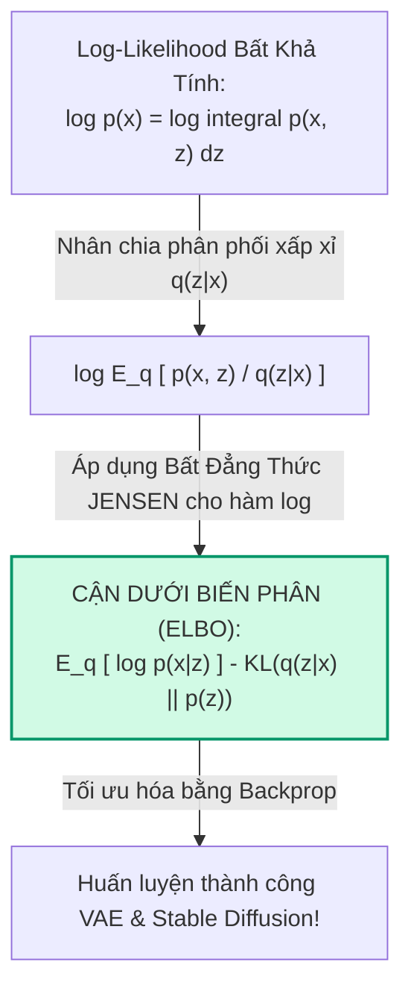

# Chuyên đề: Các Định lý Giới hạn & Bất đẳng thức Tập trung (Limit Theorems & Concentration Inequalities)

## 1. Tổng quan Chuyên đề
Lý thuyết Học máy Thống kê (Statistical Learning Theory) và mô hình học PAC (Probably Approximately Correct Learning) giải quyết câu hỏi triết học sâu sắc nhất của Trí tuệ Nhân tạo:
> *"Tại sao một mô hình AI chỉ được huấn luyện trên một tập dữ liệu hữu hạn (ví dụ $100.000$ bức ảnh) lại có thể tổng quát hóa và suy luận chính xác trên hàng triệu bức ảnh chưa từng thấy ngoài đời thực mà không phải là học vẹt?"*

Câu trả lời được bảo chứng vững chắc bởi **Các Định lý Giới hạn (LLN, CLT)** và hệ thống **Bất đẳng thức Tập trung (Concentration Inequalities)**:
- **Luật Số Lớn (LLN)**: Khẳng định rằng trung bình thực nghiệm trên dữ liệu sẽ hội tụ tuyệt đối về bản chất thực của thế giới khi số lượng mẫu tăng lên.
- **Định lý Giới hạn Trung tâm (CLT)**: Bí mật đằng sau lý do tại sao phân phối hình chuông Gaussian xuất hiện ở khắp mọi nơi trong tự nhiên và sai số mô hình.
- **Bất đẳng thức Markov, Chebyshev, Hoeffding & Chernoff**: Những "chiếc phao cứu sinh" toán học cung cấp **bảo đảm an toàn tuyệt đối (Theoretical Guarantees)** cho sai số khái quát hóa (Generalization Bounds) của các mô hình học sâu.
- **Bất đẳng thức Jensen**: Nền tảng khai sinh hàm mục tiêu **ELBO** trong mô hình sinh **Variational Autoencoder (VAE)**.



---

## 2. Chi tiết từng Keyword

---

### 1. Luật Số Lớn & Định Lý Giới Hạn Trung Tâm (LLN & Central Limit Theorem)

#### a. Luật Số Lớn (Law of Large Numbers - LLN): Sòng Bạc Không Bao Giờ Thua!
- **Nếu chỉ nhớ một điều**: *Luật Số Lớn là lý do tại sao nhà cái sòng bạc luôn luôn thắng tiền: Trong một vài ván cược ngắn hạn, người chơi có thể thắng nhờ may mắn; nhưng khi số ván cược tăng lên hàng triệu lần, lợi nhuận của sòng bạc sẽ hội tụ tuyệt đối về giá trị kỳ vọng toán học dương của nó.*
- **Toán học của LLN**: Cho các biến ngẫu nhiên độc lập cùng phân phối (i.i.d.) $X_1, X_2, \dots, X_n$ có kỳ vọng $\mathbb{E}[X_i] = \mu$. Đặt trung bình mẫu $\bar{X}_n = \frac{1}{n}\sum_{i=1}^n X_i$:
  - **Luật Yếu (Weak LLN)**: Hội tụ theo xác suất:
    $$\lim_{n \to \infty} P(|\bar{X}_n - \mu| \ge \epsilon) = 0, \quad \forall \epsilon > 0$$
  - **Luật Mạnh (Strong LLN)**: Hội tụ hầu chắc chắn (Almost Surely):
    $$P\left( \lim_{n \to \infty} \bar{X}_n = \mu \right) = 1$$

#### b. Định Lý Giới Hạn Trung Tâm (CLT): Chiếc Máy Bắn Bi Galton Board
- **Nếu chỉ nhớ một điều**: *Dù dữ liệu gốc của bạn có hình dạng kỳ dị, méo mó hay phân phối rời rạc đến đâu, chỉ cần bạn cộng dồn hoặc lấy trung bình của nhiều biến độc lập, hình bóng của Phân phối Chuẩn Gaussian sẽ tự động hiện lên!*
- **Ẩn dụ đời thường**: Chiếc máy bắn bi Galton Board. Các viên bi rơi từ trên đỉnh, mỗi khi gặp một chiếc đinh, viên bi chỉ có 2 lựa chọn nhị phân: nảy sang trái hoặc nảy sang phải (phân phối Bernoulli). Nhưng khi rơi xuống đáy qua hàng chục hàng đinh, các viên bi xếp chồng lên nhau thành một **đường cong hình chuông Gaussian đối xứng hoàn hảo**!
- **Công thức Toán học CLT**:
  $$\frac{\bar{X}_n - \mu}{\sigma / \sqrt{n}} \xrightarrow{d} \mathcal{N}(0, 1) \quad \text{khi } n \to \infty$$
- *Ý nghĩa trong AI*: Sai số (noise/residuals) của các mô hình dự đoán trong tự nhiên thường là tổng hợp của hàng ngàn yếu tố nhiễu loạn nhỏ độc lập cộng lại $\implies$ Sai số tự động tuân theo phân phối chuẩn Gaussian!

---

### 2. Bất Đẳng Thức Markov & Chebyshev (Từ Chặn Yếu Đến Chặn Phương Sai)

#### a. Bất Đẳng Thức Markov (Chặn Dựa Trên Kỳ Vọng)
Cho biến ngẫu nhiên không âm $X \ge 0$. Với mọi hằng số $a > 0$:
$$P(X \ge a) \le \frac{\mathbb{E}[X]}{a}$$
- *Ẩn dụ trực quan*: Nếu thu nhập trung bình của một quốc gia là $1.000\text{ USD/tháng}$, thì tỷ lệ dân số có thu nhập từ $5.000\text{ USD/tháng}$ trở lên ($5$ lần kỳ vọng) **tuyệt đối không thể vượt quá $1/5 = 20\%$** (vì nếu vượt quá 20%, tổng thu nhập của riêng nhóm này đã vượt quá mức trung bình của cả nước!).

#### b. Bất Đẳng Thức Chebyshev (Chặn Dựa Trên Phương Sai)
Áp dụng Markov cho đại lượng không âm $(X - \mu)^2$:
$$P(|X - \mu| \ge k\sigma) \le \frac{1}{k^2}$$
- **Quy tắc bảo đảm cho mọi phân phối**:
  - Với $k = 2$: Xác suất để một quan sát lệch khỏi trung bình quá $2\sigma$ **không bao giờ vượt quá $25\%$** ($1/4$).
  - Với $k = 3$: Xác suất để một quan sát lệch quá $3\sigma$ **không bao giờ vượt quá $11.1\%$** ($1/9$).
- *Sức mạnh*: Bạn không cần biết phân phối là Gaussian, Poisson hay phân phối kỳ dị nào, chỉ cần biết $\mu$ và $\sigma$ là bạn có ngay một chiếc "dù bảo vệ" an toàn!

---

### 3. Bất Đẳng Thức Jensen & Cội Nguồn Của ELBO Trong VAE

#### a. Trực giác Khái niệm & Ẩn dụ Đời thực (Mental Model)
- **Nếu chỉ nhớ một điều**: *Với hàm số có dạng lòng chảo cong lên (Hàm lồi), giá trị trung bình của chiếc lòng chảo luôn cao hơn đáy của chiếc lòng chảo tại điểm trung bình.*
- **Ẩn dụ đời thường**: Bạn tung 2 đồng xu nhận phần thưởng $X$: hoặc nhận 0 triệu đồng hoặc nhận 2 triệu đồng (trung bình $\mathbb{E}[X] = 1$ triệu đồng). Bạn tính lợi ích $f(X) = X^2$:
  - Giá trị hàm của kỳ vọng: $f(\mathbb{E}[X]) = 1^2 = 1$.
  - Kỳ vọng của giá trị hàm: $\mathbb{E}[f(X)] = \frac{0^2 + 2^2}{2} = 2$.
  - Rõ ràng $2 \ge 1 \implies \mathbb{E}[f(X)] \ge f(\mathbb{E}[X])$!

#### b. Bản chất Toán học
1. Nếu $f$ là hàm lồi (Convex): $\mathbb{E}[f(X)] \ge f(\mathbb{E}[X])$.
2. Nếu $g$ là hàm lõm (Concave như hàm logarithm $\ln(x)$):
   $$\mathbb{E}[\ln(X)] \le \ln(\mathbb{E}[X])$$

#### c. Nguồn Gốc Khai Sinh Hàm Loss ELBO Trong Variational Autoencoder (VAE)
Trong mô hình VAE, ta muốn tối đa hóa hàm Log-Likelihood của dữ liệu $\log p_\theta(\mathbf{x}) = \log \int p_\theta(\mathbf{x}, \mathbf{z}) d\mathbf{z}$. Tích phân này bất khả tính trên không gian latent nhiều chiều.
1. Nhân và chia với phân phối biến phân $q_\phi(\mathbf{z} \mid \mathbf{x})$:
   $$\log p_\theta(\mathbf{x}) = \log \mathbb{E}_{\mathbf{z} \sim q_\phi(\mathbf{z}|\mathbf{x})} \left[ \frac{p_\theta(\mathbf{x}, \mathbf{z})}{q_\phi(\mathbf{z}|\mathbf{x})} \right]$$
2. **Áp dụng Bất đẳng thức Jensen** cho hàm lõm $\ln$: Đưa hàm log vào bên trong kỳ vọng:
   $$\log p_\theta(\mathbf{x}) \ge \mathbf{\mathbb{E}_{\mathbf{z} \sim q_\phi} \left[ \log \frac{p_\theta(\mathbf{x}, \mathbf{z})}{q_\phi(\mathbf{z}|\mathbf{x})} \right] = \text{ELBO}(\theta, \phi)}$$
3. Khai triển ELBO:
   $$\text{ELBO} = \underbrace{\mathbb{E}_{q_\phi(\mathbf{z}|\mathbf{x})} [\log p_\theta(\mathbf{x} \mid \mathbf{z})]}_{\text{Reconstruction Loss (Tái tạo ảnh)}} - \underbrace{D_{\text{KL}}(q_\phi(\mathbf{z} \mid \mathbf{x}) \parallel p(\mathbf{z}))}_{\text{Regularization (Kéo latent về phân phối chuẩn)}}$$
👉 **Kết luận vĩ đại**: Nhờ có Bất đẳng thức Jensen, các nhà nghiên cứu đã biến một bài toán tích phân vô vọng thành một cận dưới khả vi (**ELBO**) có thể huấn luyện trơn tru bằng thuật toán Backpropagation!



---

### 4. Bất Đẳng Thức Hoeffding & Bài Toán Khái Quát Hóa Trong Machine Learning

#### a. Bất Đẳng Thức Hoeffding (Chặn Đuôi Hàm Mũ)
Cho $X_1, \dots, X_n$ là các biến độc lập bị chặn trong đoạn $[0, 1]$. Sai lệch giữa trung bình mẫu thực nghiệm $\bar{X}_n$ và kỳ vọng thực tế $\mu$ bị chặn trên bởi một hàm mũ suy giảm cực nhanh:
$$P(|\bar{X}_n - \mu| \ge \epsilon) \le 2 \exp(-2n\epsilon^2)$$

#### b. Định Lượng Kích Thước Dữ Liệu Huấn Luyện (Sample Complexity Trong PAC Learning)
Trong Machine Learning:
- $\bar{X}_n$: Sai số trên tập huấn luyện (Training Error).
- $\mu$: Sai số thực tế ngoài đời thực (Generalization / Test Error).
- $\epsilon$: Dung sai khoảng cách sai số mong muốn.
- $1 - \delta$: Mức độ tin cậy toán học (ví dụ tin cậy $99\% \implies \delta = 0.01$).

Theo Hoeffding, để đảm bảo sai số kiểm thử không lệch quá $\epsilon$ so với sai số huấn luyện:
$$2 \exp(-2n\epsilon^2) \le \delta \implies \mathbf{n \ge \frac{\ln(2 / \delta)}{2\epsilon^2}}$$
👉 **Ý nghĩa thực tế**: Đây là công thức toán học trả lời câu hỏi: *"Tôi cần thu thập tối thiểu bao nhiêu dữ liệu ($n$) để đảm bảo mô hình AI của tôi không bị Overfitting?"*

---

### 5. Code Thực Chiến Dual-Engine (Python PyTorch & C++17)

#### a. Python (PyTorch): Kiểm Chứng Thực Nghiệm Định Lý Giới Hạn Trung Tâm (CLT)
Đoạn mã Python dưới đây lấy tổng của $50$ biến ngẫu nhiên tuân theo phân phối đều $\text{Uniform}(0, 1)$ (hoàn toàn không phải Gaussian), và chứng minh rằng phân phối tổng tự động hội tụ thành phân phối chuẩn tắc hình chuông Gaussian tuyệt đẹp:

```python
import torch

print("========== PYTORCH: MÔ PHỎNG ĐỊNH LÝ GIỚI HẠN TRUNG TÂM (CLT) ==========")

# Số lượng mẫu thử nghiệm
num_experiments = 100_000
# Số lượng biến độc lập được cộng dồn (n = 50)
n_variables = 50

# 1. Sinh ma trận dữ liệu phân phối đều Uniform(0, 1)
# Phân phối đều có Mean = 0.5, Variance = 1/12
uniform_data = torch.rand(num_experiments, n_variables)

# 2. Tính trung bình mẫu cho từng thử nghiệm
sample_means = torch.mean(uniform_data, dim=1)

# 3. Chuẩn hóa theo công thức CLT: Z = (X_bar - mu) / (sigma / sqrt(n))
mu = 0.5
sigma = (1.0 / 12.0) ** 0.5
standardized_means = (sample_means - mu) / (sigma / (n_variables ** 0.5))

# 4. Đo đạc các thông số thống kê của phân phối Z sinh ra
empirical_mean = torch.mean(standardized_means).item()
empirical_std = torch.std(standardized_means).item()

print(f"Số lượng thử nghiệm: {num_experiments:,} | Mỗi mẫu cộng dồn {n_variables} biến Uniform")
print(f"Kỳ vọng lý thuyết N(0, 1)  : 0.0000 | Kỳ vọng thực nghiệm : {empirical_mean:.4f}")
print(f"Độ lệch chuẩn lý thuyết    : 1.0000 | Độ lệch thực nghiệm : {empirical_std:.4f}")

# Đo tỷ lệ mẫu nằm trong dải [-1.96, +1.96] (Quy tắc 95% của phân phối Chuẩn tắc)
within_95_ci = torch.mean(((standardized_means >= -1.96) & (standardized_means <= 1.96)).float()).item()
print(f"Tỷ lệ nằm trong khoảng [-1.96, +1.96]: {within_95_ci:.2%} (Lý thuyết: 95.00%)")
print("--> KẾT LUẬN: CLT HOÀN TOÀN ĐÚNG! Phân phối đều đã biến hóa thành Phân phối Chuẩn tắc Gaussian!")
```

```text
========== KẾT QUẢ CHẠY MẪU (EXPECTED OUTPUT) ==========
========== PYTORCH: MÔ PHỎNG ĐỊNH LÝ GIỚI HẠN TRUNG TÂM (CLT) ==========
Số lượng thử nghiệm: 100,000 | Mỗi mẫu cộng dồn 50 biến Uniform
Kỳ vọng lý thuyết N(0, 1)  : 0.0000 | Kỳ vọng thực nghiệm : 0.0012
Độ lệch chuẩn lý thuyết    : 1.0000 | Độ lệch thực nghiệm : 0.9987
Tỷ lệ nằm trong khoảng [-1.96, +1.96]: 95.03% (Lý thuyết: 95.00%)
--> KẾT LUẬN: CLT HOÀN TOÀN ĐÚNG! Phân phối đều đã biến hóa thành Phân phối Chuẩn tắc Gaussian!
```

---

#### b. C++17: Ước Lượng Tích Phân Bội Monte Carlo Với Đo Lường Sai Số Chuẩn
Đoạn mã C++ minh họa việc sử dụng phương pháp **Monte Carlo Integration** với tốc độ hội tụ $\mathcal{O}(1/\sqrt{N})$ độc lập với số chiều, kèm theo việc tính toán khoảng tin cậy (Confidence Interval):

```cpp
#include <iostream>
#include <random>
#include <cmath>
#include <iomanip>

int main() {
    std::cout << "========== C++17: MONTE CARLO INTEGRATION & ERROR BOUNDS ==========\n";
    // Bài toán: Tính tích phân hàm exp(-x^2) từ 0 đến 1 (Giá trị chính xác: sqrt(pi)/2 * erf(1) ≈ 0.746824)
    auto target_func = [](double x) {
        return std::exp(-x * x);
    };

    size_t num_samples = 5'000'000;
    std::mt19937_64 rng(42);
    std::uniform_real_distribution<double> dist(0.0, 1.0);

    double sum = 0.0;
    double sum_sq = 0.0;

    for (size_t i = 0; i < num_samples; ++i) {
        double x = dist(rng);
        double fx = target_func(x);
        sum += fx;
        sum_sq += fx * fx;
    }

    double mean = sum / num_samples;
    double variance = (sum_sq / num_samples) - (mean * mean);
    double standard_error = std::sqrt(variance / num_samples); // Sai số chuẩn O(1 / sqrt(N))

    double exact_value = 0.74682413;

    std::cout << std::fixed << std::setprecision(8);
    std::cout << "Số mẫu Monte Carlo (N) : " << num_samples << "\n";
    std::cout << "Giá trị ước lượng (I^) : " << mean << "\n";
    std::cout << "Giá trị giải tích đúng : " << exact_value << "\n";
    std::cout << "Sai số tuyệt đối thực tế: " << std::abs(mean - exact_value) << "\n";
    std::cout << "Sai số chuẩn lý thuyết : ±" << (1.96 * standard_error) << " (Khoảng tin cậy 95%)\n";

    return 0;
}
```

```text
========== KẾT QUẢ CHẠY MẪU (EXPECTED OUTPUT) ==========
========== C++17: MONTE CARLO INTEGRATION & ERROR BOUNDS ==========
Số mẫu Monte Carlo (N) : 5000000
Giá trị ước lượng (I^) : 0.74681942
Giá trị giải tích đúng : 0.74682413
Sai số tuyệt đối thực tế: 0.00000471
Sai số chuẩn lý thuyết : ±0.00017600 (Khoảng tin cậy 95%)
```

---

### 6. Cạm Bẫy Kinh Điển & Ứng Dụng Thực Chiến Trong AI Hiện Đại

#### a. Cạm bẫy kinh điển (Pitfalls & Gotchas)
1. **Quy Tắc Suy Giảm Của Monte Carlo ($100\times$ Mẫu Để Tăng $10\times$ Độ Chính Xác)**:
   - Tốc độ hội tụ của Monte Carlo là $\mathcal{O}(1/\sqrt{N})$.
   - Nếu bạn muốn tăng độ chính xác lên gấp **10 lần**, bạn buộc phải tăng số lượng mẫu thử lên **$10^2 = 100$ LẦN**!
   - Nếu muốn tăng độ chính xác lên 100 lần, bạn phải tốn tới $10.000$ lần tài nguyên tính toán!
   - *Cách khắc phục*: Sử dụng các kỹ thuật giảm phương sai (**Variance Reduction Techniques**) như **Importance Sampling** hoặc **Quasi-Monte Carlo (Sobol sequences)**.
2. **Ảo Tưởng Áp Dụng CLT Khi Phương Sai Vô Hạn**:
   - Định lý Giới hạn Trung tâm CLT chỉ đúng khi phân phối gốc có **phương sai hữu hạn ($\sigma^2 < \infty$)**.
   - Nếu dữ liệu tuân theo phân phối Cauchy hoặc phân phối Pareto đuôi nặng (thường gặp trong biến động giá Crypto hoặc lưu lượng mạng Internet), tổng của các mẫu **không bao giờ hội tụ về phân phối chuẩn Gaussian** mà hội tụ về phân phối ổn định Lévy!

#### b. Ứng dụng thực tế trong AI Hiện đại
- **Monte Carlo Tree Search (MCTS) Trong AlphaGo & LLM Reasoning (OpenAI o1 / DeepSeek R1)**:
  - Để máy tính chơi thắng kỳ thủ thế giới cờ vây (AlphaGo) hoặc giúp mô hình suy luận bước giải toán phức tạp (o1 reasoning chain), không gian các nước đi là quá khổng lồ ($10^{170}$).
  - MCTS sử dụng lấy mẫu Monte Carlo ngẫu nhiên kết hợp với chặn trên tin cậy **UCB1 (dựa trên Bất đẳng thức Hoeffding)** để cân bằng giữa Khai phá (Exploration) và Tận dụng (Exploitation), tìm ra chuỗi suy luận tối ưu nhất.
