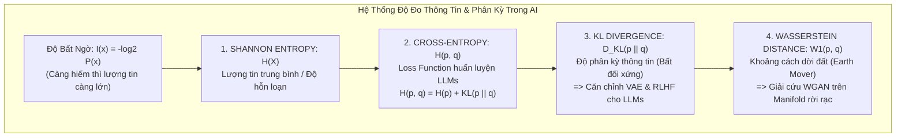
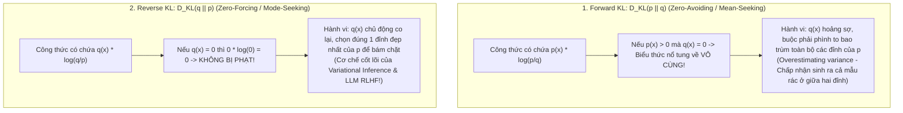

# Chuyên đề: Lý thuyết Thông tin & Các Độ đo Phân kỳ (Information Theory & Divergences)

## 1. Tổng quan Chuyên đề
Lý thuyết Thông tin (Information Theory) do thiên tài Claude Shannon khai sinh năm 1948 ban đầu nhằm giải quyết bài toán nén và truyền tín hiệu qua dây cáp viễn thông. Tuy nhiên, trong kỷ nguyên Deep Learning, nó đã trở thành **ngôn ngữ toán học tối thượng để định lượng sự bất định, đo khoảng cách giữa các phân phối xác suất và thiết kế hầu hết các hàm mất mát (Loss Functions)**:
- **Entropy ($H(X)$)**: Đo lường "mức độ bất ngờ" và lượng thông tin chứa trong một sự kiện.
- **Cross-Entropy ($H(p, q)$)**: Hàm mất mát phổ biến nhất thế giới AI, dùng để huấn luyện tất cả các mô hình phân loại hình ảnh và các mô hình ngôn ngữ lớn (**ChatGPT, Claude, LLaMA**).
- **KL Divergence ($D_{\text{KL}}$)**: Thước đo mức độ lệch chuẩn giữa hai phân phối, là "trọng tài" giám sát việc căn chỉnh hành vi mô hình trong **RLHF** để tránh hiện tượng ảo giác (Hallucination) và sụp đổ phân phối.
- **Wasserstein Distance ($\mathcal{W}_1$ - Earth Mover's Distance)**: Đột phá toán học giải cứu mạng đối kháng **GANs** khỏi cái chết của đạo hàm triệt tiêu (Vanishing Gradients).



---

## 2. Chi tiết từng Keyword

---

### 1. Shannon Entropy: Đo Lường "Mức Độ Bất Ngờ" (Information Entropy)

#### a. Trực giác Khái niệm & Ẩn dụ Đời thực (Mental Model)
- **Nếu chỉ nhớ một điều**: *Lượng thông tin của một sự kiện tỉ lệ thuận với MỨC ĐỘ BẤT NGỜ của nó: Một sự kiện hiển nhiên không mang lại thông tin gì; một sự kiện càng khó tin thì lượng thông tin mang lại càng khổng lồ.*
- **Ẩn dụ đời thường**:
  - Bản tin thời tiết thông báo: *"Ngày mai Mặt Trời sẽ mọc ở hướng Đông!"*. Sự kiện này có xác suất $P = 1.0 \implies$ Mức độ bất ngờ bằng $0$ $\implies$ **Lượng thông tin mang lại bằng 0 bit**!
  - Nhưng nếu bản tin thông báo: *"Ngày mai tuyết rơi giữa trưa hè tại TP. Hồ Chí Minh!"*. Sự kiện này cực kỳ hiếm ($P = 10^{-7}$) $\implies$ Mức độ bất ngờ cực đại $\implies$ **Lượng thông tin mang lại khổng lồ**!
- **Hàm Tự Thông Tin (Self-Information / Surprisal)**:
  $$I(x) = -\log_2 P(x) = \log_2 \frac{1}{P(x)} \quad (\text{đơn vị: Bits})$$
- **Shannon Entropy ($H(X)$)**: Lượng thông tin kỳ vọng (trung bình) trên toàn bộ không gian sự kiện:
  $$H(X) = \mathbb{E}_{x \sim p}[I(x)] = -\sum_{x \in \mathcal{X}} p(x) \log_2 p(x)$$
  - $H(X) = 0$: Trạng thái chắc chắn hoàn toàn (chỉ có 1 kết quả duy nhất).
  - $H(X) = \log_2 K$: Đạt cực đại khi tất cả $K$ trạng thái có xác suất đều nhau (hỗn loạn tối đa, không thể đoán trước).

---

### 2. Cross-Entropy & Mối Quan Hệ Máu Thịt Với KL Divergence

#### a. Trực giác Khái niệm & Ẩn dụ Đời thực
- **Nếu chỉ nhớ một điều**: *Cross-Entropy là chi phí lãng phí khi bạn dùng một cuốn từ điển sai để nén một bức thư.*
- **Ẩn dụ đời thường**: Bạn muốn nén một văn bản viết bằng tiếng Việt (phân phối thực $p$). 
  - Nếu bạn dùng bảng mã tối ưu cho tiếng Việt: Các ký tự phổ biến như 'a', 'e' được gán mã siêu ngắn (1-2 bits) $\implies$ Chi phí truyền tin đạt mức tối ưu lý tưởng bằng chính **Entropy $H(p)$**.
  - Nhưng nếu bạn dùng một bảng mã tối ưu cho tiếng Đức (phân phối dự đoán của mô hình $q$): Những từ tiếng Việt sẽ bị mã hóa bằng các chuỗi bit rất dài $\implies$ Chi phí tiêu tốn sẽ tăng lên thành **Cross-Entropy $H(p, q)$**.
  - Phần dung lượng dư thừa bị lãng phí do dùng sai bảng mã chính là **Phân kỳ KL: $D_{\text{KL}}(p \parallel q)$**!

#### b. Bản chất Toán học Tuyệt Đối
$$H(p, q) = -\sum_{x} p(x) \log q(x) = \mathbb{E}_{x \sim p}[-\log q(x)]$$
$$H(p, q) = H(p) + D_{\text{KL}}(p \parallel q)$$
- **Tại sao Tất Cả Các Mạng Phân Loại Đều Dùng Cross-Entropy?**
  - Trong tập dữ liệu huấn luyện, nhãn thực tế $p$ là cố định (ví dụ nhãn One-hot `[1, 0, 0]`) $\implies$ Entropy $H(p)$ là một **hằng số bất biến**.
  - Do đó:
    $$\arg\min_q H(p, q) \equiv \arg\min_q D_{\text{KL}}(p \parallel q)$$
  - 👉 **Tối thiểu hóa Cross-Entropy tương đương 100% với việc ép phân phối dự đoán của mô hình $q$ tiến sát về phân phối thực $p$**!

---

### 3. Phân Kỳ KL: Forward KL vs Reverse KL & Bí Quyết Căn Chỉnh RLHF

#### a. Bản chất Bất Đối Xứng Của KL Divergence
Phân kỳ Kullback-Leibler đo mức độ chênh lệch thông tin giữa 2 phân phối:
$$D_{\text{KL}}(p \parallel q) = \sum_{x} p(x) \log \frac{p(x)}{q(x)}$$
- **Tính chất**: Luôn không âm ($D_{\text{KL}} \ge 0$). Bằng 0 khi và chỉ khi $p \equiv q$.
- ⚠️ **TÍNH CHẤT BẤT ĐỐI XỨNG (Asymmetry)**:
  $$D_{\text{KL}}(p \parallel q) \ne D_{\text{KL}}(q \parallel p)$$
  Do đó, KL **không phải là một khoảng cách hình học chuẩn (Metric)**. Và việc chọn chiều nào để tối ưu sẽ quyết định toàn bộ hành vi của mô hình AI!

#### b. Forward KL vs Reverse KL (Chiến Lược Mean-Seeking vs Mode-Seeking)
Giả sử phân phối thực $p$ có 2 đỉnh núi (Bimodal distribution) nhưng mô hình $q$ chỉ là phân phối Gaussian đơn đỉnh:



#### c. Vai Trò Sống Còn của KL Penalty Trong RLHF (Reinforcement Learning from Human Feedback)
Khi căn chỉnh mô hình ngôn ngữ lớn (như ChatGPT) bằng thuật toán PPO:
$$\max_\theta \mathbb{E} \left[ R(x, y) - \beta \cdot D_{\text{KL}}(\pi_\theta(y \mid x) \parallel \pi_{\text{ref}}(y \mid x)) \right]$$
- **Nỗi sợ hãi**: Nếu chỉ tối đa hóa phần thưởng $R$, mô hình sẽ tìm ra các câu trả lời mẹo, nịnh nọt hoặc lặp từ quái đản để "hack điểm" (**Reward Hacking**), làm câu văn mất hoàn toàn tính tự nhiên.
- **Chiếc phanh hãm KL**: Số hạng phạt $-\beta D_{\text{KL}}$ đóng vai trò như một chiếc dây chun níu giữ mô hình được huấn luyện $\pi_\theta$ không được bay quá xa khỏi mô hình gốc ban đầu $\pi_{\text{ref}}$, đảm bảo câu trả lời vừa đạt điểm cao vừa giữ trọn độ mạch lạc và ngữ pháp!

---

### 4. Wasserstein Distance: Giải Cứu Mạng Đối Kháng GANs

#### a. Nỗi Đau Trí Mạng Của KL & Jensen-Shannon Divergence
- Trong không gian dữ liệu nhiều chiều (như ảnh $512 \times 512$), phân phối dữ liệu thật $P_r$ và phân phối dữ liệu do mạng GAN sinh ra $P_g$ nằm trên hai bề mặt đa tạp (Manifolds) cực kỳ mỏng.
- Khi mới bắt đầu huấn luyện, hai đa tạp này **hoàn toàn không giao nhau trong không gian**:
  - Phân kỳ KL sẽ bằng **vô cùng**: $D_{\text{KL}} = \infty$.
  - Phân kỳ Jensen-Shannon sẽ bằng **hằng số**: $D_{\text{JS}} = \log(2) \approx 0.693$.
  - Đạo hàm của một hằng số bằng **0 tuyệt đối** $\implies$ Gradient triệt tiêu hoàn toàn (**Vanishing Gradients**)! Mạng Generator không nhận được bất kỳ tín hiệu nào để học tập, dẫn tới hiện tượng sập nguồn (**Mode Collapse**)!

#### b. Đột phá Wasserstein Distance (Earth Mover's Distance - EMD)
Wasserstein Distance đo "công tối thiểu" để vận chuyển một đống cát có hình dạng $P$ thành đống cát có hình dạng $Q$ (Công = Khối lượng $\times$ Quãng đường di chuyển):
$$\mathcal{W}_1(P_r, P_g) = \inf_{\gamma \in \Pi(P_r, P_g)} \mathbb{E}_{(x, y) \sim \gamma} [\|x - y\|]$$
- **Ưu điểm vĩ đại**: Ngay cả khi hai đa tạp nằm cách xa nhau hàng ngàn dặm không hề chạm nhau, khoảng cách Wasserstein **vẫn là một hàm số tuyến tính trơn tru theo khoảng cách thực tế giữa chúng**!
- Gradient luôn tồn tại và chỉ đường rõ ràng cho mạng Generator từng bước nhích dần về phía dữ liệu thật. Đây chính là bí mật thành công của **WGAN-GP (Wasserstein GAN with Gradient Penalty)**!

---

### 5. Code Thực Chiến Dual-Engine (Python PyTorch & C++17)

#### a. Python (PyTorch): Bẫy Đảo Tham Số Trong `F.kl_div` & Đo Lường Forward vs Reverse KL
Đoạn mã PyTorch dưới đây chỉ ra chiếc "bẫy thế kỷ" trong hàm `F.kl_div` của PyTorch và minh họa tính bất đối xứng của KL Divergence:

```python
import torch
import torch.nn.functional as F

print("========== PYTORCH: CẢNH BÁO CHIẾC BẪY THỨ TỰ THAM SỐ TRONG F.kl_div ==========")

# Phân phối mục tiêu thực tế P (Target)
p = torch.tensor([0.7, 0.2, 0.1], dtype=torch.float32)
# Phân phối dự đoán của mô hình Q (Prediction)
q = torch.tensor([0.3, 0.4, 0.3], dtype=torch.float32)

# ⚠️ BẪY KINH ĐIỂN CỦA PYTORCH:
# Trong toán học: D_KL(P || Q) = sum(P * log(P / Q))
# Nhưng PyTorch F.kl_div(input, target) quy ước:
# - 'input' BẮT BUỘC phải là LOG-PROBABILITIES của Q: log(Q)
# - 'target' BẮT BUỘC phải là PROBABILITIES của P: P
# - reduction='batchmean' để chia trung bình đúng chuẩn toán học!

# 1. TÍNH FORWARD KL: D_KL(P || Q)
log_q = torch.log(q)
forward_kl = F.kl_div(log_q, p, reduction='sum').item()

# 2. TÍNH REVERSE KL: D_KL(Q || P)
log_p = torch.log(p)
reverse_kl = F.kl_div(log_p, q, reduction='sum').item()

print(f"Phân phối P (Target) : {p.numpy()}")
print(f"Phân phối Q (Model)  : {q.numpy()}")
print(f"1. Forward KL: D_KL(P || Q) = {forward_kl:.5f} nats")
print(f"2. Reverse KL: D_KL(Q || P) = {reverse_kl:.5f} nats")
print(f"--> Rõ ràng D_KL(P || Q) != D_KL(Q || P) (Chênh lệch {abs(forward_kl - reverse_kl):.5f} nats)!")

# 3. MINH HỌA CROSS-ENTROPY LOSS CHUẨN
# H(P, Q) = H(P) + D_KL(P || Q)
entropy_p = -torch.sum(p * torch.log(p)).item()
cross_entropy_calc = entropy_p + forward_kl
print(f"\nEntropy nội tại H(P)       : {entropy_p:.5f}")
print(f"Cross-Entropy H(P, Q)     : {cross_entropy_calc:.5f}")
```

```text
========== KẾT QUẢ CHẠY MẪU (EXPECTED OUTPUT) ==========
========== PYTORCH: CẢNH BÁO CHIẾC BẪY THỨ TỰ THAM SỐ TRONG F.kl_div ==========
Phân phối P (Target) : [0.7 0.2 0.1]
Phân phối Q (Model)  : [0.3 0.4 0.3]
1. Forward KL: D_KL(P || Q) = 0.34444 nats
2. Reverse KL: D_KL(Q || P) = 0.37004 nats
--> Rõ ràng D_KL(P || Q) != D_KL(Q || P) (Chênh lệch 0.02560 nats)!

Entropy nội tại H(P)       : 0.80182
Cross-Entropy H(P, Q)     : 1.14626
```

---

#### b. C++17: Thuật Toán Tính Shannon Entropy & Jensen-Shannon Divergence
Đoạn mã C++ minh họa việc tính toán chuẩn mực Shannon Entropy và khoảng cách đối xứng Jensen-Shannon Divergence (JSD) có chặn trên an toàn:

```cpp
#include <iostream>
#include <vector>
#include <cmath>
#include <iomanip>
#include <algorithm>

// Tính Shannon Entropy H(P) theo đơn vị Bits (cơ số 2)
double compute_entropy(const std::vector<double>& p) {
    double h = 0.0;
    for (double prob : p) {
        if (prob > 1e-12) {
            h -= prob * std::log2(prob);
        }
    }
    return h;
}

// Tính KL Divergence: D_KL(P || Q) theo cơ số 2
double compute_kl(const std::vector<double>& p, const std::vector<double>& q) {
    double kl = 0.0;
    for (size_t i = 0; i < p.size(); ++i) {
        if (p[i] > 1e-12) {
            double q_safe = std::max(q[i], 1e-12);
            kl += p[i] * std::log2(p[i] / q_safe);
        }
    }
    return kl;
}

// Tính Jensen-Shannon Divergence (JSD): Đối xứng & Giới hạn trong [0, 1]
double compute_jsd(const std::vector<double>& p, const std::vector<double>& q) {
    size_t n = p.size();
    std::vector<double> m(n);
    for (size_t i = 0; i < n; ++i) {
        m[i] = 0.5 * (p[i] + q[i]);
    }
    return 0.5 * compute_kl(p, m) + 0.5 * compute_kl(q, m);
}

int main() {
    std::cout << "========== C++17: SHANNON ENTROPY & JENSEN-SHANNON DIVERGENCE ==========\n";
    // Phân phối xúc xắc gian lận P vs Phân phối xúc xắc cân đối Q
    std::vector<double> p = {0.50, 0.10, 0.10, 0.10, 0.10, 0.10}; // Lệch về mặt 1
    std::vector<double> q = {1.0/6, 1.0/6, 1.0/6, 1.0/6, 1.0/6, 1.0/6}; // Cân đối hoàn hảo

    std::cout << std::fixed << std::setprecision(5);
    std::cout << "Entropy P (Xúc xắc lệch)  : " << compute_entropy(p) << " bits\n";
    std::cout << "Entropy Q (Cân đối tối đa): " << compute_entropy(q) << " bits (log2(6) = " << std::log2(6.0) << ")\n\n";

    double jsd_pq = compute_jsd(p, q);
    double jsd_qp = compute_jsd(q, p);

    std::cout << "Jensen-Shannon Divergence JSD(P || Q): " << jsd_pq << "\n";
    std::cout << "Jensen-Shannon Divergence JSD(Q || P): " << jsd_qp << "\n";
    std::cout << "Khoảng cách metric căn bậc 2 sqrt(JSD): " << std::sqrt(jsd_pq) << "\n";
    std::cout << "--> Nhận xét: JSD hoàn toàn đối xứng và nằm trọn trong đoạn [0, 1]!\n";

    return 0;
}
```

```text
========== KẾT QUẢ CHẠY MẪU (EXPECTED OUTPUT) ==========
========== C++17: SHANNON ENTROPY & JENSEN-SHANNON DIVERGENCE ==========
Entropy P (Xúc xắc lệch)  : 2.16096 bits
Entropy Q (Cân đối tối đa): 2.58496 bits (log2(6) = 2.58496)

Jensen-Shannon Divergence JSD(P || Q): 0.11718
Jensen-Shannon Divergence JSD(Q || P): 0.11718
Khoảng cách metric căn bậc 2 sqrt(JSD): 0.34232
--> Nhận xét: JSD hoàn toàn đối xứng và nằm trọn trong đoạn [0, 1]!
```

---

### 6. Cạm Bẫy Kinh Điển & Ứng Dụng Thực Chiến Trong AI Hiện Đại

#### a. Cạm bẫy kinh điển (Pitfalls & Gotchas)
1. **Lỗi `log(0) = -inf` Gây Ra $\text{NaN}$ Trong Cross-Entropy**:
   - Khi mô hình dự đoán xác suất của nhãn đúng bằng $0.0$ tuyệt đối ($q = 0$), hàm $-\log(q)$ sẽ vọt lên $+\infty$.
   - Khi cập nhật gradient bằng phép trừ vô cùng, máy tính sẽ sinh ra giá trị **$\text{NaN}$ (Not a Number)**, phá hủy toàn bộ trọng số của mạng nơ-ron ngay lập tức!
   - *Cách khắc phục*: Luôn sử dụng kỹ thuật **Label Smoothing** (thay vì nhãn $1.0$ cứng, dùng $0.95$ và chia đều $0.05$ cho các nhãn còn lại) hoặc dùng trực tiếp hàm `torch.nn.CrossEntropyLoss` (đã tích hợp ngầm `LogSoftmax` chống tràn số).
2. **Chiếc Bẫy Thứ Tự Tham Số Trong `F.kl_div`**:
   - Rất nhiều bài báo và code trên GitHub viết sai: `F.kl_div(p, q)`. 
   - Hãy luôn nhớ: Tham số thứ nhất của PyTorch phải là **`log(q)`** (Log-probabilities của dự đoán) và tham số thứ hai là **`p`** (Probabilities thực tế)!

#### b. Ứng dụng thực tế trong AI Hiện đại
- **Token-Level Loss Trong Huấn Luyện Các Siêu Mô Hình Ngôn Ngữ (LLMs)**:
  - Tất cả các mô hình như GPT-4, LLaMA 3, Mistral đều được huấn luyện trên hàng chục Terabytes văn bản bằng **Next-Token Prediction Cross-Entropy Loss**:
    $$\mathcal{L}_{\text{LLM}} = -\frac{1}{T} \sum_{t=1}^T \log P_\theta(w_t \mid w_{<t})$$
  - Chỉ số **Perplexity (PPL)** dùng để đánh giá độ thông minh của LLM thực chất chính là lũy thừa cơ số tự nhiên của hàm Cross-Entropy: $\text{PPL} = \exp(\mathcal{L})$!
- **Direct Preference Optimization (DPO - Thay Thế PPO Cho LLM Alignment)**:
  - Năm 2023–2024, thuật toán DPO của Đại học Stanford đã gây bão toàn ngành AI khi chứng minh rằng: Bằng cách giải tích vi phân chính xác hàm phạt KL Divergence, ta có thể căn chỉnh mô hình ngôn ngữ theo phản hồi con người **trực tiếp qua hàm Loss phân loại nhị phân mà không cần huấn luyện mạng Reward Model phức tạp**!
