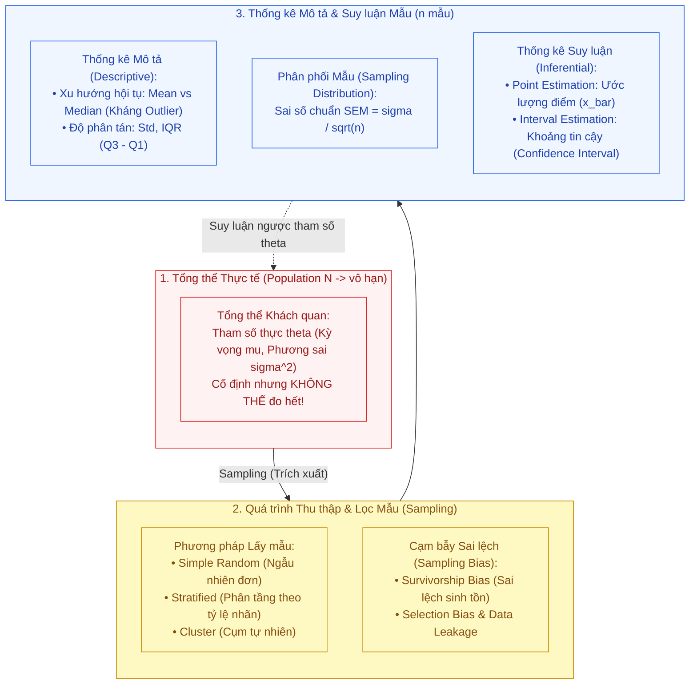
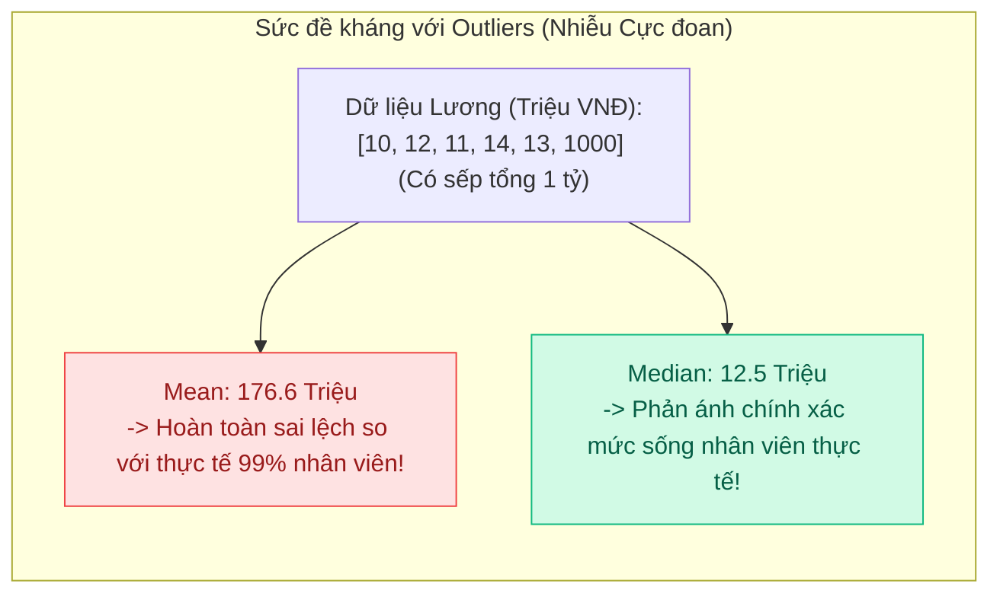
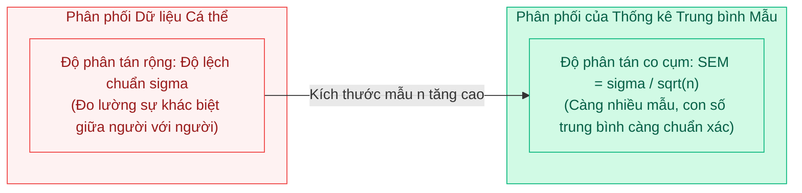

# Chuyên đề: Thống kê Mô tả & Cơ sở Lấy mẫu (Descriptive & Sampling Foundations)

> [!IMPORTANT]
> **Tuyên ngôn Cốt lõi**: Nếu Lý thuyết Xác suất là con đường suy diễn xuôi từ *Quy luật $\to$ Dữ liệu*, thì **Thống kê (Statistics)** là con đường quy nạp ngược từ *Dữ liệu thực tế hữu hạn $\to$ Bản chất thật của Tổng thể*. Toàn bộ Machine Learning thực chất là bài toán thống kê suy luận: từ một tập dữ liệu mẫu (Training Data), ta tìm cách ước lượng hàm phân bố xác suất tiềm ẩn (Data Generating Distribution) để đưa ra dự đoán chính xác trên dữ liệu chưa từng thấy (Generalization).

---

## 1. Tổng quan Kiến trúc & Tư duy Trực quan (Mental Model)

### Bản đồ Tư duy: Từ Thu thập Mẫu đến Suy luận Tham số


---

## 2. Chi tiết từng Keyword (Under-the-Hood Deep Dive)

---

### Keyword 1: Descriptive vs Inferential Statistics

#### 1. Trực giác & Ẩn dụ Đời sống (Mental Model)
> **Nếu chỉ nhớ một điều**: 
> - *Thống kê Mô tả (Descriptive) là **chụp ảnh lại bàn ăn**: đếm xem có bao nhiêu đĩa, bao nhiêu bát, nhiệt độ đĩa thịt là bao nhiêu mà không đưa ra bất kỳ kết luận nào về toàn bộ nhà hàng.*
> - *Thống kê Suy luận (Inferential) là **nếm thử một thìa súp nhỏ**: từ hương vị của một thìa (mẫu $n$), bạn đưa ra kết luận chắc chắn 95% rằng cả nồi súp 100 lít (tổng thể $N$) có vừa miệng hay không.*

#### 2. Bản chất Toán học Tầng sâu
1. **Thống kê Mô tả (Descriptive Statistics)**:
   - **Đo lường Xu hướng Hội tụ (Central Tendency)**:
     - Trung bình cộng (Mean): $\bar{x} = \frac{1}{n} \sum_{i=1}^n x_i$ (Cực kỳ nhạy cảm với Outlier).
     - Trung vị (Median): Điểm chia phân phối thành hai nửa bằng nhau ($50\%$ mẫu nhỏ hơn, $50\%$ mẫu lớn hơn). Đây là chỉ số **kháng nhiễu ngoại lai (Robust Metric)** tuyệt đối.
     - Yếu vị (Mode): Giá trị có tần suất xuất hiện cao nhất.
   - **Đo lường Mức độ Biến thiên (Dispersion)**:
     - Phương sai mẫu: $s^2 = \frac{1}{n-1} \sum_{i=1}^n (x_i - \bar{x})^2$.
     - Khoảng Tứ phân vị (Interquartile Range - IQR): $\text{IQR} = Q_3 - Q_1$ (Độ trải của $50\%$ dữ liệu ở giữa, không bị ảnh hưởng bởi các giá trị cực biên).

2. **Thống kê Suy luận (Inferential Statistics)**:
   Mục tiêu là ước lượng tham số chưa biết $\theta$ của tổng thể dựa trên thống kê mẫu $T(X_1, \dots, X_n)$ thông qua các định lý xác suất (Luật số lớn LLN, Định lý Giới hạn Trung tâm CLT).



---

### Keyword 2: Population, Sample, Sampling Methods & Sampling Bias

#### 1. Trực giác & Ẩn dụ Đời sống (Mental Model)
> **Nếu chỉ nhớ một điều**: *Mẫu dữ liệu chỉ có giá trị khi nó là một bản thu nhỏ trung thực của thế giới thực. Nếu bạn đứng trước cổng phòng gym lúc 6h sáng để khảo sát tỷ lệ người tập thể thao của toàn thành phố, bạn đã rơi vào cạm bẫy Sai lệch Chọn mẫu (Sampling Bias) và mô hình AI của bạn sẽ đưa ra kết luận sai lầm rằng 100% người dân đều tập gym mỗi ngày!*

#### 2. Bản chất Kỹ thuật & Các Phương pháp Lấy mẫu
1. **Simple Random Sampling (SRS - Lấy mẫu Ngẫu nhiên Đơn giản)**:
   Mỗi phần tử có xác suất trúng tuyển độc lập và bằng nhau: $P = \frac{1}{N}$.
2. **Stratified Sampling (Lấy mẫu Phân tầng)**:
   - Chia tổng thể thành $K$ tầng riêng biệt (Strata) dựa trên đặc trưng then chốt (ví dụ: giới tính, độ tuổi, nhãn phân loại).
   - Lấy mẫu ngẫu nhiên từ từng tầng theo đúng tỷ lệ xuất hiện của tầng đó trong tổng thể.
   - **Sống còn trong AI**: `StratifiedKFold` trong huấn luyện phân loại dữ liệu mất cân bằng (Imbalanced Classification như phát hiện gian lận thẻ tín dụng tỷ lệ $0.1\%$). Nếu dùng SRS ngẫu nhiên, tập validation có thể hoàn toàn không có mẫu gian lận nào!
3. **Cluster Sampling (Lấy mẫu Theo Cụm)**:
   Chia tổng thể thành các cụm tự nhiên (ví dụ: các trường học, các bệnh viện), chọn ngẫu nhiên một số cụm và lấy toàn bộ dữ liệu trong cụm đó. Tiết kiệm chi phí thu thập dữ liệu phân tán.

#### 3. Các Dạng Sai lệch Lấy mẫu (Sampling Biases) Kinh Điển Trong AI
- **Survivorship Bias (Sai lệch Sinh tồn)**: Chỉ huấn luyện mô hình trên các đối tượng còn tồn tại. Ví dụ: dự đoán nguy cơ khách hàng hủy dịch vụ (Churn) nhưng chỉ khảo sát những người đang dùng app mà bỏ qua những tài khoản đã xóa app.
- **Selection Bias (Sai lệch Lựa chọn)**: Nhóm đối tượng tham gia có đặc thù tự nguyện, không đại diện cho người dùng thụ động.
- **Covariate Shift / Data Drift**: Phân phối đầu vào thay đổi giữa môi trường huấn luyện và môi trường sản xuất ($P_{\text{train}}(\mathbf{x}) \neq P_{\text{test}}(\mathbf{x})$).

---

### Keyword 3: Sampling Distribution & Standard Error of the Mean (SEM)

#### 1. Trực giác & Ẩn dụ Đời sống (Mental Model)
> **Nếu chỉ nhớ một điều**: *Đừng nhầm lẫn giữa **Độ lệch chuẩn của dữ liệu ($\sigma$)** và **Sai số chuẩn của trung bình (SEM)**. $\sigma$ đo độ phân tán giữa các cá thể người trong một căn phòng. Còn SEM đo độ dao động của con số trung bình khi bạn lặp đi lặp lại cuộc khảo sát nhiều lần. Càng khảo sát nhiều người ($n$ tăng), con số trung bình càng "đóng đinh" vào sự thật với tốc độ $\sqrt{n}$.*

#### 2. Bản chất Toán học Tầng sâu
Giả sử ta lấy các mẫu độc lập cùng phân phối (i.i.d) $X_1, X_2, \dots, X_n$ từ một tổng thể có kỳ vọng $\mathbb{E}[X] = \mu$ và phương sai $\text{Var}(X) = \sigma^2$.
Xét biến ngẫu nhiên là trung bình mẫu:
$$\bar{X}_n = \frac{1}{n} \sum_{i=1}^n X_i$$

**Kỳ vọng và Phương sai của Phân phối Mẫu**:
1. **Tính Không chệch của Kỳ vọng**:
   $$\mathbb{E}[\bar{X}_n] = \frac{1}{n}\sum_{i=1}^n \mathbb{E}[X_i] = \frac{1}{n}(n\mu) = \mu$$
2. **Phương sai và Độ sai chuẩn (Standard Error - SEM)**:
   $$\text{Var}(\bar{X}_n) = \frac{1}{n^2}\sum_{i=1}^n \text{Var}(X_i) = \frac{1}{n^2}(n\sigma^2) = \frac{\sigma^2}{n}$$
   $$\text{SEM} = \text{SE}(\bar{X}_n) = \sqrt{\text{Var}(\bar{X}_n)} = \frac{\sigma}{\sqrt{n}}$$

**Quy luật Căn bậc hai (The Square Root Law)**:
Để giảm sai số ước lượng đi **một nửa** (độ chính xác tăng gấp đôi), bạn phải tăng kích thước mẫu lên **gấp 4 lần** ($2^2 = 4$). Để giảm sai số đi 10 lần, bạn phải thu thập dữ liệu gấp 100 lần!



---

### Keyword 4: Point Estimation vs Interval Estimation (Confidence Intervals)

#### 1. Trực giác & Ẩn dụ Đời sống (Mental Model)
> **Nếu chỉ nhớ một điều**: 
> - *Ước lượng Điểm (Point Estimation) giống như **phóng một ngọn lao**: bạn đưa ra đúng một con số duy nhất ($\bar{x} = 25.4$), nhưng xác suất ngọn lao trúng chính xác tuyệt đối vào con số thật $\mu$ ngoài đời gần như bằng 0.*
> - *Ước lượng Khoảng (Interval Estimation / Khoảng Tin cậy) giống như **quăng một tấm lưới đánh cá**: bạn khẳng định khoảng giá trị $[24.1, 26.7]$ có độ tin cậy 95% bao trọn lấy con cá tham số thực $\mu$.*

#### 2. Bản chất Toán học Tầng sâu
1. **Point Estimation (Ước lượng Điểm)**:
   Dùng một giá trị duy nhất $\hat{\theta} = g(X_1, \dots, X_n)$ để dự đoán tham số tổng thể $\theta$.
   - Trung bình mẫu $\bar{X}$ là ước lượng điểm cho $\mu$.
   - Phương sai mẫu hiệu chỉnh $s^2 = \frac{1}{n-1}\sum_{i=1}^n (X_i - \bar{X})^2$ là ước lượng điểm không chệch cho $\sigma^2$.
2. **Interval Estimation (Khoảng Tin cậy - Confidence Interval - CI)**:
   Khoảng ngẫu nhiên $[L(\mathbf{X}), U(\mathbf{X})]$ sao cho:
   $$\mathbb{P}(L(\mathbf{X}) \le \theta \le U(\mathbf{X})) = 1 - \alpha$$
   Với mức ý nghĩa $\alpha$ (thường chọn $\alpha = 0.05 \implies \text{Độ tin cậy } 95\%$).

**Công thức Khoảng Tin cậy 95% cho Kỳ vọng $\mu$**:
- Khi đã biết phương sai tổng thể $\sigma^2$ (Dùng phân phối Chuẩn $Z$):
  $$\text{CI}_{95\%} = \left[ \bar{X} - 1.96 \frac{\sigma}{\sqrt{n}}, \; \bar{X} + 1.96 \frac{\sigma}{\sqrt{n}} \right]$$
- Khi chưa biết $\sigma^2$ và phải ước lượng bằng $s$ với mẫu nhỏ (Dùng phân phối Student $t$):
  $$\text{CI}_{1-\alpha} = \left[ \bar{X} - t_{\alpha/2, n-1} \frac{s}{\sqrt{n}}, \; \bar{X} + t_{\alpha/2, n-1} \frac{s}{\sqrt{n}} \right]$$

#### 3. Code Thực chiến (C++ SEM & Python Confidence Interval Simulation)

```cpp
// C++17: Tính toán Thống kê Mô tả, SEM và Khoảng tin cậy cho Mẫu dữ liệu
#include <iostream>
#include <vector>
#include <numeric>
#include <cmath>
#include <algorithm>
#include <iomanip>

struct StatsResult {
    double mean;
    double median;
    double sample_variance;
    double sample_std;
    double sem;
    double ci_lower;
    double ci_upper;
};

StatsResult compute_descriptive_stats(std::vector<double> data) {
    size_t n = data.size();
    double sum = std::accumulate(data.begin(), data.end(), 0.0);
    double mean = sum / n;

    // Tính Median
    std::sort(data.begin(), data.end());
    double median = (n % 2 == 0) ? (data[n/2 - 1] + data[n/2]) / 2.0 : data[n/2];

    // Tính Phương sai mẫu không chệch (Bessel's correction n - 1)
    double var_sum = 0.0;
    for (double x : data) var_sum += (x - mean) * (x - mean);
    double sample_var = var_sum / (n - 1);
    double sample_std = std::sqrt(sample_var);
    double sem = sample_std / std::sqrt(n);

    // Xấp xỉ Khoảng tin cậy 95% (Z ~ 1.96 cho n lớn)
    double ci_lower = mean - 1.96 * sem;
    double ci_upper = mean + 1.96 * sem;

    return {mean, median, sample_var, sample_std, sem, ci_lower, ci_upper};
}

int main() {
    std::vector<double> latency_samples = {
        12.4, 15.1, 11.8, 13.9, 14.5, 12.0, 16.2, 13.1, 14.0, 12.8,
        15.5, 11.2, 13.7, 14.8, 12.9, 13.4, 15.0, 12.2, 14.1, 13.6
    };

    StatsResult res = compute_descriptive_stats(latency_samples);

    std::cout << std::fixed << std::setprecision(4);
    std::cout << "[C++ Descriptive & Sampling Analytics]\n";
    std::cout << "Kích thước mẫu (n):       " << latency_samples.size() << "\n";
    std::cout << "Trung bình mẫu (Mean):     " << res.mean << " ms\n";
    std::cout << "Trung vị (Median):         " << res.median << " ms\n";
    std::cout << "Độ lệch chuẩn mẫu (s):     " << res.sample_std << " ms\n";
    std::cout << "Sai số chuẩn (SEM):        " << res.sem << " ms\n";
    std::cout << "Khoảng tin cậy 95% (CI):  [" << res.ci_lower << ", " << res.ci_upper << "] ms\n";

    return 0;
}
```

```python
# Python 3.10: Mô phỏng Giải thích Ý nghĩa Thực sự của Khoảng Tin cậy 95%
import numpy as np

np.random.seed(42)
true_mu = 50.0 # Tham số thực của tổng thể
true_sigma = 10.0
sample_size = 30
num_experiments = 1000

covered_count = 0

for _ in range(num_experiments):
    # Rút một mẫu độc lập kích thước n=30
    sample = np.random.normal(loc=true_mu, scale=true_sigma, size=sample_size)
    x_bar = np.mean(sample)
    s = np.std(sample, ddof=1)
    sem = s / np.sqrt(sample_size)

    # Khoảng tin cậy 95% dùng t-distribution (df = 29 -> t_crit ~ 2.045)
    t_crit = 2.045
    ci_lower = x_bar - t_crit * sem
    ci_upper = x_bar + t_crit * sem

    # Kiểm tra xem tham số thật true_mu có nằm trong khoảng tin cậy của mẫu này không
    if ci_lower <= true_mu <= ci_upper:
        covered_count += 1

empirical_coverage = covered_count / num_experiments * 100
print(f"[Monte Carlo CI Simulation (1,000 Thí nghiệm)]")
print(f"Tỷ lệ các khoảng tin cậy bao trùm đúng tham số thật mu=50.0:")
print(f"Kết quả thực nghiệm: {empirical_coverage:.2f}% (Kỳ vọng lý thuyết: 95.00%)")
```

**Output mẫu thực tế**:
```text
[C++ Descriptive & Sampling Analytics]
Kích thước mẫu (n):       20
Trung bình mẫu (Mean):     13.6300 ms
Trung vị (Median):         13.6500 ms
Độ lệch chuẩn mẫu (s):     1.3326 ms
Sai số chuẩn (SEM):        0.2980 ms
Khoảng tin cậy 95% (CI):  [13.0459, 14.2141] ms

[Monte Carlo CI Simulation (1,000 Thí nghiệm)]
Tỷ lệ các khoảng tin cậy bao trùm đúng tham số thật mu=50.0:
Kết quả thực nghiệm: 94.90% (Kỳ vọng lý thuyết: 95.00%)
```

---

## 3. Cạm bẫy Kỹ thuật & Hiểu Lầm Phổ Biến (Pitfalls)

1. **Hiểu Lầm Nghiêm Trọng về Định Nghĩa Khoảng Tin Cậy (Confidence Interval Fallacy)**:
   - *Hiểu lầm phổ biến*: "Sau khi tính ra khoảng $[13.0, 14.2]$, có $95\%$ xác suất tham số thực $\mu$ nằm trong khoảng này." $\implies$ **SAI HOÀN TOÀN!**
   - *Bản chất*: Tham số thực $\mu$ là một hằng số cố định của tự nhiên, nó không phải là biến ngẫu nhiên. Khi khoảng số cụ thể đã được tính ra, $\mu$ hoặc nằm trong khoảng đó ($100\%$), hoặc không nằm trong đó ($0\%$).
   - *Định nghĩa đúng*: Con số $95\%$ là đặc tính của **phương pháp lấy mẫu**: Nếu bạn lặp lại việc thu thập mẫu và tính khoảng tin cậy 100 lần, thì có khoảng 95 chiếc lưới bao trúng con cá $\mu$, và 5 chiếc lưới bị trượt.

2. **Cạm bẫy Rò rỉ Dữ liệu khi Chuẩn Hóa (Data Leakage in Preprocessing)**:
   - *Sai lầm*: Tính `mean` và `std` trên **toàn bộ tập dữ liệu** trước khi chia `train_test_split`.
   - *Hậu quả*: Thông tin về phân phối của tập Test đã rò rỉ vào tập Train, khiến điểm đánh giá mô hình cao ảo nhưng sụp đổ thảm hại khi triển khai lên production.
   - *Quy tắc vàng*: Luôn chỉ `fit` trung bình/phương sai trên tập Train, sau đó áp dụng `transform` lên cả Train và Test.

3. **Cạm bẫy Mẫu Mất Cân Bằng (Class Imbalance Blindness)**:
   - *Triệu chứng*: Chia tập Train/Val bằng `train_test_split(shuffle=True)` thông thường trên bài toán Fraud Detection. Tập validation có thể chỉ có 0-1 mẫu gian lận, làm mô hình đạt Accuracy $99.9\%$ nhưng hoàn toàn vô dụng.
   - *Khắc phục*: Luôn sử dụng `StratifiedKFold` hoặc `train_test_split(stratify=y)`.

---

## 4. Bảng Tra Cứu Nhanh & Ứng Dụng Sản Xuất (Quick Reference)

| Khái niệm | Biểu thức Toán học | Kháng Outlier? | Điểm cốt lõi cần nhớ | Ứng dụng trong AI / Machine Learning |
| :--- | :--- | :--- | :--- | :--- |
| **Mean ($\bar{x}$)** | $\frac{1}{n} \sum x_i$ | Không | Trọng tâm phân phối, rất nhạy cảm với số dị biệt | Batch Normalization, MSE Loss |
| **Median** | Điểm phân vị $50\%$ | Có (Rất cao) | Không bị méo bởi các số cực đoan | Robust Scaler, MAE Loss (L1) |
| **Variance ($s^2$)**| $\frac{1}{n-1}\sum (x_i - \bar{x})^2$ | Không | Chia cho $n-1$ để loại bỏ độ chệch (Bessel) | Layer Normalization, Đo lường Feature Spread |
| **IQR** | $Q_3 - Q_1$ | Có | Đo độ rộng của $50\%$ dữ liệu cốt lõi | Bộ lọc phát hiện Outlier tự động ($1.5 \times \text{IQR}$) |
| **SEM** | $\frac{s}{\sqrt{n}}$ | Không | Độ tin cậy của con số trung bình | So sánh A/B Testing, Đánh giá sai số mô hình |
| **Stratified Sampling**| Chia tầng tỷ lệ cố định | - | Bảo toàn nguyên vẹn tỷ lệ nhãn hiếm | Đánh giá Cross-Validation cho tập dữ liệu lệch nhãn |