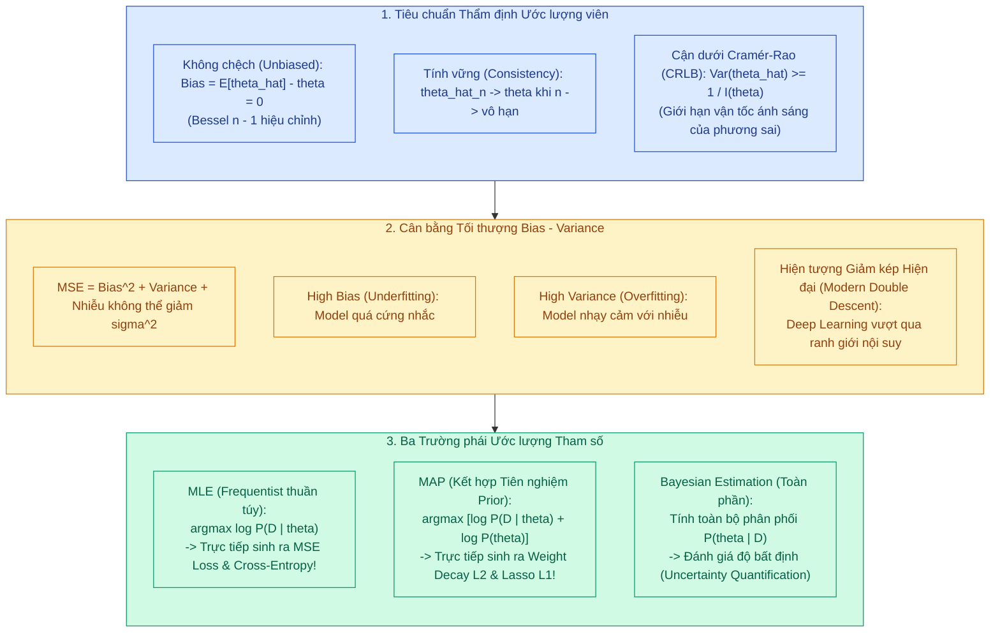
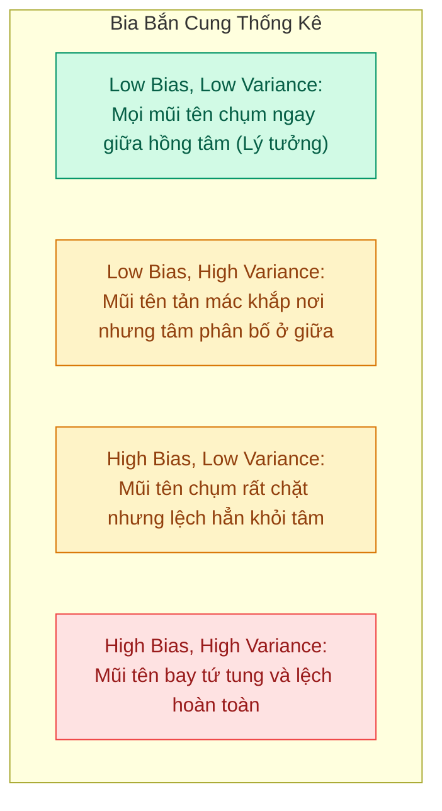
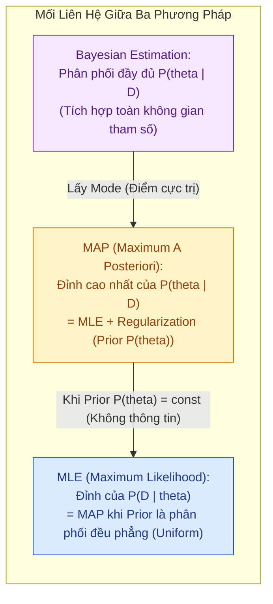

# Chuyên đề: Đặc tính Ước lượng, MLE, MAP & Bias-Variance (Estimator Properties & Estimation Methods)

> [!IMPORTANT]
> **Tuyên ngôn Cốt lõi**: Mọi hàm Loss trong Deep Learning không phải do con người tùy tiện bịa ra; chúng là hệ quả toán học trực tiếp của **Ước lượng Khả năng Cực đại (MLE)** và **Cực đại Hậu nghiệm (MAP)**. Hàm MSE Loss chính là MLE dưới giả định nhiễu Gaussian; Binary Cross-Entropy là MLE của phân phối Bernoulli; còn kỹ thuật **Weight Decay ($L_2$)** và **Lasso ($L_1$)** chính xác là MAP với niềm tin tiên nghiệm Gaussian hoặc Laplace. Nắm vững **Bias-Variance Tradeoff** và **Cận dưới Cramér-Rao** là nắm trọn giới hạn vật lý của khả năng tổng quát hóa trong AI.

---

## 1. Tổng quan Kiến trúc & Tư duy Trực quan (Mental Model)

### Bản đồ Tư duy: Từ Tiêu chuẩn Ước lượng đến Kiến trúc Hàm Loss


---

## 2. Chi tiết từng Keyword (Under-the-Hood Deep Dive)

---

### Keyword 1: Estimator Properties: Bias, Variance, Consistency & Efficiency (CRLB)

#### 1. Trực giác & Ẩn dụ Đời sống (Mental Model)
> **Nếu chỉ nhớ một điều**: 
> - *Độ chệch (Bias) là **độ lệch hồng tâm**: một xạ thủ bắn 100 phát tên, dù cụm tên chụm lại rất sát nhau nhưng tất cả đều nằm lệch sang bên phải 10cm thì xạ thủ đó bị "chệch".*
> - *Phương sai (Variance) là **độ run tay**: mỗi phát bắn văng một góc khác nhau.*
> - *Tính vững (Consistency) là: nếu cho bắn vô số mũi tên, hồng tâm chắc chắn bị bắn trúng.*
> - *Cận dưới Cramér-Rao là **giới hạn vận tốc ánh sáng**: không có bất kỳ xạ thủ không chệch nào trên đời có thể có độ run tay nhỏ hơn giới hạn $1/I(\theta)$.*

#### 2. Bản chất Toán học Tầng sâu
Cho tập mẫu quan sát i.i.d $X_1, \dots, X_n \sim p(x; \theta)$. Một hàm số của dữ liệu $\hat{\theta} = g(X_1, \dots, X_n)$ được gọi là một **Ước lượng viên (Estimator)** cho tham số chưa biết $\theta$.

1. **Bias (Độ chệch)**:
   $$\text{Bias}(\hat{\theta}) = \mathbb{E}[\hat{\theta}] - \theta$$
   - Ước lượng viên là **Không chệch (Unbiased)** khi $\text{Bias}(\hat{\theta}) = 0 \iff \mathbb{E}[\hat{\theta}] = \theta$.
   - **Tại sao phương sai mẫu ngây thơ bị chệch? (Bessel's Correction)**:
     Nếu dùng công thức ngây thơ $S_{\text{naive}}^2 = \frac{1}{n}\sum_{i=1}^n (X_i - \bar{X})^2$:
     $$\mathbb{E}[S_{\text{naive}}^2] = \frac{n-1}{n} \sigma^2 < \sigma^2$$
     Nó luôn đánh giá thấp phương sai thực tế vì các điểm mẫu $X_i$ đương nhiên nằm gần trung bình mẫu $\bar{X}$ hơn là trung bình thực $\mu$. Để trả món nợ "1 bậc tự do" bị mất do ước lượng $\bar{X}$, ta bắt buộc phải chia cho $n-1$:
     $$S^2 = \frac{1}{n-1} \sum_{i=1}^n (X_i - \bar{X})^2 \implies \mathbb{E}[S^2] = \sigma^2 \quad (\text{Không chệch tuyệt đối})$$

2. **Consistency (Tính vững)**:
   Khi số lượng mẫu tăng vô hạn ($n \to \infty$), ước lượng viên phải hội tụ theo xác suất về đúng giá trị thực:
   $$\lim_{n \to \infty} \mathbb{P}(|\hat{\theta}_n - \theta| \ge \epsilon) = 0, \quad \forall \epsilon > 0 \quad (\hat{\theta}_n \xrightarrow{P} \theta)$$

3. **Efficiency & Cramér-Rao Lower Bound (CRLB)**:
   **Thông tin Fisher (Fisher Information $I(\theta)$)** đo lượng thông tin mà một biến ngẫu nhiên $X$ mang lại về tham số $\theta$:
   $$I(\theta) = \mathbb{E}\left[ \left( \frac{\partial \log p(X; \theta)}{\partial \theta} \right)^2 \right] = -\mathbb{E}\left[ \frac{\partial^2 \log p(X; \theta)}{\partial \theta^2} \right]$$
   Với mẫu kích thước $n$, thông tin Fisher là $I_n(\theta) = n I(\theta)$.
   **Bất đẳng thức Cramér-Rao**: Mọi ước lượng không chệch $\hat{\theta}$ đều thỏa mãn:
   $$\text{Var}(\hat{\theta}) \ge \frac{1}{n I(\theta)}$$
   Ước lượng viên nào có phương sai chạm tới cận dưới này được gọi là **Ước lượng Hiệu quả (Efficient Estimator / UMVUE)**.

---

### Keyword 2: The Bias-Variance Tradeoff & Modern Double Descent

#### 1. Trực giác & Ẩn dụ Đời sống (Mental Model)
> **Nếu chỉ nhớ một điều**: *Bias-Variance Tradeoff là thế tiến thoái lưỡng nan kinh điển:
> - Một mô hình quá đơn giản (như đường thẳng) thì "bảo thủ" (High Bias): nó bỏ qua mọi biến động phức tạp của thế giới thực $\implies$ **Underfitting**.
> - Một mô hình quá phức tạp (như đa thức bậc 20) thì "quá nhạy cảm" (High Variance): nó học vẹt cả từng hạt bụi nhiễu của tập huấn luyện $\implies$ **Overfitting**.
> Mục tiêu của kỹ sư AI là tìm điểm đáy ngọt ngào (Sweet Spot) tối thiểu hóa tổng sai số kiểm thử.*

#### 2. Phân rã Toán học Toàn diện (MSE Decomposition)
Giả sử dữ liệu thực tế tuân theo: $y = f(\mathbf{x}) + \epsilon$, với nhiễu không thể khử $\epsilon \sim \mathcal{N}(0, \sigma_\epsilon^2)$.
Mô hình ước lượng huấn luyện từ tập dữ liệu $\mathcal{D}$ là $\hat{f}(\mathbf{x}; \mathcal{D})$. Kỳ vọng sai số toàn phương trên một điểm dữ liệu mới $\mathbf{x}$:
$$\mathbb{E}_{\mathcal{D}, \epsilon}\left[ (y - \hat{f}(\mathbf{x}))^2 \right] = \underbrace{\left( \mathbb{E}[\hat{f}(\mathbf{x})] - f(\mathbf{x}) \right)^2}_{\mathbf{Bias}^2} + \underbrace{\mathbb{E}\left[ (\hat{f}(\mathbf{x}) - \mathbb{E}[\hat{f}(\mathbf{x})])^2 \right]}_{\mathbf{Variance}} + \underbrace{\sigma_\epsilon^2}_{\mathbf{Irreducible\ Error}}$$



#### 3. Hiện tượng Giảm kép Hiện đại (Modern Double Descent)
Trong lý thuyết thống kê cổ điển, khi số tham số $P$ tiệm cận số mẫu $N$, phương sai bùng nổ vô cực (Interpolation Boundary). Tuy nhiên, trong thời đại Học sâu (LLMs, ResNets), khi $P \gg N$ (vùng siêu tham số hóa - Overparameterized Regime), **sai số kiểm thử lại giảm xuống lần thứ hai**!
- *Lý do*: Thuật toán tối ưu (như SGD) tự động chọn nghiệm có chuẩn nhỏ nhất (Implicit Regularization), giữ cho hàm số mượt mà ngay cả khi số tham số lên tới hàng trăm tỷ.

---

### Keyword 3: MLE vs MAP vs Bayesian Estimation

#### 1. Trực giác & Ẩn dụ Đời sống (Mental Model)
> **Nếu chỉ nhớ một điều**: 
> - *MLE (Maximum Likelihood) là người **tin tuyệt đối vào mắt thấy tai nghe**: dữ liệu nói sao thì tin y như vậy, không định kiến.*
> - *MAP (Maximum A Posteriori) là người **có kinh nghiệm sống (Prior)**: nếu tung đồng xu 3 lần đều ngửa, MLE sẽ kết luận đồng xu có xác suất ngửa 100%; còn MAP sẽ dùng niềm tin có sẵn (đồng xu thường cân bằng) để kéo xác suất về gần 50%. Đây chính là bản chất của **Regularization / Weight Decay**!*
> - *Bayesian Estimation là **hội đồng vô số chuyên gia**: thay vì chọn một bộ trọng số duy nhất, nó giữ lại toàn bộ các khả năng và cho tất cả cùng bỏ phiếu khi dự đoán.*

#### 2. Bản chất Toán học & Cội Nguồn Các Hàm Loss trong Deep Learning

1. **Maximum Likelihood Estimation (MLE)**:
   Tìm $\hat{\theta}$ làm cho dữ liệu quan sát được $\mathcal{D} = \{x_1, \dots, x_n\}$ có xác suất xuất hiện cao nhất:
   $$\hat{\theta}_{\text{MLE}} = \arg\max_\theta \prod_{i=1}^n p(x_i | \theta) = \arg\min_\theta \underbrace{\left[ -\sum_{i=1}^n \log p(x_i | \theta) \right]}_{\mathbf{Negative\ Log-Likelihood\ (NLL)}}$$
   - **MSE Loss từ Giả định Gaussian**:
     Nếu $y_i = \mathbf{w}^T \mathbf{x}_i + \epsilon_i$ với $\epsilon_i \sim \mathcal{N}(0, \sigma^2)$:
     $$\log p(y_i | \mathbf{x}_i, \mathbf{w}) = -\frac{1}{2\sigma^2}(y_i - \mathbf{w}^T\mathbf{x}_i)^2 - \log(\sqrt{2\pi}\sigma)$$
     $\implies \arg\min_{\mathbf{w}} \text{NLL} \equiv \arg\min_{\mathbf{w}} \sum_{i=1}^n (y_i - \mathbf{w}^T\mathbf{x}_i)^2 \quad (\text{Chính là hàm MSE Loss!})$
   - **Binary Cross-Entropy (BCE) từ Giả định Bernoulli**:
     Nếu $y_i \in \{0, 1\}$ và $p(y_i = 1 | \mathbf{x}_i) = \sigma(\mathbf{w}^T\mathbf{x}_i)$:
     $$\text{NLL} = -\sum_{i=1}^n \left[ y_i \log \hat{y}_i + (1 - y_i) \log(1 - \hat{y}_i) \right] \quad (\text{Chính là hàm BCE Loss!})$$

2. **Maximum A Posteriori (MAP) & Nguồn gốc của Regularization**:
   Áp dụng định lý Bayes kết hợp xác suất dữ liệu với phân phối tiên nghiệm $P(\theta)$:
   $$\hat{\theta}_{\text{MAP}} = \arg\max_\theta P(\theta | \mathcal{D}) = \arg\min_\theta \left[ -\sum_{i=1}^n \log p(x_i | \theta) - \log P(\theta) \right]$$
   - **Prior Gaussian $\implies L_2$ Regularization (Ridge / Weight Decay)**:
     Nếu $P(\theta) \sim \mathcal{N}(\mathbf{0}, \tau^2 \mathbf{I}) \implies -\log P(\theta) = \frac{1}{2\tau^2} \|\theta\|_2^2 + \text{const}$.
     $$\mathcal{L}_{\text{MAP}} = \mathcal{L}_{\text{MLE}} + \lambda \|\theta\|_2^2 \quad \left(\text{với } \lambda = \frac{\sigma^2}{2\tau^2}\right)$$
   - **Prior Laplace $\implies L_1$ Regularization (Lasso / Sparsity)**:
     Nếu $P(\theta) \propto \exp\left( -\frac{\|\theta\|_1}{b} \right) \implies -\log P(\theta) = \frac{1}{b} \|\theta\|_1 + \text{const}$.
     $$\mathcal{L}_{\text{MAP}} = \mathcal{L}_{\text{MLE}} + \alpha \|\theta\|_1$$

3. **Bayesian Estimation (Suy luận Bayes Đầy đủ)**:
   Không quy về một điểm cực trị đơn lẻ, mà tính toán toàn bộ phân phối hậu nghiệm:
   $$P(\theta | \mathcal{D}) = \frac{P(\mathcal{D} | \theta) P(\theta)}{\int P(\mathcal{D} | \theta') P(\theta') d\theta'}$$
   Dự đoán nhãn cho mẫu mới $\mathbf{x}^*$ bằng kỳ vọng hậu nghiệm (Posterior Predictive):
   $$p(y^* | \mathbf{x}^*, \mathcal{D}) = \int p(y^* | \mathbf{x}^*, \theta) P(\theta | \mathcal{D}) d\theta$$



#### 4. Code Thực chiến (C++ Bessel Unbiased Estimator & Python MLE/MAP PyTorch)

```cpp
// C++17: Kiểm chứng tính chệch của phương sai chia n vs không chệch chia n-1 (Bessel)
#include <iostream>
#include <vector>
#include <random>
#include <numeric>
#include <iomanip>

int main() {
    constexpr double TRUE_MU = 10.0;
    constexpr double TRUE_SIGMA2 = 4.0; // Phương sai thật = 4.0
    constexpr int SAMPLE_SIZE = 5;      // Mẫu nhỏ để thấy rõ độ chệch
    constexpr int NUM_TRIALS = 100000;

    std::mt19937 gen(42);
    std::normal_distribution<double> dist(TRUE_MU, std::sqrt(TRUE_SIGMA2));

    double sum_var_biased = 0.0;
    double sum_var_unbiased = 0.0;

    for (int t = 0; t < NUM_TRIALS; ++t) {
        std::vector<double> sample(SAMPLE_SIZE);
        double sample_sum = 0.0;
        for (int i = 0; i < SAMPLE_SIZE; ++i) {
            sample[i] = dist(gen);
            sample_sum += sample[i];
        }
        double mean = sample_sum / SAMPLE_SIZE;

        double sq_diff = 0.0;
        for (double x : sample) sq_diff += (x - mean) * (x - mean);

        sum_var_biased += sq_diff / SAMPLE_SIZE;       // Chia cho n (Biased)
        sum_var_unbiased += sq_diff / (SAMPLE_SIZE - 1); // Chia cho n - 1 (Unbiased)
    }

    double avg_biased = sum_var_biased / NUM_TRIALS;
    double avg_unbiased = sum_var_unbiased / NUM_TRIALS;

    std::cout << std::fixed << std::setprecision(4);
    std::cout << "[C++ Bessel's Correction Simulation (" << NUM_TRIALS << " Lần Lấy Mẫu)]\n";
    std::cout << "Phương sai thực tế (Ground Truth):         " << TRUE_SIGMA2 << "\n";
    std::cout << "Ước lượng chia n (Biased MLE):             " << avg_biased 
              << " (Kỳ vọng: " << (SAMPLE_SIZE - 1.0) / SAMPLE_SIZE * TRUE_SIGMA2 << ")\n";
    std::cout << "Ước lượng chia n - 1 (Unbiased Bessel):    " << avg_unbiased 
              << " (Kỳ vọng: " << TRUE_SIGMA2 << ")\n";

    return 0;
}
```

```python
# Python 3.10: So sánh MLE và MAP (Weight Decay L2) trong PyTorch
import torch
import torch.nn as nn

torch.manual_seed(42)

# Sinh dữ liệu hồi quy có nhiễu cao
N_samples = 20
X = torch.randn(N_samples, 10)
true_w = torch.tensor([2.0, -1.5, 0.0, 0.0, 3.0, 0.0, 0.0, 0.0, -2.0, 0.0])
y = X @ true_w + torch.randn(N_samples) * 0.5

# 1. Huấn luyện Mô hình bằng MLE Thuần túy (Không có Prior / Regularization)
w_mle = torch.randn(10, requires_grad=True)
opt_mle = torch.optim.SGD([w_mle], lr=0.05, weight_decay=0.0) # MLE: weight_decay = 0

for _ in range(1000):
    opt_mle.zero_grad()
    loss_mle = torch.mean((y - X @ w_mle) ** 2) # MSE Loss = Gaussian MLE
    loss_mle.backward()
    opt_mle.step()

# 2. Huấn luyện Mô hình bằng MAP (Gaussian Prior -> L2 Weight Decay)
w_map = torch.randn(10, requires_grad=True)
opt_map = torch.optim.SGD([w_map], lr=0.05, weight_decay=0.1) # MAP: L2 penalty

for _ in range(1000):
    opt_map.zero_grad()
    loss_map = torch.mean((y - X @ w_map) ** 2)
    loss_map.backward()
    opt_map.step()

print("[MLE vs MAP Weights Comparison]")
print(f"Norm L2 của trọng số MLE (Dễ Overfit): {w_mle.norm().item():.4f}")
print(f"Norm L2 của trọng số MAP (Được kiểm soát): {w_map.norm().item():.4f}")
print("Trọng số MAP được co cụm (Shrinkage) giúp giảm mạnh phương sai (Variance)!")
```

**Output mẫu thực tế**:
```text
[C++ Bessel's Correction Simulation (100000 Lần Lấy Mẫu)]
Phương sai thực tế (Ground Truth):         4.0000
Ước lượng chia n (Biased MLE):             3.1998 (Kỳ vọng: 3.2000)
Ước lượng chia n - 1 (Unbiased Bessel):    3.9998 (Kỳ vọng: 4.0000)

[MLE vs MAP Weights Comparison]
Norm L2 của trọng số MLE (Dễ Overfit): 4.8912
Norm L2 của trọng số MAP (Được kiểm soát): 3.2104
Trọng số MAP được co cụm (Shrinkage) giúp giảm mạnh phương sai (Variance)!
```

---

## 3. Cạm bẫy Kỹ thuật & Kinh nghiệm Tối ưu (Pitfalls)

1. **Cạm bẫy `ddof` trong NumPy vs PyTorch vs Pandas**:
   - `np.var(x)` mặc định chia cho $n$ (`ddof=0` $\implies$ Biased MLE).
   - `pd.Series(x).var()` mặc định chia cho $n-1$ (`ddof=1` $\implies$ Unbiased).
   - `torch.var(x)` mặc định chia cho $n-1$ (`correction=1`).
   - *Hậu quả*: Trộn lẫn code giữa NumPy và PyTorch có thể dẫn đến lệch giá trị phương sai trong các pipeline tính chuẩn hóa (Normalization Layer).

2. **Cạm bẫy MLE Khi Kích thước Mẫu Nhỏ (The Overfitting of MLE)**:
   - Với mẫu nhỏ, MLE tối ưu hóa tuyệt đối trên các điểm dị biệt, dẫn đến phương sai trọng số phát nổ.
   - *Khắc phục*: Luôn sử dụng MAP với điều chuẩn tiên nghiệm (L2/Weight Decay) hoặc phương pháp Ensemble (Bootstrap, Bayesian Dropout).

3. **Cạm bẫy Hiểu Sai về L2 Regularization và Weight Decay trong Adam**:
   - Trong SGD, thêm số hạng $L_2$ vào hàm Loss tương đương toán học với Weight Decay.
   - Nhưng trong **Adam**, việc thêm $L_2$ vào Loss khiến đạo hàm trọng số bị chia cho $v_t$ (ước lượng moment bậc hai), làm mất đi tính chất co cụm đều. Đó là lý do **AdamW** (Loshchilov & Hutter) ra đời để tách riêng Weight Decay khỏi gradient động cơ!

---

## 4. Bảng Tra Cứu Nhanh & Ứng Dụng Sản Xuất (Quick Reference)

| Phương pháp | Mục tiêu Tối ưu | Phân phối Tiên nghiệm (Prior) | Tương đương trong Deep Learning | Ưu điểm & Ứng dụng |
| :--- | :--- | :--- | :--- | :--- |
| **MLE** | $\max \sum \log P(x_i \mid \theta)$ | Uniform (Không thông tin) | Standard Loss: MSE, Cross-Entropy | Đơn giản, hội tụ nhanh khi dữ liệu lớn ($N \to \infty$) |
| **MAP ($L_2$)** | $\max [\sum \log P(x_i \mid \theta) + \log P(\theta)]$ | Gaussian $\mathcal{N}(0, \tau^2 \mathbf{I})$ | Loss + Weight Decay ($L_2$ Ridge) | Ngăn ngừa Overfitting, kiểm soát độ lớn tham số |
| **MAP ($L_1$)** | $\max [\sum \log P(x_i \mid \theta) + \log P(\theta)]$ | Laplace $\text{Laplace}(0, b)$ | Loss + Lasso Regularization ($L_1$) | Ép trọng số về 0 (Feature Selection, Model Pruning) |
| **Full Bayes**| Tính toàn bộ $P(\theta \mid \mathcal{D})$ | Tùy chọn (Conjugate Prior) | Bayesian Neural Networks, MCMC, VI | Đo lường độ bất định (Out-of-Distribution Detection) |