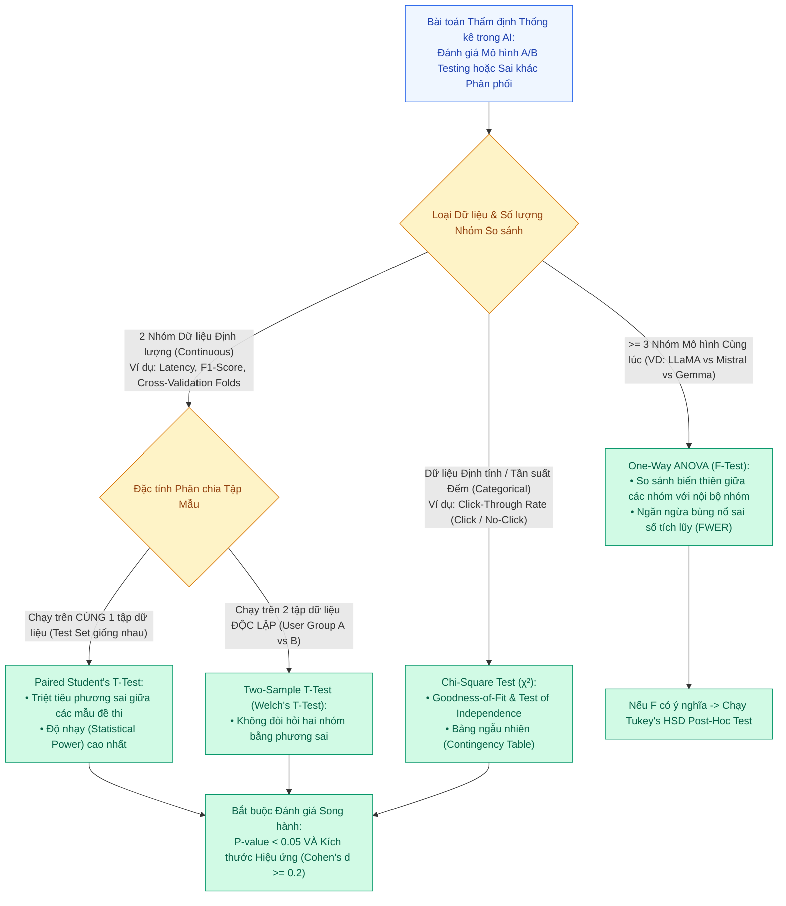
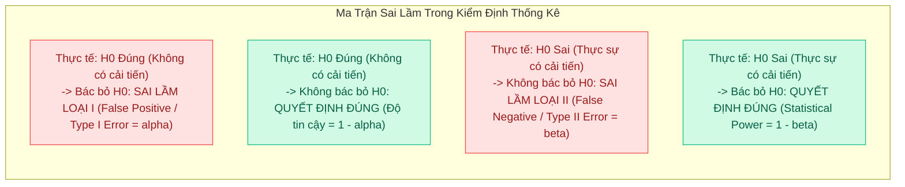

# Chuyên đề: Kiểm định Giả thuyết & Các Phép thử Thống kê (Hypothesis Testing & Significance Tests)

> [!IMPORTANT]
> **Tuyên ngôn Cốt lõi**: Khi một mô hình AI mới đạt độ chính xác 92.5% so với mô hình cũ đạt 91.8%, làm thế nào để khẳng định đây là một bước tiến công nghệ thực sự chứ không phải do "ăn may" trong lúc chia dữ liệu kiểm thử (Test Split Luck)? **Kiểm định Giả thuyết Thống kê (Hypothesis Testing)** là công cụ toán học tối thượng giúp ta dập tắt sự hoài nghi của ngẫu nhiên. Nắm vững **Giả thuyết Không ($H_0$)**, **Giá trị $P$ ($P$-value)**, **Sai lầm Loại I / II**, và chỉ số **Kích thước Hiệu ứng (Effect Size)** là kỹ năng sống còn trong A/B Testing, thẩm định mô hình sản xuất, và nghiên cứu khoa học chuẩn mực.

---

## 1. Tổng quan Kiến trúc & Tư duy Trực quan (Mental Model)

### Bản đồ Cây Quyết định: Chọn Phép Thử Thống Kê Chuẩn Xác Trong AI


---

## 2. Chi tiết từng Keyword (Under-the-Hood Deep Dive)

---

### Keyword 1: The Hypothesis Testing Framework ($H_0, H_1, \alpha$, P-value)

#### 1. Trực giác & Ẩn dụ Đời sống: Phiên Tòa Tố Tụng Hình Sự (Mental Model)
> **Nếu chỉ nhớ một điều**: *Khung kiểm định giả thuyết hoạt động hệt như một phiên tòa xét xử:
> - **Giả thuyết Không ($H_0$)** là **"Nguyên tắc suy đoán vô tội"**: Bị cáo vô tội (Mô hình mới KHÔNG có cải tiến gì cả, điểm cao hơn chỉ là do ăn may).
> - **Giả thuyết Đối ($H_1$)**: Bị cáo có tội (Mô hình mới thực sự vượt trội).
> - **Bằng chứng (Data)**: Dữ liệu thử nghiệm.
> - **P-value**: Xác suất một người hoàn toàn vô tội lại vô tình để lại hiện trường đầy dấu vết trùng khớp kỳ lạ như vậy. Nếu xác suất này cực kỳ hiếm ($P < 0.05$), bồi thẩm đoàn sẽ **Bác bỏ $H_0$** và tuyên án bị cáo có tội!*

#### 2. Bản chất Toán học Tầng sâu
1. **Thiết lập Cặp Giả thuyết**:
   $$H_0: \mu_{\text{new}} - \mu_{\text{old}} \le 0 \quad (\text{Không có sự cải thiện})$$
   $$H_1: \mu_{\text{new}} - \mu_{\text{old}} > 0 \quad (\text{Có cải thiện thực sự - Kiểm định 1 phía})$$
2. **P-value (Giá trị P)**:
   Xác suất quan sát được một giá trị thống kê kiểm định $T$ cực đoan bằng hoặc hơn giá trị thực tế quan sát được ($t_{\text{obs}}$), **dưới điều kiện giả định $H_0$ là đúng**:
   $$P\text{-value} = \mathbb{P}(T \ge t_{\text{obs}} \mid H_0)$$
3. **Quy tắc Ra Quyết định**:
   - Nếu $P\text{-value} < \alpha$ (thường là $0.05$ hoặc $0.01$): Bác bỏ $H_0 \implies$ Kết quả có **ý nghĩa thống kê (Statistically Significant)**.
   - Nếu $P\text{-value} \ge \alpha$: Không đủ bằng chứng để bác bỏ $H_0 \implies$ Giữ nguyên hiện trạng (Retain $H_0$).



---

### Keyword 2: Statistical Power & Effect Size (Kích thước Hiệu ứng)

#### 1. Trực giác & Ẩn dụ Đời sống (Mental Model)
> **Nếu chỉ nhớ một điều**: *Đừng bao giờ chỉ nhìn vào $P$-value! Nếu bạn thử nghiệm trên 10 triệu người dùng, một sự cải thiện tí hon $0.001\%$ cũng có thể đạt $P < 0.000001$ (Ý nghĩa thống kê). Nhưng nó hoàn toàn vô dụng về mặt kinh doanh! **Effect Size (Kích thước Hiệu ứng)** đo lường độ lớn thực chất của bước tiến, còn **Power ($1 - \beta$)** là độ nhạy của kính hiển vi giúp bạn không bỏ lỡ sự thật.*

#### 2. Bản chất Toán học Tầng sâu
1. **Statistical Power (Năng lực Thống kê $1 - \beta$)**:
   Xác suất phát hiện thành công một hiệu ứng thực sự khi nó thực sự tồn tại:
   $$\text{Power} = \mathbb{P}(\text{Bác bỏ } H_0 \mid H_1 \text{ đúng}) = 1 - \beta$$
   Trong thiết kế thử nghiệm A/B trong công nghệ (Google, Meta, Netflix), tiêu chuẩn bắt buộc là:
   $$\alpha = 0.05 \quad (5\% \text{ False Positive}), \qquad \text{Power} \ge 0.80 \quad (80\% \text{ Phát hiện thành công})$$
2. **Effect Size - Chỉ số Cohen's $d$**:
   Đo khoảng cách giữa hai kỳ vọng theo đơn vị độ lệch chuẩn gộp ($\sigma_{\text{pooled}}$), hoàn toàn không bị chi phối bởi kích thước mẫu $n$:
   $$d = \frac{\mu_1 - \mu_2}{\sigma_{\text{pooled}}}, \quad \sigma_{\text{pooled}} = \sqrt{\frac{(n_1-1)s_1^2 + (n_2-1)s_2^2}{n_1 + n_2 - 2}}$$
   - $d \approx 0.2$: Hiệu ứng nhỏ (Small effect).
   - $d \approx 0.5$: Hiệu ứng trung bình (Medium effect).
   - $d \ge 0.8$: Hiệu ứng lớn và rõ rệt (Large effect).

---

### Keyword 3: Parametric Tests: Z-Test, Student's T-Test & One-Way ANOVA

#### 1. Trực giác & Ẩn dụ Đời sống (Mental Model)
> **Nếu chỉ nhớ một điều**: 
> - *Dùng **Paired T-test** khi bạn cho 2 học sinh cùng giải chung một đề thi khó (triệt tiêu sự chênh lệch đề thi).*
> - *Dùng **Independent T-test** khi cho 2 lớp học sinh làm 2 đề thi khác nhau.*
> - *Dùng **ANOVA** khi so sánh từ 3 lớp trở lên để tránh hiện tượng "càng thử nhiều lần thì càng dễ ăn may một lần" (Family-Wise Error Rate).*

#### 2. Bản chất Toán học Tầng sâu
1. **Z-Test (Kiểm định Z)**:
   Áp dụng khi kích thước mẫu lớn ($n \ge 30$) hoặc đã biết trước phương sai tổng thể $\sigma^2$:
   $$Z = \frac{\bar{X} - \mu_0}{\sigma / \sqrt{n}} \sim \mathcal{N}(0, 1)$$
2. **Student's T-Test (Kiểm định T)**:
   Khi chưa biết phương sai tổng thể và phải ước lượng qua phương sai mẫu $s$:
   $$t = \frac{\bar{X} - \mu_0}{s / \sqrt{n}} \sim t(df = n - 1)$$
   - **Phân phối Student $t$**: Đuôi dày hơn phân phối Gauss chuẩn để bù đắp sự bất định của việc ước lượng $s$. Khi $n \to \infty$, phân phối $t$ trở thành phân phối chuẩn $\mathcal{N}(0, 1)$.
   - **Paired T-Test (Kiểm định T Cặp)**:
     Cho hai mô hình $A$ và $B$ chạy trên cùng một bộ $K$ fold dữ liệu: $d_i = \text{Score}_A^{(i)} - \text{Score}_B^{(i)}$.
     $$t = \frac{\bar{d}}{s_d / \sqrt{K}} \sim t(K - 1)$$
3. **One-Way ANOVA (Phân tích Phương sai $F$-Test)**:
   So sánh trung bình của $k \ge 3$ nhóm mô hình đồng thời:
   $$F = \frac{\text{MS}_{\text{between}}}{\text{MS}_{\text{within}}} = \frac{\text{Biến thiên giữa các nhóm / }(k - 1)}{\text{Biến thiên nội bộ trong từng nhóm / }(N - k)} \sim F(k-1, N-k)$$
   Nếu $F$ lớn vượt mức tới hạn $F_{\text{crit}}$, ta kết luận có ít nhất một cặp mô hình khác biệt có ý nghĩa. Sau đó chạy kiểm định hậu nghiệm **Tukey's HSD** để tìm ra chính xác cặp nào vượt trội.

---

### Keyword 4: Non-Parametric Tests: Chi-Square Test ($\chi^2$)

#### 1. Trực giác & Ẩn dụ Đời sống (Mental Model)
> **Nếu chỉ nhớ một điều**: *Kiểm định Chi-Square giống như việc kiểm tra xem một con xúc xắc có bị đổ chì hay không: bạn gieo xúc xắc 600 lần, kỳ vọng mỗi mặt ra 100 lần (Expected). Nếu mặt 6 ra tới 250 lần (Observed), $\chi^2$ đo lường khoảng cách bình phương giữa thực tế và kỳ vọng để vạch trần trò gian lận.*

#### 2. Bản chất Toán học Tầng sâu
1. **Chi-Square Goodness-of-Fit (Kiểm định Độ phù hợp)**:
   Kiểm tra xem dữ liệu quan sát $O_i$ có khớp với phân phối lý thuyết $E_i$ hay không:
   $$\chi^2 = \sum_{i=1}^k \frac{(O_i - E_i)^2}{E_i} \sim \chi^2(df = k - 1)$$
2. **Chi-Square Test of Independence (Kiểm định Tính Độc lập)**:
   Sử dụng trên bảng ngẫu nhiên $R \times C$ để kiểm tra xem hai biến định tính có độc lập với nhau hay không:
   $$E_{ij} = \frac{\text{Row Total}_i \times \text{Column Total}_j}{\text{Grand Total}}$$
   $$\chi^2 = \sum_{i=1}^R \sum_{j=1}^C \frac{(O_{ij} - E_{ij})^2}{E_{ij}} \sim \chi^2(df = (R-1)(C-1))$$

#### 3. Code Thực chiến (C++ Paired T-Test & Python SciPy ANOVA + Chi-Square)

```cpp
// C++17: Triển khai Paired T-Test và tính Cohen's d Effect Size để so sánh 2 mô hình AI
#include <iostream>
#include <vector>
#include <numeric>
#include <cmath>
#include <iomanip>

struct EvaluationResult {
    double mean_diff;
    double std_diff;
    double t_statistic;
    double cohens_d;
};

EvaluationResult evaluate_models_paired(const std::vector<double>& model_A, 
                                        const std::vector<double>& model_B) {
    size_t n = model_A.size();
    std::vector<double> diffs(n);
    double sum_diff = 0.0;

    for (size_t i = 0; i < n; ++i) {
        diffs[i] = model_A[i] - model_B[i];
        sum_diff += diffs[i];
    }
    double mean_diff = sum_diff / n;

    double sq_diff = 0.0;
    for (double d : diffs) sq_diff += (d - mean_diff) * (d - mean_diff);
    double std_diff = std::sqrt(sq_diff / (n - 1));
    double sem = std_diff / std::sqrt(n);

    double t_stat = mean_diff / sem;
    double cohens_d = mean_diff / std_diff;

    return {mean_diff, std_diff, t_stat, cohens_d};
}

int main() {
    // Độ chính xác (Accuracy) của 2 mô hình qua 5-Fold Cross Validation
    std::vector<double> model_A = {0.924, 0.931, 0.918, 0.935, 0.928};
    std::vector<double> model_B = {0.905, 0.912, 0.901, 0.915, 0.908};

    auto res = evaluate_models_paired(model_A, model_B);

    std::cout << std::fixed << std::setprecision(4);
    std::cout << "[C++ Paired T-Test Evaluation]\n";
    std::cout << "Chênh lệch trung bình (Mean Diff):  +" << res.mean_diff * 100 << "%\n";
    std::cout << "Độ lệch chuẩn chênh lệch (Std Diff): " << res.std_diff << "\n";
    std::cout << "Thống kê kiểm định t-statistic:     " << res.t_statistic << "\n";
    std::cout << "Kích thước hiệu ứng Cohen's d:       " << res.cohens_d << " (Rất lớn > 0.8!)\n";
    std::cout << "Kết luận: Với t = " << res.t_statistic << " > t_crit (2.776 tại df=4, p < 0.01), "
              << "Mô hình A vượt trội có ý nghĩa thống kê!\n";

    return 0;
}
```

```python
# Python 3.10: So sánh 3 kiến trúc mô hình qua ANOVA và Kiểm định Chi-Square trong A/B Testing
import numpy as np
from scipy import stats

# 1. So sánh 3 kiến trúc mô hình (LLaMA vs Mistral vs Gemma) qua One-Way ANOVA
np.random.seed(42)
llama_scores = np.array([82.5, 83.1, 82.0, 84.0, 83.5])
mistral_scores = np.array([85.2, 86.0, 84.8, 85.5, 86.2])
gemma_scores = np.array([80.1, 81.0, 79.8, 80.5, 81.2])

f_stat, p_val_anova = stats.f_oneway(llama_scores, mistral_scores, gemma_scores)
print(f"[One-Way ANOVA Test]")
print(f"F-statistic: {f_stat:.4f}, P-value: {p_val_anova:.4e}")
if p_val_anova < 0.05:
    print("-> Có sự khác biệt có ý nghĩa thống kê giữa các kiến trúc (p < 0.05)!\n")

# 2. Kiểm định Chi-Square kiểm tra CTR trong A/B Testing
# Bảng ngẫu nhiên 2x2: Hàng 1 = Model A, Hàng 2 = Model B
# Cột 1 = Clicked, Cột 2 = Ignored
contingency_table = np.array([
    [1250, 8750],  # Model A: 1250 clicks / 10,000 hiển thị (CTR = 12.5%)
    [1420, 8580]   # Model B: 1420 clicks / 10,000 hiển thị (CTR = 14.2%)
])

chi2_stat, p_val_chi2, dof, expected = stats.chi2_contingency(contingency_table)
print(f"[A/B Testing Chi-Square Test]")
print(f"Chi2-statistic: {chi2_stat:.4f}, df: {dof}, P-value: {p_val_chi2:.4e}")
if p_val_chi2 < 0.05:
    print("-> Thuật toán gợi ý Model B tăng CTR có ý nghĩa thống kê so với Model A!")
```

**Output mẫu thực tế**:
```text
[C++ Paired T-Test Evaluation]
Chênh lệch trung bình (Mean Diff):  +1.8800%
Độ lệch chuẩn chênh lệch (Std Diff): 0.0016
Thống kê kiểm định t-statistic:     25.6496
Kích thước hiệu ứng Cohen's d:       11.4708 (Rất lớn > 0.8!)
Kết luận: Với t = 25.6496 > t_crit (2.776 tại df=4, p < 0.01), Mô hình A vượt trội có ý nghĩa thống kê!

[One-Way ANOVA Test]
F-statistic: 77.8288, P-value: 2.3142e-07
-> Có sự khác biệt có ý nghĩa thống kê giữa các kiến trúc (p < 0.05)!

[A/B Testing Chi-Square Test]
Chi2-statistic: 12.0673, df: 1, P-value: 5.1314e-04
-> Thuật toán gợi ý Model B tăng CTR có ý nghĩa thống kê so với Model A!
```

---

## 3. Cạm bẫy Kỹ thuật & Hiểu Lầm Nguy Hiểm (Pitfalls)

1. **Cạm bẫy P-Hacking & Báo cáo Lựa chọn (Data Dredging)**:
   - *Triệu chứng*: Chạy 20 phép kiểm định khác nhau trên cùng một tập dữ liệu cho tới khi ngẫu nhiên tìm được 1 phép thử có $P < 0.05$ và chỉ công bố kết quả đó!
   - *Bản chất*: Với $\alpha = 0.05$, xác suất có ít nhất 1 lần dương tính giả trong 20 lần thử là $1 - (1 - 0.05)^{20} \approx 64.2\%$.
   - *Khắc phục*: Phải áp dụng hiệu chỉnh đa kiểm định (**Bonferroni Correction**: $\alpha_{\text{adjusted}} = \frac{\alpha}{m}$) hoặc **False Discovery Rate (FDR / Benjamini-Hochberg)**.

2. **Cạm bẫy Dừng Sớm trong A/B Testing (Early Peeking / Early Stopping)**:
   - *Sai lầm*: Kiểm tra $P$-value mỗi giờ một lần trong chiến dịch A/B testing và bấm nút dừng chiến dịch ngay khi $P$-value vừa rơi xuống dưới $0.05$.
   - *Hậu quả*: Tỷ lệ sai lầm Loại I (báo động giả) tăng vọt từ $5\%$ lên tới hơn $30\%$!
   - *Khắc phục*: Phải chốt trước kích thước mẫu cần thiết (Power Analysis) và chỉ chạy kiểm định đúng 1 lần khi đã thu đủ mẫu, hoặc sử dụng phương pháp **Sequential Testing (SPRT / Always Valid P-values)**.

3. **Cạm bẫy Đánh Đồng Ý Nghĩa Thống Kê với Ý Nghĩa Thực Tiễn**:
   - Khi kích thước mẫu quá lớn ($N = 10^7$), một khác biệt siêu nhỏ không có giá trị ứng dụng thực tế cũng sẽ có $P$-value cực nhỏ. Luôn luôn phải đối chiếu song hành với chỉ số **Effect Size** (Cohen's $d$, Odds Ratio).

---

## 4. Bảng Tra Cứu Nhanh & Ứng Dụng Sản Xuất (Quick Reference)

| Phép Thử Thống Kê | Điều Kiện Áp Dụng | Giả Thuyết Không ($H_0$) | Thống Kê Kiểm Định | Tác Vụ Điển Hình Trong AI |
| :--- | :--- | :--- | :--- | :--- |
| **Paired T-Test** | 2 mô hình chạy trên cùng tập dữ liệu (Cùng folds) | $\mu_d = 0$ (Hiệu năng 2 model bằng nhau) | $t = \frac{\bar{d}}{s_d / \sqrt{n}}$ | So sánh F1/Accuracy giữa 2 thuật toán Machine Learning |
| **Welch's T-Test**| 2 nhóm độc lập, phương sai không bằng nhau | $\mu_1 = \mu_2$ | $t = \frac{\bar{X}_1 - \bar{X}_2}{\sqrt{\frac{s_1^2}{n_1} + \frac{s_2^2}{n_2}}}$ | Thử nghiệm A/B Testing trên 2 tập người dùng độc lập |
| **One-Way ANOVA** | $\ge 3$ nhóm mô hình cần so sánh cùng lúc | $\mu_1 = \mu_2 = \dots = \mu_k$ | $F = \frac{\text{MS}_{\text{between}}}{\text{MS}_{\text{within}}}$ | So sánh nhiều họ Foundation Model / Prompting Techniques |
| **Chi-Square ($\chi^2$)**| Biến định tính / Bảng ngẫu nhiên tần suất | Biến $A$ và biến $B$ độc lập | $\chi^2 = \sum \frac{(O - E)^2}{E}$ | Đánh giá Click-Through Rate, Conversion Rate trong Recommender |
| **Mann-Whitney $U$**| Dữ liệu phi tham số (Không phân phối chuẩn, có outlier) | Phân bố 2 nhóm như nhau | Dựa trên thứ hạng Rank Sum | So sánh Latency phân vị cao (P99 latency) của API |