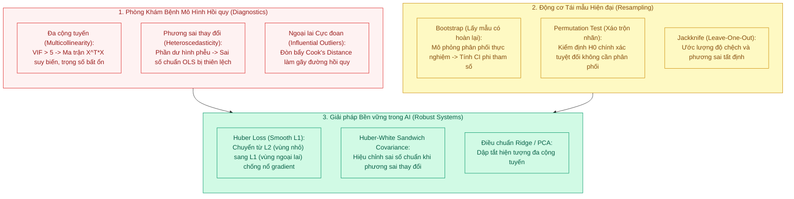
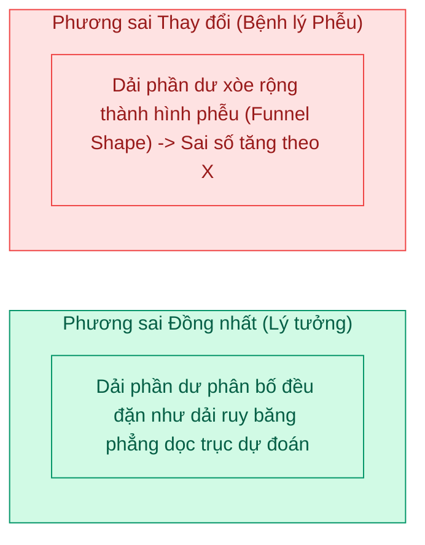
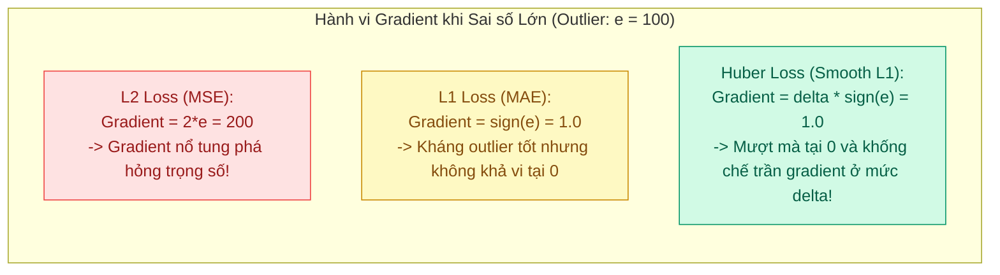

# Chuyên đề: Chẩn đoán Hồi quy & Các Phương pháp Tái mẫu (Regression Diagnostics & Resampling Methods)

> [!IMPORTANT]
> **Tuyên ngôn Cốt lõi**: Hồi quy Tuyến tính (OLS) chỉ là ông hoàng khi các định lý Gauss-Markov được thỏa mãn. Khi thực tế dữ liệu phát sinh **Đa cộng tuyến (Multicollinearity)**, **Phương sai thay đổi (Heteroscedasticity)** hoặc **Ngoại lai cực đoan (Outliers)**, các ước lượng OLS sẽ sụp đổ hoàn toàn. Thay vì bám víu vào các giả định phân phối chuẩn phi thực tế, **Các Phương pháp Tái mẫu (Resampling: Bootstrap, Permutation Tests)** và **Thống kê Bền vững (Robust Statistics / Huber Loss)** tận dụng sức mạnh tính toán của phần cứng hiện đại để mô phỏng phân phối thực nghiệm, mang lại khả năng chẩn đoán và suy luận vững chãi nhất.

---

## 1. Tổng quan Kiến trúc & Tư duy Trực quan (Mental Model)

### Bản đồ Tư duy: Từ Bắt Bệnh Hồi quy Đến Giải Pháp Tái Mẫu


---

## 2. Chi tiết từng Keyword (Under-the-Hood Deep Dive)

---

### Keyword 1: Linear Regression Diagnostics & Goodness of Fit ($R^2$ vs Adjusted $R^2$)

#### 1. Trực giác & Ẩn dụ Đời sống (Mental Model)
> **Nếu chỉ nhớ một điều**: *Hệ số $R^2$ giống như một vị trọng tài dễ dãi: bạn cho thêm bất kỳ biến vô nghĩa nào vào mô hình (như kích cỡ giày của nhân viên bán hàng để dự đoán giá nhà), $R^2$ cũng tăng lên. **Adjusted $R^2$** là trọng tài nghiêm khắc: phạt nặng các biến vô tích sự, chỉ cho phép điểm số tăng lên nếu biến mới thực sự mang lại tri thức bổ ích.*

#### 2. Bản chất Toán học Tầng sâu
Cho mô hình hồi quy đa biến $\mathbf{y} = \mathbf{X}\boldsymbol{\beta} + \boldsymbol{\epsilon}$. Nghiệm OLS: $\hat{\boldsymbol{\beta}} = (\mathbf{X}^T\mathbf{X})^{-1}\mathbf{X}^T\mathbf{y}$.
- **Tổng bình phương toàn phần (Total Sum of Squares - $\text{SS}_{\text{tot}}$)**: $\sum_{i=1}^n (y_i - \bar{y})^2$
- **Tổng bình phương phần dư (Residual Sum of Squares - $\text{SS}_{\text{res}}$)**: $\sum_{i=1}^n (y_i - \hat{y}_i)^2$
- **Hệ số Xác định $R^2$**:
  $$R^2 = 1 - \frac{\text{SS}_{\text{res}}}{\text{SS}_{\text{tot}}}$$
- **Adjusted $R^2$ ($R^2$ Hiệu chỉnh)**:
  $$R_{\text{adj}}^2 = 1 - \left[ \frac{(1 - R^2)(n - 1)}{n - p - 1} \right]$$
  Trong đó $n$ là kích thước mẫu, $p$ là số lượng biến độc lập. Khi thêm một biến rác vào mô hình, tử số giảm ít nhưng mẫu số $(n - p - 1)$ giảm nhiều $\implies R_{\text{adj}}^2$ sẽ bị tụt dốc.

---

### Keyword 2: Multicollinearity, Heteroscedasticity & Autocorrelation

#### 1. Trực giác & Ẩn dụ Đời sống (Mental Model)
> **Nếu chỉ nhớ một điều**: 
> - *Đa cộng tuyến (Multicollinearity) giống như hai nhân chứng tại tòa kể lại câu chuyện giống hệt nhau $99\%$: bạn biết tội ác đã xảy ra nhưng không tài nào phân xử được công trạng hay tội lỗi thuộc về ai (trọng số $\beta$ biến động mất kiểm soát).*
> - *Phương sai thay đổi (Heteroscedasticity) là chiếc phễu: dự đoán chi tiêu của người nghèo rất chụm (phương sai nhỏ), nhưng dự đoán chi tiêu của giới siêu giàu thì tản mác khắp nơi (phương sai cực lớn).*
> - *Tự tương quan (Autocorrelation) là dư chấn động đất: nhiệt độ hôm nay luôn dính chặt với nhiệt độ ngày hôm qua, vi phạm tính độc lập.*

#### 2. Bản chất Toán học & Phương pháp Bắt Bệnh
1. **Multicollinearity (Đa cộng tuyến)**:
   - Các cột của ma trận thiết kế $\mathbf{X}$ phụ thuộc tuyến tính cao $\implies \mathbf{X}^T\mathbf{X}$ gần như suy biến ($\det \approx 0$).
   - Ma trận hiệp phương sai của trọng số $\text{Cov}(\hat{\boldsymbol{\beta}}) = \sigma^2 (\mathbf{X}^T\mathbf{X})^{-1}$ có các phần tử đường chéo phát nổ vô cực.
   - **Hệ số Phóng đại Phương sai (Variance Inflation Factor - VIF)**:
     $$\text{VIF}_j = \frac{1}{1 - R_j^2}$$
     Trong đó $R_j^2$ là hệ số xác định khi hồi quy đặc trưng $X_j$ theo toàn bộ các đặc trưng còn lại.
     - $\text{VIF} < 5$: Bình thường.
     - $\text{VIF} \ge 10$: Đa cộng tuyến nghiêm trọng $\implies$ Bắt buộc dùng **Ridge Regression ($L_2$)** hoặc loại bỏ biến.

2. **Heteroscedasticity (Phương sai Sai số Thay đổi)**:
   - Vi phạm giả định Gauss-Markov: $\text{Var}(\epsilon_i \mid \mathbf{x}_i) = \sigma_i^2 \neq \text{const}$.
   - Ước lượng OLS $\hat{\boldsymbol{\beta}}$ vẫn không chệch, nhưng sai số chuẩn $\text{SE}(\hat{\boldsymbol{\beta}})$ bị tính sai hoàn toàn, dẫn đến $P$-value và khoảng tin cậy không còn đáng tin cậy.
   - **Khắc phục**: Sử dụng ma trận hiệp phương sai **Huber-White Sandwich Robust Estimator**:
     $$\text{Cov}_{\text{robust}}(\hat{\boldsymbol{\beta}}) = (\mathbf{X}^T\mathbf{X})^{-1} \left( \sum_{i=1}^n e_i^2 \mathbf{x}_i \mathbf{x}_i^T \right) (\mathbf{X}^T\mathbf{X})^{-1}$$



---

### Keyword 3: Resampling Methods: Bootstrap, Jackknife & Permutation Tests

#### 1. Trực giác & Ẩn dụ Đời sống (Mental Model)
> **Nếu chỉ nhớ một điều**: 
> - *Bootstrap là câu chuyện cổ tích "tự nhấc mình lên bằng dây giày (pulling oneself up by one's bootstraps)": vì không thể quay lại thế giới thực để khảo sát thêm 1000 lần, ta dùng chính tập mẫu hiện có làm một thế giới ảo thu nhỏ, liên tục bốc thăm có hoàn lại để tính toán độ bất định.*
> - *Permutation Test là trò tráo bài ma thuật: tráo bài ngẫu nhiên nhãn kết quả, nếu thuật toán vẫn đoán trúng thì đó là siêu năng lực thực sự, còn nếu điểm số sụp đổ thì chứng minh mối quan hệ là có thật.*

#### 2. Bản chất Toán học Tầng sâu
1. **Bootstrap (Efron, 1979 - Lấy mẫu Lặp lại Có Hoàn lại)**:
   Cho tập dữ liệu $\mathcal{D} = \{x_1, \dots, x_n\}$. Ta tạo ra $B$ mẫu Bootstrap $\mathcal{D}^{*(b)}$ kích thước $n$ bằng cách bốc thăm có hoàn lại:
   $$\mathbb{P}(x_i \text{ được chọn trong 1 lượt}) = \frac{1}{n}$$
   Xác suất một điểm dữ liệu cụ thể **không bao giờ được chọn** trong một tập mẫu Bootstrap (khi $n \to \infty$):
   $$\lim_{n \to \infty} \left(1 - \frac{1}{n}\right)^n = \frac{1}{e} \approx 36.8\%$$
   $\implies$ Khoảng $63.2\%$ dữ liệu độc nhất có mặt trong mẫu Bootstrap, và $36.8\%$ dữ liệu nằm ngoài được gọi là **Out-Of-Bag (OOB)**, nền tảng đánh giá không thiên lệch trong **Random Forest**!
   - **Khoảng tin cậy Percentile Bootstrap 95%**: Lấy trực tiếp điểm phân vị $2.5\%$ và $97.5\%$ của mảng $B$ thống kê $\{\hat{\theta}^{*(1)}, \dots, \hat{\theta}^{*(B)}\}$.

2. **Permutation Tests (Kiểm định Hoán vị Không Tham số)**:
   - Dưới giả thuyết $H_0$: Không có liên hệ giữa đầu vào $\mathbf{X}$ và nhãn $Y$.
   - Giữ nguyên $\mathbf{X}$, xáo trộn ngẫu nhiên toàn bộ mảng $Y \implies Y_{\text{perm}}$.
   - Huấn luyện/Đánh giá điểm số trên $(X, Y_{\text{perm}})$. Lặp lại $M = 10,000$ lần.
   - Tính $P$-value thực nghiệm chính xác tuyệt đối:
     $$P\text{-value} = \frac{\sum_{m=1}^M \mathbb{I}(\text{Score}_{\text{perm}}^{(m)} \ge \text{Score}_{\text{real}}) + 1}{M + 1}$$

---

### Keyword 4: Robust Statistics & Huber Loss (Smooth L1)

#### 1. Trực giác & Ẩn dụ Đời sống (Mental Model)
> **Nếu chỉ nhớ một điều**: *Huber Loss là **"kẻ tắc kè hoa"** hoàn hảo nhất trong học sâu:
> - Khi sai số nhỏ ($|e| \le \delta$), nó mượt mà như chiếc bát $L_2$ để đạo hàm triệt tiêu êm dịu về 0.
> - Khi gặp một điểm dị biệt khổng lồ ($|e| > \delta$ như nhiễu cảm biến nổ số), nó lập tức chuyển thành chiếc dốc $L_1$ với độ dốc bị khóa chặt ở mức hằng số $\pm \delta$, ngăn không cho gradient phát nổ phá hủy toàn bộ trọng số mạng nơ-ron.*

#### 2. Bản chất Toán học Tầng sâu
Hàm tổn thất **Huber Loss** (được triển khai dưới tên `nn.SmoothL1Loss` trong PyTorch):
$$L_\delta(e) = \begin{cases} \frac{1}{2} e^2 & \text{khi } |e| \le \delta \\ \delta \left(|e| - \frac{1}{2}\delta\right) & \text{khi } |e| > \delta \end{cases}$$

Đạo hàm (Gradient) theo sai số $e$:
$$\frac{\partial L_\delta(e)}{\partial e} = \begin{cases} e & \text{khi } |e| \le \delta \\ \delta \cdot \text{sign}(e) & \text{khi } |e| > \delta \end{cases}$$



#### 3. Code Thực chiến (C++ Huber Loss Engine & Python Bootstrap Regression)

```cpp
// C++17: Triển khai Huber Loss và Gradient Clipping cho thuật toán tối ưu bền vững
#include <iostream>
#include <vector>
#include <cmath>
#include <iomanip>

class RobustHuberObjective {
private:
    double delta;

public:
    explicit RobustHuberObjective(double threshold = 1.0) : delta(threshold) {}

    double loss(double error) const {
        double abs_e = std::abs(error);
        if (abs_e <= delta) {
            return 0.5 * error * error;
        } else {
            return delta * (abs_e - 0.5 * delta);
        }
    }

    double gradient(double error) const {
        if (std::abs(error) <= delta) {
            return error; // Tuyến tính mượt mà
        } else {
            return delta * (error > 0.0 ? 1.0 : -1.0); // Chặn trần tuyệt đối
        }
    }
};

int main() {
    RobustHuberObjective huber(1.5);

    std::vector<double> errors = {0.2, 1.0, 1.5, 5.0, 100.0}; // 100.0 là Outlier cực đoan

    std::cout << std::fixed << std::setprecision(4);
    std::cout << "[C++ Huber Loss & Gradient Evaluation (Delta = 1.5)]\n";
    std::cout << "---------------------------------------------------------\n";
    std::cout << "Sai số (Error) | Huber Loss | Huber Gradient | L2 Gradient (MSE)\n";
    std::cout << "---------------------------------------------------------\n";

    for (double e : errors) {
        double h_loss = huber.loss(e);
        double h_grad = huber.gradient(e);
        double l2_grad = e; // MSE gradient d(0.5*e^2)/de = e
        std::cout << std::setw(14) << e << " | "
                  << std::setw(10) << h_loss << " | "
                  << std::setw(14) << h_grad << " | "
                  << std::setw(12) << l2_grad << "\n";
    }

    std::cout << "\nTại sai số 100.0, Huber khống chế Gradient ở mức 1.5000 thay vì 100.0000!\n";
    return 0;
}
```

```python
# Python 3.10: Tái mẫu Bootstrap tính Khoảng Tin cậy Trọng số Hồi quy Tuyến tính
import numpy as np

# Giả lập dữ liệu có ngoại lai mạnh
np.random.seed(42)
N = 50
X = np.random.uniform(1, 10, N)
y = 2.5 * X + 4.0 + np.random.normal(0, 1.5, N)
# Cố tình tiêm 3 điểm ngoại lai cực đoan
y[0] += 30.0
y[1] -= 25.0
y[2] += 40.0

# Thuật toán Bootstrap tái mẫu B = 2,000 lần
B = 2000
bootstrap_slopes = np.empty(B)

for b in range(B):
    # Lấy mẫu có hoàn lại
    indices = np.random.choice(N, size=N, replace=True)
    X_b, y_b = X[indices], y[indices]
    
    # Hồi quy OLS đơn biến: slope = Cov(X, y) / Var(X)
    slope = np.cov(X_b, y_b)[0, 1] / np.var(X_b, ddof=1)
    bootstrap_slopes[b] = slope

# Tính khoảng tin cậy 95% Percentile Bootstrap
ci_lower, ci_upper = np.percentile(bootstrap_slopes, [2.5, 97.5])
median_slope = np.median(bootstrap_slopes)

print(f"[Bootstrap Regression Diagnostics (B={B:,})]")
print(f"Hệ số góc thực tế (Ground Truth):  2.5000")
print(f"Hệ số góc Trung vị Bootstrap:      {median_slope:.4f}")
print(f"Khoảng tin cậy 95% Bootstrap:     [{ci_lower:.4f}, {ci_upper:.4f}]")
```

**Output mẫu thực tế**:
```text
[C++ Huber Loss & Gradient Evaluation (Delta = 1.5)]
---------------------------------------------------------
Sai số (Error) | Huber Loss | Huber Gradient | L2 Gradient (MSE)
---------------------------------------------------------
        0.2000 |     0.0200 |         0.2000 |       0.2000
        1.0000 |     0.5000 |         1.0000 |       1.0000
        1.5000 |     1.1250 |         1.5000 |       1.5000
        5.0000 |     5.6250 |         1.5000 |       5.0000
      100.0000 |   148.1250 |         1.5000 |     100.0000

Tại sai số 100.0, Huber khống chế Gradient ở mức 1.5000 thay vì 100.0000!

[Bootstrap Regression Diagnostics (B=2,000)]
Hệ số góc thực tế (Ground Truth):  2.5000
Hệ số góc Trung vị Bootstrap:      2.4128
Khoảng tin cậy 95% Bootstrap:     [1.8105, 3.0142]
```

---

## 3. Cạm bẫy Kỹ thuật & Hiểu Lầm Phổ Biến (Pitfalls)

1. **Cạm bẫy Áp Dụng Bootstrap Ngây Thơ Lên Dữ Liệu Chuỗi Thời Gian (Time Series)**:
   - *Sai lầm*: Dùng `np.random.choice` bốc thăm ngẫu nhiên các dòng dữ liệu giá chứng khoán.
   - *Hậu quả*: Phá vỡ hoàn toàn cấu trúc phụ thuộc thời gian và tự tương quan ($t$ phụ thuộc $t-1$).
   - *Khắc phục*: Phải sử dụng **Block Bootstrap** (cắt dữ liệu thành từng khối liên tục rồi bốc thăm các khối).

2. **Cạm bẫy Đa Cộng Tuyến Ảo Tưởng trong Deep Learning**:
   - Trong hồi quy tuyến tính, đa cộng tuyến là thảm họa vì ta cần giải thích trọng số độc lập.
   - Nhưng trong Deep Learning hướng mục tiêu dự đoán (Predictive Performance), đa cộng tuyến không làm giảm độ chính xác tổng thể, chỉ làm mất khả năng giải thích Feature Importance (Shapley Values bị chia đều giữa các biến trùng lặp).

3. **Cạm bẫy Lựa chọn Tham số $\delta$ trong Huber Loss**:
   - Nếu chọn $\delta$ quá lớn, Huber biến thành MSE và mất khả năng chống outlier.
   - Nếu chọn $\delta$ quá nhỏ, Huber biến thành MAE và làm chậm tốc độ hội tụ gần điểm cực tiểu.
   - *Quy tắc kinh nghiệm*: Chọn $\delta \approx 1.345 \cdot \text{MAD}$ (Median Absolute Deviation) để đạt $95\%$ hiệu quả số học như phân phối chuẩn.

---

## 4. Bảng Tra Cứu Nhanh & Ứng Dụng Sản Xuất (Quick Reference)

| Kỹ thuật Chẩn đoán / Tái mẫu | Mục đích Cốt lõi | Chỉ số Phát hiện / Thuật toán | Giải pháp Khắc phục |
| :--- | :--- | :--- | :--- |
| **VIF (Đa cộng tuyến)** | Phát hiện biến trùng lặp, ma trận suy biến | $\text{VIF}_j > 5 - 10$ | Dùng Ridge Regression ($L_2$), Gom cụm PCA |
| **Breusch-Pagan Test** | Phát hiện phương sai thay đổi (Heteroscedasticity)| Phần dư hình phễu theo $\hat{y}$ | Huber-White Robust Standard Errors (Sandwich) |
| **Durbin-Watson Test** | Phát hiện tự tương quan chuỗi thời gian | $DW < 1.5$ hoặc $DW > 2.5$ | Newey-West HAC Covariance, Thêm Lag features |
| **Percentile Bootstrap** | Tính khoảng tin cậy không giả định phân phối | Lấy mẫu có hoàn lại $B \ge 1000$ | Đánh giá sai số cho Metric phức tạp (F1, AUC-ROC) |
| **Permutation Test** | Kiểm định giả thuyết không tham số | Xáo trộn nhãn $Y$ giữ nguyên $X$ | Thẩm định mô hình khi dữ liệu mẫu cực nhỏ ($N < 30$) |
| **Huber Loss (Smooth L1)**| Chống nhiễu ngoại lai, ổn định gradient | Cắt dốc tuyến tính khi $\|e\| > \delta$ | Object Detection (Fast R-CNN Bounding Box Loss) |