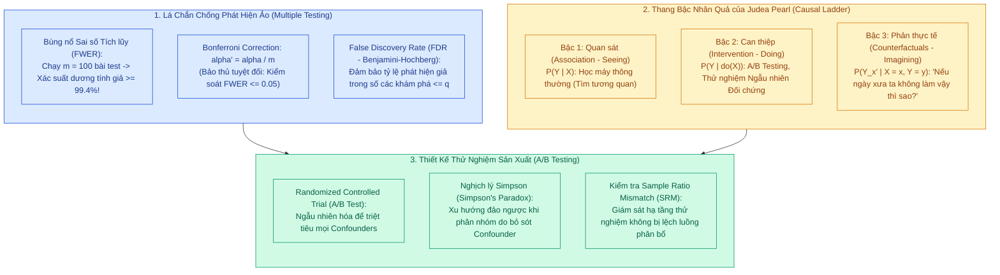
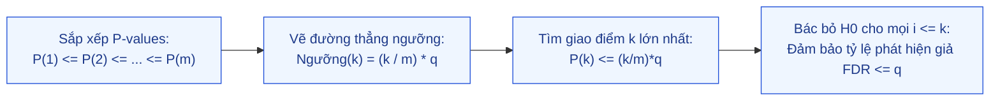
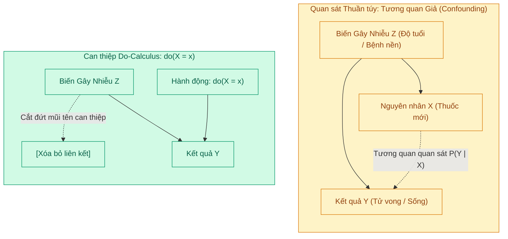

# Chuyên đề: Đa kiểm định, Suy luận Nhân quả & Thử nghiệm A/B (Multiple Testing, Causal Inference & A/B Testing)

> [!IMPORTANT]
> **Tuyên ngôn Cốt lõi**: *"Tương quan không đồng nghĩa với Nhân quả (Correlation $\ne$ Causation)"*. Mọi mô hình Machine Learning / Deep Learning hiện đại chỉ học sự liên đới thống kê thụ động $P(Y \mid X)$. Khi triển khai vào hệ thống sản xuất, nếu can thiệp vào môi trường mà không hiểu **Biến gây nhiễu (Confounders)** và **Nghịch lý Simpson**, mô hình sẽ đưa ra các quyết định thảm họa. Đồng thời, việc quét qua hàng ngàn feature hay chạy thử nghiệm A/B liên tục nếu không áp dụng **Hiệu chỉnh Đa kiểm định (Bonferroni / FDR Benjamini-Hochberg)** sẽ khiến doanh nghiệp đưa ra các quyết định kinh doanh dựa trên 100% ảo giác ngẫu nhiên.

---

## 1. Tổng quan Kiến trúc & Tư duy Trực quan (Mental Model)

### Bản đồ Tư duy: Từ Kiểm soát Phát hiện Ảo đến Thang Bậc Nhân Quả (Judea Pearl)


---

## 2. Chi tiết từng Keyword (Under-the-Hood Deep Dive)

---

### Keyword 1: Multiple Hypothesis Testing, Bonferroni Correction & False Discovery Rate (FDR)

#### 1. Trực giác & Ẩn dụ Đời sống (Mental Model)
> **Nếu chỉ nhớ một điều**: *Vấn đề Đa kiểm định giống như việc bạn thử 100 chìa khóa ngẫu nhiên vào một ổ khóa: nếu tỷ lệ cắm bừa mở được là $5\%$, việc bạn cắm 100 lần chắc chắn sẽ có lúc ổ khóa vô tình bật mở! 
> - **Bonferroni** là cảnh sát siêu khắt khe: chia nhỏ mức xác suất cho 100 lần ($0.05 / 100 = 0.0005$), gần như không bao giờ bắt nhầm người tốt nhưng có thể để lọt tội phạm.
> - **FDR (Benjamini-Hochberg)** là thanh tra chất lượng thông minh: cam kết rằng trong toàn bộ các lô hàng bị giữ lại, tối đa chỉ có $5\%$ là báo động giả.*

#### 2. Bản chất Toán học Tầng sâu
1. **Bùng nổ Tỷ lệ Sai số Theo Họ (Family-Wise Error Rate - FWER)**:
   Nếu thực hiện $m$ phép thử độc lập, mỗi phép thử có mức ý nghĩa $\alpha = 0.05$:
   $$\text{FWER} = \mathbb{P}(\text{Có ít nhất 1 phát hiện giả sai lầm Loại I}) = 1 - (1 - \alpha)^m$$
   - Khi $m = 20 \implies \text{FWER} = 1 - (0.95)^{20} \approx 64.2\%$.
   - Khi $m = 100 \implies \text{FWER} = 1 - (0.95)^{100} \approx \mathbf{99.4\%}$ (Chắc chắn dính bẫy dương tính giả!).

2. **Hiệu chỉnh Bonferroni (Bonferroni Correction)**:
   Để kiểm soát $\text{FWER} \le \alpha$, ta điều chỉnh ngưỡng bác bỏ cho từng bài test:
   $$\alpha' = \frac{\alpha}{m}$$
   *Đánh giá*: Cực kỳ an toàn, nhưng làm tăng vọt Sai lầm Loại II ($\beta$), triệt tiêu năng lực phát hiện tín hiệu thực sự khi $m$ lên tới hàng nghìn (ví dụ gene microarray hoặc feature selection trong AI).

3. **False Discovery Rate (FDR) & Thuật toán Benjamini-Hochberg (BH)**:
   Thay vì kiểm soát việc có dù chỉ 1 sai lầm, ta kiểm soát **tỷ lệ kỳ vọng của số phát hiện giả ($V$) trên tổng số phát hiện ($R$)**:
   $$\text{FDR} = \mathbb{E}\left[ \frac{V}{\max(R, 1)} \right] \le q \quad (\text{thường chọn } q = 0.05)$$
   **Quy trình Thực thi Benjamini-Hochberg**:
   1. Thu thập $m$ giá trị $P$-value từ $m$ phép thử và sắp xếp tăng dần: $P_{(1)} \le P_{(2)} \le \dots \le P_{(m)}$.
   2. Tìm chỉ số lớn nhất $k$ thỏa mãn:
      $$P_{(k)} \le \frac{k}{m} \cdot q$$
   3. Bác bỏ $H_0$ cho toàn bộ các phép thử có thứ hạng $i \le k$.



---

### Keyword 2: Experimental Design, Sample Size & A/B Testing

#### 1. Trực giác & Ẩn dụ Đời sống (Mental Model)
> **Nếu chỉ nhớ một điều**: *A/B Testing là **chiếc máy đo nói thật** duy nhất của thế giới kinh doanh và công nghệ. Bằng cách gieo xúc xắc ngẫu nhiên tuyệt đối để chia người dùng thành hai nhóm A và B, mọi yếu tố gây nhiễu (thời tiết, ngày lễ, độ tuổi, tâm trạng) đều bị san phẳng đồng đều sang cả hai bên. Bất kỳ sự khác biệt nào xuất hiện sau đó chắc chắn 100% là do mô hình AI mới tạo ra.*

#### 2. Bản chất Toán học Tầng sâu
1. **Thử nghiệm Ngẫu nhiên Đối chứng (Randomized Controlled Trial - RCT)**:
   - Nhóm Control ($A$): Chạy thuật toán gợi ý hiện tại.
   - Nhóm Treatment ($B$): Chạy thuật toán gợi ý AI mới.
   - **Cơ chế Ngẫu nhiên hóa (Randomization)**: Cắt đứt hoàn toàn mối quan hệ phụ thuộc giữa các đặc trưng người dùng và quyết định phân bổ thuật toán, loại bỏ thiên kiến chọn mẫu (Selection Bias).

2. **Công thức Tính Kích thước Mẫu Tối thiểu (Sample Size Determination)**:
   Để phát hiện sự cải thiện tối thiểu có ý nghĩa (Minimum Detectable Effect - MDE) $\delta = \mu_B - \mu_A$ với mức ý nghĩa $\alpha$ (False Positive) và năng lực thống kê $1 - \beta$ (Power):
   $$n = \frac{2 \left( Z_{\alpha/2} + Z_\beta \right)^2 \sigma^2}{\delta^2}$$
   - Với $\alpha = 0.05 \implies Z_{\alpha/2} = 1.96$.
   - Với $\text{Power} = 0.80 \implies Z_\beta = 0.84$.
   - **Quy luật Nghịch đảo Bình phương**: Nếu bạn muốn phát hiện mức tăng trưởng nhỏ hơn một nửa ($\delta \to \frac{\delta}{2}$), bạn phải gom lượng dữ liệu người dùng **gấp 4 lần** ($n \propto \frac{1}{\delta^2}$)!

3. **Kiểm tra Sample Ratio Mismatch (SRM)**:
   Nếu bạn cấu hình chia luồng $50\% - 50\%$, nhưng thực tế ghi nhận nhóm A có 500,000 user và nhóm B chỉ có 485,000 user. Đây là dấu hiệu cảnh báo đỏ của **Lỗi Hạ tầng (SRM)**! Thuật toán phân bổ hoặc bot-filter đang làm méo mó thử nghiệm $\implies$ Toàn bộ kết quả A/B Test vô giá trị. Bắt buộc phải chạy kiểm định Chi-Square goodness-of-fit để phát hiện SRM trước khi phân tích kết quả.

---

### Keyword 3: Causal Inference, Confounders & Simpson's Paradox

#### 1. Trực giác & Ẩn dụ Đời sống: Nghịch Lý Simpson (Mental Model)
> **Nếu chỉ nhớ một điều**: *Nghịch lý Simpson là ảo ảnh thị giác của thống kê: Một loại thuốc có thể có tỷ lệ chữa khỏi cao hơn trên nhóm nam giới, VÀ CŨNG cao hơn trên nhóm nữ giới, nhưng khi gộp chung toàn bộ dữ liệu lại thì loại thuốc đó lại có vẻ gây hại nhiều hơn! Lý do là phụ nữ mắc bệnh nặng hơn nhiều và cũng là nhóm được cho dùng thuốc nhiều hơn (Biến gây nhiễu Confounder bóp méo thực tế).*

#### 2. Bản chất Toán học Tầng sâu & Thang Bậc Nhân Quả (Judea Pearl)
Judea Pearl phân định 3 cấp độ nhận thức của trí tuệ:
1. **Cấp độ 1: Quan sát Thụ động (Association / Seeing - Machine Learning hiện nay)**:
   $$P(Y \mid X = x) \quad (\text{"Nếu tôi nhìn thấy triệu chứng X, xác suất mắc bệnh Y là bao nhiêu?"})$$
2. **Cấp độ 2: Can thiệp Chủ động (Intervention / Doing - A/B Testing, Robotics)**:
   $$P(Y \mid \text{do}(X = x)) \quad (\text{"Nếu tôi bắt buộc cho bệnh nhân uống thuốc X, xác suất lành bệnh là bao nhiêu?"})$$
   Ký hiệu $\text{do}(X=x)$ biểu thị việc cắt đứt mọi mũi tên tác động từ các biến gây nhiễu trỏ vào $X$ trên đồ thị nhân quả Causal DAG!
3. **Cấp độ 3: Phản thực tế (Counterfactuals / Imagining - Trí tuệ Nhân tạo Tổng quát AGI)**:
   $$P(Y_{X=x'} \mid X = x, Y = y) \quad (\text{"Bệnh nhân đã uống thuốc X và đã qua đời. Nếu ngày đó tôi cho uống thuốc X', liệu anh ấy có còn sống?"})$$



#### 3. Code Thực chiến (C++ Benjamini-Hochberg & Python Causal Simpson Simulation)

```cpp
// C++17: Triển khai Thuật toán Benjamini-Hochberg kiểm soát FDR trong thử nghiệm đa tính năng AI
#include <iostream>
#include <vector>
#include <algorithm>
#include <iomanip>

struct HypothesisTest {
    int feature_id;
    double p_value;
    bool rejected{false};
};

std::vector<HypothesisTest> run_benjamini_hochberg(std::vector<HypothesisTest> tests, double q = 0.05) {
    size_t m = tests.size();
    if (m == 0) return tests;

    // 1. Sắp xếp các phép thử theo p-value tăng dần
    std::sort(tests.begin(), tests.end(), [](const HypothesisTest& a, const HypothesisTest& b) {
        return a.p_value < b.p_value;
    });

    // 2. Tìm k lớn nhất sao cho P(k) <= (k / m) * q
    int max_k = -1;
    for (size_t i = 0; i < m; ++i) {
        double rank = static_cast<double>(i + 1);
        double threshold = (rank / m) * q;
        if (tests[i].p_value <= threshold) {
            max_k = static_cast<int>(i);
        }
    }

    // 3. Đánh dấu bác bỏ H0 cho mọi phép thử từ 0 đến max_k
    for (int i = 0; i <= max_k; ++i) {
        tests[i].rejected = true;
    }

    return tests;
}

int main() {
    // Giả lập 8 tính năng AI mới được thử nghiệm đồng thời
    std::vector<HypothesisTest> feature_tests = {
        {101, 0.002}, {102, 0.008}, {103, 0.015}, {104, 0.038},
        {105, 0.045}, {106, 0.120}, {107, 0.350}, {108, 0.890}
    };

    double fdr_q = 0.05;
    auto results = run_benjamini_hochberg(feature_tests, fdr_q);

    std::cout << std::fixed << std::setprecision(4);
    std::cout << "[C++ Benjamini-Hochberg FDR Control (q = " << fdr_q << ")]\n";
    std::cout << "Feature ID | P-value | BH Threshold | Significant Discovery?\n";
    std::cout << "---------------------------------------------------------\n";

    size_t m = results.size();
    for (size_t i = 0; i < m; ++i) {
        double threshold = ((i + 1.0) / m) * fdr_q;
        std::cout << "Feature " << results[i].feature_id << "  | "
                  << results[i].p_value << "  | "
                  << threshold << "       | "
                  << (results[i].rejected ? "YES (Accepted)" : "NO (Rejected)") << "\n";
    }

    return 0;
}
```

```python
# Python 3.10: Mô phỏng Nghịch lý Simpson trong Đánh giá Thuật toán Gợi ý AI
import pandas as pd
import numpy as np

# Giả lập dữ liệu A/B Testing thuật toán gợi ý:
# Biến gây nhiễu Confounder: Thiết bị người dùng (Mobile vs Desktop)
# Người dùng Mobile lướt nhanh ít click hơn, Desktop kiên nhẫn click nhiều hơn.

# Phân bổ thử nghiệm:
# Model New được phân bổ nhiều cho Mobile (80% Mobile, 20% Desktop)
# Model Old được phân bổ nhiều cho Desktop (20% Mobile, 80% Desktop)

data = {
    'Device': ['Mobile', 'Mobile', 'Desktop', 'Desktop'],
    'Model': ['Old', 'New', 'Old', 'New'],
    'Users': [2000, 8000, 8000, 2000],
    'Clicks': [200, 960, 1600, 440]
}

df = pd.DataFrame(data)
df['CTR'] = df['Clicks'] / df['Users'] * 100

print("[Nghịch lý Simpson Trong Đánh giá Thuật toán AI]")
print("1. Phân tích chi tiết theo từng phân tầng (Device Subgroups):")
for device in ['Mobile', 'Desktop']:
    sub = df[df['Device'] == device]
    ctr_old = sub[sub['Model'] == 'Old']['CTR'].values[0]
    ctr_new = sub[sub['Model'] == 'New']['CTR'].values[0]
    print(f" - {device:<7}: Model Old CTR = {ctr_old:.1f}% | Model New CTR = {ctr_new:.1f}% -> Model NEW Thắng!")

# 2. Phân tích tổng thể khi gộp chung (Aggregated Analysis)
agg = df.groupby('Model').agg({'Users': 'sum', 'Clicks': 'sum'})
agg['Overall_CTR'] = agg['Clicks'] / agg['Users'] * 100
print("\n2. Phân tích gộp chung toàn hệ thống (Bỏ qua Confounder Device):")
print(f" - Model Old Overall CTR: {agg.loc['Old', 'Overall_CTR']:.2f}%")
print(f" - Model New Overall CTR: {agg.loc['New', 'Overall_CTR']:.2f}%")
print("-> KẾT QUẢ ĐẢO NGƯỢC! Nhìn tổng thể Model Old thắng, dù Model New thắng ở mọi phân nhóm con!")
```

**Output mẫu thực tế**:
```text
[C++ Benjamini-Hochberg FDR Control (q = 0.0500)]
Feature ID | P-value | BH Threshold | Significant Discovery?
---------------------------------------------------------
Feature 101  | 0.0020  | 0.0062       | YES (Accepted)
Feature 102  | 0.0080  | 0.0125       | YES (Accepted)
Feature 103  | 0.0150  | 0.0188       | YES (Accepted)
Feature 104  | 0.0380  | 0.0250       | NO (Rejected)
Feature 105  | 0.0450  | 0.0312       | NO (Rejected)
Feature 106  | 0.1200  | 0.0375       | NO (Rejected)
Feature 107  | 0.3500  | 0.0438       | NO (Rejected)
Feature 108  | 0.8900  | 0.0500       | NO (Rejected)

[Nghịch lý Simpson Trong Đánh giá Thuật toán AI]
1. Phân tích chi tiết theo từng phân tầng (Device Subgroups):
 - Mobile : Model Old CTR = 10.0% | Model New CTR = 12.0% -> Model NEW Thắng!
 - Desktop: Model Old CTR = 20.0% | Model New CTR = 22.0% -> Model NEW Thắng!

2. Phân tích gộp chung toàn hệ thống (Bỏ qua Confounder Device):
 - Model Old Overall CTR: 18.00%
 - Model New Overall CTR: 14.00%
-> KẾT QUẢ ĐẢO NGƯỢC! Nhìn tổng thể Model Old thắng, dù Model New thắng ở mọi phân nhóm con!
```

---

## 3. Cạm bẫy Kỹ thuật & Hiểu Lầm Phổ Biến (Pitfalls)

1. **Cạm bẫy Hiệu Ứng Tràn (Network Spillover Effects trong A/B Testing)**:
   - Trong các hệ thống mạng xã hội, thị trường hai chiều (Grab, Uber, Shopee) hoặc game online: hành động của người dùng nhóm Treatment (B) tác động trực tiếp đến người dùng nhóm Control (A) (ví dụ tài xế nhận cuốc xe của B làm giảm lượng xe sẵn có cho A).
   - *Hậu quả*: Vi phạm giả định độc lập SUTVA (Stable Unit Treatment Value Assumption).
   - *Khắc phục*: Phải phân cụm thử nghiệm theo **Cluster-Based Randomization** (ví dụ chia theo toàn bộ thành phố hoặc theo cụm biểu đồ đồ thị xã hội Graph Clusters).

2. **Cạm bẫy Phân tích Dữ liệu Hồi cứu Không Can thiệp (Observational Causal Fallacy)**:
   - Dùng dữ liệu nhật ký lịch sử (Log data) để khẳng định: "Người dùng sử dụng tính năng AI chat có tỷ lệ chi tiêu cao gấp 3 lần, vì vậy thêm AI chat sẽ làm tăng doanh thu".
   - *Bản chất*: Người dùng trung thành, nhiều tiền vốn dĩ đã có xu hướng tò mò dùng thử mọi tính năng mới! Đây là tương quan thuần túy, không phải nhân quả.

3. **Cạm bẫy Bỏ qua Kiểm tra Sample Ratio Mismatch (SRM)**:
   - Bất kỳ phân tích A/B Testing nào cũng phải chạy kiểm định $\chi^2$ kiểm tra tỷ lệ mẫu đầu vào trước tiên. Nếu SRM có ý nghĩa thống kê ($p < 0.001$), toàn bộ kết luận về CTR, Doanh thu phải bị hủy bỏ ngay lập tức vì hệ thống phân bổ luồng đã bị lỗi kỹ thuật.

---

## 4. Bảng Tra Cứu Nhanh & Ứng Dụng Sản Xuất (Quick Reference)

| Phương Pháp / Hiện Tượng | Ký Pháp Toán Học | Mục Tiêu Chính | Ứng Dụng Thực Chiến Trong AI |
| :--- | :--- | :--- | :--- |
| **Bonferroni** | $\alpha' = \alpha / m$ | Kiểm soát nghiêm ngặt Family-Wise Error Rate (FWER) | Kiểm định an toàn y tế, khám phá gen AI |
| **Benjamini-Hochberg (BH)**| $P_{(k)} \le \frac{k}{m} q$ | Kiểm soát tỷ lệ phát hiện giả (FDR) | Feature selection, Khám phá hàng ngàn metric sản phẩm |
| **A/B Testing (RCT)** | $P(Y \mid \text{do}(X))$ | Triệt tiêu mọi Confounder nhờ ngẫu nhiên hóa | Triển khai mô hình AI sản xuất, Tối ưu UX/UI |
| **Simpson's Paradox** | Xu hướng đảo ngược | Cảnh báo việc bỏ sót biến phân tầng Confounder | Đánh giá công bằng AI (Algorithmic Fairness) |
| **Sample Ratio Mismatch** | Chi-Square Test trên Counts | Giám sát tính toàn vẹn của hạ tầng chia luồng | Health-check hệ thống thử nghiệm thực tế |