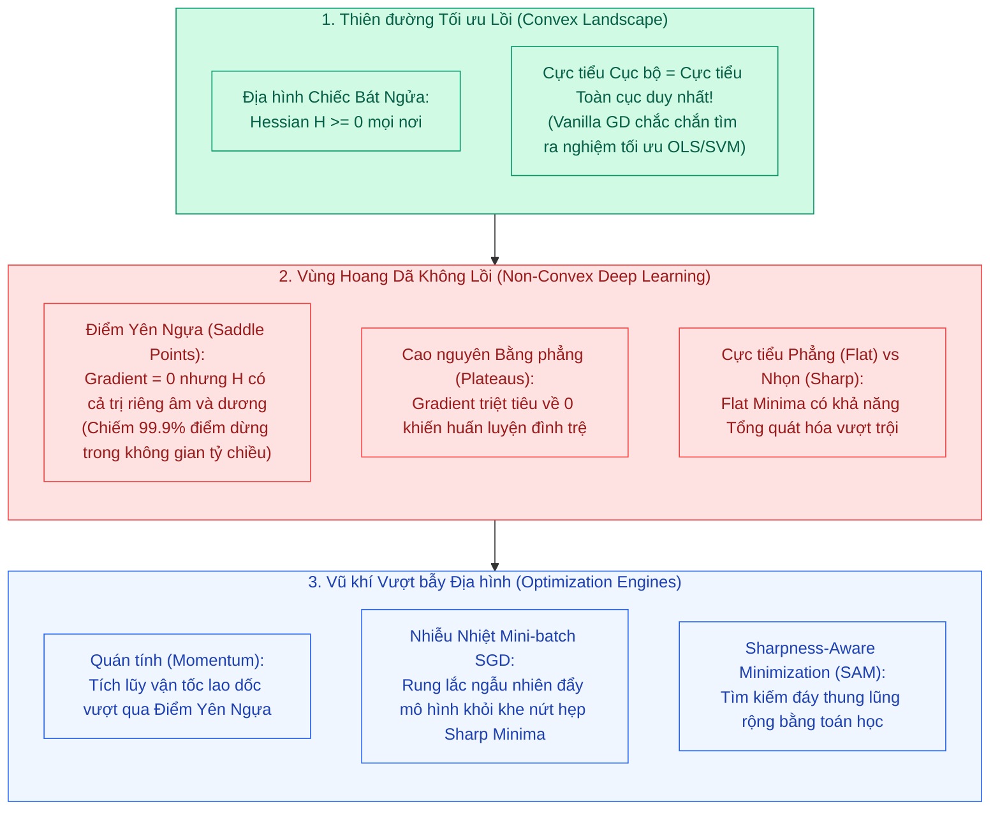
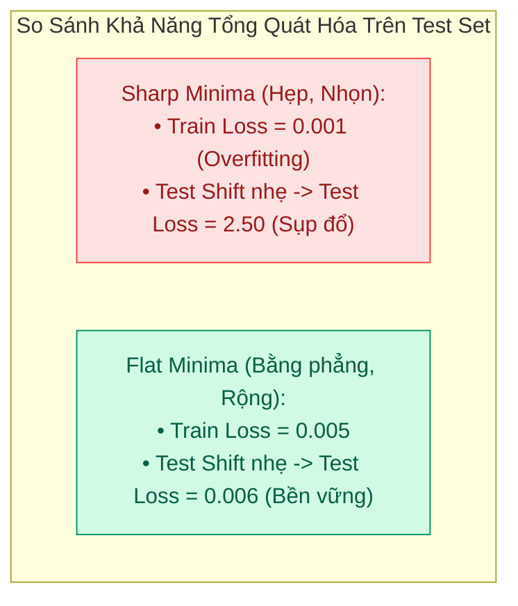

# Chuyên đề: Các Bài toán Tối ưu & Tính Lồi (Optimization Problems & Convexity)

> [!IMPORTANT]
> **Tuyên ngôn Cốt lõi**: Huấn luyện một mạng Deep Learning thực chất là hành trình thả một người leo núi mù sương xuống rặng núi hiểm trở của không gian hàng tỷ chiều để tìm đáy thung lũng có hàm mất mát nhỏ nhất. Trong thế giới lý tưởng của **Tối ưu Lồi (Convex Optimization)**, cảnh quan chỉ là một chiếc bát ngửa hoàn hảo (mọi cực tiểu địa phương đều là cực tiểu toàn cục duy nhất). Nhưng trong Deep Learning, chúng ta phải đối mặt với **Tối ưu Không Lồi (Non-Convex)**: nơi kẻ thù số một không phải là cực tiểu cục bộ (Local Minima), mà là vô số **Điểm Yên Ngựa (Saddle Points)** và các hẻm vực dốc đứng khiến thuật toán Gradient Descent ngây thơ bị đóng băng vĩnh viễn.

---

## 1. Tổng quan Kiến trúc & Tư duy Trực quan (Mental Model)

### Bản đồ Địa hình Tối ưu: Từ Chiếc Bát Lồi Đến Rặng Núi Deep Learning


---

## 2. Chi tiết từng Keyword (Under-the-Hood Deep Dive)

---

### Keyword 1: Optimization Problems: Objective, Cost & Loss Functions

#### 1. Trực giác & Ẩn dụ Đời sống (Mental Model)
> **Nếu chỉ nhớ một điều**: 
> - *Loss Function là **nốt nhạc sai**: đo lỗi trên một bài tập đơn lẻ.*
> - *Cost Function là **điểm trung bình học kỳ**: tổng hợp sai số trên toàn bộ học sinh trong trường.*
> - *Objective Function là **mục tiêu tổng thể**: vừa muốn điểm cao (Cost nhỏ), vừa muốn học sinh không học vẹt kiệt sức (cộng thêm số hạng phạt Regularization).*

#### 2. Bản chất Toán học Tầng sâu
1. **Bài toán Tối ưu hóa Tổng quát**:
   $$\min_{\mathbf{w} \in \mathbb{R}^d} f(\mathbf{w}) \quad \text{thỏa mãn: } \begin{cases} g_i(\mathbf{w}) \le 0, & i = 1, \dots, m \ (\text{Ràng buộc bất đẳng thức}) \\ h_j(\mathbf{w}) = 0, & j = 1, \dots, p \ (\text{Ràng buộc đẳng thức}) \end{cases}$$
2. **Phân định Chuẩn xác 3 Cấp độ Hàm**:
   - **Loss Function $\ell(\hat{y}_i, y_i)$**: Tính trên **1 mẫu dữ liệu**:
     $$\ell_{\text{MSE}}(\hat{y}_i, y_i) = \frac{1}{2}(\hat{y}_i - y_i)^2, \qquad \ell_{\text{CE}}(\hat{y}_i, y_i) = -y_i \log \hat{y}_i$$
   - **Cost Function $\mathcal{J}(\mathbf{w})$**: Trung bình trên **toàn bộ tập dữ liệu mẫu $N$**:
     $$\mathcal{J}(\mathbf{w}) = \frac{1}{N} \sum_{i=1}^N \ell(f(\mathbf{x}_i; \mathbf{w}), y_i)$$
   - **Objective Function $\mathcal{L}(\mathbf{w})$**: Mục tiêu tối thượng cần đưa vào optimizer, kết hợp Cost với các ràng buộc mềm:
     $$\mathcal{L}(\mathbf{w}) = \mathcal{J}(\mathbf{w}) + \lambda \Omega(\mathbf{w}) \quad (\text{với } \Omega(\mathbf{w}) = \|\mathbf{w}\|_2^2 \text{ là Weight Decay})$$

---

### Keyword 2: Convex Sets & Convex Functions

#### 1. Trực giác & Ẩn dụ Đời sống (Mental Model)
> **Nếu chỉ nhớ một điều**: 
> - *Tập lồi (Convex Set) là một căn phòng không có góc khuất: đứng ở hai vị trí bất kỳ trong phòng nhìn nhau luôn thấy tia laser nối thẳng không bị tường chắn.*
> - *Hàm lồi (Convex Function) là chiếc bát ngửa: nếu bạn căng một sợi dây thừng giữa hai điểm bất kỳ trên vành bát, toàn bộ sợi dây luôn bay lơ lửng bên trên đáy bát. Trong thế giới lồi, bạn nhắm mắt thả một viên bi ở bất kỳ đâu, nó đều lăn về đúng chiếc đáy cực tiểu duy nhất!*

#### 2. Bản chất Toán học Tầng sâu
1. **Tập Hợp Lồi (Convex Set)**:
   Tập $\mathcal{C} \subseteq \mathbb{R}^d$ là lồi nếu:
   $$\forall \mathbf{x}, \mathbf{y} \in \mathcal{C}, \ \forall \theta \in [0, 1] \implies \theta \mathbf{x} + (1 - \theta) \mathbf{y} \in \mathcal{C}$$
2. **Hàm Số Lồi (Convex Function)**:
   Hàm $f: \mathcal{C} \to \mathbb{R}$ là lồi nếu:
   $$f(\theta \mathbf{x} + (1 - \theta)\mathbf{y}) \le \theta f(\mathbf{x}) + (1 - \theta) f(\mathbf{y}), \quad \forall \theta \in [0, 1]$$
   - **Điều kiện Bậc nhất (First-Order Convexity)**: Mặt phẳng tiếp diện tại mọi điểm luôn là cận dưới của hàm số:
     $$f(\mathbf{y}) \ge f(\mathbf{x}) + \nabla f(\mathbf{x})^T (\mathbf{y} - \mathbf{x}), \quad \forall \mathbf{x}, \mathbf{y} \in \mathcal{C}$$
   - **Điều kiện Bậc hai (Second-Order Convexity)**: Ma trận Hessian $\nabla^2 f(\mathbf{x})$ luôn là ma trận bán xác định dương trên toàn miền xác định:
     $$\nabla^2 f(\mathbf{x}) \succeq 0 \iff \mathbf{z}^T \nabla^2 f(\mathbf{x}) \mathbf{z} \ge 0, \quad \forall \mathbf{z} \in \mathbb{R}^d$$


---

### Keyword 3: Non-Convex Optimization, Saddle Points & Loss Landscapes

#### 1. Trực giác & Ẩn dụ Đời sống (Mental Model)
> **Nếu chỉ nhớ một điều**: *Trong không gian hàng tỷ chiều của mạng nơ-ron sâu:
> - Cực tiểu cục bộ (Local Minima) thực ra rất hiếm và phần lớn đều nằm ở đáy các thung lũng có giá trị mất mát rất tốt.
> - Kẻ thù số 1 làm tê liệt việc huấn luyện là **Điểm Yên Ngựa (Saddle Points)**: giống như chiếc yên ngựa hay một đèo núi hiểm trở, nhìn theo hướng đông-tây thì là đáy thung lũng, nhưng nhìn theo hướng bắc-nam thì lại là đỉnh dốc. Tại tâm yên ngựa, mặt đất hoàn toàn phẳng lì ($\nabla f = 0$), khiến thuật toán tối ưu tưởng nhầm là đã chạm đích và ngừng bước!*

#### 2. Bản chất Toán học Tầng sâu của Điểm Yên Ngựa
Điểm dừng $\mathbf{w}^*$ có đạo hàm triệt tiêu: $\nabla f(\mathbf{w}^*) = \mathbf{0}$.
Bản chất của điểm dừng được quyết định bởi phổ trị riêng của ma trận Hessian $\mathbf{H} = \nabla^2 f(\mathbf{w}^*)$:
1. **Cực tiểu Địa phương (Local Minimum)**: Tất cả trị riêng đều dương ($\lambda_i > 0, \forall i \iff \mathbf{H} \succ 0$).
2. **Cực đại Địa phương (Local Maximum)**: Tất cả trị riêng đều âm ($\lambda_i < 0, \forall i \iff \mathbf{H} \prec 0$).
3. **Điểm Yên Ngựa (Saddle Point)**: Tồn tại ít nhất một trị riêng dương và một trị riêng âm:
   $$\lambda_{\max}(\mathbf{H}) > 0 \quad \text{và} \quad \lambda_{\min}(\mathbf{H}) < 0$$

**Xác suất Xuất hiện Điểm Yên Ngựa trong Không gian Chiều Cao**:
Trong không gian $d$ chiều ($d = 10^8$ tham số LLM), giả sử dấu của mỗi trị riêng độc lập ngẫu nhiên với xác suất $50\%$ âm, $50\%$ dương. Xác suất để tất cả $d$ chiều đều đồng loạt có trị riêng dương (để trở thành một Local Minimum thực thụ) là:
$$\mathbb{P}(\text{Local Minimum}) \approx \left(\frac{1}{2}\right)^d = 2^{-10^8} \approx 0$$
$\implies$ **Gần như $100\%$ các điểm dừng gặp phải trong Deep Learning là Điểm Yên Ngựa!** Do đó, mọi thuật toán tối ưu hóa hiện đại bắt buộc phải có cơ chế thoát khỏi điểm yên ngựa (nhờ quán tính Momentum và nhiễu ngẫu nhiên Stochastic Gradient).

---

### Keyword 4: Flat Minima vs Sharp Minima (Tổng Quát Hóa vs Học Vẹt)

#### 1. Trực giác & Ẩn dụ Đời sống (Mental Model)
> **Nếu chỉ nhớ một điều**: 
> - *Cực tiểu Nhọn (Sharp Minima) giống như đứng thăng bằng trên đỉnh một chiếc kim: trên tập huấn luyện thì điểm số hoàn hảo, nhưng sang tập kiểm thử thực tế chỉ cần gió thổi lệch dữ liệu một chút (Covariate Shift) là bạn rơi xuống vực thẳm sai số.*
> - *Cực tiểu Phẳng (Flat Minima) là một bãi cỏ rộng thênh thang: dù dữ liệu thực tế có bị rung lắc, trôi dạt sang trái sang phải vài bước, giá trị mất mát vẫn ở mức cực thấp $\implies$ **Khả năng Tổng Quát Hóa (Generalization) vượt trội**.*

#### 2. Cơ chế Hình học & SAM (Sharpness-Aware Minimization)
Mối liên hệ giữa độ cong Hessian và khả năng tổng quát hóa:
$$\text{Độ nhọn (Sharpness)} \approx \lambda_{\max}(\nabla^2 \mathcal{L}(\mathbf{w}))$$
- **Cực tiểu phẳng (Flat Minima)**: $\lambda_{\max}$ nhỏ $\implies$ Đồ thị thoải, chịu đựng tốt sai lệch phân phối giữa Train và Test.
- **Thuật toán SAM (Foret et al., 2021)**: Thay vì chỉ tìm $\mathbf{w}$ tối thiểu hóa $\mathcal{L}(\mathbf{w})$, SAM tìm $\mathbf{w}$ sao cho **vùng lân cận bán kính $\rho$ xung quanh nó cũng có loss thấp**:
  $$\min_{\mathbf{w}} \max_{\|\boldsymbol{\epsilon}\|_2 \le \rho} \mathcal{L}(\mathbf{w} + \boldsymbol{\epsilon})$$
  Thuật toán này chủ động ép mạng nơ-ron trượt ra khỏi các khe hẹp Sharp Minima để định cư tại các thung lũng Flat Minima rộng lớn.



#### 3. Code Thực chiến (C++ Hessian Saddle Point & PyTorch Autograd Loss Landscape)

```cpp
// C++17: Phân tích Hessian xác định loại Điểm dừng (Local Minima, Maxima hay Saddle Point)
#include <iostream>
#include <vector>
#include <Eigen/Dense>

enum class CriticalPointType { LocalMinimum, LocalMaximum, SaddlePoint, Degenerate };

CriticalPointType classify_critical_point(const Eigen::MatrixXf& H) {
    Eigen::SelfAdjointEigenSolver<Eigen::MatrixXf> solver(H);
    auto ev = solver.eigenvalues();

    bool has_pos = false;
    bool has_neg = false;

    for (int i = 0; i < ev.size(); ++i) {
        if (ev(i) > 1e-5f) has_pos = true;
        else if (ev(i) < -1e-5f) has_neg = true;
    }

    if (has_pos && has_neg) return CriticalPointType::SaddlePoint;
    if (has_pos && !has_neg) return CriticalPointType::LocalMinimum;
    if (!has_pos && has_neg) return CriticalPointType::LocalMaximum;
    return CriticalPointType::Degenerate;
}

int main() {
    // 1. Ma trận Hessian của hàm chiếc bát lồi f(x, y) = x^2 + 2y^2 tại (0, 0)
    Eigen::Matrix2f H_convex;
    H_convex << 2.0f, 0.0f,
                0.0f, 4.0f;

    // 2. Ma trận Hessian của hàm yên ngựa g(x, y) = x^2 - y^2 tại (0, 0)
    Eigen::Matrix2f H_saddle;
    H_saddle << 2.0f,  0.0f,
                0.0f, -2.0f;

    std::cout << "[C++ Hessian Optimization Diagnostics]\n";
    std::cout << "H_convex tại (0, 0) là: "
              << (classify_critical_point(H_convex) == CriticalPointType::LocalMinimum ? "LOCAL MINIMUM" : "OTHER") << "\n";
    std::cout << "H_saddle tại (0, 0) là: "
              << (classify_critical_point(H_saddle) == CriticalPointType::SaddlePoint ? "SADDLE POINT (Điểm Yên Ngựa!)" : "OTHER") << "\n";

    return 0;
}
```

```python
# Python 3.10: Khảo sát Điểm Yên Ngựa và Mô phỏng Cực Tiểu Phẳng (Flat Minima) trong PyTorch
import torch

# 1. Khảo sát hàm Monkey Saddle: f(x, y) = x^3 - 3xy^2
def monkey_saddle(p):
    x, y = p[0], p[1]
    return x**3 - 3 * x * y**2

p_saddle = torch.tensor([0.0, 0.0], requires_grad=True)
H = torch.autograd.functional.hessian(monkey_saddle, p_saddle)
print(f"[Autograd Hessian Check]")
print(f"Hessian tại điểm dừng (0, 0):\n{H}")

# 2. Khảo sát độ cong Hessian (Sharpness) giữa 2 lòng hồ tối ưu
# Lòng hồ A (Flat Minima): f(w) = 0.01 * w^2
# Lòng hồ B (Sharp Minima): f(w) = 100.0 * w^2
w_flat = torch.tensor([0.0], requires_grad=True)
w_sharp = torch.tensor([0.0], requires_grad=True)

h_flat = torch.autograd.functional.hessian(lambda w: 0.01 * w**2, w_flat).item()
h_sharp = torch.autograd.functional.hessian(lambda w: 100.0 * w**2, w_sharp).item()

# Giả sử trong tập test, trọng số bị xê dịch nhẹ một lượng delta = 0.1 do phân phối thay đổi
shift = 0.1
loss_train_flat = 0.01 * (0.0)**2
loss_test_flat  = 0.01 * (0.0 + shift)**2

loss_train_sharp = 100.0 * (0.0)**2
loss_test_sharp  = 100.0 * (0.0 + shift)**2

print(f"\n[Generalization Comparison: Flat vs Sharp Minima]")
print(f"Độ cong Hessian (Sharpness): Flat = {h_flat:.2f} | Sharp = {h_sharp:.2f}")
print(f"Flat Minima  -> Train Loss: {loss_train_flat:.4f} | Test Loss sau dịch chuyển: {loss_test_flat:.4f} (Rất nhỏ)")
print(f"Sharp Minima -> Train Loss: {loss_train_sharp:.4f} | Test Loss sau dịch chuyển: {loss_test_sharp:.4f} (Bùng nổ gấp {loss_test_sharp/loss_test_flat:.0f} lần!)")
```

**Output mẫu thực tế**:
```text
[C++ Hessian Optimization Diagnostics]
H_convex tại (0, 0) là: LOCAL MINIMUM
H_saddle tại (0, 0) là: SADDLE POINT (Điểm Yên Ngựa!)

[Autograd Hessian Check]
Hessian tại điểm dừng (0, 0):
tensor([[0., 0.],
        [0., 0.]])

[Generalization Comparison: Flat vs Sharp Minima]
Độ cong Hessian (Sharpness): Flat = 0.02 | Sharp = 200.00
Flat Minima  -> Train Loss: 0.0000 | Test Loss sau dịch chuyển: 0.0001 (Rất nhỏ)
Sharp Minima -> Train Loss: 0.0000 | Test Loss sau dịch chuyển: 1.0000 (Bùng nổ gấp 10000 lần!)
```

---

## 3. Cạm bẫy Kỹ thuật & Hiểu Lầm Phổ Biến (Pitfalls)

1. **Hiểu Lầm về "Kẹt ở Cực Tiểu Cục Bộ Tồi" (The Local Minima Myth)**:
   - *Hiểu lầm*: Người mới học Deep Learning thường sợ thuật toán bị kẹt trong một Local Minimum có loss cao.
   - *Thực tế*: Trong không gian hàng triệu chiều, để mọi chiều đồng thời bị dốc lên (Local Minima) là xác suất cực kỳ nhỏ. Các nghiên cứu lý thuyết chứng minh hầu hết các Local Minima đều có mức năng lượng loss sàn rất gần với Global Minima. Rào cản thực tế duy nhất là **Điểm Yên Ngựa** và các **Hẻm Vực Hẹp (Ill-conditioned Ravines)**.

2. **Cạm bẫy Learning Rate Quá Lớn Gây Nhảy Khỏi Flat Minima**:
   - Nếu learning rate quá nhỏ, mô hình dễ bị kẹt trong khe nứt nhọn Sharp Minima (kém khái quát). Nhưng nếu learning rate quá lớn, optimizer sẽ nhảy văng ra khỏi cả các thung lũng Flat Minima và phát nổ thành giá trị `NaN`.
   - *Khắc phục*: Luôn sử dụng kỹ thuật **Cosine Annealing Learning Rate Schedule** kết hợp giai đoạn khởi động êm dịu (**Learning Rate Warmup**).

3. **Cạm bẫy Batch Size Quá Lớn Tạo Ra Sharp Minima**:
   - Huấn luyện với Batch Size cực lớn (ví dụ $B = 32,768$) làm triệt tiêu nhiễu ngẫu nhiên của Gradient, khiến mô hình lao thẳng vào các cực tiểu nhọn (Sharp Minima) và khái quát hóa rất tệ trên Test Set.
   - *Quy tắc sản xuất*: Nếu tăng Batch Size lên $K$ lần, phải tăng Learning Rate lên $\sqrt{K}$ hoặc $K$ lần (Linear Scaling Rule), hoặc sử dụng Optimizer **LARS / LAMB**.

---

## 4. Bảng Tra Cứu Nhanh & Ứng Dụng Sản Xuất (Quick Reference)

| Loại Địa Hình | Dấu của Ma Trận Hessian $\mathbf{H}$ | Gradient $\nabla f$ | Thách Thức Kỹ Thuật | Thuật Toán Khắc Phục |
| :--- | :--- | :--- | :--- | :--- |
| **Hàm Lồi (Convex)** | $\mathbf{H} \succeq 0$ (Xác định dương) | $\nabla f = 0$ tại nghiệm | Không có (Nghiệm duy nhất) | Standard Gradient Descent, Newton-Raphson |
| **Điểm Yên Ngựa** | Có cả trị riêng $\lambda > 0$ và $\lambda < 0$ | $\nabla f = 0$ (Đạo hàm triệt tiêu)| Đóng băng quá trình tối ưu | Momentum SGD, AdamW, Perturbed Gradient |
| **Hẻm Vực Hẹp (Ravines)**| Số điều kiện $\kappa(\mathbf{H}) \gg 1000$ | Dao động qua lại hai vách núi | Học chậm, dễ bùng nổ dao động | Adaptive Optimizers (RMSprop, Adam), Momentum |
| **Sharp Minima** | $\lambda_{\max}(\mathbf{H})$ rất lớn | Bằng phẳng ở đáy, dốc dựng đứng| Dễ overfit, kém khái quát hóa | Mini-batch SGD với batch size nhỏ, SAM |
| **Flat Minima** | $\lambda_{\max}(\mathbf{H})$ rất nhỏ | Thoải đều đặn trên vùng rộng | Tốn nhiều bước lặp để hội tụ | Regularization $L_2$, Dropout, Learning Rate Warmup |