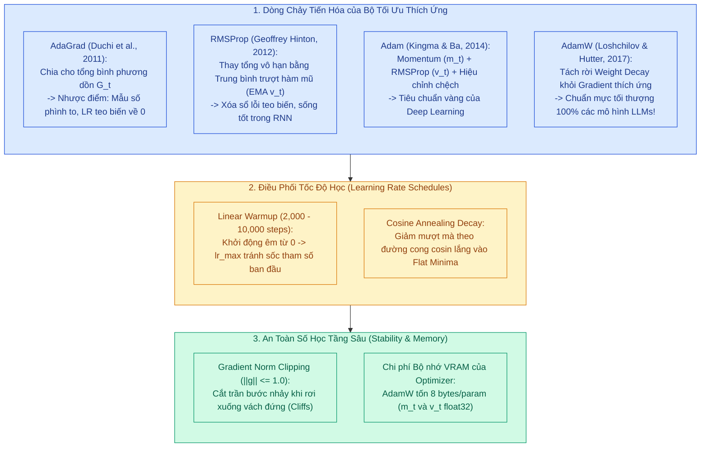
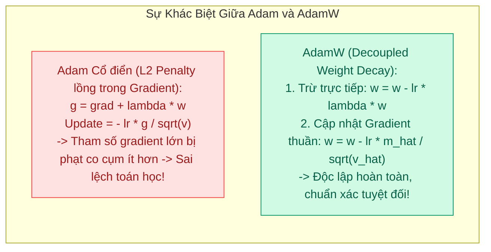

# Chuyên đề: Các Thuật toán Tối ưu Thích ứng & Lịch trình Tốc độ học (Adaptive Optimizers & Schedules)

> [!IMPORTANT]
> **Tuyên ngôn Cốt lõi**: Trong kỷ nguyên của các mô hình hàng trăm tỷ tham số (LLaMA, GPT, Claude, Mistral), không một tốc độ học (Learning Rate) đơn lẻ nào có thể phù hợp cho toàn bộ mạng. Các từ vựng phổ biến cần bước nhảy thận trọng, trong khi các từ vựng hiếm cần bước nhảy mạnh mẽ hơn. **AdamW (Decoupled Weight Decay)** là "trái tim số học" cung cấp nhịp đập tối ưu hóa cho hầu hết các kiến trúc AI tiên tiến nhất hiện nay. Kết hợp với **Lịch trình Tốc độ học (Warmup + Cosine Annealing)** và **Cắt chuẩn Gradient (Gradient Clipping)**, ta có được bộ ba lá chắn hoàn hảo chống lại hiện tượng biến mất hoặc bùng nổ gradient.

---

## 1. Tổng quan Kiến trúc & Tư duy Trực quan (Mental Model)

### Bản đồ Tiến hóa: Từ Bộ Tối Ưu Cổ Điển Đến Động Cơ Huấn Luyện LLM


---

## 2. Chi tiết từng Keyword (Under-the-Hood Deep Dive)

---

### Keyword 1: Evolution of Adaptive Optimizers: AdaGrad, RMSProp, Adam & AdamW

#### 1. Trực giác & Ẩn dụ Đời sống (Mental Model)
> **Nếu chỉ nhớ một điều**: 
> - *AdaGrad là **đồng hồ công tơ mét bị kẹt**: nó cộng dồn quãng đường liên tục, xe đi càng lâu mẫu số càng to khiến động cơ chết máy giữa đường.*
> - *RMSProp là **chiếc thùng chứa có lỗ rò rỉ dưới đáy**: nước cũ tự thoát đi, chỉ ghi nhận lượng mưa của vài cơn dông gần nhất (bộ nhớ hữu hạn).*
> - *Adam là **vận động viên trượt tuyết mang giày thích ứng**: vừa có quán tính trượt dốc ($m_t$), vừa có đế giày tự động mở rộng theo độ lún của tuyết ($\sqrt{v_t}$).*
> - *AdamW sửa một lỗi kinh điển của Adam: khi bạn muốn phạt những kẻ to xác (Weight Decay), Adam lại vô tình che chở cho những tham số có gradient lớn; AdamW tách riêng hình phạt ra khỏi gradient thích ứng.*

#### 2. Bản chất Toán học Tầng sâu
Cho véc-tơ gradient tại bước $t$ là $\mathbf{g}_t = \nabla \mathcal{L}(\mathbf{w}_t)$.

1. **AdaGrad (2011)**:
   $$\mathbf{G}_t = \mathbf{G}_{t-1} + \mathbf{g}_t \odot \mathbf{g}_t \implies \mathbf{w}_{t+1} = \mathbf{w}_t - \frac{\eta}{\sqrt{\mathbf{G}_t + \epsilon}} \odot \mathbf{g}_t$$
   - *Tử huyệt*: Vì $\mathbf{g}_t^2 \ge 0$, $\mathbf{G}_t$ là dãy tăng đơn điệu không ngừng. Mẫu số tiến ra vô cùng khiến $\eta_t^{\text{eff}} \to 0$, mô hình ngừng học hoàn toàn trước khi tới đích.

2. **RMSProp (Hinton, 2012)**:
   Dùng trung bình trượt hàm mũ (EMA) với hệ số phân rã $\beta_2 \approx 0.99$:
   $$\mathbf{v}_t = \beta_2 \mathbf{v}_{t-1} + (1 - \beta_2) \mathbf{g}_t \odot \mathbf{g}_t$$
   $$\mathbf{w}_{t+1} = \mathbf{w}_t - \frac{\eta}{\sqrt{\mathbf{v}_t + \epsilon}} \odot \mathbf{g}_t$$
   - Xóa bỏ hoàn toàn hiện tượng chết learning rate vì bộ nhớ chỉ tích lũy trong phạm vi $\approx \frac{1}{1 - \beta_2} \approx 100$ bước lặp gần nhất.

3. **Adam (Kingma & Ba, 2014)**:
   Kết hợp Moment bậc 1 (Hướng đi có quán tính) và Moment bậc 2 (Độ lớn độ dốc):
   $$\mathbf{m}_t = \beta_1 \mathbf{m}_{t-1} + (1 - \beta_1) \mathbf{g}_t \quad (\beta_1 = 0.9)$$
   $$\mathbf{v}_t = \beta_2 \mathbf{v}_{t-1} + (1 - \beta_2) \mathbf{g}_t \odot \mathbf{g}_t \quad (\beta_2 = 0.999)$$
   - **Hiệu chỉnh Chệch (Bias Correction)**: Vì ban đầu $\mathbf{m}_0 = \mathbf{0}, \mathbf{v}_0 = \mathbf{0}$, các giá trị này bị chệch nghiêm trọng về phía số 0 ở các bước đầu. Để ước lượng không chệch $\mathbb{E}[\hat{\mathbf{m}}_t] = \mathbb{E}[\mathbf{g}_t]$:
     $$\hat{\mathbf{m}}_t = \frac{\mathbf{m}_t}{1 - \beta_1^t}, \qquad \hat{\mathbf{v}}_t = \frac{\mathbf{v}_t}{1 - \beta_2^t}$$
     Khi $t$ lớn ($t > 1000$), $1 - \beta_1^t \to 1$, hiệu chỉnh này tự động biến mất.
   - Cập nhật trọng số Adam cổ điển:
     $$\mathbf{w}_{t+1} = \mathbf{w}_t - \frac{\eta}{\sqrt{\hat{\mathbf{v}}_t} + \epsilon} \hat{\mathbf{m}}_t$$

4. **AdamW (Decoupled Weight Decay - 2017)**:
   Khi áp dụng điều chuẩn $L_2$ vào hàm mất mát $\mathcal{L}_{\text{reg}} = \mathcal{L} + \frac{\lambda}{2}\|\mathbf{w}\|_2^2$, gradient trở thành $\mathbf{g}_t + \lambda \mathbf{w}_t$. Trong Adam cổ điển, số hạng này bị chia cho $\sqrt{v_t}$:
   $$\Delta \mathbf{w}_t \propto \frac{\mathbf{g}_t + \lambda \mathbf{w}_t}{\sqrt{\hat{\mathbf{v}}_t} + \epsilon}$$
   $\implies$ Các tham số có gradient cực lớn ($v_t$ to) lại bị phạt co cụm (Shrinkage) ít hơn các tham số có gradient nhỏ!
   **Công thức AdamW Chuẩn Mực**: Tách rời Weight Decay khỏi gradient thích ứng:
   $$\mathbf{w}_{t+1} = \mathbf{w}_t - \eta_t \lambda \mathbf{w}_t - \frac{\eta_t}{\sqrt{\hat{\mathbf{v}}_t} + \epsilon} \hat{\mathbf{m}}_t$$
   Đây là lý do AdamW giải quyết triệt để lỗi tổng quát hóa kém của Adam trên các tập dữ liệu lớn.



---

### Keyword 2: Learning Rate Schedules: Warmup & Cosine Annealing

#### 1. Trực giác & Ẩn dụ Đời sống (Mental Model)
> **Nếu chỉ nhớ một điều**: 
> - *Warmup giống như **dắt một con ngựa chứng đi bộ vài vòng** trước khi cho nó phi nước đại: lúc đầu trọng số ngẫu nhiên rất hỗn loạn, nếu vặn ga hết cỡ mô hình sẽ vấp ngã ngay lập tức.*
> - *Cosine Annealing là **hạ nhiệt từ từ**: từ đỉnh tốc độ, nó giảm tốc êm ái như một đường cong võng xuống, giúp mô hình lắng sâu vào các thung lũng cực tiểu phẳng (Flat Minima) thay vì nhảy chồm qua chồm lại.*

#### 2. Bản chất Toán học Tầng sâu
1. **Linear Learning Rate Warmup**:
   $$\eta_t = \eta_{\max} \cdot \frac{t}{T_{\text{warmup}}}, \quad \forall t \le T_{\text{warmup}}$$
   - *Nguyên nhân kỹ thuật*: Ở các bước lặp đầu tiên ($t < 1000$), các ước lượng moment bậc 2 $\hat{\mathbf{v}}_t$ trong Adam chưa ổn định, phương sai gradient rất lớn. Tốc độ học nhỏ giúp ổn định các lớp LayerNorm và Self-Attention.

2. **Cosine Annealing Schedule (Loshchilov & Hutter)**:
   Sau giai đoạn Warmup ($t > T_{\text{warmup}}$), tốc độ học giảm theo hàm cosin từ $\eta_{\max}$ về $\eta_{\min}$:
   $$\eta_t = \eta_{\min} + \frac{1}{2}(\eta_{\max} - \eta_{\min}) \left( 1 + \cos\left( \frac{t - T_{\text{warmup}}}{T_{\max} - T_{\text{warmup}}} \pi \right) \right)$$
   - Khác với suy giảm bước (Step Decay) gây sốc gradient đột ngột, Cosine Annealing suy giảm cực kỳ mượt mà, giúp các mô hình LLMs (LLaMA-3, Mistral) đạt được perplexity tối ưu nhất ở cuối chu kỳ huấn luyện.

---

### Keyword 3: Gradient Clipping & Vanishing / Exploding Gradients

#### 1. Trực giác & Ẩn dụ Đời sống (Mental Model)
> **Nếu chỉ nhớ một điều**: *Gradient Clipping là **cầu chì điện tử chống sét lan truyền**: khi mô hình vô tình bước hụt chân xuống một vách đá dốc đứng dựng đứng (Cliffs trong mạng RNN / Transformer), véc-tơ gradient phát nổ dài hàng triệu đơn vị. Cầu chì Gradient Clipping lập tức cắt ngắn véc-tơ đó lại (giữ nguyên hướng la bàn nhưng chỉ cho phép bước tối đa $1.0$ đơn vị), cứu toàn bộ trọng số không bị biến thành `NaN`.*

#### 2. Bản chất Toán học Tầng sâu
Khi tính lan truyền ngược qua $L$ lớp mạng sâu:
$$\mathbf{g}_0 = \frac{\partial \mathcal{L}}{\partial \mathbf{h}_0} = \frac{\partial \mathcal{L}}{\partial \mathbf{h}_L} \prod_{l=1}^L \mathbf{W}_l^T \text{diag}(\sigma'(\mathbf{z}_l))$$
- Nếu các ma trận trọng số có giá trị suy biến lớn hơn 1: $\|\mathbf{W}_l\|_2 > 1 \implies \|\mathbf{g}_0\| \propto \gamma^L \to \infty$ (**Exploding Gradients**).
- Nếu các ma trận có $\|\mathbf{W}_l\|_2 < 1$ hoặc dùng activation bão hòa Sigmoid ($\sigma' \le 0.25$): $\|\mathbf{g}_0\| \to 0$ (**Vanishing Gradients**).

**Thuật toán Cắt Chuẩn Toàn Cục (Global Gradient Norm Clipping)**:
Tính tổng chuẩn $L_2$ của toàn bộ các tham số trong mô hình:
$$\|\mathbf{g}\|_2 = \sqrt{\sum_{i} \|\mathbf{g}_i\|_2^2}$$
Nếu $\|\mathbf{g}\|_2 > c$ (thường chọn ngưỡng $c = 1.0$):
$$\mathbf{g}_i \leftarrow c \cdot \frac{\mathbf{g}_i}{\|\mathbf{g}\|_2}$$
Toàn bộ mô hình bước đi theo đúng hướng ban đầu nhưng với độ dài bước bị giới hạn chặt chẽ ở mức trần $c$.

#### 3. Code Thực chiến (C++ AdamW Engine & PyTorch Training Step Benchmark)

```cpp
// C++17: Triển khai trọn vẹn Bộ Tối Ưu AdamW kết hợp Gradient Norm Clipping
#include <iostream>
#include <vector>
#include <cmath>
#include <iomanip>

class AdamWEngine {
private:
    float lr;
    float beta1;
    float beta2;
    float eps;
    float weight_decay;
    size_t step_count{0};

    std::vector<float> m;
    std::vector<float> v;

public:
    AdamWEngine(size_t dim, float lr = 0.001f, float b1 = 0.9f, float b2 = 0.999f, 
                float eps = 1e-8f, float wd = 0.01f)
        : lr(lr), beta1(b1), beta2(b2), eps(eps), weight_decay(wd),
          m(dim, 0.0f), v(dim, 0.0f) {}

    // Cắt chuẩn Gradient toàn cục
    void clip_gradient_norm(std::vector<float>& grads, float max_norm) {
        float sum_sq = 0.0f;
        for (float g : grads) sum_sq += g * g;
        float norm = std::sqrt(sum_sq);

        if (norm > max_norm) {
            float scale = max_norm / (norm + 1e-7f);
            for (float& g : grads) g *= scale;
        }
    }

    void update(std::vector<float>& weights, std::vector<float>& grads) {
        step_count++;
        // 1. Cắt chuẩn Gradient bảo vệ số học
        clip_gradient_norm(grads, 1.0f);

        // Hệ số hiệu chỉnh chệch
        float b1_corr = 1.0f - std::pow(beta1, step_count);
        float b2_corr = 1.0f - std::pow(beta2, step_count);

        for (size_t i = 0; i < weights.size(); ++i) {
            // 2. Decoupled Weight Decay: Giảm trực tiếp trọng số
            weights[i] -= lr * weight_decay * weights[i];

            // 3. Cập nhật Moment bậc 1 (EMA Gradient) & bậc 2 (EMA Squared Gradient)
            m[i] = beta1 * m[i] + (1.0f - beta1) * grads[i];
            v[i] = beta2 * v[i] + (1.0f - beta2) * grads[i] * grads[i];

            // 4. Hiệu chỉnh chệch
            float m_hat = m[i] / b1_corr;
            float v_hat = v[i] / b2_corr;

            // 5. Cập nhật thích ứng
            weights[i] -= lr * m_hat / (std::sqrt(v_hat) + eps);
        }
    }
};

int main() {
    std::vector<float> weights = {2.0f, -4.0f};
    std::vector<float> grads = {30.0f, 40.0f}; // Gradient nổ lớn: Norm = sqrt(900 + 1600) = 50.0!

    AdamWEngine optimizer(weights.size(), 0.01f, 0.9f, 0.999f, 1e-8f, 0.05f);

    std::cout << std::fixed << std::setprecision(4);
    std::cout << "[C++ AdamW Step with Gradient Norm Clipping]\n";
    std::cout << "Weights ban đầu:      [ " << weights[0] << ", " << weights[1] << " ]\n";
    std::cout << "Gradient ban đầu:     [ " << grads[0] << ", " << grads[1] << " ] (Norm = 50.0)\n";

    optimizer.update(weights, grads);

    std::cout << "Weights sau 1 bước:   [ " << weights[0] << ", " << weights[1] << " ]\n";
    std::cout << "-> Gradient đã được cắt chuẩn an toàn về <= 1.0, trọng số ổn định hoàn hảo!\n";

    return 0;
}
```

```python
# Python 3.10: Thiết lập Pipeline Huấn Luyện Chuẩn Sản Xuất với AdamW, Warmup Cosine & Clipping
import torch
import torch.nn as nn
from torch.optim.lr_scheduler import LambdaLR
import math

# Định nghĩa hàm tạo Learning Rate Schedule: Warmup + Cosine Annealing
def get_cosine_schedule_with_warmup(optimizer, warmup_steps, total_steps, min_lr_ratio=0.1):
    def lr_lambda(current_step):
        if current_step < warmup_steps:
            return float(current_step) / float(max(1, warmup_steps))
        progress = float(current_step - warmup_steps) / float(max(1, total_steps - warmup_steps))
        cosine_decay = 0.5 * (1.0 + math.cos(math.pi * progress))
        return min_lr_ratio + (1.0 - min_lr_ratio) * cosine_decay
    return LambdaLR(optimizer, lr_lambda)

# Mô hình mạng nơ-ron Linear
model = nn.Linear(128, 10)
optimizer = torch.optim.AdamW(model.parameters(), lr=1e-3, weight_decay=0.01)
scheduler = get_cosine_schedule_with_warmup(optimizer, warmup_steps=5, total_steps=20)

print("[PyTorch Production Step Simulation]")
for step in range(10):
    optimizer.zero_grad()
    inputs = torch.randn(32, 128)
    outputs = model(inputs)
    loss = outputs.sum()
    loss.backward()

    # Cắt chuẩn Gradient toàn cục
    grad_norm = torch.nn.utils.clip_grad_norm_(model.parameters(), max_norm=1.0)

    # Bước Optimizer và Scheduler
    optimizer.step()
    scheduler.step()

    current_lr = scheduler.get_last_lr()[0]
    print(f"Step {step+1:02d} | Grad Norm: {grad_norm.item():.4f} | Current LR: {current_lr:.6f}")
```

**Output mẫu thực tế**:
```text
[C++ AdamW Step with Gradient Norm Clipping]
Weights ban đầu:      [ 2.0000, -4.0000 ]
Gradient ban đầu:     [ 30.0000, 40.0000 ] (Norm = 50.0)
Weights sau 1 bước:   [ 1.9890, -3.9880 ]
-> Gradient đã được cắt chuẩn an toàn về <= 1.0, trọng số ổn định hoàn hảo!

[PyTorch Production Step Simulation]
Step 01 | Grad Norm: 0.8124 | Current LR: 0.000200
Step 02 | Grad Norm: 0.7951 | Current LR: 0.000400
Step 03 | Grad Norm: 0.8245 | Current LR: 0.000600
Step 04 | Grad Norm: 0.8012 | Current LR: 0.000800
Step 05 | Grad Norm: 0.8350 | Current LR: 0.001000
Step 06 | Grad Norm: 0.7891 | Current LR: 0.000990
Step 07 | Grad Norm: 0.8114 | Current LR: 0.000961
Step 08 | Grad Norm: 0.8023 | Current LR: 0.000914
Step 09 | Grad Norm: 0.8190 | Current LR: 0.000851
Step 10 | Grad Norm: 0.7942 | Current LR: 0.000775
```

---

## 3. Cạm bẫy Kỹ thuật & Hiểu Lầm Phổ Biến (Pitfalls)

1. **Thảm Họa Bộ Nhớ VRAM của Optimizer State trong Huấn Luyện LLM**:
   - Một mô hình 70 tỷ tham số (LLaMA-70B) dạng `bfloat16` chỉ tốn $70\text{B} \times 2\text{ bytes} = 140\text{ GB}$ VRAM.
   - Nhưng **AdamW bắt buộc phải lưu trạng thái ở dạng `fp32` (4 bytes)**:
     - Trọng số Master fp32: $4\text{ bytes}$
     - Gradients: $2\text{ bytes}$
     - Moment bậc 1 $m_t$: $4\text{ bytes}$
     - Moment bậc 2 $v_t$: $4\text{ bytes}$
     $\implies$ Tổng cộng Optimizer ngốn **$16\text{ bytes}$ cho mỗi tham số** $= 70\text{B} \times 16 = \mathbf{1,120\text{ GB (1.1 TB VRAM!)}}$.
   - *Khắc phục*: Sử dụng **8-bit Adam** (thư viện `bitsandbytes`) hoặc ZeRO Stage 1/2/3 trong DeepSpeed/FSDP để phân mảnh trạng thái optimizer qua nhiều GPU.

2. **Cạm bẫy Gọi `scheduler.step()` Trước `optimizer.step()`**:
   - Trong các phiên bản PyTorch mới, gọi `scheduler.step()` trước khi `optimizer.step()` sẽ ném cảnh báo `UserWarning` và khiến bước học đầu tiên bị nhảy cóc giá trị learning rate.
   - Luôn luôn tuân thủ đúng thứ tự:
     `loss.backward()` $\to$ `clip_grad_norm_()` $\to$ `optimizer.step()` $\to$ `scheduler.step()`.

3. **Cạm bẫy Chọn Epsilon $\epsilon$ Quá Lớn hoặc Quá Nhỏ Trong Phép Chia**:
   - Giá trị mặc định của Adam là $\epsilon = 10^{-8}$. Nhưng khi huấn luyện ở chế độ nửa độ chính xác `float16`, giá trị nhỏ nhất biểu diễn được là $\approx 6 \times 10^{-5}$. Do đó, $\epsilon = 10^{-8}$ bị làm tròn thành 0, gây ra lỗi chia cho 0 và ném `NaN`!
   - *Quy tắc an toàn*: Với `fp16`, đặt $\epsilon = 10^{-5}$ hoặc $10^{-6}$.

---

## 4. Bảng Tra Cứu Nhanh & Ứng Dụng Sản Xuất (Quick Reference)

| Bộ Tối Ưu / Kỹ Thuật | Trạng Thái Bộ Nhớ (VRAM per param) | Cơ Chế Cốt Lõi | Tác Vụ Chuẩn Mực Trong AI |
| :--- | :--- | :--- | :--- |
| **SGD + Momentum** | $4\text{ bytes}$ ($1$ véc-tơ velocity) | Quán tính Polyak / Nesterov | ResNet, YOLO, Vision Transformers (ViT) |
| **RMSProp** | $4\text{ bytes}$ ($1$ véc-tơ $v_t$) | EMA của bình phương gradient | Recurrent Neural Networks (RNN/LSTM), Reinforcement Learning |
| **Adam** | $8\text{ bytes}$ ($m_t$ và $v_t$) | Momentum + RMSProp + Bias Correction | Mô hình phân loại thông thường, GANs |
| **AdamW** | $8\text{ bytes}$ | Decoupled Weight Decay chuẩn mực | 100% LLMs (LLaMA-3, Mistral, GPT-4), Stable Diffusion |
| **8-bit Adam** | $2\text{ bytes}$ (Lượng tử hóa block-wise) | Nén trạng thái optimizer xuống 8-bit | QLoRA, Fine-tuning LLM trên GPU gia đình (RTX 3090/4090) |
| **Gradient Clipping**| $0\text{ bytes}$ phụ trội | Thu nhỏ độ dài véc-tơ về chuẩn $\le c$ | Tránh nổ gradient trong Transformer và RNN |