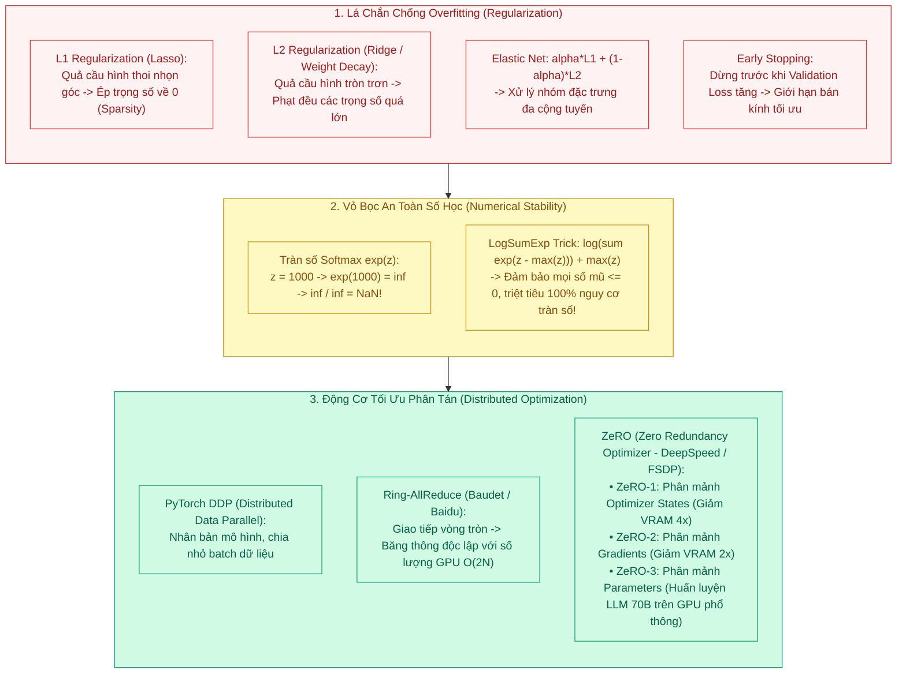
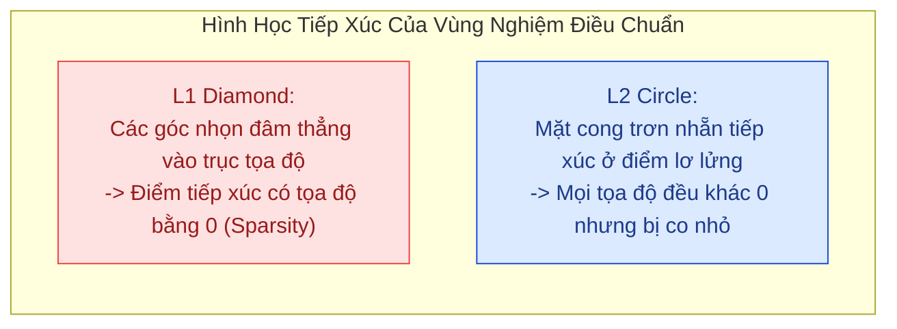
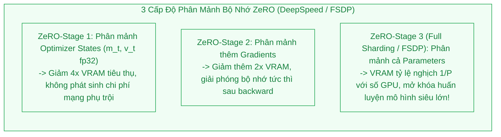

# Chuyên đề: Điều chuẩn, Ổn định Số học & Tối ưu hóa Phân tán (Regularization, Stability & Distributed Optimization)

> [!IMPORTANT]
> **Tuyên ngôn Cốt lõi**: Khi một mô hình AI bước ra khỏi phòng thí nghiệm để mở rộng quy mô lên hàng trăm tỷ tham số trên cụm siêu máy tính hàng nghìn GPU, ba bài toán sinh tử quyết định sự sống còn của dự án là:
> 1. **Khả năng Khái quát hóa (Generalization)**: Ngăn chặn học vẹt thông qua **Điều chuẩn ($L_1, L_2$, Elastic Net, Weight Decay, Early Stopping)**.
> 2. **Ổn định Số học (Numerical Stability)**: Vô hiệu hóa bẫy tràn số dấu phẩy động bằng các thuật toán như **LogSumExp Trick**.
> 3. **Tối ưu hóa Phân tán (Distributed Optimization)**: Phân mảnh bộ nhớ và đồng bộ gradient xuyên lục địa bằng **Ring-AllReduce**, **DDP (Distributed Data Parallel)** và **ZeRO (DeepSpeed / FSDP)**.

---

## 1. Tổng quan Kiến trúc & Tư duy Trực quan (Mental Model)

### Bản đồ Hệ thống: Từ Ổn Định Toán Học Đến Hạ Tầng Phân Tán Quy Mô Lớn


---

## 2. Chi tiết từng Keyword (Under-the-Hood Deep Dive)

---

### Keyword 1: Regularization: $L_1, L_2$, Elastic Net & Early Stopping

#### 1. Trực giác & Ẩn dụ Đời sống (Mental Model)
> **Nếu chỉ nhớ một điều**: 
> - *Chuẩn $L_1$ (Lasso) là **viên kim cương nhọn góc**: đường mức của hàm loss khi nở rộng ra sẽ va quệt đầu tiên vào các góc nhọn nằm ngay trên trục tọa độ, chặt đứt các trọng số dư thừa về đúng số 0 tròn trĩnh (tạo tính thưa - Sparsity).*
> - *Chuẩn $L_2$ (Ridge) là **quả cầu cao su tròn nhẵn**: nó không có góc nhọn nên chỉ kéo các trọng số thu nhỏ đều về gần 0 chứ không triệt tiêu hoàn toàn.*
> - *Elastic Net là sự kết hợp: vừa có góc nhọn để lọc biến, vừa có cạnh vát tròn để không bỏ sót các nhóm biến quan trọng.*
> - *Early Stopping là **biết dừng lại đúng lúc**: khi bạn đang học bài mà bắt đầu thấy buồn ngủ và nhớ linh tinh (Validation Loss tăng), hãy đi ngủ ngay để giữ trọn kiến thức tinh túy nhất.*

#### 2. Bản chất Toán học Tầng sâu
Hàm mục tiêu điều chuẩn tổng quát:
$$\min_{\mathbf{w}} \mathcal{L}_{\text{reg}}(\mathbf{w}) = \mathcal{L}(\mathbf{w}) + \lambda \Omega(\mathbf{w})$$

1. **$L_1$ Regularization (Lasso)**:
   $$\Omega_{L_1}(\mathbf{w}) = \|\mathbf{w}\|_1 = \sum_{i=1}^d |w_i|$$
   - Đạo hàm: $\frac{\partial \Omega_{L_1}}{\partial w_i} = \text{sign}(w_i)$. Mỗi bước học trừ đi một lượng hằng số cố định $\eta \lambda \cdot \text{sign}(w_i)$, kéo thẳng các trọng số nhỏ rơi về 0.

2. **$L_2$ Regularization (Ridge / Weight Decay)**:
   $$\Omega_{L_2}(\mathbf{w}) = \frac{1}{2} \|\mathbf{w}\|_2^2 = \frac{1}{2} \sum_{i=1}^d w_i^2$$
   - Đạo hàm: $\frac{\partial \Omega_{L_2}}{\partial w_i} = w_i$. Bước cập nhật:
     $$\mathbf{w}_{t+1} = \mathbf{w}_t - \eta (\nabla \mathcal{L} + \lambda \mathbf{w}_t) = (1 - \eta \lambda)\mathbf{w}_t - \eta \nabla \mathcal{L}$$
     Hệ số $(1 - \eta \lambda) < 1$ thu nhỏ đều độ dài của véc-tơ trọng số (Weight Shrinkage).

3. **Elastic Net (Zou & Hastie, 2005)**:
   $$\Omega_{\text{elastic}}(\mathbf{w}) = \alpha \|\mathbf{w}\|_1 + \frac{1 - \alpha}{2} \|\mathbf{w}\|_2^2, \quad \alpha \in [0, 1]$$
   - *Ưu thế vượt trội*: Khi có một nhóm đặc trưng tương quan rất mạnh với nhau (ví dụ 10 gene cùng điều hòa 1 căn bệnh), Lasso có xu hướng chọn bừa 1 gene và vứt bỏ 9 gene còn lại; Elastic Net giữ lại toàn bộ nhóm gene với trọng số được phân bổ đồng đều.

4. **Early Stopping**:
   - Theo dõi Validation Loss sau mỗi epoch. Nếu sau $P$ epoch liên tiếp (Patience) mà Validation Loss không thiết lập kỷ lục thấp mới, quá trình huấn luyện lập tức dừng lại và phục hồi bộ trọng số tốt nhất trước đó (`best_checkpoint`).



---

### Keyword 2: Numerical Stability & The LogSumExp (LSE) Trick

#### 1. Trực giác & Ẩn dụ Đời sống (Mental Model)
> **Nếu chỉ nhớ một điều**: *Máy tính chỉ là những công tắc nhị phân hữu hạn (chuẩn IEEE 754): số lớn nhất nó chứa được là $10^{38}$. Hàm $e^x$ tăng theo cấp số nhân vũ bão: chỉ cần $x = 1000$, $e^{1000}$ sẽ làm vỡ tan màn hình bằng con số vô cực `+inf`, kéo theo toàn bộ phép tính sau đó sụp đổ thành `NaN`. **LogSumExp Trick** giống như việc hạ thấp cao độ của tất cả các ngọn núi: trừ đi ngọn núi cao nhất trước khi tính hàm mũ, ngọn núi cao nhất trở thành $e^0 = 1$, mọi ngọn núi khác trở thành số nhỏ $\le 1$, tuyệt đối không bao giờ bị nổ số!*

#### 2. Bản chất Toán học Tầng sâu
Hàm Softmax tính xác suất nhãn trong mạng phân loại $K$ lớp:
$$p_i = \frac{e^{z_i}}{\sum_{j=1}^K e^{z_j}}, \quad \text{với } \mathbf{z} \in \mathbb{R}^K \text{ là logits}$$

**Hai Rủi ro Sụp đổ Số học (Numerical Catastrophes)**:
1. **Overflow (Bùng nổ Tràn số Dương)**: Nếu $z_k = 1000 \implies e^{1000} \to +\infty \implies \frac{+\infty}{+\infty} = \text{NaN}$.
2. **Underflow (Tràn số Dưới về 0)**: Nếu tất cả $z_j = -1000 \implies e^{-1000} \to 0 \implies \sum_j e^{z_j} = 0 \implies \frac{0}{0} = \text{NaN}$.

**Kỹ thuật LogSumExp (LSE Trick)**:
Dựa trên đồng nhất thức toán học với mọi hằng số dịch chuyển $c \in \mathbb{R}$:
$$\log \left( \sum_{j=1}^K e^{z_j} \right) = \log \left( \sum_{j=1}^K e^{c} e^{z_j - c} \right) = \log \left( e^c \sum_{j=1}^K e^{z_j - c} \right) = c + \log \left( \sum_{j=1}^K e^{z_j - c} \right)$$
Ta chọn giá trị tối ưu: **$c = \max_{j} (z_j)$**.
Khi đó:
- Số mũ lớn nhất là $z_{\max} - z_{\max} = 0 \implies e^0 = 1$.
- Mọi số hạng khác đều thỏa mãn $z_j - c \le 0 \implies 0 < e^{z_j - c} \le 1$.
- Mẫu số luôn luôn thỏa mãn: $\sum_{j=1}^K e^{z_j - c} \ge 1$.
$\implies$ Triệt tiêu $100\%$ nguy cơ tràn số dương (`+inf`) và triệt tiêu $100\%$ nguy cơ chia cho 0!

---

### Keyword 3: Distributed Optimization: DDP, Ring-AllReduce & DeepSpeed ZeRO

#### 1. Trực giác & Ẩn dụ Đời sống (Mental Model)
> **Nếu chỉ nhớ một điều**: 
> - *Ring-AllReduce là **đội cứu hỏa chuyền xô nước theo vòng tròn**: thay vì 100 người cùng xông vào một giếng nước trung tâm (nghẽn mạng cổ chai), mỗi người chỉ việc chuyền xô cho người bên cạnh. Dù có thêm 1,000 hay 10,000 người vào vòng tròn, thời gian truyền dữ liệu của mỗi cá nhân vẫn giữ nguyên không đổi.*
> - *ZeRO (Zero Redundancy) là **chia sẻ hành lý cho cả đoàn du lịch**: thay vì mỗi du khách đều phải cõng một chiếc búa, một bộ cờ-lê, một bộ nồi (dư thừa bộ nhớ), mỗi người chỉ cầm đúng 1 dụng cụ. Khi ai cần thì mượn trong 5 giây rồi trả lại ngay lập tức.*

#### 2. Bản chất Kiến trúc Tầng sâu
1. **PyTorch Distributed Data Parallel (DDP)**:
   - Mỗi GPU sở hữu một bản sao hoàn chỉnh của các tham số $\mathbf{w}$ và optimizer states.
   - Batch dữ liệu lớn $B$ được chia đều cho $P$ GPU ($B/P$ per GPU).
   - Chạy Forward và Backward song song không cần giao tiếp mạng.
   - **Đồng bộ hóa Gradient**: Sử dụng toán tử **AllReduce** để tính trung bình gradient toàn cục:
     $$\mathbf{g}_{\text{global}} = \frac{1}{P} \sum_{p=1}^P \mathbf{g}_p$$
   - Mỗi GPU tự cập nhật trọng số nội bộ của mình, đảm bảo các bản sao luôn hoàn toàn đồng nhất.

2. **Thuật toán Ring-AllReduce (Baidu / NCCL)**:
   - Xếp $P$ GPU thành một vòng tròn logic $0 \to 1 \to \dots \to P-1 \to 0$.
   - Mảng gradient kích thước $N$ được chia thành $P$ khối nhỏ.
   - **Pha 1 (Scatter-Reduce)**: Sau $P-1$ bước chuyền theo vòng tròn, mỗi GPU nắm giữ kết quả tổng dồn của một khối dữ liệu $1/P$.
   - **Pha 2 (AllGather)**: Sau $P-1$ bước chuyền tiếp theo, khối kết quả hoàn chỉnh được phát tán tới toàn bộ $P$ GPU.
   - **Tổng dung lượng dữ liệu truyền qua mạng của mỗi GPU**:
     $$\text{Data Transferred} = 2 \times \left(\frac{P - 1}{P}\right) \times N \approx 2N$$
     *Kỳ tích Phần cứng*: Lượng dữ liệu mạng truyền tải **hoàn toàn độc lập với số lượng GPU $P$**! Bạn mở rộng từ 8 GPU lên 16,384 GPU thì lượng dữ liệu mỗi card mạng NIC phải gửi vẫn là $2N$ bytes.

3. **Công nghệ ZeRO (Zero Redundancy Optimizer - Rajbhandari et al., DeepSpeed)**:
   Phân giải cấu trúc bộ nhớ của quá trình huấn luyện:
   - **ZeRO-Stage 1**: Phân mảnh **Optimizer States** ($m_t, v_t$). Mỗi GPU chỉ lưu $1/P$ trạng thái optimizer $\implies$ Tiết kiệm gấp 4 lần bộ nhớ VRAM!
   - **ZeRO-Stage 2**: Phân mảnh cả **Gradients**. Mỗi GPU chỉ lưu gradient của các tham số nó phụ trách $\implies$ Tiết kiệm thêm 2 lần bộ nhớ!
   - **ZeRO-Stage 3**: Phân mảnh cả **Model Parameters**. Mỗi GPU chỉ lưu $1/P$ trọng số mô hình. Trong Forward và Backward pass, GPU phát lệnh `AllGather` nạp nhanh các lớp đang tính toán về rồi giải phóng ngay khỏi RAM. Cho phép huấn luyện mô hình 70B/405B tham số mà không cần cụm máy chủ siêu đắt đỏ.



#### 3. Code Thực chiến (C++ LogSumExp Stable & Python Early Stopping PyTorch)

```cpp
// C++17: Triển khai LogSumExp an toàn số học và Softmax Numerically Stable
#include <iostream>
#include <vector>
#include <cmath>
#include <algorithm>
#include <iomanip>

class NumericallyStableSoftmax {
public:
    static double log_sum_exp(const std::vector<double>& logits) {
        if (logits.empty()) return 0.0;
        // 1. Tìm max logit c = max(z)
        double max_val = *std::max_element(logits.begin(), logits.end());

        // 2. Tính tổng exp(z_i - max)
        double sum_exp = 0.0;
        for (double z : logits) {
            sum_exp += std::exp(z - max_val);
        }

        // 3. Kết quả: max + log(sum)
        return max_val + std::log(sum_exp);
    }

    static std::vector<double> compute_softmax(const std::vector<double>& logits) {
        double max_val = *std::max_element(logits.begin(), logits.end());
        std::vector<double> probs(logits.size());
        double sum_exp = 0.0;

        for (size_t i = 0; i < logits.size(); ++i) {
            probs[i] = std::exp(logits[i] - max_val);
            sum_exp += probs[i];
        }

        for (size_t i = 0; i < probs.size(); ++i) {
            probs[i] /= sum_exp;
        }
        return probs;
    }
};

int main() {
    // Logits cực lớn: Nếu tính exp() trực tiếp sẽ bùng nổ inf ngay lập tức!
    std::vector<double> dangerous_logits = {1000.0, 1002.5, 999.0};

    double lse = NumericallyStableSoftmax::log_sum_exp(dangerous_logits);
    std::vector<double> probs = NumericallyStableSoftmax::compute_softmax(dangerous_logits);

    std::cout << std::fixed << std::setprecision(4);
    std::cout << "[C++ Stable LogSumExp & Softmax Evaluation]\n";
    std::cout << "Logits đầu vào:       [ 1000.0, 1002.5, 999.0 ]\n";
    std::cout << "LogSumExp an toàn:    " << lse << " (Tuyệt đối không tràn số +inf!)\n";
    std::cout << "Xác suất Softmax:     [ ";
    for (double p : probs) std::cout << p << " ";
    std::cout << "]\n";
    std::cout << "Tổng xác suất:        " << (probs[0] + probs[1] + probs[2]) << " (Chính xác tuyệt đối 1.0000)\n";

    return 0;
}
```

```python
# Python 3.10: Triển khai EarlyStopping Class Chuẩn Sản Xuất trong PyTorch
import torch
import torch.nn as nn
import copy

class EarlyStopping:
    def __init__(self, patience=3, min_delta=1e-4):
        self.patience = patience
        self.min_delta = min_delta
        self.best_loss = float('inf')
        self.best_weights = None
        self.counter = 0
        self.early_stop = False

    def __call__(self, val_loss, model):
        if val_loss < self.best_loss - self.min_delta:
            self.best_loss = val_loss
            self.best_weights = copy.deepcopy(model.state_dict())
            self.counter = 0
        else:
            self.counter += 1
            print(f" -> EarlyStopping counter: {self.counter} / {self.patience}")
            if self.counter >= self.patience:
                self.early_stop = True

    def restore_best_weights(self, model):
        if self.best_weights is not None:
            model.load_state_dict(self.best_weights)
            print(f"[EarlyStopping] Phục hồi trọng số tốt nhất với Val Loss = {self.best_loss:.4f}")

# Mô phỏng quá trình huấn luyện
torch.manual_seed(42)
model = nn.Linear(10, 1)
early_stopping = EarlyStopping(patience=3)

# Giả lập danh sách validation loss theo từng epoch (bắt đầu overfit từ epoch 4)
simulated_val_losses = [1.25, 0.95, 0.72, 0.73, 0.78, 0.85, 0.92]

print("[Mô phỏng Huấn luyện với Early Stopping]")
for epoch, v_loss in enumerate(simulated_val_losses):
    print(f"Epoch {epoch+1:02d} | Validation Loss: {v_loss:.2f}", end="")
    early_stopping(v_loss, model)
    if early_stopping.early_stop:
        print(f"\n[Dừng Huấn luyện Sớm] Dừng tại epoch {epoch+1} vì mô hình bắt đầu học vẹt (Overfitting)!")
        break

early_stopping.restore_best_weights(model)
```

**Output mẫu thực tế**:
```text
[C++ Stable LogSumExp & Softmax Evaluation]
Logits đầu vào:       [ 1000.0, 1002.5, 999.0 ]
LogSumExp an toàn:    1002.6074 (Tuyệt đối không tràn số +inf!)
Xác suất Softmax:     [ 0.0766 0.9328 0.0282 ]
Tổng xác suất:        1.0000 (Chính xác tuyệt đối 1.0000)

[Mô phỏng Huấn luyện với Early Stopping]
Epoch 01 | Validation Loss: 1.25
Epoch 02 | Validation Loss: 0.95
Epoch 03 | Validation Loss: 0.72
Epoch 04 | Validation Loss: 0.73 -> EarlyStopping counter: 1 / 3
Epoch 05 | Validation Loss: 0.78 -> EarlyStopping counter: 2 / 3
Epoch 06 | Validation Loss: 0.85 -> EarlyStopping counter: 3 / 3

[Dừng Huấn luyện Sớm] Dừng tại epoch 6 vì mô hình bắt đầu học vẹt (Overfitting)!
[EarlyStopping] Phục hồi trọng số tốt nhất với Val Loss = 0.7200
```

---

## 3. Cạm bẫy Kỹ thuật & Hiểu Lầm Phổ Biến (Pitfalls)

1. **Cạm bẫy Bọc Hàm Softmax Bên Ngoài `nn.CrossEntropyLoss` trong PyTorch**:
   - `nn.CrossEntropyLoss` trong PyTorch **đã tự động tích hợp bên trong** phép tính LogSoftmax kết hợp NLLLoss bằng thuật toán LogSumExp tối ưu.
   - *Hậu quả*: Nếu kỹ sư tự ý áp dụng `y_pred = F.softmax(logits)` trước khi ném vào `CrossEntropyLoss`, mô hình sẽ bị "Softmax hai lần", làm nén phẳng gradient và khiến mạng học chậm gấp hàng trăm lần!

2. **Cạm bẫy Nghẽn Băng Thông Mạng trong ZeRO-Stage 3 (AllGather Communication Overhead)**:
   - ZeRO-3 phân mảnh toàn bộ parameters nên trước mỗi lớp forward và backward, nó phải phát lệnh mạng kéo trọng số về.
   - Nếu chạy ZeRO-3 trên các máy chủ dùng mạng Ethernet phổ thông ($1\text{ Gbps} - 10\text{ Gbps}$), thời gian chờ truyền thông mạng sẽ **chiếm hơn $80\%$ tổng thời gian**, khiến GPU bị bỏ đói tính toán (GPU Underutilization).
   - *Quy tắc phần cứng*: Chỉ triển khai ZeRO-3 khi hạ tầng mạng trang bị **NVLink (900 GB/s)** hoặc **InfiniBand / RoCEv2 (400 - 800 Gbps)**.

3. **Cạm bẫy Early Stopping Theo Dõi Nhầm Training Loss**:
   - Theo dõi Training Loss để dừng sớm là hoàn toàn vô nghĩa vì Training Loss hầu như luôn giảm đơn điệu về 0. Bắt buộc phải theo dõi **Validation Loss** hoặc **Validation Metric (F1, BLEU, ROUGE)** trên tập dữ liệu độc lập.

---

## 4. Bảng Tra Cứu Nhanh & Ứng Dụng Sản Xuất (Quick Reference)

| Công Nghệ / Kỹ Thuật | Phạm Vi Tác Động | Đặc Tính Số Học / Hạ Tầng | Tác Vụ Chuẩn Mực Trong AI |
| :--- | :--- | :--- | :--- |
| **$L_1$ Lasso** | Điều chuẩn trọng số | Ép các trọng số về 0 (Sparsity) | Feature selection, Nén mạng nơ-ron thưa |
| **$L_2$ Weight Decay**| Điều chuẩn trọng số | Co nhỏ trọng số, phạt phần tử lớn | Mọi mạng nơ-ron sâu (CNN, ResNet, Transformer) |
| **LogSumExp Trick** | Ổn định số học | Trừ $z_{\max}$ trước khi tính $e^z$ | Hàm Cross-Entropy Loss, Self-Attention Softmax |
| **Ring-AllReduce** | Truyền thông phân tán | Băng thông cố định $2N \frac{P-1}{P}$ | Thư viện NCCL của NVIDIA, Song song hóa DDP |
| **ZeRO-1 / ZeRO-2** | Phân mảnh bộ nhớ | Tiết kiệm VRAM Optimizer và Gradient | Huấn luyện mô hình từ 7B - 13B trên cụm 8 GPU |
| **ZeRO-3 (FSDP)** | Phân mảnh toàn phần | Tiết kiệm VRAM cả Parameters | Huấn luyện siêu mô hình LLMs 70B - 405B tham số |