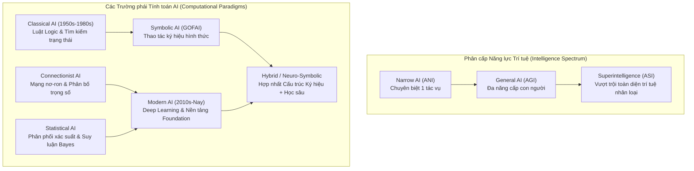
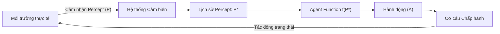
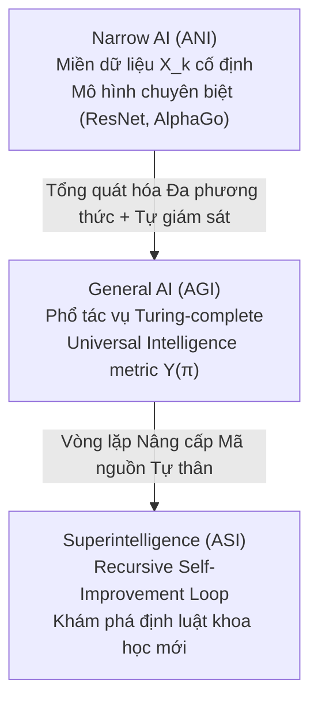
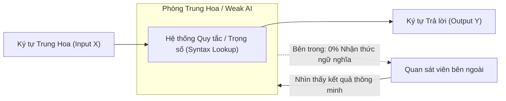
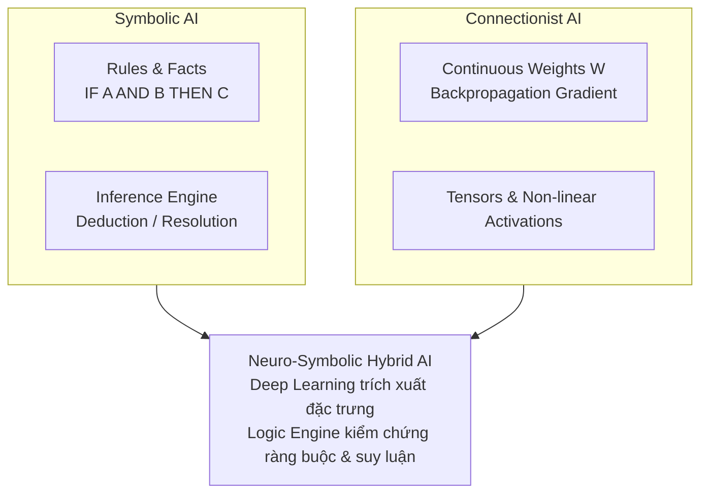
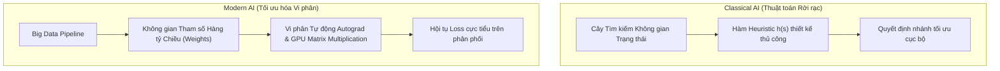

# Chuyên đề: Các Mô hình & Tiến trình Phát triển của Trí tuệ Nhân tạo (AI Paradigms & Evolution)

## 1. Tổng quan Chuyên đề
Lịch sử và bản chất của Trí tuệ Nhân tạo (Artificial Intelligence - AI) là sự chuyển dịch liên tục giữa các trường phái triết học, toán học và kỹ thuật tính toán: từ các hệ thống hình thức thao tác ký hiệu (Symbolic / Good Old-Fashioned AI - GOFAI), các mô hình kết nối phỏng sinh học mạng nơ-ron (Connectionism), các khung xác suất thống kê (Statistical Learning), cho đến sự hội tụ của kỷ nguyên học sâu (Deep Learning) và các kiến trúc lai (Hybrid / Neuro-Symbolic AI).

Việc phân cấp khả năng trí tuệ nhân tạo từ Trí tuệ Nhân tạo Hẹp (Artificial Narrow Intelligence - ANI) hướng tới Trí tuệ Nhân tạo Tổng quát (Artificial General Intelligence - AGI) và Siêu trí tuệ (Artificial Superintelligence - ASI) đòi hỏi sự hiểu biết sâu sắc về các giới hạn lý thuyết tính toán (Church-Turing Thesis, NP-hardness), kiến trúc phần cứng (von Neumann vs. Neuromorphic / Tensor Cores), và các mô hình biểu diễn tri thức.



---

## 2. Chi tiết từng Keyword

---

### 1. Artificial Intelligence (Trí tuệ Nhân tạo)

#### a. Định nghĩa Bản chất Toán học (Mathematical Formulation)
Theo Russell & Norvig, Trí tuệ Nhân tạo về bản chất toán học là việc thiết kế hàm tác tử (agent function) $f$:
$$f: \mathcal{P}^* \to \mathcal{A}$$
trong đó $\mathcal{P}^*$ là chuỗi lịch sử các quan sát cảm nhận (percept sequence) từ môi trường, và $\mathcal{A}$ là không gian hành động có thể thực thi.

Một hệ thống AI được gọi là tối ưu (rational/ideal) khi nó cực đại hóa hàm mục tiêu kỳ vọng:
$$f^* = \arg\max_f \mathbb{E}_{e \in \mathcal{E}} \left[ U(e, f) \right]$$
với $\mathcal{E}$ là tập hợp các môi trường thử nghiệm và $U(e, f)$ là thước đo hiệu quả (utility/performance metric).

#### b. Cơ chế Tầng Sâu & Điện toán (Hardware & Computational Internals)
- **Tầng tính toán**: Biến đổi từ kiến trúc tuần tự Turing-von Neumann (thao tác CPU registers, fetch-decode-execute) sang kiến trúc tính toán dữ liệu song song cực lớn (SIMD/SIMT trên GPU/TPU Tensor Cores) và tính toán dạng não bộ (Neuromorphic Spiking Networks).
- **Bộ nhớ**: Chuyển từ biểu diễn rời rạc dạng đồ thị con trỏ (linked graphs/trees) sang các mảng nhiều chiều liên tục (dense tensors) được tối ưu hóa theo đường truyền bộ nhớ (Memory Bandwidth bound vs Compute bound).

#### c. Sơ đồ Minh họa (Mermaid Diagram)


#### d. Code Thực chiến (C++ & Python)
```cpp
// C++20: Mô hình hóa Trừu tượng Agent Function tổng quát
#include <iostream>
#include <vector>
#include <functional>
#include <numeric>

template <typename Percept, typename Action>
class AbstractAgent {
public:
    using AgentFunction = std::function<Action(const std::vector<Percept>&)>;
private:
    std::vector<Percept> percept_history_;
    AgentFunction agent_fn_;
public:
    explicit AbstractAgent(AgentFunction fn) : agent_fn_(std::move(fn)) {}

    Action step(const Percept& p) {
        percept_history_.push_back(p);
        return agent_fn_(percept_history_);
    }
};

int main() {
    auto rational_policy = [](const std::vector<double>& history) -> int {
        double avg = std::accumulate(history.begin(), history.end(), 0.0) / history.size();
        return (avg > 0.5) ? 1 : 0; // Quyết định hành động nhị phân
    };
    AbstractAgent<double, int> agent(rational_policy);
    std::cout << "Action taken: " << agent.step(0.8) << "\n";
    std::cout << "Action taken: " << agent.step(0.3) << "\n";
    return 0;
}
```

```python
# Python: Agent Interface với hàm mục tiêu xác suất
from typing import List, Callable, Any
import numpy as np

class RationalAgent:
    def __init__(self, utility_fn: Callable[[List[float], int], float]):
        self.history: List[float] = []
        self.utility_fn = utility_fn
        self.action_space = [0, 1]

    def act(self, percept: float) -> int:
        self.history.append(percept)
        # Cực đại hóa kỳ vọng tiện ích argmax_a U(history, a)
        utilities = [self.utility_fn(self.history, a) for a in self.action_space]
        return int(np.argmax(utilities))

# Hàm tiện ích giả lập
u_func = lambda h, a: (np.mean(h) * 2.0 - 1.0) * (1 if a == 1 else -1)
agent = RationalAgent(u_func)
print("Action selected:", agent.act(0.75))
```

#### e. Lỗi Thường gặp & Độ ổn định Thuật toán
- **Goodhart's Law**: Khi một chỉ số đo lường trở thành mục tiêu tối ưu, nó sẽ đánh mất độ chính xác của thước đo. Tối ưu hóa quá mức hàm $U$ có thể dẫn đến hành vi gian lận phần thưởng (Reward Hacking).
- **Curse of History**: Chiều dài của chuỗi $\mathcal{P}^*$ tăng vô hạn theo thời gian $t$. Cần cơ chế Markovian State Reduction $s_t = \phi(\mathcal{P}_t^*)$ để giữ độ phức tạp bộ nhớ là $O(1)$.

#### f. Ứng dụng AI
- Thiết kế hệ thống tự hành (Autonomous Vehicles), hệ thống giao dịch thuật toán (HFT), và các Agent tự chủ đa bước (Autonomous LLM Agents).

---

### 2. Narrow AI (ANI) vs. General AI (AGI) vs. Superintelligence (ASI)

#### a. Định nghĩa Bản chất Toán học
- **Narrow AI (ANI)**: Hệ thống giải quyết bài toán ánh xạ trong không gian con đóng (bounded manifold):
  $$f_{\text{ANI}}: \mathcal{X}_k \to \mathcal{Y}_k, \quad \mathcal{X}_k \subset \mathbb{R}^{d_k}$$
  Khả năng tổng quát hóa ngoài phân phối (out-of-distribution) xấp xỉ bằng $0$: $\mathbb{E}_{x \sim \mathcal{D}_{\text{other}}} [L(f_{\text{ANI}}(x), y)] \to \infty$.

- **General AI (AGI)**: Khả năng giải quyết phổ nhiệm vụ tùy ý $\mathcal{T} \in \mathcal{U}$ tương đương trí tuệ con người:
  $$\text{Perf}(f_{\text{AGI}}, \mathcal{T}) \ge \text{Perf}(\text{Human}, \mathcal{T}), \quad \forall \mathcal{T} \sim \mathcal{P}(\text{Tasks})$$
  Theo định nghĩa AIXI của Marcus Hutter, năng lực trí tuệ phổ quát (Universal Intelligence $\Upsilon$) là:
  $$\Upsilon(\pi) = \sum_{\mu \in \mathcal{M}} 2^{-K(\mu)} V_{\mu}^\pi$$
  trong đó $K(\mu)$ là độ phức tạp Kolmogorov của môi trường $\mu$, và $V_{\mu}^\pi$ là giá trị kỳ vọng tích lũy của chính sách $\pi$.

- **Superintelligence (ASI)**: Trí tuệ vượt trội các bộ óc tinh hoa nhất ở mọi lĩnh vực nhận thức:
  $$\Upsilon(f_{\text{ASI}}) \gg \max_{h \in \text{Humans}} \Upsilon(h)$$

#### b. Cơ chế Tầng Sâu & Điện toán
- **ANI**: Trọng số mô hình (weights) được huấn luyện chuyên hóa trên một miền tensor cố định (ví dụ ResNet cho xử lý ảnh, AlphaZero cho cờ bàn).
- **AGI / ASI**: Đòi hỏi hệ thống siêu quy mô (Scale Laws), bộ nhớ vĩnh cửu có khả năng tự tái cấu trúc thuật toán mã nguồn (Self-referential meta-learning, Gödel Machines) và dung lượng bộ nhớ làm việc động (Dynamic Memory Augmentation).

#### c. Sơ đồ Minh họa (Mermaid Diagram)


#### d. Code Thực chiến (C++ & Python)
```cpp
// C++17: Mô phỏng Độ phức tạp Kolmogorov xấp xỉ qua nén dữ liệu cho AIXI Universal Metric
#include <iostream>
#include <string>
#include <vector>
#include <cmath>

// Giả lập xấp xỉ K(mu) qua kích thước mã hóa
struct EnvironmentModel {
    std::string name;
    size_t program_length_bits; // K(mu)
    double evaluate_policy_reward() const { return 100.0 / (1.0 + program_length_bits * 0.01); }
};

double universal_intelligence(const std::vector<EnvironmentModel>& envs) {
    double total_score = 0.0;
    for (const auto& env : envs) {
        double prior = std::pow(2.0, -static_cast<double>(env.program_length_bits));
        total_score += prior * env.evaluate_policy_reward();
    }
    return total_score;
}

int main() {
    std::vector<EnvironmentModel> envs = {
        {"SimpleGrid", 12},
        {"ContinuousPhysics", 64},
        {"MultiAgentMarket", 256}
    };
    std::cout << "Approx Universal Intelligence Metric: " << universal_intelligence(envs) << "\n";
    return 0;
}
```

```python
# Python: Mô phỏng Trực quan Phổ Tổng Quát hóa (ANI vs AGI)
import numpy as np

def evaluate_generalization(agent_type: str, task_diversity_dim: int = 10):
    np.random.seed(42)
    task_difficulties = np.linspace(1.0, 10.0, task_diversity_dim)
    if agent_type == "ANI":
        # Hiệu suất cực cao ở task 0, sụp đổ ở task khác
        perf = np.zeros(task_diversity_dim)
        perf[0] = 99.5
        perf[1:] = np.random.uniform(0.0, 5.0, task_diversity_dim - 1)
    elif agent_type == "AGI":
        # Hiệu suất đồng đều vượt ngưỡng người (75.0)
        perf = 85.0 - 1.5 * task_difficulties + np.random.normal(0, 1, task_diversity_dim)
    return perf

print("ANI Scores:", evaluate_generalization("ANI"))
print("AGI Scores:", evaluate_generalization("AGI"))
```

#### e. Lỗi Thường gặp & Độ ổn định Thuật toán
- **Catastrophic Forgetting**: Mạng nơ-ron học bài toán mới sẽ ghi đè và phá hủy hoàn toàn trọng số của bài toán cũ, rào cản lớn nhất ngăn ANI trở thành AGI.
- **AI Safety / Orthogonality Thesis**: Trí tuệ cực cao (ASI) hoàn toàn có thể gắn liền với mục tiêu tầm thường hoặc hủy diệt (Paperclip Maximizer).

#### f. Ứng dụng AI
- LLMs nền tảng (GPT-4o, Gemini 1.5 Pro) đóng vai trò bước chuyển tiếp từ ANI đa năng (Broad ANI) sang AGI sơ khai.

---

### 3. Weak AI vs. Strong AI

#### a. Định nghĩa Bản chất Toán học
- **Weak AI (AI Yếu / AI Chức năng)**: Quan điểm vị lợi (Functionalism). Hệ thống hành xử *như thể* nó có trí tuệ. Chỉ quan tâm đến độ chính xác của hàm ánh xạ hành vi:
  $$\| f_{\text{agent}}(x) - f_{\text{rational}}(x) \| < \epsilon$$
  Không cần và không giả định tồn tại ý thức, tính chủ quan (qualia) hay sự thông hiểu thực sự.
- **Strong AI (AI Mạnh / Ý thức Máy móc)**: Quan điểm thực thể (Physical Symbol / Biological Naturalism). Máy tính thực thi chương trình thực sự tạo ra một tâm thức (mind), có khả năng thấu hiểu ngữ nghĩa nội tại (intrinsic semantics), không chỉ là thao tác cú pháp (syntax).

#### b. Cơ chế Tầng Sâu & Điện toán
- **Thí nghiệm Phòng Trung Hoa (Searle's Chinese Room)**: Một CPU thao tác các bảng lookup mã lệnh hoặc phép nhân ma trận GEMM có thể dịch chính xác văn bản nhưng bản thân các cổng bán dẫn (ALU) hoàn toàn không có sự thấu hiểu ngữ nghĩa.
- **Điện toán Lượng tử / Thần kinh**: Trường phái Strong AI cho rằng điện toán von Neumann cổ điển không đủ để sinh ra ý thức do thiếu tính phi tuyến phi thuật toán (Penrose-Lucas argument).

#### c. Sơ đồ Minh họa (Mermaid Diagram)


#### d. Code Thực chiến (C++ & Python)
```cpp
// C++17: Mô phỏng Chinese Room - Bộ biến đổi Cú pháp thuần túy không có Thấu hiểu Ngữ nghĩa
#include <iostream>
#include <unordered_map>
#include <string>

class ChineseRoomSimulator {
private:
    std::unordered_map<std::string, std::string> syntactic_lookup_table_;
public:
    void learn_rule(const std::string& input_symbol, const std::string& output_symbol) {
        syntactic_lookup_table_[input_symbol] = output_symbol;
    }

    std::string process_token(const std::string& token) const {
        auto it = syntactic_lookup_table_.find(token);
        if (it != syntactic_lookup_table_.end()) {
            return it->second; // Ánh xạ máy móc hoàn toàn
        }
        return "[Unknown Symbol]";
    }
};

int main() {
    ChineseRoomSimulator room;
    room.learn_rule("你好", "Chào bạn!");
    std::cout << "Output: " << room.process_token("你好") << "\n";
    return 0;
}
```

```python
# Python: Functional Equivalence Test (Turing Test Verification)
def turing_behavior_test(agent_fn, human_evaluator, trials=100):
    indistinguishable_count = 0
    for _ in range(trials):
        response = agent_fn("What is the feeling of existential grief?")
        # Evaluator nhầm lẫn máy với người
        if human_evaluator(response):
            indistinguishable_count += 1
    return indistinguishable_count / trials

print(f"Weak AI Pass Rate: {turing_behavior_test(lambda x: 'It is profound sadness.', lambda r: len(r) > 10) * 100}%")
```

#### e. Lỗi Thường gặp & Độ ổn định Thuật toán
- **Đồng nhất hóa Syntax và Semantics**: Cho rằng mô hình ngôn ngữ sinh văn bản mạch lạc là mô hình "đang hiểu" thế giới thực tế (Stochastic Parrots debate).
- **Vấn đề Tiếp đất Biểu tượng (Symbol Grounding Problem)**: Các biểu tượng toán học trong máy tính không có sự gắn kết tự nhiên với vật thể vật lý trong thế giới thực nếu không có cảm biến tương tác vật lý (Embodied AI).

#### f. Ứng dụng AI
- Triết lý nền tảng cho việc đánh giá độ tin cậy và ranh giới đạo đức của AI tổng quát (AI Alignment and Philosophy of Mind).

---

### 4. Symbolic AI vs. Connectionist AI vs. Statistical AI vs. Hybrid AI

#### a. Định nghĩa Bản chất Toán học
- **Symbolic AI (GOFAI)**: Dựa trên giả thuyết hệ thống biểu tượng vật lý (Newell & Simon). Tri thức là tập các mệnh đề logic:
  $$\mathcal{KB} \vdash \alpha \iff \mathcal{M}(\mathcal{KB}) \subseteq \mathcal{M}(\alpha)$$
- **Connectionist AI**: Biểu diễn phân tán (Distributed Representation). Trí tuệ là hàm phi tuyến tham số hóa bởi ma trận trọng số $\mathbf{W}$:
  $$\hat{\mathbf{y}} = \sigma_L(\mathbf{W}_L \dots \sigma_1(\mathbf{W}_1 \mathbf{x} + \mathbf{b}_1) \dots + \mathbf{b}_L)$$
- **Statistical AI**: Biểu diễn bằng các phân phối xác suất liên hợp và đồ thị quan hệ ngẫu nhiên (Bayesian Networks, Graphical Models):
  $$P(X_1, \dots, X_n) = \prod_{i=1}^n P(X_i \mid \text{Parents}(X_i))$$
- **Hybrid AI (Neuro-Symbolic)**: Hợp nhất toán tử logic vào không gian vector liên tục (Logic Tensor Networks):
  $$\mathcal{L} = \mathcal{L}_{\text{data}}(\mathbf{W}) + \lambda \sum_{\phi \in \text{Rules}} (1 - I_{\mathbf{W}}(\phi))$$

#### b. Cơ chế Tầng Sâu & Điện toán
- **Symbolic**: Cấu trúc cây dữ liệu rời rạc, tìm kiếm đệ quy (DFS/BFS, Alpha-Beta), ngốn bộ nhớ pointer-chasing, gây Cache Miss nghiêm trọng trên CPU.
- **Connectionist**: Tối ưu hóa cho GPU SRAM và HBM, tận dụng phép nhân ma trận khối GEMM (General Matrix Multiply), bộ nhớ liên tục liên tục (Contiguous Memory Buffers).

#### c. Sơ đồ Minh họa (Mermaid Diagram)


#### d. Code Thực chiến (C++ & Python)
```cpp
// C++20: Minh họa sự tương phản giữa Symbolic Rule Engine và Connectionist Dot Product
#include <iostream>
#include <vector>
#include <numeric>
#include <cmath>

// 1. Symbolic Inference Rule
bool symbolic_inference(bool has_fever, bool has_cough) {
    return has_fever && has_cough; // Luật cứng hình thức
}

// 2. Connectionist Linear Perceptron
float connectionist_inference(const std::vector<float>& x, const std::vector<float>& w, float bias) {
    float z = std::inner_product(x.begin(), x.end(), w.begin(), bias);
    return 1.0f / (1.0f + std::exp(-z)); // Sigmoid activation
}

int main() {
    bool sym_res = symbolic_inference(true, true);
    float con_res = connectionist_inference({1.0f, 1.0f}, {2.5f, 2.0f}, -3.0f);
    std::cout << "Symbolic Result (Deterministic): " << sym_res << "\n";
    std::cout << "Connectionist Activation (Probabilistic): " << con_res << "\n";
    return 0;
}
```

```python
# Python: Logic Tensor Network đơn giản (Neuro-Symbolic Loss)
import torch
import torch.nn as nn

class NeuroSymbolicModel(nn.Module):
    def __init__(self):
        super().__init__()
        self.encoder = nn.Linear(4, 2) # Dự đoán xác suất nhãn A và B

    def forward(self, x):
        return torch.sigmoid(self.encoder(x))

    def compute_loss(self, preds, y_true):
        task_loss = nn.functional.binary_cross_entropy(preds, y_true)
        # Ràng buộc logic: A implies B <=> NOT A OR B => P(B) >= P(A)
        p_A = preds[:, 0]
        p_B = preds[:, 1]
        logic_violation = torch.relu(p_A - p_B).mean() # Phạt nếu P(A) > P(B)
        return task_loss + 0.5 * logic_violation

model = NeuroSymbolicModel()
dummy_x = torch.randn(8, 4)
dummy_y = torch.randint(0, 2, (8, 2)).float()
loss = model.compute_loss(model(dummy_x), dummy_y)
print("Hybrid Loss with Symbolic Constraint:", loss.item())
```

#### e. Lỗi Thường gặp & Độ ổn định Thuật toán
- **Symbolic Brittleness**: Hệ thống logic sụp đổ khi dữ liệu đầu vào chứa nhiễu (noise) hoặc gặp sự kiện chưa từng được định nghĩa trong luật (Zero-shot failure).
- **Connectionist Black-box & Hallucination**: Mạng nơ-ron không có cơ chế suy luận tất suy (deductive soundness), dễ dàng sinh kết quả sai với độ tự tin giả tạo cao.

#### f. Ứng dụng AI
- AlphaFold (hợp nhất mô hình hóa học cấu trúc và Transformer), AlphaGeometry (kết hợp LLM giải mã hình học và Deductive Database Engine).

---

### 5. Classical AI vs. Modern AI

#### a. Định nghĩa Bản chất Toán học
- **Classical AI (Kỷ nguyên 1950 - 1990)**: Dựa trên giải thuật tìm kiếm trong không gian trạng thái rời rạc (Search Trees) và đại số Boole:
  $$\text{Problem} = \langle \mathcal{S}, \mathcal{A}, \mathcal{T}, s_0, \mathcal{G} \rangle$$
  Thuật toán: $A^*$, Minimax, Backtracking CSP, STRIPS Planning.
- **Modern AI (Kỷ nguyên 2000 - Hiện tại)**: Dựa trên tối ưu hóa vi phân liên tục trong không gian Hilbert/Euclidean nhiều chiều:
  $$\min_{\mathbf{\theta}} \mathbb{E}_{(\mathbf{x}, \mathbf{y}) \sim \mathcal{D}} \left[ \mathcal{L}(f_\mathbf{\theta}(\mathbf{x}), \mathbf{y}) \right]$$
  Thuật toán: Stochastic Gradient Descent (AdamW), Backpropagation, Transformer Self-Attention, Diffusion SDEs.

#### b. Cơ chế Tầng Sâu & Điện toán
- **Classical AI**: Giới hạn bởi xung nhịp đơn nhân (Single-thread IPC), thuật toán duyệt nhánh bộ nhớ phân tán, tốc độ truy xuất DRAM ngẫu nhiên (Random Access Latency bound).
- **Modern AI**: Tối ưu hóa triệt để phần cứng gia tốc ma trận song song (NVIDIA Hopper H100 SXM5, Blackwell B200), băng thông bộ nhớ HBM3e đạt 3-8 TB/s, kỹ thuật FlashAttention giảm IO truy cập HBM sang SRAM.

#### c. Sơ đồ Minh họa (Mermaid Diagram)


#### d. Code Thực chiến (C++ & Python)
```cpp
// C++17: Classical AI State-Space Node Representation vs Modern Continuous Vector
#include <iostream>
#include <vector>
#include <memory>

// Classical: Cấu trúc nút rời rạc cho tìm kiếm cây
struct ClassicalSearchNode {
    int state_id;
    int cost;
    std::shared_ptr<ClassicalSearchNode> parent;
};

// Modern: Bộ đệm tensor liên tục cho mạng nơ-ron
struct ModernParameterTensor {
    std::vector<float> weights;
    std::vector<float> gradients;
    void zero_grad() { std::fill(gradients.begin(), gradients.end(), 0.0f); }
};

int main() {
    ClassicalSearchNode root{0, 0, nullptr};
    ModernParameterTensor tensor{{0.1f, -0.5f, 0.8f}, {0.0f, 0.0f, 0.0f}};
    std::cout << "Classical Node State: " << root.state_id << "\n";
    std::cout << "Modern Tensor Dim: " << tensor.weights.size() << " floats\n";
    return 0;
}
```

```python
# Python: So sánh Classical Heuristic Search vs Modern Neural Approximation
import heapq
import torch

# 1. Classical Priority Queue cho tìm kiếm trạng thái
def classical_search_step(frontier, state, cost):
    heapq.heappush(frontier, (cost, state))
    return heapq.heappop(frontier)

# 2. Modern Neural Gradient Step
def modern_optimization_step(param, grad, lr=0.01):
    with torch.no_grad():
        param -= lr * grad
    return param

frontier = []
print("Classical popped:", classical_search_step(frontier, "Node_A", 15))
p = torch.tensor([1.0], requires_grad=True)
loss = p ** 2
loss.backward()
print("Modern param after SGD:", modern_optimization_step(p, p.grad).item())
```

#### e. Lỗi Thường gặp & Độ ổn định Thuật toán
- **Classical**: Bùng nổ tổ hợp (Combinatorial Explosion): Không gian trạng thái tăng theo hàm mũ $b^d$, làm tràn RAM hệ thống chỉ sau vài chục bước tìm kiếm.
- **Modern**: Biến mất/Bùng nổ Gradient (Vanishing/Exploding Gradients), kẹt tại điểm yên ngựa (Saddle Points), và nhạy cảm cực cao với siêu tham số (Hyperparameter sensitivity).

#### f. Ứng dụng AI
- Sự kết hợp trong các hệ thống hiện đại: LLM Agents sử dụng Monte Carlo Tree Search (như OpenAI o1) để tìm kiếm chuỗi suy nghĩ (Chain-of-Thought search) dựa trên nền tảng Modern Deep Neural Networks.
