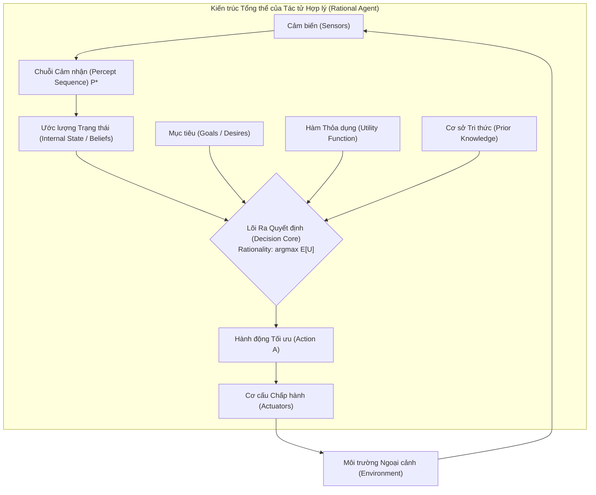
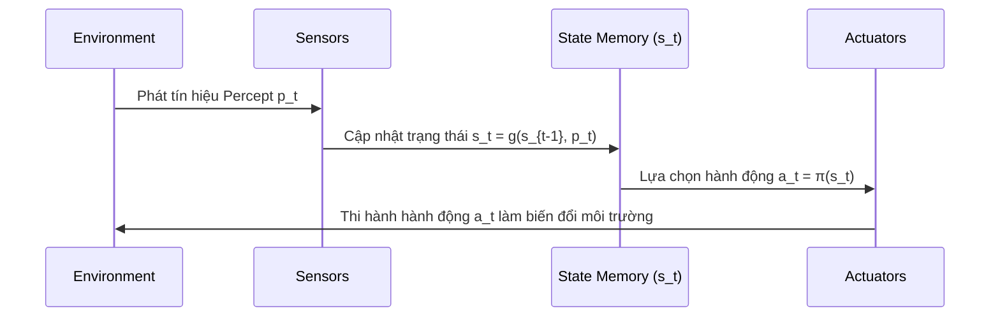
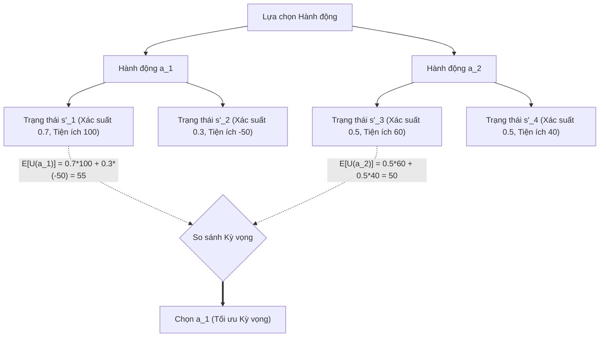
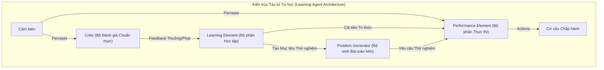
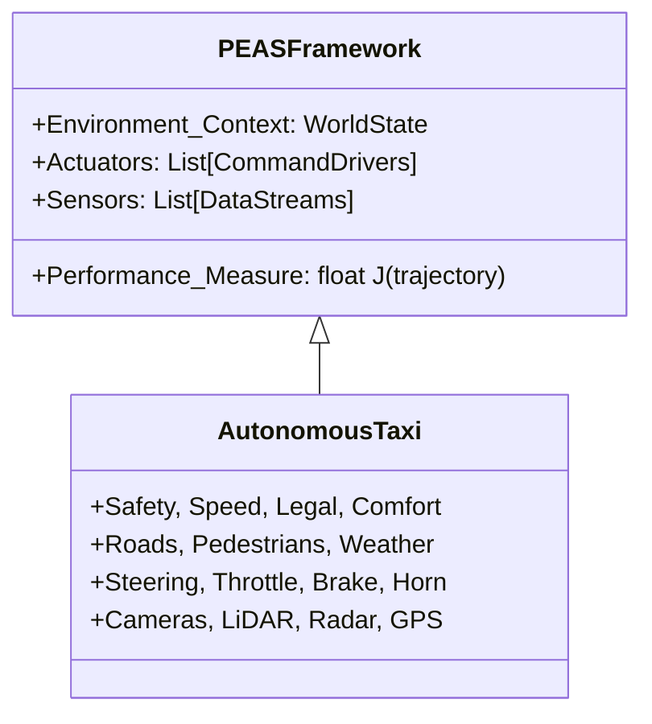

# Chuyên đề: Tác tử Thông minh & Tính Hợp lý (Intelligent & Rational Agents)

## 1. Tổng quan Chuyên đề
Khái niệm trung tâm trong Trí tuệ Nhân tạo hiện đại là **Tác tử (Agent)**: một thực thể có khả năng cảm nhận môi trường thông qua các cảm biến (sensors) và tác động lên môi trường đó thông qua các cơ cấu chấp hành (actuators). 

Một tác tử không chỉ đơn thuần hành động phản xạ mà phải hướng tới **Tính Hợp lý (Rationality)** — tức là lựa chọn hành động sao cho cực đại hóa giá trị kỳ vọng của thước đo hiệu quả (Performance Measure), dựa trên chuỗi cảm nhận lịch sử và tri thức tích lũy sẵn có. Để hiện thực hóa tính hợp lý này, các kiến trúc tác tử (Agent Architectures) từ phản xạ đơn giản (Simple Reflex), dựa trên mô hình (Model-based), dựa trên mục tiêu (Goal-based), dựa trên độ thỏa dụng (Utility-based), đến kiến trúc học tập (Learning Agent) và mô hình BDI (Belief-Desire-Intention) đã được chuẩn hóa.



---

## 2. Chi tiết từng Keyword

---

### 1. Intelligent Agents (Tác tử Thông minh)

#### a. Định nghĩa Bản chất Toán học
Một **Tác tử Thông minh (Intelligent Agent)** là một hàm toán học ánh xạ chuỗi cảm nhận vào hành động:
$$f: \mathcal{P}^* \to \mathcal{A}$$
trong đó:
- $\mathcal{P}$ là tập hợp các cảm nhận đơn lẻ (percepts). $\mathcal{P}^* = \bigcup_{k=0}^{\infty} \mathcal{P}^k$ là tập hợp tất cả các chuỗi cảm nhận hữu hạn từ thời điểm $t=0$ đến hiện tại.
- $\mathcal{A}$ là không gian các hành động khả dĩ (action space).

Chương trình tác tử (Agent Program) chạy trên một kiến trúc vật lý (Physical Architecture) để thực thi hàm $f$:
$$\text{Agent} = \text{Architecture} + \text{Program}$$

#### b. Cơ chế Tầng Sâu & Điện toán
- **Memory Footprint**: Nếu lưu trữ toàn bộ chuỗi $\mathcal{P}^*$ một cách tường minh, bộ nhớ cần thiết sẽ tăng theo cấp số mũ: $|\mathcal{P}|^T$ với $T$ là số bước thời gian.
- **State Compression**: Trong hệ thống thực tế, tác tử duy trì một trạng thái nội tại $\mathbf{s}_t \in \mathbb{R}^d$ nén thông tin quá khứ thông qua cơ chế đệ quy:
  $$\mathbf{s}_t = g(\mathbf{s}_{t-1}, p_t, a_{t-1})$$
  tương đương với tế bào RNN, GRU hoặc KV Cache trong kiến trúc Transformer.

#### c. Sơ đồ Minh họa


#### d. Code Thực chiến (C++ & Python)
```cpp
// C++20: Khung Tác tử Thông minh với Quản lý Bộ nhớ Đệm Trạng thái
#include <iostream>
#include <vector>
#include <string>
#include <memory>

struct Percept {
    double reading;
    long long timestamp_ms;
};

enum class Action { IDLE, MOVE_FORWARD, TURN_LEFT, TURN_RIGHT };

class IntelligentAgent {
private:
    double internal_state_{0.0}; // Nén lịch sử percept
public:
    Action process(const Percept& p) {
        // Cập nhật trạng thái đệ quy: Exponential Moving Average
        internal_state_ = 0.8 * internal_state_ + 0.2 * p.reading;
        
        if (internal_state_ > 10.0) {
            return Action::TURN_LEFT;
        } else if (internal_state_ > 0.0) {
            return Action::MOVE_FORWARD;
        }
        return Action::IDLE;
    }
};

int main() {
    IntelligentAgent agent;
    Percept p1{12.5, 1000};
    Action act = agent.process(p1);
    std::cout << "Action taken: " << (act == Action::TURN_LEFT ? "TURN_LEFT" : "OTHER") << "\n";
    return 0;
}
```

```python
# Python: Intelligent Agent Interface với State Representation
from dataclasses import dataclass
from typing import List
import numpy as np

@dataclass
class Percept:
    visual_features: np.ndarray # Vector d chiều

class AutonomousAgent:
    def __init__(self, feature_dim: int, hidden_dim: int):
        self.state = np.zeros(hidden_dim)
        self.W_h = np.random.randn(hidden_dim, hidden_dim) * 0.05
        self.W_x = np.random.randn(hidden_dim, feature_dim) * 0.05

    def step(self, percept: Percept) -> str:
        # Cập nhật trạng thái nội tại s_t = tanh(W_h * s_{t-1} + W_x * x_t)
        self.state = np.tanh(self.W_h @ self.state + self.W_x @ percept.visual_features)
        action_val = np.sum(self.state)
        return "ACCELERATE" if action_val > 0.0 else "BRAKE"

agent = AutonomousAgent(feature_dim=4, hidden_dim=8)
p = Percept(visual_features=np.array([1.2, -0.5, 0.3, 0.8]))
print("Selected Action:", agent.step(p))
```

#### e. Lỗi Thường gặp & Độ ổn định Thuật toán
- **Percept Aliasing**: Hai trạng thái môi trường hoàn toàn khác nhau lại tạo ra cùng một giá trị cảm nhận $p_t$, dẫn đến quyết định sai lầm nếu không có bộ nhớ ngữ cảnh dài hạn.
- **Sensor Drift & Latency**: Cảm biến vật lý bị trôi tín hiệu hoặc độ trễ I/O làm sai lệch ước lượng thời gian thực.

#### f. Ứng dụng AI
- Thiết kế hệ thống Robot hút bụi, xe tự hành Waymo/Tesla FSD, và Agent phần mềm tự động hóa tác vụ (RPA).

---

### 2. Rational Agents & Agent Rationality (Tác tử Hợp lý & Tính Hợp lý)

#### a. Định nghĩa Bản chất Toán học
Một tác tử được gọi là **Hợp lý (Rational)** nếu với mỗi chuỗi cảm nhận khả dĩ, tác tử chọn hành động $a^*$ nhằm **cực đại hóa giá trị kỳ vọng của chỉ số hiệu quả** $E[U]$, dựa trên bằng chứng cung cấp bởi chuỗi cảm nhận và tri thức tích hợp:
$$a^* = \arg\max_{a \in \mathcal{A}} \sum_{s'} P(s' \mid s, a) U(s')$$
trong đó:
- $U(s')$ là hàm thỏa dụng (Utility function) đo lường chất lượng của trạng thái tương lai $s'$.
- $P(s' \mid s, a)$ là xác suất chuyển trạng thái của môi trường.

*Lưu ý cốt lõi*: **Tính Hợp lý (Rationality) $\neq$ Toàn tri (Omniscience)**. Toàn tri đòi hỏi biết trước kết quả thực tế của mọi hành động ($U(s_{\text{actual}})$), điều này là bất khả thi trong môi trường ngẫu nhiên; tính hợp lý chỉ đòi hỏi cực đại hóa *kỳ vọng* (expected utility).

#### b. Cơ chế Tầng Sâu & Điện toán
- **Tính toán Kỳ vọng (Expected Value Computation)**: Đòi hỏi tính tích phân hoặc lấy tổng trên toàn bộ không gian trạng thái kế tiếp: $\sum_{s' \in \mathcal{S}}$. Khi $|\mathcal{S}|$ lớn, phép tính này bùng nổ tổ hợp, buộc phần cứng phải áp dụng xấp xỉ Monte Carlo hoặc mạng nơ-ron xấp xỉ hàm giá trị (Value Function Approximation).

#### c. Sơ đồ Minh họa


#### d. Code Thực chiến (C++ & Python)
```cpp
// C++17: Thuật toán Lựa chọn Hành động Hợp lý theo Lý thuyết Quyết định
#include <iostream>
#include <vector>
#include <string>
#include <algorithm>

struct Outcome {
    double probability;
    double utility;
};

struct ActionCandidate {
    std::string name;
    std::vector<Outcome> outcomes;

    double expected_utility() const {
        double eu = 0.0;
        for (const auto& out : outcomes) {
            eu += out.probability * out.utility;
        }
        return eu;
    }
};

int main() {
    std::vector<ActionCandidate> actions = {
        {"TakeHighway", {{0.8, 80.0}, {0.2, -40.0}}}, // EU = 64 - 8 = 56
        {"TakeLocalRoad", {{0.95, 50.0}, {0.05, 30.0}}} // EU = 47.5 + 1.5 = 49
    };

    auto best_act = std::max_element(actions.begin(), actions.end(),
        [](const ActionCandidate& a, const ActionCandidate& b) {
            return a.expected_utility() < b.expected_utility();
        });

    std::cout << "Rational Choice: " << best_act->name 
              << " with Expected Utility: " << best_act->expected_utility() << "\n";
    return 0;
}
```

```python
# Python: Rational Choice Solver with Dynamic Stochastic Transitions
import numpy as np

def select_rational_action(transition_matrix: np.ndarray, utilities: np.ndarray) -> int:
    """
    transition_matrix: Shape [num_actions, num_states] - P(s' | a)
    utilities: Shape [num_states] - U(s')
    """
    # Tính tích vô hướng Expected Utility: EU = P @ U
    expected_utilities = transition_matrix @ utilities
    return int(np.argmax(expected_utilities))

# 3 hành động, 4 trạng thái tương lai khả dĩ
P = np.array([
    [0.7, 0.1, 0.1, 0.1],
    [0.2, 0.5, 0.2, 0.1],
    [0.1, 0.1, 0.7, 0.1]
])
U = np.array([100.0, -50.0, 80.0, 10.0])

best_action_idx = select_rational_action(P, U)
print(f"Optimal Action Index: {best_action_idx}, Expected Utility: {(P @ U)[best_action_idx]}")
```

#### e. Lỗi Thường gặp & Độ ổn định Thuật toán
- **Nhầm lẫn giữa Kết quả Thực tế và Quyết định Hợp lý**: Một quyết định hợp lý hoàn toàn có thể dẫn đến kết quả tồi do xác suất rủi ro (bad luck). Đánh giá tính hợp lý phải dựa trên thông tin sẵn có tại thời điểm ra quyết định, không phải kết quả hậu nghiệm (Outcome Bias).
- **Bounded Rationality (Herbert Simon)**: Trong thực tế, tài nguyên tính toán và thời gian là hữu hạn, tác tử không thể duyệt hết mọi nhánh; nó chỉ có thể đạt được tính hợp lý giới hạn (Satisficing thay vì Maximizing).

#### f. Ứng dụng AI
- Định lượng rủi ro trong giao dịch tài chính định lượng, hệ thống định tuyến mạng Internet, và AI trong y tế đưa ra phác đồ điều trị tối ưu kỳ vọng cứu sống bệnh nhân.

---

### 3. Agent Architectures (Kiến trúc Tác tử)

#### a. Định nghĩa Bản chất Toán học
Các kiến trúc tác tử kinh điển được phân cấp dựa trên cấu trúc bên trong của hàm chính sách $\pi$:
1. **Simple Reflex Agent**: Hành động chỉ phụ thuộc trực tiếp vào cảm nhận hiện tại $p_t$:
   $$a_t = \text{Condition-Action-Rules}(p_t)$$
2. **Model-Based Reflex Agent**: Duy trì trạng thái nội tại $\mathbf{s}_t$ kết hợp mô hình chuyển dịch môi trường:
   $$\mathbf{s}_t = f(\mathbf{s}_{t-1}, a_{t-1}, p_t), \quad a_t = \pi(\mathbf{s}_t)$$
3. **Goal-Based Agent**: Kết hợp trạng thái nội tại và tập mục tiêu khả dĩ $\mathcal{G}$ để lập kế hoạch:
   $$a_t = \text{Plan}(\mathbf{s}_t, \mathcal{G})$$
4. **Utility-Based Agent**: Sử dụng hàm giá trị thực $U(\mathbf{s})$ để đánh giá sự đánh đổi giữa các mục tiêu:
   $$a_t = \arg\max_a \mathbb{E}[U(f(\mathbf{s}_t, a))]$$
5. **Learning Agent**: Phân tách thành 4 thành phần: *Critic* (đánh giá), *Learning Element* (học), *Performance Element* (thực thi), và *Problem Generator* (khám phá).
6. **BDI Architecture (Belief-Desire-Intention)**: Mô hình nhận thức dựa trên triết học hành động của Michael Bratman:
   $$\text{Beliefs } \mathcal{B} \subseteq \mathcal{S}, \quad \text{Desires } \mathcal{D} \subseteq \mathcal{P}(\mathcal{S}), \quad \text{Intentions } \mathcal{I} \subseteq \text{Plans}$$

#### b. Cơ chế Tầng Sâu & Điện toán
- **Lookup Table vs Finite State Machine (FSM)**: Simple Reflex có thể triển khai bằng bảng tra cứu $O(1)$ hoặc mạng nơ-ron nhiều tầng MLP. Model-based đòi hỏi bộ đệm vòng (ring buffer) lưu vết trạng thái và cơ chế đồng bộ hóa cache.

#### c. Sơ đồ Minh họa


#### d. Code Thực chiến (C++ & Python)
```cpp
// C++20: Kiến trúc BDI (Belief-Desire-Intention) tối giản
#include <iostream>
#include <vector>
#include <string>
#include <optional>

struct Belief {
    bool enemy_spotted;
    int ammo_count;
    double health_pct;
};

enum class Desire { SURVIVE, ATTACK, PATROL };
enum class Intention { RETREAT_TO_BASE, FIRE_WEAPON, EXPLORE_SECTOR };

class BDIAgent {
private:
    Belief beliefs_{false, 10, 100.0};
public:
    void update_beliefs(const Belief& new_b) { beliefs_ = new_b; }

    Desire deliberate() const {
        if (beliefs_.health_pct < 20.0 || beliefs_.ammo_count == 0) return Desire::SURVIVE;
        if (beliefs_.enemy_spotted && beliefs_.ammo_count > 0) return Desire::ATTACK;
        return Desire::PATROL;
    }

    Intention plan_intentions(Desire d) const {
        switch (d) {
            case Desire::SURVIVE: return Intention::RETREAT_TO_BASE;
            case Desire::ATTACK:  return Intention::FIRE_WEAPON;
            case Desire::PATROL:  return Intention::EXPLORE_SECTOR;
        }
        return Intention::EXPLORE_SECTOR;
    }

    void execute() {
        Desire d = deliberate();
        Intention i = plan_intentions(d);
        std::cout << "BDI Cycle: Desire=" << (int)d << " -> Committed Intention=" << (int)i << "\n";
    }
};

int main() {
    BDIAgent agent;
    agent.update_beliefs({true, 5, 15.0}); // Máu thấp, gặp địch
    agent.execute();
    return 0;
}
```

```python
# Python: Model-Based Reflex Agent with Latent World State
class ModelBasedReflexAgent:
    def __init__(self):
        self.internal_state = {"position": 0, "battery_pct": 100.0}

    def update_state(self, percept: dict, last_action: str):
        # Mô hình thế giới chuyển dịch
        if last_action == "FORWARD":
            self.internal_state["position"] += 1
            self.internal_state["battery_pct"] -= 1.0
        # Cập nhật từ cảm biến
        self.internal_state["light_level"] = percept.get("light", 0.5)

    def select_action(self) -> str:
        if self.internal_state["battery_pct"] < 10.0:
            return "GO_TO_CHARGER"
        if self.internal_state["position"] < 10:
            return "FORWARD"
        return "STAY"

agent = ModelBasedReflexAgent()
agent.update_state({"light": 0.8}, "FORWARD")
print("Next Action:", agent.select_action(), "| State:", agent.internal_state)
```

#### e. Lỗi Thường gặp & Độ ổn định Thuật toán
- **Infinite Deliberation Loop**: Trong kiến trúc Goal-based hoặc BDI, tác tử dành quá nhiều thời gian để tính toán kế hoạch tối ưu mà không kịp phản hồi trước sự thay đổi nhanh chóng của môi trường thời gian thực (Real-time reactivity failure).

#### f. Ứng dụng AI
- NPC thông minh trong Video Game (sử dụng Behavior Trees / BDI), hệ thống quản trị năng lượng lưới điện thông minh, và các trợ lý tự hành (AutoGPT, Devin).

---

### 4. PEAS Framework & Intelligent Behavior (Khung PEAS & Hành vi Thông minh)

#### a. Định nghĩa Bản chất Toán học
Khung **PEAS** là đặc tả hình thức gồm 4 thành phần để xác định bài toán thiết kế một tác tử hợp lý:
$$\text{Task Environment} = \langle \mathcal{P}_{\text{erformance}}, \mathcal{E}_{\text{nvironment}}, \mathcal{A}_{\text{ctuators}}, \mathcal{S}_{\text{ensors}} \rangle$$
1. **Performance Measure ($P$)**: Hàm tiêu chí đánh giá thành công $J: \mathcal{S}^* \times \mathcal{A}^* \to \mathbb{R}$.
2. **Environment ($E$)**: Không gian trạng thái ngoại cảnh và quy luật chuyển dịch động học.
3. **Actuators ($A$)**: Tập các cơ cấu tác động vật lý/phần mềm.
4. **Sensors ($S$)**: Tập các kênh thu nhận tín hiệu đầu vào.

**Intelligent Behavior (Hành vi Thông minh)**: Một hành vi được coi là thông minh khi nó thỏa mãn tính thích nghi (adaptability), học hỏi từ kinh nghiệm (learning), xử lý bất định (uncertainty management), và đạt được mục tiêu phức tạp với tài nguyên tối thiểu.

#### b. Cơ chế Tầng Sâu & Điện toán
- Khi hiện thực hóa PEAS trong phần mềm kiến trúc Microservices/Robotics, Sensors tương ứng với hàng đợi tin nhắn bất đồng bộ (ZeroMQ, ROS2 topics, Kafka streams), Actuators là các RPC endpoints/Driver calls, và Performance Measure là module telemetry thu thập metrics gửi về Prometheus/Grafana.

#### c. Sơ đồ Minh họa


#### d. Code Thực chiến (C++ & Python)
```cpp
// C++17: Đặc tả cấu trúc PEAS cho Hệ thống Giám sát Nhà thông minh
#include <iostream>
#include <string>
#include <vector>

struct PEASDescriptor {
    std::string performance_measure;
    std::string environment;
    std::vector<std::string> actuators;
    std::vector<std::string> sensors;
};

void display_peas(const PEASDescriptor& peas) {
    std::cout << "=== PEAS SPECIFICATION ===\n";
    std::cout << "P (Metric): " << peas.performance_measure << "\n";
    std::cout << "E (World) : " << peas.environment << "\n";
    std::cout << "A (Acts)  : ";
    for (const auto& a : peas.actuators) std::cout << a << ", ";
    std::cout << "\nS (Sense) : ";
    for (const auto& s : peas.sensors) std::cout << s << ", ";
    std::cout << "\n==========================\n";
}

int main() {
    PEASDescriptor smart_thermostat{
        "Minimize energy consumption while keeping temp at 22C +/- 1C",
        "Residential house rooms, fluctuating ambient weather",
        {"Heater relay", "Air conditioner valve", "Buzzer"},
        {"Digital thermometer", "Occupancy PIR sensor", "Humidity meter"}
    };
    display_peas(smart_thermostat);
    return 0;
}
```

```python
# Python: Telemetry Metric Evaluator cho PEAS Performance
from typing import List, Dict

class PerformanceEvaluator:
    def __init__(self, target_temp: float = 22.0):
        self.target_temp = target_temp

    def compute_trajectory_cost(self, trajectory: List[Dict[str, float]]) -> float:
        # Cực tiểu hóa sai số nhiệt độ + chi phí điện năng
        error_cost = sum((pt["temp"] - self.target_temp) ** 2 for pt in trajectory)
        energy_cost = sum(pt["energy_kwh"] for pt in trajectory)
        total_penalty = error_cost + 1.5 * energy_cost
        return total_penalty

evaluator = PerformanceEvaluator()
sample_traj = [
    {"temp": 21.8, "energy_kwh": 0.2},
    {"temp": 22.1, "energy_kwh": 0.1},
    {"temp": 23.5, "energy_kwh": 0.5}
]
print("Trajectory Total Cost Penalty:", evaluator.compute_trajectory_cost(sample_traj))
```

#### e. Lỗi Thường gặp & Độ ổn định Thuật toán
- **Thiết kế sai Thước đo Hiệu quả (Faulty Performance Design)**: Đưa hành vi tác tử vào thước đo thay vì đo lường kết quả mong muốn trong môi trường (ví dụ thưởng robot dọn dẹp mỗi khi nhặt rác dẫn đến việc robot tự xả rác ra rồi nhặt lại liên tục để tối đa hóa điểm).

#### f. Ứng dụng AI
- Thiết kế hệ thống khuyến nghị thương mại điện tử (Amazon, Netflix), hệ thống phân tích chẩn đoán y khoa tự động.
