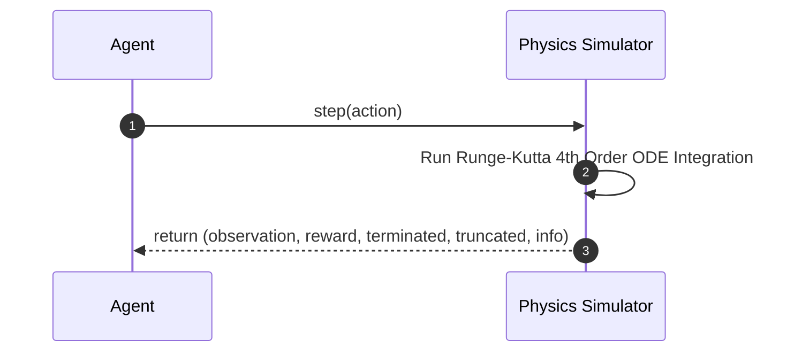
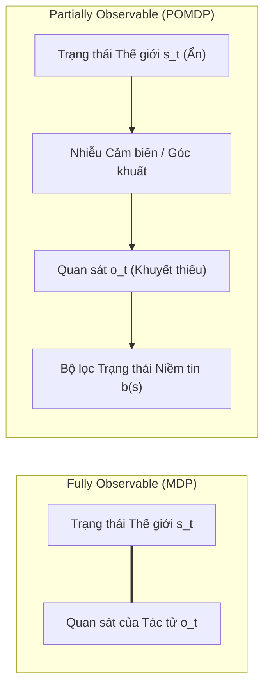
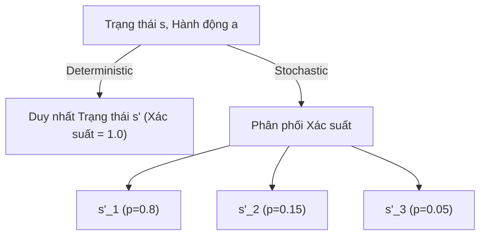
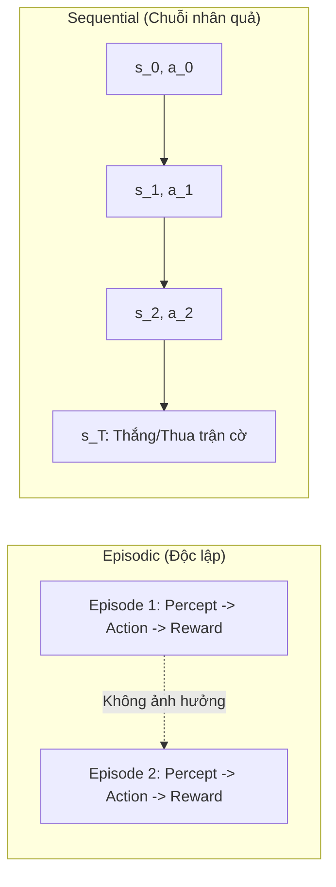
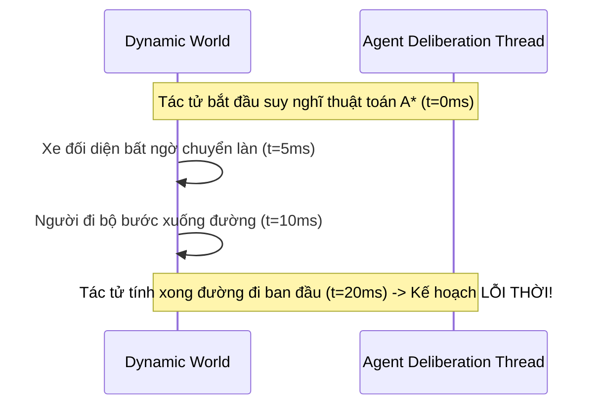
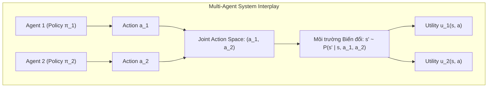

# Chuyên đề: Phân loại Môi trường Tác tử (Agent Environments & Taxonomy)

## 1. Tổng quan Chuyên đề
Bản chất của môi trường tác vụ (Task Environment) chi phối trực tiếp toàn bộ thiết kế kiến trúc phần mềm, cấu trúc dữ liệu và giải thuật ra quyết định của tác tử AI. Một thuật toán tối ưu trên môi trường này (ví dụ: tìm kiếm nhánh cận trên môi trường tĩnh, tất định, quan sát toàn phần như Cờ vua) sẽ hoàn toàn sụp đổ khi áp dụng vào môi trường động, ngẫu nhiên, quan sát một phần và liên tục (như xe tự hành hay thị trường tài chính).

Việc phân loại môi trường dựa trên 6 chiều không gian toán học kinh điển theo Russell & Norvig:
1. Quan sát toàn phần (Fully Observable) vs. Quan sát một phần (Partially Observable).
2. Tất định (Deterministic) vs. Ngẫu nhiên (Stochastic).
3. Đơn tập / Phân đoạn (Episodic) vs. Nối tiếp (Sequential).
4. Tĩnh (Static) vs. Động (Dynamic / Semidynamic).
5. Rời rạc (Discrete) vs. Liên tục (Continuous).
6. Đơn tác tử (Single-Agent) vs. Đa tác tử (Multi-Agent - Cạnh tranh / Hợp tác).

```mermaid
graph TD
    Env["Môi trường Tác vụ (Task Environment)"]
    
    Env --> Obs["Quan sát (Observability)"]
    Obs --> FO["Fully Observable: Cảm biến = Trạng thái thực"]
    Obs --> PO["Partially Observable: Cảm biến = Tín hiệu nhiễu / Thiếu"]

    Env --> Trans["Chuyển dịch (Determinism)"]
    Trans --> Det["Deterministic: s' = f(s, a)"]
    Trans --> Stoch["Stochastic: P(s' | s, a)"]

    Env --> Time["Thời gian (Temporal Structure)"]
    Time --> Ep["Episodic: Các bước độc lập"]
    Time --> Seq["Sequential: Hành động hiện tại ảnh hưởng tương lai xa"]

    Env --> Dyna["Tính Động học (Dynamics)"]
    Dyna --> Static["Static: Thế giới đứng yên khi tác tử suy nghĩ"]
    Dyna --> Dynamic["Dynamic: Thế giới liên tục biến đổi"]

    Env --> Space["Không gian Trạng thái/Hành động"]
    Space --> Disc["Discrete: Đếm được hữu hạn"]
    Space --> Cont["Continuous: Không gian R^n liên tục"]

    Env --> Pop["Số lượng Tác tử (Population)"]
    Pop --> Single["Single-Agent: 1 thực thể tối ưu hóa"]
    Pop --> Multi["Multi-Agent: Game Theory / Cạnh tranh & Hợp tác"]
```



---

## 2. Chi tiết từng Keyword

---

### 1. Agent Environments (Môi trường Tác tử)

#### a. Định nghĩa Bản chất Toán học
Môi trường $\mathcal{E}$ được mô hình hóa toán học là một hệ thống động lực học (dynamical system):
$$\mathcal{E} = \langle \mathcal{S}, \mathcal{T}, \mathcal{P}, \mathcal{A}, \Omega, \mathcal{O} \rangle$$
trong đó:
- $\mathcal{S}$: Không gian trạng thái thế giới (State space).
- $\mathcal{A}$: Không gian hành động của tác tử (Action space).
- $\mathcal{T}$: Toán tử chuyển dịch trạng thái: $\mathcal{S} \times \mathcal{A} \to \mathcal{P}(\mathcal{S})$.
- $\Omega$: Không gian các quan sát cảm nhận khả dĩ (Observation space).
- $\mathcal{O}$: Hàm quan sát: $\mathcal{S} \to \Omega$ (hoặc phân phối $P(o \mid s)$).

#### b. Cơ chế Tầng Sâu & Điện toán
- Trong hệ thống mô phỏng (Simulators như OpenAI Gym / Farama Gymnasium, MuJoCo, Isaac Sim), môi trường được hiện thực hóa qua vòng lặp động học vật lý chạy trên GPU (PhysX / Warp) với cơ chế đồng bộ hóa bước xung nhịp thời gian $\Delta t$ (tick-based execution).

#### c. Sơ đồ Minh họa


#### d. Code Thực chiến (C++ & Python)
```cpp
// C++17: Minimal Environment Interface theo chuẩn mô phỏng Reinforcement Learning
#include <iostream>
#include <vector>
#include <tuple>

struct StepResult {
    std::vector<double> observation;
    double reward;
    bool done;
};

class AbstractEnvironment {
public:
    virtual ~AbstractEnvironment() = default;
    virtual std::vector<double> reset() = 0;
    virtual StepResult step(int action) = 0;
};

class Simple1DGridEnv : public AbstractEnvironment {
private:
    int state_{0};
    const int goal_{5};
public:
    std::vector<double> reset() override {
        state_ = 0;
        return {static_cast<double>(state_)};
    }
    StepResult step(int action) override {
        if (action == 1) state_++; // Move right
        else if (action == 0) state_--; // Move left
        bool done = (state_ >= goal_);
        double reward = done ? 10.0 : -1.0;
        return {{static_cast<double>(state_)}, reward, done};
    }
};

int main() {
    Simple1DGridEnv env;
    env.reset();
    auto res = env.step(1);
    std::cout << "Obs: " << res.observation[0] << ", Reward: " << res.reward << ", Done: " << res.done << "\n";
    return 0;
}
```

```python
# Python: Farama Gymnasium Standard Interface
from typing import Tuple, Dict, Any
import numpy as np

class CartPoleMinimalEnv:
    def __init__(self):
        # Trạng thái: [vị trí xe, vận tốc xe, góc con lắc, vận tốc góc]
        self.state = np.zeros(4, dtype=np.float32)

    def reset(self) -> np.ndarray:
        self.state = np.random.uniform(-0.05, 0.05, size=(4,)).astype(np.float32)
        return self.state

    def step(self, action: int) -> Tuple[np.ndarray, float, bool, Dict[str, Any]]:
        force = 10.0 if action == 1 else -10.0
        # Tích phân Euler xấp xỉ động học
        self.state[0] += self.state[1] * 0.02
        self.state[1] += force * 0.02
        done = bool(abs(self.state[0]) > 2.4)
        reward = 1.0 if not done else 0.0
        return self.state, reward, done, {}

env = CartPoleMinimalEnv()
print("Initial obs:", env.reset())
obs, r, done, _ = env.step(1)
print(f"Step obs: {obs}, r: {r}, done: {done}")
```

#### e. Lỗi Thường gặp & Ứng dụng
- **Sim-to-Real Gap**: Môi trường giả lập bỏ qua ma sát phi tuyến, độ rơ cơ khí và nhiễu cảm biến, khiến chính sách tác tử hoạt động hoàn hảo trong mô phỏng bị thất bại thảm hại khi đưa vào robot thật.

---

### 2. Fully Observable vs. Partially Observable Environments

#### a. Định nghĩa Bản chất Toán học
- **Fully Observable (Quan sát Toàn phần)**: Cảm biến của tác tử thu nhận toàn bộ trạng thái thực của môi trường tại mọi thời điểm:
  $$o_t = s_t, \quad \forall t$$
  Bài toán được mô hình hóa là Markov Decision Process (MDP).
- **Partially Observable (Quan sát Một phần)**: Cảm biến chỉ thu nhận tín hiệu cục bộ hoặc bị méo mó bởi nhiễu (noise):
  $$o_t \sim P(O \mid s_t), \quad o_t \neq s_t$$
  Tác tử phải duy trì một phân phối xác suất về trạng thái thực (Belief State $b(s)$):
  $$b'(s') = \eta P(o \mid s') \sum_{s} P(s' \mid s, a) b(s)$$
  Bài toán được mô hình hóa là Partially Observable Markov Decision Process (POMDP).

#### b. Cơ chế Tầng Sâu & Điện toán
- Hệ thống POMDP đòi hỏi tính toán Belief State qua bộ lọc Kalman (Kalman Filter) hoặc bộ lọc hạt (Particle Filter) trên CPU/GPU, ngốn bộ nhớ để duy trì hàng nghìn hạt trạng thái song song.

#### c. Sơ đồ Minh họa


#### d. Code Thực chiến (C++ & Python)
```cpp
// C++17: Cập nhật Trạng thái Niềm tin (Belief State Update) trong POMDP nhị phân
#include <iostream>
#include <iomanip>

struct BinaryBelief {
    double b_clean; // Xác suất sàn sạch
    double b_dirty; // Xác suất sàn bẩn
};

BinaryBelief update_belief(const BinaryBelief& prior, bool sensor_detects_dirty) {
    // P(DetectDirty | Dirty) = 0.9, P(DetectDirty | Clean) = 0.1
    double p_obs_given_dirty = sensor_detects_dirty ? 0.9 : 0.1;
    double p_obs_given_clean = sensor_detects_dirty ? 0.1 : 0.9;

    double numerator_dirty = p_obs_given_dirty * prior.b_dirty;
    double numerator_clean = p_obs_given_clean * prior.b_clean;
    double normalizer = numerator_dirty + numerator_clean;

    return {numerator_clean / normalizer, numerator_dirty / normalizer};
}

int main() {
    BinaryBelief b{0.5, 0.5}; // Khởi đầu chưa biết
    b = update_belief(b, true); // Cảm biến báo bẩn
    std::cout << std::fixed << std::setprecision(4);
    std::cout << "Updated Belief: P(Clean)=" << b.b_clean << ", P(Dirty)=" << b.b_dirty << "\n";
    return 0;
}
```

```python
# Python: Particle Filter mô phỏng định vị robot trong môi trường Partially Observable
import numpy as np

class ParticleFilter1D:
    def __init__(self, num_particles: int = 1000):
        self.particles = np.random.uniform(0.0, 100.0, num_particles)
        self.weights = np.ones(num_particles) / num_particles

    def predict(self, velocity: float, dt: float = 1.0):
        # Mô hình chuyển động có nhiễu Gaussian
        self.particles += velocity * dt + np.random.normal(0, 0.5, len(self.particles))

    def update(self, sensor_measurement: float):
        # Tính trọng số hạt dựa trên khoảng cách tới phép đo cảm biến
        sigma = 2.0
        self.weights = np.exp(-0.5 * ((self.particles - sensor_measurement) / sigma) ** 2)
        self.weights += 1e-300 # Tránh chia cho 0
        self.weights /= np.sum(self.weights)

    def estimate(self) -> float:
        return float(np.sum(self.particles * self.weights))

pf = ParticleFilter1D()
pf.predict(5.0)
pf.update(5.2)
print("Estimated Position:", pf.estimate())
```

#### e. Lỗi Thường gặp & Ứng dụng
- **Curse of Dimensionality trong Belief Space**: Không gian Belief là một simplex liên tục vô hạn chiều ngay cả khi không gian trạng thái gốc $\mathcal{S}$ là hữu hạn. Ứng dụng: Game Poker đối kháng (Libratus), định vị xe tự hành trong hầm tối.

---

### 3. Deterministic vs. Stochastic Environments

#### a. Định nghĩa Bản chất Toán học
- **Deterministic (Tất định)**: Trạng thái tiếp theo $s'$ được xác định hoàn toàn và duy nhất bởi trạng thái hiện tại $s$ và hành động $a$:
  $$s' = f(s, a) \quad \text{hoặc} \quad P(s' \mid s, a) \in \{0, 1\}$$
- **Stochastic (Ngẫu nhiên)**: Trạng thái tiếp theo mang tính bất định và được mô tả bởi một phân phối xác suất:
  $$s' \sim P(\cdot \mid s, a)$$
  trong đó tồn tại ít nhất hai trạng thái $s_1', s_2'$ sao cho $P(s_1' \mid s, a) > 0$ và $P(s_2' \mid s, a) > 0$.

#### b. Cơ chế Tầng Sâu & Điện toán
- Môi trường tất định cho phép sử dụng các thuật toán tìm kiếm cây kinh điển ($A^*$, DFS) và bộ đệm trạng thái xác thực bằng Hash Table. Môi trường ngẫu nhiên đòi hỏi bộ sinh số ngẫu nhiên giả lập (PRNG) tối ưu trên SIMD (như xoroshiro128+ hoặc cuRAND) và kỳ vọng toán học phân rã.

#### c. Sơ đồ Minh họa


#### d. Code Thực chiến (C++ & Python)
```cpp
// C++17: Mô hình hóa Chuyển dịch Trạng thái Tất định vs Ngẫu nhiên
#include <iostream>
#include <random>

class TransitionModel {
private:
    std::mt19937 rng_{42};
public:
    // Chuyển dịch tất định: s' = s + a
    int step_deterministic(int s, int a) {
        return s + a;
    }

    // Chuyển dịch ngẫu nhiên: 80% theo đúng a, 20% bị trượt sang hướng khác
    int step_stochastic(int s, int a) {
        std::uniform_real_distribution<double> dist(0.0, 1.0);
        double roll = dist(rng_);
        if (roll < 0.8) return s + a;
        return s; // Bị trượt, đứng yên
    }
};

int main() {
    TransitionModel model;
    std::cout << "Deterministic next: " << model.step_deterministic(10, 2) << "\n";
    std::cout << "Stochastic next   : " << model.step_stochastic(10, 2) << "\n";
    return 0;
}
```

```python
# Python: Stochastic Transition Sampling
import numpy as np

def sample_next_state(s: int, a: int, transition_tensor: np.ndarray) -> int:
    """
    transition_tensor: Shape [num_states, num_actions, num_states]
    """
    prob_dist = transition_tensor[s, a]
    next_s = np.random.choice(len(prob_dist), p=prob_dist)
    return int(next_s)

# Ma trận xác suất mẫu
P_sa = np.zeros((3, 2, 3))
P_sa[0, 0] = [0.1, 0.8, 0.1]
print("Sampled Next State:", sample_next_state(0, 0, P_sa))
```

#### e. Lỗi Thường gặp & Ứng dụng
- **Nhầm lẫn giữa Stochastic và Nondeterministic**: Nondeterministic chỉ định nghĩa một tập các trạng thái khả dĩ mà không gán xác suất cụ thể; Stochastic gắn liền với một phân phối xác suất toán học chặt chẽ. Ứng dụng: Dự báo thời tiết, mô hình hóa biến động giá cổ phiếu.

---

### 4. Episodic vs. Sequential Environments

#### a. Định nghĩa Bản chất Toán học
- **Episodic (Phân đoạn / Đơn tập)**: Kinh nghiệm của tác tử được chia thành các chuỗi độc lập (episodes). Trong mỗi episode, tác tử nhận một percept và thực hiện 1 hành động duy nhất; **hành động hiện tại hoàn toàn không ảnh hưởng tới các episode tương lai**:
  $$P(s_{t+1} \mid s_t, a_t, s_{t-1}, a_{t-1}, \dots) = P(s_{t+1})$$
  (Điển hình: Phân loại ảnh, kiểm duyệt nội dung).
- **Sequential (Nối tiếp)**: Hành động hiện tại có thể gây ra hậu quả lâu dài tới tất cả các trạng thái và phần thưởng trong tương lai xa:
  $$G_t = \sum_{k=0}^{\infty} \gamma^k R_{t+k+1}, \quad \gamma \in [0, 1)$$
  Đòi hỏi lập kế hoạch (Planning) và quy trách nhiệm chậm (Credit Assignment Problem).

#### b. Sơ đồ Minh họa


#### c. Code Thực chiến (C++ & Python)
```cpp
// C++17: Mô phỏng Discounted Return trong Sequential Environment
#include <iostream>
#include <vector>
#include <cmath>

double compute_discounted_return(const std::vector<double>& rewards, double gamma) {
    double total_return = 0.0;
    for (size_t t = 0; t < rewards.size(); ++t) {
        total_return += std::pow(gamma, static_cast<double>(t)) * rewards[t];
    }
    return total_return;
}

int main() {
    std::vector<double> rewards = {0.0, 0.0, 0.0, 100.0}; // Phần thưởng nhận được ở cuối chuỗi
    double g = compute_discounted_return(rewards, 0.9);
    std::cout << "Discounted Cumulative Return: " << g << "\n";
    return 0;
}
```

```python
# Python: Bellman Backup cho Sequential Decision Making
import numpy as np

def compute_q_value(r: float, next_state_values: np.ndarray, gamma: float = 0.99) -> float:
    # Q(s, a) = r + gamma * max_a' Q(s', a')
    return r + gamma * float(np.max(next_state_values))

print("Sequential Q-value:", compute_q_value(5.0, np.array([12.0, 15.0, 8.0])))
```

#### d. Ứng dụng AI
- Episodic: OCR nhận dạng ký tự viết tay, phân loại rác thải trên băng chuyền.
- Sequential: Cờ vây, điều khiển cánh tay robot xếp dỡ hàng hóa.

---

### 5. Static vs. Dynamic Environments

#### a. Định nghĩa Bản chất Toán học
- **Static (Tĩnh)**: Trạng thái môi trường giữ nguyên không thay đổi trong suốt khoảng thời gian tác tử đang tính toán (deliberating):
  $$\frac{\partial s}{\partial t_{\text{computation}}} = 0$$
- **Dynamic (Động)**: Trạng thái môi trường liên tục biến đổi ngay trong lúc tác tử đang tính toán:
  $$\frac{\partial s}{\partial t_{\text{computation}}} \neq 0$$
- **Semidynamic (Bán động)**: Trạng thái môi trường không đổi nhưng điểm số/thước đo hiệu quả bị giảm dần theo thời gian tính toán (ví dụ: cờ vua có đồng hồ bấm giờ).

#### b. Cơ chế Tầng Sâu & Điện toán
- Trong môi trường Dynamic, kiến trúc phần mềm bắt buộc phải bất đồng bộ (Asynchronous Multi-threading / Event Loop). Thuật toán phải hỗ trợ tính năng **Anytime Algorithm** (có thể trả về lời giải tạm thời tại bất kỳ thời điểm nào bị ngắt).

#### c. Sơ đồ Minh họa


#### d. Code Thực chiến (C++ & Python)
```cpp
// C++20: Mô hình hóa Anytime Algorithm cho Dynamic Environment
#include <iostream>
#include <chrono>
#include <thread>
#include <atomic>

class AnytimeSearcher {
public:
    int best_solution_found_{0};
    std::atomic<bool> stop_flag_{false};

    void search_worker() {
        for (int depth = 1; depth <= 10; ++depth) {
            if (stop_flag_.load()) break;
            std::this_thread::sleep_for(std::chrono::milliseconds(5)); // Giả lập độ sâu tìm kiếm
            best_solution_found_ = depth * 10; // Cải thiện dần lời giải
        }
    }
};

int main() {
    AnytimeSearcher searcher;
    std::thread t(&AnytimeSearcher::search_worker, &searcher);

    // Môi trường động chỉ cho phép tối đa 12ms để suy nghĩ
    std::this_thread::sleep_for(std::chrono::milliseconds(12));
    searcher.stop_flag_.store(true);
    t.join();

    std::cout << "Anytime Solution extracted: " << searcher.best_solution_found_ << "\n";
    return 0;
}
```

```python
# Python: Asynchronous Event Loop cho Môi trường Động
import asyncio

async def dynamic_world_clock():
    world_state = 0
    while True:
        await asyncio.sleep(0.01)
        world_state += 1

async def deliberate(deadline_sec: float) -> str:
    try:
        await asyncio.wait_for(asyncio.sleep(0.05), timeout=deadline_sec)
        return "Optimal_Action"
    except asyncio.TimeoutError:
        return "Quick_Emergency_Fallback_Action"

async def main():
    action = await deliberate(0.02)
    print("Action in Dynamic Env:", action)

asyncio.run(main())
```

---

### 6. Discrete vs. Continuous Environments

#### a. Định nghĩa Bản chất Toán học
- **Discrete (Rời rạc)**: Không gian trạng thái $\mathcal{S}$, không gian hành động $\mathcal{A}$ và các mốc thời gian $t$ là tập hợp đếm được (countable/finite):
  $$|\mathcal{S}| \le \aleph_0, \quad |\mathcal{A}| \le \aleph_0, \quad t \in \mathbb{N}$$
- **Continuous (Liên tục)**: Trạng thái, hành động hoặc thời gian nằm trong không gian thực vô hạn chiều:
  $$\mathbf{s} \in \mathbb{R}^n, \quad \mathbf{a} \in \mathbb{R}^m, \quad t \in \mathbb{R}^+$$
  Quy luật động học được mô tả bởi các phương trình vi phân thông thường (ODEs):
  $$\dot{\mathbf{s}}(t) = f(\mathbf{s}(t), \mathbf{a}(t))$$

#### b. Cơ chế Tầng Sâu & Điện toán
- Môi trường liên tục đòi hỏi các phép tích phân số học (Euler, Runge-Kutta 4th Order) và thuật toán tối ưu vi phân liên tục (Policy Gradient, DDPG, SAC) thay vì bảng Q-table hữu hạn.

#### c. Code Thực chiến (C++ & Python)
```cpp
// C++17: Rời rạc hóa Môi trường Liên tục (Discretization / Binning)
#include <iostream>
#include <cmath>
#include <algorithm>

int discretize(double continuous_val, double min_val, double max_val, int num_bins) {
    double clamped = std::clamp(continuous_val, min_val, max_val);
    double ratio = (clamped - min_val) / (max_val - min_val);
    int bin = static_cast<int>(ratio * num_bins);
    return std::min(bin, num_bins - 1);
}

int main() {
    double angle = 0.35; // radians (-1.0 to 1.0)
    int bin_id = discretize(angle, -1.0, 1.0, 10);
    std::cout << "Continuous angle: " << angle << " -> Discrete Bin: " << bin_id << "\n";
    return 0;
}
```

```python
# Python: Continuous Action Sampling via Gaussian Reparameterization
import torch
import torch.nn as nn

class ContinuousPolicy(nn.Module):
    def __init__(self, state_dim: int, action_dim: int):
        super().__init__()
        self.fc_mean = nn.Linear(state_dim, action_dim)
        self.fc_log_std = nn.Linear(state_dim, action_dim)

    def sample_action(self, state: torch.Tensor):
        mean = self.fc_mean(state)
        log_std = torch.clamp(self.fc_log_std(state), -20, 2)
        std = torch.exp(log_std)
        # Reparameterization Trick: a = mu + sigma * eps
        eps = torch.randn_like(std)
        action = torch.tanh(mean + std * eps) # Bounded [-1, 1]
        return action

policy = ContinuousPolicy(state_dim=4, action_dim=2)
dummy_s = torch.randn(1, 4)
print("Continuous Action Sample:", policy.sample_action(dummy_s))
```

---

### 7. Single-Agent vs. Multi-Agent Systems

#### a. Định nghĩa Bản chất Toán học
- **Single-Agent System**: Chỉ duy nhất một tác tử tương tác với môi trường cố định (các thực thể khác được coi là các vật thể tĩnh hoặc ngẫu nhiên của môi trường). Hàm tối ưu là bài toán cực trị đơn lẻ:
  $$\max_\pi \mathbb{E}[R(\pi)]$$
- **Multi-Agent System (MAS)**: Môi trường chứa nhiều tác tử đồng thời hành động. Trạng thái tiếp theo và tiện ích của tác tử $i$ phụ thuộc vào vector hành động chung $\mathbf{a} = (a_1, a_2, \dots, a_N)$:
  $$u_i = u_i(s, a_1, \dots, a_i, \dots, a_N)$$
  - **Competitive (Cạnh tranh / Đối kháng)**: Trò chơi có tổng bằng 0 (Zero-Sum Game): $\sum_i u_i = 0$.
  - **Cooperative (Hợp tác)**: Các tác tử chia sẻ chung hàm tiện ích: $u_1 = u_2 = \dots = u_N$.
  - **General-Sum / Mixed**: Vừa hợp tác vừa cạnh tranh.

#### b. Cơ chế Tầng Sâu & Điện toán
- Trong MAS, tính ổn định của môi trường bị phá vỡ hoàn toàn (**Non-stationarity problem**). Khi các tác tử khác đồng thời học và thay đổi chính sách, phân phối chuyển dịch trạng thái từ góc nhìn của tác tử $i$ thay đổi liên tục, làm vô hiệu hóa các giả định hội tụ toán học kinh điển.

#### c. Sơ đồ Minh họa


#### d. Code Thực chiến (C++ & Python)
```cpp
// C++17: Ma trận Trò chơi 2 Tác tử (2-Player Payoff Matrix)
#include <iostream>
#include <vector>
#include <utility>

struct Payoff {
    int p1_utility;
    int p2_utility;
};

class GameMatrix {
private:
    std::vector<std::vector<Payoff>> matrix_;
public:
    GameMatrix() {
        // Tù nhân phân vân (Prisoner's Dilemma): Cooperate (0), Defect (1)
        matrix_ = {
            { {-1, -1}, {-3, 0} },  // P1 Cooperate
            { {0, -3},  {-2, -2} }  // P1 Defect
        };
    }

    Payoff evaluate(int a1, int a2) const {
        return matrix_[a1][a2];
    }
};

int main() {
    GameMatrix game;
    Payoff res = game.evaluate(1, 1); // Cả hai cùng Defect (Nash Equilibrium)
    std::cout << "Nash Payoff: P1=" << res.p1_utility << ", P2=" << res.p2_utility << "\n";
    return 0;
}
```

```python
# Python: Multi-Agent Environment Step Interface
from typing import Dict, Tuple

class SimpleMultiAgentMarket:
    def __init__(self):
        self.agents = ["buyer", "seller"]

    def step(self, actions: Dict[str, float]) -> Tuple[Dict[str, float], Dict[str, float]]:
        # actions: {'buyer': bid_price, 'seller': ask_price}
        bid = actions["buyer"]
        ask = actions["seller"]
        rewards = {"buyer": 0.0, "seller": 0.0}
        
        if bid >= ask: # Khớp lệnh thành công
            deal_price = (bid + ask) / 2.0
            rewards["buyer"] = 100.0 - deal_price
            rewards["seller"] = deal_price - 20.0
            
        return rewards, {"deal_occurred": bid >= ask}

market = SimpleMultiAgentMarket()
r, info = market.step({"buyer": 60.0, "seller": 50.0})
print("Market Payoffs:", r, "| Info:", info)
```

#### e. Lỗi Thường gặp & Ứng dụng
- **Tragedy of the Commons (Bi kịch của tài nguyên chung)**: Trong hệ thống đa tác tử, các hành vi duy lý ích kỷ cục bộ của từng tác tử dẫn đến sự sụp đổ phúc lợi của toàn hệ thống nếu thiếu cơ chế điều phối hoặc thiết kế cơ chế (Mechanism Design). Ứng dụng: Điều phối luồng không lưu sân bay, lưới điện thông minh, hệ thống đấu giá quảng cáo trực tuyến.
