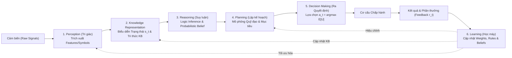
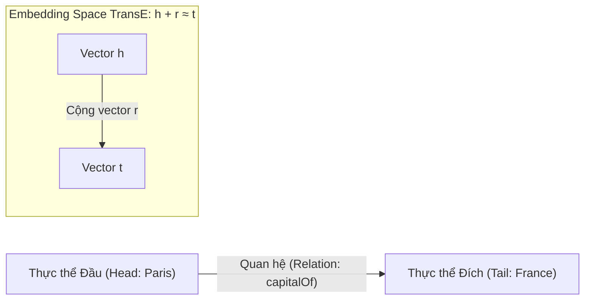

# Chuyên đề: Các Năng lực Nhận thức & Khả năng của Tác tử (Cognitive Faculties & Agent Capabilities)

## 1. Tổng quan Chuyên đề
Để thể hiện hành vi thông minh toàn diện, một tác tử AI phải tích hợp một chuỗi các năng lực nhận thức cốt lõi (Cognitive Faculties):
1. **Tri giác (Perception)**: Chuyển hóa luồng dữ liệu tín hiệu thô từ thế giới thực (raw sensory streams) thành các biểu diễn ngữ nghĩa có cấu trúc (semantic representations).
2. **Biểu diễn Tri thức (Knowledge Representation)**: Hình thức hóa các thực thể, thuộc tính và quan hệ thành các cấu trúc toán học mà máy tính có thể thao tác.
3. **Suy luận (Reasoning)**: Dẫn xuất các tri thức mới, suy đoán hệ quả logic và xử lý tính bất định từ tri thức đã có.
4. **Lập kế hoạch (Planning)**: Tìm kiếm và xây dựng chuỗi hành động tối ưu để đưa tác tử từ trạng thái hiện tại tới trạng thái mục tiêu mong muốn.
5. **Ra quyết định (Decision Making)**: Lựa chọn hành động tốt nhất dưới sự đánh đổi giữa các mục tiêu mâu thuẫn và các điều kiện rủi ro.
6. **Học máy (Learning)**: Tự động cải thiện hiệu suất của chính sách và mô hình nội tại thông qua dữ liệu và tương tác kinh nghiệm.



---

## 2. Chi tiết từng Keyword

---

### 1. Perception (Tri giác)

#### a. Định nghĩa Bản chất Toán học
Tri giác là quá trình ánh xạ phi tuyến từ không gian tín hiệu thô $\mathcal{X}$ (âm thanh, hình ảnh, đám mây điểm LiDAR) sang không gian biểu diễn ẩn $\mathcal{Z}$ mang ngữ nghĩa:
$$f_{\text{percept}}: \mathcal{X} \to \mathcal{Z}, \quad \mathbf{z} = f_{\mathbf{\theta}}(\mathbf{x})$$
trong đó $\mathbf{z} \in \mathbb{R}^d$ bảo toàn các đặc trưng bất biến của thực thể (invariance to translation, rotation, scale, noise):
$$\| f_{\mathbf{\theta}}(\mathbf{x}) - f_{\mathbf{\theta}}(T_g(\mathbf{x})) \| \approx 0$$
với $T_g$ là toán tử biến đổi nhóm (như phép tịnh tiến trong nhóm $SE(2)$ hoặc $SE(3)$).

#### b. Cơ chế Tầng Sâu & Điện toán
- **Tensor Pipeling**: Dữ liệu cảm biến từ camera (RGB Bayer pattern) được xử lý qua ISP (Image Signal Processor), nạp vào GPU VRAM qua DMA (Direct Memory Access), thực thi tích chập 2D/3D (GEMM cuDNN) hoặc FlashAttention để tạo embedding.

#### c. Code Thực chiến (C++ & Python)
```cpp
// C++20: Spatial Downsampling & Feature Extraction Pipeline đơn giản
#include <iostream>
#include <vector>
#include <numeric>

std::vector<float> extract_edge_features_1d(const std::vector<float>& raw_signal) {
    if (raw_signal.size() < 3) return {};
    std::vector<float> features(raw_signal.size() - 2);
    // Toán tử Laplace 1D rời rạc [-1, 2, -1]
    for (size_t i = 1; i < raw_signal.size() - 1; ++i) {
        features[i - 1] = -raw_signal[i - 1] + 2.0f * raw_signal[i] - raw_signal[i + 1];
    }
    return features;
}

int main() {
    std::vector<float> raw_sensor = {1.0f, 1.2f, 1.1f, 5.0f, 9.2f, 9.1f};
    auto edges = extract_edge_features_1d(raw_sensor);
    std::cout << "Extracted Edge Feature Count: " << edges.size() << " | Max Edge: " << edges[2] << "\n";
    return 0;
}
```

```python
# Python: Vision Transformer Patch Projection cho Perception
import torch
import torch.nn as nn

class PatchPerception(nn.Module):
    def __init__(self, in_channels=3, patch_size=16, embed_dim=768):
        super().__init__()
        # Chiếu ảnh thành chuỗi token ngữ nghĩa qua tích chập strided
        self.proj = nn.Conv2d(in_channels, embed_dim, kernel_size=patch_size, stride=patch_size)

    def forward(self, x):
        # x: [B, C, H, W] -> [B, D, H/P, W/P] -> [B, N, D]
        x = self.proj(x)
        x = x.flatten(2).transpose(1, 2)
        return x

perceiver = PatchPerception()
dummy_img = torch.randn(2, 3, 224, 224)
tokens = perceiver(dummy_img)
print("Perceptual Tokens Shape:", tokens.shape) # [2, 196, 768]
```

---

### 2. Knowledge Representation (Biểu diễn Tri thức)

#### a. Định nghĩa Bản chất Toán học
Một ngôn ngữ biểu diễn tri thức (Knowledge Representation Language) $\mathcal{K}$ bao gồm cú pháp (syntax) và ngữ nghĩa (semantics) xác định quan hệ chân lý:
$$\mathcal{KB} \models \alpha \iff \mathcal{M}(\mathcal{KB}) \subseteq \mathcal{M}(\alpha)$$
Đồng thời, trong thời đại học sâu, tri thức được mã hóa dưới dạng hình học embedding trong không gian vector nhiều chiều (Knowledge Graph Embeddings như TransE, RotatE):
$$\mathbf{h} + \mathbf{r} \approx \mathbf{t}, \quad \mathbf{h}, \mathbf{t} \in \mathbb{R}^d, \mathbf{r} \in \mathbb{R}^d$$

#### b. Sơ đồ Minh họa


#### c. Code Thực chiến (C++ & Python)
```cpp
// C++17: Cấu trúc Bộ ba Tri thức (RDF Triple: Head, Relation, Tail)
#include <iostream>
#include <string>
#include <vector>

struct Triple {
    std::string head;
    std::string relation;
    std::string tail;
};

class KnowledgeBase {
private:
    std::vector<Triple> facts_;
public:
    void add_fact(std::string h, std::string r, std::string t) {
        facts_.push_back({std::move(h), std::move(r), std::move(t)});
    }

    bool query(const std::string& h, const std::string& r, const std::string& t) const {
        for (const auto& f : facts_) {
            if (f.head == h && f.relation == r && f.tail == t) return true;
        }
        return false;
    }
};

int main() {
    KnowledgeBase kb;
    kb.add_fact("GPT4", "isA", "LargeLanguageModel");
    std::cout << "Query Result: " << kb.query("GPT4", "isA", "LargeLanguageModel") << "\n";
    return 0;
}
```

```python
# Python: TransE Knowledge Graph Embedding Loss
import torch
import torch.nn as nn

class TransELoss(nn.Module):
    def __init__(self, margin=1.0):
        super().__init__()
        self.margin = margin

    def forward(self, h, r, t_pos, t_neg):
        # Khoảng cách L2: ||h + r - t||
        pos_dist = torch.norm(h + r - t_pos, p=2, dim=-1)
        neg_dist = torch.norm(h + r - t_neg, p=2, dim=-1)
        return torch.relu(pos_dist - neg_dist + self.margin).mean()

criterion = TransELoss()
dim = 64
h = torch.randn(10, dim)
r = torch.randn(10, dim)
t_pos = h + r + torch.randn(10, dim) * 0.01
t_neg = torch.randn(10, dim)
print("TransE Energy Loss:", criterion(h, r, t_pos, t_neg).item())
```

---

### 3. Reasoning (Suy luận)

#### a. Định nghĩa Bản chất Toán học
Suy luận là quá trình sinh ra mệnh đề mới $\alpha$ từ cơ sở tri thức $\mathcal{KB}$ thông qua các quy tắc dẫn xuất hình thức (Inference Rules):
$$\mathcal{KB} \vdash_{\mathcal{R}} \alpha$$
- **Deductive (Diễn dịch)**: Bảo toàn chân lý tuyệt đối: $A \land (A \to B) \vdash B$ (Modus Ponens).
- **Inductive (Quy nạp)**: Khái quát hóa từ các trường hợp cá biệt thành quy luật chung: $\{P(a_i)\}_{i=1}^N \implies \forall x P(x)$ (mang tính xác suất).
- **Abductive (Quy thoái)**: Tìm lời giải thích hợp lý nhất cho một quan sát: $B \land (A \to B) \implies A \text{ (giả thuyết khả dĩ)}$.

#### b. Code Thực chiến (C++ & Python)
```cpp
// C++17: Modus Ponens Engine đơn giản
#include <iostream>
#include <unordered_map>
#include <string>

class ModusPonensEngine {
private:
    std::unordered_map<std::string, bool> facts_;
public:
    void assert_fact(const std::string& p) { facts_[p] = true; }

    bool deduce(const std::string& premise, const std::string& conclusion) {
        // Luật: IF premise THEN conclusion
        if (facts_.find(premise) != facts_.end() && facts_[premise]) {
            facts_[conclusion] = true; // Suy luận ra chân lý mới
            return true;
        }
        return false;
    }
};

int main() {
    ModusPonensEngine engine;
    engine.assert_fact("IsRaining");
    bool deduced = engine.deduce("IsRaining", "GroundIsWet");
    std::cout << "GroundIsWet deduced: " << deduced << "\n";
    return 0;
}
```

```python
# Python: Probabilistic Abductive Reasoning via Bayes Theorem
def abductive_explanation_prob(p_fever: float, p_covid: float, p_fever_given_covid: float) -> float:
    # P(Covid | Fever) = P(Fever | Covid) * P(Covid) / P(Fever)
    return (p_fever_given_covid * p_covid) / p_fever

prob = abductive_explanation_prob(p_fever=0.05, p_covid=0.01, p_fever_given_covid=0.8)
print(f"P(Covid | Fever) = {prob * 100:.2f}%")
```

---

### 4. Planning (Lập kế hoạch)

#### a. Định nghĩa Bản chất Toán học
Lập kế hoạch là bài toán tìm chuỗi toán tử $\pi = \langle a_1, a_2, \dots, a_K \rangle$ đưa thế giới từ trạng thái ban đầu $s_0$ tới trạng thái thỏa mãn mục tiêu $\mathcal{G}$:
$$s_k = \mathcal{T}(s_{k-1}, a_k), \quad s_K \in \mathcal{G}$$
sao cho cực tiểu hóa tổng chi phí hành động:
$$\min_{\pi} \sum_{k=1}^K c(s_{k-1}, a_k)$$

#### b. Code Thực chiến (C++ & Python)
```cpp
// C++17: Cấu trúc Bước Lập kế hoạch (Action Preconditions & Effects - STRIPS style)
#include <iostream>
#include <vector>
#include <string>
#include <algorithm>

struct PlanAction {
    std::string name;
    std::vector<std::string> preconditions;
    std::vector<std::string> add_effects;
    std::vector<std::string> del_effects;

    bool is_applicable(const std::vector<std::string>& current_state) const {
        for (const auto& pre : preconditions) {
            if (std::find(current_state.begin(), current_state.end(), pre) == current_state.end()) {
                return false;
            }
        }
        return true;
    }
};

int main() {
    PlanAction pickup{"PickUpBlockA", {"ArmEmpty", "BlockAClear"}, {"HoldingBlockA"}, {"ArmEmpty"}};
    std::vector<std::string> state = {"ArmEmpty", "BlockAClear"};
    std::cout << "Can execute PickUpBlockA: " << pickup.is_applicable(state) << "\n";
    return 0;
}
```

```python
# Python: Graph Search Planning qua BFS
from collections import deque

def simple_grid_planner(start: tuple, goal: tuple, obstacles: set):
    queue = deque([[start]])
    visited = {start}
    while queue:
        path = queue.popleft()
        node = path[-1]
        if node == goal:
            return path
        for dx, dy in [(0, 1), (0, -1), (1, 0), (-1, 0)]:
            nxt = (node[0] + dx, node[1] + dy)
            if nxt not in obstacles and nxt not in visited:
                visited.add(nxt)
                queue.append(path + [nxt])
    return None

print("Planned Path:", simple_grid_planner((0, 0), (2, 2), obstacles={(1, 1)}))
```

---

### 5. Decision Making (Ra quyết định)

#### a. Định nghĩa Bản chất Toán học
Ra quyết định tích hợp cả niềm tin xác suất và độ thỏa dụng giá trị (Von Neumann-Morgenstern Utility Theorem):
$$a^* = \arg\max_{a \in \mathcal{A}} \int_{\mathcal{S}'} U(s') P(s' \mid s, a) \, ds'$$
Quyết định tối ưu phải thỏa mãn tính bắc cầu (transitivity), tính liên tục (continuity) và tính độc lập (independence).

#### b. Code Thực chiến (C++ & Python)
```cpp
// C++17: Bộ chọn Quyết định Cực đại hóa Tiện ích Kỳ vọng
#include <iostream>
#include <vector>

double evaluate_decision(const std::vector<double>& probs, const std::vector<double>& utils) {
    double expected_u = 0.0;
    for (size_t i = 0; i < probs.size(); ++i) {
        expected_u += probs[i] * utils[i];
    }
    return expected_u;
}

int main() {
    // Quyết định đầu tư cổ phiếu: [Lãi to, Hòa, Lỗ nặng]
    std::vector<double> probs = {0.3, 0.5, 0.2};
    std::vector<double> utils = {1000.0, 0.0, -1200.0};
    std::cout << "Expected Utility of Decision: " << evaluate_decision(probs, utils) << "\n";
    return 0;
}
```

```python
# Python: Softmax Action Selection (Exploration vs Exploitation Decision)
import numpy as np

def softmax_decision(q_values: np.ndarray, temperature: float = 1.0) -> int:
    exp_q = np.exp((q_values - np.max(q_values)) / temperature)
    probs = exp_q / np.sum(exp_q)
    return int(np.random.choice(len(probs), p=probs))

q_vals = np.array([10.5, 12.0, 9.8])
print("Sampled Action under Softmax Decision:", softmax_decision(q_vals, temperature=0.5))
```

---

### 6. Learning (Học máy)

#### a. Định nghĩa Bản chất Toán học
Theo Tom Mitchell: Một chương trình máy tính được gọi là học từ kinh nghiệm $E$ đối với lớp nhiệm vụ $T$ và thước đo hiệu quả $P$, nếu hiệu quả của nó tại các nhiệm vụ trong $T$, được đo bởi $P$, cải thiện theo kinh nghiệm $E$:
$$\lim_{|E| \to \infty} P(T, E) \ge P(T, \emptyset)$$
Về mặt tối ưu hóa:
$$\mathbf{\theta}^* = \arg\min_{\mathbf{\theta}} \frac{1}{|E|} \sum_{i=1}^{|E|} \mathcal{L}(f_{\mathbf{\theta}}(\mathbf{x}_i), \mathbf{y}_i) + \lambda \Omega(\mathbf{\theta})$$

#### b. Code Thực chiến (C++ & Python)
```cpp
// C++17: Online Stochastic Gradient Descent Update Loop
#include <iostream>
#include <vector>

void sgd_step(float& weight, float& bias, float x, float y_true, float lr) {
    float y_pred = weight * x + bias;
    float error = y_pred - y_true; // Dao ham cua 0.5 * (y - y_true)^2
    weight -= lr * error * x;
    bias   -= lr * error;
}

int main() {
    float w = 0.0f, b = 0.0f;
    for (int epoch = 0; epoch < 100; ++epoch) {
        sgd_step(w, b, 2.0f, 6.0f, 0.05f); // Học hàm y = 3x (w=3, b=0)
    }
    std::cout << "Learned weight: " << w << ", bias: " << b << "\n";
    return 0;
}
```

```python
# Python: PyTorch Parameter Optimization Step
import torch

w = torch.randn(1, requires_grad=True)
b = torch.randn(1, requires_grad=True)
optimizer = torch.optim.SGD([w, b], lr=0.05)

x = torch.tensor([2.0])
y_true = torch.tensor([6.0])

for _ in range(50):
    optimizer.zero_grad()
    loss = (w * x + b - y_true) ** 2
    loss.backward()
    optimizer.step()

print(f"PyTorch Learned: w={w.item():.4f}, b={b.item():.4f}")
```

#### c. Lỗi Thường gặp & Ứng dụng
- **Overfitting & Concept Drift**: Mô hình học quá mức dữ liệu quá khứ và mất khả năng thích nghi khi quy luật thế giới biến đổi theo thời gian. Ứng dụng: Toàn bộ nền tảng Deep Learning và Reinforcement Learning đương đại.
