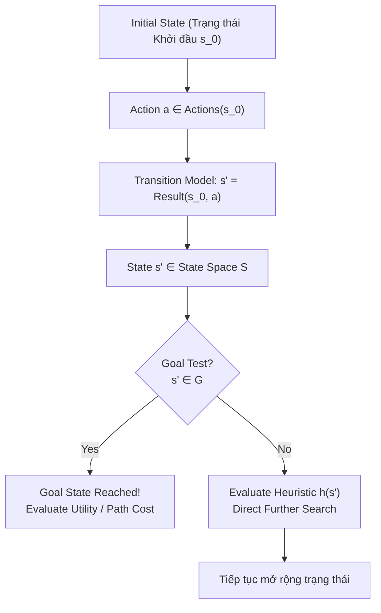
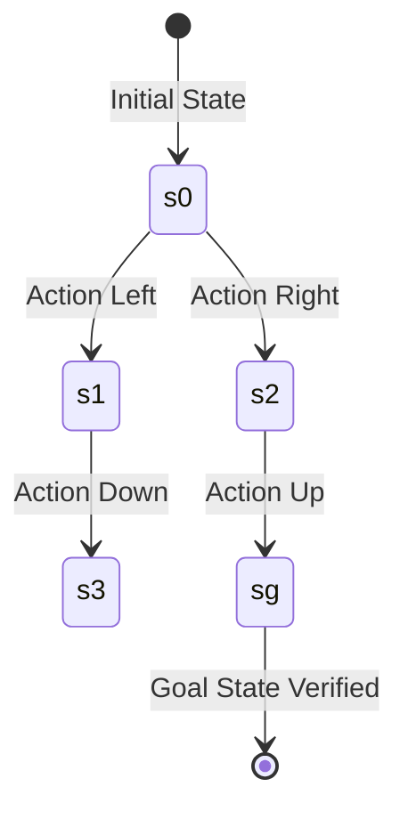
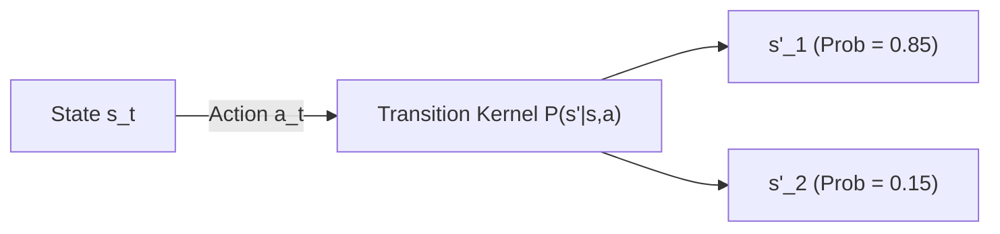
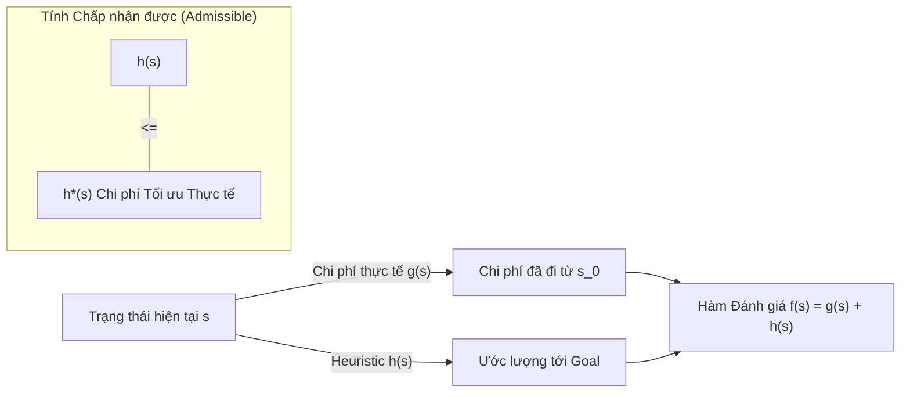

# Chuyên đề: Hình thức hóa Bài toán AI & Không gian Trạng thái (AI Problem Formulation & State Spaces)

## 1. Tổng quan Chuyên đề
Để giải quyết bất kỳ bài toán trí tuệ nhân tạo nào một cách có tính toán, bước quan trọng đầu tiên là **Hình thức hóa Bài toán (Problem Formulation)**. Quá trình này trừu tượng hóa một bài toán thực tế phức tạp (với vô số chi tiết vật lý không cần thiết) thành một mô hình toán học chặt chẽ.

Một bài toán tìm kiếm và giải quyết vấn đề kinh điển được hình thức hóa thành bộ 5 thành phần cốt lõi:
1. **Trạng thái Khởi đầu (Initial State)**: Điểm xuất phát của hệ thống.
2. **Không gian Hành động (Actions)**: Tập các thao tác khả thi tại mỗi trạng thái.
3. **Mô hình Chuyển dịch (Transition Model)**: Quy luật toán học xác định trạng thái kết quả khi thực hiện hành động.
4. **Kiểm tra Mục tiêu (Goal State / Goal Test)**: Tiêu chí xác định bài toán đã được giải quyết xong hay chưa.
5. **Chi phí Đường đi / Hàm Tiện ích (Path Cost / Utility Function)**: Thước đo đánh giá chất lượng của lời giải, kết hợp cùng **Hàm Heuristic (Heuristic Function)** ước lượng khoảng cách tới đích để định hướng giải thuật tìm kiếm.



---

## 2. Chi tiết từng Keyword

---

### 1. AI Problem Formulation & State Space (Hình thức hóa Bài toán & Không gian Trạng thái)

#### a. Định nghĩa Bản chất Toán học
Một bài toán AI tổng quát được hình thức hóa dưới dạng bộ toán học 5 phần tử:
$$\mathcal{P} = \langle \mathcal{S}, s_0, \mathcal{A}, \mathcal{T}, \mathcal{G}, c \rangle$$
trong đó:
- $\mathcal{S}$ là **Không gian Trạng thái (State Space)**: Tập hợp tất cả các cấu hình khả dĩ của thế giới bài toán.
- $s_0 \in \mathcal{S}$ là **Trạng thái Ban đầu (Initial State)**.
- $\mathcal{A}(s)$ là tập các hành động hợp lệ từ trạng thái $s$: $\mathcal{A}(s) \subseteq \mathcal{A}$.
- $\mathcal{T}: \mathcal{S} \times \mathcal{A} \to \mathcal{S}$ là **Mô hình Chuyển dịch (Transition Model)** (hoặc hàm $\text{Result}(s, a)$).
- $\mathcal{G} \subseteq \mathcal{S}$ là tập **Trạng thái Mục tiêu (Goal States)** (hoặc hàm kiểm tra $\text{IsGoal}(s) \to \{\text{True}, \text{False}\}$).
- $c(s, a, s')$ là **Chi phí Bước (Step Cost)** để thực hiện hành động $a$ chuyển từ $s$ sang $s'$.

Không gian trạng thái có thể biểu diễn dưới dạng đồ thị có hướng (Directed State Graph) $\mathcal{G}_{\text{state}} = (\mathcal{V}, \mathcal{E})$ với $\mathcal{V} = \mathcal{S}$ và $\mathcal{E} = \{(s, s') \mid \exists a \in \mathcal{A}(s), s' = \mathcal{T}(s, a)\}$.

#### b. Cơ chế Tầng Sâu & Điện toán
- **Kích thước Không gian Trạng thái (State Space Cardinality)**: Bùng nổ tổ hợp cực nhanh.
  - Ví dụ bài toán 8-puzzle: $|\mathcal{S}| = 9! / 2 = 181,440$.
  - Bài toán 15-puzzle: $|\mathcal{S}| = 16! / 2 \approx 10^{13}$.
  - Cờ vua: $|\mathcal{S}| \approx 10^{47}$, Cờ vây: $|\mathcal{S}| \approx 10^{170}$.
- **Bộ nhớ**: Không thể lưu trữ toàn bộ $\mathcal{S}$ trong RAM. Không gian trạng thái phải được tạo ra ngầm định (implicitly generated on-the-fly) tại thời điểm duyệt nút bằng các hàm sinh successor.

#### c. Sơ đồ Minh họa


#### d. Code Thực chiến (C++ & Python)
```cpp
// C++20: Khung Hình thức hóa Bài toán Không gian Trạng thái (8-Puzzle State)
#include <iostream>
#include <array>
#include <vector>
#include <iomanip>

struct PuzzleState {
    std::array<int, 9> tiles; // Bố cục phẳng 1D biểu diễn ma trận 3x3
    int empty_idx; // Vị trí ô trống (số 0)

    bool operator==(const PuzzleState& other) const {
        return tiles == other.tiles;
    }
};

class PuzzleProblem {
public:
    PuzzleState initial_state;
    PuzzleState goal_state{{1, 2, 3, 4, 5, 6, 7, 8, 0}, 8};

    bool is_goal(const PuzzleState& s) const {
        return s == goal_state;
    }

    std::vector<PuzzleState> get_successors(const PuzzleState& s) const {
        std::vector<PuzzleState> successors;
        int r = s.empty_idx / 3, c = s.empty_idx % 3;
        const int dr[] = {-1, 1, 0, 0};
        const int dc[] = {0, 0, -1, 1};

        for (int i = 0; i < 4; ++i) {
            int nr = r + dr[i], nc = c + dc[i];
            if (nr >= 0 && nr < 3 && nc >= 0 && nc < 3) {
                PuzzleState next = s;
                int n_idx = nr * 3 + nc;
                std::swap(next.tiles[s.empty_idx], next.tiles[n_idx]);
                next.empty_idx = n_idx;
                successors.push_back(next);
            }
        }
        return successors;
    }
};

int main() {
    PuzzleProblem prob;
    prob.initial_state = PuzzleState{{1, 2, 3, 4, 5, 6, 0, 7, 8}, 6};
    auto succs = prob.get_successors(prob.initial_state);
    std::cout << "Successors generated: " << succs.size() << " states\n";
    std::cout << "Is initial state goal? " << (prob.is_goal(prob.initial_state) ? "YES" : "NO") << "\n";
    return 0;
}
```

```python
# Python: State Space Formulation với Generic Type Interface
from typing import Generic, TypeVar, List, Tuple
from dataclasses import dataclass

S = TypeVar('S') # State Type
A = TypeVar('A') # Action Type

@dataclass
class Problem(Generic[S, A]):
    initial_state: S
    
    def is_goal(self, state: S) -> bool:
        raise NotImplementedError
        
    def actions(self, state: S) -> List[A]:
        raise NotImplementedError
        
    def transition(self, state: S, action: A) -> S:
        raise NotImplementedError
        
    def step_cost(self, state: S, action: A, next_state: S) -> float:
        return 1.0

# Áp dụng cho bài toán điều hướng lưới 2D (Grid World)
class GridWorldProblem(Problem[Tuple[int, int], str]):
    def __init__(self, start: Tuple[int, int], goal: Tuple[int, int], max_x: int, max_y: int):
        super().__init__(initial_state=start)
        self.goal = goal
        self.max_x = max_x
        self.max_y = max_y

    def is_goal(self, state: Tuple[int, int]) -> bool:
        return state == self.goal

    def actions(self, state: Tuple[int, int]) -> List[str]:
        acts = []
        x, y = state
        if x > 0: acts.append("LEFT")
        if x < self.max_x: acts.append("RIGHT")
        if y > 0: acts.append("DOWN")
        if y < self.max_y: acts.append("UP")
        return acts

    def transition(self, state: Tuple[int, int], action: str) -> Tuple[int, int]:
        x, y = state
        moves = {"LEFT": (-1, 0), "RIGHT": (1, 0), "DOWN": (0, -1), "UP": (0, 1)}
        dx, dy = moves[action]
        return (x + dx, y + dy)

p = GridWorldProblem(start=(0, 0), goal=(4, 4), max_x=5, max_y=5)
print("Available actions from start:", p.actions(p.initial_state))
print("Next state after RIGHT:", p.transition(p.initial_state, "RIGHT"))
```

---

### 2. Actions & Transition Models (Hành động & Mô hình Chuyển dịch)

#### a. Định nghĩa Bản chất Toán học
- **Actions (Không gian Hành động)**: Tập các tác động mà tác tử có thể kích hoạt: $\mathcal{A}$.
- **Transition Model (Mô hình Chuyển dịch)**:
  - Tất định (Deterministic):
    $$\mathcal{T}: \mathcal{S} \times \mathcal{A} \to \mathcal{S}, \quad s' = \text{Result}(s, a)$$
  - Ngẫu nhiên (Stochastic Markov Kernel):
    $$P(s' \mid s, a) = \mathbb{P}(S_{t+1} = s' \mid S_t = s, A_t = a)$$
    thỏa mãn tính chất chuẩn hóa: $\sum_{s' \in \mathcal{S}} P(s' \mid s, a) = 1, \quad \forall (s, a)$.

#### b. Sơ đồ Minh họa


#### c. Code Thực chiến (C++ & Python)
```cpp
// C++17: Transition Kernel dạng Ma trận Thưa (Sparse Transition Model)
#include <iostream>
#include <vector>
#include <unordered_map>

struct StateTransition {
    int next_state;
    double probability;
};

class TransitionModelEngine {
private:
    // Key: (state, action) hash -> Danh sách các chuyển dịch có thể
    std::unordered_map<int, std::vector<StateTransition>> transitions_;
public:
    void register_transition(int s, int a, int s_next, double prob) {
        int key = (s << 16) | (a & 0xFFFF);
        transitions_[key].push_back({s_next, prob});
    }

    const std::vector<StateTransition>& get_transitions(int s, int a) {
        int key = (s << 16) | (a & 0xFFFF);
        return transitions_[key];
    }
};

int main() {
    TransitionModelEngine engine;
    engine.register_transition(1, 0, 2, 0.9); // State 1, Action 0 -> State 2 (p=0.9)
    engine.register_transition(1, 0, 1, 0.1); // State 1, Action 0 -> State 1 (p=0.1)

    for (const auto& tr : engine.get_transitions(1, 0)) {
        std::cout << "Next State: " << tr.next_state << " with P=" << tr.probability << "\n";
    }
    return 0;
}
```

```python
# Python: Transition Tensor Matrix Multiplication
import numpy as np

# Tạo Tensor xác suất chuyển trạng thái T[s, a, s']
num_states = 3
num_actions = 2
T = np.zeros((num_states, num_actions, num_states))

# s=0, a=0 -> 80% s=1, 20% s=0
T[0, 0, 1] = 0.8
T[0, 0, 0] = 0.2

# Phân phối trạng thái hiện tại mu = [1, 0, 0]
mu = np.array([1.0, 0.0, 0.0])
action_taken = 0

# Phân phối trạng thái kế tiếp: mu' = sum_s mu(s) * T(s, a, s')
mu_next = mu @ T[:, action_taken, :]
print("Next state probability distribution:", mu_next)
```

---

### 3. Utility Functions & Heuristic Functions (Hàm Tiện ích & Hàm Heuristic)

#### a. Định nghĩa Bản chất Toán học
- **Utility Function (Hàm Tiện ích)**:
  Ánh xạ từ một trạng thái (hoặc một chuỗi trạng thái) vào một số thực đo lường mức độ thỏa mãn/hạnh phúc của tác tử:
  $$U: \mathcal{S} \to \mathbb{R}$$
  Trong lý thuyết quyết định, tác tử tối ưu hóa $E[U]$.
- **Heuristic Function (Hàm Đánh giá Phỏng đoán)**:
  Ước lượng chi phí rẻ nhất từ trạng thái hiện tại $s$ đến một trạng thái mục tiêu $\mathcal{G}$:
  $$h: \mathcal{S} \to \mathbb{R}_{\ge 0}$$
  với điều kiện biên $h(s) = 0, \quad \forall s \in \mathcal{G}$.
  - **Tính chấp nhận được (Admissibility)**: Heuristic không bao giờ đánh giá quá cao chi phí thực tế:
    $$0 \le h(s) \le h^*(s), \quad \forall s$$
    trong đó $h^*(s)$ là chi phí tối ưu thực tế từ $s$ đến đích.
  - **Tính nhất quán (Consistency / Monotonicity)**: Thỏa mãn bất đẳng thức tam giác cho mọi hành động $a$:
    $$h(s) \le c(s, a, s') + h(s')$$

#### b. Sơ đồ Minh họa


#### c. Code Thực chiến (C++ & Python)
```cpp
// C++20: Triển khai các hàm Heuristic kinh điển (Manhattan vs Euclidean Distance)
#include <iostream>
#include <cmath>

struct Point2D {
    int x;
    int y;
};

// Manhattan Distance (L1 Norm): Phù hợp chuyển động 4 hướng
double heuristic_manhattan(Point2D a, Point2D b) {
    return std::abs(a.x - b.x) + std::abs(a.y - b.y);
}

// Euclidean Distance (L2 Norm): Phù hợp chuyển động tự do vô hướng
double heuristic_euclidean(Point2D a, Point2D b) {
    return std::hypot(a.x - b.x, a.y - b.y);
}

int main() {
    Point2D current{1, 2};
    Point2D goal{4, 6};
    std::cout << "Manhattan Heuristic: " << heuristic_manhattan(current, goal) << "\n";
    std::cout << "Euclidean Heuristic: " << heuristic_euclidean(current, goal) << "\n";
    return 0;
}
```

```python
# Python: Kiểm tra Tính Nhất quán (Consistency Verification) của Heuristic
from typing import Callable, List, Tuple

def verify_consistency(states: List[Tuple[int, int]], 
                       h_fn: Callable[[Tuple[int, int]], float], 
                       step_cost: float = 1.0) -> bool:
    for s in states:
        for dx, dy in [(0, 1), (0, -1), (1, 0), (-1, 0)]:
            s_prime = (s[0] + dx, s[1] + dy)
            # Kiểm tra h(s) <= c(s, a, s') + h(s')
            if h_fn(s) > step_cost + h_fn(s_prime) + 1e-7:
                return False
    return True

# Heuristic Manhattan tới đích (5, 5)
goal = (5, 5)
manhattan = lambda s: abs(s[0] - goal[0]) + abs(s[1] - goal[1])

test_states = [(x, y) for x in range(6) for y in range(6)]
print("Is Manhattan Consistent?", verify_consistency(test_states, manhattan))
```

#### d. Lỗi Thường gặp & Ứng dụng
- **Inadmissible Heuristic trong $A^*$**: Nếu $h(s) > h^*(s)$, giải thuật $A^*$ sẽ đánh mất tính tối ưu (optimality) và có thể trả về một đường đi dưới mức tối ưu.
- **Ứng dụng AI**: Định tuyến GPS toàn cầu (Google Maps, OSRM), thuật toán giải Rubik, và lập kế hoạch chuyển động cho robot công nghiệp 6 bậc tự do.
