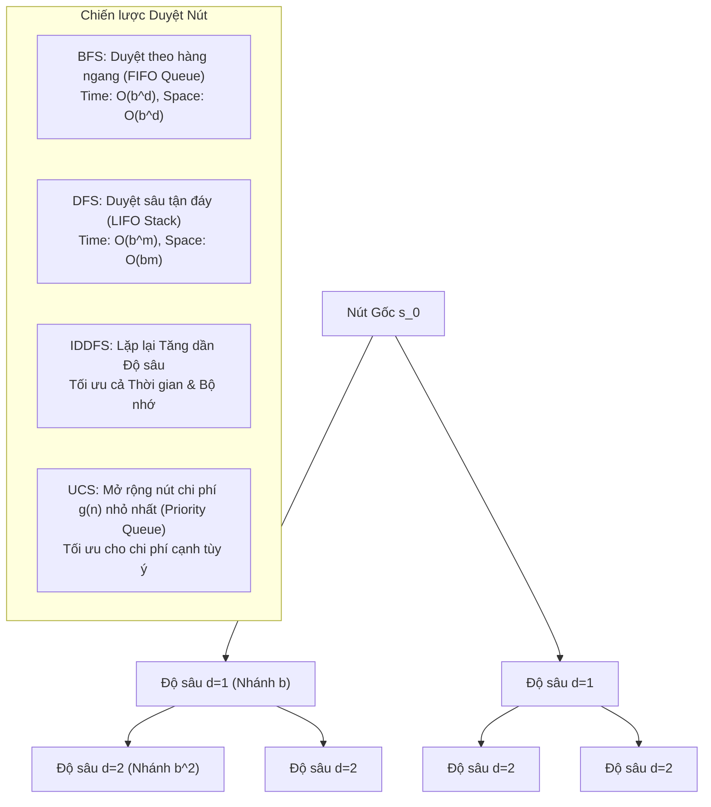
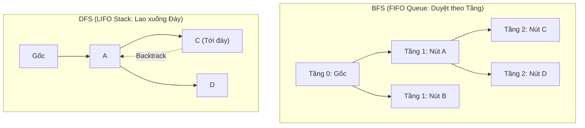
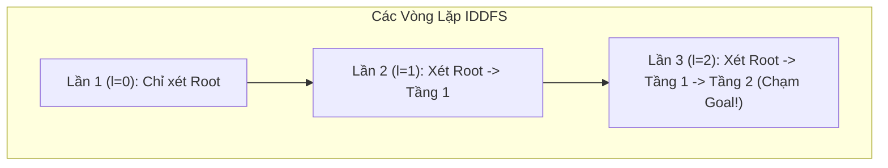
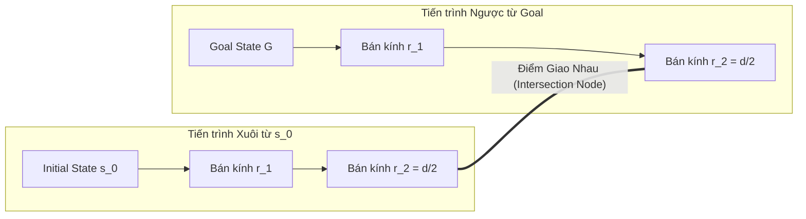

# Chuyên đề: Tìm kiếm Mù & Duyệt Đồ thị (Uninformed Search & Graph Traversals)

## 1. Tổng quan Chuyên đề
**Tìm kiếm Mù (Uninformed Search / Blind Search)** là nhóm các chiến lược duyệt không gian trạng thái mà tác tử không có thêm bất kỳ thông tin nào về khoảng cách hay độ hứa hẹn từ trạng thái hiện tại đến đích (ngoài định nghĩa hình thức của bài toán: $s_0$, $\text{Actions}(s)$, $\text{Result}(s, a)$ và $\text{IsGoal}(s)$).

Các tiêu chí lý thuyết để đánh giá và so sánh bất kỳ thuật toán tìm kiếm nào bao gồm:
1. **Tính Toàn vẹn (Completeness)**: Thuật toán có luôn tìm ra lời giải nếu tồn tại lời giải hay không?
2. **Tính Tối ưu (Optimality)**: Lời giải tìm được có phải là đường đi có chi phí thấp nhất hay không?
3. **Độ phức tạp Thời gian (Time Complexity)**: Số lượng nút cần sinh/duyệt trước khi chạm đích.
4. **Độ phức tạp Không gian (Space Complexity)**: Dung lượng bộ nhớ RAM tối đa cần duy trì trong suốt quá trình tìm kiếm.



---

## 2. Chi tiết từng Keyword

---

### 1. Search Complexity, Completeness, Optimality, Time & Space Complexity

#### a. Định nghĩa Bản chất Toán học
Các tham số chuẩn trong phân tích cây tìm kiếm:
- $b$: Hệ số phân nhánh tối đa (branching factor) của đồ thị.
- $d$: Độ sâu của nút đích nông nhất (depth of the shallowest goal node).
- $m$: Độ sâu tối đa của không gian trạng thái (maximum depth, có thể là $\infty$).
- $C^*$: Chi phí của đường đi tối ưu.
- $\epsilon > 0$: Giới hạn dưới của chi phí mỗi bước bước đi ($c(s, a, s') \ge \epsilon$).

Các thuộc tính:
- **Completeness**: $\exists \pi \implies \text{Algorithm}(\mathcal{P}) = \pi$.
- **Optimality**: $\text{Cost}(\text{Algorithm}(\mathcal{P})) = C^* = \min_{\pi} \text{Cost}(\pi)$.
- **Time Complexity**: Số nút được sinh ra $N = \sum_{i=0}^d b^i = \frac{b^{d+1}-1}{b-1} \in \mathcal{O}(b^d)$.
- **Space Complexity**: Số lượng nút tối đa lưu trữ đồng thời trong bộ nhớ đệm (Frontier + Explored set).

#### b. Cơ chế Tầng Sâu & Điện toán (Memory & Cache Bottleneck)
- **Tắc nghẽn Bộ nhớ (RAM Exhaustion)**: Trong thuật toán tìm kiếm theo chiều rộng (BFS), với $b = 10$, $d = 10$, mỗi nút chiếm 128 bytes trên 64-bit architecture (pointers, state ID, parent pointer):
  $$N \approx 10^{10} \text{ nodes} \implies 10^{10} \times 128 \text{ bytes} \approx 1.28 \text{ Terabytes RAM}$$
  Hệ điều hành sẽ rơi vào tình trạng Disk Thrashing (Swap page out liên tục) khiến CPU stalls và tiến trình bị Linux OOM Killer tắt cưỡng bức.

#### c. Bảng So sánh Lý thuyết Toàn diện
| Thuật toán | Completeness | Optimality | Time Complexity | Space Complexity |
| :--- | :--- | :--- | :--- | :--- |
| **BFS** | Có (nếu $b < \infty$) | Có (nếu mọi cạnh đồng chi phí) | $\mathcal{O}(b^d)$ | $\mathcal{O}(b^d)$ (Nút thắt cổ chai) |
| **DFS** | Không (nếu $m = \infty$) | Không | $\mathcal{O}(b^m)$ | $\mathcal{O}(bm)$ (Cực kỳ tiết kiệm) |
| **DLS** | Không (nếu $l < d$) | Không | $\mathcal{O}(b^l)$ | $\mathcal{O}(bl)$ |
| **IDDFS**| Có (nếu $b < \infty$) | Có (nếu mọi cạnh đồng chi phí) | $\mathcal{O}(b^d)$ | $\mathcal{O}(bd)$ (Hoàn hảo cho AI) |
| **UCS** | Có (nếu $c \ge \epsilon$) | Có | $\mathcal{O}(b^{1 + \lfloor C^* / \epsilon \rfloor})$ | $\mathcal{O}(b^{1 + \lfloor C^* / \epsilon \rfloor})$ |
| **Bidirectional**| Có (nếu $b < \infty$) | Có (nếu mọi cạnh đồng chi phí) | $\mathcal{O}(b^{d/2})$ | $\mathcal{O}(b^{d/2})$ |

---

### 2. Uninformed Search & Graph Search (Tìm kiếm Mù & Duyệt Đồ thị)

#### a. Định nghĩa Bản chất Toán học
- **Tree Search vs. Graph Search**:
  Trong Tree Search, các đường đi lặp lại (redundant paths / loops) không được ghi nhớ, dẫn đến việc duyệt lại cùng một trạng thái vô hạn lần trên đồ thị có chu trình.
  Trong **Graph Search**, thuật toán duy trì một tập hợp các trạng thái đã đóng (Closed List / Explored Set $\mathcal{E}$):
  $$\mathcal{E} \leftarrow \mathcal{E} \cup \{s\}$$
  Một nút con $s'$ chỉ được thêm vào tập biên mở (Frontier / Open List $\mathcal{F}$) nếu $s' \notin \mathcal{E} \land s' \notin \mathcal{F}$.

#### b. Cơ chế Tầng Sâu & Điện toán
- `Explored Set` đòi hỏi cấu trúc dữ liệu tra cứu $\mathcal{O}(1)$ thời gian: **Hash Table** với hàm băm tối ưu (MurmurHash3, Robin Hood Hashing, hoặc `std::unordered_set` với custom hash) để giảm thiểu va chạm (hash collisions).

#### c. Code Thực chiến (C++ & Python)
```cpp
// C++20: Cấu trúc Graph Search chuẩn với Explored Set và Frontier
#include <iostream>
#include <vector>
#include <unordered_set>
#include <queue>
#include <memory>

struct SearchNode {
    int state;
    std::shared_ptr<SearchNode> parent;
    int path_cost{0};
};

class GenericGraphSearch {
public:
    static bool solve(int start, int goal, const std::vector<std::vector<int>>& adj) {
        std::queue<std::shared_ptr<SearchNode>> frontier;
        std::unordered_set<int> explored;

        frontier.push(std::make_shared<SearchNode>(SearchNode{start, nullptr, 0}));
        std::unordered_set<int> in_frontier = {start};

        while (!frontier.empty()) {
            auto current = frontier.front();
            frontier.pop();
            in_frontier.erase(current->state);
            explored.insert(current->state);

            if (current->state == goal) return true;

            for (int neighbor : adj[current->state]) {
                if (explored.find(neighbor) == explored.end() && 
                    in_frontier.find(neighbor) == in_frontier.end()) {
                    frontier.push(std::make_shared<SearchNode>(SearchNode{neighbor, current, current->path_cost + 1}));
                    in_frontier.insert(neighbor);
                }
            }
        }
        return false;
    }
};

int main() {
    std::vector<std::vector<int>> adj = {{1, 2}, {3}, {3}, {}};
    std::cout << "Graph path exists: " << GenericGraphSearch::solve(0, 3, adj) << "\n";
    return 0;
}
```

```python
# Python: Graph Search Template với Set Membership Check
from collections import deque
from typing import Dict, List, Optional

def graph_search_bfs(adj: Dict[int, List[int]], start: int, goal: int) -> Optional[List[int]]:
    frontier = deque([[start]])
    explored = set()

    while frontier:
        path = frontier.popleft()
        node = path[-1]

        if node == goal:
            return path

        if node not in explored:
            explored.add(node)
            for neighbor in adj.get(node, []):
                if neighbor not in explored:
                    frontier.append(path + [neighbor])
    return None

graph = {0: [1, 2], 1: [3], 2: [3], 3: []}
print("BFS Discovered Path:", graph_search_bfs(graph, 0, 3))
```

---

### 3. Breadth-First Search (BFS) & Depth-First Search (DFS)

#### a. Định nghĩa Bản chất Toán học
- **BFS (Tìm kiếm theo Chiều rộng)**: Cấu trúc biên mở $\mathcal{F}$ hoạt động theo nguyên tắc hàng đợi FIFO (First-In, First-Out). Nút ở độ sâu nông nhất luôn được lấy ra trước:
  $$\text{pop}() = \arg\min_{n \in \mathcal{F}} \text{depth}(n)$$
- **DFS (Tìm kiếm theo Chiều sâu)**: Cấu trúc biên mở $\mathcal{F}$ hoạt động theo nguyên tắc ngăn xếp LIFO (Last-In, First-Out). Nút ở độ sâu sâu nhất luôn được mở rộng trước:
  $$\text{pop}() = \arg\max_{n \in \mathcal{F}} \text{depth}(n)$$

#### b. Cơ chế Tầng Sâu & Điện toán
- **DFS Call Stack**: Thường triển khai đệ quy trên kiến trúc x86_64, tận dụng trực tiếp Stack Pointer (`RSP`). Mỗi frame hàm đẩy thanh ghi và biến cục bộ vào Call Stack (giới hạn mặc định Linux ~8MB). Nếu độ sâu $m > 10^5$, chương trình sẽ bị lỗi **Stack Overflow**. Cần chuyển sang ngăn xếp heap tường minh (`std::vector`).

#### c. Sơ đồ Minh họa


#### d. Code Thực chiến (C++ & Python)
```cpp
// C++20: DFS Khử Đệ quy (Iterative DFS) sử dụng Explicit Heap Stack tránh Stack Overflow
#include <iostream>
#include <vector>
#include <unordered_set>

bool iterative_dfs(int start, int goal, const std::vector<std::vector<int>>& adj) {
    std::vector<int> stack;
    std::unordered_set<int> visited;

    stack.push_back(start);

    while (!stack.empty()) {
        int u = stack.back();
        stack.pop_back();

        if (u == goal) return true;

        if (visited.find(u) == visited.end()) {
            visited.insert(u);
            // Đẩy các nút kề vào stack theo chiều ngược lại
            for (auto it = adj[u].rbegin(); it != adj[u].rend(); ++it) {
                if (visited.find(*it) == visited.end()) {
                    stack.push_back(*it);
                }
            }
        }
    }
    return false;
}

int main() {
    std::vector<std::vector<int>> adj = {{1, 2}, {3}, {4}, {}, {}};
    std::cout << "DFS reached goal: " << iterative_dfs(0, 4, adj) << "\n";
    return 0;
}
```

```python
# Python: BFS vs DFS Execution Comparison
from collections import deque

def bfs_traversal(adj, start):
    order, q, seen = [], deque([start]), {start}
    while q:
        u = q.popleft()
        order.append(u)
        for v in adj[u]:
            if v not in seen:
                seen.add(v)
                q.append(v)
    return order

def dfs_traversal(adj, start):
    order, stack, seen = [], [start], set()
    while stack:
        u = stack.pop()
        if u not in seen:
            seen.add(u)
            order.append(u)
            for v in reversed(adj[u]):
                if v not in seen:
                    stack.append(v)
    return order

tree = {0: [1, 2], 1: [3, 4], 2: [5, 6], 3: [], 4: [], 5: [], 6: []}
print("BFS Order:", bfs_traversal(tree, 0))
print("DFS Order:", dfs_traversal(tree, 0))
```

---

### 4. Depth-Limited Search & Iterative Deepening DFS (DLS & IDDFS)

#### a. Định nghĩa Bản chất Toán học
- **Depth-Limited Search (DLS)**: DFS kèm theo ngưỡng độ sâu cắt tỉa $l$: Nút ở độ sâu $d = l$ được coi là nút lá không có nút kế tiếp.
- **Iterative Deepening DFS (IDDFS)**: Lặp lại DLS với ngưỡng $l$ tăng dần: $l = 0, 1, 2, \dots, d$.
  Tổng số nút được sinh ra trong IDDFS:
  $$N(\text{IDDFS}) = (d+1)b^0 + d b^1 + (d-1)b^2 + \dots + 1 b^d = \mathcal{O}(b^d)$$
  Mặc dù các tầng nông bị duyệt lại nhiều lần, tỷ số lặp lại chỉ chiếm một hằng số nhỏ:
  $$\frac{N(\text{IDDFS})}{N(\text{BFS})} \approx \frac{b}{b-1}$$
  Khi $b = 10$, chi phí trùng lặp chỉ xấp xỉ 11%, đổi lại bộ nhớ tiết kiệm cấp số nhân từ $\mathcal{O}(b^d)$ xuống chỉ còn $\mathcal{O}(bd)$.

#### b. Sơ đồ Minh họa


#### c. Code Thực chiến (C++ & Python)
```cpp
// C++20: IDDFS Algorithm Implementation
#include <iostream>
#include <vector>

class IDDFSSolver {
private:
    const std::vector<std::vector<int>>& adj_;
    int goal_;

    bool dls(int u, int depth_limit) {
        if (u == goal_) return true;
        if (depth_limit <= 0) return false;

        for (int v : adj_[u]) {
            if (dls(v, depth_limit - 1)) return true;
        }
        return false;
    }
public:
    IDDFSSolver(const std::vector<std::vector<int>>& adj, int goal) : adj_(adj), goal_(goal) {}

    bool solve(int start, int max_depth) {
        for (int limit = 0; limit <= max_depth; ++limit) {
            if (dls(start, limit)) {
                std::cout << "Found goal at depth: " << limit << "\n";
                return true;
            }
        }
        return false;
    }
};

int main() {
    std::vector<std::vector<int>> tree = {{1, 2}, {3, 4}, {5, 6}, {}, {}, {}, {}};
    IDDFSSolver solver(tree, 5);
    solver.solve(0, 5);
    return 0;
}
```

```python
# Python: Iterative Deepening DFS
def iddfs(adj, start, goal, max_limit=10):
    def dls(node, depth):
        if node == goal:
            return [node]
        if depth <= 0:
            return None
        for neighbor in adj.get(node, []):
            path = dls(neighbor, depth - 1)
            if path is not None:
                return [node] + path
        return None

    for limit in range(max_limit):
        result = dls(start, limit)
        if result is not None:
            return result, limit
    return None, -1

graph = {0: [1, 2], 1: [3, 4], 2: [5], 5: [6], 6: []}
path, d = iddfs(graph, 0, 6)
print(f"IDDFS found path: {path} at depth {d}")
```

---

### 5. Uniform Cost Search (UCS) & Bidirectional Search

#### a. Định nghĩa Bản chất Toán học
- **Uniform Cost Search (Dijkstra trên Cây/Đồ thị trạng thái)**:
  Mở rộng nút $n$ trên biên $\mathcal{F}$ có chi phí đường đi tích lũy $g(n)$ nhỏ nhất:
  $$n^* = \arg\min_{n \in \mathcal{F}} g(n), \quad g(n) = \sum_{e \in \text{path}(s_0, n)} c(e)$$
  - Điều kiện tối ưu: Đòi hỏi chi phí mỗi bước không âm ($c \ge \epsilon > 0$).
  - Nút được kiểm tra mục tiêu tại thời điểm **lấy ra khỏi hàng đợi (pop)**, KHÔNG PHẢI tại thời điểm sinh nút (push).
- **Bidirectional Search (Tìm kiếm Hai chiều)**:
  Chạy đồng thời hai tiến trình tìm kiếm: một xuôi từ $s_0$ và một ngược từ $\mathcal{G}$. Thuật toán dừng khi biên mở của hai tiến trình giao nhau:
  $$\mathcal{F}_{\text{forward}} \cap \mathcal{F}_{\text{backward}} \neq \emptyset$$
  Độ phức tạp thời gian giảm từ $\mathcal{O}(b^d)$ xuống $\mathcal{O}(2 \cdot b^{d/2}) = \mathcal{O}(b^{d/2})$.

#### b. Cơ chế Tầng Sâu & Điện toán
- UCS sử dụng **Priority Queue** (Binary Heap hoặc Fibonacci Heap). Độ phức tạp cho mỗi thao tác pop là $\mathcal{O}(\log |\mathcal{F}|)$ và decrease-key là $\mathcal{O}(\log |\mathcal{F}|)$. Bộ nhớ cache bị ảnh hưởng do các phần tử heap nhảy ngẫu nhiên trên mảng con trỏ.

#### c. Sơ đồ Minh họa


#### d. Code Thực chiến (C++ & Python)
```cpp
// C++20: Uniform Cost Search (Dijkstra Variant) với std::priority_queue
#include <iostream>
#include <vector>
#include <queue>
#include <unordered_map>

struct Edge {
    int to;
    int cost;
};

struct UCSNode {
    int state;
    int g_cost;
    bool operator>(const UCSNode& other) const { return g_cost > other.g_cost; }
};

int uniform_cost_search(int start, int goal, const std::vector<std::vector<Edge>>& graph) {
    std::priority_queue<UCSNode, std::vector<UCSNode>, std::greater<UCSNode>> pq;
    std::unordered_map<int, int> dist;

    pq.push({start, 0});
    dist[start] = 0;

    while (!pq.empty()) {
        auto [u, g] = pq.top();
        pq.pop();

        if (u == goal) return g; // Kiểm tra đích khi pop

        if (g > dist[u]) continue; // Nút cũ đã có đường đi rẻ hơn

        for (const auto& edge : graph[u]) {
            int new_g = g + edge.cost;
            if (dist.find(edge.to) == dist.end() || new_g < dist[edge.to]) {
                dist[edge.to] = new_g;
                pq.push({edge.to, new_g});
            }
        }
    }
    return -1;
}

int main() {
    std::vector<std::vector<Edge>> graph = {
        {{1, 2}, {2, 5}},  // Nút 0 nối 1 (cost 2), 2 (cost 5)
        {{3, 10}},         // Nút 1 nối 3 (cost 10)
        {{3, 2}},          // Nút 2 nối 3 (cost 2)
        {}
    };
    std::cout << "UCS Minimal Cost to Goal: " << uniform_cost_search(0, 3, graph) << "\n";
    return 0;
}
```

```python
# Python: Bidirectional BFS Search
from collections import deque

def bidirectional_bfs(adj, start, goal):
    if start == goal: return [start]

    q_f, q_b = deque([start]), deque([goal])
    parents_f = {start: None}
    parents_b = {goal: None}

    while q_f and q_b:
        # Mở rộng phía xuôi
        curr_f = q_f.popleft()
        for nxt in adj.get(curr_f, []):
            if nxt not in parents_f:
                parents_f[nxt] = curr_f
                q_f.append(nxt)
                if nxt in parents_b:
                    return f"Intersected at {nxt}!"

        # Mở rộng phía ngược
        curr_b = q_b.popleft()
        for nxt in adj.get(curr_b, []):
            if nxt not in parents_b:
                parents_b[nxt] = curr_b
                q_b.append(nxt)
                if nxt in parents_f:
                    return f"Intersected at {nxt}!"
    return None

graph = {0: [1], 1: [2], 2: [3], 3: [4], 4: []}
print(bidirectional_bfs(graph, 0, 4))
```

#### e. Lỗi Thường gặp & Ứng dụng
- **Kiểm tra Goal sớm trong UCS**: Nếu kiểm tra goal ngay khi sinh nút (push vào queue) thay vì khi pop, thuật toán có thể trả về đường đi chưa tối ưu do một nút con khác có chi phí ngắn hơn vẫn đang nằm sâu trong heap.
- **Ứng dụng AI**: Hệ thống dẫn đường định tuyến giao thông, quy hoạch mạng viễn thông.
