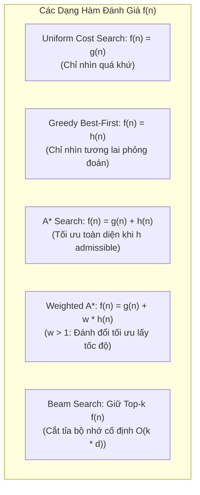
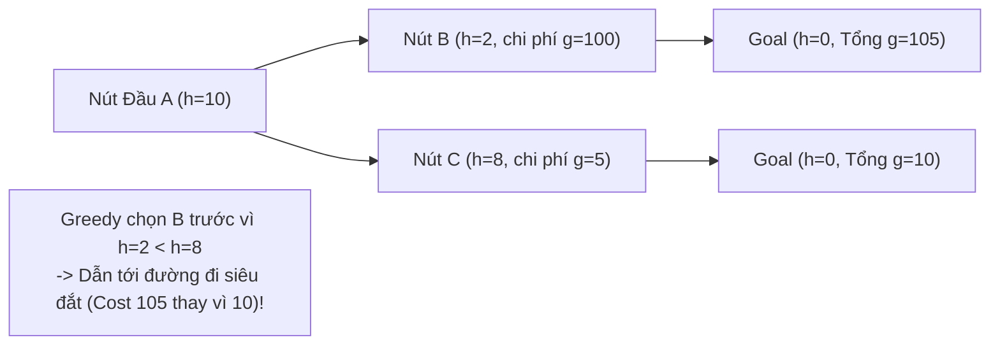
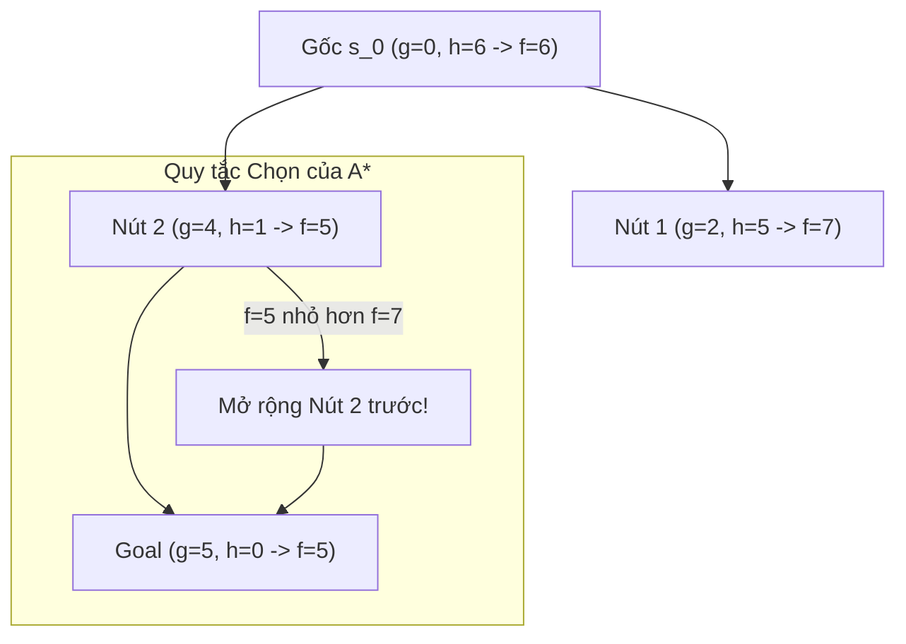
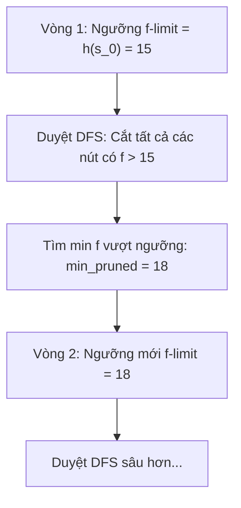
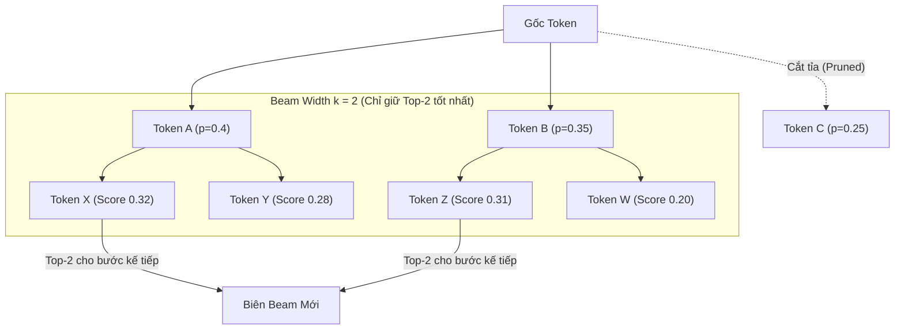

# Chuyên đề: Tìm kiếm Có Thông tin & Tìm kiếm Heuristic (Informed & Heuristic Search)

## 1. Tổng quan Chuyên đề
Khác với tìm kiếm mù, **Tìm kiếm Có thông tin (Informed Search)** hay **Tìm kiếm Heuristic** sử dụng tri thức đặc thù của miền bài toán thông qua hàm đánh giá phỏng đoán $h(n)$ để ước lượng khoảng cách từ trạng thái hiện tại tới trạng thái đích.

Việc tích hợp hàm Heuristic cho phép giải thuật cắt tỉa mạnh mẽ các nhánh không triển vọng trong cây tìm kiếm, biến một bài toán có độ phức tạp hàm mũ $\mathcal{O}(b^d)$ thành một quá trình tiệm cận tuyến tính trong trường hợp lý tưởng. Các thuật toán nền tảng trong họ này bao gồm:
- **Greedy Best-First Search**: Tham lam mở rộng nút có $h(n)$ nhỏ nhất.
- **A\* Search**: Cân bằng tối ưu giữa chi phí đã đi $g(n)$ và ước lượng tương lai $h(n)$ qua hàm $f(n) = g(n) + h(n)$.
- **Weighted A\***: Tăng tốc độ tìm kiếm bằng cách đánh đổi độ tối ưu qua hệ số trọng số $\epsilon > 1$: $f(n) = g(n) + (1 + \epsilon) h(n)$.
- **IDA\* (Iterative Deepening A\*)**: Giải quyết nút thắt cổ chai bộ nhớ của $A^*$ bằng cách lặp tăng dần ngưỡng $f$-limit.
- **Beam Search**: Giới hạn kích thước biên mở ở mức tối đa $k$ nút tốt nhất (Beam Width $k$), là xương sống của cơ chế sinh từ (decoding) trong các mô hình ngôn ngữ lớn (LLMs).



---

## 2. Chi tiết từng Keyword

---

### 1. Informed Search & Heuristic Search (Tìm kiếm Có Thông tin & Heuristic)

#### a. Định nghĩa Bản chất Toán học
Một chiến lược tìm kiếm có thông tin định nghĩa hàm đánh giá tổng quát:
$$f(n): \mathcal{S} \to \mathbb{R}$$
để sắp xếp thứ tự ưu tiên mở rộng các nút trong hàng đợi $\mathcal{F}$:
$$n^* = \arg\min_{n \in \mathcal{F}} f(n)$$
Hàm Heuristic $h(n)$ là một hàm toán học ánh xạ từ trạng thái đến một số thực không âm:
$$h(n) \approx h^*(n)$$
trong đó $h^*(n)$ là chi phí thực sự của đường đi tối ưu ngắn nhất từ nút $n$ đến bất kỳ nút mục tiêu nào.

- **Độ chính xác Heuristic (Effective Branching Factor $b^*$)**:
  Nếu $A^*$ sinh tổng cộng $N$ nút để tìm ra lời giải ở độ sâu $d$, hệ số phân nhánh hiệu dụng $b^*$ được xác định bằng nghiệm của phương trình:
  $$N + 1 = 1 + b^* + (b^*)^2 + \dots + (b^*)^d = \frac{(b^*)^{d+1} - 1}{b^* - 1}$$
  Một hàm heuristic càng tốt thì $b^*$ càng tiệm cận giá trị 1.

#### b. Cơ chế Tầng Sâu & Điện toán
- Việc tính toán $h(n)$ được gọi hàng triệu lần trong vòng lặp chính của thuật toán. Do đó, $h(n)$ phải được tối ưu hóa tối đa ở cấp độ thanh ghi CPU (Register-level optimization, bitwise operations, SIMD float operations), không được chứa cấp phát động bộ nhớ (`malloc` / `new`).

---

### 2. Greedy Best-First Search (Tìm kiếm Tốt nhất - Tham lam)

#### a. Định nghĩa Bản chất Toán học
Greedy Best-First Search luôn mở rộng nút được phỏng đoán là gần đích nhất:
$$f(n) = h(n)$$
- **Tính Toàn vẹn (Completeness)**: Không (có thể bị kẹt trong vòng lặp vô hạn trên đồ thị vô hạn nếu không dùng Graph Search).
- **Tính Tối ưu (Optimality)**: Không tối ưu. Thuật toán có thể bị đánh lừa bởi một bước đi cục bộ có vẻ gần đích nhưng thực tế lại dẫn vào ngõ cụt đắt đỏ.
- **Độ phức tạp Thời gian & Không gian**: Trường hợp xấu nhất là $\mathcal{O}(b^m)$, trong đó $m$ là độ sâu tối đa.

#### b. Sơ đồ Minh họa


#### c. Code Thực chiến (C++ & Python)
```cpp
// C++17: Greedy Best-First Search sử dụng std::priority_queue
#include <iostream>
#include <vector>
#include <queue>
#include <unordered_set>

struct Node {
    int id;
    int h_val;
    bool operator>(const Node& other) const { return h_val > other.h_val; }
};

int greedy_best_first_search(int start, int goal, 
                             const std::vector<std::vector<int>>& adj, 
                             const std::vector<int>& heuristic) {
    std::priority_queue<Node, std::vector<Node>, std::greater<Node>> frontier;
    std::unordered_set<int> visited;

    frontier.push({start, heuristic[start]});
    visited.insert(start);

    while (!frontier.empty()) {
        auto [u, h] = frontier.top();
        frontier.pop();

        if (u == goal) return u;

        for (int v : adj[u]) {
            if (visited.find(v) == visited.end()) {
                visited.insert(v);
                frontier.push({v, heuristic[v]});
            }
        }
    }
    return -1;
}

int main() {
    std::vector<std::vector<int>> adj = {{1, 2}, {3}, {3}, {}};
    std::vector<int> h = {10, 2, 8, 0}; // Node 1 có h=2 cực nhỏ
    int res = greedy_best_first_search(0, 3, adj, h);
    std::cout << "Greedy Search reached goal node: " << res << "\n";
    return 0;
}
```

```python
# Python: Greedy Best-First Search
import heapq

def greedy_bfs(adj, h_table, start, goal):
    pq = [(h_table[start], start, [start])]
    visited = {start}

    while pq:
        h, curr, path = heapq.heappop(pq)
        if curr == goal:
            return path
        for nxt in adj.get(curr, []):
            if nxt not in visited:
                visited.add(nxt)
                heapq.heappush(pq, (h_table[nxt], nxt, path + [nxt]))
    return None

graph = {'A': ['B', 'C'], 'B': ['D'], 'C': ['D'], 'D': []}
heuristics = {'A': 10, 'B': 2, 'C': 8, 'D': 0}
print("Greedy BFS Path:", greedy_bfs(graph, heuristics, 'A', 'D'))
```

---

### 3. A* Search (Thuật toán Tìm kiếm A*)

#### a. Định nghĩa Bản chất Toán học
Thuật toán $A^*$ kết hợp chi phí thực tế đã trải qua $g(n)$ với ước lượng tương lai $h(n)$:
$$f(n) = g(n) + h(n)$$
trong đó:
- $g(n)$: Chi phí đường đi ngắn nhất từ nút gốc $s_0$ đến nút $n$.
- $h(n)$: Chi phí ước lượng từ nút $n$ đến nút mục tiêu gần nhất.
- $f(n)$: Chi phí ước lượng của đường đi tối ưu hoàn chỉnh đi qua nút $n$.

**Định lý Tối ưu của $A^*$ (Optimality Theorems)**:
1. **Tree-Search $A^*$ là tối ưu** nếu $h(n)$ là **Admissible** (Chấp nhận được):
   $$0 \le h(n) \le h^*(n), \quad \forall n$$
2. **Graph-Search $A^*$ là tối ưu** nếu $h(n)$ là **Consistent (Monotonic)** (Nhất quán):
   $$h(n) \le c(n, a, n') + h(n'), \quad \forall n, n'$$
   Nếu $h$ nhất quán, dãy giá trị $f(n)$ của các nút được mở rộng tăng đơn điệu ($f(n') \ge f(n)$), và khi một nút được mở rộng (popped), đường đi tới nó được đảm bảo là đường đi ngắn nhất tuyệt đối (không bao giờ cần re-open nút đã đóng).

#### b. Cơ chế Tầng Sâu & Điện toán
- **Cấu trúc Nút (Node Layout)**: Để tối ưu hóa bộ nhớ Cache (64-byte Cache line), nút $A^*$ nên được thiết kế gọn gàng, tránh con trỏ thừa:
  ```cpp
  struct alignas(32) AStarNode {
      uint32_t state_id;
      float g_cost;
      float f_cost;
      uint32_t parent_idx;
  };
  ```

#### c. Sơ đồ Minh họa


#### d. Code Thực chiến (C++ & Python)
```cpp
// C++20: Thuật toán A* Tối ưu hóa Hiệu năng Cao trên Grid 2D
#include <iostream>
#include <vector>
#include <queue>
#include <cmath>
#include <unordered_map>

struct Point {
    int x, y;
    bool operator==(const Point& o) const { return x == o.x && y == o.y; }
};

struct PointHash {
    size_t operator()(const Point& p) const {
        return (std::hash<int>()(p.x) ^ (std::hash<int>()(p.y) << 1));
    }
};

struct Node {
    Point pt;
    double g, f;
    bool operator>(const Node& o) const { return f > o.f; }
};

double astar_grid(Point start, Point goal, int max_x, int max_y) {
    auto heuristic = [](Point a, Point b) {
        return std::abs(a.x - b.x) + std::abs(a.y - b.y); // Manhattan
    };

    std::priority_queue<Node, std::vector<Node>, std::greater<Node>> open_set;
    std::unordered_map<Point, double, PointHash> g_score;

    g_score[start] = 0.0;
    open_set.push({start, 0.0, static_cast<double>(heuristic(start, goal))});

    const int dx[] = {0, 0, 1, -1};
    const int dy[] = {1, -1, 0, 0};

    while (!open_set.empty()) {
        auto current = open_set.top();
        open_set.pop();

        if (current.pt == goal) return current.g;

        if (current.g > g_score[current.pt]) continue;

        for (int i = 0; i < 4; ++i) {
            Point neighbor{current.pt.x + dx[i], current.pt.y + dy[i]};
            if (neighbor.x < 0 || neighbor.x >= max_x || neighbor.y < 0 || neighbor.y >= max_y) continue;

            double tentative_g = current.g + 1.0;
            if (g_score.find(neighbor) == g_score.end() || tentative_g < g_score[neighbor]) {
                g_score[neighbor] = tentative_g;
                double f = tentative_g + heuristic(neighbor, goal);
                open_set.push({neighbor, tentative_g, f});
            }
        }
    }
    return -1.0;
}

int main() {
    Point start{0, 0}, goal{5, 5};
    double cost = astar_grid(start, goal, 10, 10);
    std::cout << "A* Optimal Path Cost: " << cost << "\n";
    return 0;
}
```

```python
# Python: A* Search Template với Priority Queue
import heapq
from typing import Tuple, Dict

def astar_search(start: Tuple[int, int], goal: Tuple[int, int]) -> float:
    h = lambda p: abs(p[0] - goal[0]) + abs(p[1] - goal[1])
    frontier = []
    heapq.heappush(frontier, (h(start), 0.0, start))
    g_costs: Dict[Tuple[int, int], float] = {start: 0.0}

    while frontier:
        f, g, u = heapq.heappop(frontier)
        if u == goal:
            return g

        for dx, dy in [(0, 1), (0, -1), (1, 0), (-1, 0)]:
            v = (u[0] + dx, u[1] + dy)
            tentative_g = g + 1.0
            if v not in g_costs or tentative_g < g_costs[v]:
                g_costs[v] = tentative_g
                heapq.heappush(frontier, (tentative_g + h(v), tentative_g, v))
    return -1.0

print("A* Shortest Distance:", astar_search((0, 0), (10, 10)))
```

#### e. Lỗi Thường gặp & Ứng dụng
- **Memory Wall**: $A^*$ giữ toàn bộ các nút sinh ra trong RAM. Với bản đồ lớn hoặc không gian trạng thái phức tạp, $A^*$ sẽ hết bộ nhớ rất lâu trước khi hết thời gian chạy. Ứng dụng: Lập trình game AI di chuyển đơn vị (StarCraft, RTS), hệ thống định vị GPS tự động.

---

### 4. Weighted A* & IDA* (A* Có Trọng Số & A* Lặp Tăng Dần Độ Sâu)

#### a. Định nghĩa Bản chất Toán học
- **Weighted A\***: Đưa vào hệ số nhân trọng lượng $w > 1$ (hoặc $1 + \epsilon$) gán cho hàm heuristic:
  $$f(n) = g(n) + w \cdot h(n), \quad w \ge 1$$
  - **Tính chất $\epsilon$-Admissible**: Chi phí của lời giải tìm được đảm bảo không vượt quá $w$ lần chi phí tối ưu thực tế:
    $$\text{Cost}(\text{Solution}) \le w \cdot C^*$$
  - **Tốc độ**: Giúp $A^*$ hướng mạnh mẽ về phía đích giống Greedy Search, giảm số lượng nút mở rộng đi hàng trăm lần.
- **IDA\* (Iterative Deepening A\*)**:
  Thay vì dùng hàng đợi ưu tiên trong bộ nhớ heap, IDA\* sử dụng thuật toán DFS đệ quy với một ngưỡng cắt tỉa $f\text{-limit}$.
  - Vòng lặp ban đầu: $\text{limit} = f(s_0) = h(s_0)$.
  - Nếu nhánh nào có $f(n) > \text{limit}$, nhánh đó bị cắt tỉa; ngưỡng limit tiếp theo được cập nhật bằng giá trị $f(n)$ nhỏ nhất trong số các nhánh bị cắt tỉa:
    $$\text{limit}_{\text{next}} = \min_{n \text{ pruned}} f(n)$$
  - **Space Complexity**: Tiết kiệm tuyệt đối $\mathcal{O}(d)$, giải quyết triệt để nút thắt cổ chai bộ nhớ của $A^*$.

#### b. Sơ đồ Minh họa


#### c. Code Thực chiến (C++ & Python)
```cpp
// C++20: IDA* Algorithm Framework cho Bài toán Đồ thị
#include <iostream>
#include <vector>
#include <algorithm>

const int INF = 1e9;

struct Edge {
    int to;
    int cost;
};

class IDAStarSolver {
private:
    const std::vector<std::vector<Edge>>& graph_;
    const std::vector<int>& h_;
    int goal_;

    int search(int u, int g, int threshold) {
        int f = g + h_[u];
        if (f > threshold) return f;
        if (u == goal_) return -1; // Đã tìm thấy đích!

        int min_val = INF;
        for (const auto& edge : graph_[u]) {
            int t = search(edge.to, g + edge.cost, threshold);
            if (t == -1) return -1;
            if (t < min_val) min_val = t;
        }
        return min_val;
    }

public:
    IDAStarSolver(const std::vector<std::vector<Edge>>& g, const std::vector<int>& h, int goal)
        : graph_(g), h_(h), goal_(goal) {}

    int solve(int start) {
        int threshold = h_[start];
        while (true) {
            int t = search(start, 0, threshold);
            if (t == -1) return threshold; // Thành công
            if (t == INF) return -1;       // Không có đường đi
            threshold = t;                 // Nâng ngưỡng f-limit
        }
    }
};

int main() {
    std::vector<std::vector<Edge>> g = { {{1, 3}, {2, 2}}, {{3, 4}}, {{3, 1}}, {} };
    std::vector<int> h = {5, 3, 2, 0};
    IDAStarSolver solver(g, h, 3);
    std::cout << "IDA* Found Goal Cost: " << solver.solve(0) << "\n";
    return 0;
}
```

```python
# Python: Weighted A* vs Standard A* Node Expansion Tracker
import heapq

def weighted_astar(adj, h_table, start, goal, w=1.5):
    frontier = []
    heapq.heappush(frontier, (w * h_table[start], 0, start))
    g_costs = {start: 0}
    nodes_expanded = 0

    while frontier:
        f, g, u = heapq.heappop(frontier)
        nodes_expanded += 1
        if u == goal:
            return g, nodes_expanded

        for v, cost in adj.get(u, []):
            new_g = g + cost
            if v not in g_costs or new_g < g_costs[v]:
                g_costs[v] = new_g
                heapq.heappush(frontier, (new_g + w * h_table[v], new_g, v))
    return -1, nodes_expanded

graph = {
    0: [(1, 1), (2, 2)],
    1: [(3, 5)],
    2: [(3, 1)],
    3: []
}
h = {0: 3, 1: 2, 2: 1, 3: 0}

cost_std, exp_std = weighted_astar(graph, h, 0, 3, w=1.0)
cost_w, exp_w = weighted_astar(graph, h, 0, 3, w=2.5)
print(f"Standard A* (w=1.0): Cost={cost_std}, Nodes Expanded={exp_std}")
print(f"Weighted A* (w=2.5): Cost={cost_w}, Nodes Expanded={exp_w}")
```

---

### 5. Beam Search (Tìm kiếm Chùm tia)

#### a. Định nghĩa Bản chất Toán học
Beam Search là một biến thể tối ưu hóa bộ nhớ của Best-First Search. Tại mỗi bước mở rộng độ sâu, thay vì lưu trữ toàn bộ các nút con sinh ra, Beam Search chỉ giữ lại đúng $k$ nút có điểm số $f(n)$ tốt nhất:
$$\mathcal{B}_{t+1} = \text{Top-}k \left( \bigcup_{n \in \mathcal{B}_t} \text{Successors}(n) \right)$$
trong đó $k$ được gọi là **Beam Width (Độ rộng chùm)**.
- **Space Complexity**: $\mathcal{O}(k \cdot d)$ — hoàn toàn bị chặn và kiểm soát được bộ nhớ RAM.
- **Đặc tính**: Không hoàn chỉnh (Incomplete) và Không tối ưu (Inoptimal), nhưng cực kỳ nhanh và hiệu quả trong thực tế.

#### b. Sơ đồ Minh họa


#### c. Code Thực chiến (C++ & Python)
```cpp
// C++20: Top-K Beam Search Buffer Implementation
#include <iostream>
#include <vector>
#include <queue>
#include <string>
#include <algorithm>

struct BeamCandidate {
    std::string sequence;
    double log_prob;
    bool operator<(const BeamCandidate& o) const { return log_prob < o.log_prob; }
};

std::vector<BeamCandidate> beam_search_step(const std::vector<BeamCandidate>& current_beam, 
                                            const std::vector<std::string>& vocab, 
                                            size_t k) {
    std::vector<BeamCandidate> all_candidates;

    for (const auto& cand : current_beam) {
        for (size_t i = 0; i < vocab.size(); ++i) {
            double dummy_step_prob = -1.0 * (i + 1); // Giả lập log prob
            all_candidates.push_back({cand.sequence + " " + vocab[i], cand.log_prob + dummy_step_prob});
        }
    }

    // Giữ đúng Top-K phần tử có điểm số cao nhất
    std::sort(all_candidates.begin(), all_candidates.end(), [](const BeamCandidate& a, const BeamCandidate& b) {
        return a.log_prob > b.log_prob;
    });

    if (all_candidates.size() > k) {
        all_candidates.resize(k);
    }
    return all_candidates;
}

int main() {
    std::vector<BeamCandidate> beam = {{"<s>", 0.0}};
    std::vector<std::string> vocab = {"The", "A", "One"};
    auto next_beam = beam_search_step(beam, vocab, 2);

    for (const auto& item : next_beam) {
        std::cout << "Beam Item: " << item.sequence << " | Score: " << item.log_prob << "\n";
    }
    return 0;
}
```

```python
# Python: LLM Autoregressive Beam Search Decoding Simulator
import numpy as np

def simulate_beam_search_step(beam_sequences, vocab, beam_width=3):
    candidates = []
    for seq, score in beam_sequences:
        # Giả lập phân phối logit tiếp theo từ mô hình ngôn ngữ
        simulated_logits = np.random.uniform(-3.0, -0.1, size=len(vocab))
        for token_idx, token in enumerate(vocab):
            new_seq = seq + [token]
            new_score = score + simulated_logits[token_idx]
            candidates.append((new_seq, new_score))

    # Chọn Top-k chuỗi có tổng log-likelihood cao nhất
    candidates.sort(key=lambda x: x[1], reverse=True)
    return candidates[:beam_width]

vocabulary = ["deep", "learning", "model", "agent"]
beam = [([ "START" ], 0.0)]

for step in range(3):
    beam = simulate_beam_search_step(beam, vocabulary, beam_width=2)

print("Top Decoded Beam Sequences:")
for seq, sc in beam:
    print(" ".join(seq), f"(Score: {sc:.3f})")
```

#### d. Lỗi Thường gặp & Ứng dụng
- **Lặp từ trong Beam Search (Degeneration Problem)**: Beam Search trong LLMs thường dễ rơi vào vòng lặp lặp từ vô tận nếu không có cơ chế `repetition_penalty` hoặc `no_repeat_ngram_size`.
- **Ứng dụng AI**: Cơ chế sinh văn bản tự hồi quy trong GPT-4, dịch máy Neural Machine Translation (NMT), và nhận dạng giọng nói tự động (Whisper ASR).
