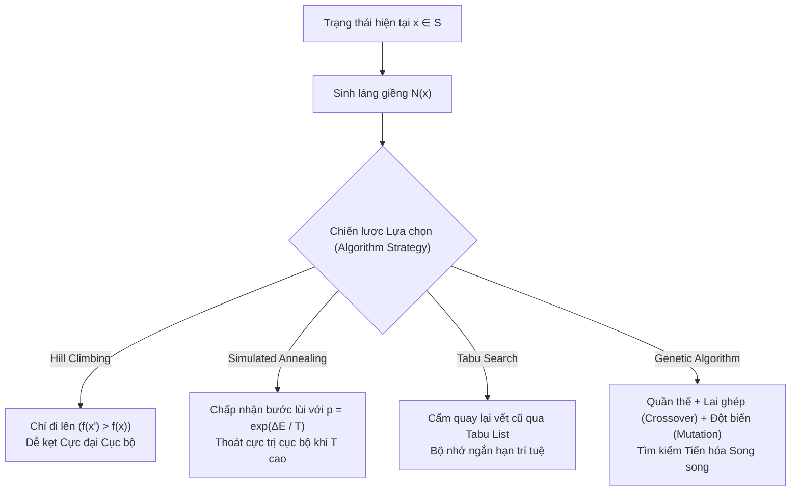
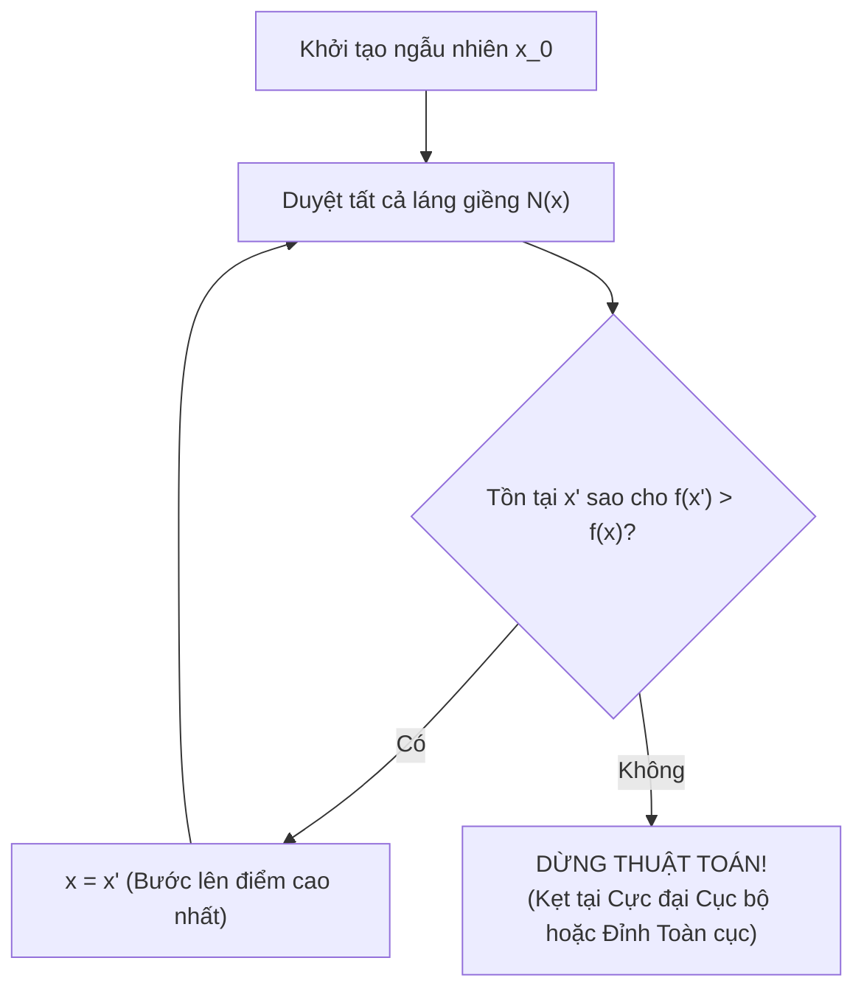
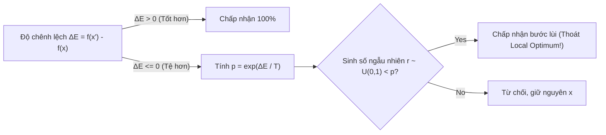
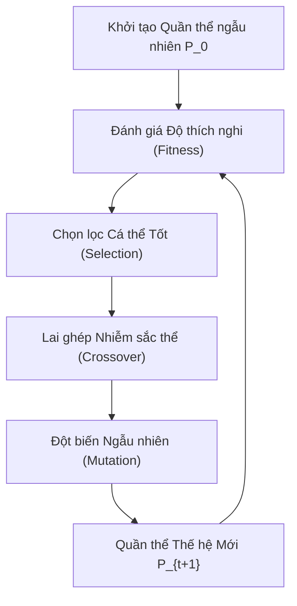

# Chuyên đề: Tìm kiếm Cục bộ & Tối ưu hóa Tổ hợp (Local Search & Combinatorial Optimization)

## 1. Tổng quan Chuyên đề
Trong nhiều bài toán AI thực tế (như bài toán xếp lịch, định tuyến xe cộ VRP, tối ưu cấu trúc mạng nơ-ron NAS, hoặc bài toán $N$-Queens), **đường đi (path)** dẫn đến đích hoàn toàn không quan trọng; điều quan trọng duy nhất là **cấu hình của trạng thái đích (Goal State Configuration)**.

**Tìm kiếm Cục bộ (Local Search)** hoạt động dựa trên nguyên lý: duy trì một (hoặc một quần thể) trạng thái hiện tại $\mathbf{x} \in \mathcal{S}$ và di chuyển dần sang các trạng thái lân cận $\mathcal{N}(\mathbf{x})$ nhằm tối ưu hóa một hàm mục tiêu $f(\mathbf{x})$. Ưu điểm tuyệt đối của Local Search là **độ phức tạp bộ nhớ $\mathcal{O}(1)$** (hoặc $\mathcal{O}(\text{Population Size})$), cho phép giải quyết các bài toán tối ưu hóa tổ hợp khổng lồ mà các giải thuật tìm kiếm cây có hệ thống ($A^*$, BFS) hoàn toàn bất khả thi.



---

## 2. Chi tiết từng Keyword

---

### 1. Local Search & Combinatorial Optimization (Tìm kiếm Cục bộ & Tối ưu hóa Tổ hợp)

#### a. Định nghĩa Bản chất Toán học
Một bài toán **Tối ưu hóa Tổ hợp (Combinatorial Optimization)** được định nghĩa bởi:
$$\min_{\mathbf{x} \in \mathcal{D}} f(\mathbf{x}) \quad \text{hoặc} \quad \max_{\mathbf{x} \in \mathcal{D}} f(\mathbf{x})$$
trong đó $\mathcal{D}$ là một tập hợp rời rạc các cấu hình khả dĩ (thường có kích thước cấp số nhân, ví dụ $|\mathcal{D}| = n!$ đối với bài toán TSP).

**Tìm kiếm Cục bộ (Local Search)** định nghĩa một cấu trúc lân cận (Neighborhood Structure):
$$\mathcal{N}: \mathcal{D} \to \mathcal{P}(\mathcal{D})$$
Tác tử khởi tạo tại $\mathbf{x}_0 \in \mathcal{D}$ và cập nhật trạng thái theo quy tắc chuyển dịch:
$$\mathbf{x}_{t+1} \in \mathcal{N}(\mathbf{x}_t)$$

#### b. Cơ chế Tầng Sâu & Điện toán
- **Memory Footprint**: Cực kỳ nhỏ gọn, thường chỉ là một con trỏ hoặc mảng cố định trên Stack / L1 Cache. Không cần duy trì đồ thị hay hàng đợi ưu tiên.
- **Biểu diễn Bitmask & SIMD**: Trạng thái tổ hợp thường được nén vào các biến nguyên 64-bit (`uint64_t`) để thực hiện các phép toán láng giềng bằng các lệnh bitwise (`__builtin_popcount`, `__builtin_ctz`) có tốc độ đúng 1 chu kỳ CPU.

---

### 2. Hill Climbing & Random Search (Leo đồi & Tìm kiếm Ngẫu nhiên)

#### a. Định nghĩa Bản chất Toán học
- **Hill Climbing (Steepest-Ascent)**: Tại mỗi bước, thuật toán chọn trạng thái lân cận có giá trị hàm mục tiêu cao nhất:
  $$\mathbf{x}_{t+1} = \arg\max_{\mathbf{x}' \in \mathcal{N}(\mathbf{x}_t)} f(\mathbf{x}')$$
  Điều kiện dừng: Thuật toán dừng lại ngay khi $\forall \mathbf{x}' \in \mathcal{N}(\mathbf{x}_t), f(\mathbf{x}') \le f(\mathbf{x}_t)$.
- **Các Rào cản Cổ điển**:
  - **Local Maxima (Cực đại cục bộ)**: Đỉnh núi thấp hơn đỉnh toàn cục.
  - **Plateaux / Shoulders (Bình nguyên)**: Vùng phẳng mà mọi láng giềng đều có giá trị bằng nhau ($\nabla f = 0$), thuật toán bị lang thang ngẫu nhiên.
  - **Ridges (Sống núi dốc)**: Sống núi có sườn dốc khiến việc đi dọc theo từng trục tọa độ độc lập bị bế tắc.
- **Random Search**: Sinh ngẫu nhiên hoàn toàn các cấu hình $\mathbf{x} \sim \text{Uniform}(\mathcal{D})$ không phụ thuộc vào trạng thái trước. Tuy đơn giản, Random Search đóng vai trò đường cơ sở (baseline) chuẩn mực để đo lường hiệu quả của các heuristic thông minh.

#### b. Sơ đồ Minh họa


#### c. Code Thực chiến (C++ & Python)
```cpp
// C++20: Hill Climbing giải bài toán N-Queens tối ưu số cặp xung đột
#include <iostream>
#include <vector>
#include <random>
#include <cmath>

int compute_conflicts(const std::vector<int>& board) {
    int n = board.size();
    int conflicts = 0;
    for (int i = 0; i < n; ++i) {
        for (int j = i + 1; j < n; ++j) {
            if (board[i] == board[j] || std::abs(board[i] - board[j]) == std::abs(i - j)) {
                conflicts++;
            }
        }
    }
    return conflicts;
}

std::vector<int> hill_climbing_nqueens(int n, int max_iterations = 1000) {
    std::mt19937 rng(42);
    std::uniform_int_distribution<int> dist(0, n - 1);
    std::vector<int> current(n);
    for (int i = 0; i < n; ++i) current[i] = dist(rng);

    int current_cost = compute_conflicts(current);

    for (int iter = 0; iter < max_iterations && current_cost > 0; ++iter) {
        int best_col = -1, best_row = -1;
        int min_neighbor_cost = current_cost;

        for (int c = 0; c < n; ++c) {
            int original_row = current[c];
            for (int r = 0; r < n; ++r) {
                if (r == original_row) continue;
                current[c] = r;
                int cost = compute_conflicts(current);
                if (cost < min_neighbor_cost) {
                    min_neighbor_cost = cost;
                    best_col = c;
                    best_row = r;
                }
            }
            current[c] = original_row;
        }

        if (best_col == -1) break; // Kẹt tại cực tiểu cục bộ!
        current[best_col] = best_row;
        current_cost = min_neighbor_cost;
    }
    return current;
}

int main() {
    auto solution = hill_climbing_nqueens(8);
    std::cout << "Remaining Conflicts: " << compute_conflicts(solution) << "\n";
    return 0;
}
```

```python
# Python: Random-Restart Hill Climbing
import numpy as np

def sphere_objective(x):
    return -np.sum(x ** 2) # Cực đại hóa tại x = 0

def hill_climb_step(curr_x, step_size=0.1):
    best_x = curr_x
    best_val = sphere_objective(curr_x)
    for _ in range(20): # Lấy mẫu 20 láng giềng ngẫu nhiên
        candidate = curr_x + np.random.uniform(-step_size, step_size, size=curr_x.shape)
        val = sphere_objective(candidate)
        if val > best_val:
            best_val = val
            best_x = candidate
    return best_x, best_val

x = np.array([5.0, -4.0])
for _ in range(50):
    x, score = hill_climb_step(x)
print(f"Hill Climbing Optimized Coord: {x}, Score: {score:.4f}")
```

---

### 3. Simulated Annealing (Tôi luyện Thép Mô phỏng)

#### a. Định nghĩa Bản chất Toán học
Lấy cảm hứng từ hiện tượng nhiệt động lực học khi làm nguội chậm kim loại nóng chảy để các nguyên tử sắp xếp vào cấu trúc tinh thể có năng lượng tối thiểu (Annealing).
Tại trạng thái $\mathbf{x}$, thuật toán chọn ngẫu nhiên một láng giềng $\mathbf{x}' \in \mathcal{N}(\mathbf{x})$:
- Độ chênh lệch năng lượng: $\Delta E = f(\mathbf{x}') - f(\mathbf{x})$.
- Nếu $\Delta E > 0$ (bước đi cải thiện): **Luôn chấp nhận** di chuyển sang $\mathbf{x}'$.
- Nếu $\Delta E \le 0$ (bước đi lùi): **Chấp nhận với xác suất Metropolis**:
  $$P(\text{Accept}) = \exp\left( \frac{\Delta E}{T} \right)$$
trong đó $T > 0$ là nhiệt độ hệ thống, giảm dần theo thời gian qua lịch trình làm nguội (Cooling Schedule):
$$T_{k+1} = \alpha T_k \quad (\alpha \in [0.8, 0.99])$$
- **Định lý Hội tụ (Geman & Geman, 1984)**: Nếu nhiệt độ giảm đủ chậm theo lịch trình $T_k \ge \frac{C}{\log(k + 1)}$, thuật toán đảm bảo hội tụ tới cực trị toàn cục (Global Optimum) với xác suất bằng 1.

#### b. Sơ đồ Minh họa


#### c. Code Thực chiến (C++ & Python)
```cpp
// C++20: Simulated Annealing Solver cho Hàm Phi tuyến Đa cực trị
#include <iostream>
#include <cmath>
#include <random>

double objective_fn(double x) {
    // Hàm đa cực trị: Rastrigin 1D
    return -(x * x - 10.0 * std::cos(2.0 * M_PI * x) + 10.0);
}

double simulated_annealing() {
    std::mt19937 rng(1337);
    std::uniform_real_distribution<double> u_dist(0.0, 1.0);
    std::normal_distribution<double> step_dist(0.0, 0.5);

    double current_x = 4.5; // Bắt đầu ở xa cực đại toàn cục (x=0)
    double current_energy = objective_fn(current_x);

    double T = 100.0;
    const double T_min = 1e-4;
    const double alpha = 0.95;

    while (T > T_min) {
        double next_x = current_x + step_dist(rng);
        double next_energy = objective_fn(next_x);
        double delta_E = next_energy - current_energy;

        if (delta_E > 0.0 || u_dist(rng) < std::exp(delta_E / T)) {
            current_x = next_x;
            current_energy = next_energy;
        }
        T *= alpha; // Làm nguội hệ thống
    }
    return current_x;
}

int main() {
    double best_x = simulated_annealing();
    std::cout << "Global Maximum found at x = " << best_x << " with Value: " << objective_fn(best_x) << "\n";
    return 0;
}
```

```python
# Python: Simulated Annealing Vectorized Visualizer
import numpy as np

def run_simulated_annealing(f, init_x, t_init=100.0, alpha=0.98, max_steps=500):
    curr_x = np.copy(init_x)
    curr_score = f(curr_x)
    T = t_init

    for step in range(max_steps):
        candidate = curr_x + np.random.normal(0, 0.2, size=curr_x.shape)
        cand_score = f(candidate)
        delta = cand_score - curr_score

        if delta > 0 or np.random.rand() < np.exp(delta / max(T, 1e-8)):
            curr_x = candidate
            curr_score = cand_score
        T *= alpha

    return curr_x, curr_score

rastrigin = lambda x: -np.sum(x**2 - 10*np.cos(2*np.pi*x) + 10)
sol, val = run_simulated_annealing(rastrigin, np.array([3.5, -2.5]))
print(f"Annealed Solution: {sol}, Score: {val:.4f}")
```

---

### 4. Tabu Search & Genetic / Evolutionary Search

#### a. Định nghĩa Bản chất Toán học
- **Tabu Search (Fred Glover)**:
  Sử dụng cấu trúc bộ nhớ ngắn hạn **Tabu List $\mathcal{T}$** (thường là hàng đợi vòng FIFO kích thước $S$) lưu lại các trạng thái hoặc các phép biến đổi vừa thực hiện để cấm quay lại trong một số bước:
  $$\mathbf{x}_{t+1} = \arg\max_{\mathbf{x}' \in \mathcal{N}(\mathbf{x}_t) \setminus \mathcal{T}} f(\mathbf{x}')$$
  - **Aspiration Criterion (Tiêu chí Khát khao)**: Nếu một bước đi bị cấm bởi Tabu nhưng lại mang lại giá trị hàm mục tiêu tốt hơn kỷ lục toàn cục tốt nhất từ trước đến nay, lệnh cấm sẽ bị hủy bỏ (override).
- **Genetic Algorithms (GA / Evolutionary Search - John Holland)**:
  Duy trì một quần thể cá thể $\mathcal{P} = \{\mathbf{x}_1, \dots, \mathbf{x}_M\}$. Tiến hóa qua các thế hệ thông qua 3 toán tử phỏng sinh học:
  1. **Selection (Chọn lọc tự nhiên)**: Dựa trên độ thích nghi (Fitness proportional / Roulette Wheel hoặc Tournament Selection):
     $$P(\mathbf{x}_i) = \frac{\text{Fitness}(\mathbf{x}_i)}{\sum_j \text{Fitness}(\mathbf{x}_j)}$$
  2. **Crossover (Lai ghép)**: Kết hợp vật liệu di truyền từ 2 cá thể cha mẹ để sinh con:
     $$\mathbf{x}_{\text{child}} = \mathbf{M} \odot \mathbf{x}_{\text{parent1}} + (1 - \mathbf{M}) \odot \mathbf{x}_{\text{parent2}}$$
  3. **Mutation (Đột biến)**: Đảo bit hoặc nhiễu ngẫu nhiên với xác suất nhỏ $p_m \ll 1$ để duy trì tính đa dạng di truyền.

#### b. Sơ đồ Minh họa


#### c. Code Thực chiến (C++ & Python)
```cpp
// C++20: Simple Genetic Algorithm Bitstring Optimizer
#include <iostream>
#include <vector>
#include <string>
#include <random>
#include <algorithm>

const int CHROMO_LEN = 16;
const int POP_SIZE = 20;

struct Individual {
    std::string genes;
    int fitness;
};

int evaluate_fitness(const std::string& genes) {
    // One-Max Problem: Đếm số lượng bit '1'
    int count = 0;
    for (char c : genes) if (c == '1') count++;
    return count;
}

Individual crossover(const Individual& p1, const Individual& p2, std::mt19937& rng) {
    std::uniform_int_distribution<int> dist(1, CHROMO_LEN - 2);
    int point = dist(rng);
    std::string child_genes = p1.genes.substr(0, point) + p2.genes.substr(point);
    return {child_genes, evaluate_fitness(child_genes)};
}

int main() {
    std::mt19937 rng(42);
    std::uniform_int_distribution<int> bit_dist(0, 1);

    std::vector<Individual> population(POP_SIZE);
    for (auto& ind : population) {
        ind.genes.resize(CHROMO_LEN);
        for (int i = 0; i < CHROMO_LEN; ++i) ind.genes[i] = bit_dist(rng) ? '1' : '0';
        ind.fitness = evaluate_fitness(ind.genes);
    }

    for (int gen = 0; gen < 50; ++gen) {
        std::sort(population.begin(), population.end(), [](const Individual& a, const Individual& b) {
            return a.fitness > b.fitness;
        });
        if (population[0].fitness == CHROMO_LEN) break; // Hoàn thành

        // Sinh thế hệ mới từ Top cá thể
        std::vector<Individual> next_gen = {population[0], population[1]}; // Elitism
        while (next_gen.size() < POP_SIZE) {
            next_gen.push_back(crossover(population[0], population[1], rng));
        }
        population = next_gen;
    }

    std::cout << "Best GA Individual: " << population[0].genes << " with Fitness: " << population[0].fitness << "\n";
    return 0;
}
```

```python
# Python: Tabu Search Simulator for 1D Function
def tabu_search_1d(target_val=42, max_iters=50, tabu_tenure=5):
    curr_x = 0
    best_x = curr_x
    tabu_list = []

    for _ in range(max_iters):
        # Láng giềng: x - 2, x - 1, x + 1, x + 2
        neighbors = [curr_x + d for d in [-2, -1, 1, 2]]
        # Lọc láng giềng không nằm trong Tabu hoặc thỏa tiêu chí khát khao
        valid_cands = [
            n for n in neighbors 
            if n not in tabu_list or abs(n - target_val) < abs(best_x - target_val)
        ]
        if not valid_cands: break

        # Chọn ứng viên có khoảng cách tới target nhỏ nhất
        curr_x = min(valid_cands, key=lambda n: abs(n - target_val))
        if abs(curr_x - target_val) < abs(best_x - target_val):
            best_x = curr_x

        tabu_list.append(curr_x)
        if len(tabu_list) > tabu_tenure:
            tabu_list.pop(0)

    return best_x

print("Tabu Search Found Target:", tabu_search_1d())
```

#### d. Lỗi Thường gặp & Ứng dụng
- **Premature Convergence trong GA**: Quần thể bị đồng nhất hóa gen quá sớm do áp lực chọn lọc quá cao, làm mất tính đa dạng và kẹt tại cực tiểu địa phương.
- **Ứng dụng AI**: Tối ưu hóa siêu tham số (Hyperparameter Tuning), Neural Architecture Search (NAS), bài toán đóng gói container (Bin Packing) và định tuyến giao vận hàng triệu đơn hàng.
