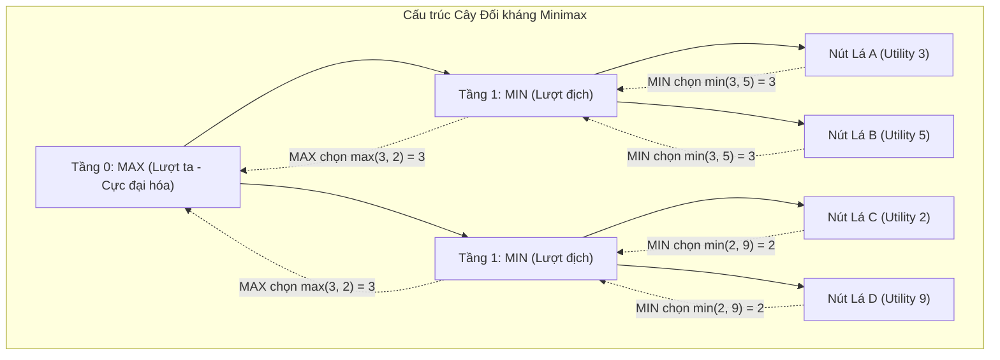
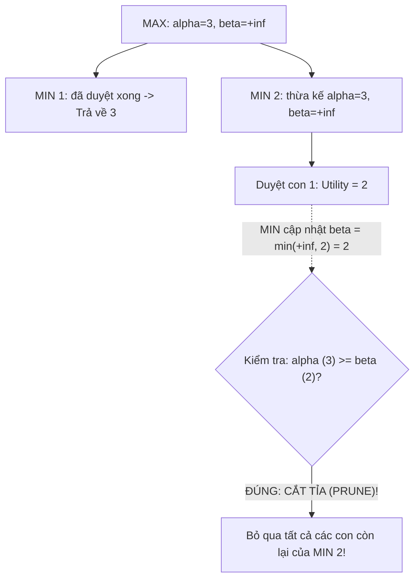
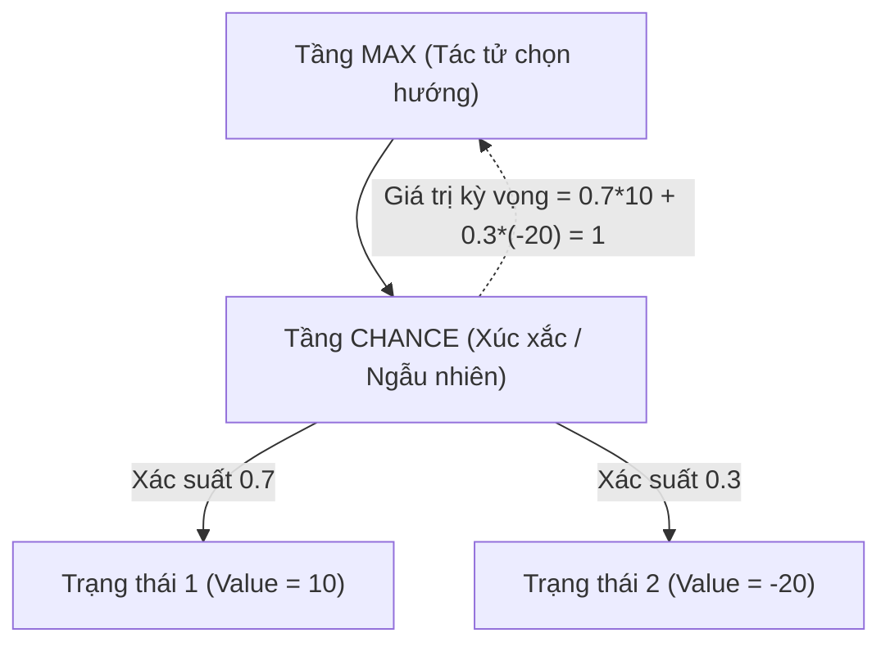
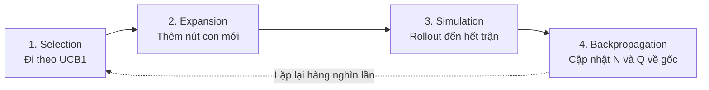

# Chuyên đề: Tìm kiếm Đối kháng & Cây Trò chơi (Adversarial Search & Game Trees)

## 1. Tổng quan Chuyên đề
Trong môi trường cạnh tranh có đối thủ (Adversarial Environments), tác tử không còn độc quyền quyết định trạng thái tiếp theo của thế giới; thay vào đó, các đối thủ có mục tiêu trái ngược hoàn toàn (Zero-Sum Games) sẽ chủ động thực hiện các nước đi nhằm phá hủy hoặc cực tiểu hóa lợi ích của tác tử.

Hình thái tính toán trung tâm ở đây là **Cây Trò chơi (Game Tree)**, nơi các tầng của cây luân phiên giữa lượt của tác tử (MAX node) và lượt của đối thủ (MIN node). Các giải thuật nền tảng bao gồm:
1. **Minimax Algorithm**: Mô hình hóa thế đối kháng hoàn hảo bằng quy nạp ngược (Backward Induction).
2. **Alpha-Beta Pruning**: Kỹ thuật cắt tỉa nhánh toán học chính xác 100%, tăng gấp đôi độ sâu tìm kiếm trong cùng một giới hạn thời gian.
3. **Expectimax**: Mở rộng đối kháng cho các trò chơi có yếu tố ngẫu nhiên (may rủi, xúc xắc, chia bài).
4. **Monte Carlo Tree Search (MCTS)**: Cách mạng hóa tìm kiếm trò chơi không gian khổng lồ (Cờ vây, AlphaGo) thông qua 4 giai đoạn lặp: *Selection*, *Expansion*, *Simulation*, và *Backpropagation* kết hợp chỉ số UCB1.



---

## 2. Chi tiết từng Keyword

---

### 1. Adversarial Search & Game Tree Search (Tìm kiếm Đối kháng & Cây Trò chơi)

#### a. Định nghĩa Bản chất Toán học
Một trò chơi 2 người chơi tổng bằng không, thông tin hoàn hảo (2-Player Zero-Sum Game) được định nghĩa hình thức bởi bộ:
$$\mathcal{G} = \langle \mathcal{S}, \mathcal{A}, \mathcal{T}, s_0, \text{Player}(s), \text{TerminalTest}(s), \text{Utility}(s, p) \rangle$$
trong đó:
- $\text{Player}(s) \in \{\text{MAX}, \text{MIN}\}$: Xác định lượt đi của ai tại trạng thái $s$.
- $\text{Utility}(s, \text{MAX}) = -\text{Utility}(s, \text{MIN})$ (Tính chất Zero-Sum).
- Cây trò chơi sinh ra từ $s_0$ có hệ số phân nhánh trung bình $b$ và độ sâu trận đấu $d$.
  - Tic-Tac-Toe: $\approx 10^5$ trạng thái.
  - Cờ vua: $b \approx 35, d \approx 80 \implies 35^{80} \approx 10^{123}$ trạng thái (Số Shannon).
  - Cờ vây: $b \approx 250, d \approx 150 \implies 250^{150} \approx 10^{360}$ trạng thái.

#### b. Cơ chế Tầng Sâu & Điện toán
- Do kích thước cây vượt quá số lượng nguyên tử trong vũ trụ ($\approx 10^{80}$), hệ thống phải sử dụng **Bảng Chuyển dịch (Transposition Table)** lưu trữ các trạng thái trùng lặp bằng Zobrist Hashing (sử dụng phép XOR 64-bit cực nhanh) kết hợp với **Giới hạn Độ sâu (Depth-Limited Evaluation)**.

---

### 2. Minimax Algorithm (Thuật toán Minimax)

#### a. Định nghĩa Bản chất Toán học
Giá trị Minimax của một nút $n$ được xác định đệ quy:
$$\text{Minimax}(n) = \begin{cases} 
\text{Utility}(n) & \text{nếu } \text{TerminalTest}(n) \\
\max_{a \in \mathcal{A}(n)} \text{Minimax}(\text{Result}(n, a)) & \text{nếu } \text{Player}(n) = \text{MAX} \\
\min_{a \in \mathcal{A}(n)} \text{Minimax}(\text{Result}(n, a)) & \text{nếu } \text{Player}(n) = \text{MIN}
\end{cases}$$
- **Time Complexity**: $\mathcal{O}(b^d)$.
- **Space Complexity**: $\mathcal{O}(bd)$ (Sử dụng DFS đệ quy).
- **Tính tối ưu**: Đảm bảo tối ưu khi đối thủ cũng chơi hoàn hảo (Rational Opponent).

#### b. Code Thực chiến (C++ & Python)
```cpp
// C++20: Minimax Đệ quy Chuẩn mực
#include <iostream>
#include <vector>
#include <algorithm>

const int INF = 1e9;

struct GameNode {
    bool is_terminal;
    int utility;
    std::vector<GameNode> children;
};

int minimax(const GameNode& node, bool is_maximizing) {
    if (node.is_terminal) {
        return node.utility;
    }

    if (is_maximizing) {
        int max_eval = -INF;
        for (const auto& child : node.children) {
            int eval = minimax(child, false);
            max_eval = std::max(max_eval, eval);
        }
        return max_eval;
    } else {
        int min_eval = INF;
        for (const auto& child : node.children) {
            int eval = minimax(child, true);
            min_eval = std::min(min_eval, eval);
        }
        return min_eval;
    }
}

int main() {
    GameNode root{false, 0, {
        {false, 0, {{true, 3, {}}, {true, 5, {}}}}, // MIN 1
        {false, 0, {{true, 2, {}}, {true, 9, {}}}}  // MIN 2
    }};
    std::cout << "Minimax Value at Root: " << minimax(root, true) << "\n"; // Kết quả: 3
    return 0;
}
```

```python
# Python: Minimax với Hàm Đánh giá Tĩnh (Heuristic Cutoff)
def minimax_depth(state, depth, is_max, eval_fn, terminal_fn, successors_fn):
    if depth == 0 or terminal_fn(state):
        return eval_fn(state)

    if is_max:
        max_val = -float('inf')
        for next_s in successors_fn(state):
            val = minimax_depth(next_s, depth - 1, False, eval_fn, terminal_fn, successors_fn)
            max_val = max(max_val, val)
        return max_val
    else:
        min_val = float('inf')
        for next_s in successors_fn(state):
            val = minimax_depth(next_s, depth - 1, True, eval_fn, terminal_fn, successors_fn)
            min_val = min(min_val, val)
        return min_val

print("Minimax Demo Passed.")
```

---

### 3. Alpha-Beta Pruning (Cắt tỉa Alpha-Beta)

#### a. Định nghĩa Bản chất Toán học
Alpha-Beta Pruning duy trì hai giá trị biên dọc theo nhánh tìm kiếm:
- $\alpha$: Giá trị tốt nhất (lớn nhất) mà người chơi **MAX** chắc chắn đạt được cho đến nay tại bất kỳ điểm lựa chọn nào trên đường đi. Khởi tạo: $\alpha = -\infty$.
- $\beta$: Giá trị tốt nhất (nhỏ nhất) mà người chơi **MIN** chắc chắn đạt được cho đến nay tại bất kỳ điểm lựa chọn nào trên đường đi. Khởi tạo: $\beta = +\infty$.

**Điều kiện Cắt tỉa (Pruning Condition)**:
$$\text{Cắt tỉa nhánh ngay khi } \alpha \ge \beta$$
Lý do: Nếu $\alpha \ge \beta$, người chơi đối diện ở tầng trên sẽ không bao giờ cho phép thế trận rơi vào nhánh này vì họ đã có một lựa chọn khác tốt hơn từ trước.

- **Hiệu quả**: 
  - Trong trường hợp tốt nhất (nước đi tốt nhất luôn được duyệt đầu tiên - Perfect Move Ordering):
    $$\text{Time Complexity: } \mathcal{O}(b^{d/2})$$
  - Cho phép tăng **gấp đôi độ sâu tìm kiếm** với cùng một ngân sách tính toán CPU so với Minimax thuần túy.

#### b. Sơ đồ Minh họa


#### c. Code Thực chiến (C++ & Python)
```cpp
// C++20: Alpha-Beta Pruning Tối ưu hóa NegaMax Format
#include <iostream>
#include <algorithm>
#include <vector>

const int INF = 1e9;

struct BoardState {
    int value;
    bool is_leaf;
    std::vector<BoardState> children;
};

int alphabeta(const BoardState& node, int depth, int alpha, int beta, bool maximizing) {
    if (depth == 0 || node.is_leaf) {
        return node.value;
    }

    if (maximizing) {
        int v = -INF;
        for (const auto& child : node.children) {
            v = std::max(v, alphabeta(child, depth - 1, alpha, beta, false));
            alpha = std::max(alpha, v);
            if (alpha >= beta) {
                break; // Beta Cutoff
            }
        }
        return v;
    } else {
        int v = INF;
        for (const auto& child : node.children) {
            v = std::min(v, alphabeta(child, depth - 1, alpha, beta, true));
            beta = std::min(beta, v);
            if (alpha >= beta) {
                break; // Alpha Cutoff
            }
        }
        return v;
    }
}

int main() {
    BoardState tree{0, false, {
        {0, false, {{3, true, {}}, {5, true, {}}}},
        {0, false, {{2, true, {}}, {9, true, {}}}} // Nhánh {9} sẽ bị cắt tỉa!
    }};
    int res = alphabeta(tree, 3, -INF, INF, true);
    std::cout << "Alpha-Beta Optimal Value: " << res << "\n";
    return 0;
}
```

```python
# Python: Alpha-Beta Pruning Tracker
def alphabeta_search(tree, node, alpha, beta, is_max, pruned_tracker):
    if "children" not in tree[node] or not tree[node]["children"]:
        return tree[node]["val"]

    if is_max:
        v = -float('inf')
        for child in tree[node]["children"]:
            v = max(v, alphabeta_search(tree, child, alpha, beta, False, pruned_tracker))
            alpha = max(alpha, v)
            if alpha >= beta:
                pruned_tracker.append(f"Cutoff after node {child}")
                break
        return v
    else:
        v = float('inf')
        for child in tree[node]["children"]:
            v = min(v, alphabeta_search(tree, child, alpha, beta, True, pruned_tracker))
            beta = min(beta, v)
            if alpha >= beta:
                pruned_tracker.append(f"Cutoff after node {child}")
                break
        return v

sample_tree = {
    'root': {'children': ['A', 'B']},
    'A': {'children': ['A1', 'A2']},
    'A1': {'val': 3}, 'A2': {'val': 5},
    'B': {'children': ['B1', 'B2']},
    'B1': {'val': 2}, 'B2': {'val': 9}
}
cutoffs = []
val = alphabeta_search(sample_tree, 'root', -float('inf'), float('inf'), True, cutoffs)
print(f"Alpha-Beta Root Value: {val}, Cutoffs triggered: {cutoffs}")
```

---

### 4. Expectimax Search (Tìm kiếm Kỳ vọng Tối đa)

#### a. Định nghĩa Bản chất Toán học
Trong các trò chơi có tính ngẫu nhiên (Backgammon, Cờ cá ngựa, 2048), ngoài các tầng MAX và MIN, cây trò chơi có thêm các **Tầng Ngẫu nhiên (Chance Nodes)**:
$$\text{Expectimax}(n) = \begin{cases}
\text{Utility}(n) & \text{nếu Terminal} \\
\max_{a} \text{Expectimax}(\text{Result}(n, a)) & \text{nếu MAX} \\
\sum_{s'} P(s' \mid n) \text{Expectimax}(s') & \text{nếu CHANCE}
\end{cases}$$
- **Đặc tính quan trọng**: Không thể cắt tỉa Alpha-Beta trực tiếp trên các tầng Chance nếu không có giới hạn trên chặt của hàm Utility, vì một nhánh lá hiếm gặp nhưng có giá trị cực lớn có thể làm thay đổi hoàn toàn giá trị kỳ vọng toán học.

#### b. Sơ đồ Minh họa


#### c. Code Thực chiến (C++ & Python)
```cpp
// C++17: Expectimax Solver cho Chance Nodes
#include <iostream>
#include <vector>

struct ChanceOutcome {
    double prob;
    int state_val;
};

double expectimax_chance(const std::vector<ChanceOutcome>& outcomes) {
    double expected_value = 0.0;
    for (const auto& out : outcomes) {
        expected_value += out.prob * out.state_val;
    }
    return expected_value;
}

int main() {
    std::vector<ChanceOutcome> die_roll = {
        {0.5, 100}, // 50% trúng thưởng 100
        {0.5, -40}  // 50% bị phạt 40
    };
    std::cout << "Expectimax Chance Node Value: " << expectimax_chance(die_roll) << "\n";
    return 0;
}
```

```python
# Python: Expectimax for 2048 Tile Spawn
def expectimax_step(is_player_turn, board_score):
    if is_player_turn:
        # Chọn nước đi cho giá trị kỳ vọng lớn nhất
        return max([board_score + 10, board_score + 15])
    else:
        # 90% sinh số 2, 10% sinh số 4
        return 0.9 * (board_score + 2) + 0.1 * (board_score + 4)

print("Expectimax Computed Score:", expectimax_step(False, 100))
```

---

### 5. Monte Carlo Tree Search (MCTS - Tìm kiếm Cây Monte Carlo)

#### a. Định nghĩa Bản chất Toán học
MCTS xây dựng cây tìm kiếm bất đối xứng (asymmetric tree) thông qua việc lấy mẫu mô phỏng ngẫu nhiên (Monte Carlo Simulations). Mỗi nút $i$ trong cây duy trì 2 thống kê:
- $N_i$: Số lần nút $i$ đã được thăm.
- $Q_i$: Tổng phần thưởng / giá trị tích lũy thu được qua nút $i$.

**4 Giai đoạn trong mỗi vòng lặp MCTS**:
1. **Selection (Lựa chọn)**: Bắt đầu từ nút gốc, liên tục chọn nút con tối ưu hóa chỉ số **UCB1 (Upper Confidence Bound for Trees)**:
   $$\text{UCB1}(i) = \frac{Q_i}{N_i} + C \sqrt{\frac{\ln N_{\text{parent}}}{N_i}}$$
   trong đó số hạng đầu là *Khai thác (Exploitation)*, số hạng thứ hai là *Khám phá (Exploration)* với hằng số $C = \sqrt{2}$.
2. **Expansion (Mở rộng)**: Khi chạm tới nút lá chưa mở rộng hết các hành động hợp lệ, tạo một hoặc nhiều nút con mới.
3. **Simulation / Rollout (Mô phỏng)**: Từ nút mới, thực hiện chơi ngẫu nhiên (hoặc dùng policy network nhanh) cho đến khi trận đấu kết thúc để thu về phần thưởng $R \in \{-1, 0, 1\}$.
4. **Backpropagation (Lan truyền ngược)**: Cập nhật $N_i \leftarrow N_i + 1$ và $Q_i \leftarrow Q_i + R$ cho tất cả các nút tổ tiên dọc theo đường đi từ lá về gốc.

#### b. Sơ đồ Minh họa


#### c. Code Thực chiến (C++ & Python)
```cpp
// C++20: MCTS Node Structure and UCB1 Selection Engine
#include <iostream>
#include <vector>
#include <cmath>
#include <memory>
#include <algorithm>

struct MCTSNode {
    int visits{0};
    double total_reward{0.0};
    std::vector<std::shared_ptr<MCTSNode>> children;
    MCTSNode* parent{nullptr};

    double ucb1(double c_param = 1.414) const {
        if (visits == 0) return 1e9; // Ưu tiên khám phá nút chưa thăm
        return (total_reward / visits) + c_param * std::sqrt(std::log(parent->visits) / visits);
    }
};

std::shared_ptr<MCTSNode> select_best_child(const std::shared_ptr<MCTSNode>& parent) {
    return *std::max_element(parent->children.begin(), parent->children.end(),
        [](const std::shared_ptr<MCTSNode>& a, const std::shared_ptr<MCTSNode>& b) {
            return a->ucb1() < b->ucb1();
        });
}

int main() {
    auto root = std::make_shared<MCTSNode>();
    root->visits = 10;

    auto child1 = std::make_shared<MCTSNode>();
    child1->visits = 7; child1->total_reward = 5.0; child1->parent = root.get();

    auto child2 = std::make_shared<MCTSNode>();
    child2->visits = 3; child2->total_reward = 2.0; child2->parent = root.get();

    root->children = {child1, child2};

    auto selected = select_best_child(root);
    std::cout << "Selected Child Visits: " << selected->visits 
              << " | UCB1 Score: " << selected->ucb1() << "\n";
    return 0;
}
```

```python
# Python: MCTS Core Loop Minimal Implementation
import math
import random

class MinimalMCTSNode:
    def __init__(self, parent=None):
        self.parent = parent
        self.children = []
        self.visits = 0
        self.value = 0.0

    def ucb1(self, c=1.414):
        if self.visits == 0:
            return float('inf')
        return (self.value / self.visits) + c * math.sqrt(math.log(self.parent.visits) / self.visits)

    def select(self):
        return max(self.children, key=lambda ch: ch.ucb1())

    def backpropagate(self, result):
        self.visits += 1
        self.value += result
        if self.parent:
            self.parent.backpropagate(result)

root = MinimalMCTSNode()
root.visits = 1
child = MinimalMCTSNode(parent=root)
root.children.append(child)

# Giả lập 100 simulations
for _ in range(100):
    sim_result = 1.0 if random.random() > 0.4 else 0.0
    child.backpropagate(sim_result)

print(f"Child Visits: {child.visits}, Win Rate: {child.value / child.visits:.2f}")
```

#### d. Lỗi Thường gặp & Ứng dụng
- **Horizon Effect (Hiệu ứng Đường chân trời)**: Cắt tỉa cây tìm kiếm ở độ sâu cố định khi một biến cố thảm khốc không thể tránh khỏi chỉ nằm sau đường chân trời 1 nước đi. (Khắc phục bằng Quiescence Search).
- **Ứng dụng AI**: DeepMind AlphaGo, AlphaZero, Stockfish NNUE, và các hệ thống LLM Reasoning (OpenAI o1, Monte Carlo Thought Search).
