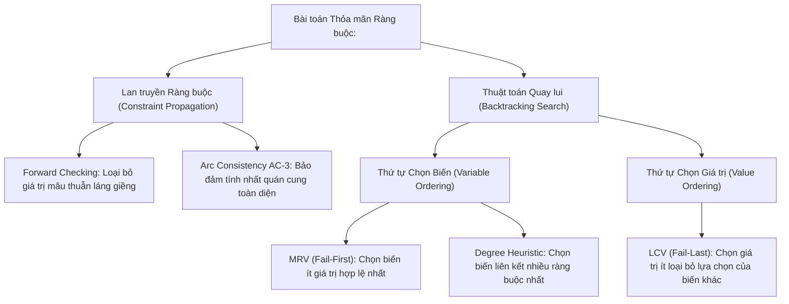
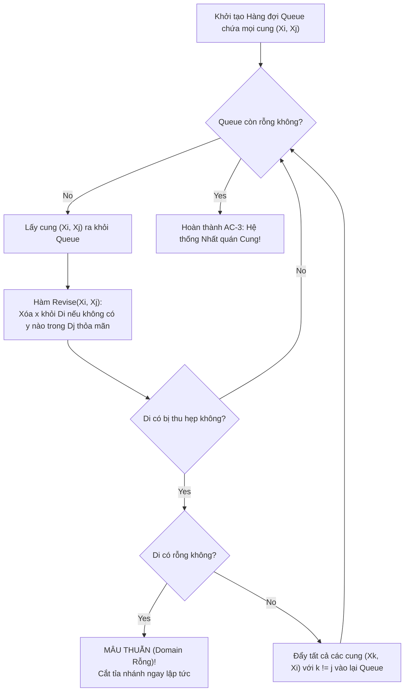
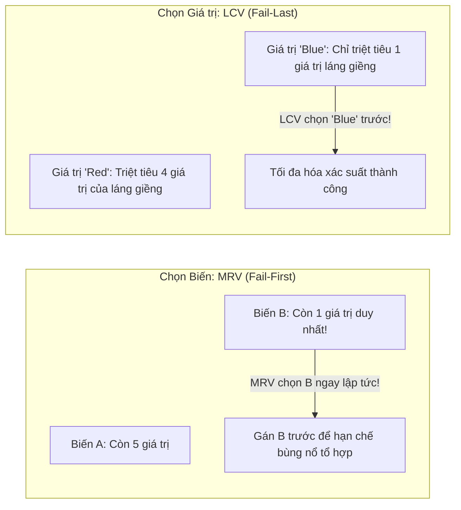

# Chuyên đề: Bài toán Thỏa mãn Ràng buộc & Quay lui (CSP & Backtracking Search)

## 1. Tổng quan Chuyên đề
Trong nhiều bài toán trí tuệ nhân tạo, trạng thái không phải là một "hộp đen" nguyên khối mà là một tập hợp các **biến số (variables)**, mỗi biến nhận giá trị trong một **miền xác định (domain)**, và phải thỏa mãn một hệ thống các **ràng buộc (constraints)** toán học. Lớp bài toán này được gọi là **Bài toán Thỏa mãn Ràng buộc (Constraint Satisfaction Problems - CSP)**.

Thay vì duyệt mù quáng trong không gian trạng thái, giải thuật giải CSP khai thác cấu trúc nội tại của các ràng buộc để **Lan truyền Ràng buộc (Constraint Propagation)**, cắt tỉa không gian tìm kiếm ngay từ trước khi thử gán giá trị (ví dụ: Forward Checking, Arc Consistency AC-3). Khi kết hợp cùng thuật toán **Tìm kiếm Quay lui (Backtracking Search)** và các Heuristic chọn biến/giá trị thông minh như **MRV (Minimum Remaining Values)**, **Degree Heuristic**, và **LCV (Least Constraining Value)**, các bài toán NP-đầy đủ phức tạp như Sudoku, tô màu bản đồ, xếp thời khóa biểu và kiểm tra thiết kế vi mạch VLSI có thể được giải quyết trong thời gian thực.



---

## 2. Chi tiết từng Keyword

---

### 1. Constraint Satisfaction Problems (CSP) & Backtracking Search

#### a. Định nghĩa Bản chất Toán học
Một bài toán CSP được định nghĩa hình thức bởi bộ ba:
$$\text{CSP} = \langle \mathcal{X}, \mathcal{D}, \mathcal{C} \rangle$$
trong đó:
- $\mathcal{X} = \{X_1, X_2, \dots, X_n\}$: Tập hợp $n$ biến số.
- $\mathcal{D} = \{D_1, D_2, \dots, D_n\}$: Tập hợp các miền giá trị tương ứng, $X_i \in D_i$.
- $\mathcal{C} = \{C_1, C_2, \dots, C_m\}$: Tập hợp các ràng buộc. Mỗi ràng buộc $C_j = \langle \text{scope}, \text{rel} \rangle$ xác định một tập con các biến và một quan hệ logic cho phép các bộ giá trị đồng thời hợp lệ:
  $$\text{rel} \subseteq D_{j1} \times D_{j2} \times \dots \times D_{jk}$$

- **Trạng thái Hoàn chỉnh (Complete Assignment)**: Mọi biến đều được gán giá trị: $|\text{Assignment}| = n$.
- **Trạng thái Nhất quán (Consistent Assignment)**: Phép gán không vi phạm bất kỳ ràng buộc nào trong $\mathcal{C}$.
- **Lời giải CSP (Solution)**: Một phép gán vừa hoàn chỉnh vừa nhất quán.

**Backtracking Search (Tìm kiếm Quay lui)**: Là dạng DFS chuyên biệt cho CSP. Tại mỗi bước độ sâu, thuật toán chọn một biến chưa gán và thử lần lượt từng giá trị trong miền của nó. Nếu xảy ra mâu thuẫn (vi phạm ràng buộc), thuật toán quay lui (backtrack) hủy phép gán và thử giá trị khác.

#### b. Cơ chế Tầng Sâu & Điện toán
- **Bitset Domain Representation**: Với các miền giá trị rời rạc nhỏ ($|D| \le 64$, như Sudoku với 9 chữ số), miền của biến được lưu trữ dưới dạng một số nguyên 64-bit (`uint64_t bitmask`). Việc loại bỏ giá trị hoặc kiểm tra rỗng được thực thi qua các phép toán bitwise AND/OR/NOT với tốc độ cực nhanh trong thanh ghi CPU.

#### c. Code Thực chiến (C++ & Python)
```cpp
// C++20: CSP Backtracking Framework với Bitmask Domain cho Bài toán Tô màu Đồ thị
#include <iostream>
#include <vector>
#include <cstdint>

const int NUM_COLORS = 3;

struct GraphCSP {
    int num_vars;
    std::vector<std::vector<int>> adj;
    std::vector<int> assignment; // -1 nếu chưa gán

    bool is_consistent(int var, int color) const {
        for (int neighbor : adj[var]) {
            if (assignment[neighbor] == color) return false;
        }
        return true;
    }

    bool backtrack(int var_idx) {
        if (var_idx == num_vars) return true; // Hoàn thành tất cả các biến

        for (int color = 0; color < NUM_COLORS; ++color) {
            if (is_consistent(var_idx, color)) {
                assignment[var_idx] = color;
                if (backtrack(var_idx + 1)) return true;
                assignment[var_idx] = -1; // Quay lui
            }
        }
        return false;
    }
};

int main() {
    // Tam giác đồ thị K3 (đòi hỏi đúng 3 màu)
    GraphCSP csp{3, {{1, 2}, {0, 2}, {0, 1}}, {-1, -1, -1}};
    bool solved = csp.backtrack(0);
    std::cout << "Graph Coloring Solved: " << (solved ? "YES" : "NO") << "\n";
    if (solved) {
        for (int i = 0; i < 3; ++i) std::cout << "Node " << i << " Color: " << csp.assignment[i] << " | ";
        std::cout << "\n";
    }
    return 0;
}
```

```python
# Python: Backtracking CSP Solver Generic Interface
from typing import Dict, List, Any, Optional

class SimpleCSP:
    def __init__(self, variables: List[str], domains: Dict[str, List[Any]], neighbors: Dict[str, List[str]]):
        self.variables = variables
        self.domains = domains
        self.neighbors = neighbors

    def is_consistent(self, var: str, val: Any, assignment: Dict[str, Any]) -> bool:
        for neighbor in self.neighbors.get(var, []):
            if neighbor in assignment and assignment[neighbor] == val:
                return False
        return True

    def backtrack(self, assignment: Dict[str, Any]) -> Optional[Dict[str, Any]]:
        if len(assignment) == len(self.variables):
            return assignment

        # Chọn biến chưa gán
        unassigned = [v for v in self.variables if v not in assignment][0]

        for val in self.domains[unassigned]:
            if self.is_consistent(unassigned, val, assignment):
                assignment[unassigned] = val
                result = self.backtrack(assignment)
                if result is not None:
                    return result
                del assignment[unassigned] # Backtrack
        return None

vars_list = ['WA', 'NT', 'SA']
domains_dict = {v: ['Red', 'Green', 'Blue'] for v in vars_list}
neighbors_dict = {'WA': ['NT', 'SA'], 'NT': ['WA', 'SA'], 'SA': ['WA', 'NT']}
solver = SimpleCSP(vars_list, domains_dict, neighbors_dict)
print("Coloring Solution:", solver.backtrack({}))
```

---

### 2. Constraint Propagation, Forward Checking & Arc Consistency (AC-3)

#### a. Định nghĩa Bản chất Toán học
- **Forward Checking**: Mỗi khi một biến $X$ được gán giá trị $x$, duyệt qua tất cả các biến lân cận chưa gán $Y \in \text{Neighbors}(X)$ và xóa khỏi miền $D_Y$ bất kỳ giá trị nào vi phạm ràng buộc với $x$:
  $$D_Y \leftarrow D_Y \setminus \{y \in D_Y \mid \neg \text{Consistent}(X=x, Y=y)\}$$
  Nếu bất kỳ $D_Y$ nào trở thành rỗng ($\emptyset$), nhánh tìm kiếm lập tức bị cắt tỉa (Fail-Immediate).
- **Arc Consistency (AC-3 Algorithm)**:
  Một cung có hướng $X_i \to X_j$ được gọi là **nhất quán cung (Arc-Consistent)** nếu với mọi giá trị $x \in D_i$, tồn tại ít nhất một giá trị $y \in D_j$ thỏa mãn ràng buộc nhị phân giữa $X_i$ và $X_j$:
  $$\forall x \in D_i, \exists y \in D_j \text{ s.t. } (x, y) \in C_{ij}$$
  Thuật toán **AC-3** duy trì một hàng đợi tất cả các cung cần kiểm tra $\mathcal{Q}$. Mỗi khi miền $D_i$ bị thu hẹp, tất cả các cung trỏ vào $X_i$ ($X_k \to X_i, k \neq j$) được đưa trở lại hàng đợi $\mathcal{Q}$ để lan truyền tiếp.
  - **Độ phức tạp Thời gian của AC-3**: $\mathcal{O}(c \cdot d^3)$ trong đó $c$ là số ràng buộc nhị phân và $d$ là kích thước tối đa của miền giá trị.

#### b. Sơ đồ Minh họa


#### c. Code Thực chiến (C++ & Python)
```cpp
// C++20: Thuật toán AC-3 (Arc Consistency Algorithm #3)
#include <iostream>
#include <vector>
#include <queue>
#include <unordered_set>

struct Arc {
    int xi, xj;
    bool operator==(const Arc& o) const { return xi == o.xi && xj == o.xj; }
};

bool revise(int xi, int xj, std::vector<std::unordered_set<int>>& domains) {
    bool revised = false;
    std::vector<int> to_remove;

    for (int x : domains[xi]) {
        bool has_support = false;
        for (int y : domains[xj]) {
            if (x != y) { // Ràng buộc khác nhau: x != y
                has_support = true;
                break;
            }
        }
        if (!has_support) {
            to_remove.push_back(x);
            revised = true;
        }
    }

    for (int val : to_remove) domains[xi].erase(val);
    return revised;
}

bool ac3(int n_vars, std::vector<std::unordered_set<int>>& domains, const std::vector<std::pair<int, int>>& constraints) {
    std::queue<Arc> q;
    for (const auto& [u, v] : constraints) {
        q.push({u, v});
        q.push({v, u});
    }

    while (!q.empty()) {
        auto [xi, xj] = q.front();
        q.pop();

        if (revise(xi, xj, domains)) {
            if (domains[xi].empty()) return false; // Không thể giải

            for (const auto& [u, v] : constraints) {
                if (v == xi && u != xj) q.push({u, xi});
                if (u == xi && v != xj) q.push({v, xi});
            }
        }
    }
    return true;
}

int main() {
    // 2 biến X0, X1 cùng có miền {1}, ràng buộc X0 != X1 -> AC3 phải phát hiện mâu thuẫn
    std::vector<std::unordered_set<int>> domains = {{1}, {1}};
    std::vector<std::pair<int, int>> constraints = {{0, 1}};
    bool possible = ac3(2, domains, constraints);
    std::cout << "Is AC-3 Consistent? " << (possible ? "YES" : "NO") << "\n"; // Sẽ in NO
    return 0;
}
```

```python
# Python: Forward Checking Implementation
def forward_check(var, val, domains, neighbors, assignment):
    # Tạo bản sao miền để có thể rollback khi quay lui
    pruned = {neighbor: [] for neighbor in neighbors[var] if neighbor not in assignment}

    for neighbor in neighbors[var]:
        if neighbor not in assignment:
            if val in domains[neighbor]:
                domains[neighbor].remove(val)
                pruned[neighbor].append(val)
                if len(domains[neighbor]) == 0:
                    return False, pruned # Domain wipe-out
    return True, pruned

domains_demo = {'X': [1, 2], 'Y': [1]}
neighbors_demo = {'X': ['Y'], 'Y': ['X']}
ok, pruned_info = forward_check('X', 1, domains_demo, neighbors_demo, {})
print("Forward Checking Result:", ok, "| Pruned:", pruned_info)
```

---

### 3. Variable & Value Ordering: MRV, Degree & Least Constraining Value (LCV)

#### a. Định nghĩa Bản chất Toán học
Thứ tự duyệt biến và giá trị quyết định kích thước cây tìm kiếm:
1. **MRV (Minimum Remaining Values - Fail-First Principle)**:
   Chọn biến tiếp theo có số lượng giá trị hợp lệ còn lại trong miền ít nhất:
   $$X^* = \arg\min_{X \in \mathcal{X}_{\text{unassigned}}} |D_X|$$
   *Triết lý*: Thất bại càng sớm càng tốt (Fail-First) để cắt tỉa toàn bộ cây con bên dưới.
2. **Degree Heuristic**:
   Dùng làm tiêu chí phụ phá vỡ thế hòa điểm (tie-breaker) cho MRV: Chọn biến có số lượng ràng buộc lớn nhất với các biến chưa gán khác:
   $$X^* = \arg\max_{X} \sum_{Y \in \text{Neighbors}(X), Y \text{ unassigned}} 1$$
3. **LCV (Least Constraining Value - Fail-Last Principle)**:
   Sau khi đã chọn biến $X$, thứ tự thử các giá trị $v \in D_X$ được ưu tiên cho giá trị nào **loại bỏ ít lựa chọn nhất** trong miền của các biến lân cận:
   $$v^* = \arg\min_{v \in D_X} \sum_{Y \in \text{Neighbors}(X)} |\{y \in D_Y \mid \neg \text{Consistent}(X=v, Y=y)\}|$$
   *Triết lý*: Chừa lại tối đa sự tự do cho các biến còn lại để tăng cơ hội tìm ra lời giải ngay trong nhánh đầu tiên mà không phải quay lui.

#### b. Sơ đồ Minh họa


#### c. Code Thực chiến (C++ & Python)
```cpp
// C++20: MRV và LCV Selector Logic
#include <iostream>
#include <vector>
#include <unordered_set>
#include <algorithm>

struct VariableState {
    int id;
    std::unordered_set<int> domain;
    bool assigned;
};

// MRV: Tìm biến chưa gán có domain nhỏ nhất
int select_mrv_variable(const std::vector<VariableState>& vars) {
    int best_id = -1;
    size_t min_domain_size = 1e9;

    for (const auto& v : vars) {
        if (!v.assigned && v.domain.size() < min_domain_size) {
            min_domain_size = v.domain.size();
            best_id = v.id;
        }
    }
    return best_id;
}

int main() {
    std::vector<VariableState> vars = {
        {0, {1, 2, 3}, false},
        {1, {2}, false},       // MRV sẽ chọn biến này vì size = 1
        {2, {1, 2, 3, 4}, false}
    };
    std::cout << "Selected MRV Variable ID: " << select_mrv_variable(vars) << "\n";
    return 0;
}
```

```python
# Python: Least Constraining Value (LCV) Heuristic
def order_domain_values_lcv(var, domains, neighbors):
    def count_conflicts(val):
        conflicts = 0
        for n in neighbors[var]:
            if val in domains[n]:
                conflicts += 1
        return conflicts

    # Sắp xếp giá trị tăng dần theo số lượng xung đột gây ra
    return sorted(domains[var], key=count_conflicts)

domains = {'A': [1, 2, 3], 'B': [1, 2], 'C': [1]}
neighbors = {'A': ['B', 'C']}
print("LCV Value Ordering for A:", order_domain_values_lcv('A', domains, neighbors))
```

#### d. Lỗi Thường gặp & Ứng dụng
- **Tràn chi phí khi tính LCV**: Việc tính toán đầy đủ LCV ở mỗi nút có thể tốn kém thời gian hơn việc quay lui đơn giản nếu số lượng láng giềng quá lớn. Cần cân đối ngân sách tính toán.
- **Ứng dụng AI**: Công cụ lập lịch máy bay (Airline Scheduling), xếp phòng thi đại học, trình biên dịch tối ưu phân bổ thanh ghi phần cứng (Register Allocation via Graph Coloring).
