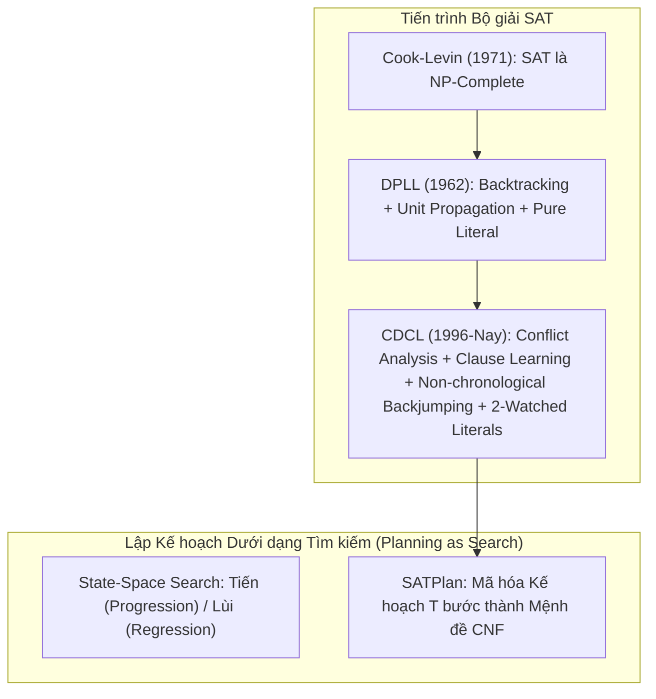
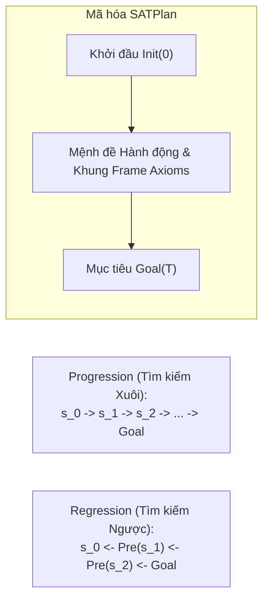

# Chuyên đề: Bộ giải SAT & Lập kế hoạch dưới dạng Tìm kiếm (SAT Solving & Planning as Search)

## 1. Tổng quan Chuyên đề
**Bài toán Thỏa mãn Công thức Boole (Boolean Satisfiability - SAT)** là bài toán NP-đầy đủ đầu tiên được chứng minh trong lịch sử khoa học máy tính (Định lý Cook-Levin, 1971). Mặc dù thuộc lớp bài toán NP-khó trong trường hợp tổng quát xấu nhất, sự đột phá của các giải thuật giải SAT hiện đại (SAT Solvers) — đặc biệt là bước nhảy vọt từ giải thuật đệ quy cổ điển **DPLL (Davis-Putnam-Logemann-Loveland)** sang kiến trúc hiện đại **CDCL (Conflict-Driven Clause Learning)** — đã cho phép giải quyết thực tế các bài toán công nghiệp chứa hàng triệu biến và hàng chục triệu mệnh đề logic.

Đồng thời, **Lập kế hoạch dưới dạng Tìm kiếm (Planning as Search)** là mô hình chuyển hóa bài toán lập kế hoạch hành động thành bài toán tìm kiếm đường đi trong không gian trạng thái (hoặc mã hóa toàn bộ bài toán lập kế hoạch thành một bài toán SAT khổng lồ thông qua SATPlan), tạo cầu nối vững chắc giữa biểu diễn logic hình thức và giải thuật tối ưu hóa.



---

## 2. Chi tiết từng Keyword

---

### 1. Boolean Satisfiability (SAT) & SAT Solving

#### a. Định nghĩa Bản chất Toán học
Một công thức đại số Boole $\Phi$ ở **Dạng Chuẩn Hội (Conjunctive Normal Form - CNF)** là một phép hội (AND, $\land$) của các mệnh đề (clauses) $C_j$:
$$\Phi = C_1 \land C_2 \land \dots \land C_m$$
Mỗi mệnh đề $C_j$ là một phép tuyển (OR, $\lor$) của các biến nguyên tử hoặc phủ định của chúng (literals $l_{ji}$):
$$C_j = l_{j1} \lor l_{j2} \lor \dots \lor l_{jk}, \quad l_{ji} \in \{x_k, \neg x_k\}$$

**Bài toán SAT**: Tìm một phép gán chân lý (Truth Assignment) $\tau: \mathcal{X} \to \{0, 1\}$ sao cho $\Phi(\tau) = 1$ (SATISFIABLE), hoặc chứng minh rằng không tồn tại bất kỳ phép gán nào thỏa mãn công thức (UNSATISFIABLE).

- **Định lý Cook-Levin**: Mọi bài toán trong lớp NP đều có thể quy giảm đa thức (polynomial-time reduction) về SAT:
  $$\forall \mathcal{L} \in \text{NP}, \quad \mathcal{L} \le_P \text{SAT}$$

#### b. Cơ chế Tầng Sâu & Điện toán
- **DIMACS CNF Format**: Chuẩn lưu trữ tệp tin trong cộng đồng SAT quốc tế. Mỗi dòng biểu diễn một clause kết thúc bằng số 0.
- **Biểu diễn Mệnh đề trong Bộ nhớ**: Các solvers hiện đại (như MiniSat, CryptoMiniSat, Kissat) biểu diễn literal bằng số nguyên không dấu 32-bit:
  ```cpp
  // Biến x được mã hóa: literal(x) = 2*x, literal(~x) = 2*x + 1
  uint32_t to_lit(int var, bool sign) { return (var << 1) | (sign ? 1 : 0); }
  ```
  Cách biểu diễn này cho phép đảo dấu literal chỉ bằng một phép XOR bitwise: `lit ^ 1`.

---

### 2. DPLL Algorithm (Thuật toán DPLL)

#### a. Định nghĩa Bản chất Toán học
Thuật toán **DPLL (Davis-Putnam-Logemann-Loveland)** là thuật toán tìm kiếm quay lui có hệ thống kết hợp 2 quy tắc suy luận cắt tỉa then chốt:
1. **Unit Propagation (Lan truyền Mệnh đề Đơn vị)**:
   Nếu một clause chỉ còn đúng **một literal duy nhất chưa gán** và tất cả các literal khác đều đã bị gán giá trị SAI ($0$), thì literal đó **bắt buộc phải được gán giá trị ĐÚNG ($1$)** để thỏa mãn clause:
   $$(\text{False} \lor \text{False} \lor l) \implies l \leftarrow \text{True}$$
   Quá trình này được lặp lại cho đến khi đạt điểm bất động (fixpoint).
2. **Pure Literal Elimination (Loại bỏ Literal Thuần khiết)**:
   Nếu một biến chỉ xuất hiện với một dấu duy nhất (luôn là $x$ hoặc luôn là $\neg x$) trong tất cả các clause chưa thỏa mãn, gán giá trị chân lý sao cho literal đó bằng ĐÚNG.

#### b. Code Thực chiến (C++ & Python)
```cpp
// C++20: Mô phỏng DPLL Solver Tối giản với Unit Propagation
#include <iostream>
#include <vector>
#include <unordered_map>

using Clause = std::vector<int>; // Số dương: x, Số âm: ~x
using CNF = std::vector<Clause>;

bool dpll(CNF cnf, std::unordered_map<int, bool>& assignment) {
    // 1. Kiểm tra Clause rỗng (Mâu thuẫn -> UNSAT)
    for (const auto& c : cnf) {
        if (c.empty()) return false;
    }
    // 2. Kiểm tra nếu tất cả Clauses đã thỏa mãn -> SAT
    if (cnf.empty()) return true;

    // 3. Unit Propagation
    for (const auto& c : cnf) {
        if (c.size() == 1) {
            int lit = c[0];
            int var = std::abs(lit);
            bool val = (lit > 0);
            assignment[var] = val;

            // Đơn giản hóa CNF với giá trị mới
            CNF next_cnf;
            for (const auto& cl : cnf) {
                bool clause_satisfied = false;
                Clause new_cl;
                for (int l : cl) {
                    if (l == lit) { clause_satisfied = true; break; }
                    if (l != -lit) new_cl.push_back(l);
                }
                if (!clause_satisfied) next_cnf.push_back(new_cl);
            }
            return dpll(next_cnf, assignment);
        }
    }

    // 4. Nhánh rẽ (Branching / Decision)
    int branch_var = std::abs(cnf[0][0]);
    CNF branch_true = cnf;
    branch_true.push_back({branch_var});
    if (dpll(branch_true, assignment)) return true;

    CNF branch_false = cnf;
    branch_false.push_back({-branch_var});
    return dpll(branch_false, assignment);
}

int main() {
    // (x1 OR x2) AND (~x1) -> Nghiệm bắt buộc x2 = True
    CNF formula = {{1, 2}, {-1}};
    std::unordered_map<int, bool> model;
    bool sat = dpll(formula, model);
    std::cout << "DPLL Formula SAT: " << (sat ? "YES" : "NO") << "\n";
    return 0;
}
```

```python
# Python: DPLL Unit Propagation Recursive Demo
def dpll_solve(clauses, assignment):
    # Kiểm tra clause rỗng
    if any(len(c) == 0 for c in clauses): return False, {}
    if not clauses: return True, assignment

    # Tìm unit clause
    unit_clauses = [c for c in clauses if len(c) == 1]
    if unit_clauses:
        unit_lit = unit_clauses[0][0]
        var = abs(unit_lit)
        val = unit_lit > 0
        new_assignment = {**assignment, var: val}
        # Simplify
        new_clauses = []
        for c in clauses:
            if unit_lit in c: continue
            new_clauses.append([l for l in c if l != -unit_lit])
        return dpll_solve(new_clauses, new_assignment)

    # Branching
    chosen_var = abs(clauses[0][0])
    # Nhánh True
    res, model = dpll_solve(clauses + [[chosen_var]], assignment)
    if res: return True, model
    # Nhánh False
    return dpll_solve(clauses + [[-chosen_var]], assignment)

cnf_test = [[1, 2], [-1, 2], [-2]] # Mâu thuẫn -> UNSAT
sat, res_model = dpll_solve(cnf_test, {})
print("Is SAT:", sat)
```

---

### 3. CDCL (Conflict-Driven Clause Learning - Học Mệnh đề Hướng Xung đột)

#### a. Định nghĩa Bản chất Toán học
CDCL là kiến trúc đưa năng lực giải SAT lên tầm công nghiệp, khắc phục điểm yếu quay lui ngây thơ (chronological backtracking) của DPLL:
1. **Implication Graph (Đồ thị Kéo theo)**: Đồ thị DAG ghi lại chuỗi suy luận của Unit Propagation tại từng mức quyết định (Decision Level).
2. **Conflict Analysis & 1-UIP (First Unique Implication Point)**: Khi phát hiện mâu thuẫn (cả $x$ và $\neg x$ đều bị ép buộc), thuật toán cắt đồ thị tại 1-UIP để suy ra **Learned Clause (Mệnh đề Học được)**.
3. **Non-Chronological Backjumping (Nhảy ngược Phi niên đại)**: Nhảy lùi thẳng về mức quyết định gốc gây ra mâu thuẫn, bỏ qua hàng triệu bước quay lui vô ích.
4. **Two-Watched Literals (2WL Scheme - Chaff Solver)**:
   Thay vì đếm số literal chưa gán trong mọi clause, mỗi clause chỉ theo dõi đúng **2 literal chưa gán**. Chi phí cập nhật khi gán biến giảm từ $\mathcal{O}(\text{Clause Length})$ xuống $\mathcal{O}(1)$, tăng tốc độ Unit Propagation lên gấp 10-100 lần trên phần cứng CPU.

#### b. Sơ đồ Minh họa


#### c. Code Thực chiến (C++ & Python)
```cpp
// C++20: Two-Watched Literals Concept Implementation
#include <iostream>
#include <vector>

struct WatchedClause {
    std::vector<int> literals;
    size_t watch1; // Vị trí literal đang theo dõi 1
    size_t watch2; // Vị trí literal đang theo dõi 2

    bool update_watch(int false_lit, const std::vector<int>& assignment) {
        // Nếu literal bị gán false là watch1, tìm literal thay thế
        if (literals[watch1] == false_lit) {
            for (size_t i = 0; i < literals.size(); ++i) {
                if (i != watch2 && assignment[std::abs(literals[i])] == 0) { // Chưa gán
                    watch1 = i;
                    return true;
                }
            }
            return false; // Trở thành Unit Clause hoặc Conflict!
        }
        return true;
    }
};

int main() {
    WatchedClause c{{1, 2, 3}, 0, 1}; // Clause (x1 OR x2 OR x3), theo dõi x1, x2
    std::vector<int> assign(4, 0);
    bool ok = c.update_watch(1, assign);
    std::cout << "Watch updated successfully: " << ok << " | New watch1: " << c.watch1 << "\n";
    return 0;
}
```

```python
# Python: CDCL Conflict Analysis Implication Cut Simulator
class ConflictAnalyzer:
    def __init__(self):
        self.learned_clauses = []

    def record_conflict_and_learn(self, conflict_clause, decision_level):
        # Trừu tượng hóa việc rút ra Learned Clause từ 1-UIP
        learned = [lit for lit in conflict_clause if abs(lit) != decision_level]
        self.learned_clauses.append(learned)
        # Tính mức backjump
        backjump_level = max([abs(l) for l in learned], default=0)
        return learned, backjump_level

analyzer = ConflictAnalyzer()
learned_c, b_lvl = analyzer.record_conflict_and_learn([-3, 2, -1], decision_level=3)
print(f"Learned Clause: {learned_c}, Non-chronological Backjump Level: {b_lvl}")
```

---

### 4. Planning as Search (Lập kế hoạch dưới dạng Tìm kiếm)

#### a. Định nghĩa Bản chất Toán học
Lập kế hoạch là việc tìm kiếm một đường đi trong không gian trạng thái từ $s_0$ tới mục tiêu $\mathcal{G}$:
- **Progression Search (Tìm kiếm Xuôi / Forward State-Space Search)**:
  Bắt đầu từ $s_0$, áp dụng các hành động khả dĩ $a \in \text{Applicable}(s)$ để mở rộng trạng thái con:
  $$s' = (s \setminus \text{Del}(a)) \cup \text{Add}(a)$$
- **Regression Search (Tìm kiếm Ngược / Backward Relevant-States Search)**:
  Bắt đầu từ mục tiêu $\mathcal{G}$, tìm các hành động liên đới (relevant actions) có thể đạt được $\mathcal{G}$ và suy ngược lại các tiền điều kiện (preconditions) cần đạt được ở bước trước.
- **SATPlan (Kautz & Selman)**:
  Mã hóa bài toán lập kế hoạch với độ dài $T$ bước thành một bài toán SAT:
  $$\Phi = \text{Init}^0 \land \bigwedge_{t=0}^{T-1} \text{Transitions}^{t, t+1} \land \mathcal{G}^T$$
  Nếu $\Phi$ là SAT, trích xuất nghiệm thành chuỗi hành động tối ưu; nếu UNSAT, tăng $T \leftarrow T + 1$.

#### b. Sơ đồ Minh họa


#### c. Code Thực chiến (C++ & Python)
```cpp
// C++17: Progression State Transition Step (Add/Delete Lists)
#include <iostream>
#include <vector>
#include <string>
#include <set>

struct ActionSTRIPS {
    std::string name;
    std::set<std::string> pre;
    std::set<std::string> add;
    std::set<std::string> del;

    bool applicable(const std::set<std::string>& state) const {
        for (const auto& p : pre) {
            if (state.find(p) == state.end()) return false;
        }
        return true;
    }

    std::set<std::string> apply(const std::set<std::string>& state) const {
        std::set<std::string> next_state = state;
        for (const auto& d : del) next_state.erase(d);
        for (const auto& a : add) next_state.insert(a);
        return next_state;
    }
};

int main() {
    ActionSTRIPS move{"Move(A,B)", {"At(A)"}, {"At(B)"}, {"At(A)"}};
    std::set<std::string> s0 = {"At(A)"};
    if (move.applicable(s0)) {
        auto s1 = move.apply(s0);
        std::cout << "State after progression: ";
        for (const auto& f : s1) std::cout << f << " ";
        std::cout << "\n";
    }
    return 0;
}
```

```python
# Python: SATPlan Encoder Mockup
def encode_satplan_step(current_step: int, action_name: str, pre_var: int, effect_var: int):
    # Ràng buộc Action implies Preconditions và Effects: Action -> Pre AND Effect
    # Biểu diễn CNF: (~Action OR Pre) AND (~Action OR Effect)
    act_lit = 100 * current_step + 1
    return [
        [-act_lit, pre_var],
        [-act_lit, effect_var]
    ]

cnf_clauses = encode_satplan_step(0, "LoadCargo", pre_var=1, effect_var=2)
print("Generated SATPlan CNF Clauses:", cnf_clauses)
```

#### d. Lỗi Thường gặp & Ứng dụng
- **Vấn đề Tiên đề Khung (Frame Axiom Problem)**: Cần phải phát biểu tường minh rằng tất cả các sự kiện không bị tác động bởi hành động thì giữ nguyên trạng thái cũ. Nếu không mã hóa đúng, hệ thống SAT sẽ cho phép các thuộc tính tự động biến đổi tùy tiện.
- **Ứng dụng AI**: Kiểm thử hình thức phần mềm/phần cứng vi xử lý Intel/AMD (Formal Verification), tổng hợp vi mạch tự động EDA, quy hoạch nhiệm vụ tàu thám hiểm sao Hỏa (NASA Mars Rover).
