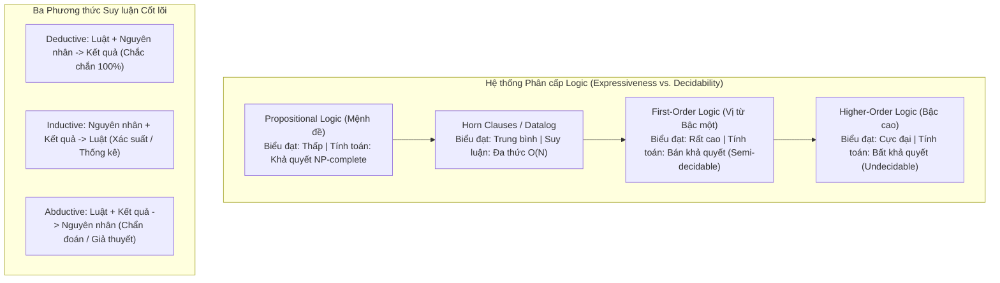
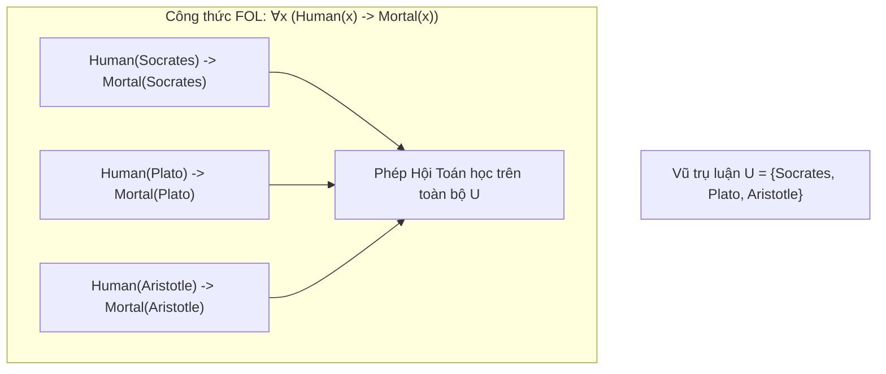
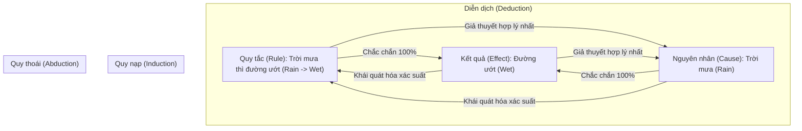
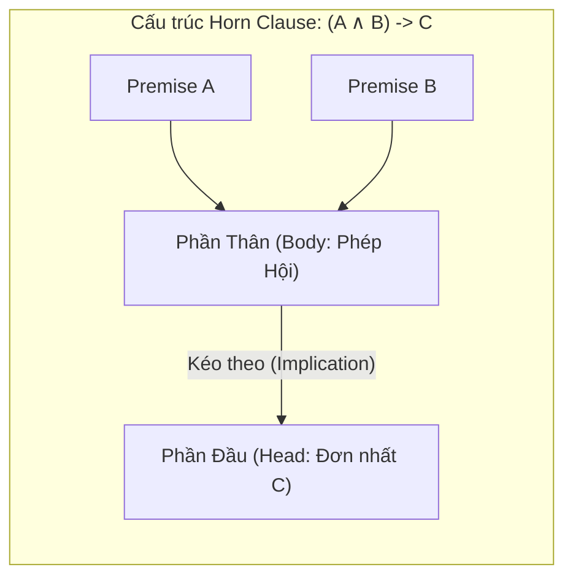

# Chuyên đề: Logic Hình thức & Suy luận Diễn dịch (Formal Logic & Deductive Inference)

## 1. Tổng quan Chuyên đề
**Biểu diễn Tri thức và Suy luận (Knowledge Representation and Reasoning - KR&R)** là nền tảng triết học và kỹ thuật của trường phái AI Ký hiệu (Symbolic AI). Mục tiêu tối thượng của KR&R là hình thức hóa tri thức của con người về thế giới thành các ký hiệu toán học có ngữ nghĩa chặt chẽ, từ đó trao cho máy tính khả năng tự động rút ra các kết luận mới bảo toàn chân lý (Truth-preserving deduction).

Hệ thống phân cấp logic toán học trải dài từ:
- **Propositional Logic (Logic Mệnh đề)**: Đơn giản, khả quyết (decidable), giải bằng bảng chân lý hoặc SAT.
- **First-Order Logic (Logic Vị từ Bậc một - FOL)**: Bổ sung lượng từ ($\forall, \exists$), hàm số và vị từ, cho phép biểu diễn các quan hệ phức tạp giữa các thực thể trong vũ trụ luận.
- **Higher-Order Logic (Logic Bậc cao - HOL)**: Cho phép lượng từ hóa trên cả các vị từ và hàm số, mở rộng sức mạnh biểu diễn nhưng không hoàn chỉnh về mặt suy luận (Gödel's Incompleteness).
- **Horn Clauses**: Phân lớp logic con có độ phức tạp tính toán đa thức, tạo nền tảng cho lập trình logic (Prolog) và các cơ sở dữ liệu diễn dịch (Datalog).



---

## 2. Chi tiết từng Keyword

---

### 1. Knowledge Representation, Knowledge Bases, Facts & Rules

#### a. Định nghĩa Bản chất Toán học
- **Cơ sở Tri thức (Knowledge Base - $\mathcal{KB}$)**: Là một tập hợp hữu hạn các câu (sentences) trong một ngôn ngữ hình thức biểu diễn thế giới quan:
  $$\mathcal{KB} = \{\alpha_1, \alpha_2, \dots, \alpha_M\}$$
- **Facts (Sự thật / Dữ kiện)**: Là các mệnh đề khẳng định vô điều kiện về trạng thái thực tế của thế giới tại thời điểm hiện tại:
  $$\text{At}(\text{Robot}, \text{RoomA}), \quad \text{Temperature}(38.5)$$
- **Rules (Quy tắc / Luật)**: Là các mệnh đề có điều kiện (conditional implications) xác định mối quan hệ nhân quả hoặc kéo theo ngữ nghĩa:
  $$\forall x, y \ (\text{Parent}(x, y) \land \text{Female}(x) \to \text{Mother}(x, y))$$
- **Hệ quả Ngữ nghĩa (Entailment $\models$)**: $\alpha$ là hệ quả ngữ nghĩa của $\mathcal{KB}$ khi và chỉ khi trong mọi mô hình (thế giới khả dĩ) mà $\mathcal{KB}$ đúng thì $\alpha$ cũng phải đúng:
  $$\mathcal{KB} \models \alpha \iff \mathcal{M}(\mathcal{KB}) \subseteq \mathcal{M}(\alpha)$$

#### b. Cơ chế Tầng Sâu & Điện toán
- **Trie / Discrimination Tree Storage**: Các sự thật trong $\mathcal{KB}$ được lưu trữ dưới dạng cây chỉ mục tiền tố (Prefix Trees) để tăng tốc thao tác khớp mẫu (pattern matching) và thống nhất hóa (unification) trong RAM, giảm thiểu việc quét tuyến tính toàn bộ cơ sở tri thức.

---

### 2. Propositions & Propositional Logic (Logic Mệnh đề)

#### a. Định nghĩa Bản chất Toán học
Một **Mệnh đề (Proposition)** là một câu khẳng định mang một giá trị chân lý duy nhất: Đúng (True - $1$) hoặc Sai (False - $0$).
Cú pháp của **Logic Mệnh đề (Propositional Logic - PL)** được xây dựng từ:
- Tập các ký hiệu nguyên tử: $\mathcal{P} = \{P, Q, R, \dots\}$.
- Các liên từ logic chuẩn: $\neg$ (Phủ định), $\land$ (Hội), $\lor$ (Tuyển), $\to$ (Kéo theo), $\leftrightarrow$ (Tương đương).

Ngữ nghĩa của phép kéo theo:
$$P \to Q \equiv \neg P \lor Q$$
- **Độ phức tạp Tính toán**: Kiểm tra $\mathcal{KB} \models \alpha$ trong PL tương đương với bài toán kiểm tra tính không thỏa mãn (Unsatisfiability) của $\mathcal{KB} \land \neg \alpha$, thuộc lớp bài toán **co-NP-complete**.

#### b. Code Thực chiến (C++ & Python)
```cpp
// C++20: Propositional Logic Formula Evaluator với AST (Abstract Syntax Tree)
#include <iostream>
#include <memory>
#include <unordered_map>
#include <string>

struct Env {
    std::unordered_map<std::string, bool> values;
};

class Expr {
public:
    virtual ~Expr() = default;
    virtual bool eval(const Env& env) const = 0;
};

class Var : public Expr {
    std::string name_;
public:
    explicit Var(std::string name) : name_(std::move(name)) {}
    bool eval(const Env& env) const override { return env.values.at(name_); }
};

class Implies : public Expr {
    std::shared_ptr<Expr> left_, right_;
public:
    Implies(std::shared_ptr<Expr> l, std::shared_ptr<Expr> r) : left_(l), right_(r) {}
    bool eval(const Env& env) const override {
        // P -> Q <=> (!P || Q)
        return !left_->eval(env) || right_->eval(env);
    }
};

int main() {
    auto p = std::make_shared<Var>("P");
    auto q = std::make_shared<Var>("Q");
    Implies p_implies_q(p, q);

    Env env1{{{"P", true}, {"Q", false}}};
    Env env2{{{"P", true}, {"Q", true}}};

    std::cout << "P=1, Q=0 => P->Q: " << p_implies_q.eval(env1) << "\n"; // In 0
    std::cout << "P=1, Q=1 => P->Q: " << p_implies_q.eval(env2) << "\n"; // In 1
    return 0;
}
```

```python
# Python: Truth Table Enumerator for Entailment Verification
import itertools

def check_entailment_truth_table(kb_fn, alpha_fn, variables):
    # Duyệt toàn bộ 2^N thế giới khả dĩ
    for values in itertools.product([False, True], repeat=len(variables)):
        env = dict(zip(variables, values))
        if kb_fn(env): # Nếu KB đúng trong thế giới này
            if not alpha_fn(env): # Mà alpha lại sai -> Không kéo theo!
                return False
    return True

# Kiểm tra Modus Ponens: KB = (P) and (P -> Q) |= Q
kb = lambda e: e['P'] and (not e['P'] or e['Q'])
alpha = lambda e: e['Q']
print("Does KB entail alpha?", check_entailment_truth_table(kb, alpha, ['P', 'Q']))
```

---

### 3. First-Order Logic (FOL), Predicate Logic & Higher-Order Logic (HOL)

#### a. Định nghĩa Bản chất Toán học
- **First-Order Logic (FOL / Predicate Calculus)**:
  Mở rộng logic mệnh đề bằng cách đưa vào:
  - **Hằng số (Constants)**: Biểu thị các thực thể cá biệt trong thế giới ($a, b, \text{John}$).
  - **Biến số (Variables)**: Đại diện cho các đối tượng tùy ý ($x, y, z$).
  - **Hàm số (Functions)**: Ánh xạ đối tượng sang đối tượng ($\text{FatherOf}(x)$).
  - **Vị từ (Predicates)**: Ánh xạ đối tượng sang chân lý ($\text{IsStudent}(x)$, $\text{Greater}(x, y)$).
  - **Lượng từ (Quantifiers)**: $\forall x$ (Lượng từ phổ quát - Mọi) và $\exists x$ (Lượng từ tồn tại - Tồn tại).
  
  *Ngữ nghĩa Lượng từ*:
  $$\forall x \ \phi(x) \equiv \bigwedge_{c \in \mathcal{U}} \phi(c), \quad \exists x \ \phi(x) \equiv \bigvee_{c \in \mathcal{U}} \phi(c)$$
  với $\mathcal{U}$ là không gian vũ trụ luận (Domain of Discourse).
  
  - **Định lý Bán Khả quyết của Church & Turing (1936)**: Suy luận trong FOL là **Bán khả quyết (Semi-decidable)**: Nếu $\mathcal{KB} \models \alpha$, thuật toán suy luận (Resolution) chắc chắn sẽ dừng và tìm ra chứng minh; nhưng nếu $\mathcal{KB} \not\models \alpha$, thuật toán có thể chạy vô hạn mà không dừng.

- **Higher-Order Logic (HOL)**:
  Cho phép lượng từ hóa trên cả các vị từ và hàm số:
  $$\forall P \ (P(x) \land P(y) \to x = y) \quad \text{(Nguyên lý Leibniz về sự bất khả phân biệt)}$$
  HOL có sức biểu đạt toán học vô cùng lớn (có thể tiên đề hóa toàn bộ số học Peano) nhưng **không có thuật toán suy luận hoàn chỉnh** (theo Định lý Bất toàn của Gödel).

#### b. Sơ đồ Minh họa


#### c. Code Thực chiến (C++ & Python)
```cpp
// C++17: First-Order Logic Predicate Evaluation trên Tập hữu hạn
#include <iostream>
#include <vector>
#include <string>
#include <functional>

struct Entity {
    std::string name;
    bool is_human;
    bool is_mortal;
};

bool evaluate_forall_human_mortal(const std::vector<Entity>& universe) {
    for (const auto& entity : universe) {
        // Human(x) -> Mortal(x) <=> (!Human(x) || Mortal(x))
        if (entity.is_human && !entity.is_mortal) {
            return false; // Tìm thấy phản ví dụ
        }
    }
    return true;
}

int main() {
    std::vector<Entity> universe = {
        {"Socrates", true, true},
        {"Plato", true, true},
        {"Zeus", false, false} // Thần thoại: Không phải người, bất tử
    };
    std::cout << "Does forall x (Human(x) -> Mortal(x)) hold? " 
              << (evaluate_forall_human_mortal(universe) ? "YES" : "NO") << "\n";
    return 0;
}
```

```python
# Python: SymPy Logic Engine cho First-Order Expression Validation
from sympy import symbols
from sympy.logic.boolalg import Equivalent, Implies

P, Q, R = symbols('P Q R')
# Kiểm tra luật bắc cầu hình thức: (P -> Q) and (Q -> R) => (P -> R)
rule = Implies(P, Q) & Implies(Q, R)
target = Implies(P, R)

# Kiểm tra xem rule -> target có phải là hằng đúng (Tautology)
tautology = Implies(rule, target)
print("Is Transitivity a Valid FOL Tautology?", tautology.is_concrete)
```

---

### 4. Logical Inference, Deductive, Inductive & Abductive Reasoning

#### a. Định nghĩa Bản chất Toán học
1. **Deductive Reasoning (Diễn dịch)**: Đi từ quy luật tổng quát đến trường hợp cá biệt. Bảo toàn chân lý tuyệt đối:
   $$\frac{A \to B, \quad A}{B} \quad (\text{Modus Ponens})$$
2. **Inductive Reasoning (Quy nạp)**: Đi từ tập hợp các quan sát cá biệt để suy ra quy luật tổng quát:
   $$\frac{\phi(a_1), \phi(a_2), \dots, \phi(a_N)}{\forall x \ \phi(x)} \quad (\text{Xác suất phụ thuộc vào } N)$$
   Là nền tảng của học máy (Statistical Machine Learning).
3. **Abductive Reasoning (Quy thoái / Suy luận Giải thích)**: Đi từ kết quả quan sát được và quy luật để suy ngược lại nguyên nhân khả dĩ nhất:
   $$\frac{A \to B, \quad B}{A \quad (\text{Giải thích tốt nhất})}$$
   Được sử dụng trong chẩn đoán y khoa, điều tra tội phạm và chẩn đoán lỗi phần cứng.

#### b. Sơ đồ Minh họa


#### c. Code Thực chiến (C++ & Python)
```cpp
// C++17: Abductive Reasoning Engine tính điểm khả năng của giả thuyết
#include <iostream>
#include <vector>
#include <string>
#include <algorithm>

struct Hypothesis {
    std::string name;
    double prior_probability;
    double explains_evidence_prob; // P(Evidence | Hypothesis)

    double posterior_score() const {
        return prior_probability * explains_evidence_prob;
    }
};

std::string abduce_best_explanation(const std::vector<Hypothesis>& candidates) {
    auto best = std::max_element(candidates.begin(), candidates.end(),
        [](const Hypothesis& a, const Hypothesis& b) {
            return a.posterior_score() < b.posterior_score();
        });
    return best->name;
}

int main() {
    std::vector<Hypothesis> explanations = {
        {"ItRained", 0.2, 0.95}, // P(Wet | Rain) = 0.95
        {"SprinklerWasOn", 0.1, 0.90},
        {"SomeoneSpilledWater", 0.01, 0.80}
    };
    std::cout << "Best Abductive Explanation: " << abduce_best_explanation(explanations) << "\n";
    return 0;
}
```

```python
# Python: Deductive vs Inductive vs Abductive Demonstrator
def reasoning_engine(mode: str, data: dict):
    if mode == "deduction":
        # Given: P and (P -> Q), deduce Q
        if data.get("P") and data.get("P_implies_Q"):
            return "Q is DEFINITELY TRUE (Deduction)"
    elif mode == "abduction":
        # Given: Q and (P -> Q), abduce P as candidate cause
        if data.get("Q") and data.get("P_implies_Q"):
            return "P is a PLAUSIBLE EXPLANATION (Abduction)"
    elif mode == "induction":
        # Given: [P(x) and Q(x)] for many x, induce rule
        pos_samples = data.get("samples", [])
        if len(pos_samples) > 10 and all(s['P'] == s['Q'] for s in pos_samples):
            return "Inducing Rule: forall x, P(x) <=> Q(x) (Induction)"
    return "No conclusion"

print(reasoning_engine("deduction", {"P": True, "P_implies_Q": True}))
print(reasoning_engine("abduction", {"Q": True, "P_implies_Q": True}))
```

---

### 5. Horn Clauses (Mệnh đề Horn)

#### a. Định nghĩa Bản chất Toán học
Một **Mệnh đề Horn (Horn Clause)** là một mệnh đề rời (disjunction of literals) có **tối đa một literal dương**:
$$C = \neg p_1 \lor \neg p_2 \lor \dots \lor \neg p_k \lor q$$
Có thể viết lại tương đương dưới dạng câu điều kiện (Rule):
$$(p_1 \land p_2 \land \dots \land p_k) \to q$$
trong đó:
- $q$: Được gọi là **Phần đầu (Head)** của clause.
- $p_1 \land \dots \land p_k$: Được gọi là **Phần thân (Body)** của clause.

Các dạng Horn Clauses đặc biệt:
1. **Definite Clause**: Có chính xác một literal dương (Rule thông thường).
2. **Fact**: Chỉ có duy nhất một literal dương và không có literal âm ($q \equiv \text{True} \to q$).
3. **Goal Clause / Integrity Constraint**: Không có bất kỳ literal dương nào ($\neg p_1 \lor \dots \lor \neg p_k \equiv (p_1 \land \dots \land p_k) \to \text{False}$).

- **Độ phức tạp Tuyệt hảo**: Trong khi bài toán SAT tổng quát là NP-đầy đủ, bài toán **Horn-SAT có thể giải quyết trong thời gian tuyến tính $\mathcal{O}(N)$** (với $N$ là tổng số literal trong công thức) bằng thuật toán Lan truyền Xuôi (Forward Chaining).

#### b. Sơ đồ Minh họa


#### c. Code Thực chiến (C++ & Python)
```cpp
// C++20: Horn Clause Engine với Thuật toán Suy luận Tuyến tính O(N)
#include <iostream>
#include <vector>
#include <unordered_map>
#include <queue>

struct HornRule {
    std::vector<int> body; // Danh sách các biến tiền đề
    int head;              // Biến kết luận
    int unsatisfied_count; // Số biến trong body chưa được chứng minh
};

bool solve_horn_sat(int num_vars, std::vector<HornRule>& rules, const std::vector<int>& initial_facts, int target_goal) {
    std::vector<bool> inferred(num_vars + 1, false);
    std::vector<std::vector<int>> var_to_rules(num_vars + 1);
    std::queue<int> agenda;

    for (size_t i = 0; i < rules.size(); ++i) {
        rules[i].unsatisfied_count = rules[i].body.size();
        for (int var : rules[i].body) {
            var_to_rules[var].push_back(i);
        }
    }

    for (int fact : initial_facts) {
        inferred[fact] = true;
        agenda.push(fact);
    }

    while (!agenda.empty()) {
        int p = agenda.front();
        agenda.pop();

        if (p == target_goal) return true; // Đã chứng minh được mục tiêu!

        for (int rule_idx : var_to_rules[p]) {
            rules[rule_idx].unsatisfied_count--;
            if (rules[rule_idx].unsatisfied_count == 0) {
                int h = rules[rule_idx].head;
                if (!inferred[h]) {
                    inferred[h] = true;
                    agenda.push(h);
                }
            }
        }
    }
    return false;
}

int main() {
    // Rule 0: (1 AND 2) -> 3
    // Facts: 1, 2
    // Mục tiêu: Chứng minh 3
    std::vector<HornRule> rules = { {{1, 2}, 3, 2} };
    bool proven = solve_horn_sat(3, rules, {1, 2}, 3);
    std::cout << "Horn Clause Goal Proven in O(N): " << (proven ? "YES" : "NO") << "\n";
    return 0;
}
```

```python
# Python: Horn Clause Knowledge Base Execution
class HornKnowledgeBase:
    def __init__(self):
        self.rules = [] # list of (body_set, head)
        self.facts = set()

    def add_rule(self, body: list, head: str):
        self.rules.append((set(body), head))

    def add_fact(self, fact: str):
        self.facts.add(fact)

    def entails(self, query: str) -> bool:
        known = set(self.facts)
        added = True
        while added:
            added = False
            for body, head in self.rules:
                if head not in known and body.issubset(known):
                    known.add(head)
                    added = True
                    if head == query:
                        return True
        return query in known

kb = HornKnowledgeBase()
kb.add_fact("A")
kb.add_fact("B")
kb.add_rule(["A", "B"], "C") # A and B -> C
kb.add_rule(["C"], "D")      # C -> D
print("Is D entailed by Horn KB?", kb.entails("D"))
```

#### d. Lỗi Thường gặp & Ứng dụng
- **Giới hạn của Horn Clauses**: Không thể biểu diễn tri thức phủ định rời (disjunctive negative knowledge) như "Một người chỉ có thể là nam HOẶC nữ" ($P \lor Q$).
- **Ứng dụng AI**: Hệ thống quản lý cơ sở dữ liệu diễn dịch Datalog, phân tích luồng bảo mật mã nguồn (Static Code Analysis), và các rule engines như Drools.
