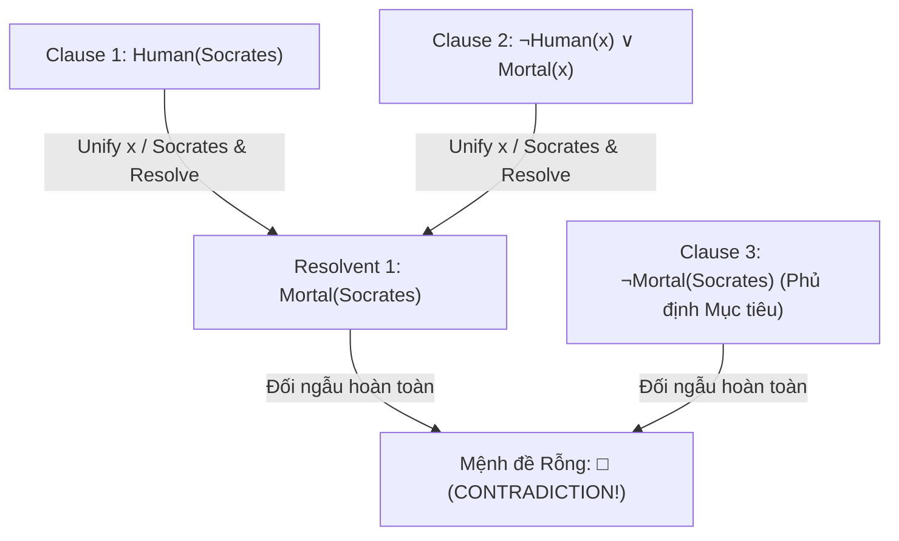
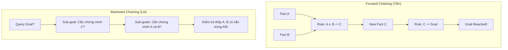
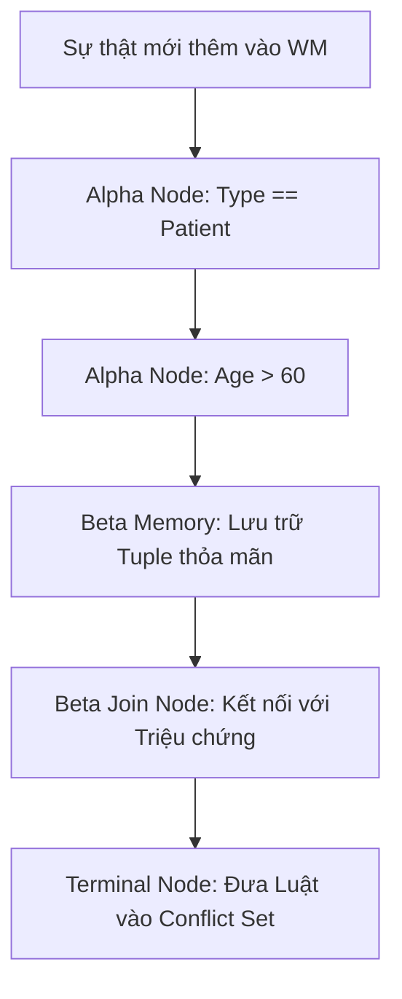

# Chuyên đề: Chứng minh Định lý Tự động & Động cơ Luật (Automated Theorem Proving & Rule Engines)

## 1. Tổng quan Chuyên đề
Khai sinh từ những ngày đầu của trí tuệ nhân tạo (Logic Theorist - 1956, General Problem Solver), **Chứng minh Định lý Tự động (Automated Theorem Proving - ATP)** và **Hệ thống Chuyên gia Dựa trên Quy tắc (Rule-Based Expert Systems)** đại diện cho đỉnh cao thương mại hóa của AI trong thập niên 1970–1980 (với các hệ thống kinh điển như MYCIN, DENDRAL, R1/XCON).

Các trụ cột kỹ thuật của trường phái này bao gồm:
1. **Unification (Thống nhất hóa)**: Thuật toán tìm phép thế biến số tổng quát nhất (Most General Unifier - MGU) để đồng nhất hai biểu thức vị từ.
2. **Resolution (Quy tắc Hợp giải - Alan Robinson, 1965)**: Quy tắc suy luận duy nhất, hoàn chỉnh và đúng đắn (Sound & Refutation-Complete) cho logic mệnh đề và logic vị từ bậc một.
3. **Forward Chaining (Suy diễn Tiến / Dẫn xuất Dữ liệu)**: Khởi phát từ các sự thật đã biết, liên tục kích hoạt các quy tắc để suy ra các sự thật mới.
4. **Backward Chaining (Suy diễn Lùi / Dẫn xuất Mục tiêu)**: Khởi phát từ giả thuyết mục tiêu, tìm ngược lại các tiên đề cần thiết (xương sống của ngôn ngữ lập trình Prolog).
5. **Production Systems & Rete Algorithm**: Kiến trúc lưu trữ bộ nhớ làm việc (Working Memory) và mạng phân biệt (Rete Network) cho phép so khớp hàng chục nghìn luật song song mà không cần lặp lại phép so sánh.

```mermaid
graph TD
    subgraph TheoremProving["Chứng minh Định lý Tự động"]
        KB_Formula["Công thức Logic KB & Phủ định Mục tiêu ¬α"] --> CNF["Chuyển đổi sang Chuẩn hội CNF / Skolemization"]
        CNF --> Unify["Unification: Tìm MGU θ sao cho P(x)θ = P(John)"]
        Unify --> Resolve["Resolution Rule: (A ∨ B) ∧ (¬B ∨ C) ⊢ (A ∨ C)"]
        Resolve --> EmptyClause{"Rút ra Mệnh đề Rỗng □ (False)?"}
        EmptyClause -- Yes --> Proven["CHỨNG MINH THÀNH CÔNG!<br/>KB ⊨ α bằng Phản chứng"]
    end

    subgraph ProductionEngines["Hệ thống Sản xuất (Production Systems)"]
        WorkingMemory["Working Memory (Facts)"] --> ReteNet["Mạng Rete (Alpha/Beta Nodes)"]
        RuleBase["Production Rules (IF-THEN)"] --> ReteNet
        ReteNet --> ConflictSet["Tập Xung đột (Conflict Set)"]
        ConflictSet --> ConflictResolution["Giải quyết Xung đột (Salience/Recency)"]
        ConflictResolution --> Fire["Kích hoạt Luật (Fire Action)"]
        Fire --> WorkingMemory
    end
```



---

## 2. Chi tiết từng Keyword

---

### 1. Unification (Thống nhất hóa) & Most General Unifier (MGU)

#### a. Định nghĩa Bản chất Toán học
Cho hai biểu thức logic $E_1$ và $E_2$. Một **Phép thế (Substitution)** $\theta = \{v_1 / t_1, v_2 / t_2, \dots, v_k / t_k\}$ (trong đó biến $v_i$ được thay thế bởi hạng thức $t_i$) được gọi là một **Bộ Thống nhất (Unifier)** của $E_1$ và $E_2$ nếu:
$$E_1 \theta = E_2 \theta$$

Một phép thế $\theta$ được gọi là **Bộ Thống nhất Tổng quát Nhất (Most General Unifier - MGU)** nếu với mọi bộ thống nhất $\sigma$ khác của $E_1$ và $E_2$, tồn tại một phép thế $\gamma$ sao cho:
$$\sigma = \theta \circ \gamma$$

**Occur Check (Kiểm tra Xuất hiện)**:
Khi thống nhất một biến $x$ với một hạng thức phức hợp $t$, thuật toán bắt buộc phải kiểm tra xem $x$ có xuất hiện bên trong $t$ hay không ($x \in \text{Vars}(t)$).
Ví dụ: Thống nhất $x$ với $f(x)$ sẽ tạo ra chuỗi đệ quy vô hạn $x = f(f(f(\dots)))$, dẫn đến việc suy luận sai lầm về mặt logic.

#### b. Cơ chế Tầng Sâu & Điện toán
- **Độ phức tạp**: Thuật toán Unification của Robinson có độ phức tạp thời gian theo hàm mũ $\mathcal{O}(2^n)$ trong trường hợp xấu nhất do sự nhân đôi kích thước biểu thức. Bằng cách sử dụng cấu trúc đồ thị chia sẻ nút DAG (Directed Acyclic Graph) và cấu trúc dữ liệu **Disjoint-Set (Union-Find)**, thuật toán có thể đạt độ phức tạp gần như tuyến tính $\mathcal{O}(n \cdot \alpha(n))$ (Paterson & Wegman, 1978).

#### c. Code Thực chiến (C++ & Python)
```cpp
// C++20: Thuật toán Unification Đơn giản cho Hạng thức Ký hiệu
#include <iostream>
#include <string>
#include <unordered_map>
#include <memory>

struct Term {
    bool is_variable;
    std::string val; // Tên biến nếu is_variable=true, ngược lại là hằng số
};

using Substitution = std::unordered_map<std::string, std::string>;

bool unify_var(const std::string& var, const Term& x, Substitution& theta) {
    if (theta.find(var) != theta.end()) {
        Term bound{false, theta[var]};
        // Tiếp tục unify với giá trị đã ràng buộc
        return (bound.val == x.val);
    }
    // Occur check tối giản cho biến đơn
    if (x.is_variable && x.val == var) return true;

    theta[var] = x.val; // Ràng buộc biến
    return true;
}

bool unify(const Term& t1, const Term& t2, Substitution& theta) {
    if (t1.val == t2.val && t1.is_variable == t2.is_variable) return true;
    if (t1.is_variable) return unify_var(t1.val, t2, theta);
    if (t2.is_variable) return unify_var(t2.val, t1, theta);
    return false; // Hai hằng số khác nhau không thể unify
}

int main() {
    Term x_var{true, "?x"};
    Term john_const{false, "John"};
    Substitution theta;

    bool success = unify(x_var, john_const, theta);
    std::cout << "Unification Success: " << success << "\n";
    if (success) {
        std::cout << "MGU Binding: ?x -> " << theta["?x"] << "\n";
    }
    return 0;
}
```

```python
# Python: Recursive Unification Algorithm
def unify(x, y, theta):
    if theta is None: return None
    elif x == y: return theta
    elif isinstance(x, str) and x.startswith('?'): # Biến logic
        return unify_var(x, y, theta)
    elif isinstance(y, str) and y.startswith('?'):
        return unify_var(y, x, theta)
    elif isinstance(x, list) and isinstance(y, list):
        if len(x) != len(y): return None
        return unify(x[1:], y[1:], unify(x[0], y[0], theta))
    return None

def unify_var(var, x, theta):
    if var in theta: return unify(theta[var], x, theta)
    elif x in theta: return unify(var, theta[x], theta)
    # Occur check
    if isinstance(x, list) and var in x: return None
    new_theta = dict(theta)
    new_theta[var] = x
    return new_theta

# Unify P(?x, Bob) với P(Alice, ?y)
res = unify(['P', '?x', 'Bob'], ['P', 'Alice', '?y'], {})
print("MGU Substitution:", res) # {'?x': 'Alice', '?y': 'Bob'}
```

---

### 2. Resolution (Quy tắc Hợp giải)

#### a. Định nghĩa Bản chất Toán học
Quy tắc Hợp giải (Resolution Rule) là quy tắc dẫn xuất duy nhất có tính chất **Phản chứng Toàn vẹn (Refutation-Complete)**:
$$\frac{l_1 \lor \dots \lor l_i \lor \dots \lor l_k, \quad m_1 \lor \dots \lor m_j \lor \dots \lor m_n}{(l_1 \lor \dots \lor l_{i-1} \lor l_{i+1} \lor \dots \lor l_k \lor m_1 \lor \dots \lor m_{j-1} \lor m_{j+1} \lor \dots \lor m_n)\theta}$$
với điều kiện tồn tại MGU $\theta$ sao cho:
$$l_i \theta = \neg m_j \theta$$
Mệnh đề kết quả được gọi là **Resolvent**.

- **Quy trình Chứng minh Phản chứng (Proof by Refutation)**:
  Để chứng minh $\mathcal{KB} \models \alpha$:
  1. Thêm phủ định của mục tiêu vào cơ sở tri thức: $\mathcal{KB}' = \mathcal{KB} \cup \{\neg \alpha\}$.
  2. Chuyển đổi toàn bộ các câu trong $\mathcal{KB}'$ sang dạng chuẩn hội CNF (loại bỏ tương đương, khử kéo theo, chuẩn hóa lượng từ Skolemization).
  3. Liên tục áp dụng Resolution lên các cặp mệnh đề có chứa literal đối ngẫu.
  4. Nếu rút ra được **Mệnh đề Rỗng ($\square$ / Empty Clause / False)**, suy ra $\mathcal{KB}'$ là không thể thỏa mãn (Unsatisfiable), tức $\mathcal{KB} \models \alpha$ được chứng minh thành công!

#### b. Sơ đồ Minh họa


#### c. Code Thực chiến (C++ & Python)
```cpp
// C++20: Resolution Refutation Engine trong Logic Mệnh đề
#include <iostream>
#include <vector>
#include <set>
#include <algorithm>

using Clause = std::set<int>; // Tập các literal

Clause resolve_clauses(const Clause& c1, const Clause& c2, int lit) {
    Clause resolvent;
    for (int l : c1) if (l != lit) resolvent.insert(l);
    for (int l : c2) if (l != -lit) resolvent.insert(l);
    return resolvent;
}

bool run_resolution_refutation(std::vector<Clause> clauses) {
    std::set<Clause> clause_set(clauses.begin(), clauses.end());

    while (true) {
        std::vector<Clause> new_clauses;
        std::vector<Clause> current(clause_set.begin(), clause_set.end());
        size_t n = current.size();

        for (size_t i = 0; i < n; ++i) {
            for (size_t j = i + 1; j < n; ++j) {
                for (int lit : current[i]) {
                    if (current[j].count(-lit)) {
                        Clause res = resolve_clauses(current[i], current[j], lit);
                        if (res.empty()) return true; // Tìm thấy mệnh đề rỗng -> Thành công!
                        new_clauses.push_back(res);
                    }
                }
            }
        }

        bool has_novel_clause = false;
        for (const auto& cl : new_clauses) {
            if (clause_set.insert(cl).second) has_novel_clause = true;
        }
        if (!has_novel_clause) return false; // Không thể rút ra thêm mệnh đề mới
    }
}

int main() {
    // KB: (P), (P -> Q <=> ~P OR Q)
    // Goal: Q. Phủ định goal: ~Q
    // Clauses: {P}, {-P, Q}, {-Q}
    std::vector<Clause> problem = { {1}, {-1, 2}, {-2} };
    bool proven = run_resolution_refutation(problem);
    std::cout << "Resolution Refutation Proven: " << (proven ? "YES" : "NO") << "\n";
    return 0;
}
```

```python
# Python: Propositional Resolution Solver
def propositional_resolution(kb_clauses, alpha_negated_clause):
    clauses = set(frozenset(c) for c in kb_clauses + [alpha_negated_clause])
    new = set()

    while True:
        clause_list = list(clauses)
        for i in range(len(clause_list)):
            for j in range(i + 1, len(clause_list)):
                ci, cj = clause_list[i], clause_list[j]
                # Tìm cặp đối ngẫu
                for lit in ci:
                    if -lit in cj:
                        resolvent = (ci - {lit}) | (cj - {-lit})
                        if len(resolvent) == 0:
                            return True # Empty clause derived!
                        new.add(resolvent)
        if new.issubset(clauses):
            return False
        clauses.update(new)

# Chứng minh P |= P: KB = {P}, Negated Alpha = {~P}
print("Proven by refutation?", propositional_resolution([[1]], [-1]))
```

---

### 3. Forward Chaining vs. Backward Chaining (Suy diễn Tiến vs. Suy diễn Lùi)

#### a. Định nghĩa Bản chất Toán học
- **Forward Chaining (Data-Driven / Bottom-Up)**:
  Bắt đầu từ tập các sự thật ban đầu (Axioms/Facts). Áp dụng Modus Ponens để sinh ra các kết luận mới và bổ sung vào Working Memory, lặp lại cho đến khi đạt được mục tiêu $Q$ hoặc không còn luật nào có thể kích hoạt:
  $$\text{Match}(\text{Premises}, \mathcal{WM}) \implies \text{Assert}(\text{Conclusion})$$
- **Backward Chaining (Goal-Driven / Top-Down)**:
  Bắt đầu từ mục tiêu $Q$. Tìm kiếm các luật có phần Head khớp với $Q$, sau đó đệ quy thiết lập các điều kiện trong Body của luật đó thành các mục tiêu con (Sub-goals) mới cần chứng minh:
  $$\text{Prove}(Q) \implies \text{Find Rule }(B_1 \land \dots \land B_k \to Q) \land \forall i \ \text{Prove}(B_i)$$
  Được tối ưu hóa bằng thuật toán quay lui đệ quy (SLD-Resolution).

#### b. Bảng So sánh Chuyên sâu
| Đặc tính | Forward Chaining | Backward Chaining |
| :--- | :--- | :--- |
| **Định hướng** | Dữ liệu dẫn dắt (Data-driven) | Mục tiêu dẫn dắt (Goal-driven) |
| **Bản chất tính toán** | Suy diễn mọi hệ quả có thể (sinh nhiều rác) | Chỉ tập trung vào các sự thật liên quan tới mục tiêu |
| **Ứng dụng tối ưu** | Giám sát hệ thống, cảnh báo thời gian thực | Chẩn đoán y khoa, lập luận pháp lý, Prolog |
| **Độ phức tạp** | $\mathcal{O}(p \cdot r)$ với Horn Clauses | Bị đe dọa bởi vòng lặp vô hạn nếu đệ quy chu trình |

#### c. Sơ đồ Minh họa


#### d. Code Thực chiến (C++ & Python)
```cpp
// C++20: Backward Chaining Goal Prover Tối giản
#include <iostream>
#include <vector>
#include <string>
#include <unordered_set>

struct Rule {
    std::string head;
    std::vector<std::string> body;
};

class BackwardChainer {
private:
    std::unordered_set<std::string> facts_;
    std::vector<Rule> rules_;
    std::unordered_set<std::string> visited_goals_; // Chống lặp vô hạn
public:
    void add_fact(std::string f) { facts_.insert(std::move(f)); }
    void add_rule(std::string head, std::vector<std::string> body) {
        rules_.push_back({std::move(head), std::move(body)});
    }

    bool prove(const std::string& goal) {
        if (facts_.count(goal)) return true;
        if (visited_goals_.count(goal)) return false; // Phát hiện chu trình

        visited_goals_.insert(goal);

        for (const auto& r : rules_) {
            if (r.head == goal) {
                bool all_subgoals_proven = true;
                for (const auto& subgoal : r.body) {
                    if (!prove(subgoal)) {
                        all_subgoals_proven = false;
                        break;
                    }
                }
                if (all_subgoals_proven) {
                    visited_goals_.erase(goal);
                    return true;
                }
            }
        }
        visited_goals_.erase(goal);
        return false;
    }
};

int main() {
    BackwardChainer chainer;
    chainer.add_fact("HasHighBloodPressure");
    chainer.add_fact("Smoker");
    chainer.add_rule("HeartDiseaseRisk", {"HasHighBloodPressure", "Smoker"});

    bool risk = chainer.prove("HeartDiseaseRisk");
    std::cout << "Heart Disease Risk Proven via Backward Chaining: " << (risk ? "YES" : "NO") << "\n";
    return 0;
}
```

```python
# Python: Backward Chaining Inference Engine
class BackwardChainingEngine:
    def __init__(self, rules, facts):
        self.rules = rules # Dict[head, List[List[subgoals]]]
        self.facts = set(facts)

    def prove(self, goal, path=()):
        if goal in self.facts:
            return True
        if goal in path: # Vòng lặp
            return False

        for body_option in self.rules.get(goal, []):
            if all(self.prove(subgoal, path + (goal,)) for subgoal in body_option):
                return True
        return False

rules_kb = {
    'Fly': [['Bird', 'Normal']],
    'Bird': [['Feathers']]
}
facts_kb = {'Feathers', 'Normal'}
engine = BackwardChainingEngine(rules_kb, facts_kb)
print("Can Entity Fly?", engine.prove('Fly'))
```

---

### 4. Production Systems, Rule-Based Systems & Expert Systems (Hệ Thống Sản Xuất & Hệ Chuyên Gia)

#### a. Định nghĩa Bản chất Toán học
Một **Hệ thống Sản xuất (Production System)** bao gồm:
1. **Bộ nhớ Làm việc (Working Memory - $\mathcal{WM}$)**: Tập hợp các sự thật hiện tại.
2. **Cơ sở Quy tắc Sản xuất (Production Rules)**: Các cặp mẫu hành động dạng `IF condition THEN action`:
   $$P_i: \mathcal{C}_i \to \mathcal{A}_i$$
3. **Chu trình Nhận dạng - Hành động (Recognize-Act Cycle)**:
   - **Match**: So khớp điều kiện $\mathcal{C}_i$ với $\mathcal{WM}$ để tìm các luật thỏa mãn, đưa vào **Conflict Set**.
   - **Conflict Resolution**: Chọn một luật duy nhất từ Conflict Set dựa trên độ ưu tiên (Salience, Specificity, Recency).
   - **Act**: Thực thi hành động $\mathcal{A}_i$ (sửa đổi, thêm hoặc xóa sự thật trong $\mathcal{WM}$).

- **Thuật toán Rete (Charles Forgy, 1974)**:
  Giải quyết vấn đề hiệu năng bằng cách biên dịch các luật thành một đồ thị luồng dữ liệu (Rete Network):
  - **Alpha Network**: Lọc các sự thật đơn lẻ (1-input nodes) dựa trên thuộc tính cố định.
  - **Beta Network**: Thực hiện phép kết nối (Join / 2-input nodes) giữa các biến xuất hiện ở nhiều điều kiện khác nhau.
  - Các kết quả so khớp từng phần được ghi nhớ (memoized) trong các nút mạng, loại bỏ việc duyệt lại toàn bộ các sự thật không thay đổi giữa các chu kỳ.

#### b. Sơ đồ Minh họa


#### c. Code Thực chiến (C++ & Python)
```cpp
// C++17: Production System Conflict Resolution (Priority Queue based on Salience)
#include <iostream>
#include <vector>
#include <string>
#include <queue>

struct ProductionRule {
    std::string name;
    int salience; // Độ ưu tiên
    int recency;  // Thời điểm sự thật kích hoạt được nạp vào
    bool operator<(const ProductionRule& o) const {
        if (salience != o.salience) return salience < o.salience;
        return recency < o.recency;
    }
};

int main() {
    std::priority_queue<ProductionRule> conflict_set;
    conflict_set.push({"GeneralDiagnosisRule", 10, 100});
    conflict_set.push({"EmergencyCardiacArrestRule", 100, 105}); // Salience vượt trội
    conflict_set.push({"SpecificAllergyRule", 50, 102});

    auto winner = conflict_set.top();
    std::cout << "Conflict Resolution Winner: " << winner.name << " (Salience: " << winner.salience << ")\n";
    return 0;
}
```

```python
# Python: Production System Cycle Simulation
class ProductionSystem:
    def __init__(self):
        self.wm = set()
        self.rules = []

    def add_rule(self, name, condition_fn, action_fn, salience=0):
        self.rules.append((salience, name, condition_fn, action_fn))

    def run_cycle(self, max_steps=10):
        for step in range(max_steps):
            conflict_set = []
            for salience, name, cond, act in self.rules:
                if cond(self.wm):
                    conflict_set.append((salience, name, act))

            if not conflict_set:
                print(f"Cycle halted at step {step}: No matching rules.")
                break

            # Conflict resolution: chọn luật có salience cao nhất
            conflict_set.sort(key=lambda x: x[0], reverse=True)
            chosen_salience, chosen_name, chosen_act = conflict_set[0]
            print(f"Firing rule: {chosen_name}")
            chosen_act(self.wm)

ps = ProductionSystem()
ps.wm.add("smoke_detected")
ps.add_rule("SoundAlarm", lambda wm: "smoke_detected" in wm and "alarm_on" not in wm, 
            lambda wm: wm.add("alarm_on"), salience=100)
ps.add_rule("CallFireDept", lambda wm: "alarm_on" in wm and "fire_dept_called" not in wm, 
            lambda wm: wm.add("fire_dept_called"), salience=90)
ps.run_cycle()
print("Final Working Memory:", ps.wm)
```

#### d. Lỗi Thường gặp & Ứng dụng
- **Knowledge Acquisition Bottleneck (Nút thắt thu nhận tri thức)**: Các chuyên gia con người rất khó chuyển hóa trực giác vô thức thành hàng chục nghìn luật IF-THEN rõ ràng, dẫn đến các luật mâu thuẫn lẫn nhau trong hệ thống lớn.
- **Ứng dụng AI**: Hệ thống thẩm định tín dụng ngân hàng, kiểm tra gian lận bảo hiểm y tế, và các động cơ kinh doanh như CLIPS, Jess, Drools.
