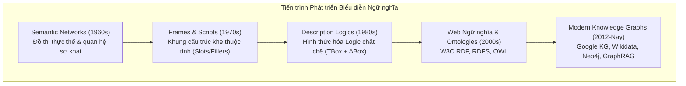
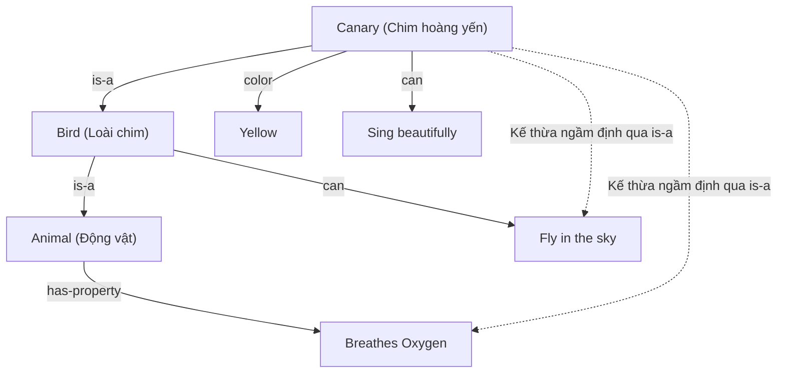
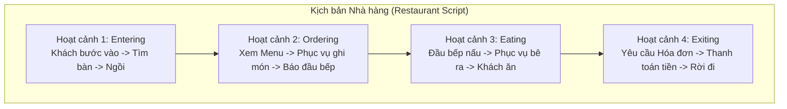

# Chuyên đề: Bản thể luận & Đồ thị Tri thức Ngữ nghĩa (Ontologies & Semantic Knowledge Graphs)

## 1. Tổng quan Chuyên đề
Để máy móc có thể hiểu và chia sẻ tri thức một cách thông minh, thông tin không thể chỉ lưu trữ dưới dạng văn bản phi cấu trúc hay các bảng cơ sở dữ liệu quan hệ rời rạc. Cần có các mô hình biểu diễn tri thức cấu trúc hóa ngữ nghĩa:
- **Semantic Networks (Mạng Ngữ nghĩa)** & **Frames (Khung tri thức - Marvin Minsky)**: Tiên phong trong việc mô hình hóa các khái niệm dưới dạng đồ thị có hướng gồm các nút (thực thể) và các cạnh (quan hệ phân cấp `is-a`, `part-of`).
- **Scripts (Kịch bản - Roger Schank)**: Mô hình hóa các chuỗi sự kiện khuôn mẫu theo thời gian và ngữ cảnh xã hội (ví dụ kịch bản đi ăn nhà hàng).
- **Description Logics (Logic Mô tả - DLs)**: Cung cấp nền tảng hình thức logic chặt chẽ, cân bằng giữa năng lực biểu đạt và khả năng tính toán khả quyết (Decidable), làm xương sống cho tiêu chuẩn Web Ngữ nghĩa (W3C OWL - Web Ontology Language).
- **Ontologies (Bản thể luận)** & **Knowledge Graphs (Đồ thị Tri thức)**: Tổ chức hàng tỷ thực thể và quan hệ trong thế giới thực thành các bộ ba ngữ nghĩa RDF ($h, r, t$), tạo nên sức mạnh cho các công cụ tìm kiếm hiện đại (Google Knowledge Graph, Wikidata, DBpedia) và kiến trúc trích xuất thông tin mở rộng cho LLM (GraphRAG).



---

## 2. Chi tiết từng Keyword

---

### 1. Description Logic (Logic Mô tả) & Ontologies (Bản thể luận)

#### a. Định nghĩa Bản chất Toán học
- **Description Logic (DL)**: Là một họ các ngôn ngữ biểu diễn tri thức là phân lớp con khả quyết của First-Order Logic (FOL). Một cơ sở tri thức DL bao gồm 2 thành phần tách biệt:
  $$\mathcal{KB} = \langle \mathcal{T}, \mathcal{A} \rangle$$
  1. **TBox (Terminological Box - Hộp Thuật ngữ)**: Chứa các định nghĩa về khái niệm (Concepts - tập hợp các đối tượng) và vai trò (Roles - quan hệ nhị phân giữa các đối tượng):
     - Bao hàm khái niệm (Subsumption): $C \sqsubseteq D$ (Ví dụ: $\text{Human} \sqsubseteq \text{Mortal}$).
     - Tương đương khái niệm: $C \equiv D$.
     - Các toán tử: Giao ($C \sqcap D$), Hợp ($C \sqcup D$), Phủ định ($\neg C$), Giới hạn tồn tại ($\exists R.C$), Giới hạn giá trị ($\forall R.C$).
  2. **ABox (Assertional Box - Hộp Khẳng định)**: Chứa các phát biểu về các cá thể cụ thể (Individuals):
     - Khẳng định khái niệm: $C(a)$ (Ví dụ: $\text{Human}(\text{Socrates})$).
     - Khẳng định vai trò: $R(a, b)$ (Ví dụ: $\text{hasChild}(\text{John}, \text{Mary})$).

- **Ontology (Bản thể luận)**: Là một đặc tả hình thức, tường minh về một sự khái niệm hóa chung (Gruber, 1993):
  $$\mathcal{O} = \langle \mathcal{C}, \mathcal{R}, \mathcal{I}, \mathcal{A}_{\text{xioms}} \rangle$$
  trong đó $\mathcal{C}$ là các lớp khái niệm, $\mathcal{R}$ là các quan hệ, $\mathcal{I}$ là các thực thể, và $\mathcal{A}_{\text{xioms}}$ là các tiên đề logic ràng buộc.

#### b. Cơ chế Tầng Sâu & Điện toán
- **Tableau Algorithms**: Các bộ suy luận bản thể luận (như HermiT, Pellet, FaCT++) sử dụng thuật toán Tableau để kiểm tra tính thỏa mãn của khái niệm (Concept Satisfiability) bằng cách xây dựng một cây mô hình phản ví dụ, với độ phức tạp tính toán được chứng minh là PSPACE-complete hoặc EXPTIME-complete tùy thuộc vào độ biểu đạt của ngôn ngữ DL ($\mathcal{ALC}$, $\mathcal{SHIQ}$, $\mathcal{SROIQ}$).

#### c. Code Thực chiến (C++ & Python)
```cpp
// C++20: Mô phỏng Kiểm tra Bao hàm Khái niệm TBox (Subsumption Check) tối giản
#include <iostream>
#include <string>
#include <unordered_map>
#include <unordered_set>

class SimpleTBox {
private:
    std::unordered_map<std::string, std::unordered_set<std::string>> parents_;
public:
    void add_subclass(const std::string& sub, const std::string& super) {
        parents_[sub].insert(super);
    }

    // Kiểm tra C ⊑ D qua BFS trên đồ thị bản thể học
    bool is_subsumed_by(const std::string& c, const std::string& d) {
        if (c == d) return true;
        std::unordered_set<std::string> visited;
        std::vector<std::string> q = {c};

        while (!q.empty()) {
            std::string curr = q.back();
            q.pop_back();

            for (const auto& parent : parents_[curr]) {
                if (parent == d) return true;
                if (visited.insert(parent).second) {
                    q.push_back(parent);
                }
            }
        }
        return false;
    }
};

int main() {
    SimpleTBox tbox;
    tbox.add_subclass("Professor", "Teacher");
    tbox.add_subclass("Teacher", "Person");

    std::cout << "Is Professor ⊑ Person? " << (tbox.is_subsumed_by("Professor", "Person") ? "YES" : "NO") << "\n";
    return 0;
}
```

```python
# Python: Owlready2 Ontology Definition and Classification
from owlready2 import get_ontology, Thing

onto = get_ontology("http://test.org/onto.owl")

with onto:
    class Person(Thing): pass
    class Teacher(Person): pass
    class Professor(Teacher): pass

# Kiểm tra Subsumption trong Python
print("Is Professor subclass of Person?", issubclass(Professor, Person))
print("Professor MRO Hierarchy:", [cls.name for cls in Professor.__mro__ if hasattr(cls, 'name')])
```

---

### 2. Semantic Networks & Knowledge Graphs (Mạng Ngữ nghĩa & Đồ thị Tri thức)

#### a. Định nghĩa Bản chất Toán học
- **Semantic Network (Mạng Ngữ nghĩa - Quillian, 1968)**: Là một đồ thị có hướng gán nhãn $\mathcal{G} = (\mathcal{V}, \mathcal{E}, \mathcal{L})$:
  - $\mathcal{V}$: Tập hợp các nút biểu diễn khái niệm hoặc đối tượng.
  - $\mathcal{E} \subseteq \mathcal{V} \times \mathcal{L} \times \mathcal{V}$: Các cạnh có hướng gán nhãn biểu diễn quan hệ ngữ nghĩa (kinh điển: `is-a` thừa kế thuộc tính, `has-part`, `color`).
- **Knowledge Graph (Đồ thị Tri thức - Google, 2012)**:
  Tập hợp hàng triệu đến hàng tỷ bộ ba ngữ nghĩa (RDF Triples):
  $$\mathcal{KG} = \{ (h, r, t) \in \mathcal{E}_{\text{entities}} \times \mathcal{R}_{\text{relations}} \times \mathcal{E}_{\text{entities}} \}$$
  với $h$: Head entity, $r$: Relation, $t$: Tail entity.

- **Duyệt Thừa kế Kế thừa Thuộc tính (Inheritance Traversal)**:
  Nếu $A \xrightarrow{\text{is-a}} B$ và $B$ có thuộc tính $P(v)$, thì $A$ tự động thừa kế thuộc tính $P(v)$ trừ khi bị ghi đè cục bộ tại nút $A$ (Default Inheritance).

#### b. Sơ đồ Minh họa


#### c. Code Thực chiến (C++ & Python)
```cpp
// C++20: Bộ Đệm Đồ thị Tri thức Ngữ nghĩa RDF Triple Store với Hash Indexing
#include <iostream>
#include <vector>
#include <string>
#include <unordered_map>

struct Triple {
    std::string head, relation, tail;
};

class TripleStore {
private:
    std::vector<Triple> triples_;
    std::unordered_map<std::string, std::vector<size_t>> head_index_; // SPO Index: S -> Triples
public:
    void insert(std::string h, std::string r, std::string t) {
        size_t idx = triples_.size();
        triples_.push_back({h, r, t});
        head_index_[h].push_back(idx);
    }

    std::vector<Triple> query_subject(const std::string& h) const {
        std::vector<Triple> results;
        auto it = head_index_.find(h);
        if (it != head_index_.end()) {
            for (size_t idx : it->second) results.push_back(triples_[idx]);
        }
        return results;
    }
};

int main() {
    TripleStore kg;
    kg.insert("Alan_Turing", "bornIn", "London");
    kg.insert("Alan_Turing", "fieldOfWork", "Computer_Science");

    auto facts = kg.query_subject("Alan_Turing");
    std::cout << "Retrieved " << facts.size() << " facts for Alan Turing:\n";
    for (const auto& f : facts) {
        std::cout << "  (" << f.head << ", " << f.relation << ", " << f.tail << ")\n";
    }
    return 0;
}
```

```python
# Python: RDFLib SPARQL Query Execution
from rdflib import Graph, URIRef, Literal, Namespace
from rdflib.namespace import RDF, FOAF

g = Graph()
EX = Namespace("http://example.org/")

# Thêm triples vào đồ thị
g.add((EX.Alice, RDF.type, FOAF.Person))
g.add((EX.Alice, FOAF.name, Literal("Alice Smith")))
g.add((EX.Alice, EX.knows, EX.Bob))
g.add((EX.Bob, FOAF.name, Literal("Bob Jones")))

# Truy vấn SPARQL tìm bạn bè của Alice
q = """
SELECT ?friendName WHERE {
    ?person foaf:name "Alice Smith" .
    ?person <http://example.org/knows> ?friend .
    ?friend foaf:name ?friendName .
}
"""
for row in g.query(q):
    print("SPARQL Result Friend:", row.friendName)
```

---

### 3. Frames, Scripts & Conceptual Graphs (Khung Tri thức, Kịch bản & Đồ thị Khái niệm)

#### a. Định nghĩa Bản chất Toán học
1. **Frames (Khung tri thức - Marvin Minsky, 1975)**:
   Mô hình cấu trúc dữ liệu nguyên mẫu biểu diễn các tình huống điển hình. Mỗi Frame bao gồm:
   - Tên khung (Frame Name).
   - Tập các **Khe cắm (Slots)** biểu thị các thuộc tính.
   - Các **Bộ điền (Fillers)** là giá trị hoặc liên kết tới các Frame khác.
   - **Thủ tục đính kèm (Procedural Attachments)**: Các hàm kích hoạt khi truy cập hoặc sửa đổi slot (`if-needed`, `if-added`, `if-removed`). Là tiền thân trực tiếp của Lập trình Hướng Đối tượng (OOP).
2. **Scripts (Kịch bản - Schank & Abelson, 1977)**:
   Mở rộng Frame để biểu diễn chuỗi sự kiện khuôn mẫu theo trình tự thời gian. Bao gồm:
   - *Entry Conditions* (Điều kiện bắt đầu).
   - *Roles* (Các vai trò tham gia: Phục vụ bàn, Khách hàng, Đầu bếp).
   - *Props* (Đạo cụ: Thực đơn, Món ăn, Hóa đơn).
   - *Scenes* (Các hoạt cảnh nối tiếp: Bước vào quán, Gọi món, Ăn uống, Thanh toán, Rời đi).
3. **Conceptual Graphs (Đồ thị Khái niệm - John Sowa, 1984)**:
   Đồ thị hai phía (Bipartite Graph) gồm hai loại nút: **Nút Khái niệm (Concept Nodes)** và **Nút Quan hệ Khái niệm (Conceptual Relation Nodes)**, có ánh xạ song ánh chính xác với First-Order Logic.

#### b. Sơ đồ Minh họa


#### c. Code Thực chiến (C++ & Python)
```cpp
// C++17: Frame Data Structure với Procedural Attachment (if-needed demon)
#include <iostream>
#include <string>
#include <unordered_map>
#include <functional>

struct Frame {
    std::string name;
    std::unordered_map<std::string, std::string> slots;
    std::unordered_map<std::string, std::function<std::string()>> if_needed_demons;

    std::string get_slot(const std::string& slot_name) {
        if (slots.find(slot_name) != slots.end()) {
            return slots[slot_name];
        }
        if (if_needed_demons.find(slot_name) != if_needed_demons.end()) {
            std::string computed = if_needed_demons[slot_name]();
            slots[slot_name] = computed; // Cache lại giá trị tính toán
            return computed;
        }
        return "[Unknown Slot]";
    }
};

int main() {
    Frame circle{"Circle_01", {}, {
        {"area", []() { return "78.54 (computed via PI*r^2)"; }}
    }};
    std::cout << "Circle Area from Demon: " << circle.get_slot("area") << "\n";
    return 0;
}
```

```python
# Python: Script Event Sequence Simulator
class ScriptRunner:
    def __init__(self, script_name: str, scenes: list):
        self.script_name = script_name
        self.scenes = scenes

    def execute_script(self, context: dict):
        print(f"=== Activating Script: {self.script_name} ===")
        for idx, scene in enumerate(self.scenes, start=1):
            print(f"Scene {idx}: {scene['name']}")
            for action in scene['actions']:
                formatted_act = action.format(**context)
                print(f"  -> {formatted_act}")

restaurant_script = ScriptRunner("DiningOut", [
    {"name": "Entering", "actions": ["{customer} walks into {restaurant}.", "{customer} sits at table."]},
    {"name": "Ordering", "actions": ["{customer} reads menu.", "{waiter} takes order for {food}."]},
    {"name": "Eating",   "actions": ["{customer} eats {food}."]},
    {"name": "Leaving",  "actions": ["{customer} pays bill.", "{customer} exits {restaurant}."]}
])

restaurant_script.execute_script({"customer": "Alice", "waiter": "Bob", "restaurant": "Le Bistro", "food": "Pasta"})
```

#### d. Lỗi Thường gặp & Ứng dụng
- **Script Rigidity (Sự xơ cứng của Kịch bản)**: Hệ thống script không thể xử lý các sự kiện bất thường nằm ngoài khuôn mẫu (ví dụ: nhà hàng bị cháy, khách hàng quên mang ví, hoặc nhà hàng hết sạch món ăn).
- **Ứng dụng AI**: Hệ thống hiểu ngôn ngữ tự nhiên trong hội thoại dịch vụ khách hàng, trích xuất sự kiện trong tài liệu pháp lý, và GraphRAG kết nối đồ thị tri thức với LLM sinh câu trả lời chính xác không ảo giác.
