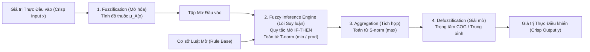
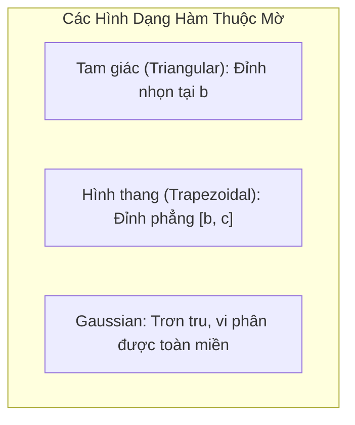
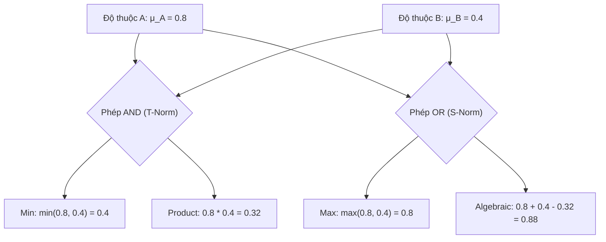
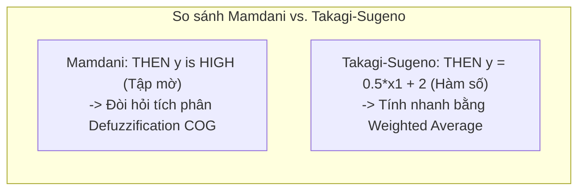

# Chuyên đề: Logic Mờ & Hệ Thống Suy Luận Mờ (Fuzzy Logic & Fuzzy Inference Systems)

## 1. Tổng quan Chuyên đề
Logic nhị phân cổ điển của Aristotle chỉ chấp nhận hai giá trị chân lý tuyệt đối: Đúng ($1$) hoặc Sai ($0$). Tuy nhiên, trong thế giới thực tế và tư duy ngôn ngữ của con người, các khái niệm thường mang tính mơ hồ, không ranh giới rõ ràng (ví dụ: "trời khá nóng", "tốc độ xe tương đối nhanh", "bệnh nhân hơi sốt").

**Logic Mờ (Fuzzy Logic)** do Giáo sư Lotfi Zadeh đề xuất năm 1965 tại Đại học UC Berkeley, mở rộng lý thuyết tập hợp cổ điển bằng cách cho phép **Hàm Thuộc (Membership Function $\mu_A(x)$)** nhận bất kỳ giá trị thực liên tục nào trong đoạn đóng $[0, 1]$. 

**Hệ thống Suy luận Mờ (Fuzzy Inference Systems - FIS)** — với hai kiến trúc kinh điển là **Mamdani** và **Takagi-Sugeno** — biến đổi các biến ngôn ngữ mờ (Linguistic Variables) thông qua 4 bước: *Mờ hóa (Fuzzification)* $\to$ *Đánh giá Luật (Rule Evaluation)* $\to$ *Tích hợp (Aggregation)* $\to$ *Giải mờ (Defuzzification)*, tạo nên các bộ điều khiển tự động hóa thông minh (Fuzzy Controllers) được ứng dụng rộng rãi trong các thiết bị công nghiệp và dân dụng.



---

## 2. Chi tiết từng Keyword

---

### 1. Fuzzy Sets & Fuzzy Membership Functions (Tập Mờ & Hàm Thuộc Mờ)

#### a. Định nghĩa Bản chất Toán học
- **Tập Cổ điển (Crisp Set $A$)**: Xác định bởi hàm chỉ thị nhị phân:
  $$\chi_A(x) = \begin{cases} 1 & \text{nếu } x \in A \\ 0 & \text{nếu } x \notin A \end{cases}$$
- **Tập Mờ (Fuzzy Set $A$)**: Được xác định trong không gian vũ trụ luận $\mathcal{X}$ bởi **Hàm Thuộc (Membership Function)** $\mu_A(x)$:
  $$\mu_A: \mathcal{X} \to [0, 1]$$
  Giá trị $\mu_A(x)$ biểu thị mức độ thuộc về (degree of membership) của phần tử $x$ vào tập mờ $A$.

- **Các Dạng Hàm Thuộc Chuẩn**:
  1. **Hàm Tam giác (Triangular - $\text{trimf}(x; a, b, c)$)**:
     $$\mu(x) = \max\left( \min\left( \frac{x - a}{b - a}, \frac{c - x}{c - b} \right), 0 \right)$$
  2. **Hàm Hình thang (Trapezoidal - $\text{trapmf}(x; a, b, c, d)$)**:
     $$\mu(x) = \max\left( \min\left( \frac{x - a}{b - a}, 1, \frac{d - x}{d - c} \right), 0 \right)$$
  3. **Hàm Gauss (Gaussian - $\text{gaussmf}(x; c, \sigma)$)**:
     $$\mu(x) = \exp\left( -\frac{(x - c)^2}{2\sigma^2} \right)$$
  4. **Hàm Sigmoid**: $\mu(x) = \frac{1}{1 + e^{-a(x - c)}}$.

#### b. Sơ đồ Minh họa


#### c. Code Thực chiến (C++ & Python)
```cpp
// C++20: Triển khai các Hàm Thuộc Mờ Tối ưu hóa Inline
#include <iostream>
#include <cmath>
#include <algorithm>

class FuzzyMembership {
public:
    static inline double triangular(double x, double a, double b, double c) {
        if (x <= a || x >= c) return 0.0;
        if (x == b) return 1.0;
        if (x < b) return (x - a) / (b - a);
        return (c - x) / (c - b);
    }

    static inline double gaussian(double x, double c, double sigma) {
        double diff = (x - c) / sigma;
        return std::exp(-0.5 * diff * diff);
    }
};

int main() {
    double temp = 28.5; // Độ C
    double warm_tri = FuzzyMembership::triangular(temp, 20.0, 25.0, 30.0);
    double warm_gauss = FuzzyMembership::gaussian(temp, 25.0, 3.0);

    std::cout << "Temperature: " << temp << " C\n";
    std::cout << "  Membership 'Warm' (Triangular): " << warm_tri << "\n";
    std::cout << "  Membership 'Warm' (Gaussian)  : " << warm_gauss << "\n";
    return 0;
}
```

```python
# Python: Vectorized Membership Functions via NumPy
import numpy as np

def triangular_mf(x, a, b, c):
    return np.maximum(0.0, np.minimum((x - a) / (b - a + 1e-9), (c - x) / (c - b + 1e-9)))

def gaussian_mf(x, c, sigma):
    return np.exp(-0.5 * ((x - c) / sigma) ** 2)

x_domain = np.linspace(0, 40, 5) # 5 điểm nhiệt độ
print("Domain points:", x_domain)
print("Triangular Warm memberships:", triangular_mf(x_domain, 15, 25, 35))
print("Gaussian Warm memberships:", gaussian_mf(x_domain, 25, 5))
```

---

### 2. Fuzzy Logic Operators & Uncertainty Reasoning (Toán tử Mờ & Suy luận Bất định)

#### a. Định nghĩa Bản chất Toán học
Trong Logic Mờ, các liên từ chuẩn được mở rộng từ đại số Boole sang các hàm toán học liên tục trên đoạn $[0, 1]$:
1. **Phép Giao / Hội Logic (T-Norm - Triangular Norm)**:
   - Chuẩn Zadeh (Min): $T_{\min}(a, b) = \min(a, b)$.
   - Chuẩn Tích (Product): $T_{\text{prod}}(a, b) = a \cdot b$.
   - Chuẩn Łukasiewicz: $T_{\text{Luk}}(a, b) = \max(0, a + b - 1)$.
2. **Phép Hợp / Tuyển Logic (S-Norm / T-Conorm)**:
   - Chuẩn Zadeh (Max): $S_{\max}(a, b) = \max(a, b)$.
   - Tổng xác suất (Algebraic Sum): $S_{\text{sum}}(a, b) = a + b - a \cdot b$.
   - Chuẩn Łukasiewicz: $S_{\text{Luk}}(a, b) = \min(1, a + b)$.
3. **Phép Phủ định (Fuzzy Complement)**:
   $$c(a) = 1 - a$$

- **Suy luận Bất định (Uncertainty Reasoning)**:
  Phép kéo theo mờ (Fuzzy Implication): $\mathcal{I}(a, b): [0, 1] \times [0, 1] \to [0, 1]$.
  - Mamdani Implication (Minimum Clip): $\mathcal{I}_{\text{Mam}}(a, b) = \min(a, b)$.
  - Larsen Implication (Product Scale): $\mathcal{I}_{\text{Lar}}(a, b) = a \cdot b$.

#### b. Sơ đồ Minh họa


#### c. Code Thực chiến (C++ & Python)
```cpp
// C++17: Fuzzy T-Norm và S-Norm Calculators
#include <iostream>
#include <algorithm>

struct FuzzyOperators {
    static double t_norm_min(double a, double b) { return std::min(a, b); }
    static double t_norm_prod(double a, double b) { return a * b; }
    static double s_norm_max(double a, double b) { return std::max(a, b); }
    static double s_norm_sum(double a, double b) { return a + b - a * b; }
    static double complement(double a) { return 1.0 - a; }
};

int main() {
    double mu_A = 0.7, mu_B = 0.5;
    std::cout << "A AND B (Min): " << FuzzyOperators::t_norm_min(mu_A, mu_B) << "\n";
    std::cout << "A OR B (Max) : " << FuzzyOperators::s_norm_max(mu_A, mu_B) << "\n";
    std::cout << "NOT A        : " << FuzzyOperators::complement(mu_A) << "\n";
    return 0;
}
```

```python
# Python: Fuzzy Set Theory Operations Visualizer
class FuzzySetOperations:
    @staticmethod
    def fuzzy_and(mu1, mu2, method='min'):
        return np.minimum(mu1, mu2) if method == 'min' else mu1 * mu2

    @staticmethod
    def fuzzy_or(mu1, mu2, method='max'):
        return np.maximum(mu1, mu2) if method == 'max' else mu1 + mu2 - mu1 * mu2

    @staticmethod
    def fuzzy_not(mu):
        return 1.0 - mu

mu_a, mu_b = 0.75, 0.40
print("Fuzzy AND (min):", FuzzySetOperations.fuzzy_and(mu_a, mu_b))
print("Fuzzy OR (max):", FuzzySetOperations.fuzzy_or(mu_a, mu_b))
```

---

### 3. Fuzzy Inference Systems (FIS: Mamdani vs. Takagi-Sugeno) & Defuzzification

#### a. Định nghĩa Bản chất Toán học
1. **Kiến trúc Mamdani (Mamdani FIS, 1975)**:
   Cả tiền đề và kết luận đều là các tập mờ ngôn ngữ:
   $$\text{Rule } i: \text{IF } x_1 \text{ is } A_{i1} \text{ AND } x_2 \text{ is } A_{i2} \text{ THEN } y \text{ is } B_i$$
   - Mức độ kích hoạt của luật $i$: $w_i = \min(\mu_{A_{i1}}(x_1), \mu_{A_{i2}}(x_2))$.
   - Tập mờ kết quả của luật $i$: $\mu_{B'_i}(y) = \min(w_i, \mu_{B_i}(y))$.
   - Tích hợp toàn bộ các luật (Aggregation): $\mu_{\text{agg}}(y) = \max_i \mu_{B'_i}(y)$.
2. **Kiến trúc Takagi-Sugeno (Sugeno FIS, 1985)**:
   Phần kết luận là một hàm toán học tuyến tính giải tích (Crisp Function):
   $$\text{Rule } i: \text{IF } x_1 \text{ is } A_{i1} \text{ AND } x_2 \text{ is } A_{i2} \text{ THEN } y_i = p_{i0} + p_{i1} x_1 + p_{i2} x_2$$
   - Kết quả đầu ra là trung bình gia quyền (Weighted Average):
     $$y^* = \frac{\sum_i w_i y_i}{\sum_i w_i}$$
   Sugeno FIS có tốc độ tính toán vượt trội trên phần cứng nhúng vì không đòi hỏi tích phân giải mờ.

3. **Các Phương pháp Giải mờ (Defuzzification Methods cho Mamdani)**:
   Chuyển tập mờ tích hợp $\mu_{\text{agg}}(y)$ thành một giá trị thực đơn nhất $y^*$:
   - **Trọng tâm (Centroid / Center of Gravity - COG)**:
     $$y^* = \frac{\int y \cdot \mu_{\text{agg}}(y) \, dy}{\int \mu_{\text{agg}}(y) \, dy} \approx \frac{\sum_k y_k \cdot \mu_{\text{agg}}(y_k)}{\sum_k \mu_{\text{agg}}(y_k)}$$
   - **Mean of Maxima (MOM)**: Trung bình của các giá trị $y$ đạt độ thuộc lớn nhất.

#### b. Sơ đồ Minh họa


#### c. Code Thực chiến (C++ & Python)
```cpp
// C++20: Takagi-Sugeno Fuzzy Controller Đơn giản cho Điều khiển Tốc độ Động cơ
#include <iostream>
#include <vector>
#include <numeric>

struct SugenoRule {
    double w;       // Trọng số kích hoạt của luật
    double output;  // Giá trị crisp đầu ra của luật
};

double sugeno_inference(const std::vector<SugenoRule>& rules) {
    double weighted_sum = 0.0;
    double total_weight = 0.0;

    for (const auto& r : rules) {
        weighted_sum += r.w * r.output;
        total_weight += r.w;
    }

    if (total_weight == 0.0) return 0.0;
    return weighted_sum / total_weight; // Trung bình gia quyền
}

int main() {
    // Luật 1: IF Error is Large THEN Speed = 100 rpm (w=0.8)
    // Luật 2: IF Error is Small THEN Speed = 20 rpm  (w=0.2)
    std::vector<SugenoRule> active_rules = {
        {0.8, 100.0},
        {0.2, 20.0}
    };
    double target_rpm = sugeno_inference(active_rules);
    std::cout << "Sugeno Crisp Output Speed: " << target_rpm << " RPM\n"; // 84 RPM
    return 0;
}
```

```python
# Python: Mamdani Centroid Defuzzification Simulator
import numpy as np

def defuzzify_centroid(y_domain: np.ndarray, aggregated_mf: np.ndarray) -> float:
    numerator = np.sum(y_domain * aggregated_mf)
    denominator = np.sum(aggregated_mf)
    if denominator == 0:
        return 0.0
    return float(numerator / denominator)

# Miền đầu ra: Lực phanh từ 0% đến 100%
y_axis = np.linspace(0, 100, 1000)
# Giả lập aggregated membership function
aggregated = np.maximum(
    np.minimum(0.6, np.exp(-0.5 * ((y_axis - 40) / 10) ** 2)),
    np.minimum(0.3, np.exp(-0.5 * ((y_axis - 80) / 15) ** 2))
)

crisp_brake = defuzzify_centroid(y_axis, aggregated)
print(f"Mamdani Centroid Defuzzified Brake Force: {crisp_brake:.2f}%")
```

#### d. Lỗi Thường gặp & Ứng dụng
- **Curse of Dimensionality trong Rule Base**: Nếu hệ thống có $n$ biến đầu vào và mỗi biến có $m$ tập mờ, số lượng luật cần thiết bùng nổ theo hàm mũ $m^n$, gây quá tải bộ nhớ và bất khả thi khi cấu hình thủ công.
- **Ứng dụng AI**: Hệ thống chống bó cứng phanh (ABS) trong ô tô, điều hòa nhiệt độ Inverter thông minh, hệ thống lấy nét tự động trong máy ảnh kỹ thuật số (Nikon, Canon), và nồi cơm điện mờ (Fuzzy Logic Rice Cooker).
