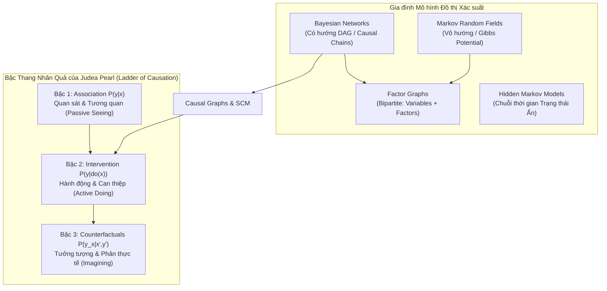
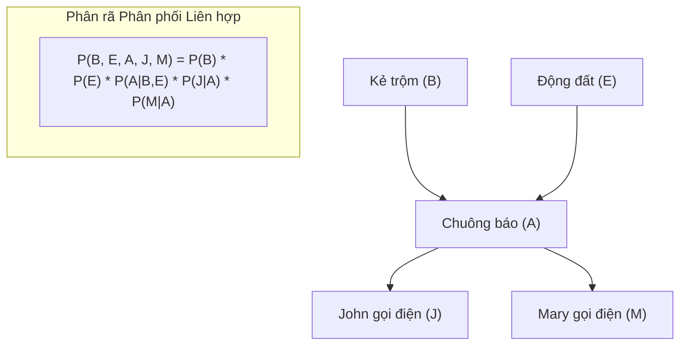
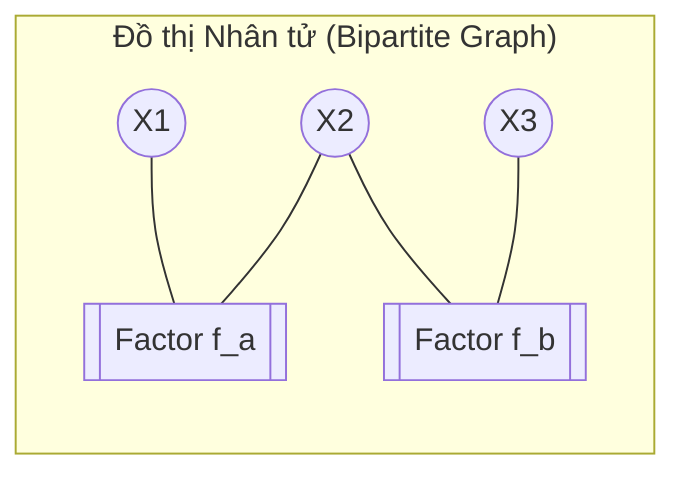
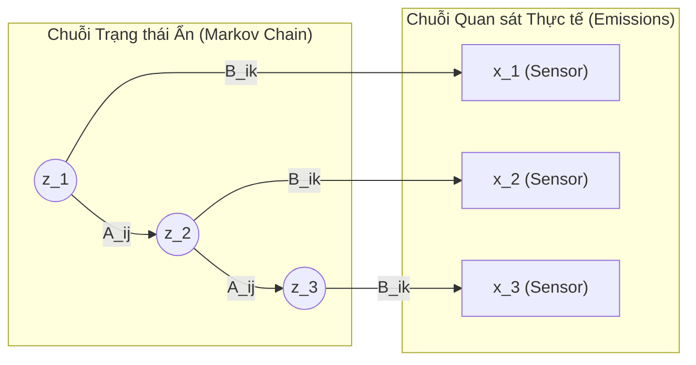
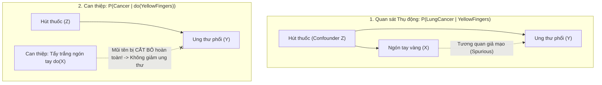

# Chuyên đề: Mô hình Đồ thị Xác suất & Suy luận Nhân quả (Probabilistic Graphical Models & Causal Inference)

## 1. Tổng quan Chuyên đề
Trong thế giới thực, tri thức hiếm khi là chắc chắn tuyệt đối mà thường chứa đầy sự bất định (uncertainty), nhiễu cảm biến và thông tin khuyết thiếu. **Mô hình Đồ thị Xác suất (Probabilistic Graphical Models - PGMs)** hợp nhất vẻ đẹp trực quan của Lý thuyết Đồ thị với sự chặt chẽ của Lý thuyết Xác suất, cho phép phân rã phân phối xác suất liên hợp nhiều chiều khổng lồ thành các nhân tố (factors) cục bộ dựa trên tính chất độc lập có điều kiện (conditional independence).

Phổ kiến trúc PGM bao gồm:
1. **Bayesian Networks (Đồ thị Có hướng - DAGs)**: Mô hình hóa các mối quan hệ nhân quả và phụ thuộc xác suất xuôi qua bảng phân phối xác suất có điều kiện (CPDs).
2. **Markov Random Fields (MRFs - Đồ thị Vô hướng)**: Mô hình hóa các tương tác đối xứng không định hướng trong không gian (như phân đoạn ảnh thị giác máy tính).
3. **Factor Graphs (Đồ thị Nhân tử)**: Cấu trúc đồ thị hai phía biểu diễn rõ ràng sự phân rã của hàm năng lượng, làm nền tảng cho thuật toán truyền tin nhắn **Belief Propagation (Sum-Product Algorithm)**.
4. **Hidden Markov Models (HMMs)**: Mô hình chuỗi thời gian kinh điển cho tín hiệu ngẫu nhiên với trạng thái ẩn.
5. **Causal Graphs & Structural Causal Models (SCMs - Judea Pearl)**: Vượt lên trên tương quan thống kê thuần túy ($P(y \mid x)$) để đạt tới cấp độ **Can thiệp (Intervention - $P(y \mid \text{do}(x))$)** và **Phản thực tế (Counterfactuals)** — bậc thang nhận thức cao nhất của trí tuệ.



---

## 2. Chi tiết từng Keyword

---

### 1. Bayesian Networks & Probabilistic Graphical Models (PGMs)

#### a. Định nghĩa Bản chất Toán học
Một **Bayesian Network (Mạng Bayes)** là một đồ thị có hướng không chu trình (Directed Acyclic Graph - DAG) $\mathcal{G} = (\mathcal{V}, \mathcal{E})$ cùng với một tập các bảng phân phối xác suất có điều kiện (Conditional Probability Distributions - CPDs):
- Mỗi nút $X_i \in \mathcal{V}$ đại diện cho một biến ngẫu nhiên.
- Mỗi cạnh có hướng $X_j \to X_i$ biểu thị sự phụ thuộc xác suất trực tiếp ($X_j \in \text{Parents}(X_i)$).

**Định lý Phân rã Chuỗi Tương thích (Chain Rule of Bayesian Networks)**:
Phân phối xác suất đồng thời (Joint Probability Distribution) của $n$ biến số được phân rã thành tích của các phân phối có điều kiện cục bộ:
$$P(X_1, X_2, \dots, X_n) = \prod_{i=1}^n P(X_i \mid \text{Parents}(X_i))$$
- **Tiết kiệm Bộ nhớ**: Nếu mỗi biến có $k$ giá trị rời rạc, bảng phân phối liên hợp đầy đủ cần $k^n - 1$ tham số. Nếu mỗi nút trong mạng Bayes có tối đa $p$ cha mẹ, số tham số giảm cấp số nhân xuống còn:
  $$\mathcal{O}(n \cdot k^{p+1}) \ll \mathcal{O}(k^n)$$
  Khi $n=30, k=2, p=3$, bảng đầy đủ cần $\approx 10^9$ số thực, trong khi Bayesian Network chỉ cần $30 \times 2^4 = 480$ số thực!

- **d-Separation (Tính phân tách có hướng)**:
  Tiêu chuẩn đồ thị để kiểm tra tính độc lập có điều kiện $X \perp Y \mid Z$. Xét 3 cấu trúc đường đi cơ bản:
  1. *Causal Chain* ($X \to Z \to Y$): Bị chặn (blocked) khi $Z$ được quan sát.
  2. *Common Cause / Fork* ($X \leftarrow Z \to Y$): Bị chặn khi $Z$ được quan sát.
  3. *Common Effect / Collider / V-Structure* ($X \to Z \leftarrow Y$): Hoạt động (active) khi và chỉ khi $Z$ (hoặc con cháu của $Z$) **được quan sát** (Hiện tượng *Explaining Away*).

#### b. Sơ đồ Minh họa


#### c. Code Thực chiến (C++ & Python)
```cpp
// C++17: Tính Xác suất Đồng thời trong Bayesian Network Chuỗi Nhân quả
#include <iostream>
#include <iomanip>

struct SimpleBayesNet {
    // P(Rain): 0.2
    double p_rain{0.2};
    // P(Sprinkler | Rain): True->0.01, False->0.4
    double p_sprinkler_given_rain{0.01};
    double p_sprinkler_given_no_rain{0.4};
    // P(WetGrass | Rain, Sprinkler)
    double p_wet_both{0.99};
    double p_wet_rain_only{0.80};
    double p_wet_sprinkler_only{0.90};
    double p_wet_none{0.0};

    double joint_probability(bool rain, bool sprinkler, bool wet) {
        double p_r = rain ? p_rain : (1.0 - p_rain);
        double p_s = rain ? (sprinkler ? p_sprinkler_given_rain : (1.0 - p_sprinkler_given_rain))
                          : (sprinkler ? p_sprinkler_given_no_rain : (1.0 - p_sprinkler_given_no_rain));
        double p_w = 0.0;
        if (rain && sprinkler) p_w = p_wet_both;
        else if (rain && !sprinkler) p_w = p_wet_rain_only;
        else if (!rain && sprinkler) p_w = p_wet_sprinkler_only;
        else p_w = p_wet_none;

        if (!wet) p_w = 1.0 - p_w;
        return p_r * p_s * p_w;
    }
};

int main() {
    SimpleBayesNet bn;
    double p = bn.joint_probability(true, false, true); // Rain=1, Sprinkler=0, Wet=1
    std::cout << std::fixed << std::setprecision(5);
    std::cout << "P(Rain=1, Sprinkler=0, Wet=1) = " << p << "\n";
    return 0;
}
```

```python
# Python: pgmpy Bayesian Network Modeling & Exact Inference
from pgmpy.models import DiscreteBayesianNetwork
from pgmpy.factors.discrete import TabularCPD
from pgmpy.inference import VariableElimination

# Khởi tạo mô hình
model = DiscreteBayesianNetwork([('Rain', 'WetGrass'), ('Sprinkler', 'WetGrass')])

cpd_rain = TabularCPD(variable='Rain', variable_card=2, values=[[0.8], [0.2]])
cpd_sprinkler = TabularCPD(variable='Sprinkler', variable_card=2, values=[[0.6], [0.4]])
cpd_wet = TabularCPD(
    variable='WetGrass', variable_card=2,
    values=[[1.0, 0.1, 0.2, 0.01],  # WetGrass = False
            [0.0, 0.9, 0.8, 0.99]], # WetGrass = True
    evidence=['Rain', 'Sprinkler'], evidence_card=[2, 2]
)

model.add_cpds(cpd_rain, cpd_sprinkler, cpd_wet)
assert model.check_model()

# Suy luận chính xác qua Variable Elimination
infer = VariableElimination(model)
query_res = infer.query(variables=['Rain'], evidence={'WetGrass': 1})
print("P(Rain | WetGrass=True):\n", query_res)
```

---

### 2. Markov Random Fields (MRFs) & Factor Graphs

#### a. Định nghĩa Bản chất Toán học
- **Markov Random Field (MRF)**: Là một đồ thị vô hướng $\mathcal{G} = (\mathcal{V}, \mathcal{E})$. Tính chất Markov cục bộ: Một biến $X$ độc lập có điều kiện với toàn bộ mạng lưới khi biết **Markov Blanket** của nó (trong MRF, Markov Blanket chính là tập các nút láng giềng kề trực tiếp $\mathcal{N}(X)$).
  
  **Định lý Hammersley-Clifford (1971)**:
  Một phân phối xác suất dương $P(\mathbf{x}) > 0$ thỏa mãn tính chất Markov trên đồ thị vô hướng khi và chỉ khi nó có thể được phân tích thành tích của các hàm thế năng (Potential Functions $\psi_C$) trên các **Clique Cực đại (Maximal Cliques)** của đồ thị:
  $$P(\mathbf{x}) = \frac{1}{Z} \prod_{C \in \text{Cliques}} \psi_C(\mathbf{x}_C) = \frac{1}{Z} \exp\left( -\sum_{C} E(\mathbf{x}_C) \right)$$
  trong đó $Z = \sum_{\mathbf{x}} \prod_C \psi_C(\mathbf{x}_C)$ là **Hàm Phân phối (Partition Function)** đóng vai trò hằng số chuẩn hóa (rất khó tính, là bài toán #P-hard).

- **Factor Graph (Đồ thị Nhân tử)**:
  Đồ thị hai phía biểu diễn rõ ràng sự phân rã của hàm:
  $$P(X_1, \dots, X_n) = \frac{1}{Z} \prod_{s} f_s(\mathbf{X}_s)$$
  Nút tròn biểu diễn biến ngẫu nhiên $X_i$, nút vuông biểu diễn hàm nhân tử $f_s$.

#### b. Sơ đồ Minh họa


#### c. Code Thực chiến (C++ & Python)
```cpp
// C++17: Tính Hàm Thế năng Năng lượng Ising Model (MRF 2D Grid)
#include <iostream>
#include <vector>
#include <cmath>

double compute_mrf_energy(const std::vector<int>& spins, int width, int height, double J, double h) {
    double energy = 0.0;
    // Tương tác cặp láng giềng: -J * s_i * s_j
    for (int r = 0; r < height; ++r) {
        for (int c = 0; c < width; ++c) {
            int idx = r * width + c;
            int s_i = spins[idx];
            // Phải
            if (c + 1 < width) energy -= J * s_i * spins[r * width + (c + 1)];
            // Dưới
            if (r + 1 < height) energy -= J * s_i * spins[(r + 1) * width + c];
            // Từ trường ngoài: -h * s_i
            energy -= h * s_i;
        }
    }
    return energy;
}

int main() {
    std::vector<int> grid = {1, 1, 1, 1}; // 2x2 lưới, toàn bộ spin +1 (Năng lượng cực tiểu)
    double E = compute_mrf_energy(grid, 2, 2, 1.0, 0.5);
    std::cout << "Ising MRF Energy: " << E << "\n";
    return 0;
}
```

```python
# Python: Belief Propagation trên Factor Graph đơn giản
import numpy as np

def factor_product(f1, f2):
    return f1 * f2

# Factor a: f_a(X1, X2), Factor b: f_b(X2)
f_a = np.array([[0.8, 0.2], [0.3, 0.7]]) # X1 x X2
f_b = np.array([0.6, 0.4])                # X2 prior

# Message từ Factor b tới biến X2: mu_{fb -> X2} = f_b
msg_fb_x2 = f_b

# Message từ X2 tới Factor a: mu_{X2 -> fa} = msg_fb_x2
msg_x2_fa = msg_fb_x2

# Marginal unnormalized P(X1) = sum_X2 f_a(X1, X2) * msg_x2_fa(X2)
unnorm_p_x1 = f_a @ msg_x2_fa
p_x1 = unnorm_p_x1 / np.sum(unnorm_p_x1)
print("Belief Propagation Marginal P(X1):", p_x1)
```

---

### 3. Hidden Markov Models (HMMs - Mô hình Markov Ẩn)

#### a. Định nghĩa Bản chất Toán học
HMM là một mô hình đồ thị thời gian với chuỗi trạng thái ẩn $z_t \in \{1, \dots, K\}$ và chuỗi quan sát phát xạ $x_t$:
$$\text{HMM} = \lambda = \langle \mathbf{\pi}, \mathbf{A}, \mathbf{B} \rangle$$
- Phân phối trạng thái khởi đầu: $\pi_i = P(z_1 = i)$.
- Ma trận xác suất chuyển trạng thái: $A_{ij} = P(z_{t+1} = j \mid z_t = i)$.
- Ma trận xác suất phát xạ: $B_{ik} = P(x_t = k \mid z_t = i)$.

**3 Bài toán Kinh điển của HMM**:
1. **Evaluation (Đánh giá)**: Tính xác suất của chuỗi quan sát $P(\mathbf{X} \mid \lambda)$ $\to$ Giải bằng **Forward-Backward Algorithm** với độ phức tạp $\mathcal{O}(K^2 T)$ thay vì $\mathcal{O}(K^T)$.
2. **Decoding (Giải mã)**: Tìm chuỗi trạng thái ẩn tối ưu nhất $\arg\max_{\mathbf{z}} P(\mathbf{z} \mid \mathbf{X}, \lambda)$ $\to$ Giải bằng **Viterbi Algorithm** (Quy hoạch động).
3. **Learning (Học tham số)**: Ước lượng tối đa hóa kỳ vọng $\lambda^* = \arg\max_\lambda P(\mathbf{X} \mid \lambda)$ $\to$ Giải bằng **Baum-Welch Algorithm** (EM Algorithm).

#### b. Sơ đồ Minh họa


#### c. Code Thực chiến (C++ & Python)
```cpp
// C++20: Thuật toán Viterbi Decoding Tối ưu hóa Log-Domain tránh Tràn số Dưới (Underflow)
#include <iostream>
#include <vector>
#include <cmath>
#include <algorithm>

const double NEG_INF = -1e9;

std::vector<int> viterbi_decode(const std::vector<int>& observations,
                                const std::vector<double>& log_pi,
                                const std::vector<std::vector<double>>& log_A,
                                const std::vector<std::vector<double>>& log_B) {
    int T = observations.size();
    int K = log_pi.size();

    std::vector<std::vector<double>> V(T, std::vector<double>(K, NEG_INF));
    std::vector<std::vector<int>> backpointer(T, std::vector<int>(K, 0));

    for (int k = 0; k < K; ++k) {
        V[0][k] = log_pi[k] + log_B[k][observations[0]];
    }

    for (int t = 1; t < T; ++t) {
        for (int k = 0; k < K; ++k) {
            double max_val = NEG_INF;
            int best_prev = 0;
            for (int j = 0; j < K; ++j) {
                double val = V[t - 1][j] + log_A[j][k] + log_B[k][observations[t]];
                if (val > max_val) {
                    max_val = val;
                    best_prev = j;
                }
            }
            V[t][k] = max_val;
            backpointer[t][k] = best_prev;
        }
    }

    std::vector<int> path(T);
    path[T - 1] = std::max_element(V[T - 1].begin(), V[T - 1].end()) - V[T - 1].begin();
    for (int t = T - 2; t >= 0; --t) {
        path[t] = backpointer[t + 1][path[t + 1]];
    }
    return path;
}

int main() {
    // 2 trạng thái ẩn: 0 (Mưa), 1 (Nắng)
    std::vector<double> log_pi = {std::log(0.6), std::log(0.4)};
    std::vector<std::vector<double>> log_A = {
        {std::log(0.7), std::log(0.3)},
        {std::log(0.4), std::log(0.6)}
    };
    std::vector<std::vector<double>> log_B = {
        {std::log(0.1), std::log(0.9)}, // Mưa: 10% đi dạo, 90% che ô
        {std::log(0.8), std::log(0.2)}  // Nắng: 80% đi dạo, 20% che ô
    };
    // Quan sát: [Che ô (1), Đi dạo (0)]
    auto states = viterbi_decode({1, 0}, log_pi, log_A, log_B);
    std::cout << "Viterbi Best Path: ";
    for (int s : states) std::cout << (s == 0 ? "Rain " : "Sunny ");
    std::cout << "\n";
    return 0;
}
```

```python
# Python: HMM Forward Pass via Dynamic Programming
import numpy as np

def hmm_forward(obs, pi, A, B):
    T = len(obs)
    K = len(pi)
    alpha = np.zeros((T, K))
    alpha[0] = pi * B[:, obs[0]]

    for t in range(1, T):
        alpha[t] = (alpha[t - 1] @ A) * B[:, obs[t]]

    # Tổng xác suất quan sát P(X) = sum_k alpha_T(k)
    return np.sum(alpha[-1]), alpha

pi = np.array([0.5, 0.5])
A = np.array([[0.7, 0.3], [0.3, 0.7]])
B = np.array([[0.9, 0.1], [0.2, 0.8]])
p_obs, alpha_table = hmm_forward([0, 1, 0], pi, A, B)
print("Forward Algorithm P(Observations):", p_obs)
```

---

### 4. Causal Graphs & Structural Causal Models (SCMs)

#### a. Định nghĩa Bản chất Toán học
Lý thuyết của Judea Pearl chỉ ra rằng: **Tương quan không phải là Nhân quả (Correlation is not Causation)**. Xác suất điều kiện $P(Y \mid X = x)$ chỉ quan sát thế giới thụ động, trong khi hành vi can thiệp $P(Y \mid \text{do}(X = x))$ chủ động ép buộc biến $X$ nhận giá trị $x$, cắt đứt toàn bộ các mũi tên đi vào $X$.

Một **Structural Causal Model (SCM)** là bộ 4 phần tử:
$$\mathcal{M} = \langle \mathcal{U}, \mathcal{V}, \mathcal{F}, P(\mathbf{u}) \rangle$$
- $\mathcal{U}$: Tập hợp các biến ngoại sinh (Exogenous variables, nhiễu ngẫu nhiên không mô hình hóa).
- $\mathcal{V}$: Tập hợp các biến nội sinh (Endogenous variables).
- $\mathcal{F} = \{f_1, \dots, f_m\}$: Tập các phương trình cấu trúc phi tuyến tất định:
  $$V_i = f_i(\text{Parents}(V_i), U_i)$$

**Toán tử do-Calculus**:
Khi can thiệp $\text{do}(X = x)$, đồ thị nhân quả $\mathcal{G}$ bị cắt bỏ mọi cung trỏ vào $X$ ($\mathcal{G}_{\overline{X}}$).
Công thức chuẩn hóa Backdoor Adjustment:
$$P(Y = y \mid \text{do}(X = x)) = \sum_{\mathbf{z}} P(Y = y \mid X = x, \mathbf{Z} = \mathbf{z}) P(\mathbf{Z} = \mathbf{z})$$
với $\mathbf{Z}$ là tập biến thỏa mãn tiêu chuẩn Backdoor (chặn mọi đường đi cửa sau nối giữa $X$ và $Y$).

#### b. Sơ đồ Minh họa


#### c. Code Thực chiến (C++ & Python)
```cpp
// C++17: Mô phỏng Can thiệp SCM do(X) vs Quan sát Thụ động
#include <iostream>
#include <random>

struct PatientSimulation {
    std::mt19937 rng{42};
    std::bernoulli_distribution dist_smoke{0.3}; // 30% người hút thuốc

    // 1. Dữ liệu quan sát tự nhiên
    void simulate_observational(int N) {
        int yellow_count = 0, cancer_count = 0, cancer_and_yellow = 0;
        for (int i = 0; i < N; ++i) {
            bool smoke = dist_smoke(rng);
            bool yellow = smoke ? (std::bernoulli_distribution(0.9)(rng)) : (std::bernoulli_distribution(0.05)(rng));
            bool cancer = smoke ? (std::bernoulli_distribution(0.4)(rng)) : (std::bernoulli_distribution(0.01)(rng));

            if (yellow) {
                yellow_count++;
                if (cancer) cancer_and_yellow++;
            }
        }
        std::cout << "Observational P(Cancer | YellowFingers): " 
                  << static_cast<double>(cancer_and_yellow) / yellow_count << "\n";
    }

    // 2. Can thiệp do(YellowFingers = true) qua việc sơn màu ngón tay
    void simulate_intervention_do(int N) {
        int cancer_count = 0;
        for (int i = 0; i < N; ++i) {
            bool smoke = dist_smoke(rng);
            bool yellow = true; // do(X = true) - can thiep truc tiep
            // Ung thu chi phu thuoc vao smoke, khong he bi anh huong boi yellow!
            bool cancer = smoke ? (std::bernoulli_distribution(0.4)(rng)) : (std::bernoulli_distribution(0.01)(rng));
            if (cancer) cancer_count++;
        }
        std::cout << "Interventional P(Cancer | do(YellowFingers=True)): " 
                  << static_cast<double>(cancer_count) / N << "\n";
    }
};

int main() {
    PatientSimulation sim;
    sim.simulate_observational(100000);
    sim.simulate_intervention_do(100000);
    return 0;
}
```

```python
# Python: Backdoor Adjustment Estimation via DoWhy/Pandas
import pandas as pd
import numpy as np

# Tạo dữ liệu mẫu có biến gây nhiễu Z (Confounder)
N = 10000
Z = np.random.binomial(1, 0.5, N) # Confounder
X = np.random.binomial(1, 0.2 + 0.6 * Z, N) # Treatment phụ thuộc Z
Y = 2.0 * X + 5.0 * Z + np.random.normal(0, 1, N) # True Causal Effect của X lên Y là 2.0

df = pd.DataFrame({'Z': Z, 'X': X, 'Y': Y})

# 1. Hồi quy ngây thơ P(Y | X): Sai lệch do biến nhiễu Z!
naive_effect = df[df['X'] == 1]['Y'].mean() - df[df['X'] == 0]['Y'].mean()

# 2. Backdoor Adjustment: sum_z [E[Y|X=1, Z=z] - E[Y|X=0, Z=z]] * P(Z=z)
p_z0 = (df['Z'] == 0).mean()
p_z1 = 1.0 - p_z0

diff_z0 = df[(df['X'] == 1) & (df['Z'] == 0)]['Y'].mean() - df[(df['X'] == 0) & (df['Z'] == 0)]['Y'].mean()
diff_z1 = df[(df['X'] == 1) & (df['Z'] == 1)]['Y'].mean() - df[(df['X'] == 0) & (df['Z'] == 1)]['Y'].mean()
causal_effect = diff_z0 * p_z0 + diff_z1 * p_z1

print(f"Naive Correlation Effect (Biased): {naive_effect:.3f}")
print(f"True Causal Effect via Backdoor (Unbiased): {causal_effect:.3f} (Expected: 2.000)")
```

#### d. Lỗi Thường gặp & Ứng dụng
- **Biến Ngụy Tương quan (Spurious Correlation)**: Nhầm lẫn biến gây nhiễu (Confounder) với quan hệ nhân quả thực sự dẫn tới các quyết định y khoa hoặc chính sách kinh tế sai lầm nghiêm trọng.
- **Ứng dụng AI**: Phân tích tác động thuốc mới trong y tế (Clinical Trials), thử nghiệm A/B Testing tối ưu thuật toán khuyến nghị, và AI Công bằng không thiên vị (Fairness & Algorithmic Bias Reduction).
