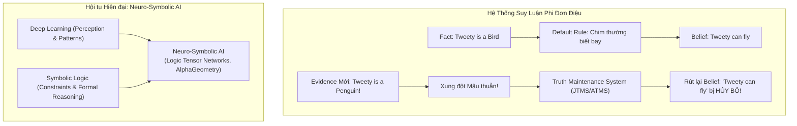
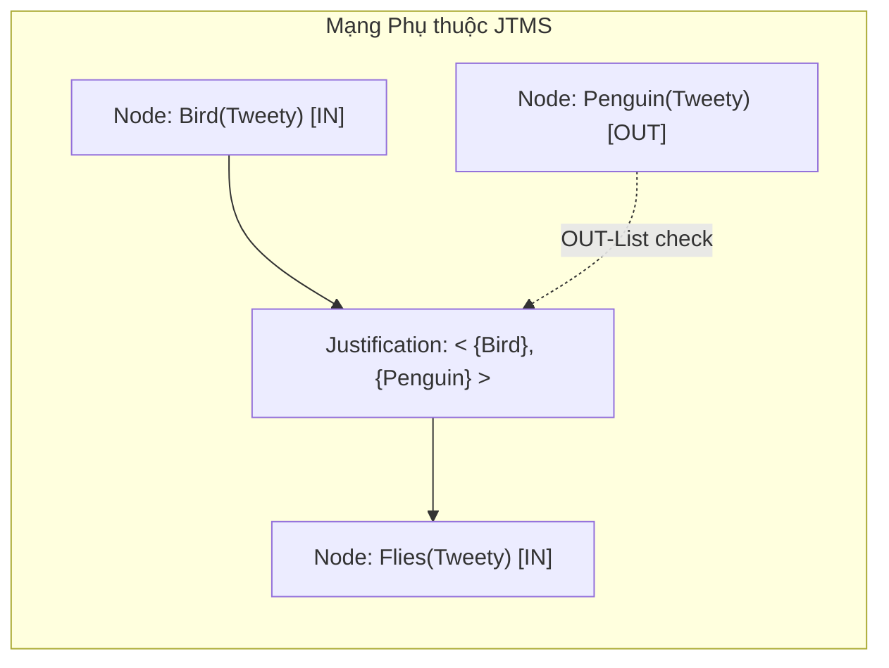
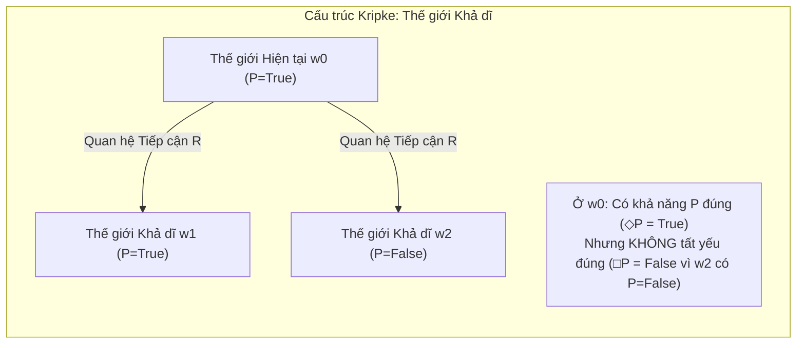
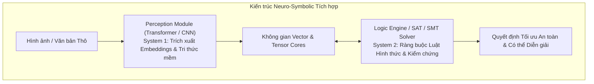

# Chuyên đề: Logic Trạng Huống, Phi Đơn Điệu & AI Thần Kinh Ký Hiệu (Modal, Non-Monotonic & Neuro-Symbolic AI)

## 1. Tổng quan Chuyên đề
Logic hình thức cổ điển sở hữu tính chất **Đơn điệu (Monotonicity)**: Nếu một kết luận $\alpha$ được rút ra từ tập tiên đề $\mathcal{KB}$, thì việc bổ sung thêm bất kỳ sự thật mới $\beta$ nào vào $\mathcal{KB}$ cũng không bao giờ có thể làm mất đi tính đúng đắn của $\alpha$:
$$\mathcal{KB} \models \alpha \implies \mathcal{KB} \cup \{\beta\} \models \alpha$$
Tuy nhiên, trong tư duy đời thường của con người (**Commonsense Reasoning**), chúng ta liên tục đưa ra các phỏng đoán mặc định dựa trên thông tin chưa đầy đủ (ví dụ: "Tweety là chim, nên Tweety biết bay"). Khi nhận được bằng chứng mới phủ định ("Tweety là chim cánh cụt"), chúng ta bắt buộc phải **rút lại kết luận cũ (Retract Belief)**. Cơ chế này được gọi là **Suy luận Phi Đơn điệu (Non-Monotonic Reasoning)**, hiện thực hóa thông qua **Default Logic (Reiter)**, **Truth Maintenance Systems (TMS / JTMS / ATMS)**, và **Belief Revision (AGM Postulates)**.

Đồng thời, **Modal Logic (Logic Trạng huống)** và **Temporal Logic (Logic Thời gian - LTL, CTL)** mở rộng chân lý theo chiều kích khả năng, sự tất yếu và dòng chảy thời gian. Đỉnh cao hội tụ hiện đại của các lĩnh vực này với học sâu là **Neuro-Symbolic AI** — hợp nhất khả năng nhận thức mẫu mềm dẻo của mạng nơ-ron và khả năng suy luận hình thức chặt chẽ của logic ký hiệu.



---

## 2. Chi tiết từng Keyword

---

### 1. Non-Monotonic Reasoning & Default Logic (Suy luận Phi Đơn điệu & Logic Mặc định)

#### a. Định nghĩa Bản chất Toán học
- **Suy luận Phi Đơn điệu (Non-Monotonic Reasoning)**: Là hệ thống suy luận mà việc tăng thêm dữ kiện có thể làm giảm bớt tập hợp các kết luận hợp lệ:
  $$\exists \mathcal{KB}, \alpha, \beta: \quad \mathcal{KB} \vdash \alpha \quad \text{nhưng} \quad \mathcal{KB} \cup \{\beta\} \not\vdash \alpha$$
- **Default Logic (Raymond Reiter, 1980)**:
  Một lý thuyết mặc định là một cặp $\Delta = (D, W)$ trong đó $W$ là tập các câu tiên đề cứng (Hard Facts in FOL), và $D$ là tập các **Quy tắc Mặc định (Default Rules)** có dạng:
  $$\frac{\alpha : \beta_1, \dots, \beta_m}{\gamma}$$
  - $\alpha$: Tiền đề (Prerequisite).
  - $\beta_1, \dots, \beta_m$: Các điều kiện nhất quán (Justifications) — luật chỉ được áp dụng nếu không có mâu thuẫn khi giả định $\beta_i$ đúng.
  - $\gamma$: Kết luận mặc định (Consequent).
  
  *Ví dụ kinh điển*:
  $$\frac{\text{Bird}(x) : \text{Flies}(x)}{\text{Flies}(x)}$$
  (Nếu $x$ là chim, và không có bằng chứng $x$ không biết bay, thì giả định $x$ biết bay).

- **Extension (Mở rộng)**: Một Extension $E$ là một tập đóng các câu suy dẫn tối đa có thể rút ra từ $W$ bằng cách áp dụng các quy tắc trong $D$ mà không sinh ra mâu thuẫn nội tại.

#### b. Code Thực chiến (C++ & Python)
```cpp
// C++17: Mô phỏng Quy tắc Mặc định (Default Rule Engine)
#include <iostream>
#include <string>
#include <unordered_set>

class DefaultReasoningEngine {
private:
    std::unordered_set<std::string> hard_facts_;
public:
    void add_fact(std::string fact) { hard_facts_.insert(std::move(fact)); }

    bool can_fly(const std::string& animal) {
        if (hard_facts_.count(animal + "_is_penguin") || hard_facts_.count(animal + "_has_broken_wing")) {
            return false; // Phản ví dụ ghi đè mặc định!
        }
        if (hard_facts_.count(animal + "_is_bird")) {
            return true;  // Áp dụng luật mặc định: Chim biết bay
        }
        return false;
    }
};

int main() {
    DefaultReasoningEngine engine;
    engine.add_fact("Tweety_is_bird");
    std::cout << "Tweety can fly? " << (engine.can_fly("Tweety") ? "YES" : "NO") << "\n"; // In YES

    // Nhận thêm thông tin mới: Tweety là chim cánh cụt
    engine.add_fact("Tweety_is_penguin");
    std::cout << "After new fact, Tweety can fly? " << (engine.can_fly("Tweety") ? "YES" : "NO") << "\n"; // In NO (Phi đơn điệu!)
    return 0;
}
```

```python
# Python: Non-Monotonic Belief Maintenance Demo
class NonMonotonicAgent:
    def __init__(self):
        self.beliefs = set()
        self.defaults = [] # List of (premise, exception, consequence)

    def add_default(self, premise, exception, consequence):
        self.defaults.append((premise, exception, consequence))

    def evaluate_consequences(self):
        derived = set(self.beliefs)
        for prem, exc, cons in self.defaults:
            if prem in self.beliefs and exc not in self.beliefs:
                derived.add(cons)
        return derived

agent = NonMonotonicAgent()
agent.add_default("Bird(Opus)", "Penguin(Opus)", "Flies(Opus)")

agent.beliefs.add("Bird(Opus)")
print("Initial Derived:", agent.evaluate_consequences()) # Contains Flies(Opus)

agent.beliefs.add("Penguin(Opus)")
print("After Evidence:", agent.evaluate_consequences())   # Flies(Opus) disappears!
```

---

### 2. Belief Revision & Truth Maintenance Systems (TMS / JTMS / ATMS)

#### a. Định nghĩa Bản chất Toán học
- **Belief Revision (Hiệu chỉnh Niềm tin - Tiên đề AGM - Alchourrón, Gärdenfors, Makinson, 1985)**:
  Khi tiếp nhận một niềm tin mới $\phi$ mâu thuẫn với cơ sở tri thức hiện tại $\mathcal{KB}$, toán tử hiệu chỉnh $\ast$:
  $$\mathcal{KB} \ast \phi$$
  phải thỏa mãn nguyên lý thay đổi tối thiểu (Minimal Change): giữ lại càng nhiều niềm tin cũ càng tốt mà vẫn duy trì tính nhất quán nội tại.
- **Truth Maintenance Systems (TMS)**:
  Hệ thống quản lý vết phụ thuộc (Dependency Network) giữa các niềm tin:
  1. **Justification-based TMS (JTMS - Doyle, 1979)**:
     Mỗi nút niềm tin (Node) có một trạng thái: `IN` (được tin là đúng) hoặc `OUT` (chưa được chứng minh). Một Justification có dạng:
     $$\langle \text{IN-List}, \text{OUT-List} \rangle \implies \text{Node}$$
     Nút là `IN` khi và chỉ khi mọi nút trong IN-List đều là `IN` và mọi nút trong OUT-List đều là `OUT`.
  2. **Assumption-based TMS (ATMS - de Kleer, 1986)**:
     Theo dõi đồng thời nhiều giả định (Assumptions) trong các thế giới khả dĩ song song mà không cần quay lui, bằng cách gắn nhãn (Label) cho mỗi nút là tập các môi trường giả định cực tiểu sinh ra nó.

#### b. Sơ đồ Minh họa


#### c. Code Thực chiến (C++ & Python)
```cpp
// C++20: Mô phỏng Nút JTMS (Justification-based Truth Maintenance)
#include <iostream>
#include <vector>
#include <string>
#include <memory>

struct JTMSNode;

struct Justification {
    std::vector<std::shared_ptr<JTMSNode>> in_list;
    std::vector<std::shared_ptr<JTMSNode>> out_list;
    bool is_valid() const;
};

struct JTMSNode {
    std::string name;
    bool is_in{false};
    std::vector<Justification> justifications;

    void recompute_status() {
        for (const auto& j : justifications) {
            if (j.is_valid()) {
                is_in = true;
                return;
            }
        }
        is_in = false;
    }
};

bool Justification::is_valid() const {
    for (const auto& n : in_list) if (!n->is_in) return false;
    for (const auto& n : out_list) if (n->is_in) return false;
    return true;
}

int main() {
    auto bird = std::make_shared<JTMSNode>(JTMSNode{"Bird", true, {}});
    auto penguin = std::make_shared<JTMSNode>(JTMSNode{"Penguin", false, {}});
    auto flies = std::make_shared<JTMSNode>(JTMSNode{"Flies", false, {}});

    // Justification: IF Bird IN and Penguin OUT => Flies IN
    flies->justifications.push_back({ {bird}, {penguin} });
    flies->recompute_status();
    std::cout << "Initial Flies Status: " << (flies->is_in ? "IN" : "OUT") << "\n";

    // Cập nhật: Penguin trở thành IN
    penguin->is_in = true;
    flies->recompute_status();
    std::cout << "After Penguin IN, Flies Status: " << (flies->is_in ? "IN" : "OUT") << "\n";
    return 0;
}
```

```python
# Python: AGM Belief Contraction Simulator
def agm_contract_belief(kb_beliefs: set, target_to_retract: str, dependencies: dict) -> set:
    new_kb = set(kb_beliefs)
    if target_to_retract in new_kb:
        new_kb.remove(target_to_retract)

    # Rút lại các niềm tin phụ thuộc (Minimal change cascade)
    changed = True
    while changed:
        changed = False
        for b in list(new_kb):
            needed_premises = dependencies.get(b, [])
            if needed_premises and not all(p in new_kb for p in needed_premises):
                new_kb.remove(b)
                changed = True
    return new_kb

current_beliefs = {"Bird", "Flies", "CanSing"}
dep_graph = {"Flies": ["Bird"], "CanSing": ["Flies"]}
contracted = agm_contract_belief(current_beliefs, "Bird", dep_graph)
print("Contracted Beliefs:", contracted) # Cả Flies và CanSing đều bị rút lại!
```

---

### 3. Modal Logic, Temporal Logic & Commonsense Reasoning

#### a. Định nghĩa Bản chất Toán học
- **Modal Logic (Logic Trạng huống)**:
  Mở rộng logic mệnh đề bằng hai toán tử trạng thái:
  - $\Box \phi$: Tất yếu $\phi$ đúng (Necessarily $\phi$).
  - $\Diamond \phi$: Có khả năng $\phi$ đúng (Possibly $\phi$). Quan hệ đối ngẫu: $\Diamond \phi \equiv \neg \Box \neg \phi$.
  - **Ngữ nghĩa Thế giới Khả dĩ (Kripke Semantics)**: Cấu trúc Kripke $\mathcal{M} = \langle \mathcal{W}, \mathcal{R}, \mathcal{V} \rangle$ với $\mathcal{W}$ là tập các thế giới, $\mathcal{R} \subseteq \mathcal{W} \times \mathcal{W}$ là quan hệ tiếp cận (Accessibility Relation):
    $$\mathcal{M}, w \models \Box \phi \iff \forall w' \in \mathcal{W} \ (w \mathcal{R} w' \implies \mathcal{M}, w' \models \phi)$$
- **Linear Temporal Logic (LTL - Logic Thời gian Tuyến tính - Amir Pnueli, 1977)**:
  Mô hình hóa dòng thời gian rời rạc vô hạn $t = 0, 1, 2, \dots$. Bổ sung các toán tử thời gian:
  - $\mathbf{X} \phi$ (Next): $\phi$ đúng ở bước thời gian kế tiếp.
  - $\mathbf{F} \phi$ (Future / Finally): $\phi$ sẽ đúng ở một thời điểm nào đó trong tương lai.
  - $\mathbf{G} \phi$ (Globally / Always): $\phi$ luôn luôn đúng tại mọi thời điểm tương lai.
  - $\phi \ \mathbf{U} \ \psi$ (Until): $\phi$ đúng liên tục cho đến khi $\psi$ trở thành đúng.
  - *Ứng dụng*: Kiểm chứng an toàn tuyệt đối cho hệ thống tự hành: $\mathbf{G}(\text{SensorFailure} \to \mathbf{F} \le 100\text{ms} \text{BrakeEmergency})$.

#### b. Sơ đồ Minh họa


#### c. Code Thực chiến (C++ & Python)
```cpp
// C++20: LTL Path Model Checker Đơn giản trên Quỹ đạo Trạng thái
#include <iostream>
#include <vector>
#include <string>

struct SystemState {
    bool sensor_active;
    bool alarm_triggered;
};

// Kiểm tra công thức LTL: G (sensor_active -> F alarm_triggered)
bool check_globally_sensor_leads_to_alarm(const std::vector<SystemState>& trace) {
    for (size_t t = 0; t < trace.size(); ++t) {
        if (trace[t].sensor_active) {
            // Cần tồn tại thời điểm tương lai t' >= t có alarm_triggered = true
            bool found_future_alarm = false;
            for (size_t t_prime = t; t_prime < trace.size(); ++t_prime) {
                if (trace[t_prime].alarm_triggered) {
                    found_future_alarm = true;
                    break;
                }
            }
            if (!found_future_alarm) return false; // Vi phạm LTL!
        }
    }
    return true;
}

int main() {
    std::vector<SystemState> valid_trace = {
        {false, false},
        {true, false}, // Sensor bat tai t=1
        {false, true}, // Alarm no tai t=2
        {false, false}
    };
    std::cout << "Trace satisfies LTL Property: " 
              << (check_globally_sensor_leads_to_alarm(valid_trace) ? "YES" : "NO") << "\n";
    return 0;
}
```

```python
# Python: Kripke Semantics Modal Logic Evaluator
class KripkeStructure:
    def __init__(self, worlds, relations, valuation):
        self.worlds = worlds
        self.relations = relations # Dict[world, List[accessible_worlds]]
        self.valuation = valuation # Dict[world, Set[propositions]]

    def eval_box(self, world, prop):
        # []phi is True if phi is True in ALL accessible worlds
        accessible = self.relations.get(world, [])
        return all(prop in self.valuation[w] for w in accessible)

    def eval_diamond(self, world, prop):
        # <>phi is True if phi is True in AT LEAST ONE accessible world
        accessible = self.relations.get(world, [])
        return any(prop in self.valuation[w] for w in accessible)

kripke = KripkeStructure(
    worlds=['w0', 'w1', 'w2'],
    relations={'w0': ['w1', 'w2'], 'w1': ['w1'], 'w2': ['w2']},
    valuation={'w0': {'P'}, 'w1': {'P'}, 'w2': set()} # w2 does not have P
)
print("In w0, []P is:", kripke.eval_box('w0', 'P'))       # False
print("In w0, <>P is:", kripke.eval_diamond('w0', 'P'))   # True
```

---

### 4. Neuro-Symbolic AI (AI Thần Kinh Ký Hiệu)

#### a. Định nghĩa Bản chất Toán học
Neuro-Symbolic AI là sự kết hợp giữa hai trường phái tính toán (Kahneman System 1 & System 2):
- **System 1 (Deep Learning - Trực giác)**: Tốc độ cao, liên tục, học từ dữ liệu lớn, chống nhiễu tốt nhưng là hộp đen và dễ ảo giác.
- **System 2 (Symbolic Logic - Suy luận Lý tính)**: Chậm, cấu trúc, tất suy logic, minh bạch có thể diễn giải được (Explainable AI) và tuân thủ các quy tắc an toàn.

**Logic Tensor Networks (LTN - Serafini & Garcez)**:
Sử dụng **Real Logic**, ánh xạ các ký hiệu logic vào các phép toán vi phân trên Tensor:
- Hằng số $c \in \mathcal{C}$ được nhúng thành vector liên tục $\mathbf{v}_c \in \mathbb{R}^d$.
- Vị từ $P(x)$ được xấp xỉ bởi mạng nơ-ron nhiều tầng MLP với hàm kích hoạt Sigmoid:
  $$\mathcal{G}(P)(\mathbf{x}) = \sigma(\mathbf{w}^T \text{ReLU}(\mathbf{W}\mathbf{x} + \mathbf{b})) \in [0, 1]$$
- Các toán tử logic được thay thế bằng các hàm T-Norm vi phân được (như Product T-Norm: $A \land B \to a \cdot b$).
- **Hàm mất mát toàn cục (Loss Function)**:
  $$\mathcal{L}(\mathbf{\theta}) = 1 - \text{SatAgg}_{\phi \in \mathcal{KB}} \left( \mathcal{G}_{\mathbf{\theta}}(\phi) \right)$$
  cho phép tối ưu hóa trọng số mạng nơ-ron bằng thuật toán lan truyền ngược (Backpropagation) trực tiếp từ các tiên đề logic hình thức!

#### b. Sơ đồ Minh họa


#### c. Code Thực chiến (C++ & Python)
```cpp
// C++20: Neuro-Symbolic Soft Logic Fuzzy Constraint Check
#include <iostream>
#include <vector>
#include <cmath>

// Toán tử vi phân Product T-Norm cho Neuro-Symbolic
float soft_logic_implication(float p_a, float p_b) {
    // Reichenbach Implication: I(a, b) = 1 - a + a*b
    return 1.0f - p_a + p_a * p_b;
}

int main() {
    float neural_prob_cat = 0.95f;      // CNN du doan vat the la Meo (95%)
    float neural_prob_mammal = 0.98f;   // CNN du doan vat the la Dong vat co vu (98%)
    // Luat logic: Cat -> Mammal
    float rule_satisfaction = soft_logic_implication(neural_prob_cat, neural_prob_mammal);
    std::cout << "Neuro-Symbolic Rule Satisfaction Score: " << rule_satisfaction << "\n";
    return 0;
}
```

```python
# Python: PyTorch Logic Tensor Network (LTN) Loss Layer
import torch
import torch.nn as nn

class NeuroSymbolicLoss(nn.Module):
    def __init__(self):
        super().__init__()

    def forward(self, pred_is_bird, pred_can_fly):
        # Luật logic: Bird(x) -> Flies(x)
        # Kleene-Dienes Implication vi phân: max(1 - p_bird, p_fly)
        # hoặc Product Implication: 1 - p_bird + p_bird * p_fly
        implication = 1.0 - pred_is_bird + pred_is_bird * pred_can_fly
        # Cực tiểu hóa sự vi phạm luật: Loss = 1 - Mean(Implication)
        loss = torch.mean(1.0 - implication)
        return loss

ns_loss_fn = NeuroSymbolicLoss()
p_bird = torch.tensor([0.9, 0.8], requires_grad=True)
p_fly = torch.tensor([0.1, 0.95], requires_grad=True) # Mẫu 1 vi phạm nặng!
loss = ns_loss_fn(p_bird, p_fly)
loss.backward()
print("Neuro-Symbolic Constraint Loss:", loss.item())
print("Gradients propagating into perceptual heads:", p_fly.grad)
```

#### d. Lỗi Thường gặp & Ứng dụng
- **Mâu thuẫn Tối ưu hóa Gradient (Gradient Vanishing on Logic Satiation)**: Khi các ràng buộc logic mâu thuẫn lẫn nhau, đạo hàm của hàm mất mát logic có thể triệt tiêu lẫn nhau, làm tê liệt quá trình huấn luyện mạng nơ-ron.
- **Ứng dụng AI**: DeepMind AlphaGeometry (kết hợp LLM sinh giả thuyết và Symbolic Deduction Engine giải toán Olympic), hệ thống xe tự hành kiểm chứng an toàn phần cứng (Safe RL với LTL Shielding), và hệ thống hỏi đáp y khoa chống ảo giác.
