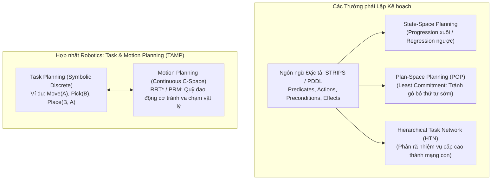
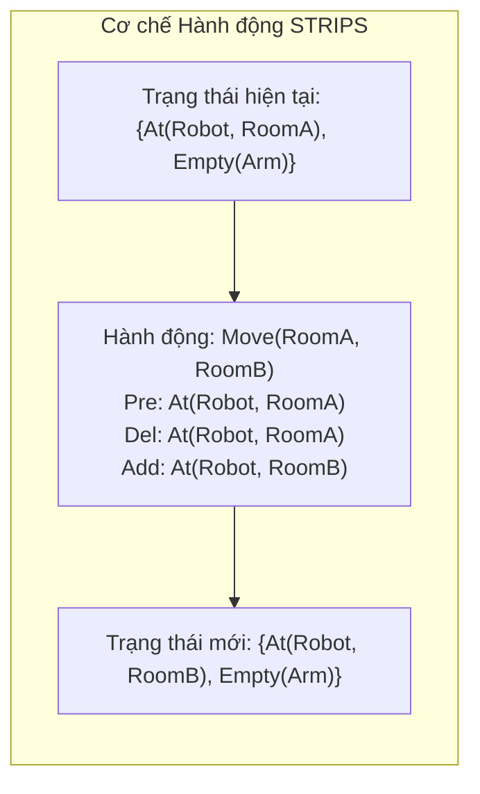
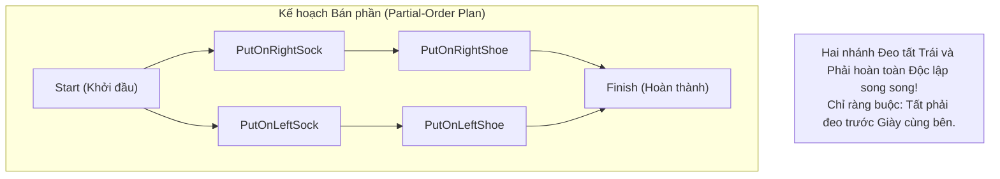
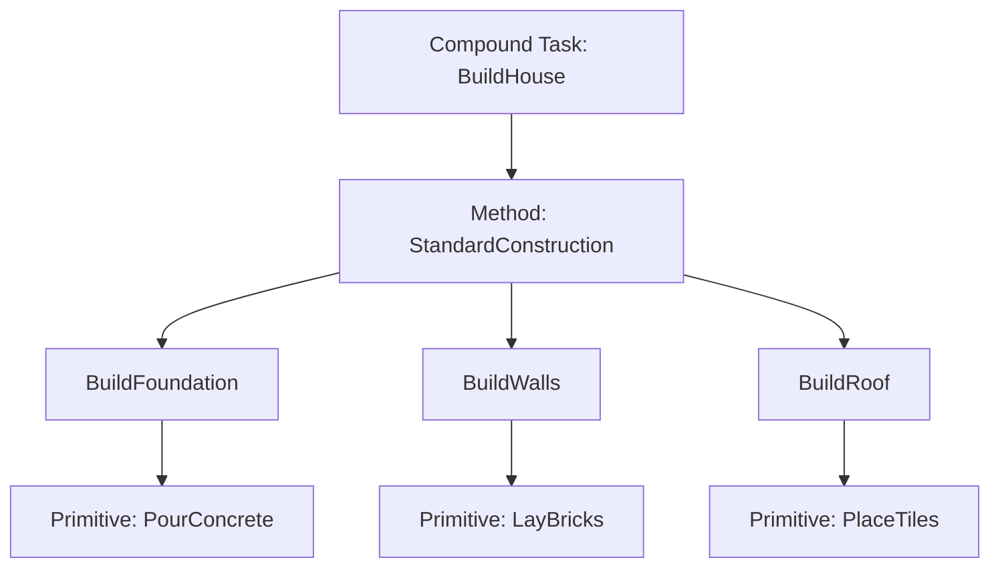
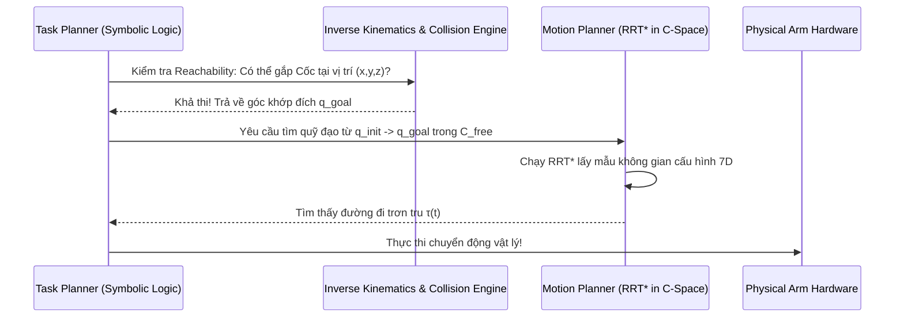

# Chuyên đề: Lập Kế hoạch Cổ điển & Tự động (Classical & Automated Planning)

## 1. Tổng quan Chuyên đề
Trong khi các thuật toán tìm kiếm kinh điển ($A^*$, BFS) xem các trạng thái của thế giới như những "hộp đen" nguyên khối, **Lập Kế hoạch Tự động (Automated Planning)** mở "hộp đen" đó ra bằng cách biểu diễn thế giới thông qua các vị từ logic và mô tả các hành động thông qua tiền điều kiện (preconditions) và hệ quả (effects).

Tiến trình phát triển của ngành Lập kế hoạch AI trải dài từ:
1. **STRIPS (Stanford Research Institute Problem Solver, 1971)**: Ngôn ngữ hình thức đầu tiên định nghĩa toán tử hành động dựa trên danh sách Precondition, Add-list và Delete-list.
2. **PDDL (Planning Domain Definition Language, 1998-Nay)**: Chuẩn ngôn ngữ quốc tế cho các cuộc thi Lập kế hoạch Quốc tế (IPC), hỗ trợ logic vị từ, ràng buộc thời gian và thông số số học.
3. **State-Space Planning (Lập kế hoạch Không gian Trạng thái)**: Tìm kiếm chuỗi hành động tuyến tính từ trạng thái khởi đầu (Progression) hoặc từ mục tiêu (Regression).
4. **Plan-Space Planning & Partial-Order Planning (POP - Lập kế hoạch Bán phần)**: Tìm kiếm trực tiếp trong không gian của các kế hoạch, chỉ xác định thứ tự thời gian giữa các hành động khi thực sự cần thiết (nguyên lý Least Commitment).
5. **Hierarchical Task Network (HTN)**: Phân rã đệ quy các nhiệm vụ trừu tượng cấp cao thành các hành động nguyên tử cấp thấp.
6. **Task & Motion Planning (TAMP)**: Cầu nối then chốt giữa lập kế hoạch logic rời rạc (Task Planning) và điều khiển hình học chuyển động liên tục không va chạm trong không gian cấu hình robot $C$-space (Motion Planning).



---

## 2. Chi tiết từng Keyword

---

### 1. Classical Planning, STRIPS & PDDL (Lập Kế hoạch Cổ điển, STRIPS & PDDL)

#### a. Định nghĩa Bản chất Toán học
- **Classical Planning (Lập kế hoạch Cổ điển)**: Đặt trên 8 giả định lý tưởng hóa:
  1. Hữu hạn (Finite).
  2. Hoàn toàn quan sát được (Fully Observable).
  3. Tất định (Deterministic).
  4. Tĩnh (Static).
  5. Mục tiêu hữu hạn (Attainment Goals).
  6. Thời gian tuần tự rời rạc (Sequential Actions).
  7. Không phụ thuộc thời gian tuyệt đối (Implicit Time).
  8. Thực thi đơn tác tử ngoại tuyến (Offline Single-Agent).

- **Mô hình STRIPS (Fikes & Nilsson, 1971)**:
  Một bài toán lập kế hoạch được định nghĩa bởi bộ $\mathcal{P} = \langle \mathcal{P}_{\text{props}}, \mathcal{A}, s_0, \mathcal{G} \rangle$:
  - $s_0$: Trạng thái ban đầu (tập các mệnh đề nguyên tử khẳng định đúng). Mọi mệnh đề không xuất hiện đều mặc định là SAI (Closed World Assumption).
  - $\mathcal{G}$: Trạng thái mục tiêu (tập các mệnh đề cần thỏa mãn).
  - Mỗi hành động $a \in \mathcal{A}$ gồm 3 danh sách:
    1. $\text{Pre}(a)$: Tiền điều kiện để hành động hợp lệ.
    2. $\text{Add}(a)$: Tập các mệnh đề trở thành ĐÚNG sau khi thi hành.
    3. $\text{Del}(a)$: Tập các mệnh đề trở thành SAI sau khi thi hành.
  
  *Quy tắc Chuyển dịch Trạng thái*:
  $$s' = \text{Result}(s, a) = (s \setminus \text{Del}(a)) \cup \text{Add}(a), \quad \text{với } \text{Pre}(a) \subseteq s$$

- **PDDL (Planning Domain Definition Language)**: Tách bài toán thành 2 tệp riêng biệt:
  1. *Domain File*: Định nghĩa các vị từ (`:predicates`) và lược đồ hành động (`:action`).
  2. *Problem File*: Định nghĩa các đối tượng thực tế (`:objects`), trạng thái ban đầu (`:init`) và mục tiêu (`:goal`).

#### b. Sơ đồ Minh họa


#### c. Code Thực chiến (C++ & Python)
```cpp
// C++20: STRIPS Action Schema Executor
#include <iostream>
#include <vector>
#include <string>
#include <set>

struct ActionSchema {
    std::string name;
    std::set<std::string> preconditions;
    std::set<std::string> add_effects;
    std::set<std::string> del_effects;

    bool is_applicable(const std::set<std::string>& current_state) const {
        for (const auto& pre : preconditions) {
            if (current_state.find(pre) == current_state.end()) return false;
        }
        return true;
    }

    std::set<std::string> execute(const std::set<std::string>& current_state) const {
        std::set<std::string> next_state = current_state;
        for (const auto& d : del_effects) next_state.erase(d);
        for (const auto& a : add_effects) next_state.insert(a);
        return next_state;
    }
};

int main() {
    ActionSchema stack_A_on_B{
        "Stack(A, B)",
        {"Clear(B)", "Holding(A)"},
        {"On(A, B)", "HandEmpty", "Clear(A)"},
        {"Clear(B)", "Holding(A)"}
    };

    std::set<std::string> state = {"Clear(B)", "Holding(A)"};
    if (stack_A_on_B.is_applicable(state)) {
        auto next = stack_A_on_B.execute(state);
        std::cout << "Action executed successfully! Next State contains:\n";
        for (const auto& lit : next) std::cout << "  - " << lit << "\n";
    }
    return 0;
}
```

```python
# Python: PDDL Syntax Mockup Generator
def generate_pddl_action(name, params, pre_conditions, add_list, del_list):
    pddl = f"(:action {name}\n"
    pddl += f"  :parameters ({params})\n"
    pddl += f"  :precondition (and {' '.join(pre_conditions)})\n"
    effects = [' '.join(add_list)] + [f"(not {d})" for d in del_list]
    pddl += f"  :effect (and {' '.join(effects)})\n)"
    return pddl

print(generate_pddl_action(
    name="PickUp",
    params="?x - block",
    pre_conditions=["(clear ?x)", "(ontable ?x)", "(handempty)"],
    add_list=["(holding ?x)"],
    del_list=["(ontable ?x)", "(clear ?x)", "(handempty)"]
))
```

---

### 2. State-Space Planning vs. Plan-Space & Partial-Order Planning (POP)

#### a. Định nghĩa Bản chất Toán học
- **State-Space Planning (Lập kế hoạch Không gian Trạng thái)**:
  Các nút trong đồ thị tìm kiếm là các trạng thái hoàn chỉnh của thế giới.
  - *Progression (Xuôi)*: Đi từ $s_0$, áp dụng hành động khả dĩ. Hệ số phân nhánh $b$ lớn.
  - *Regression (Ngược)*: Đi từ $\mathcal{G}$, áp dụng các hành động liên đới (relevant actions) có $\text{Add}(a) \cap g \neq \emptyset$.
- **Plan-Space Planning / Partial-Order Planning (POP - Lập kế hoạch Bán phần)**:
  Các nút trong đồ thị tìm kiếm **chính là các kế hoạch chưa hoàn chỉnh (Partial Plans)**:
  $$\text{Plan} = \langle \mathcal{A}_{\text{steps}}, \prec, \mathcal{C}_{\text{links}}, \mathcal{O}_{\text{bindings}} \rangle$$
  - $\mathcal{A}_{\text{steps}}$: Tập các bước hành động đã chọn.
  - $\prec$: Quan hệ thứ tự bộ phận giữa các bước ($A \prec B$: Bước $A$ phải thực hiện trước $B$).
  - $\mathcal{C}_{\text{links}}$: Các liên kết nhân quả (Causal Links $A \xrightarrow{p} B$: Bước $A$ đạt được điều kiện $p$ phục vụ cho bước $B$).
  - **Nguy cơ Đe dọa Liên kết Nhân quả (Threat / Flaw)**: Bước $C$ là một mối đe dọa đối với liên kết $A \xrightarrow{p} B$ nếu $C$ xóa bỏ $p$ ($\neg p \in \text{Del}(C)$) và $C$ có thể xảy ra giữa $A$ và $B$.
  - **Giải quyết Mối đe dọa (Flaw Resolution)**:
    1. *Demotion*: Ép $C \prec A$ (thực hiện $C$ trước khi $A$ bắt đầu).
    2. *Promotion*: Ép $B \prec C$ (thực hiện $C$ sau khi $B$ đã sử dụng xong điều kiện $p$).
  - **Nguyên lý Cam kết Tối thiểu (Principle of Least Commitment)**: Không bao giờ trói buộc thứ tự thực thi nếu chưa có ràng buộc nhân quả bắt buộc, giúp tránh hoàn toàn việc quay lui do chọn sai thứ tự tùy tiện.

#### b. Sơ đồ Minh họa


#### c. Code Thực chiến (C++ & Python)
```cpp
// C++20: Cấu trúc Ràng buộc Thứ tự Kế hoạch Bán phần (Partial Order Ordering Graph)
#include <iostream>
#include <vector>
#include <string>
#include <queue>
#include <unordered_map>

class OrderingGraph {
private:
    std::unordered_map<std::string, std::vector<std::string>> adj_;
    std::unordered_map<std::string, int> in_degree_;
public:
    void add_ordering(const std::string& before, const std::string& after) {
        adj_[before].push_back(after);
        in_degree_[after]++;
        if (in_degree_.find(before) == in_degree_.end()) in_degree_[before] = 0;
    }

    // Topo Sort sinh ra một lịch trình tuyến tính hợp lệ (Linearization)
    std::vector<std::string> linearize() {
        std::queue<std::string> q;
        for (const auto& [node, deg] : in_degree_) {
            if (deg == 0) q.push(node);
        }

        std::vector<std::string> sequence;
        while (!q.empty()) {
            std::string u = q.front();
            q.pop();
            sequence.push_back(u);

            for (const auto& v : adj_[u]) {
                in_degree_[v]--;
                if (in_degree_[v] == 0) q.push(v);
            }
        }
        return sequence;
    }
};

int main() {
    OrderingGraph pop;
    pop.add_ordering("RightSock", "RightShoe");
    pop.add_ordering("LeftSock", "LeftShoe");

    auto schedule = pop.linearize();
    std::cout << "Valid Plan Linearization:\n";
    for (const auto& act : schedule) std::cout << " -> " << act << "\n";
    return 0;
}
```

```python
# Python: Causal Link Threat Detection
class CausalLink:
    def __init__(self, step_a, condition, step_b):
        self.step_a = step_a
        self.condition = condition
        self.step_b = step_b

def detect_threats(causal_links, all_steps):
    threats = []
    for link in causal_links:
        for step in all_steps:
            if step != link.step_a and step != link.step_b:
                if link.condition in step.get('del_effects', []):
                    threats.append((step['name'], link))
    return threats

links = [CausalLink("PickUpA", "Holding(A)", "Stack(A, B)")]
steps = [
    {"name": "PickUpA", "del_effects": []},
    {"name": "DropA", "del_effects": ["Holding(A)"]}, # Đây là Threat!
    {"name": "Stack(A, B)", "del_effects": []}
]

found = detect_threats(links, steps)
print(f"Detected {len(found)} Threats on Causal Links:")
for threat_step, link in found:
    print(f"  Threat Step '{threat_step}' destroys condition '{link.condition}'")
```

---

### 3. Hierarchical Task Network (HTN - Mạng Nhiệm vụ Phân cấp)

#### a. Định nghĩa Bản chất Toán học
Lập kế hoạch HTN không xây dựng kế hoạch từ các hành động nguyên tử phẳng, mà phân rã đệ quy từ các nhiệm vụ trừu tượng cấp cao:
- **Primitive Tasks**: Các hành động nguyên tử có thể thực thi trực tiếp trên thế giới (giống STRIPS actions).
- **Compound Tasks (Nhiệm vụ Phức hợp)**: Các mục tiêu trừu tượng cần được phân rã (ví dụ: `Travel(CityA, CityB)`).
- **Methods (Phương pháp Phân rã)**:
  $$\text{Method} = \langle \text{Task}, \text{Preconditions}, \text{Subtasks}, \text{Orderings} \rangle$$
  Xác định cách phân rã một Compound Task thành một mạng các nhiệm vụ con (Subtask Network) nếu thỏa mãn tiền điều kiện tương ứng.

#### b. Sơ đồ Minh họa


#### c. Code Thực chiến (C++ & Python)
```cpp
// C++17: HTN Task Decomposition Engine
#include <iostream>
#include <string>
#include <vector>

struct HTNMethod {
    std::string abstract_task;
    std::vector<std::string> subtasks;
};

void decompose(const std::string& task, const std::vector<HTNMethod>& methods, int depth = 0) {
    bool is_compound = false;
    for (const auto& m : methods) {
        if (m.abstract_task == task) {
            is_compound = true;
            std::cout << std::string(depth * 2, ' ') << "[Decompose] " << task << " into subtasks:\n";
            for (const auto& sub : m.subtasks) {
                decompose(sub, methods, depth + 1);
            }
            break;
        }
    }
    if (!is_compound) {
        std::cout << std::string(depth * 2, ' ') << "[Primitive Action Execution]: " << task << "\n";
    }
}

int main() {
    std::vector<HTNMethod> methods = {
        {"Travel(A, B)", {"BuyTicket", "BoardTrain", "Arrive"}},
        {"BuyTicket", {"GoToStation", "PayCash"}}
    };
    decompose("Travel(A, B)", methods);
    return 0;
}
```

```python
# Python: HTN Planner Recursive Expansion
def htn_plan(tasks, methods, primitives, state):
    if not tasks:
        return [] # Hoàn thành

    task = tasks[0]
    rest = tasks[1:]

    if task in primitives:
        # Kiểm tra precondition và thực thi
        return [task] + htn_plan(rest, methods, primitives, state)

    if task in methods:
        for subtasks in methods[task]:
            # Thử phân rã method đầu tiên
            plan = htn_plan(subtasks + rest, methods, primitives, state)
            if plan is not None:
                return plan
    return None

methods_dict = {
    'MakeTea': [['BoilWater', 'InfuseTea']]
}
prims = {'BoilWater', 'InfuseTea'}
print("HTN Planned Sequence:", htn_plan(['MakeTea'], methods_dict, prims, {}))
```

---

### 4. Task Planning vs. Motion Planning (TAMP)

#### a. Định nghĩa Bản chất Toán học
Trong kỹ thuật Robot tự hành, một nhiệm vụ như "Gắp cốc nước trên bàn đặt vào bồn rửa" không thể giải quyết bằng một tầng tính toán duy nhất:
1. **Task Planning (Lập kế hoạch Tác vụ - Rời rạc / Ký hiệu)**:
   Hoạt động trong không gian trạng thái logic rời rạc $\mathcal{S}_{\text{discrete}}$ sử dụng PDDL/STRIPS để tìm chuỗi hành động ngữ nghĩa:
   $$\pi_{\text{task}} = \langle \text{ApproachTable}, \text{GraspCup}, \text{CarryToSink}, \text{ReleaseCup} \rangle$$
2. **Motion Planning (Lập kế hoạch Chuyển động - Liên tục / Hình học)**:
   Hoạt động trong **Không gian Cấu hình Robot (Configuration Space - $C$-space)** $\mathcal{C} \subset \mathbb{R}^d$ (ví dụ góc của 7 khớp cánh tay robot: $d=7$).
   - Tìm kiếm quỹ đạo liên tục không va chạm $\tau: [0, 1] \to \mathcal{C}_{\text{free}}$ sao cho $\tau(0) = \mathbf{q}_{\text{start}}$ và $\tau(1) = \mathbf{q}_{\text{goal}}$.
   - Thuật toán chuẩn: **RRT\* (Rapidly-exploring Random Trees)** và **PRM (Probabilistic Roadmaps)**.
3. **TAMP (Task and Motion Planning)**:
   Tích hợp chặt chẽ hai tầng: Khi Task Planner đề xuất hành động $\text{Pick}(O)$, Motion Planner được gọi để kiểm tra xem có tồn tại nghịch đảo động học (Inverse Kinematics - IK) và quỹ đạo chuyển động vật lý không va chạm thực tế hay không. Nếu không, Task Planner buộc phải quay lui và tìm kế hoạch logic khác.

#### b. Sơ đồ Minh họa


#### c. Code Thực chiến (C++ & Python)
```cpp
// C++20: RRT (Rapidly-exploring Random Tree) 2D Motion Planning Step
#include <iostream>
#include <vector>
#include <cmath>
#include <random>

struct Config2D {
    double x, y;
};

class RRTPlanner {
public:
    std::vector<Config2D> tree;
    double step_size{0.5};

    int find_nearest(const Config2D& target) const {
        int best_idx = 0;
        double min_dist = 1e9;
        for (size_t i = 0; i < tree.size(); ++i) {
            double d = std::hypot(tree[i].x - target.x, tree[i].y - target.y);
            if (d < min_dist) {
                min_dist = d;
                best_idx = i;
            }
        }
        return best_idx;
    }

    Config2D extend(const Config2D& from, const Config2D& towards) const {
        double d = std::hypot(towards.x - from.x, towards.y - from.y);
        if (d < step_size) return towards;
        double ratio = step_size / d;
        return {from.x + (towards.x - from.x) * ratio, from.y + (towards.y - from.y) * ratio};
    }
};

int main() {
    RRTPlanner rrt;
    rrt.tree.push_back({0.0, 0.0}); // Start
    Config2D random_sample{4.0, 3.0};

    int nearest_idx = rrt.find_nearest(random_sample);
    Config2D new_node = rrt.extend(rrt.tree[nearest_idx], random_sample);
    rrt.tree.push_back(new_node);

    std::cout << "RRT Expanded Node to: (" << new_node.x << ", " << new_node.y << ")\n";
    return 0;
}
```

```python
# Python: Integrated TAMP High-Level Interface
class IntegratedTAMP:
    def __init__(self, task_planner, motion_planner):
        self.task_planner = task_planner
        self.motion_planner = motion_planner

    def solve(self, initial_state, goal_state):
        task_plan = self.task_planner.find_symbolic_plan(initial_state, goal_state)
        geometric_trajectories = []

        for action in task_plan:
            # Kiểm tra tính khả thi chuyển động hình học
            trajectory = self.motion_planner.plan_trajectory(action)
            if trajectory is None:
                return None, f"Motion failed for action {action}"
            geometric_trajectories.append(trajectory)

        return geometric_trajectories, "Success"

# Mock execution
tamp = IntegratedTAMP(
    task_planner=type('TP', (), {'find_symbolic_plan': lambda s, init, g: ['MoveToTable', 'GraspCup']})(),
    motion_planner=type('MP', (), {'plan_trajectory': lambda s, act: f"Trajectory_for_{act}"})()
)
trajs, status = tamp.solve("Init", "Goal")
print("TAMP Status:", status, "| Plans:", trajs)
```

#### d. Lỗi Thường gặp & Ứng dụng
- **Disconnection giữa Logic và Vật lý**: Task Planner có thể sinh ra kế hoạch logic rất đẹp nhưng bất khả thi về mặt vật lý (ví dụ: vật thể bị chặn bởi một thanh cản không thể với tới). Cần cơ chế Geometric Predicates cập nhật ngược lại symbolic state.
- **Ứng dụng AI**: Hệ thống kho vận tự động Amazon Kiva/Proteus, robot phẫu thuật chính xác Da Vinci, cánh tay robot lắp ráp linh kiện xe hơi.
