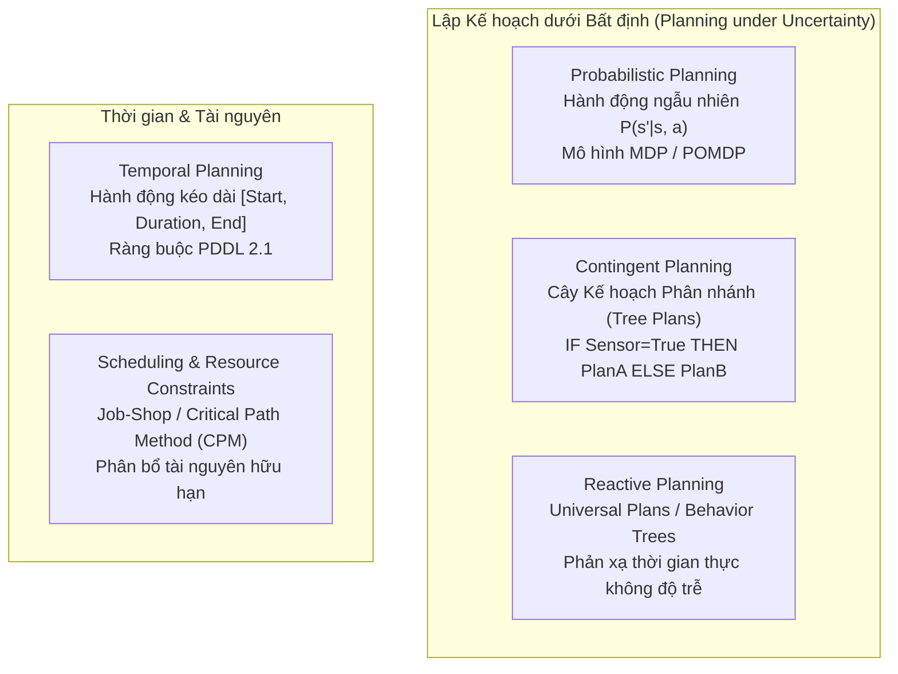
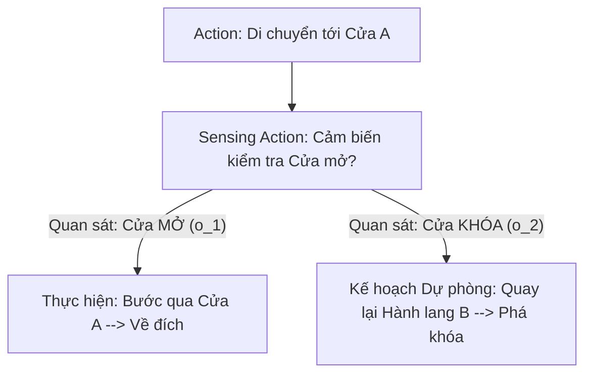
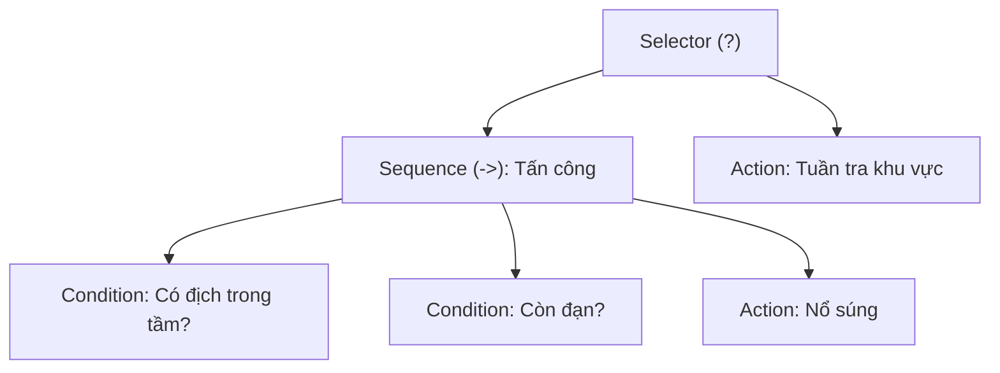

```mermaid
gantt
    title Biểu Đồ Gantt Lập Lịch Job-Shop (Makespan C_max)
    dateFormat  X
    axisFormat %s
    section Máy Tiện 1
    Job 1 (Op 1) :active, 0, 3
    Job 2 (Op 1) : 3, 7
    section Máy Phay 2
    Job 2 (Op 2) : 0, 3
    Job 1 (Op 2) : 3, 6
```

# Chuyên đề: Lập Kế hoạch Nâng cao, Bất định & Xếp lịch (Advanced & Stochastic Planning, Scheduling)

## 1. Tổng quan Chuyên đề
Lập kế hoạch cổ điển (Classical Planning) giả định thế giới là tất định, hoàn toàn quan sát được và tĩnh lặng. Tuy nhiên, trong thực tế kỹ thuật, các giả định này lập tức sụp đổ:
- Các hành động có thể bị trượt hoặc thất bại ngẫu nhiên (**Probabilistic Planning**).
- Tác tử không biết chắc trạng thái thế giới và phải đưa ra các nhánh rẽ dự phòng phụ thuộc vào kết quả quan sát của cảm biến (**Conditional / Contingent Planning**).
- Môi trường liên tục biến động nhanh đến mức tác tử không có thời gian lập kế hoạch dài hạn mà phải phản xạ tức thời (**Reactive Planning**).
- Các hành động không còn mang tính tức thời ($0$ giây) mà đòi hỏi thời lượng kéo dài (**Temporal Planning**), tiêu hao các tài nguyên vật lý hữu hạn như nhiên liệu, pin, nhân lực (**Resource-Constrained Planning**), đòi hỏi phải phân bổ thời gian biểu tối ưu (**Scheduling / Job-Shop Scheduling**).



---

## 2. Chi tiết từng Keyword

---

### 1. Probabilistic, Conditional & Contingent Planning (Lập Kế hoạch Xác suất, Có Điều kiện & Dự phòng)

#### a. Định nghĩa Bản chất Toán học
- **Probabilistic Planning (Lập kế hoạch Xác suất)**:
  Hành động có kết quả ngẫu nhiên được mô tả bởi nhân Markov $P(s' \mid s, a)$. Lời giải không còn là một chuỗi hành động tuyến tính $\langle a_1, \dots, a_k \rangle$ mà là một **Chính sách Toàn diện (Policy)** $\pi: \mathcal{S} \to \mathcal{A}$ cực đại hóa xác suất chạm tới mục tiêu hoặc cực đại hóa phần thưởng tích lũy (xem MDP).
- **Conditional / Contingent Planning (Lập kế hoạch Dự phòng)**:
  Áp dụng trong môi trường quan sát một phần (Partially Observable). Kế hoạch là một **Cây Quyết định (Decision Tree)** chứa các hành động cảm biến (Sensing Actions) để phân nhánh:
  $$\text{Plan} = \text{Action}_1 \to \text{Sense} \to \begin{cases} \text{if observation } o_1 \to \text{SubPlan}_A \\ \text{if observation } o_2 \to \text{SubPlan}_B \end{cases}$$
  Mỗi nhánh tương ứng với một trạng thái niềm tin (Belief State $b$) khác nhau của tác tử.

#### b. Sơ đồ Minh họa


#### c. Code Thực chiến (C++ & Python)
```cpp
// C++20: Mô hình Cây Kế hoạch Dự phòng (Contingent Plan Tree)
#include <iostream>
#include <string>
#include <memory>
#include <functional>

struct ContingentNode {
    std::string action_name;
    bool is_sensing_action{false};
    std::shared_ptr<ContingentNode> next_action{nullptr};
    std::shared_ptr<ContingentNode> on_true_branch{nullptr};
    std::shared_ptr<ContingentNode> on_false_branch{nullptr};

    void execute(std::function<bool(const std::string&)> sensor_callback) {
        std::cout << "Executing: " << action_name << "\n";
        if (is_sensing_action) {
            bool sensor_val = sensor_callback(action_name);
            std::cout << "  -> Sensor Reading: " << (sensor_val ? "TRUE" : "FALSE") << "\n";
            if (sensor_val && on_true_branch) on_true_branch->execute(sensor_callback);
            else if (!sensor_val && on_false_branch) on_false_branch->execute(sensor_callback);
        } else if (next_action) {
            next_action->execute(sensor_callback);
        }
    }
};

int main() {
    auto plan_true = std::make_shared<ContingentNode>(ContingentNode{"EnterRoom", false, nullptr});
    auto plan_false = std::make_shared<ContingentNode>(ContingentNode{"FindAlternativeKey", false, nullptr});

    auto root = std::make_shared<ContingentNode>(ContingentNode{"CheckDoorLocked", true, nullptr, plan_false, plan_true});

    // Giả lập cảm biến báo cửa không khóa (FALSE)
    root->execute([](const std::string&) { return false; });
    return 0;
}
```

```python
# Python: Probabilistic Policy Execution Simulator
import numpy as np

class ProbabilisticEnvironment:
    def __init__(self):
        # Action 0: 80% tới đích, 20% kẹt
        self.transitions = {
            (0, 'GO'): [(0.8, 'GOAL'), (0.2, 0)]
        }

    def simulate_policy(self, policy_fn, start_state=0, trials=100):
        success = 0
        for _ in range(trials):
            state = start_state
            for step in range(5):
                action = policy_fn(state)
                outcomes = self.transitions.get((state, action), [(1.0, state)])
                probs = [p for p, s_next in outcomes]
                states = [s_next for p, s_next in outcomes]
                state = np.random.choice(states, p=probs)
                if state == 'GOAL':
                    success += 1
                    break
        return success / trials

env = ProbabilisticEnvironment()
print("Policy Success Rate:", env.simulate_policy(lambda s: 'GO'))
```

---

### 2. Reactive Planning (Lập Kế hoạch Phản xạ) & Behavior Trees

#### a. Định nghĩa Bản chất Toán học
Trong môi trường động tốc độ cao (như Robot đá bóng RoboCup, Game AI FPS), việc tìm kiếm kế hoạch đa bước mất hàng trăm mili-giây sẽ làm tác tử bị tiêu diệt trước khi kịp hành động.
- **Reactive Planning**: Bỏ qua quá trình suy nghĩ sâu, ánh xạ trực tiếp từ không gian cảm nhận sang hành động tức thời:
  $$\pi_{\text{reactive}}: \mathcal{S} \to \mathcal{A} \quad (\text{Thời gian tính toán } \mathcal{O}(1))$$
- **Universal Plans (Schoppers, 1987)**: Một bảng tra cứu toàn diện tính toán trước hành động tối ưu cho **mọi trạng thái có thể xảy ra** của thế giới.
- **Behavior Trees (Cây Hành vi - BTs)**:
  Kiến trúc chuẩn công nghiệp hiện đại thay thế cho Finite State Machines (FSMs), được tổ chức dạng cây gồm 4 loại nút chính:
  1. **Sequence ($\to$)**: Chạy tuần tự các con; trả về `SUCCESS` nếu TẤT CẢ các con thành công. Trả về `FAILURE` ngay khi một con thất bại.
  2. **Selector / Fallback ($?$)**: Chạy các con; trả về `SUCCESS` ngay khi MỘT con thành công (Cơ chế dự phòng fallback).
  3. **Condition**: Kiểm tra điều kiện cảm biến.
  4. **Action**: Thực thi hành động cụ thể (trả về `RUNNING`, `SUCCESS`, hoặc `FAILURE`).

#### b. Sơ đồ Minh họa


#### c. Code Thực chiến (C++ & Python)
```cpp
// C++20: Behavior Tree Minimal Engine (Selector & Sequence Nodes)
#include <iostream>
#include <vector>
#include <memory>

enum class NodeStatus { SUCCESS, FAILURE, RUNNING };

class BTNode {
public:
    virtual ~BTNode() = default;
    virtual NodeStatus tick() = 0;
};

class SequenceNode : public BTNode {
    std::vector<std::shared_ptr<BTNode>> children_;
public:
    explicit SequenceNode(std::vector<std::shared_ptr<BTNode>> ch) : children_(std::move(ch)) {}
    NodeStatus tick() override {
        for (auto& child : children_) {
            NodeStatus status = child->tick();
            if (status != NodeStatus::SUCCESS) return status;
        }
        return NodeStatus::SUCCESS;
    }
};

class ActionLeaf : public BTNode {
    std::string name_;
    NodeStatus return_status_;
public:
    ActionLeaf(std::string name, NodeStatus status) : name_(std::move(name)), return_status_(status) {}
    NodeStatus tick() override {
        std::cout << "BT Action: " << name_ << "\n";
        return return_status_;
    }
};

int main() {
    auto cond = std::make_shared<ActionLeaf>("HasAmmo?", NodeStatus::SUCCESS);
    auto act = std::make_shared<ActionLeaf>("ShootWeapon", NodeStatus::SUCCESS);
    SequenceNode attack_seq({cond, act});

    std::cout << "Ticking Behavior Tree Attack Sequence:\n";
    NodeStatus res = attack_seq.tick();
    std::cout << "Sequence Final Status: " << (res == NodeStatus::SUCCESS ? "SUCCESS" : "FAILURE") << "\n";
    return 0;
}
```

```python
# Python: Behavior Tree Selector Implementation
class Selector:
    def __init__(self, children):
        self.children = children

    def tick(self):
        for child in self.children:
            status = child()
            if status == "SUCCESS":
                return "SUCCESS"
        return "FAILURE"

is_enemy_near = lambda: "FAILURE" # Không có địch
flee_action = lambda: "SUCCESS"
patrol_action = lambda: "SUCCESS"

# Fallback: Thử đánh, nếu không có địch thì tuần tra
root = Selector([is_enemy_near, patrol_action])
print("Behavior Tree Ticked Result:", root.tick())
```

---

### 3. Temporal Planning, Resource-Constrained Planning & Scheduling

#### a. Định nghĩa Bản chất Toán học
1. **Temporal Planning (PDDL 2.1 - Fox & Long, 2003)**:
   Mỗi hành động bền vững (Durative Action $a$) có thời lượng thực thi $d_a \in \mathbb{R}^+$. Các điều kiện và hệ quả được gắn với mốc thời gian:
   - `at start`: Phải đúng tại thời điểm hành động bắt đầu.
   - `over all`: Phải duy trì đúng trong suốt khoảng thời gian $(t_{\text{start}}, t_{\text{start}} + d_a)$.
   - `at end`: Trở thành đúng tại thời điểm hoàn thành.
2. **Resource-Constrained Planning (Lập kế hoạch Ràng buộc Tài nguyên)**:
   Mỗi trạng thái duy trì các hàm tài nguyên liên tục (Fluents):
   $$\text{fuel}(s) \in \mathbb{R}^+, \quad \text{fuel}(s') = \text{fuel}(s) - \Delta \text{fuel}(a)$$
   Ràng buộc bất biến: $\text{fuel}(s) \ge 0, \quad \forall s$.
3. **Scheduling (Xếp lịch / Phân bổ Thời gian biểu)**:
   - **Job-Shop Scheduling Problem (JSP)**: Tập $n$ công việc $J_1, \dots, J_n$, mỗi công việc gồm chuỗi các nguyên công (operations) cần xử lý trên tập $m$ máy móc. Mỗi máy chỉ xử lý tối đa 1 nguyên công tại một thời điểm.
   - **Hàm Mục tiêu**: Cực tiểu hóa thời gian hoàn thành toàn bộ dự án (**Makespan $C_{\max}$**):
     $$\min \max_{i} C_i$$
   - **Thuật toán Đường Găng (Critical Path Method - CPM)**: Xác định chuỗi các công việc có độ trễ bằng 0; bất kỳ sự chậm trễ nào trên đường găng đều làm chậm toàn bộ dự án.

#### b. Sơ đồ Minh họa


#### c. Code Thực chiến (C++ & Python)
```cpp
// C++20: Critical Path Method (CPM) - Tính Thời điểm Khởi sớm (Early Start) và Makespan
#include <iostream>
#include <vector>
#include <algorithm>
#include <queue>

struct Task {
    int id;
    int duration;
    std::vector<int> successors;
};

int compute_cpm_makespan(const std::vector<Task>& tasks) {
    int n = tasks.size();
    std::vector<int> in_degree(n, 0);
    for (const auto& t : tasks) {
        for (int succ : t.successors) in_degree[succ]++;
    }

    std::queue<int> q;
    std::vector<int> early_start(n, 0);
    std::vector<int> early_finish(n, 0);

    for (int i = 0; i < n; ++i) {
        if (in_degree[i] == 0) {
            q.push(i);
            early_finish[i] = tasks[i].duration;
        }
    }

    while (!q.empty()) {
        int u = q.front();
        q.pop();

        for (int v : tasks[u].successors) {
            early_start[v] = std::max(early_start[v], early_finish[u]);
            early_finish[v] = early_start[v] + tasks[v].duration;
            in_degree[v]--;
            if (in_degree[v] == 0) q.push(v);
        }
    }

    return *std::max_element(early_finish.begin(), early_finish.end());
}

int main() {
    // Task 0: 3 days -> Task 1: 4 days
    // Task 2: 2 days -> Task 1
    std::vector<Task> tasks = {
        {0, 3, {1}},
        {1, 4, {}},
        {2, 2, {1}}
    };
    std::cout << "Project Minimum Makespan: " << compute_cpm_makespan(tasks) << " days\n";
    return 0;
}
```

```python
# Python: Job-Shop Scheduling Makespan Evaluation
def compute_schedule_makespan(jobs, machine_assignments):
    """
    jobs: Dict[job_id, List[(machine_id, duration)]]
    """
    machine_free_time = {}
    job_free_time = {j: 0 for j in jobs}

    for job_id, operations in jobs.items():
        for m_id, duration in operations:
            m_ready = machine_free_time.get(m_id, 0)
            j_ready = job_free_time[job_id]
            start_time = max(m_ready, j_ready)
            finish_time = start_time + duration

            machine_free_time[m_id] = finish_time
            job_free_time[job_id] = finish_time

    return max(machine_free_time.values())

sample_jobs = {
    'JobA': [(1, 3), (2, 2)], # Máy 1 (3h) -> Máy 2 (2h)
    'JobB': [(2, 2), (1, 4)]  # Máy 2 (2h) -> Máy 1 (4h)
}
print("Total Makespan:", compute_schedule_makespan(sample_jobs, {}))
```

#### d. Lỗi Thường gặp & Ứng dụng
- **Deadlock trong Resource Allocation**: Hai công việc đồng thời giữ tài nguyên này và chờ tài nguyên kia (Dining Philosophers Problem), làm tê liệt toàn bộ tiến độ dự án.
- **Ứng dụng AI**: Điều phối sản xuất bán dẫn tại nhà máy TSMC, quản lý lịch trình cửa bay tại các sân bay quốc tế (Heathrow, Changi), và quy hoạch truyền dữ liệu vệ tinh quỹ đạo thấp Starlink.
