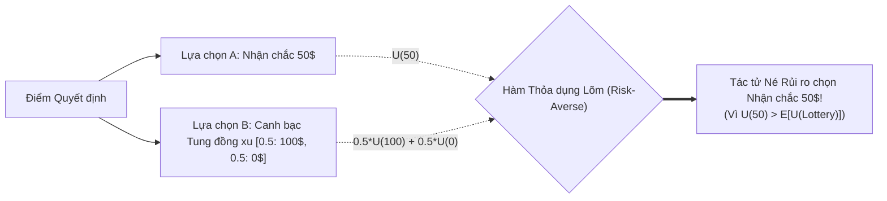
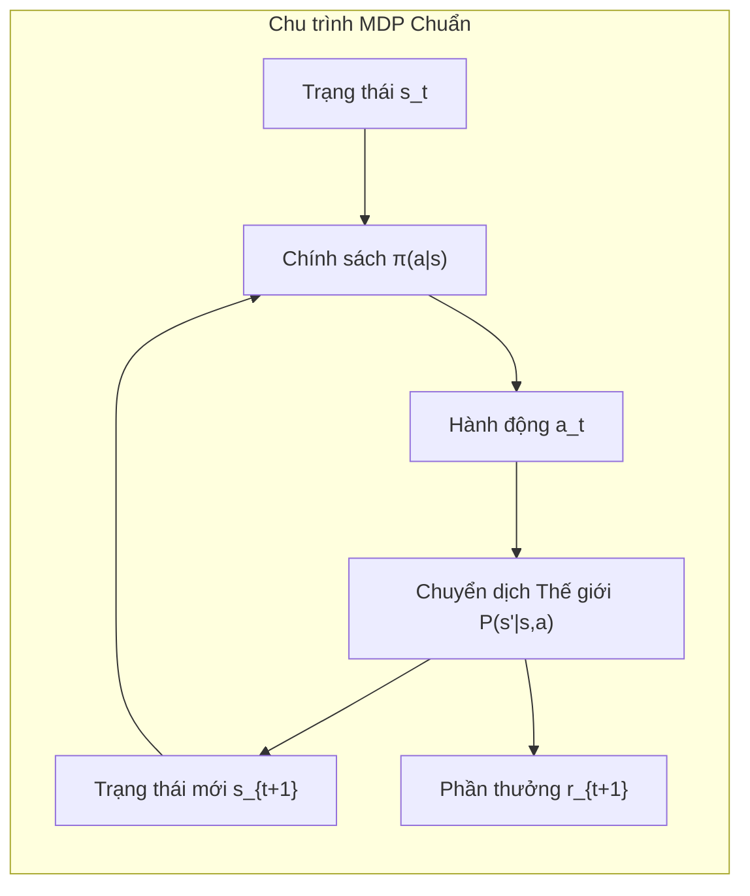

```mermaid
graph TD
    s(("Trạng thái s")) -->|Hành động a| Q["Điểm Q(s, a)"]
    Q -->|"Xác suất P(s' &#124; s, a)"| s_next1(("s'_1 (Reward r)"))
    Q -->|"Xác suất P(s' &#124; s, a)"| s_next2(("s'_2 (Reward r)"))
    
    s_next1 -->|Hệ số chiết khấu γ| V_next1["V(s'_1)"]
    s_next2 -->|Hệ số chiết khấu γ| V_next2["V(s'_2)"]
    
    V_next1 & V_next2 -. "Bellman Backup" .-> s
```

# Chuyên đề: Lý thuyết Quyết định & Quá trình Quyết định Markov (Decision Theory & MDPs)

## 1. Tổng quan Chuyên đề
Khi môi trường chứa đầy sự ngẫu nhiên và các hành động có hậu quả kéo dài trong tương lai, bài toán của tác tử thông minh được hình thức hóa thành **Lý thuyết Quyết định (Decision Theory)** — sự kết hợp giữa **Lý thuyết Xác suất (Probability Theory)** và **Lý thuyết Thỏa dụng (Utility Theory)**.

Khung toán học chuẩn mực để mô hình hóa các bài toán ra quyết định tuần tự dưới bất định là **Quá trình Quyết định Markov (Markov Decision Processes - MDPs)** và phiên bản quan sát một phần của nó (**POMDPs**). Trung tâm giải tích của toàn bộ lĩnh vực này là hệ **Phương trình Bellman (Bellman Equations)**, cho phép phân rã đệ quy giá trị tương lai và giải quyết bài toán tìm chính sách tối ưu thông qua các giải thuật **Quy hoạch Động (Dynamic Programming - Value Iteration & Policy Iteration)**.

```mermaid
graph TD
    subgraph DecisionTheoryCore["Trụ cột Lý thuyết Quyết định"]
        ProbTheory["Lý thuyết Xác suất P(s'|s,a)<br/>(Bất định thế giới)"]
        UtilityTheory["Lý thuyết Thỏa dụng U(s)<br/>(Sở thích tác tử)"]
        ProbTheory & UtilityTheory --> ExpectedUtility["Kỳ vọng Tiện ích (Expected Utility)<br/>EU(a) = ∑ P(s'|s,a) U(s')"]
    end

    subgraph MDP_Framework["Khung Quá trình Quyết định Markov"]
        ExpectedUtility --> Bellman["Phương trình Bellman (Bellman Optimality Eq)<br/>V*(s) = max_a [ R(s,a) + γ ∑ P(s'|s,a) V*(s') ]"]
        Bellman --> DP["Quy hoạch Động (Dynamic Programming)"]
        DP --> VI["Value Iteration (Lặp Giá trị)"]
        DP --> PI["Policy Iteration (Lặp Chính sách)"]
        MDP_Framework --> POMDP["POMDP (Belief MDP trong Không gian Niềm tin b)"]
    end
```

---

## 2. Chi tiết từng Keyword

---

### 1. Decision Theory, Utility Theory & Expected Utility (Lý thuyết Quyết định & Kỳ vọng Tiện ích)

#### a. Định nghĩa Bản chất Toán học
- **Hệ Tiên đề von Neumann-Morgenstern (VNM Utility Theorem, 1944)**:
  Nếu một tác tử có quan hệ sở thích $\succ$ trên các canh bạc (Lotteries $L$) thỏa mãn 4 tiên đề:
  1. *Tính Hoàn chỉnh (Completeness)*: $A \succ B \lor B \succ A \lor A \sim B$.
  2. *Tính Bắc cầu (Transitivity)*: $A \succ B \land B \succ C \implies A \succ C$.
  3. *Tính Liên tục (Continuity)*: Nếu $A \succ B \succ C$, tồn tại xác suất $p \in [0, 1]$ sao cho $[p, A; 1-p, C] \sim B$.
  4. *Tính Độc lập (Independence)*: $A \succ B \implies [p, A; 1-p, C] \succ [p, B; 1-p, C]$.
  
  Thì tồn tại duy nhất một hàm thỏa dụng $U: \mathcal{S} \to \mathbb{R}$ (sai khác một phép biến đổi afin dương $aU + b, a>0$) sao cho tác tử luôn hành xử nhằm cực đại hóa **Kỳ vọng Tiện ích (Maximum Expected Utility - MEU Principle)**:
  $$a^* = \arg\max_{a \in \mathcal{A}} \mathbb{E}[U(a)] = \arg\max_{a \in \mathcal{A}} \sum_{s'} P(s' \mid a) U(s')$$

- **Thái độ đối với Rủi ro (Risk Attitude)**:
  Độ cong của hàm thỏa dụng $U(w)$ theo tài sản $w$:
  - *Risk-Neutral (Trung lập)*: $U''(w) = 0$ (Đường thẳng).
  - *Risk-Averse (Né tránh rủi ro)*: $U''(w) < 0$ (Hàm lõm - Concave, như $\ln(w)$).
  - *Risk-Seeking (Thích rủi ro)*: $U''(w) > 0$ (Hàm lồi - Convex).

#### b. Sơ đồ Minh họa


#### c. Code Thực chiến (C++ & Python)
```cpp
// C++17: Risk-Averse Utility Calculation (Logarithmic Utility Function)
#include <iostream>
#include <cmath>

struct Lottery {
    double prob_win;
    double payout_win;
    double payout_lose;
};

// Hàm thỏa dụng né tránh rủi ro: U(w) = ln(w)
double compute_expected_utility_log(const Lottery& lot, double current_wealth) {
    double u_win = std::log(current_wealth + lot.payout_win);
    double u_lose = std::log(current_wealth + lot.payout_lose);
    return lot.prob_win * u_win + (1.0 - lot.prob_win) * u_lose;
}

int main() {
    double wealth = 1000.0;
    Lottery gamble{0.5, 500.0, -400.0}; // Kỳ vọng tiền tệ: +50$ (Dương)
    double eu_gamble = compute_expected_utility_log(gamble, wealth);
    double eu_stay = std::log(wealth);

    std::cout << "EU of Staying: " << eu_stay << "\n";
    std::cout << "EU of Gamble : " << eu_gamble << "\n";
    std::cout << "Decision: " << (eu_gamble > eu_stay ? "Accept Gamble" : "Reject Gamble") << "\n";
    return 0;
}
```

```python
# Python: Certainty Equivalent & Risk Premium
import numpy as np

def compute_risk_premium(wealth, p_win, win_amt, lose_amt):
    # U(w) = sqrt(w)
    u = lambda w: np.sqrt(w)
    u_inv = lambda val: val ** 2

    eu = p_win * u(wealth + win_amt) + (1 - p_win) * u(wealth - lose_amt)
    expected_monetary_value = wealth + p_win * win_amt - (1 - p_win) * lose_amt
    certainty_equivalent = u_inv(eu)
    risk_premium = expected_monetary_value - certainty_equivalent
    return risk_premium

premium = compute_risk_premium(wealth=100.0, p_win=0.5, win_amt=50.0, lose_amt=50.0)
print(f"Risk Premium (Chi phí trả để tránh rủi ro): {premium:.2f}$")
```

---

### 2. Markov Decision Processes (MDP) & Partially Observable MDP (POMDP)

#### a. Định nghĩa Bản chất Toán học
- **Markov Decision Process (MDP)**:
  Một MDP hữu hạn là bộ 5 phần tử:
  $$\mathcal{M} = \langle \mathcal{S}, \mathcal{A}, \mathcal{P}, \mathcal{R}, \gamma \rangle$$
  - $\mathcal{S}$: Tập trạng thái thế giới.
  - $\mathcal{A}$: Tập hành động khả thi.
  - $\mathcal{P}$: Mô hình xác suất chuyển dịch Markov:
    $$P(s' \mid s, a) = \mathbb{P}(S_{t+1} = s' \mid S_t = s, A_t = a)$$
    *Tính chất Markov*: Tương lai độc lập với quá khứ khi đã biết hiện tại:
    $$\mathbb{P}(S_{t+1} \mid S_t, A_t, S_{t-1}, A_{t-1}, \dots, S_0, A_0) = \mathbb{P}(S_{t+1} \mid S_t, A_t)$$
  - $\mathcal{R}$: Hàm phần thưởng $R(s, a, s') \in \mathbb{R}$.
  - $\gamma \in [0, 1)$: Hệ số chiết khấu tương lai (Discount Factor).
  
  Mục tiêu: Tìm chính sách $\pi(a \mid s)$ cực đại hóa tổng phần thưởng chiết khấu kỳ vọng (**Return $G_t$**):
  $$G_t = \sum_{k=0}^{\infty} \gamma^k R_{t+k+1}$$

- **POMDP (Partially Observable MDP)**:
  Mở rộng MDP với bộ: $\langle \mathcal{S}, \mathcal{A}, \mathcal{P}, \mathcal{R}, \Omega, \mathcal{O}, \gamma \rangle$.
  - Tác tử không quan sát được $s_t$, chỉ nhận được quan sát $o_t \in \Omega$ sinh ra từ phân phối $P(o \mid s')$.
  - Tác tử duy trì **Trạng thái Niềm tin (Belief State)** $b(s) = \mathbb{P}(S_t = s \mid o_{1:t}, a_{1:t-1})$.
  - POMDP có thể quy đổi thành một **Belief MDP** trong không gian trạng thái liên tục vô hạn chiều (Simplex).

#### b. Sơ đồ Minh họa


---

### 3. Bellman Equations, Value Functions & Policy Functions

#### a. Định nghĩa Bản chất Toán học
1. **Policy Function (Hàm Chính sách $\pi$)**:
   - Tất định: $a = \pi(s)$.
   - Ngẫu nhiên: $\pi(a \mid s) = \mathbb{P}(A_t = a \mid S_t = s)$.
2. **State-Value Function (Hàm Giá trị Trạng thái $V^\pi(s)$)**:
   Kỳ vọng phần thưởng tích lũy bắt đầu từ trạng thái $s$ và tuân thủ chính sách $\pi$:
   $$V^\pi(s) = \mathbb{E}_\pi \left[ \sum_{k=0}^{\infty} \gamma^k R_{t+k+1} \;\middle|\; S_t = s \right]$$
3. **Action-Value Function (Hàm Giá trị Hành động $Q^\pi(s, a)$)**:
   Kỳ vọng phần thưởng tích lũy bắt đầu từ trạng thái $s$, thực hiện hành động $a$, và sau đó tuân thủ $\pi$:
   $$Q^\pi(s, a) = \mathbb{E}_\pi \left[ \sum_{k=0}^{\infty} \gamma^k R_{t+k+1} \;\middle|\; S_t = s, A_t = a \right]$$

**Phương trình Kỳ vọng Bellman (Bellman Expectation Equation)**:
$$V^\pi(s) = \sum_{a \in \mathcal{A}} \pi(a \mid s) \left[ R(s, a) + \gamma \sum_{s' \in \mathcal{S}} P(s' \mid s, a) V^\pi(s') \right]$$
$$Q^\pi(s, a) = R(s, a) + \gamma \sum_{s' \in \mathcal{S}} P(s' \mid s, a) \sum_{a' \in \mathcal{A}} \pi(a' \mid s') Q^\pi(s', a')$$

**Phương trình Tối ưu Bellman (Bellman Optimality Equation)**:
$$V^*(s) = \max_{a \in \mathcal{A}} \left[ R(s, a) + \gamma \sum_{s' \in \mathcal{S}} P(s' \mid s, a) V^*(s') \right]$$
$$Q^*(s, a) = R(s, a) + \gamma \sum_{s' \in \mathcal{S}} P(s' \mid s, a) \max_{a' \in \mathcal{A}} Q^*(s', a')$$

#### b. Sơ đồ Minh họa


---

### 4. Dynamic Programming (Quy hoạch Động): Value Iteration & Policy Iteration

#### a. Định nghĩa Bản chất Toán học
Quy hoạch động giải quyết MDP khi đã biết hoàn hảo mô hình thế giới ($P$ và $R$):
1. **Value Iteration (Lặp Giá trị - Richard Bellman, 1957)**:
   Biến đổi phương trình tối ưu Bellman thành quy tắc cập nhật lặp điểm bất động (Fixed-point Iteration):
   $$V_{k+1}(s) = \max_{a \in \mathcal{A}} \sum_{s'} P(s' \mid s, a) \left[ R(s, a, s') + \gamma V_k(s') \right]$$
   - **Định lý Co Banach (Contraction Mapping Theorem)**: Toán tử Bellman $\mathcal{T}^*$ là một toán tử $\gamma$-co trong chuẩn vô hạn:
     $$\| \mathcal{T}^* V - \mathcal{T}^* U \|_\infty \le \gamma \| V - U \|_\infty$$
     Đảm bảo thuật toán luôn hội tụ duy nhất về $V^*$ với tốc độ cấp số nhân!
2. **Policy Iteration (Lặp Chính sách - Ronald Howard, 1960)**:
   Luân phiên qua hai giai đoạn cho đến khi chính sách không còn thay đổi:
   - **Policy Evaluation**: Giải hệ phương trình tuyến tính tìm $V^{\pi_k}$:
     $$V^{\pi_k} = (\mathbf{I} - \gamma \mathbf{P}^{\pi_k})^{-1} \mathbf{R}^{\pi_k}$$
   - **Policy Improvement**: Tham lam hóa chính sách dựa trên $V^{\pi_k}$:
     $$\pi_{k+1}(s) = \arg\max_{a \in \mathcal{A}} \sum_{s'} P(s' \mid s, a) [R(s, a, s') + \gamma V^{\pi_k}(s')]$$

#### b. Code Thực chiến (C++ & Python)
```cpp
// C++20: Value Iteration Solver cho GridWorld 1D MDP
#include <iostream>
#include <vector>
#include <cmath>
#include <algorithm>

const int NUM_STATES = 5;
const double GAMMA = 0.9;
const double EPSILON = 1e-6;

struct StepOutcome {
    int next_state;
    double prob;
    double reward;
};

std::vector<double> value_iteration() {
    std::vector<double> V(NUM_STATES, 0.0);
    // State 4 là Goal, Reward = 10.0
    
    while (true) {
        double delta = 0.0;
        std::vector<double> V_new = V;

        for (int s = 0; s < NUM_STATES - 1; ++s) {
            // 2 hành động: 0 (Stay), 1 (Forward)
            double max_q = -1e9;
            for (int a : {0, 1}) {
                double q = 0.0;
                if (a == 1) { // Forward
                    int next_s = s + 1;
                    double r = (next_s == 4) ? 10.0 : 0.0;
                    q = 1.0 * (r + GAMMA * V[next_s]);
                } else { // Stay
                    q = 1.0 * (0.0 + GAMMA * V[s]);
                }
                max_q = std::max(max_q, q);
            }
            V_new[s] = max_q;
            delta = std::max(delta, std::abs(V_new[s] - V[s]));
        }

        V = V_new;
        if (delta < EPSILON) break;
    }
    return V;
}

int main() {
    auto optimal_V = value_iteration();
    std::cout << "Optimal Value Function V*(s):\n";
    for (int s = 0; s < NUM_STATES; ++s) {
        std::cout << "State " << s << ": V* = " << optimal_V[s] << "\n";
    }
    return 0;
}
```

```python
# Python: Policy Iteration Implementation on 2-State MDP
import numpy as np

def policy_iteration_2state():
    # 2 States, 2 Actions (0: Stay, 1: Switch)
    P = np.array([
        [[1.0, 0.0], [0.0, 1.0]], # State 0
        [[0.0, 1.0], [1.0, 0.0]]  # State 1
    ])
    R = np.array([
        [1.0, 5.0],  # State 0: a0->1, a1->5
        [2.0, 0.0]   # State 1: a0->2, a1->0
    ])
    gamma = 0.9
    policy = np.array([0, 0]) # Khởi đầu

    while True:
        # 1. Policy Evaluation: Giải hệ (I - gamma * P_pi) V = R_pi
        P_pi = np.array([P[s, policy[s]] for s in range(2)])
        R_pi = np.array([R[s, policy[s]] for s in range(2)])
        V = np.linalg.inv(np.eye(2) - gamma * P_pi) @ R_pi

        # 2. Policy Improvement
        policy_stable = True
        for s in range(2):
            q_sa = [R[s, a] + gamma * np.dot(P[s, a], V) for a in range(2)]
            best_a = int(np.argmax(q_sa))
            if best_a != policy[s]:
                policy[s] = best_a
                policy_stable = False

        if policy_stable:
            return policy, V

opt_pi, opt_v = policy_iteration_2state()
print("Optimal Policy:", opt_pi, "| Optimal Values:", opt_v)
```

#### c. Lỗi Thường gặp & Ứng dụng
- **Curse of Dimensionality của Bellman**: Số lượng trạng thái $|\mathcal{S}|$ bùng nổ theo hàm mũ khi số chiều biến trạng thái tăng lên, làm ma trận chuyển dịch không thể lưu trữ trong RAM. Khắc phục bằng Reinforcement Learning hàm xấp xỉ (Deep Q-Networks, Actor-Critic).
- **Ứng dụng AI**: Hệ thống quản lý kho hàng tự động, tối ưu hóa danh mục đầu tư tài chính định lượng, và kiểm soát hệ thống làm mát trung tâm dữ liệu của Google DeepMind.
