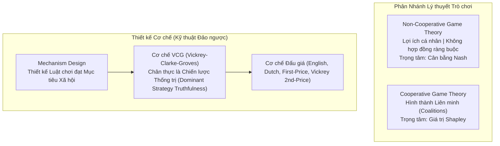
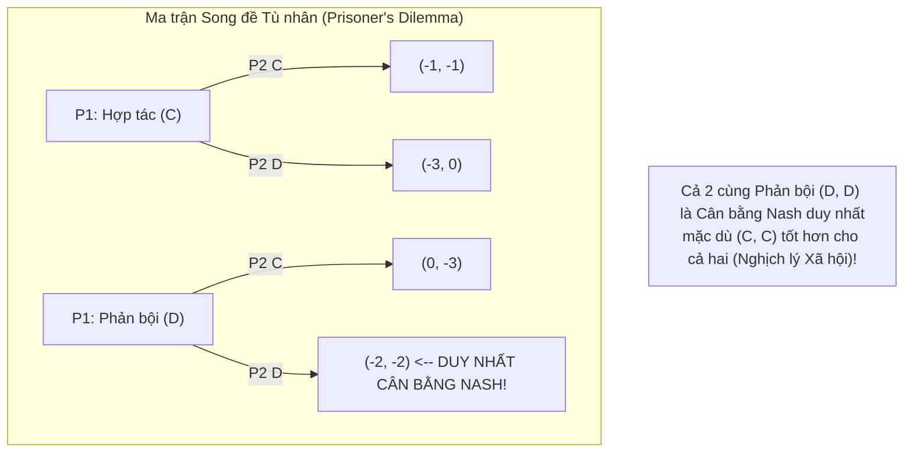
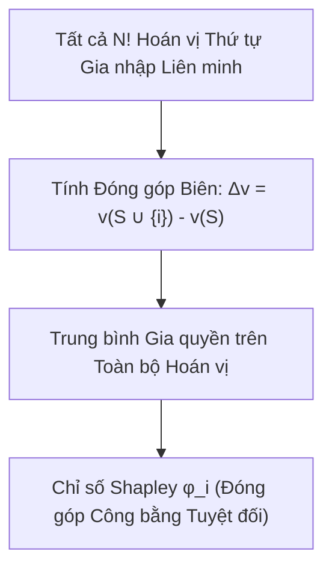
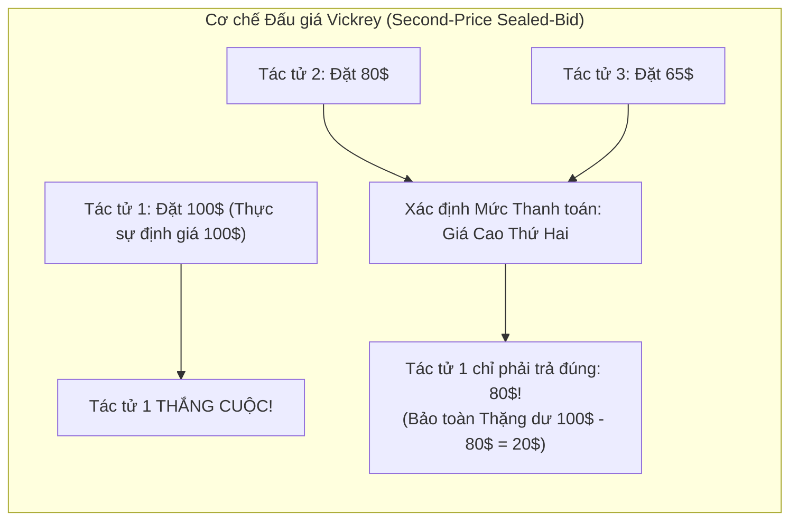

# Chuyên đề: Lý thuyết Trò chơi & Thiết kế Cơ chế (Game Theory & Mechanism Design)

## 1. Tổng quan Chuyên đề
Khi nhiều tác tử cùng tồn tại trong một môi trường, kết quả cuối cùng không chỉ phụ thuộc vào quyết định của riêng một tác tử mà là hàm tương tác tương hỗ của toàn bộ các tác tử tham gia. **Lý thuyết Trò chơi (Game Theory - John von Neumann & John Nash)** cung cấp nền tảng toán học để phân tích các tương tác chiến lược này:
- **Trò chơi Phi Hợp tác (Non-Cooperative Game Theory)**: Các tác tử là những thực thể duy lý cá nhân, hành động độc lập vì lợi ích riêng (tâm điểm là trạng thái **Cân bằng Nash - Nash Equilibrium**).
- **Trò chơi Hợp tác (Cooperative Game Theory)**: Các tác tử có thể liên minh với nhau (Coalitions) và ký kết các hợp đồng ràng buộc pháp lý, phân chia thặng dư giá trị chung thông qua chỉ số **Shapley Value**.
- **Đàm phán (Negotiation)**: Quá trình tương tác đa bước nhằm đạt được thỏa thuận chung (Nash Bargaining Solution).
- **Thiết kế Cơ chế (Mechanism Design / Reverse Game Theory)**: "Kỹ thuật đảo ngược" của lý thuyết trò chơi. Thay vì phân tích cách người chơi hành xử trong một luật chơi có sẵn, nhà thiết kế chủ động tạo ra các luật chơi, quy tắc thanh toán và **Cơ chế Đấu giá (Auction Mechanisms - Vickrey/VCG)** sao cho các tác tử dù hành xử hoàn toàn ích kỷ cũng bắt buộc phải hành động vì lợi ích tối ưu của toàn xã hội (**Incentive Compatibility / Truthfulness**).



---

## 2. Chi tiết từng Keyword

---

### 1. Game Theory & Nash Equilibrium (Lý thuyết Trò chơi & Cân bằng Nash)

#### a. Định nghĩa Bản chất Toán học
Một trò chơi dạng chuẩn (Normal-Form Game) của $N$ người chơi được định nghĩa bởi bộ:
$$\mathcal{G} = \langle \mathcal{N}, \{\mathcal{A}_i\}_{i=1}^N, \{u_i\}_{i=1}^N \rangle$$
- $\mathcal{N} = \{1, 2, \dots, N\}$: Tập hợp người chơi.
- $\mathcal{A}_i$: Tập hợp các chiến lược khả dĩ của người chơi $i$. Không gian chiến lược chung: $\mathcal{A} = \prod_i \mathcal{A}_i$.
- $u_i(\mathbf{a}): \mathcal{A} \to \mathbb{R}$: Hàm tiện ích (Payoff) của người chơi $i$, phụ thuộc vào vector chiến lược chung $\mathbf{a} = (a_i, \mathbf{a}_{-i})$.

**Chiến lược Thống trị (Strictly Dominant Strategy)**:
Chiến lược $a_i^* \in \mathcal{A}_i$ được gọi là thống trị nếu nó mang lại tiện ích cao hơn mọi chiến lược khác, bất kể đối thủ chơi gì:
$$u_i(a_i^*, \mathbf{a}_{-i}) > u_i(a_i', \mathbf{a}_{-i}), \quad \forall a_i' \neq a_i^*, \ \forall \mathbf{a}_{-i} \in \mathcal{A}_{-i}$$

**Cân bằng Nash (Nash Equilibrium - John Nash, 1950)**:
Một bộ chiến lược $\mathbf{a}^* = (a_1^*, \dots, a_N^*)$ là một **Cân bằng Nash** nếu không có bất kỳ người chơi nào có động cơ đơn phương thay đổi chiến lược của mình khi các người chơi khác giữ nguyên chiến lược:
$$u_i(a_i^*, \mathbf{a}_{-i}^*) \ge u_i(a_i, \mathbf{a}_{-i}^*), \quad \forall a_i \in \mathcal{A}_i, \ \forall i \in \mathcal{N}$$

- **Định lý Tồn tại Nash (1950)**: Mọi trò chơi hữu hạn luôn tồn tại ít nhất một Cân bằng Nash trong không gian **Chiến lược Hỗn hợp (Mixed Strategies)** $\mathbf{\sigma}^* = (\sigma_1^*, \dots, \sigma_N^*)$ (trong đó $\sigma_i$ là phân phối xác suất trên $\mathcal{A}_i$).
- **Độ phức tạp Tính toán**: Tìm cân bằng Nash trong trò chơi tổng quát là bài toán thuộc lớp **PPAD-complete** (Daskalakis, Goldberg, Papadimitriou, 2006) — rất khó tìm trong trường hợp tổng quát.

#### b. Sơ đồ Minh họa


#### c. Code Thực chiến (C++ & Python)
```cpp
// C++20: Kiểm tra Cân bằng Nash Thuần túy trong Trò chơi 2 Người
#include <iostream>
#include <vector>

struct Payoff {
    int p1, p2;
};

void find_pure_nash_equilibria(const std::vector<std::vector<Payoff>>& matrix) {
    int rows = matrix.size();
    int cols = matrix[0].size();

    std::cout << "Pure Strategy Nash Equilibria found at:\n";
    for (int r = 0; r < rows; ++r) {
        for (int c = 0; c < cols; ++c) {
            bool p1_best_response = true;
            for (int r_alt = 0; r_alt < rows; ++r_alt) {
                if (matrix[r_alt][c].p1 > matrix[r][c].p1) {
                    p1_best_response = false;
                    break;
                }
            }

            bool p2_best_response = true;
            for (int c_alt = 0; c_alt < cols; ++c_alt) {
                if (matrix[r][c_alt].p2 > matrix[r][c].p2) {
                    p2_best_response = false;
                    break;
                }
            }

            if (p1_best_response && p2_best_response) {
                std::cout << "  -> (Row " << r << ", Col " << c << ") with Payoffs (" 
                          << matrix[r][c].p1 << ", " << matrix[r][c].p2 << ")\n";
            }
        }
    }
}

int main() {
    // Prisoner's Dilemma
    std::vector<std::vector<Payoff>> pd_game = {
        { {-1, -1}, {-3, 0} },
        { {0, -3},  {-2, -2} }
    };
    find_pure_nash_equilibria(pd_game);
    return 0;
}
```

```python
# Python: Nashpy Solver cho Mixed Strategy Nash Equilibrium
import numpy as np

def compute_2x2_zero_sum_mixed_nash(payoff_matrix_p1):
    # Payoff matrix A (P1) vs -A (P2)
    # Tìm xác suất p sao cho P2 bàng quan giữa 2 cột: p*A[0,0] + (1-p)*A[1,0] = p*A[0,1] + (1-p)*A[1,1]
    A = payoff_matrix_p1
    denom = (A[0, 0] - A[1, 0]) - (A[0, 1] - A[1, 1])
    if denom == 0:
        return np.array([0.5, 0.5])
    p = (A[1, 1] - A[1, 0]) / denom
    p = np.clip(p, 0.0, 1.0)
    return np.array([p, 1.0 - p])

# Matching Pennies: P1 thắng nếu cùng mặt, P2 thắng nếu khác mặt
p1_matrix = np.array([
    [1.0, -1.0],
    [-1.0, 1.0]
])
p1_mixed_nash = compute_2x2_zero_sum_mixed_nash(p1_matrix)
print("P1 Mixed Strategy Nash Equilibrium Distribution:", p1_mixed_nash) # [0.5, 0.5]
```

---

### 2. Cooperative Game Theory & Shapley Value (Lý thuyết Trò chơi Hợp tác)

#### a. Định nghĩa Bản chất Toán học
Trong trò chơi hợp tác với tiện ích chuyển giao được (Cooperative Game with Transferable Utility - TU Game), các tác tử có thể lập thành một liên minh $S \subseteq \mathcal{N}$.
Trò chơi được định nghĩa bởi hàm đặc trưng:
$$v: 2^{\mathcal{N}} \to \mathbb{R}, \quad v(\emptyset) = 0$$
trong đó $v(S)$ là tổng giá trị kinh tế mà liên minh $S$ có thể tự tạo ra mà không cần sự trợ giúp của các tác tử bên ngoài.

**Giá trị Shapley (Shapley Value - Lloyd Shapley, Nobel Kinh tế 2012)**:
Cách duy nhất để phân chia tổng giá trị $v(\mathcal{N})$ cho từng tác tử $i$ thỏa mãn 4 tiên đề công bằng tuyệt đối (*Hiệu quả Pareto, Đối xứng, Tác tử Bù nhìn, Tính cộng*):
$$\phi_i(v) = \sum_{S \subseteq \mathcal{N} \setminus \{i\}} \frac{|S|! (|\mathcal{N}| - |S| - 1)!}{|\mathcal{N}|!} \left[ v(S \cup \{i\}) - v(S) \right]$$
trong đó $v(S \cup \{i\}) - v(S)$ là **Đóng góp Biên (Marginal Contribution)** của tác tử $i$ khi gia nhập liên minh $S$.

- **Ứng dụng Đột phá trong AI**: Công thức Shapley Value chính là nền tảng toán học của **SHAP (SHapley Additive exPlanations)** — phương pháp giải thích mô hình học sâu (XAI) chuẩn mực nhất hiện nay, coi các đặc trưng (features) là các người chơi hợp tác tạo ra giá trị dự đoán của mô hình.

#### b. Sơ đồ Minh họa


#### c. Code Thực chiến (C++ & Python)
```cpp
// C++20: Tính Giá trị Shapley Chính xác cho Trò chơi 3 Người
#include <iostream>
#include <vector>
#include <cmath>
#include <numeric>

double factorial(int n) {
    double res = 1.0;
    for (int i = 2; i <= n; ++i) res *= i;
    return res;
}

// Giả lập hàm giá trị liên minh v(S) qua bitmask 3-bit
double v_coalition(int mask) {
    if (mask == 0) return 0.0;
    if (mask == 7) return 100.0; // Đại liên minh {1, 2, 3} tạo 100$
    if ((mask & 1) && (mask & 2)) return 60.0; // {1, 2} tạo 60$
    if (mask == 1) return 10.0;
    return 0.0;
}

double compute_shapley_player_0(int N) {
    double phi = 0.0;
    double n_fact = factorial(N);

    // Duyệt qua tất cả các tập con S không chứa player 0 (bit 0 = 0)
    for (int s_mask = 0; s_mask < (1 << N); ++s_mask) {
        if (s_mask & 1) continue; // Bỏ qua nếu có player 0
        int s_size = __builtin_popcount(s_mask);
        double weight = (factorial(s_size) * factorial(N - s_size - 1)) / n_fact;
        double marginal_contribution = v_coalition(s_mask | 1) - v_coalition(s_mask);
        phi += weight * marginal_contribution;
    }
    return phi;
}

int main() {
    double phi_p0 = compute_shapley_player_0(3);
    std::cout << "Shapley Value for Player 0: " << phi_p0 << "$\n";
    return 0;
}
```

```python
# Python: Exact Shapley Value Function
from itertools import combinations
import math

def shapley_value(player, all_players, v_func):
    n = len(all_players)
    other_players = [p for p in all_players if p != player]
    phi = 0.0

    for k in range(n):
        for subset in combinations(other_players, k):
            s = set(subset)
            weight = (math.factorial(len(s)) * math.factorial(n - len(s) - 1)) / math.factorial(n)
            marginal = v_func(s | {player}) - v_func(s)
            phi += weight * marginal
    return phi

# Ví dụ hàm giá trị
def sample_v(coalition):
    if len(coalition) == 3: return 100
    if 'A' in coalition and 'B' in coalition: return 70
    if 'A' in coalition: return 20
    return 0

players = ['A', 'B', 'C']
print("Shapley Fair Payoff for A:", shapley_value('A', players, sample_v))
print("Shapley Fair Payoff for C:", shapley_value('C', players, sample_v))
```

---

### 3. Negotiation, Mechanism Design & Auction Mechanisms (Đàm phán & Đấu giá)

#### a. Định nghĩa Bản chất Toán học
1. **Thiết kế Cơ chế (Mechanism Design)**:
   Mỗi tác tử $i$ nắm giữ một thông tin bí mật tư nhân (Private Type $\theta_i \in \Theta_i$).
   Một cơ chế là một bộ $\mathcal{M} = \langle \mathcal{S}_1, \dots, \mathcal{S}_N, g(\cdot) \rangle$:
   - $\mathcal{S}_i$: Tập các hành động / thông báo mà tác tử có thể gửi.
   - $g(s_1, \dots, s_N) = (x, p_1, \dots, p_N)$: Quy tắc chọn đầu ra xã hội $x$ và mức thanh toán $p_i$.
   - **Tương thích Động cơ (Incentive Compatibility - IC / Truthfulness)**:
     Cơ chế đảm bảo việc **khai báo trung thực sự thật** ($\hat{\theta}_i = \theta_i$) luôn là chiến lược thống trị tối ưu cho mọi người chơi:
     $$u_i(g(\theta_i, \mathbf{\theta}_{-i}), \theta_i) \ge u_i(g(\hat{\theta}_i, \mathbf{\theta}_{-i}), \theta_i), \quad \forall \hat{\theta}_i$$

2. **Cơ chế VCG (Vickrey-Clarke-Groves - Đỉnh cao Cơ chế)**:
   Chọn kết quả xã hội cực đại hóa tổng giá trị phúc lợi (Social Welfare Maximizer):
   $$x^* = \arg\max_x \sum_{j} v_j(x, \theta_j)$$
   và áp dụng quy tắc thanh toán **Clarke Pivot Rule**:
   $$p_i = \max_x \sum_{j \neq i} v_j(x, \theta_j) - \sum_{j \neq i} v_j(x^*, \theta_j)$$
   Số tiền tác tử $i$ phải trả chính là **Tổn thất ngoại ứng (Harm / Externality)** mà sự xuất hiện của tác tử $i$ gây ra cho tất cả các tác tử còn lại trong xã hội!

3. **4 Cơ chế Đấu giá Kinh điển (Classic Auctions)**:
   - **English Auction (Đấu giá Anh)**: Công khai, giá tăng dần. Người trả giá cao nhất thắng và trả giá đó.
   - **Dutch Auction (Đấu giá Hà Lan)**: Công khai, giá giảm dần cho đến khi có người chấp nhận mua.
   - **First-Price Sealed-Bid (Đấu giá Kín Giá Nhất)**: Bỏ phiếu kín một lần. Người trả giá cao nhất thắng và trả đúng giá mình đã đặt (Dẫn tới hành vi *Bid Shading* - đặt thấp hơn giá trị thực).
   - **Vickrey Auction (Đấu giá Kín Giá Thứ Hai - Second-Price Sealed-Bid - William Vickrey, Nobel 1996)**:
     Bỏ phiếu kín. Người đặt giá cao nhất thắng, nhưng **chỉ phải trả mức giá của người cao thứ hai**:
     $$p^* = \max_{j \neq \text{winner}} b_j$$
     *Định lý Tuyệt đối*: Vickrey Auction là **Strategy-Proof / Truthful** — đặt đúng giá trị thực ($b_i = v_i$) là chiến lược thống trị nghiêm ngặt.

#### b. Sơ đồ Minh họa


#### c. Code Thực chiến (C++ & Python)
```cpp
// C++20: Vickrey Second-Price Sealed-Bid Auction Engine
#include <iostream>
#include <vector>
#include <string>
#include <algorithm>

struct Bid {
    std::string bidder_id;
    double amount;
};

struct AuctionResult {
    std::string winner_id;
    double winning_bid;
    double payment_price; // Second highest price
};

AuctionResult run_vickrey_auction(std::vector<Bid> bids) {
    if (bids.size() < 2) return {"None", 0.0, 0.0};

    // Sắp xếp giảm dần theo giá đặt
    std::sort(bids.begin(), bids.end(), [](const Bid& a, const Bid& b) {
        return a.amount > b.amount;
    });

    return {bids[0].bidder_id, bids[0].amount, bids[1].amount};
}

int main() {
    std::vector<Bid> bids = {
        {"Agent_Alice", 95.0},
        {"Agent_Bob", 120.0}, // Cao nhat
        {"Agent_Charlie", 80.0}
    };
    auto res = run_vickrey_auction(bids);
    std::cout << "Auction Winner: " << res.winner_id << " (Placed: " << res.winning_bid << "$)\n";
    std::cout << "Second-Price Payment: " << res.payment_price << "$\n";
    return 0;
}
```

```python
# Python: Proof of Truthfulness in Second-Price Auction Simulator
def simulate_vickrey_payout(true_value, bid, other_highest_bid):
    if bid > other_highest_bid:
        # Thắng cuộc: Utility = True Value - Payment (Other Highest)
        return true_value - other_highest_bid
    else:
        # Thua cuộc: Utility = 0
        return 0.0

true_val = 100.0
other_max = 85.0

# Kịch bản 1: Đặt thật (bid = 100) -> Utility = 100 - 85 = 15
u_truthful = simulate_vickrey_payout(true_val, 100.0, other_max)

# Kịch bản 2: Đặt thấp gian dối (bid = 80) -> Bị thua cuộc oan uổng! Utility = 0
u_underbid = simulate_vickrey_payout(true_val, 80.0, other_max)

# Kịch bản 3: Đặt cao gian dối (bid = 120) khi other_max = 110 -> Bị lỗ! Utility = 100 - 110 = -10
u_overbid = simulate_vickrey_payout(true_val, 120.0, other_highest_bid=110.0)

print(f"Utility Truthful: {u_truthful}$ | Underbid: {u_underbid}$ | Overbid: {u_overbid}$")
print("=> Khai báo Trung thực luôn là Chiến lược Tối ưu Thống trị!")
```

#### d. Lỗi Thường gặp & Ứng dụng
- **Winner's Curse (Lời nguyền của Kẻ Thắng Cuộc)**: Trong đấu giá tài sản có giá trị chung (Common-Value Auctions như mỏ dầu ngầm), người thắng thường là người ước lượng sai lạc quan nhất, dẫn tới việc mua hớ và thua lỗ nặng nếu không chiết khấu giá đặt.
- **Ứng dụng AI**: Hệ thống đấu giá từ khóa quảng cáo thời gian thực (Google Ads GSP/VCG, Meta Ads), điều phối phân bổ băng tần 5G quốc gia (FCC Spectrum Auctions), và hệ thống sàn giao dịch năng lượng P2P phi tập trung.
