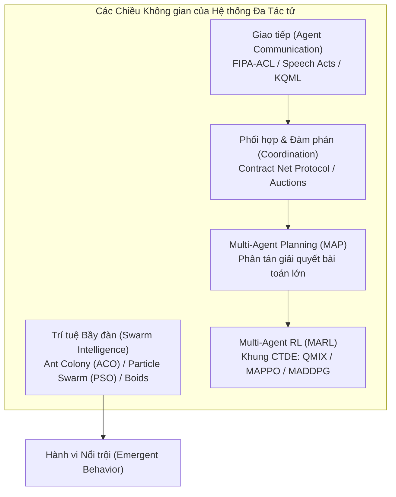
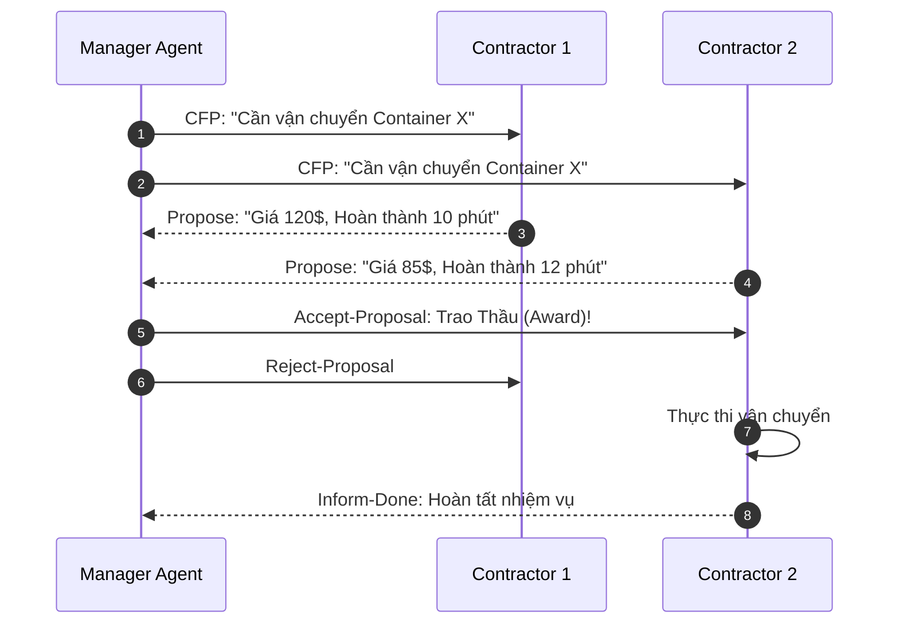
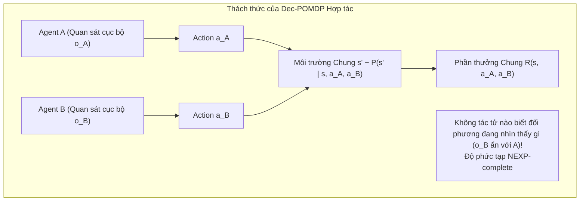
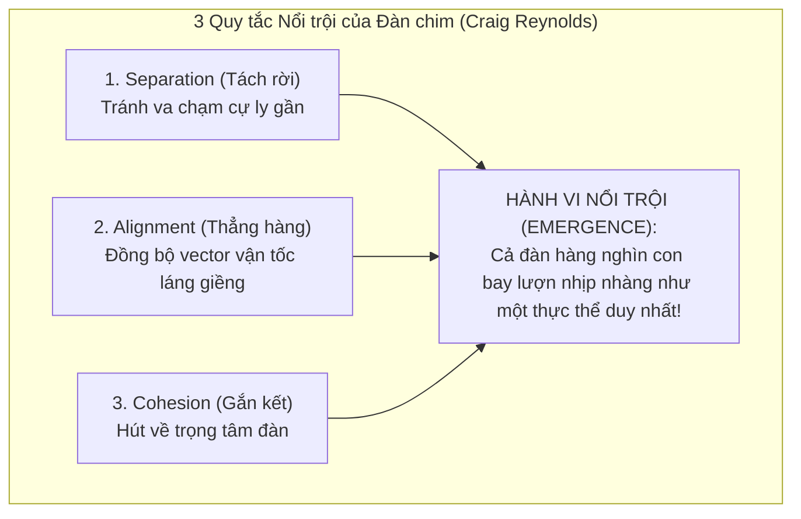
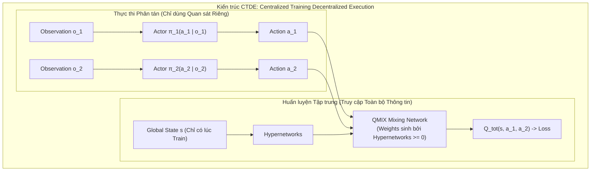

# Chuyên đề: Hệ Thống Đa Tác Tử & Trí Tuệ Bầy Đàn (Multi-Agent Systems & Swarm Intelligence)

## 1. Tổng quan Chuyên đề
Khi trí tuệ nhân tạo chuyển dịch từ một tác tử đơn lẻ độc lập sang một tập thể gồm nhiều tác tử cùng tương tác, một chiều không gian mới của sự phức tạp xuất hiện: **Hệ thống Đa Tác tử (Multi-Agent Systems - MAS)**.

Trong MAS, không một tác tử nào nắm giữ toàn bộ thông tin về thế giới hoặc có quyền lực kiểm soát tuyệt đối; các tác tử phải:
- **Giao tiếp (Agent Communication)** qua các giao thức ngôn ngữ hành vi (FIPA-ACL, KQML).
- **Phối hợp (Agent Coordination)** để giải quyết mâu thuẫn và tránh tắc nghẽn tài nguyên.
- **Hợp tác (Cooperation)** hoặc **Cạnh tranh (Competition)** tùy thuộc vào hàm mục tiêu chung hay riêng.
- **Lập kế hoạch Phân tán (Multi-Agent Planning / Distributed Problem Solving)** để phân chia nhiệm vụ quy mô lớn.
- Khai thác **Trí tuệ Bầy đàn (Swarm Intelligence / Collective Intelligence)**: Từ các quy tắc cục bộ cực kỳ đơn giản của từng cá thể (như loài kiến, đàn chim Boids), toàn bộ hệ thống bộc lộ các **Hành vi Nổi trội (Emergent Behaviors)** thông minh vượt bậc mà không cần bất kỳ bộ chỉ huy trung tâm nào.
- Đỉnh cao của lĩnh vực này là **Học Tăng cường Đa Tác tử (Multi-Agent Reinforcement Learning - MARL)** với các kiến trúc huấn luyện tập trung - thực thi phân tán (Centralized Training with Decentralized Execution - CTDE như MAPPO, QMIX, MADDPG).



---

## 2. Chi tiết từng Keyword

---

### 1. Multi-Agent Systems, Agent Communication & Coordination (Hệ thống Đa Tác tử, Giao tiếp & Phối hợp)

#### a. Định nghĩa Bản chất Toán học
Một **Hệ thống Đa Tác tử (MAS)** được mô hình hóa toán học là một Stochastic Game (Markov Game) của $N$ tác tử:
$$\mathcal{M}_{\text{MAS}} = \langle \mathcal{N}, \mathcal{S}, \{\mathcal{A}_i\}_{i=1}^N, \mathcal{P}, \{\mathcal{R}_i\}_{i=1}^N, \gamma \rangle$$
- Mỗi tác tử $i$ thực hiện hành động $a_i \in \mathcal{A}_i$.
- Chuyển dịch thế giới phụ thuộc vào vector hành động liên hợp: $\mathbf{a} = (a_1, \dots, a_N) \in \prod_i \mathcal{A}_i$:
  $$P(s' \mid s, a_1, \dots, a_N) = \mathbb{P}(S_{t+1} = s' \mid S_t = s, \mathbf{A}_t = \mathbf{a})$$

**Giao tiếp Tác tử (Agent Communication - Speech Act Theory - Austin & Searle)**:
Giao tiếp không chỉ truyền tải dữ liệu mà là một dạng hành động làm thay đổi trạng thái tâm lý (Belief, Desire, Intention) của tác tử nhận.
Chuẩn quốc tế **FIPA-ACL (Foundation for Intelligent Physical Agents - Agent Communication Language)** định nghĩa các động tác ngôn ngữ (Performatives):
- `inform`: Thông báo một sự thật.
- `request`: Yêu cầu thực thi một hành động.
- `propose`: Đề xuất thỏa thuận.
- `cfp` (Call for Proposals): Phát động đấu thầu nhiệm vụ.

**Giao thức Phối hợp (Coordination - Contract Net Protocol - Smith, 1980)**:
Cơ chế thị trường phân tán 4 bước để phân bổ tác vụ:
1. *Manager* phát thông báo gọi thầu (Task Announcement / CFP).
2. Các *Contractors* đánh giá tài nguyên và gửi hồ sơ dự thầu (Bids).
3. *Manager* chọn nhà thầu tối ưu nhất và trao hợp đồng (Award).
4. *Contractor* thắng thầu thực thi và gửi kết quả báo cáo.

#### b. Sơ đồ Minh họa


#### c. Code Thực chiến (C++ & Python)
```cpp
// C++20: Contract Net Protocol (CNP) Multi-Agent Message Dispatcher
#include <iostream>
#include <vector>
#include <string>
#include <algorithm>

struct ACLMessage {
    std::string sender;
    std::string receiver;
    std::string performative; // "CFP", "PROPOSE", "ACCEPT", "REJECT"
    double proposed_cost;
};

class CNPManager {
public:
    std::string evaluate_bids(const std::vector<ACLMessage>& proposals) {
        if (proposals.empty()) return "None";
        auto best = std::min_element(proposals.begin(), proposals.end(),
            [](const ACLMessage& a, const ACLMessage& b) {
                return a.proposed_cost < b.proposed_cost; // Chọn giá thầu rẻ nhất
            });
        return best->sender;
    }
};

int main() {
    CNPManager manager;
    std::vector<ACLMessage> incoming_bids = {
        {"Robot_Arm_1", "Manager", "PROPOSE", 15.5},
        {"Robot_Arm_2", "Manager", "PROPOSE", 8.2}, // Thắng thầu
        {"Robot_Arm_3", "Manager", "PROPOSE", 11.0}
    };
    std::string winner = manager.evaluate_bids(incoming_bids);
    std::cout << "Contract Awarded to: " << winner << "\n";
    return 0;
}
```

```python
# Python: FIPA-ACL Message Schema
from dataclasses import dataclass
from typing import Any

@dataclass
class FIPAMessage:
    performative: str  # 'request', 'inform', 'cfp'
    sender: str
    receiver: str
    content: Any
    ontology: str = "LogisticsOntology"

# Mô phỏng gửi nhận tin nhắn giữa 2 agent
msg = FIPAMessage(
    performative="request",
    sender="SupervisorAgent",
    receiver="DeliveryDrone_07",
    content={"task": "DeliverMedkit", "target": (10.5, 20.3)}
)
print(f"Dispatched FIPA Message: [{msg.performative.upper()}] from {msg.sender} to {msg.receiver}")
```

---

### 2. Cooperation, Competition, Multi-Agent Planning & Distributed Problem Solving

#### a. Định nghĩa Bản chất Toán học
- **Cooperation (Hợp tác / Fully Cooperative)**:
  Tất cả các tác tử cùng chia sẻ chung một hàm phần thưởng duy nhất:
  $$R_1(\mathbf{s}, \mathbf{a}) = R_2(\mathbf{s}, \mathbf{a}) = \dots = R_N(\mathbf{s}, \mathbf{a}) = R(\mathbf{s}, \mathbf{a})$$
  Được mô hình hóa toán học là **Decentralized Partially Observable MDP (Dec-POMDP)**.
  - *Độ phức tạp*: Giải Dec-POMDP tối ưu là bài toán thuộc lớp **NEXP-complete** — thuộc hàng khó nhất trong toàn bộ khoa học máy tính!
- **Competition (Cạnh tranh / Fully Competitive)**:
  Trò chơi có tổng bằng 0 (Zero-Sum): $\sum_{i=1}^N R_i = 0$.
- **Distributed Problem Solving (DPS)**:
  Một bài toán toàn cục lớn được chia nhỏ thành các bài toán con, phân phối cho các tác tử độc lập giải quyết trên mạng phân tán, sau đó tổng hợp các kết quả cục bộ thành lời giải toàn cục (ví dụ: Distributed Constraint Satisfaction - DisCSP qua giải thuật ABT - Asynchronous Backtracking).

#### b. Sơ đồ Minh họa


#### c. Code Thực chiến (C++ & Python)
```cpp
// C++17: Phân rã Bài toán Phân tán (Distributed Task Map-Reduce Step)
#include <iostream>
#include <vector>
#include <numeric>
#include <future>

long long distributed_worker(const std::vector<int>& data_shard) {
    return std::accumulate(data_shard.begin(), data_shard.end(), 0LL);
}

int main() {
    std::vector<int> shard1 = {1, 2, 3, 4};
    std::vector<int> shard2 = {5, 6, 7, 8};

    // Chạy song song bất đồng bộ qua hai Worker Tác tử
    auto future1 = std::async(std::launch::async, distributed_worker, shard1);
    auto future2 = std::async(std::launch::async, distributed_worker, shard2);

    long long total = future1.get() + future2.get();
    std::cout << "Distributed Problem Solving Combined Result: " << total << "\n";
    return 0;
}
```

```python
# Python: Asynchronous Backtracking (ABT) DisCSP Concept
class DisCSPAgent:
    def __init__(self, agent_id, domain):
        self.id = agent_id
        self.domain = domain
        self.current_value = domain[0]
        self.agent_view = {} # Lưu giá trị của các agent bậc cao hơn

    def receive_ok_msg(self, higher_agent_id, val):
        self.agent_view[higher_agent_id] = val
        # Kiểm tra mâu thuẫn ràng buộc
        if self.current_value in self.agent_view.values():
            for d in self.domain:
                if d not in self.agent_view.values():
                    self.current_value = d
                    return f"Agent {self.id} resolved conflict: changed to {d}"
            return f"Agent {self.id} BACKTRACK (No value left)"
        return f"Agent {self.id} consistent"

a2 = DisCSPAgent(agent_id=2, domain=['Red', 'Green'])
print(a2.receive_ok_msg(higher_agent_id=1, val='Red'))
```

---

### 3. Swarm Intelligence, Collective Intelligence & Emergent Behavior (Trí tuệ Bầy đàn & Hành vi Nổi trội)

#### a. Định nghĩa Bản chất Toán học
- **Swarm Intelligence (Trí tuệ Bầy đàn)**:
  Hệ thống bao gồm nhiều cá thể có cấu trúc cực kỳ đơn giản, tương tác phi tập trung với nhau và với môi trường thông qua cơ chế tự tổ chức (Self-Organization).
- **Stigmergy (Giao tiếp Gián tiếp qua Môi trường - Pierre-Paul Grassé, 1959)**:
  Các cá thể không cần giao tiếp trực tiếp mặt đối mặt; chúng tương tác bằng cách làm biến đổi môi trường vật lý (ví dụ: loài kiến tiết chất hóa học Pheromone $\tau_{ij}$ trên đường đi).
  
  **Thuật toán Tối ưu hóa Đàn kiến (Ant Colony Optimization - ACO - Marco Dorigo, 1992)**:
  Xác suất kiến chọn cạnh nối giữa thành phố $i$ và $j$:
  $$P_{ij}^k = \frac{[\tau_{ij}]^\alpha [\eta_{ij}]^\beta}{\sum_{l \in \text{Allowed}} [\tau_{il}]^\alpha [\eta_{il}]^\beta}$$
  trong đó $\tau_{ij}$ là nồng độ pheromone, $\eta_{ij} = \frac{1}{d_{ij}}$ là thông tin heuristic cục bộ, $\alpha, \beta$ là các hệ số kiểm soát.
  
  *Bay hơi Pheromone*: $\tau_{ij} \leftarrow (1 - \rho) \tau_{ij} + \sum_k \Delta \tau_{ij}^k$.

- **Emergent Behavior (Hành vi Nổi trội)**:
  Hiện tượng một hệ thống thể hiện những đặc tính phức tạp, thông minh ở cấp độ vĩ mô mà **hoàn toàn không được lập trình tường minh** trong bất kỳ cá thể nào ở cấp vi mô.
  *Mô hình Boids (Craig Reynolds, 1986)* mô phỏng hoàn hảo đàn chim bay lượn chỉ bằng 3 quy tắc cục bộ đơn giản:
  1. *Separation (Tách rời)*: Tránh va chạm với bạn bay gần nhất.
  2. *Alignment (Thẳng hàng)*: Lái theo hướng vận tốc trung bình của các bạn bay lân cận.
  3. *Cohesion (Gắn kết)*: Lái về phía vị trí trọng tâm trung bình của đàn lân cận.

#### b. Sơ đồ Minh họa


#### c. Code Thực chiến (C++ & Python)
```cpp
// C++20: Ant Colony Optimization (ACO) Pheromone Evaporation & Update Step
#include <iostream>
#include <vector>

void update_pheromones(std::vector<std::vector<double>>& pheromone_matrix, 
                       const std::vector<int>& best_tour, 
                       double tour_length, 
                       double rho, double Q) {
    int n = pheromone_matrix.size();
    // 1. Bay hơi Pheromone
    for (int i = 0; i < n; ++i) {
        for (int j = 0; j < n; ++j) {
            pheromone_matrix[i][j] *= (1.0 - rho);
        }
    }

    // 2. Tăng cường Pheromone tren duong di tot nhat cua kien
    double deposit = Q / tour_length;
    for (size_t k = 0; k < best_tour.size() - 1; ++k) {
        int u = best_tour[k];
        int v = best_tour[k + 1];
        pheromone_matrix[u][v] += deposit;
        pheromone_matrix[v][u] += deposit;
    }
}

int main() {
    std::vector<std::vector<double>> tau = {
        {0.0, 1.0, 1.0},
        {1.0, 0.0, 1.0},
        {1.0, 1.0, 0.0}
    };
    update_pheromones(tau, {0, 1, 2, 0}, 15.0, 0.1, 100.0);
    std::cout << "Updated Pheromone edge (0, 1): " << tau[0][1] << "\n";
    return 0;
}
```

```python
# Python: 2D Boids Flocking Emergence Simulator (1 Step)
import numpy as np

def compute_boids_step(positions, velocities, r_sep=2.0, r_coh=10.0):
    N = len(positions)
    new_velocities = np.copy(velocities)

    for i in range(N):
        diffs = positions - positions[i]
        dists = np.linalg.norm(diffs, axis=1)

        # 1. Separation
        sep_mask = (dists > 0) & (dists < r_sep)
        v_sep = -np.sum(diffs[sep_mask], axis=0) if np.any(sep_mask) else np.zeros(2)

        # 2. Alignment & Cohesion
        neigh_mask = (dists > 0) & (dists < r_coh)
        if np.any(neigh_mask):
            v_ali = np.mean(velocities[neigh_mask], axis=0) - velocities[i]
            v_coh = np.mean(positions[neigh_mask], axis=0) - positions[i]
        else:
            v_ali, v_coh = np.zeros(2), np.zeros(2)

        new_velocities[i] += 1.5 * v_sep + 1.0 * v_ali + 0.5 * v_coh
        # Chặn vận tốc tối đa
        speed = np.linalg.norm(new_velocities[i])
        if speed > 5.0:
            new_velocities[i] = (new_velocities[i] / speed) * 5.0

    return positions + new_velocities * 0.1, new_velocities

pos = np.array([[0.0, 0.0], [1.0, 1.0], [0.5, 0.2]])
vel = np.array([[1.0, 0.0], [0.8, 0.2], [1.1, -0.1]])
new_p, new_v = compute_boids_step(pos, vel)
print("Updated Emergent Boid Positions:\n", new_p)
```

---

### 4. Multi-Agent Reinforcement Learning (MARL)

#### a. Định nghĩa Bản chất Toán học
MARL mở rộng học tăng cường sâu (Deep RL) cho môi trường nhiều tác tử.
- **Thách thức Phi dừng (Non-Stationarity)**: Từ góc nhìn của tác tử $i$, môi trường liên tục biến đổi khi các tác tử khác thay đổi chính sách:
  $$P(s_{t+1} \mid s_t, a_{i,t}) = \sum_{\mathbf{a}_{-i}} P(s_{t+1} \mid s_t, a_{i,t}, \mathbf{a}_{-i,t}) \prod_{j \neq i} \pi_j(a_{j,t} \mid s_t)$$
  Điều này phá vỡ giả định hội tụ toán học của Q-learning kinh điển.

- **Khung CTDE (Centralized Training with Decentralized Execution - Huấn luyện Tập trung, Thực thi Phân tán)**:
  - *Khi Huấn luyện (Offline Training)*: Bộ đánh giá trung tâm (Centralized Critic) có quyền truy cập toàn bộ trạng thái thế giới $s$ và mọi hành động của các tác tử $\mathbf{a} = (a_1, \dots, a_N)$.
  - *Khi Thực thi (Online Execution)*: Mỗi tác tử chỉ sở hữu mạng chính sách cục bộ (Decentralized Actor $\pi_i(a_i \mid o_i)$) chỉ nhận đầu vào là quan sát riêng $o_i$.

- **Thuật toán QMIX (Rashid et al., ICML 2018)**:
  Phân rã hàm giá trị hành động chung $Q_{\text{tot}}(\mathbf{s}, \mathbf{a})$ thành các hàm giá trị cục bộ $Q_i(s, a_i)$ thông qua mạng kết nối (Mixing Network) thỏa mãn **Điều kiện Đơn điệu (Monotonicity Constraint)**:
  $$\frac{\partial Q_{\text{tot}}}{\partial Q_i} \ge 0, \quad \forall i$$
  Điều kiện này đảm bảo rằng việc tối ưu hóa cục bộ độc lập tương đương với tối ưu hóa toàn cục (**Individual-Global-Max - IGM Principle**):
  $$\arg\max_{\mathbf{a}} Q_{\text{tot}}(\mathbf{s}, \mathbf{a}) = \begin{pmatrix} \arg\max_{a_1} Q_1(o_1, a_1) \\ \vdots \\ \arg\max_{a_N} Q_N(o_N, a_N) \end{pmatrix}$$

#### b. Sơ đồ Minh họa


#### c. Code Thực chiến (C++ & Python)
```cpp
// C++20: QMIX Monotonicity Weight Activation Function
#include <iostream>
#include <vector>
#include <cmath>
#include <algorithm>

// QMIX Mixing Network đòi hỏi trọng số W_mix >= 0 để bảo toàn dQ_tot / dQ_i >= 0
struct QMixLayer {
    std::vector<float> positive_weights; // Abs-activated weights

    float forward(const std::vector<float>& individual_q_values) const {
        float q_tot = 0.0f;
        for (size_t i = 0; i < individual_q_values.size(); ++i) {
            q_tot += positive_weights[i] * individual_q_values[i];
        }
        return q_tot;
    }
};

int main() {
    // Trọng số không âm đảm bảo tính đơn điệu
    QMixLayer mixer{{std::abs(0.75f), std::abs(-0.45f)}}; // Trọng số: 0.75, 0.45
    std::vector<float> q_agents = {12.0f, 8.5f};
    std::cout << "Monotonic Q_tot Output: " << mixer.forward(q_agents) << "\n";
    return 0;
}
```

```python
# Python: QMIX PyTorch Mixing Network Layer
import torch
import torch.nn as nn

class QMixer(nn.Module):
    def __init__(self, num_agents: int, state_dim: int, mixing_embed_dim: int = 32):
        super().__init__()
        self.num_agents = num_agents
        # Hypernetwork sinh trọng số W1 từ state toàn cục
        self.hyper_w1 = nn.Linear(state_dim, num_agents * mixing_embed_dim)
        self.hyper_b1 = nn.Linear(state_dim, mixing_embed_dim)
        # Hypernetwork sinh trọng số W2 từ state toàn cục
        self.hyper_w2 = nn.Linear(state_dim, mixing_embed_dim)
        self.hyper_b2 = nn.Linear(state_dim, 1)

    def forward(self, agent_qs, states):
        """
        agent_qs: [Batch, num_agents]
        states: [Batch, state_dim]
        """
        bs = agent_qs.size(0)
        # Trọng số W1 bắt buộc phải không âm: torch.abs(...)
        w1 = torch.abs(self.hyper_w1(states)).view(bs, self.num_agents, -1)
        b1 = self.hyper_b1(states).view(bs, 1, -1)

        # Tầng ẩn 1
        q_hidden = torch.bmm(agent_qs.unsqueeze(1), w1) + b1
        q_hidden = nn.functional.elu(q_hidden)

        # Trọng số W2 không âm
        w2 = torch.abs(self.hyper_w2(states)).view(bs, -1, 1)
        b2 = self.hyper_b2(states).view(bs, 1, 1)

        q_tot = torch.bmm(q_hidden, w2) + b2
        return q_tot.view(bs, 1)

mixer = QMixer(num_agents=3, state_dim=16)
dummy_q = torch.randn(4, 3) # Batch 4, 3 tác tử
dummy_s = torch.randn(4, 16)
q_total = mixer(dummy_q, dummy_s)
print("QMIX Aggregated Q_tot Tensor Shape:", q_total.shape) # [4, 1]
```

#### d. Lỗi Thường gặp & Ứng dụng
- **Lazy Agent Problem trong Hợp tác Đa tác tử**: Khi một tác tử học được chính sách tốt, các tác tử khác có xu hướng "lười biếng" đứng yên không làm gì để tránh làm giảm phần thưởng chung (Cần cơ chế gán tín nhiệm cá nhân Counterfactual Multi-Agent Policy Gradients - COMA).
- **Ứng dụng AI**: OpenAI Five (đánh bại nhà vô địch thế giới Dota 2), DeepMind AlphaStar (chiến thắng tuyển thủ chuyên nghiệp StarCraft II), điều khiển hàng nghìn máy bay không người lái (Drone Swarm Light Shows & Military Defense), và quản lý luồng giao thông đô thị thông minh.
