# Chuyên đề: Khái niệm Cốt lõi & Lý thuyết Học máy (Core Concepts & Learning Theory)

## 1. Tổng quan Chuyên đề
Học máy (Machine Learning - ML) đánh dấu bước chuyển dịch mô hình (paradigm shift) từ lập trình tất định dựa trên luật (rule-based deterministic programming) sang lập trình quy nạp thống kê (statistical inductive programming). Thay vì định nghĩa thủ công hàm biến đổi $f: \mathcal{X} \to \mathcal{Y}$, hệ thống tự động tìm kiếm nghiệm tối ưu $f^*$ trong không gian giả thuyết $\mathcal{H}$ dựa trên phân phối dữ liệu thực nghiệm.

Lý thuyết học tính toán (Computational Learning Theory) và Học thống kê (Statistical Learning Theory) cung cấp cơ sở toán học chặt chẽ để trả lời hai câu hỏi cốt tử: *Khi nào một mô hình có thể học được?* và *Bao nhiêu dữ liệu cùng chi phí tính toán là đủ để đảm bảo sai số suy quát bị chặn?*

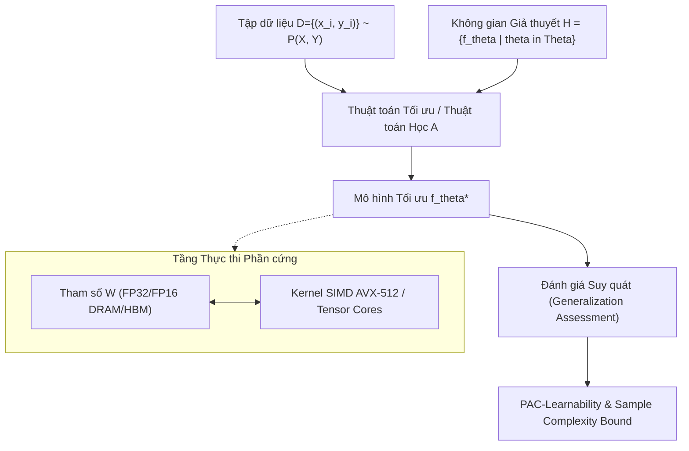

---

## 2. Chi tiết từng Keyword

---

### 1. Machine Learning (Học máy)

#### a. Định nghĩa Bản chất Toán học (Mathematical Formulation)
Theo định nghĩa hình thức của Tom Mitchell (1997): Một chương trình máy tính được gọi là *học* từ kinh nghiệm $E$ (Experience) đối với một lớp tác vụ $T$ (Tasks) và độ đo hiệu năng $P$ (Performance Measure), nếu hiệu năng của nó trên các tác vụ trong $T$, được đo lường bởi $P$, cải thiện cùng với kinh nghiệm $E$.

Về mặt giải tích và tối ưu, Machine Learning quy về bài toán tìm hàm ánh xạ:
$$f^* = \arg\min_{f \in \mathcal{H}} \mathbb{E}_{(\mathbf{x}, y) \sim \mathcal{D}} \big[ \mathcal{L}(f(\mathbf{x}), y) \big]$$
Trong đó:
- $\mathcal{X} \subseteq \mathbb{R}^d$ là không gian đầu vào (input domain), $\mathcal{Y}$ là không gian nhãn/mục tiêu (output domain).
- $\mathcal{D}$ là phân phối xác suất đồng thời chưa biết trên $\mathcal{X} \times \mathcal{Y}$.
- $\mathcal{H}$ là không gian giả thuyết (hypothesis space).
- $\mathcal{L}: \mathcal{Y} \times \mathcal{Y} \to \mathbb{R}^+$ là hàm mất mát (loss function).

#### b. Cơ chế Tầng Sâu & Điện toán (Under The Hood / Hardware Internals)
- **Memory Layout & Footprint**: Trọng số mô hình được phân bổ trong vùng nhớ liên tục (contiguous buffer). Với mô hình tham số $\mathbf{\theta} \in \mathbb{R}^p$, bộ nhớ tối thiểu để lưu trọng số là $p \times \text{sizeof}(\text{dtype})$ bytes.
- **Cache Locality**: Trong quá trình suy luận (inference), ma trận trọng số $\mathbf{W}$ được nạp từ High Bandwidth Memory (HBM) hoặc DRAM vào L3/L2/L1 cache. Để tránh nghẽn băng thông nhớ (memory bandwidth bottleneck), các phép toán được tổ chức thành khối (tiling/blocking) sao cho dữ liệu lưu giữ tối đa trong L1/L2 cache (64-byte cache lines).

#### c. Sơ đồ Minh họa (Mermaid Diagram)
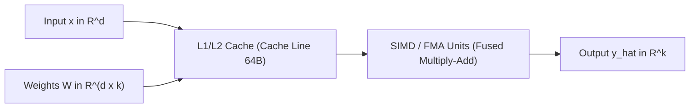

#### d. Code Thực chiến (Dual-Engine: C++ & Python)

```cpp
// C++20: Mô phỏng Pipeline Học máy tuyến tính tối giản tầng thấp
#include <iostream>
#include <vector>
#include <numeric>
#include <cmath>

class MinimalLinearRegression {
private:
    float weight{0.0f};
    float bias{0.0f};

public:
    void fit(const std::vector<float>& x, const std::vector<float>& y, float lr, size_t epochs) {
        const size_t n = x.size();
        for (size_t epoch = 0; epoch < epochs; ++epoch) {
            float grad_w = 0.0f;
            float grad_b = 0.0f;
            for (size_t i = 0; i < n; ++i) {
                float pred = weight * x[i] + bias;
                float err = pred - y[i];
                grad_w += (2.0f / n) * err * x[i];
                grad_b += (2.0f / n) * err;
            }
            weight -= lr * grad_w;
            bias -= lr * grad_b;
        }
    }

    [[nodiscard]] float predict(float x_val) const noexcept {
        return weight * x_val + bias;
    }

    void dump_weights() const {
        std::cout << "[C++] Weight: " << weight << " | Bias: " << bias << "\n";
    }
};

int main() {
    std::vector<float> x = {1.0f, 2.0f, 3.0f, 4.0f, 5.0f};
    std::vector<float> y = {2.0f, 4.0f, 6.0f, 8.0f, 10.0f};
    MinimalLinearRegression model;
    model.fit(x, y, 0.01f, 1000);
    model.dump_weights();
    std::cout << "[C++] Pred(6.0): " << model.predict(6.0f) << "\n";
    return 0;
}
```

```python
# Python / PyTorch: Bản chất Học máy dưới dạng tối ưu hóa đạo hàm tự động
import torch
import torch.nn as nn

class LinearModel(nn.Module):
    def __init__(self):
        super().__init__()
        self.linear = nn.Linear(1, 1)

    def forward(self, x: torch.Tensor) -> torch.Tensor:
        return self.linear(x)

x = torch.tensor([[1.0], [2.0], [3.0], [4.0], [5.0]], dtype=torch.float32)
y = torch.tensor([[2.0], [4.0], [6.0], [8.0], [10.0]], dtype=torch.float32)

model = LinearModel()
criterion = nn.MSELoss()
optimizer = torch.optim.SGD(model.parameters(), lr=0.01)

for _ in range(1000):
    optimizer.zero_grad(set_to_none=True) # Giải phóng bộ nhớ grad thay vì gán 0
    loss = criterion(model(x), y)
    loss.backward()
    optimizer.step()

with torch.no_grad():
    pred = model(torch.tensor([[6.0]]))
    print(f"[PyTorch] Pred(6.0): {pred.item():.4f}")
```

#### e. Lỗi Thường gặp & Ổn định Số học (Pitfalls & Numerical Stability)
- **Gradient Exploding/Vanishing**: Khi số tầng tăng cao, tích gradient tích lũy $\prod \mathbf{W}_l$ có thể tràn về $0$ hoặc $\pm\infty$. Cần gradient clipping hoặc weight normalization.
- **Stochastic vs Deterministic**: Huấn luyện trên đa GPU có thể mất tính tất định (non-deterministic) do thứ tự cộng dồn floating-point không có tính kết hợp: $(a + b) + c \neq a + (b + c)$ trong chuẩn IEEE-754.

#### f. Ứng dụng Thực chiến trong AI / Deep Learning
- Nền tảng của mọi hệ thống AI: Từ mô hình gợi ý (Recommendation Systems) đến các mạng Transformer khổng lồ (GPT-4, Gemini) nhận diện mẫu trên đa phương thức (multimodal).

---

### 2. Statistical Learning (Học thống kê)

#### a. Định nghĩa Bản chất Toán học (Mathematical Formulation)
Học thống kê coi dữ liệu là mẫu ngẫu nhiên độc lập cùng phân phối (i.i.d) sinh ra từ hàm mật độ xác suất đồng thời $P(\mathbf{X}, Y) = P(Y \mid \mathbf{X}) P(\mathbf{X})$.
Mục tiêu là ước lượng hàm hồi quy điều kiện (Regression Function) hoặc hàm phân loại Bayes:
$$\mu(\mathbf{x}) = \mathbb{E}[Y \mid \mathbf{X} = \mathbf{x}] = \int_{\mathcal{Y}} y \, p(y \mid \mathbf{x}) \, dy$$
Hàm mất mát kỳ vọng (True Risk / Generalization Risk):
$$R(f) = \int_{\mathcal{X} \times \mathcal{Y}} \mathcal{L}(f(\mathbf{x}), y) \, dP(\mathbf{x}, y)$$

#### b. Cơ chế Tầng Sâu & Điện toán (Under The Hood / Hardware Internals)
- **i.i.d Assumption & Parallel Sampling**: Giả định i.i.d cho phép phân rã tích phân xác suất thành tích các phân phối độc lập, dẫn đến bài toán tính log-likelihood dưới dạng tổng: $\sum_{i=1}^N \log P(\mathbf{x}_i, y_i)$.
- **Vectorized Reductions**: Tổng log-likelihood được tính bằng các lệnh AVX vector reduction (`_mm256_reduce_add_ps`) trên CPU hoặc block reduction trên GPU Shared Memory.

#### c. Sơ đồ Minh họa (Mermaid Diagram)
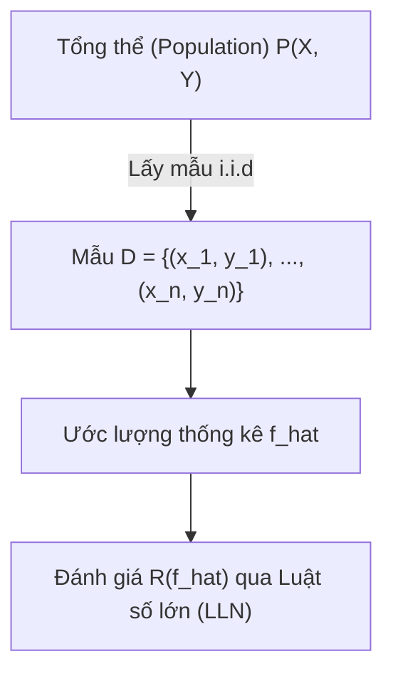

#### d. Code Thực chiến (Dual-Engine: C++ & Python)

```cpp
// C++17: Ước lượng Tham số Thống kê Gaussian Maximum Likelihood (MLE)
#include <iostream>
#include <vector>
#include <cmath>
#include <numeric>

struct GaussianMLE {
    double mean{0.0};
    double variance{0.0};

    void fit(const std::vector<double>& data) {
        const size_t n = data.size();
        mean = std::accumulate(data.begin(), data.end(), 0.0) / n;
        double sq_sum = 0.0;
        for (double x : data) {
            sq_sum += (x - mean) * (x - mean);
        }
        variance = sq_sum / n; // MLE biased estimator
    }
};

int main() {
    std::vector<double> samples = {1.2, 1.9, 2.1, 2.8, 3.1, 2.5};
    GaussianMLE mle;
    mle.fit(samples);
    std::cout << "[C++] Mean: " << mle.mean << " | Variance: " << mle.variance << "\n";
    return 0;
}
```

```python
# Python: So sánh Ước lượng Thống kê Bán tham số (KDE) và Tham số
import numpy as np
from scipy.stats import norm

data = np.array([1.2, 1.9, 2.1, 2.8, 3.1, 2.5])
mu_hat = np.mean(data)
sigma_hat = np.std(data, ddof=0) # MLE standard deviation

print(f"[Python] Mu MLE: {mu_hat:.4f}, Sigma MLE: {sigma_hat:.4f}")
```

#### e. Lỗi Thường gặp & Ổn định Số học
- **Sample Selection Bias**: Dữ liệu thu thập vi phạm giả định i.i.d, dẫn đến ước lượng chệch (biased estimation).
- **Log-Likelihood Underflow**: Tích xác suất $\prod p_i \to 0$ gây tràn dưới (underflow). Luôn tính trên miền logarit: $\sum \log p_i$.

#### f. Ứng dụng Thực chiến trong AI / Deep Learning
- Suy diễn biến phân (Variational Inference) trong Variational Autoencoders (VAEs), Maximum Likelihood trong mô hình ngôn ngữ tự hồi quy (Autoregressive LLMs).

---

### 3. Computational Learning Theory (Lý thuyết Học tính toán)

#### a. Định nghĩa Bản chất Toán học (Mathematical Formulation)
Lý thuyết Học tính toán định lượng khả năng học được thông qua mô hình PAC (Probably Approximately Correct) do Leslie Valiant đề xuất (1984).
Một lớp khái niệm $\mathcal{C}$ được gọi là **PAC-learnable** nếu tồn tại thuật toán $\mathcal{A}$ sao cho với mọi $c \in \mathcal{C}$, mọi phân phối $\mathcal{D}$, và mọi $\epsilon, \delta \in (0, 1)$, thuật toán $\mathcal{A}$ nhận mẫu kích thước $m \ge \text{poly}(1/\epsilon, 1/\delta, d, \text{size}(c))$ và trả về giả thuyết $h \in \mathcal{H}$ thỏa mãn:
$$\mathbb{P}_{\mathcal{S} \sim \mathcal{D}^m} \Big( R(h) \le \epsilon \Big) \ge 1 - \delta$$
Kích thước mẫu chặn trên theo chiều VC (Vapnik-Chervonenkis Dimension $d_{VC}$):
$$m \ge O\left( \frac{1}{\epsilon} \left( d_{VC} \log \frac{1}{\epsilon} + \log \frac{1}{\delta} \right) \right)$$

#### b. Cơ chế Tầng Sâu & Điện toán (Under The Hood / Hardware Internals)
- **Sample Complexity vs Time Complexity**: Một thuật toán có thể có độ phức tạp mẫu đa thức nhưng độ phức tạp thời gian là NP-hard (ví dụ học 3-term DNF formulae hoặc mạng neural 3 tầng có trọng số nhị phân).
- **Hardware Bound**: Đánh giá giới hạn FLOPS lý thuyết tối thiểu để giải bài toán PAC learning trong không gian chiều lớn.

#### c. Sơ đồ Minh họa (Mermaid Diagram)
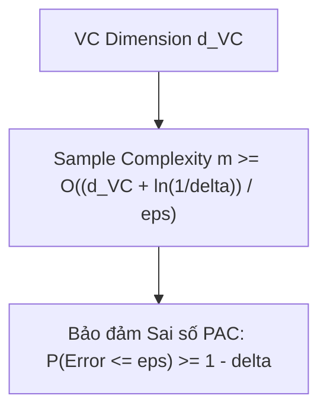

#### d. Code Thực chiến (Dual-Engine: C++ & Python)

```cpp
// C++17: Tính toán Sample Complexity PAC bound cho bài toán hữu hạn |H|
#include <iostream>
#include <cmath>

double compute_pac_sample_size(double epsilon, double delta, size_t hypothesis_space_size) {
    return (1.0 / epsilon) * (std::log(hypothesis_space_size) + std::log(1.0 / delta));
}

int main() {
    double eps = 0.05; // Sai số tối đa 5%
    double delta = 0.01; // Độ tin cậy 99%
    size_t H_size = 1000000; // |H| = 10^6
    double m = compute_pac_sample_size(eps, delta, H_size);
    std::cout << "[C++] Kích thước mẫu tối thiểu m >= " << std::ceil(m) << "\n";
    return 0;
}
```

```python
# Python: Đồ thị hóa hàm cận kích thước mẫu theo chiều VC
import numpy as np

def pac_vc_bound(vc_dim: int, eps: float, delta: float) -> float:
    # Cận mẫu xấp xỉ theo VC
    return (4.0 / eps) * (vc_dim * np.log2(12.0 / eps) + np.log2(2.0 / delta))

for d in [10, 50, 100, 500]:
    print(f"[Python] VC-Dim={d:3d} => Mẫu tối thiểu m >= {int(pac_vc_bound(d, 0.05, 0.05)):8d}")
```

#### e. Lỗi Thường gặp & Ổn định Số học
- **Cận lỏng (Loose Bounds)**: Các cận PAC truyền thống cho deep learning thường ra kích thước mẫu lớn hơn số nguyên tử trong vũ trụ (vacuous bounds), đòi hỏi các lý thuyết mới như Rademacher Complexity hoặc PAC-Bayes.

#### f. Ứng dụng Thực chiến trong AI / Deep Learning
- Chứng minh tính ổn định của Support Vector Machines (SVM), định hướng kiến trúc mạng nơ-ron có regularization ngầm định (implicit regularization).

---

### 4. Learning Paradigms (Các Mô hình Học)

#### a. Định nghĩa Bản chất Toán học (Mathematical Formulation)
Học máy phân chia thành 4 mô hình chính dựa trên cấu trúc thông tin tín hiệu phản hồi:
1. **Supervised Learning**: Dữ liệu có nhãn $\mathcal{D} = \{(\mathbf{x}_i, y_i)\}_{i=1}^N$, tối ưu $\min_\theta \sum \mathcal{L}(f_\theta(\mathbf{x}_i), y_i)$.
2. **Unsupervised Learning**: Dữ liệu không nhãn $\mathcal{D} = \{\mathbf{x}_i\}_{i=1}^N$, mô hình hóa phân phối $p(\mathbf{x})$ hoặc tái tạo $\min_\theta \sum \|\mathbf{x}_i - g_\theta(f_\theta(\mathbf{x}_i))\|^2$.
3. **Semi-Supervised / Self-Supervised Learning**: Kết hợp $\mathcal{D}_L$ và $\mathcal{D}_U$ hoặc tự tạo nhãn giả thông qua pretext task $y_i = \mathcal{T}(\mathbf{x}_i)$.
4. **Reinforcement Learning**: Tương tác môi trường theo quá trình quyết định Markov (MDP), tối đa hóa tổng phần thưởng kỳ vọng $J(\pi) = \mathbb{E}_\pi \left[ \sum_{t=0}^T \gamma^t R_t \right]$.

#### b. Cơ chế Tầng Sâu & Điện toán (Under The Hood / Hardware Internals)
- **Data Ingestion Pipe**: Supervised yêu cầu đọc đồng thời Tensor Input và Tensor Target (gấp đôi I/O bandwidth). Self-supervised (như masked language modeling) sinh target on-the-fly trên GPU VRAM, giảm nghẽn bus PCIe truyền dữ liệu từ Host DRAM.

#### c. Sơ đồ Minh họa (Mermaid Diagram)
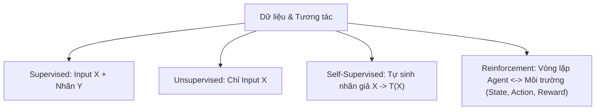

#### d. Code Thực chiến (Dual-Engine: C++ & Python)

```cpp
// C++17: Định nghĩa khung lớp trừu tượng cho các Paradigms
#include <iostream>
#include <memory>
#include <vector>

enum class Paradigm { Supervised, Unsupervised, Reinforcement };

class LearningParadigm {
public:
    virtual ~LearningParadigm() = default;
    virtual void step() = 0;
    virtual Paradigm get_type() const noexcept = 0;
};

class SupervisedTask : public LearningParadigm {
public:
    void step() override { std::cout << "[C++] Cập nhật tham số theo Loss(y_pred, y_true)\n"; }
    Paradigm get_type() const noexcept override { return Paradigm::Supervised; }
};

int main() {
    std::unique_ptr<LearningParadigm> task = std::make_unique<SupervisedTask>();
    task->step();
    return 0;
}
```

```python
# Python: Minh họa chuyển đổi giữa Self-Supervised (Masking) và Supervised
import torch
import torch.nn as nn

# Tự sinh nhãn ngẫu nhiên cho Masked Language Modeling
raw_tokens = torch.randint(0, 1000, (2, 8))
mask = torch.rand(raw_tokens.shape) < 0.15
masked_tokens = raw_tokens.clone()
masked_tokens[mask] = 103 # Token [MASK]

print("[Python] Raw Tokens:\n", raw_tokens)
print("[Python] Masked Inputs:\n", masked_tokens)
```

#### e. Lỗi Thường gặp & Ổn định Số học
- **Label Leakage**: Tín hiệu nhãn vô tình bị lộ vào pha trích xuất đặc trưng của bài toán Supervised hoặc Self-Supervised.

#### f. Ứng dụng Thực chiến trong AI / Deep Learning
- Nền tảng phân loại toàn bộ hệ sinh thái Deep Learning: Huấn luyện trước tự giám sát (Self-supervised Pretraining) kết hợp Tinh chỉnh có giám sát (Supervised Fine-Tuning - SFT) và Học tăng cường từ phản hồi con người (RLHF).

---

### 5. Hypothesis Space (Không gian Giả thuyết)

#### a. Định nghĩa Bản chất Toán học (Mathematical Formulation)
Không gian Giả thuyết $\mathcal{H}$ là tập hợp tất cả các hàm số khả dĩ mà một thuật toán học có thể lựa chọn làm nghiệm:
$$\mathcal{H} = \{ f(\cdot; \mathbf{\theta}) \mid \mathbf{\theta} \in \Theta \}$$
- Với hồi quy tuyến tính: $\mathcal{H}_{linear} = \{ \mathbf{x} \mapsto \mathbf{w}^T \mathbf{x} + b \mid \mathbf{w} \in \mathbb{R}^d, b \in \mathbb{R} \}$.
- Với mạng Neural $L$ tầng: $\mathcal{H}_{NN} = \{ \mathbf{x} \mapsto \sigma_L(\mathbf{W}_L \dots \sigma_1(\mathbf{W}_1 \mathbf{x} + \mathbf{b}_1) \dots + \mathbf{b}_L) \}$.
Theo định lý xấp xỉ phổ quát (Universal Approximation Theorem), khi số nơ-ron tầng ẩn $M \to \infty$, $\mathcal{H}_{NN}$ trù mật trong không gian các hàm liên tục $C(K)$.

#### b. Cơ chế Tầng Sâu & Điện toán (Under The Hood / Hardware Internals)
- **Parametric Dimension**: Số chiều của $\Theta$ quyết định kích thước mô hình (Model Size). Ví dụ mô hình 7B tham số $\implies 7 \times 10^9 \times 2$ bytes (FP16) $\approx 14 \text{ GB}$ VRAM.
- **Search Space Traversing**: Quá trình huấn luyện thực chất là dịch chuyển điểm tọa độ trong không gian $\Theta$ thông qua các vector gradient.

#### c. Sơ đồ Minh họa (Mermaid Diagram)
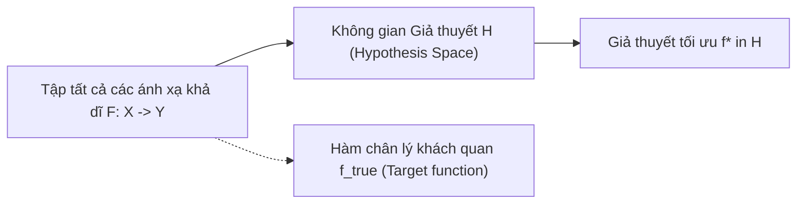

#### d. Code Thực chiến (Dual-Engine: C++ & Python)

```cpp
// C++20: Giả định Không gian Giả thuyết Đa thức bậc k
#include <iostream>
#include <vector>
#include <cmath>

class PolynomialHypothesis {
private:
    std::vector<double> coeffs; // w_0, w_1, ..., w_k

public:
    explicit PolynomialHypothesis(std::vector<double> c) : coeffs(std::move(c)) {}

    double evaluate(double x) const {
        double res = 0.0;
        double x_pow = 1.0;
        for (double c : coeffs) {
            res += c * x_pow;
            x_pow *= x;
        }
        return res;
    }
};

int main() {
    PolynomialHypothesis poly({1.0, -2.0, 3.5}); // f(x) = 1.0 - 2x + 3.5x^2
    std::cout << "[C++] f(2.0) = " << poly.evaluate(2.0) << "\n";
    return 0;
}
```

```python
# Python: Minh họa Không gian giả thuyết qua Degree of Polynomial Features
import numpy as np
from sklearn.preprocessing import PolynomialFeatures

x = np.array([[2.0]])
for deg in [1, 2, 3]:
    poly = PolynomialFeatures(degree=deg, include_bias=True)
    features = poly.fit_transform(x)
    print(f"[Python] Bậc {deg}: Số tham số chiều hypothesis = {features.shape[1]}")
```

#### e. Lỗi Thường gặp & Ổn định Số học
- **Ill-conditioned Hypothesis Space**: Khi đa thức bậc quá cao ($k > 15$), ma trận Vandermonde sinh ra có condition number $\kappa \to \infty$, khiến việc giải nghiệm hệ phương trình trở nên bất khả thi do sai số làm tròn số thực.

#### f. Ứng dụng Thực chiến trong AI / Deep Learning
- Thiết kế kiến trúc Deep Learning (Model Architecture Design) chính là định hình không gian giả thuyết $\mathcal{H}$ để thu hẹp phạm vi tìm kiếm mà vẫn chứa nghiệm chất lượng cao.

---

### 6. Model (Mô hình)

#### a. Định nghĩa Bản chất Toán học (Mathematical Formulation)
Mô hình Machine Learning là một phần tử cụ thể $f_{\mathbf{\theta}^*} \in \mathcal{H}$ được tham số hóa bởi vector tham số tối ưu $\mathbf{\theta}^*$, biểu diễn một thuật toán suy luận ánh xạ từ đặc trưng đầu vào $\mathbf{x}$ tới phân phối xác suất dự đoán $P(Y \mid \mathbf{x}; \mathbf{\theta}^*)$ hoặc giá trị đầu ra trực tiếp $\hat{y} = f_{\mathbf{\theta}^*}(\mathbf{x})$.

#### b. Cơ chế Tầng Sâu & Điện toán (Under The Hood / Hardware Internals)
- **Computational Graph Structure**: Trên tầng thực thi, mô hình là một Đồ thị có hướng không chu trình (Directed Acyclic Graph - DAG) gồm các toán tử (Operators / Kernels) và các biến đầu vào/đầu ra (Tensors).
- **Execution Plan**: Frameworks như ONNX Runtime hoặc TensorRT tối ưu hóa DAG bằng cách gộp toán tử (Kernel Fusion: e.g. `Conv + Bias + ReLU` gộp thành 1 kernel duy nhất) để giảm truy cập Global Memory.

#### c. Sơ đồ Minh họa (Mermaid Diagram)
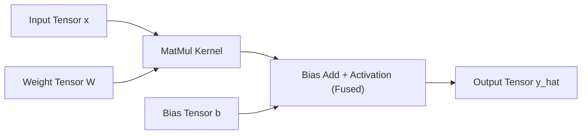

#### d. Code Thực chiến (Dual-Engine: C++ & Python)

```cpp
// C++17: Mô phỏng Cấu trúc Forward Pass của Model
#include <iostream>
#include <vector>

struct LayerParameters {
    std::vector<float> weights;
    float bias;
};

class SimpleDenseModel {
private:
    LayerParameters layer;

public:
    SimpleDenseModel(std::vector<float> w, float b) : layer{std::move(w), b} {}

    float forward(const std::vector<float>& x) const {
        float sum = layer.bias;
        for (size_t i = 0; i < x.size(); ++i) {
            sum += x[i] * layer.weights[i];
        }
        return sum > 0.0f ? sum : 0.0f; // ReLU Activation
    }
};

int main() {
    SimpleDenseModel model({0.5f, -1.2f, 2.0f}, 0.1f);
    std::cout << "[C++] Model Output: " << model.forward({1.0f, 0.5f, 2.0f}) << "\n";
    return 0;
}
```

```python
# Python: Định nghĩa Mô hình và xuất đồ thị tính toán
import torch
import torch.nn as nn

class MLPModel(nn.Module):
    def __init__(self, in_features, hidden_features, out_features):
        super().__init__()
        self.net = nn.Sequential(
            nn.Linear(in_features, hidden_features),
            nn.ReLU(),
            nn.Linear(hidden_features, out_features)
        )

    def forward(self, x):
        return self.net(x)

model = MLPModel(10, 32, 1)
sample_in = torch.randn(4, 10)
print(f"[Python] Model Output Shape: {model(sample_in).shape}")
```

#### e. Lỗi Thường gặp & Ổn định Số học
- **Serialization Mismatch**: Lưu/tải trọng số mô hình khi định dạng kiến trúc bị lệch (ví dụ khác version PyTorch hoặc mismatch giữa CPU và GPU state).

#### f. Ứng dụng Thực chiến trong AI / Deep Learning
- Triển khai mô hình định dạng ONNX, TensorRT, CoreML để phục vụ production inference trên các thiết bị Edge và Cloud.

---

### 7. Model Parameters (Tham số Mô hình)

#### a. Định nghĩa Bản chất Toán học (Mathematical Formulation)
Tham số mô hình $\mathbf{\theta} = \{ \mathbf{W}_1, \mathbf{b}_1, \dots, \mathbf{W}_L, \mathbf{b}_L \}$ là các biến số nội tại được tự động học từ dữ liệu trong quá trình tối ưu hóa:
$$\mathbf{\theta}^* = \arg\min_{\mathbf{\theta} \in \Theta} \frac{1}{N} \sum_{i=1}^N \mathcal{L}(f(\mathbf{x}_i; \mathbf{\theta}), y_i)$$
Mỗi bước lặp tối ưu cập nhật tham số theo đạo hàm riêng:
$$\mathbf{\theta}^{(t+1)} = \mathbf{\theta}^{(t)} - \eta \nabla_{\mathbf{\theta}} \mathcal{L}_t$$

#### b. Cơ chế Tầng Sâu & Điện toán (Under The Hood / Hardware Internals)
- **Weight Tensors Memory Strides**: Ma trận trọng số $\mathbf{W} \in \mathbb{R}^{C_{out} \times C_{in}}$ thường được bố trí theo định dạng Row-Major. Với phép nhân GEMM (General Matrix Multiply), bố cục nhớ quyết định hiệu năng vectorization của GPU Tensor Core (yêu cầu alignment 16-byte hoặc 32-byte).
- **Optimizer States**: Trong Adam, mỗi tham số $\theta$ tiêu tốn thêm $2 \times \text{sizeof}(\theta)$ bytes cho First Moment $m_t$ và Second Moment $v_t$. Huấn luyện FP32 tiêu tốn tổng cộng $4 + 4 + 4 + 4 = 16 \text{ bytes/parameter}$ (Weight, Grad, $m$, $v$).

#### c. Sơ đồ Minh họa (Mermaid Diagram)
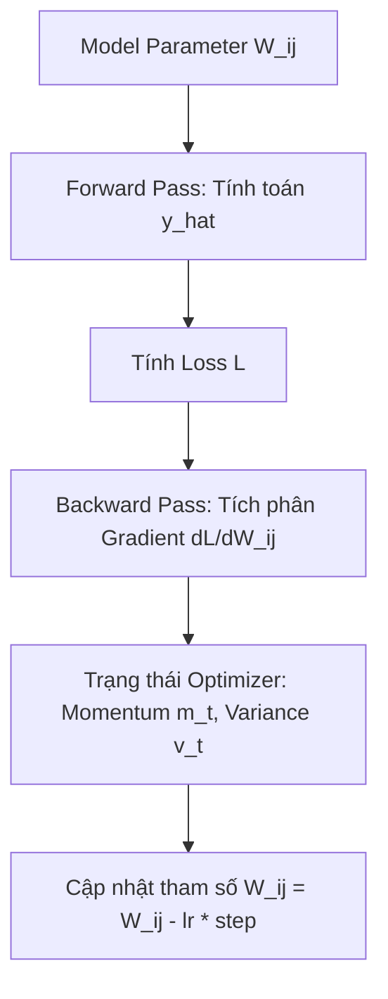

#### d. Code Thực chiến (Dual-Engine: C++ & Python)

```cpp
// C++20: Quản lý con trỏ bộ nhớ tham số mô hình tối ưu Cache
#include <iostream>
#include <vector>
#include <span>

struct LayerWeights {
    std::vector<float> data;
    size_t rows;
    size_t cols;

    LayerWeights(size_t r, size_t c) : rows(r), cols(c), data(r * c, 0.01f) {}

    // Truy cập theo Stride
    [[nodiscard]] float& at(size_t r, size_t c) noexcept {
        return data[r * cols + c];
    }
};

int main() {
    LayerWeights layer(128, 64);
    std::cout << "[C++] Bytes cấp phát cho Layer: " << layer.data.size() * sizeof(float) << " bytes\n";
    return 0;
}
```

```python
# Python: Đếm và kiểm tra mức tiêu thụ bộ nhớ của tham số mô hình
import torch
import torch.nn as nn

model = nn.TransformerEncoderLayer(d_model=512, nhead=8)
total_params = sum(p.numel() for p in model.parameters() if p.requires_grad)
total_bytes = sum(p.numel() * p.element_size() for p in model.parameters())

print(f"[Python] Total Trainable Parameters: {total_params:,}")
print(f"[Python] Parameter Memory Footprint: {total_bytes / (1024**2):.2f} MB")
```

#### e. Lỗi Thường gặp & Ổn định Số học
- **Dead Neurons**: Trong mạng sử dụng ReLU, nếu trọng số bị kéo về vùng gradient triệt tiêu hoàn toàn, nơ-ron không bao giờ cập nhật lại được nữa.

#### f. Ứng dụng Thực chiến trong AI / Deep Learning
- Kỹ thuật LoRA (Low-Rank Adaptation) đóng băng trọng số gốc $\mathbf{W}_0$ và chỉ huấn luyện phần tham số bổ sung $\Delta \mathbf{W} = \mathbf{B}\mathbf{A}$ để tiết kiệm bộ nhớ khi fine-tuning LLM.

---

### 8. Hyperparameters (Siêu tham số)

#### a. Định nghĩa Bản chất Toán học (Mathematical Formulation)
Siêu tham số $\mathbf{\lambda} \in \Lambda$ là các thông số điều khiển quá trình học của thuật toán, được cố định trước khi quá trình tối ưu hóa bắt đầu và không thể cập nhật trực tiếp qua backpropagation:
$$\mathbf{\theta}^*(\mathbf{\lambda}) = \arg\min_{\mathbf{\theta}} \mathcal{L}_{train}(\mathbf{\theta}; \mathbf{\lambda})$$
$$\mathbf{\lambda}^* = \arg\min_{\mathbf{\lambda} \in \Lambda} \mathcal{L}_{val}\big(\mathbf{\theta}^*(\mathbf{\lambda})\big)$$
Ví dụ: Learning rate $\eta$, batch size $B$, hệ số điều chuẩn $\lambda_{reg}$, số tầng $L$, dropout rate $p$.

#### b. Cơ chế Tầng Sâu & Điện toán (Under The Hood / Hardware Internals)
- **Batch Size & GPU Occupancy**: Siêu tham số Batch Size ảnh hưởng trực tiếp đến việc lấp đầy các Warp trên Streaming Multiprocessors (SMs) của GPU. Batch size quá nhỏ khiến ALU rỗi, batch size quá lớn gây OOM (Out Of Memory).
- **Learning Rate & Loss Landscape**: Tốc độ học $\eta$ chi phối bước nhảy trên phổ trị riêng của ma trận Hessian $\mathbf{H}$. Nếu $\eta > \frac{2}{\lambda_{\max}(\mathbf{H})}$, bước tối ưu hóa phân kỳ.

#### c. Sơ đồ Minh họa (Mermaid Diagram)
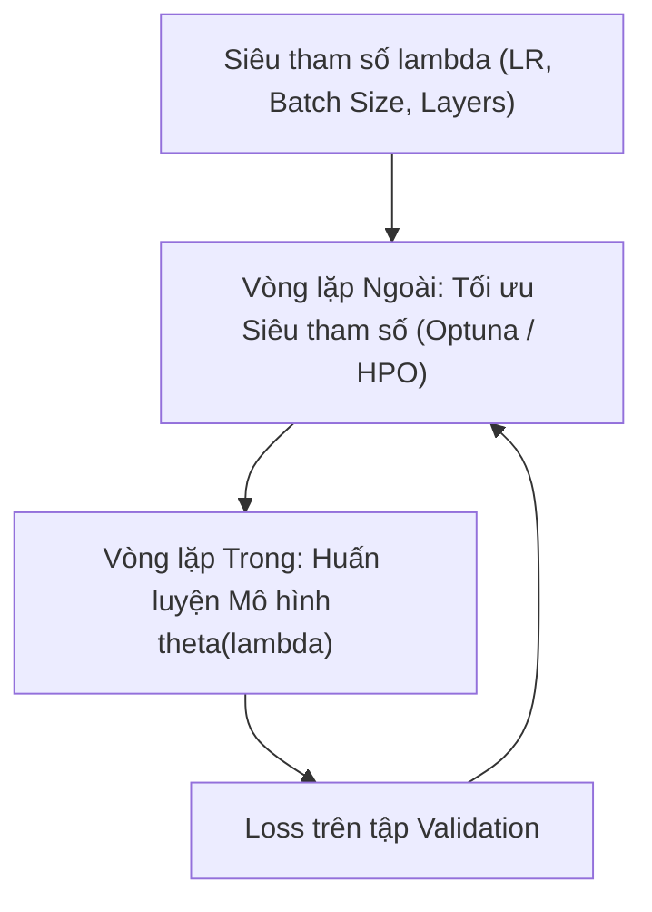

#### d. Code Thực chiến (Dual-Engine: C++ & Python)

```cpp
// C++17: Struct cấu hình Siêu tham số kiểu Type-Safe
#include <iostream>

struct Hyperparameters {
    float learning_rate{0.001f};
    size_t batch_size{64};
    float weight_decay{1e-4f};
    size_t max_epochs{100};
    bool use_cosine_annealing{true};

    void print() const {
        std::cout << "[C++] LR: " << learning_rate 
                  << " | Batch: " << batch_size 
                  << " | Decay: " << weight_decay << "\n";
    }
};

int main() {
    Hyperparameters hparams;
    hparams.learning_rate = 0.0005f;
    hparams.print();
    return 0;
}
```

```python
# Python: Định cấu hình Siêu tham số với Dataclass
from dataclasses import dataclass

@dataclass(frozen=True)
class TrainingHyperparameters:
    lr: float = 3e-4
    batch_size: int = 128
    warmup_steps: int = 2000
    dropout_rate: float = 0.1

config = TrainingHyperparameters(lr=1e-4)
print(f"[Python] Config: {config}")
```

#### e. Lỗi Thường gặp & Ổn định Số học
- **Learning Rate quá cao**: Làm nổ ma trận tham số (NaN Loss).
- **Batch Size không tương thích**: Batch size không chia hết cho số lượng thiết bị phân tán (World Size).

#### f. Ứng dụng Thực chiến trong AI / Deep Learning
- Tự động điều chỉnh siêu tham số với Bayesian Optimization, Hyperband, và ASHA trong Ray Tune, Optuna.

---

### 9. Model Training (Huấn luyện Mô hình)

#### a. Định nghĩa Bản chất Toán học (Mathematical Formulation)
Huấn luyện mô hình là quá trình giải bài toán tối ưu liên tục trên hàm mục tiêu thông qua các phương pháp lặp bậc nhất (First-Order Stochastic Gradient Descent):
$$\mathbf{\theta}_{t+1} = \mathbf{\theta}_t - \eta_t \frac{1}{|\mathcal{B}_t|} \sum_{i \in \mathcal{B}_t} \nabla_{\mathbf{\theta}} \mathcal{L}(f(\mathbf{x}_i; \mathbf{\theta}_t), y_i)$$
Trong đó $\mathcal{B}_t \subset \mathcal{D}_{train}$ là mini-batch dữ liệu tại bước lặp $t$.

#### b. Cơ chế Tầng Sâu & Điện toán (Under The Hood / Hardware Internals)
- **Pipeline Huấn luyện**: Bao gồm 3 pha:
  1. *Host-to-Device Transfer*: Nạp dữ liệu qua bus PCIe bằng pinned memory (page-locked memory).
  2. *Forward & Backward Computation*: Thực thi GEMM và Convolution kernels trên GPU cores, duy trì Autograd Tape lưu activation để tính đạo hàm.
  3. *Weight Update*: Tải gradient và optimizer states từ VRAM, thực hiện toán tử element-wise cập nhật trọng số.

#### c. Sơ đồ Minh họa (Mermaid Diagram)
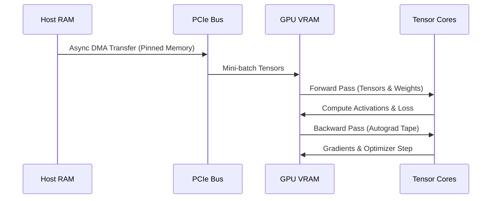

#### d. Code Thực chiến (Dual-Engine: C++ & Python)

```cpp
// C++20: Vòng lặp Huấn luyện Mini-Batch Tối ưu hóa đơn giản
#include <iostream>
#include <vector>
#include <numeric>

void train_step(float& param, float grad, float lr) {
    param -= lr * grad;
}

int main() {
    float weight = 10.0f;
    float lr = 0.1f;
    std::cout << "[C++] Bắt đầu huấn luyện, Weight ban đầu = " << weight << "\n";
    for (int step = 0; step < 5; ++step) {
        float grad = 2.0f * weight; // Đạo hàm của L = weight^2
        train_step(weight, grad, lr);
        std::cout << "Step " << step + 1 << ": Weight = " << weight << "\n";
    }
    return 0;
}
```

```python
# Python: Vòng lặp Huấn luyện Chuẩn công nghiệp với Mixed Precision (AMP)
import torch
import torch.nn as nn

device = torch.device("cuda" if torch.cuda.is_available() else "cpu")
model = nn.Linear(32, 1).to(device)
optimizer = torch.optim.AdamW(model.parameters(), lr=1e-3)
scaler = torch.cuda.amp.GradScaler(enabled=(device.type == "cuda"))

inputs = torch.randn(64, 32, device=device)
targets = torch.randn(64, 1, device=device)

model.train()
optimizer.zero_grad(set_to_none=True)

with torch.cuda.amp.autocast(enabled=(device.type == "cuda")):
    outputs = model(inputs)
    loss = nn.functional.mse_loss(outputs, targets)

scaler.scale(loss).backward()
scaler.step(optimizer)
scaler.update()

print(f"[PyTorch] Huấn luyện hoàn thành 1 step. Loss: {loss.item():.4f}")
```

#### e. Lỗi Thường gặp & Ổn định Số học
- **Memory Leak do Autograd History**: Lưu biến `loss` nguyên bản thay vì `loss.item()` trong danh sách theo dõi lịch sử huấn luyện, khiến toàn bộ đồ thị tính toán không thể giải phóng khỏi VRAM.

#### f. Ứng dụng Thực chiến trong AI / Deep Learning
- Phân tán huấn luyện dữ liệu lớn với Fully Sharded Data Parallel (FSDP), DeepSpeed ZeRO-3 trên hàng ngàn cụm GPU H100.

---

### 10. Model Inference (Suy luận Mô hình)

#### a. Định nghĩa Bản chất Toán học (Mathematical Formulation)
Suy luận là quá trình thực thi tính toán hàm $f_{\mathbf{\theta}^*}$ trên dữ liệu mới $\mathbf{x}_{new}$ để dự đoán kết quả mà không lưu lại trạng thái gradient hay kích hoạt trung gian:
$$\hat{y}_{new} = f(\mathbf{x}_{new}; \mathbf{\theta}^*)$$
Với bài toán phân loại đa lớp:
$$\hat{y} = \arg\max_{c \in \{1, \dots, C\}} P(Y = c \mid \mathbf{x}_{new}; \mathbf{\theta}^*)$$

#### b. Cơ chế Tầng Sâu & Điện toán (Under The Hood / Hardware Internals)
- **Zero Memory Overhead for Autograd**: Vô hiệu hóa Autograd Tape (`torch.inference_mode()` hoặc `torch.no_grad()`), tiết kiệm tới 70% bộ nhớ GPU vì không phải lưu cache activations.
- **Quantization (INT8 / FP8 / INT4)**: Giảm kích thước trọng số từ FP32 (4 bytes) xuống INT8 (1 byte) hoặc INT4 (0.5 byte) thông qua ma trận scaling factor $\mathbf{W}_{FP32} \approx S \cdot \mathbf{W}_{INT8}$, tăng throughput tính toán của GPU Tensor Cores gấp 2x - 4x.

#### c. Sơ đồ Minh họa (Mermaid Diagram)
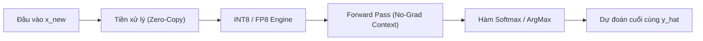

#### d. Code Thực chiến (Dual-Engine: C++ & Python)

```cpp
// C++20: Inference Kernel tối ưu hóa SIMD không cấp phát động
#include <iostream>
#include <array>
#include <algorithm>

constexpr size_t FEATURES = 4;

float predict_fast(const std::array<float, FEATURES>& x, 
                   const std::array<float, FEATURES>& w, 
                   float bias) noexcept {
    float dot = bias;
    for (size_t i = 0; i < FEATURES; ++i) {
        dot += x[i] * w[i];
    }
    return dot;
}

int main() {
    std::array<float, FEATURES> x = {1.0f, -0.5f, 2.0f, 0.2f};
    std::array<float, FEATURES> w = {0.8f, 1.2f, -0.4f, 2.5f};
    float pred = predict_fast(x, w, 0.5f);
    std::cout << "[C++] Fast Inference Result: " << pred << "\n";
    return 0;
}
```

```python
# Python: Inference chuẩn với torch.inference_mode
import torch
import torch.nn as nn

model = nn.Sequential(nn.Linear(16, 64), nn.ReLU(), nn.Linear(64, 2)).eval()
sample_input = torch.randn(1, 16)

with torch.inference_mode(): # Tối ưu hóa mạnh hơn torch.no_grad()
    logits = model(sample_input)
    probs = torch.softmax(logits, dim=-1)
    predicted_class = torch.argmax(probs, dim=-1)

print(f"[Python] Xác suất: {probs.squeeze().tolist()}, Lớp dự đoán: {predicted_class.item()}")
```

#### e. Lỗi Thường gặp & Ổn định Số học
- **Softmax Underflow/Overflow**: Khi tính $e^{z_i}$, nếu $z_i$ lớn sẽ gây tràn số (inf), nếu quá nhỏ chia ra 0. Luôn áp dụng mẹo ổn định số học: $\text{Softmax}(\mathbf{z}) = \text{Softmax}(\mathbf{z} - \max(\mathbf{z}))$.

#### f. Ứng dụng Thực chiến trong AI / Deep Learning
- Động cơ suy luận tốc độ cao vLLM, TensorRT-LLM, llama.cpp cho phục vụ các Large Language Models với KV-Cache PagedAttention.

---

### 11. Prediction (Dự đoán)

#### a. Định nghĩa Bản chất Toán học (Mathematical Formulation)
Dự đoán $\hat{y}$ là đầu ra cụ thể được tạo ra bởi mô hình cho một quan sát đầu vào $\mathbf{x}$. Trong lý thuyết quyết định thống kê (Statistical Decision Theory), dự đoán tối ưu là hàm giảm thiểu rủi ro theo một hàm tổn thất quyết định $L(y, \hat{y})$:
- Dưới tổn thất bình phương $L(y, \hat{y}) = (y - \hat{y})^2 \implies \hat{y} = \mathbb{E}[Y \mid \mathbf{X} = \mathbf{x}]$.
- Dưới tổn thất tuyệt đối $L(y, \hat{y}) = |y - \hat{y}| \implies \hat{y} = \text{Median}(Y \mid \mathbf{X} = \mathbf{x})$.
- Dưới tổn thất 0-1 $L(y, \hat{y}) = \mathbb{I}(y \neq \hat{y}) \implies \hat{y} = \arg\max_c P(Y = c \mid \mathbf{X} = \mathbf{x})$.

#### b. Cơ chế Tầng Sâu & Điện toán (Under The Hood / Hardware Internals)
- **Point Prediction vs Distributional Prediction**: Chuyển đổi từ phân phối xác suất liên tục (Continuous Logits) sang nhãn rời rạc (Discrete Token ID) đòi hỏi toán tử `ArgMax` hoặc các thuật toán lấy mẫu (Sampling Kernels: Top-k, Top-p/Nucleus Sampling) được tăng tốc trực tiếp trong GPU Warp.

#### c. Sơ đồ Minh họa (Mermaid Diagram)
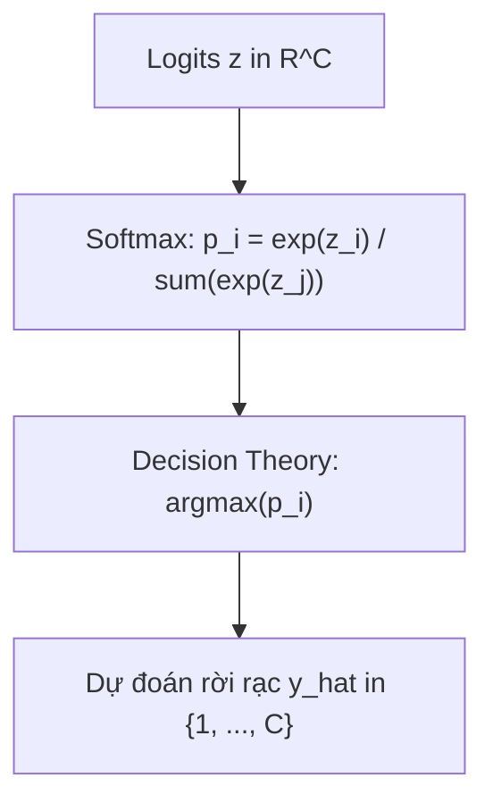

#### d. Code Thực chiến (Dual-Engine: C++ & Python)

```cpp
// C++17: Phép biến đổi Logits sang Class Prediction ổn định số học
#include <iostream>
#include <vector>
#include <cmath>
#include <algorithm>

size_t predict_class_stable(const std::vector<float>& logits) {
    float max_val = *std::max_element(logits.begin(), logits.end());
    std::vector<float> exps(logits.size());
    float sum_exp = 0.0f;
    for (size_t i = 0; i < logits.size(); ++i) {
        exps[i] = std::exp(logits[i] - max_val);
        sum_exp += exps[i];
    }
    // Trả về class có xác suất cao nhất
    return std::distance(exps.begin(), std::max_element(exps.begin(), exps.end()));
}

int main() {
    std::vector<float> raw_logits = {1002.5f, 1005.1f, 1001.0f}; // Có thể gây nổ số nếu exp trực tiếp
    size_t cls = predict_class_stable(raw_logits);
    std::cout << "[C++] Class dự đoán: " << cls << "\n";
    return 0;
}
```

```python
# Python: Dự đoán với Top-k và Phân phối Bernoulli / Categorical
import torch

logits = torch.tensor([[1002.5, 1005.1, 1001.0]])
probs = torch.softmax(logits - logits.max(), dim=-1)
pred_idx = torch.argmax(probs, dim=-1)

print(f"[Python] Phân phối xác suất: {probs}")
print(f"[Python] Lớp dự đoán: {pred_idx.item()}")
```

#### e. Lỗi Thường gặp & Ổn định Số học
- **Overconfident Predictions**: Mạng nơ-ron sâu thường cho xác suất dự đoán quá tự tin (ví dụ 0.9999) dù dự đoán sai, do cực tiểu hóa Cross-Entropy ép logits ra xa. Cần kỹ thuật Temperature Scaling hoặc Label Smoothing để hiệu chuẩn (calibration).

#### f. Ứng dụng Thực chiến trong AI / Deep Learning
- Cơ chế sinh token autoregressive trong LLM (Next Token Prediction) kết hợp bộ giải mã Beam Search / Speculative Decoding.
