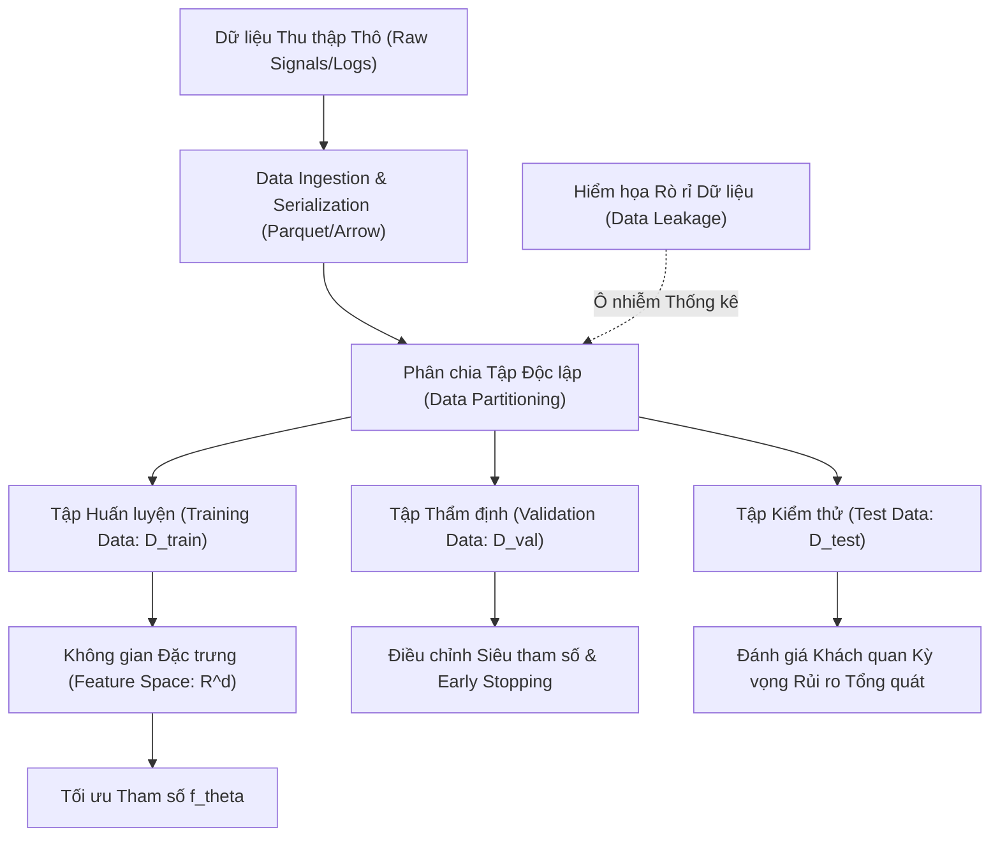
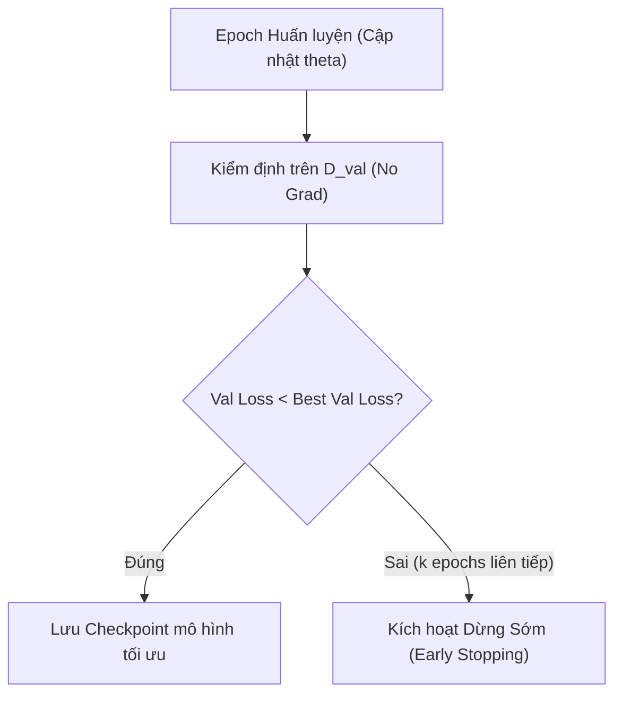
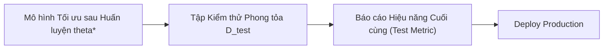
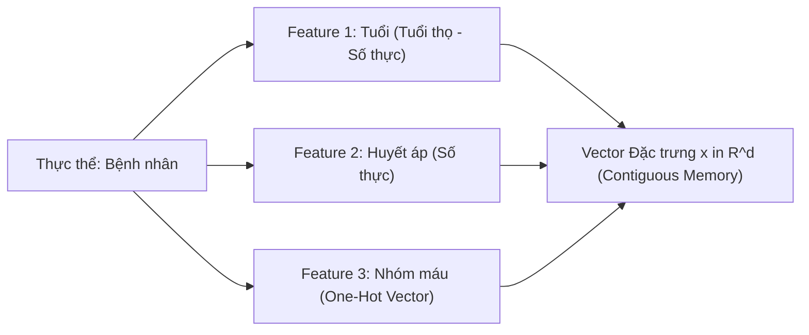
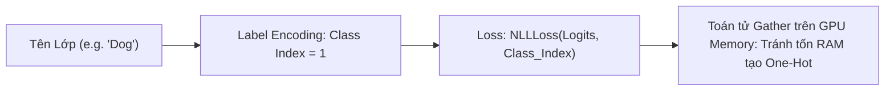
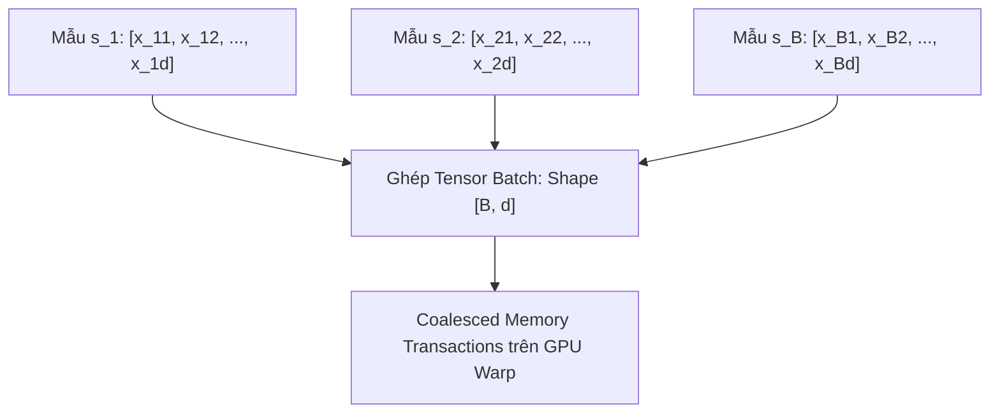
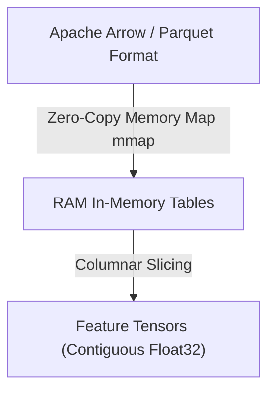
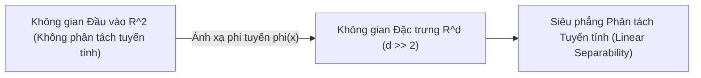
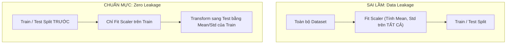

# Chuyên đề: Nền tảng Dữ liệu & Không gian Đặc trưng (Data Foundations & Feature Spaces)

## 1. Tổng quan Chuyên đề
Trong Machine Learning hiện đại, "Data is the code that compiles into models". Mọi thuật toán học máy về bản chất đều là các phép biến đổi hình học vi phân và đại số tuyến tính tác động lên các điểm phân bố trong Không gian Đặc trưng (Feature Space) $\mathbb{R}^d$.

Chuyên đề này mổ xẻ cấu trúc toán học của các phân tập dữ liệu (Train/Val/Test), bản chất hình học của véc-tơ đặc trưng, các ma trận thiết kế (Design Matrix $\mathbf{X} \in \mathbb{R}^{N \times d}$), cùng các hiểm họa rò rỉ thông tin (Data Leakage) ở cấp độ bộ nhớ đệm và chuẩn hóa.



---

## 2. Chi tiết từng Keyword

---

### 1. Training Data (Dữ liệu Huấn luyện)

#### a. Định nghĩa Bản chất Toán học (Mathematical Formulation)
Tập dữ liệu huấn luyện $\mathcal{D}_{train} = \{ (\mathbf{x}_i, y_i) \}_{i=1}^{N_{train}}$ là tập hợp hữu hạn các cặp mẫu quan sát độc lập được rút ra từ phân phối xác suất thực nghiệm $P_{\text{data}}(\mathbf{X}, Y)$:
$$\mathcal{D}_{train} \stackrel{\text{i.i.d}}{\sim} \mathcal{D}$$
Trong đó ma trận thiết kế (Design Matrix) có kích thước:
$$\mathbf{X}_{train} \in \mathbb{R}^{N_{train} \times d}, \quad \mathbf{y}_{train} \in \mathcal{Y}^{N_{train}}$$
Mô hình tối ưu hóa trực tiếp hàm mục tiêu trên tập này:
$$\mathbf{\theta}^* = \arg\min_{\mathbf{\theta}} \frac{1}{N_{train}} \sum_{i=1}^{N_{train}} \mathcal{L}(f(\mathbf{x}_i; \mathbf{\theta}), y_i)$$

#### b. Cơ chế Tầng Sâu & Điện toán (Under The Hood / Hardware Internals)
- **Contiguous Memory Buffers**: Ma trận $\mathbf{X}_{train}$ được lưu trữ dưới dạng mảng 1 chiều liên tục trong RAM. Trong chuẩn C-contiguous (Row-Major), phần tử $X_{i,j}$ nằm tại vị trí `offset = i * d + j`.
- **Dataloader Multithreading & Pinned Memory**: Để không làm đói GPU Tensor Cores (GPU starvation), PyTorch DataLoader sử dụng các tiến trình con (worker processes) đọc batch từ đĩa NVMe, ghim bộ nhớ RAM vào trang vật lý (Page-locked/Pinned memory), và kích hoạt DMA (Direct Memory Access) bất đồng bộ sang VRAM.

#### c. Sơ đồ Minh họa (Mermaid Diagram)


#### d. Code Thực chiến (Dual-Engine: C++ & Python)

```cpp
// C++20: Container lưu trữ Design Matrix tối ưu Cache Line 64-byte
#include <iostream>
#include <vector>
#include <memory>
#include <cstring>

template <typename T>
class ContiguousDesignMatrix {
private:
    size_t rows;
    size_t cols;
    std::vector<T> buffer;

public:
    ContiguousDesignMatrix(size_t r, size_t c) : rows(r), cols(c), buffer(r * c) {}

    [[nodiscard]] inline T* row_ptr(size_t r) noexcept {
        return &buffer[r * cols];
    }

    [[nodiscard]] inline const T* row_ptr(size_t r) const noexcept {
        return &buffer[r * cols];
    }

    size_t memory_bytes() const noexcept {
        return buffer.size() * sizeof(T);
    }
};

int main() {
    ContiguousDesignMatrix<float> X_train(10000, 128); // 10k mẫu, 128 đặc trưng
    std::cout << "[C++] X_train Memory: " << X_train.memory_bytes() / (1024 * 1024) << " MB\n";
    return 0;
}
```

```python
# Python: DataLoader tối ưu hóa DMA Transfer với Pinned Memory
import torch
from torch.utils.data import TensorDataset, DataLoader

X_train = torch.randn(50000, 64, dtype=torch.float32)
y_train = torch.randint(0, 2, (50000,), dtype=torch.int64)

dataset = TensorDataset(X_train, y_train)
loader = DataLoader(
    dataset, 
    batch_size=256, 
    shuffle=True, 
    num_workers=4, 
    pin_memory=True # Tránh swap memory, DMA trực tiếp lên GPU
)

batch_x, batch_y = next(iter(loader))
print(f"[Python] Loaded Batch: X={batch_x.shape}, y={batch_y.shape}")
```

#### e. Lỗi Thường gặp & Ổn định Số học
- **Training Set Imbalance**: Tỷ lệ mẫu giữa các lớp chênh lệch cực đoan khiến gradient bị chi phối hoàn toàn bởi lớp đa số (Majority class).

#### f. Ứng dụng Thực chiến trong AI / Deep Learning
- Dataset quy mô Terabyte/Petabyte trong huấn luyện LLM (như RedPajama, Common Crawl) yêu cầu kỹ thuật sharding dạng streaming (WebDataset, Megatron-LM data sharding).

---

### 2. Validation Data (Dữ liệu Thẩm định)

#### a. Định nghĩa Bản chất Toán học (Mathematical Formulation)
Tập thẩm định (Hold-out Validation Set) $\mathcal{D}_{val} = \{(\mathbf{x}_j, y_j)\}_{j=1}^{N_{val}}$ được dùng để ước lượng không chệch hiệu năng suy quát trong quá trình huấn luyện:
$$\hat{R}_{val}(f_{\mathbf{\theta}^*(\mathbf{\lambda})}) = \frac{1}{N_{val}} \sum_{j=1}^{N_{val}} \mathcal{L}(f(\mathbf{x}_j; \mathbf{\theta}^*(\mathbf{\lambda})), y_j)$$
Dựa trên $\hat{R}_{val}$, ta lựa chọn vector siêu tham số tối ưu $\mathbf{\lambda}^*$ và điểm dừng sớm (Early Stopping criterion):
$$t_{stop} = \arg\min_t \hat{R}_{val}(f_{\mathbf{\theta}^{(t)}})$$

#### b. Cơ chế Tầng Sâu & Điện toán (Under The Hood / Hardware Internals)
- **Evaluation Loop Latency**: Quá trình validation chạy định kỳ sau mỗi epoch hoặc một số step nhất định. Cần tối ưu bằng cách đóng băng Autograd (`torch.inference_mode()`) để không làm gián đoạn thông lượng pipeline huấn luyện.

#### c. Sơ đồ Minh họa (Mermaid Diagram)


#### d. Code Thực chiến (Dual-Engine: C++ & Python)

```cpp
// C++17: Bộ giám sát Early Stopping theo dõi Validation Loss
#include <iostream>
#include <limits>

class EarlyStoppingMonitor {
private:
    float best_loss{std::numeric_limits<float>::infinity()};
    size_t patience{5};
    size_t counter{0};

public:
    explicit EarlyStoppingMonitor(size_t p) : patience(p) {}

    bool step(float current_val_loss) {
        if (current_val_loss < best_loss) {
            best_loss = current_val_loss;
            counter = 0;
            return false; // Tiếp tục huấn luyện
        } else {
            ++counter;
            return counter >= patience; // Kích hoạt dừng sớm
        }
    }
};

int main() {
    EarlyStoppingMonitor stopper(3);
    std::vector<float> val_losses = {0.8f, 0.6f, 0.45f, 0.46f, 0.48f, 0.50f};
    for (size_t epoch = 0; epoch < val_losses.size(); ++epoch) {
        if (stopper.step(val_losses[epoch])) {
            std::cout << "[C++] Early stopping kích hoạt tại epoch " << epoch + 1 << "\n";
            break;
        }
    }
    return 0;
}
```

```python
# Python: Validation Loop tách biệt hoàn toàn gradient
import torch
import torch.nn as nn

def validate(model: nn.Module, val_loader: DataLoader, criterion: nn.Module, device: str) -> float:
    model.eval()
    total_loss = 0.0
    total_samples = 0
    with torch.inference_mode():
        for x, y in val_loader:
            x, y = x.to(device, non_blocking=True), y.to(device, non_blocking=True)
            preds = model(x)
            loss = criterion(preds, y)
            total_loss += loss.item() * x.size(0)
            total_samples += x.size(0)
    return total_loss / total_samples
```

#### e. Lỗi Thường gặp & Ổn định Số học
- **Validation Overfitting**: Lựa chọn siêu tham số hoặc tinh chỉnh kiến trúc quá nhiều lần dựa trên tập validation nhỏ khiến thông tin của $\mathcal{D}_{val}$ bị thấm ngược vào siêu tham số.

#### f. Ứng dụng Thực chiến trong AI / Deep Learning
- Sử dụng trong kỹ thuật Cross-Validation, Ray Tune ASHA pruning scheduler.

---

### 3. Test Data (Dữ liệu Kiểm thử)

#### a. Định nghĩa Bản chất Toán học (Mathematical Formulation)
Tập kiểm thử $\mathcal{D}_{test} = \{(\mathbf{x}_k, y_k)\}_{k=1}^{N_{test}}$ hoàn toàn bị phong tỏa (quarantined) trong suốt vòng đời nghiên cứu và huấn luyện.
Nó đóng vai trò kiểm toán độc lập về rủi ro tổng quát thực sự $R(f_{\mathbf{\theta}^*})$ theo Định lý Giới hạn Trung tâm (CLT):
$$\hat{R}_{test} \pm z_{1-\alpha/2} \frac{\hat{\sigma}_{test}}{\sqrt{N_{test}}}$$
Tập test không được phép tham gia vào bất kỳ quyết định nào về chọn mô hình hay chỉnh siêu tham số.

#### b. Cơ chế Tầng Sâu & Điện toán (Under The Hood / Hardware Internals)
- **Cryptographic Hashing for Integrity**: Kiểm tra tính nguyên vẹn của tập kiểm thử bằng mã băm SHA-256 để đảm bảo không có bất kỳ worker nào vô tình can thiệp hoặc ghi đè file test.

#### c. Sơ đồ Minh họa (Mermaid Diagram)


#### d. Code Thực chiến (Dual-Engine: C++ & Python)

```cpp
// C++17: Tính Khoảng tin cậy 95% cho Test Error
#include <iostream>
#include <vector>
#include <cmath>
#include <numeric>

struct TestConfidenceInterval {
    double mean_error;
    double lower_bound;
    double upper_bound;
};

TestConfidenceInterval compute_ci_95(const std::vector<double>& errors) {
    const size_t n = errors.size();
    double sum = std::accumulate(errors.begin(), errors.end(), 0.0);
    double mean = sum / n;
    double sq_diff = 0.0;
    for (double e : errors) sq_diff += (e - mean) * (e - mean);
    double std_dev = std::sqrt(sq_diff / (n - 1));
    double margin = 1.96 * (std_dev / std::sqrt(n));
    return {mean, mean - margin, mean + margin};
}

int main() {
    std::vector<double> test_errors(1000, 0.05); // Giả lập lỗi
    auto ci = compute_ci_95(test_errors);
    std::cout << "[C++] Test Error: " << ci.mean_error << " [95% CI: " << ci.lower_bound << ", " << ci.upper_bound << "]\n";
    return 0;
}
```

```python
# Python: Đánh giá mô hình trên tập Test với Bootstrap Confidence Interval
import numpy as np

def bootstrap_test_metric(y_true, y_pred, n_bootstraps=1000):
    rng = np.random.default_rng(42)
    scores = []
    n = len(y_true)
    for _ in range(n_bootstraps):
        indices = rng.integers(0, n, size=n)
        acc = np.mean(y_true[indices] == y_pred[indices])
        scores.append(acc)
    return np.percentile(scores, [2.5, 97.5])

y_t = np.random.randint(0, 2, 1000)
y_p = y_t.copy()
y_p[:50] = 1 - y_p[:50] # 95% accuracy
ci = bootstrap_test_metric(y_t, y_p)
print(f"[Python] Test Accuracy 95% CI: [{ci[0]:.4f}, {ci[1]:.4f}]")
```

#### e. Lỗi Thường gặp & Ổn định Số học
- **Test Set Pollution**: Dữ liệu kiểm thử bị dính vào quá trình huấn luyện thông qua tiền xử lý chung (Fitting scaler trên toàn bộ dataset trước khi train-test split).

#### f. Ứng dụng Thực chiến trong AI / Deep Learning
- Bảng xếp hạng benchmark độc lập (Leaderboards: GLUE, SuperGLUE, MMLU, HumanEval) có tập test ẩn (hidden test set) để chống gian lận.

---

### 4. Features (Đặc trưng)

#### a. Định nghĩa Bản chất Toán học (Mathematical Formulation)
Một đặc trưng (Feature) $X_j: \Omega \to \mathbb{R}$ là một biến ngẫu nhiên đo lường một thuộc tính riêng biệt của đối tượng quan sát.
Vector đặc trưng đầy đủ của một thực thể là:
$$\mathbf{x} = \begin{bmatrix} x_1 & x_2 & \dots & x_d \end{bmatrix}^T \in \mathbb{R}^d$$
Không gian đặc trưng được cấu trúc bởi ma trận tương quan $\mathbf{\Sigma}_{\mathbf{X}} = \mathbb{E}[(\mathbf{X} - \mathbf{\mu})(\mathbf{X} - \mathbf{\mu})^T]$.

#### b. Cơ chế Tầng Sâu & Điện toán (Under The Hood / Hardware Internals)
- **Data Alignment & SIMD Packing**: Trong bộ nhớ, các features của một vector được lưu liên tục. Nếu $d$ là bội số của 8 (AVX-256) hoặc 16 (AVX-512), CPU có thể load toàn bộ vector vào thanh ghi vector bằng lệnh `_mm256_loadu_ps` mà không bị phạt chu kỳ do alignment penalty.

#### c. Sơ đồ Minh họa (Mermaid Diagram)


#### d. Code Thực chiến (Dual-Engine: C++ & Python)

```cpp
// C++20: Biểu diễn Feature Vector với AVX Vector Alignment
#include <iostream>
#include <immintrin.h>

void compute_dot_avx(const float* a, const float* b, float* result, size_t size) {
    __m256 sum = _mm256_setzero_ps();
    for (size_t i = 0; i < size; i += 8) {
        __m256 va = _mm256_loadu_ps(a + i);
        __m256 vb = _mm256_loadu_ps(b + i);
        sum = _mm256_fmadd_ps(va, vb, sum);
    }
    alignas(32) float buffer[8];
    _mm256_storeu_ps(buffer, sum);
    *result = 0.0f;
    for (int i = 0; i < 8; ++i) *result += buffer[i];
}

int main() {
    alignas(32) float f1[8] = {1, 2, 3, 4, 5, 6, 7, 8};
    alignas(32) float f2[8] = {8, 7, 6, 5, 4, 3, 2, 1};
    float res = 0.0f;
    compute_dot_avx(f1, f2, &res, 8);
    std::cout << "[C++] AVX Dot Product Features: " << res << "\n";
    return 0;
}
```

```python
# Python: Kiểm tra mức tương quan đa tuyến tính giữa các Features
import numpy as np
import pandas as pd

X = np.random.randn(100, 5)
corr_matrix = pd.DataFrame(X).corr()
print("[Python] Ma trận Tương quan Đặc trưng:\n", corr_matrix.round(2))
```

#### e. Lỗi Thường gặp & Ổn định Số học
- **Multicollinearity**: Hai hoặc nhiều đặc trưng có tương quan gần bằng 1, khiến ma trận hiệp phương sai bị suy biến ($\det(\mathbf{X}^T\mathbf{X}) \approx 0$).

#### f. Ứng dụng Thực chiến trong AI / Deep Learning
- Feature Store (Feast, Hopsworks) quản lý vòng đời đặc trưng và phục vụ độ trễ thấp (sub-millisecond latency) cho online inference.

---

### 5. Labels & Targets (Nhãn & Mục tiêu)

#### a. Định nghĩa Bản chất Toán học (Mathematical Formulation)
- **Label / Target** $y \in \mathcal{Y}$ là tín hiệu chân lý thực tế (Ground Truth) tương ứng với vector $\mathbf{x}$.
- Trong phân loại: $\mathcal{Y} = \{0, 1\}$ (Nhị phân) hoặc $\mathcal{Y} = \{1, \dots, C\}$ (Đa lớp). Thường được ánh xạ sang không gian xác suất rời rạc (One-hot probability simplex): $\mathbf{y} \in \Delta^{C-1} = \{ \mathbf{p} \in [0, 1]^C \mid \sum p_c = 1 \}$.
- Trong hồi quy: $\mathcal{Y} \subseteq \mathbb{R}^k$.

#### b. Cơ chế Tầng Sâu & Điện toán (Under The Hood / Hardware Internals)
- **Label Representation in Memory**: Thay vì lưu chuỗi nhãn phân loại dạng string ("cat", "dog"), hệ thống ánh xạ sang kiểu `int64` (hoặc `int32` để tiết kiệm băng thông DRAM). Trong Cross-Entropy Loss, GPU tính trực tiếp hàm mất mát bằng cách lập chỉ mục (Gather instruction): $-\log(\text{softmax}(z)_{y_i})$ mà không cần sinh tensor One-Hot đầy đủ trên VRAM.

#### c. Sơ đồ Minh họa (Mermaid Diagram)


#### d. Code Thực chiến (Dual-Engine: C++ & Python)

```cpp
// C++17: Tính toán NLL Loss với Class Index trực tiếp (Sparse Indexing)
#include <iostream>
#include <vector>
#include <cmath>

float sparse_categorical_nll(const std::vector<float>& log_probs, size_t target_idx) {
    return -log_probs[target_idx];
}

int main() {
    std::vector<float> log_probs = {-2.3f, -0.15f, -3.4f}; // Log-softmax output
    size_t target = 1;
    std::cout << "[C++] Sparse NLL Loss: " << sparse_categorical_nll(log_probs, target) << "\n";
    return 0;
}
```

```python
# Python: Tối ưu hóa bộ nhớ với Sparse Target vs One-Hot Target
import torch
import torch.nn as nn

logits = torch.randn(4, 5) # Batch=4, Classes=5
targets = torch.tensor([1, 0, 4, 2]) # Sparse Target (int64)

criterion = nn.CrossEntropyLoss() # Tự động tối ưu hóa, không cần One-Hot
loss = criterion(logits, targets)
print(f"[Python] Cross Entropy Loss: {loss.item():.4f}")
```

#### e. Lỗi Thường gặp & Ổn định Số học
- **Label Noise**: Nhãn bị gán sai trong quá trình crowdsourcing làm giảm độ chính xác của mô hình và gây overfit vào nhiễu.

#### f. Ứng dụng Thực chiến trong AI / Deep Learning
- Kỹ thuật **Label Smoothing** thay thế nhãn cứng $y \in \{0, 1\}$ bằng phân phối mềm $y_{smooth} = (1 - \alpha) y + \frac{\alpha}{C}$ để chống Overconfidence trong mô hình thị giác và NLP.

---

### 6. Samples & Observations (Mẫu & Quan sát)

#### a. Định nghĩa Bản chất Toán học (Mathematical Formulation)
Một mẫu hay quan sát (Sample / Observation / Instance) là một bộ phần tử cụ thể:
$$\mathbf{s}_i = (\mathbf{x}_i, y_i) \in \mathcal{X} \times \mathcal{Y}$$
Đại diện cho một sự kiện độc lập được ghi nhận từ thế giới thực.
Tập hợp $N$ mẫu tạo thành đám mây điểm (point cloud) trong không gian trạng thái tích $\mathcal{X} \times \mathcal{Y}$.

#### b. Cơ chế Tầng Sâu & Điện toán (Under The Hood / Hardware Internals)
- **Batching & Striding**: Các mẫu được xếp chồng (stacked) dọc theo trục thứ nhất (Dimension 0 - Batch Axis) để tạo thành Tensor bậc 2 hoặc bậc cao hơn: $\text{Shape} = (B, d)$.
- **Coalesced Memory Access**: Trên GPU, các thread trong cùng một Warp truy cập đồng thời vào các phần tử của các sample kế cận nhau, cho phép gộp các thao tác đọc bộ nhớ (Memory Coalescing).

#### c. Sơ đồ Minh họa (Mermaid Diagram)


#### d. Code Thực chiến (Dual-Engine: C++ & Python)

```cpp
// C++20: Cấu trúc Batch Mẫu nạp song song theo luồng
#include <iostream>
#include <vector>
#include <array>

template <size_t Features>
struct Sample {
    std::array<float, Features> x;
    int y;
};

int main() {
    std::vector<Sample<3>> batch = {
        {{1.0f, 2.0f, 3.0f}, 1},
        {{0.5f, 1.5f, 2.5f}, 0}
    };
    std::cout << "[C++] Loaded " << batch.size() << " samples.\n";
    return 0;
}
```

```python
# Python: Batching mẫu với Tensor slicing không cấp phát lại bộ nhớ (Zero-Copy)
import torch

data_pool = torch.randn(1000, 32)
# Tạo mini-batch bằng view slicing (Zero-copy)
mini_batch = data_pool[0:64]
print(f"[Python] Batch Shape: {mini_batch.shape}, Is Contiguous: {mini_batch.is_contiguous()}")
```

#### e. Lỗi Thường gặp & Ổn định Số học
- **Duplicate Samples**: Mẫu trùng lặp giữa tập train và test dẫn đến đánh giá hiệu năng bị thổi phồng.

#### f. Ứng dụng Thực chiến trong AI / Deep Learning
- Khái niệm mẫu trong Contrastive Learning (SimCLR, CLIP) bao gồm Positive Sample (cặp tăng cường từ cùng một ảnh) và Negative Samples (các ảnh khác trong batch).

---

### 7. Dataset (Tập Dữ liệu)

#### a. Định nghĩa Bản chất Toán học (Mathematical Formulation)
Tập dữ liệu $\mathcal{D}$ là một họ các mẫu quan sát có thứ tự hoặc không có thứ tự:
$$\mathcal{D} = \{ (\mathbf{x}_i, y_i) \}_{i=1}^N \subset \mathcal{X} \times \mathcal{Y}$$
Được mô tả về mặt lý thuyết xác suất bằng độ đo phân phối thực nghiệm (Empirical Measure):
$$P_N = \frac{1}{N} \sum_{i=1}^N \delta_{(\mathbf{x}_i, y_i)}$$
Trong đó $\delta_{(\mathbf{x}, y)}$ là hàm Dirac delta đặt trọng số tại điểm $(\mathbf{x}, y)$.

#### b. Cơ chế Tầng Sâu & Điện toán (Under The Hood / Hardware Internals)
- **Columnar vs Row Storage**:
  - *Row-oriented (CSV, JSON)*: Tồi tệ cho ML do cache miss liên tục khi trích xuất cột.
  - *Columnar (Apache Parquet, Apache Arrow)*: Dữ liệu của từng feature nằm liên tục, nén cực tốt (Snappy, ZSTD) và nạp nhanh gấp 10x - 50x nhờ zero-copy deserialization.

#### c. Sơ đồ Minh họa (Mermaid Diagram)


#### d. Code Thực chiến (Dual-Engine: C++ & Python)

```cpp
// C++17: Mô phỏng Dataset Memory-Mapped Interface
#include <iostream>
#include <vector>

class AbstractDataset {
public:
    virtual ~AbstractDataset() = default;
    virtual size_t size() const noexcept = 0;
    virtual void get_item(size_t idx, float* out_x, int* out_y) const = 0;
};

class InMemoryDataset : public AbstractDataset {
private:
    std::vector<float> features;
    std::vector<int> labels;
    size_t num_features;

public:
    InMemoryDataset(size_t n, size_t d) : num_features(d), features(n * d, 1.0f), labels(n, 0) {}

    size_t size() const noexcept override { return labels.size(); }
    void get_item(size_t idx, float* out_x, int* out_y) const override {
        *out_y = labels[idx];
        const float* src = &features[idx * num_features];
        for (size_t i = 0; i < num_features; ++i) out_x[i] = src[i];
    }
};

int main() {
    InMemoryDataset ds(100, 4);
    std::cout << "[C++] Dataset Initialized with size: " << ds.size() << "\n";
    return 0;
}
```

```python
# Python: Tối ưu hóa Dataset I/O với PyArrow và PyTorch IterableDataset
import pyarrow as pa
import pyarrow.parquet as pq

# Đọc tập dữ liệu dạng Columnar với Arrow Zero-Copy
table = pa.Table.from_arrays(
    [pa.array(range(1000)), pa.array([0.5] * 1000)], 
    names=['id', 'score']
)
print(f"[Python] Arrow Table Columns: {table.column_names}, Memory Size: {table.nbytes} bytes")
```

#### e. Lỗi Thường gặp & Ổn định Số học
- **Memory OOM khi nạp Dataset**: Cố gắng nạp toàn bộ dataset vào RAM bằng `pd.read_csv()` thay vì sử dụng cơ chế streaming hoặc chunking.

#### f. Ứng dụng Thực chiến trong AI / Deep Learning
- Hugging Face `datasets` thư viện tối ưu hóa với Apache Arrow Memory Mapping (`mmap`), cho phép đọc dataset 100GB trên máy chỉ có 8GB RAM.

---

### 8. Feature Space (Không gian Đặc trưng)

#### a. Định nghĩa Bản chất Toán học (Mathematical Formulation)
Không gian Đặc trưng $\mathcal{F} \subseteq \mathbb{R}^d$ là một không gian véc-tơ metric được trang bị một chuẩn độ đo khoảng cách (thường là chuẩn Euclidean $L_2$ hoặc Cosine Similarity):
$$d(\mathbf{x}_i, \mathbf{x}_j) = \|\mathbf{x}_i - \mathbf{x}_j\|_2 = \sqrt{\sum_{k=1}^d (x_{ik} - x_{jk})^2}$$
Một phép biến đổi đặc trưng phi tuyến $\phi: \mathcal{X} \to \mathcal{F}$ nâng chiều dữ liệu sao cho các lớp trở nên phân tách tuyến tính (Linearly Separable) trong $\mathcal{F}$ (Định lý Cover).

#### b. Cơ chế Tầng Sâu & Điện toán (Under The Hood / Hardware Internals)
- **Curse of Dimensionality (Lời nguyền Số chiều)**: Khi số chiều $d \to \infty$, tỷ số giữa khoảng cách xa nhất và khoảng cách gần nhất giữa hai điểm bất kỳ tiến về 1:
  $$\lim_{d \to \infty} \frac{\text{dist}_{\max} - \text{dist}_{\min}}{\text{dist}_{\min}} = 0$$
  Khiến các thuật toán dựa trên khoảng cách (KNN, K-Means) mất tính chọn lọc. Thể tích hình cầu nội tiếp tiến về 0 so với thể tích hình hộp siêu lập phương ngoại tiếp.

#### c. Sơ đồ Minh họa (Mermaid Diagram)


#### d. Code Thực chiến (Dual-Engine: C++ & Python)

```cpp
// C++20: Tính khoảng cách Euclidean song song trong Feature Space R^d
#include <iostream>
#include <vector>
#include <cmath>

float euclidean_distance_squared(const float* a, const float* b, size_t d) {
    float sum = 0.0f;
    for (size_t i = 0; i < d; ++i) {
        float diff = a[i] - b[i];
        sum += diff * diff;
    }
    return sum;
}

int main() {
    std::vector<float> x1 = {1.0f, 2.0f, 3.0f, 4.0f};
    std::vector<float> x2 = {2.0f, 0.0f, 1.0f, 5.0f};
    float dist = std::sqrt(euclidean_distance_squared(x1.data(), x2.data(), 4));
    std::cout << "[C++] Euclidean Distance in R^4: " << dist << "\n";
    return 0;
}
```

```python
# Python: Minh họa Lời nguyền số chiều (Khoảng cách điểm ngẫu nhiên)
import numpy as np

for d in [2, 10, 100, 1000]:
    pts = np.random.uniform(0, 1, size=(500, d))
    dists = np.linalg.norm(pts[:, None, :] - pts[None, :, :], axis=-1)
    np.fill_diagonal(dists, np.nan)
    ratio = (np.nanmax(dists) - np.nanmin(dists)) / np.nanmin(dists)
    print(f"[Python] Dimension d={d:4d} => (Max-Min)/Min Distance Ratio: {ratio:.4f}")
```

#### e. Lỗi Thường gặp & Ổn định Số học
- **Trống rỗng không gian (Sparsity of High-D Space)**: Dữ liệu phân bố cực kỳ thưa thớt ở số chiều cao, đòi hỏi số lượng mẫu huấn luyện phải tăng theo cấp số nhân $O(2^d)$.

#### f. Ứng dụng Thực chiến trong AI / Deep Learning
- Không gian Latent Embedding trong FaceNet, CLIP, Text Embeddings (OpenAI text-embedding-3) sử dụng khoảng cách Cosine trên quả cầu đơn vị $S^{d-1}$.

---

### 9. Data Leakage (Rò rỉ Dữ liệu)

#### a. Định nghĩa Bản chất Toán học (Mathematical Formulation)
Data Leakage xảy ra khi phân phối xác suất huấn luyện $P_{\text{train}}(\mathbf{X})$ nhận thông tin ngoài ý muốn từ phân phối kiểm thử $P_{\text{test}}(\mathbf{X}, Y)$, hoặc vector đặc trưng chứa các biến ngẫu nhiên có tương quan hoàn hảo với nhãn mục tiêu nhưng không khả dụng tại thời điểm suy luận thực tế:
$$\exists j \text{ sao cho } I(X_j; Y) \approx H(Y) \quad \text{nhưng } X_j \text{ không tồn tại lúc deployment}$$
Về mặt quy trình tiền xử lý:
$$\mu_{\text{train}} = \frac{1}{N_{train} + N_{test}} \sum_{i \in \mathcal{D}_{train} \cup \mathcal{D}_{test}} x_i \implies \text{Data Leakage via Global Statistics}$$

#### b. Cơ chế Tầng Sâu & Điện toán (Under The Hood / Hardware Internals)
- **Pipeline Pipeline Barrier**: Để ngăn chặn triệt để rò rỉ, mọi trạng thái của Transformer (Mean, Std, Imputation Median, Quantile thresholds) chỉ được phép tính (`.fit()`) trên các phân vùng bộ nhớ của Train Split, sau đó áp dụng phép chiếu (`.transform()`) độc lập lên Val/Test Split.

#### c. Sơ đồ Minh họa (Mermaid Diagram)


#### d. Code Thực chiến (Dual-Engine: C++ & Python)

```cpp
// C++17: Thiết kế Scaler độc lập ngăn ngừa Leakage
#include <iostream>
#include <vector>
#include <numeric>
#include <cmath>

class LeakFreeStandardScaler {
private:
    float mean{0.0f};
    float std_dev{1.0f};
    bool is_fitted{false};

public:
    void fit(const std::vector<float>& train_data) {
        float sum = std::accumulate(train_data.begin(), train_data.end(), 0.0f);
        mean = sum / train_data.size();
        float sq_sum = 0.0f;
        for (float x : train_data) sq_sum += (x - mean) * (x - mean);
        std_dev = std::sqrt(sq_sum / train_data.size());
        if (std_dev == 0.0f) std_dev = 1e-7f; // Tránh chia cho 0
        is_fitted = true;
    }

    std::vector<float> transform(const std::vector<float>& data) const {
        if (!is_fitted) throw std::runtime_error("Scaler must be fitted first!");
        std::vector<float> result(data.size());
        for (size_t i = 0; i < data.size(); ++i) {
            result[i] = (data[i] - mean) / std_dev;
        }
        return result;
    }
};

int main() {
    std::vector<float> x_train = {10.0f, 20.0f, 30.0f};
    std::vector<float> x_test = {15.0f, 25.0f};

    LeakFreeStandardScaler scaler;
    scaler.fit(x_train); // CHỈ fit trên train!
    auto x_test_norm = scaler.transform(x_test);

    std::cout << "[C++] Test sample 0 chuẩn hóa: " << x_test_norm[0] << "\n";
    return 0;
}
```

```python
# Python: Sử dụng Pipeline của scikit-learn để cô lập Data Leakage
from sklearn.pipeline import Pipeline
from sklearn.preprocessing import StandardScaler
from sklearn.linear_model import LogisticRegression
from sklearn.model_selection import train_test_split
import numpy as np

X = np.random.randn(100, 10)
y = np.random.randint(0, 2, 100)

X_train, X_test, y_train, y_test = train_test_split(X, y, test_size=0.2, random_state=42)

# Pipeline đảm bảo scaler CHỈ được fit trên X_train trong mỗi fold
pipeline = Pipeline([
    ('scaler', StandardScaler()),
    ('classifier', LogisticRegression())
])

pipeline.fit(X_train, y_train)
test_acc = pipeline.score(X_test, y_test)
print(f"[Python] Test Accuracy cách ly Leakage: {test_acc:.4f}")
```

#### e. Lỗi Thường gặp & Ổn định Số học
- **Temporal Leakage trong Time Series**: Sử dụng K-Fold ngẫu nhiên thay vì TimeSeriesSplit, dẫn đến mô hình học các mẫu sự kiện trong tương lai để dự đoán quá khứ.

#### f. Ứng dụng Thực chiến trong AI / Deep Learning
- Dự đoán tỷ lệ click quảng cáo (CTR) và phát hiện gian lận tài chính (Fraud Detection): loại bỏ các đặc trưng được sinh ra *sau* khi giao dịch đã hoàn tất.
