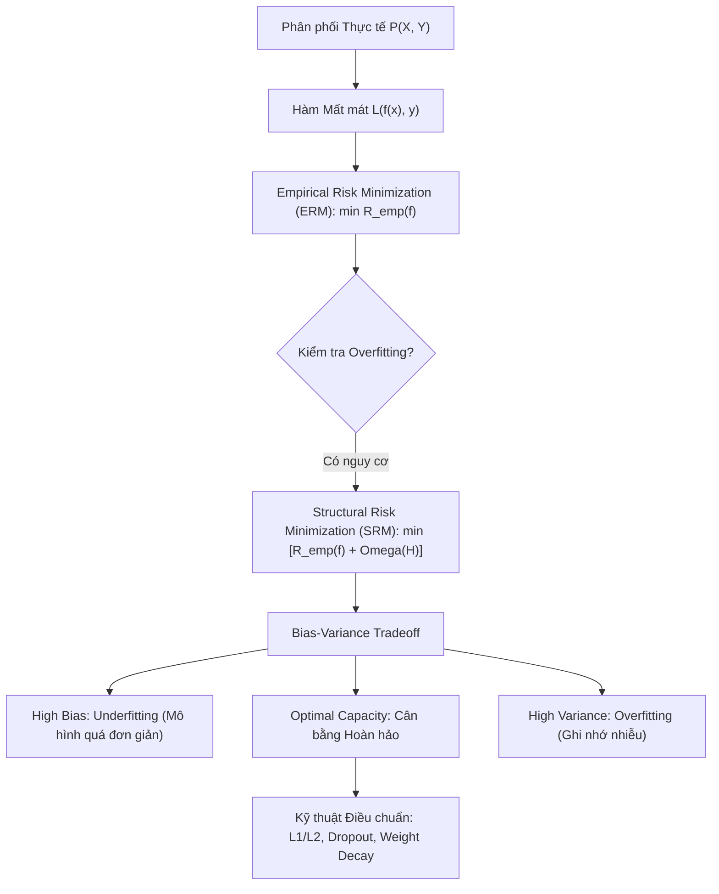
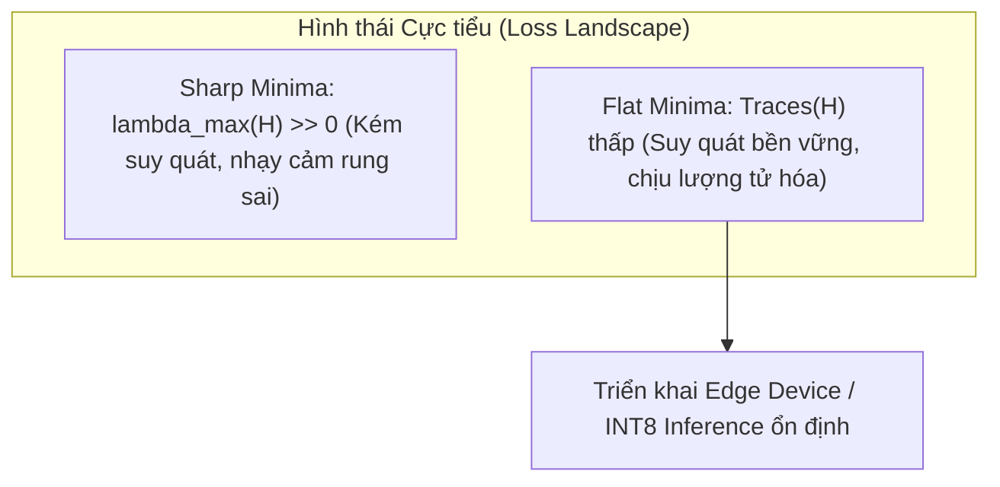
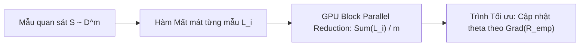
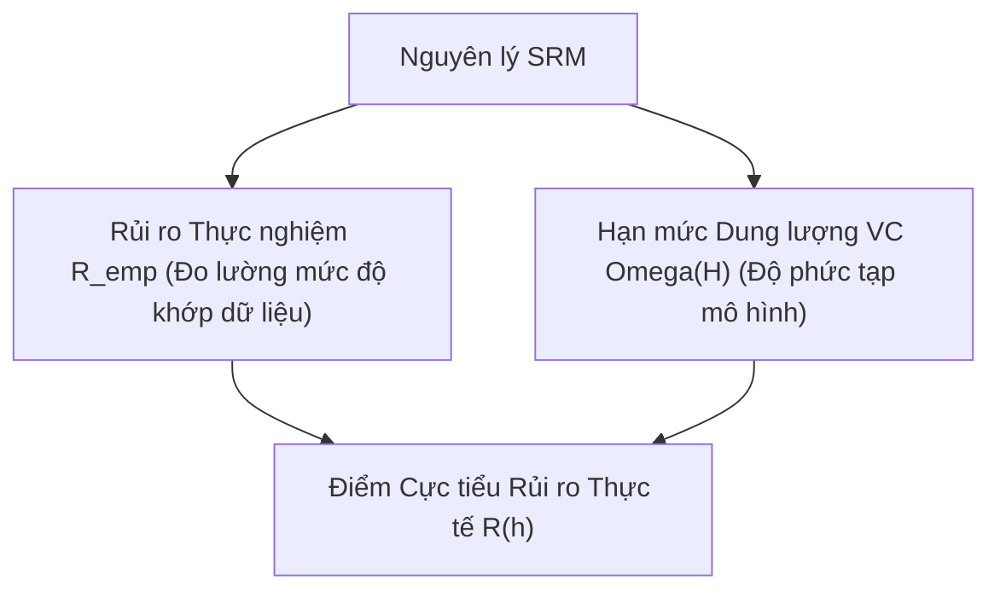
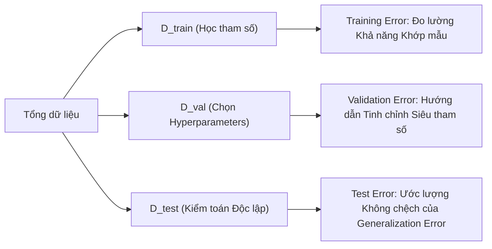
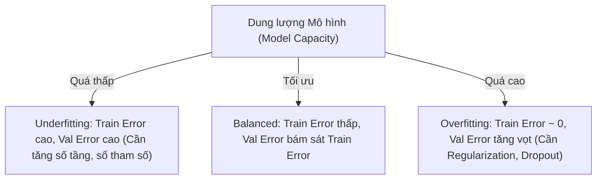
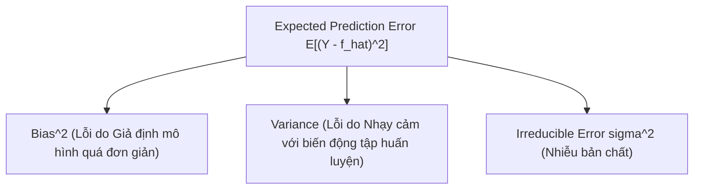
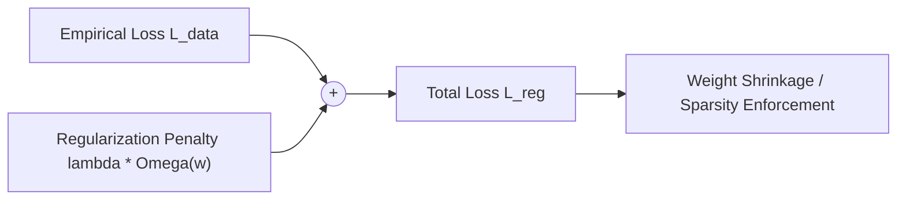

# Chuyên đề: Khả năng Suy quát, Tối thiểu hóa Rủi ro & Độ phức tạp (Generalization, Risk Minimization & Complexity)

## 1. Tổng quan Chuyên đề
Linh hồn của Machine Learning nằm ở khả năng **Suy quát (Generalization)**: năng lực đưa ra dự đoán chính xác trên các mẫu dữ liệu chưa từng thấy trong quá trình huấn luyện. Nếu một mô hình chỉ ghi nhớ máy móc tập huấn luyện, nó hoàn toàn vô dụng trong thực tế.

Chuyên đề này đi sâu vào nền tảng của Lý thuyết Học Thống kê Vapnik-Chervonenkis (VC Theory), sự chuyển dịch từ Cực tiểu hóa Rủi ro Thực nghiệm (ERM) sang Cực tiểu hóa Rủi ro Cấu trúc (SRM), phân rã toán học của Đánh đổi Chệch - Phương sai (Bias-Variance Tradeoff), cùng các kỹ thuật Điều chuẩn (Regularization) kiểm soát dung lượng mô hình trên phần cứng.



---

## 2. Chi tiết từng Keyword

---

### 1. Generalization (Khả năng Suy quát)

#### a. Định nghĩa Bản chất Toán học (Mathematical Formulation)
Cho mô hình $f: \mathcal{X} \to \mathcal{Y}$ được huấn luyện trên tập dữ liệu hữu hạn $\mathcal{S} \sim \mathcal{D}^m$.
Khả năng suy quát được đo lường bởi khoảng cách giữa Rủi ro Thực nghiệm (Empirical Risk) và Rủi ro Thực tế (True Risk / Generalization Risk):
$$R(f) = \mathbb{E}_{(\mathbf{x}, y) \sim \mathcal{D}} \big[ \mathcal{L}(f(\mathbf{x}), y) \big]$$
$$R_{emp}(f) = \frac{1}{m} \sum_{i=1}^m \mathcal{L}(f(\mathbf{x}_i), y_i)$$
Khoảng cách suy quát (Generalization Gap):
$$\Delta_{gen}(f) = | R(f) - R_{emp}(f) |$$
Mục tiêu tối thượng của ML là thu nhỏ $\Delta_{gen}(f) \le \epsilon$ với xác suất cao $1 - \delta$.

#### b. Cơ chế Tầng Sâu & Điện toán (Under The Hood / Hardware Internals)
- **Sharp vs Flat Minima**: Trên bề mặt hàm mất mát (Loss Landscape), các cực tiểu dốc đứng (Sharp Minima) có độ cong Hessian $\lambda_{\max}(\nabla^2 \mathcal{L})$ rất lớn, dẫn đến khả năng suy quát kém khi có rung sai nhỏ ở dữ liệu test. Ngược lại, cực tiểu phẳng (Flat Minima) có vết Hessian nhỏ, cho phép suy quát mạnh mẽ trên thiết bị phần cứng khi lượng tử hóa sang FP16/INT8.

#### c. Sơ đồ Minh họa (Mermaid Diagram)


#### d. Code Thực chiến (Dual-Engine: C++ & Python)

```cpp
// C++17: Tính toán Generalization Gap giữa hai tập dữ liệu
#include <iostream>
#include <vector>
#include <cmath>

float compute_loss(const std::vector<float>& y_true, const std::vector<float>& y_pred) {
    float mse = 0.0f;
    for (size_t i = 0; i < y_true.size(); ++i) {
        float diff = y_true[i] - y_pred[i];
        mse += diff * diff;
    }
    return mse / y_true.size();
}

int main() {
    std::vector<float> y_train = {1.0f, 2.0f, 3.0f};
    std::vector<float> p_train = {1.01f, 1.99f, 3.02f}; // R_emp thấp
    
    std::vector<float> y_test = {4.0f, 5.0f, 6.0f};
    std::vector<float> p_test = {2.5f, 3.1f, 4.0f}; // R_true cao

    float r_emp = compute_loss(y_train, p_train);
    float r_test = compute_loss(y_test, p_test);
    float gen_gap = std::abs(r_test - r_emp);

    std::cout << "[C++] R_emp: " << r_emp << " | R_test: " << r_test 
              << " | Generalization Gap: " << gen_gap << "\n";
    return 0;
}
```

```python
# Python: Đánh giá độ phẳng cực tiểu (Flat Minima) qua Hessian Spectral Norm
import torch
import torch.nn as nn

# Ước lượng độ cong của Loss Landscape bằng nhiễu trọng số Gaussian
def evaluate_flatness(model: nn.Module, x: torch.Tensor, y: torch.Tensor, noise_std: float = 0.01) -> float:
    base_loss = nn.functional.mse_loss(model(x), y).item()
    perturbed_losses = []
    
    with torch.no_grad():
        for _ in range(20):
            # Thêm nhiễu vào tham số
            for p in model.parameters():
                p.add_(torch.randn_like(p) * noise_std)
            
            p_loss = nn.functional.mse_loss(model(x), y).item()
            perturbed_losses.append(p_loss)
            
            # Khôi phục tham số
            for p in model.parameters():
                p.sub_(torch.randn_like(p) * noise_std)
                
    return sum(perturbed_losses) / len(perturbed_losses) - base_loss

linear = nn.Linear(5, 1)
x = torch.randn(32, 5)
y = torch.randn(32, 1)
print(f"[Python] Loss Drift upon Perturbation (Sharpness metric): {evaluate_flatness(linear, x, y):.6f}")
```

#### e. Lỗi Thường gặp & Ổn định Số học
- **Double Descent Phenomenon**: Trong mô hình deep learning siêu tham số hóa ($p \gg N$), sai số test giảm lần thứ hai sau khi đi qua ngưỡng nội suy (Interpolation Threshold), trái ngược với trực giác kinh điển.

#### f. Ứng dụng Thực chiến trong AI / Deep Learning
- Thuật toán tối ưu SAM (Sharpness-Aware Minimization) tìm kiếm các vùng cực tiểu phẳng để tối ưu hóa khả năng suy quát trên Vision Transformers và LLMs.

---

### 2. Empirical Risk Minimization - ERM (Cực tiểu hóa Rủi ro Thực nghiệm)

#### a. Định nghĩa Bản chất Toán học (Mathematical Formulation)
Nguyên lý ERM (Vapnik, 1992) đề xuất xấp xỉ tích phân rủi ro kỳ vọng bằng trung bình mẫu trên tập dữ liệu quan sát $\mathcal{S} = \{(\mathbf{x}_i, y_i)\}_{i=1}^m$:
$$R_{emp}(h) = \frac{1}{m} \sum_{i=1}^m \mathcal{L}(h(\mathbf{x}_i), y_i)$$
Nghiệm ERM là giả thuyết:
$$h_{ERM} = \arg\min_{h \in \mathcal{H}} R_{emp}(h)$$
Theo Luật Số lớn (LLN), với một hàm cố định $h$, $R_{emp}(h) \xrightarrow{P} R(h)$ khi $m \to \infty$. Tuy nhiên, ERM chỉ đảm bảo tính nhất quán (Consistency) khi sự hội tụ là **đồng đều (Uniform Convergence)** trên toàn bộ không gian $\mathcal{H}$:
$$\lim_{m \to \infty} \mathbb{P}\left( \sup_{h \in \mathcal{H}} |R_{emp}(h) - R(h)| > \epsilon \right) = 0$$

#### b. Cơ chế Tầng Sâu & Điện toán (Under The Hood / Hardware Internals)
- **Batch Loss Reduction Overhead**: Phép tính $R_{emp}$ đòi hỏi toán tử rút gọn tổng (Sum/Mean Reduction) trên toàn bộ batch dữ liệu. Trên GPU, điều này được phân bổ thành chuỗi các lệnh song song trong shared memory của từng block trước khi ghi kết quả về global memory.

#### c. Sơ đồ Minh họa (Mermaid Diagram)


#### d. Code Thực chiến (Dual-Engine: C++ & Python)

```cpp
// C++20: Triển khai ERM với hàm tổn thất Tuyệt đối (MAE) và Bình phương (MSE)
#include <iostream>
#include <vector>
#include <cmath>

enum class LossType { MSE, MAE };

float compute_empirical_risk(const std::vector<float>& y_true, 
                             const std::vector<float>& y_pred, 
                             LossType type) {
    float sum = 0.0f;
    const size_t n = y_true.size();
    for (size_t i = 0; i < n; ++i) {
        float err = y_true[i] - y_pred[i];
        sum += (type == LossType::MSE) ? (err * err) : std::abs(err);
    }
    return sum / static_cast<float>(n);
}

int main() {
    std::vector<float> y_t = {2.0f, 4.0f, 6.0f};
    std::vector<float> y_p = {1.8f, 4.2f, 5.9f};
    std::cout << "[C++] ERM (MSE): " << compute_empirical_risk(y_t, y_p, LossType::MSE) << "\n";
    return 0;
}
```

```python
# Python: Đồ thị hóa Uniform Convergence của ERM khi tăng kích thước mẫu
import numpy as np

def simulate_erm_convergence(n_samples_list):
    true_mean = 5.0 # Rủi ro thực
    gaps = []
    for n in n_samples_list:
        sample = np.random.normal(loc=true_mean, scale=2.0, size=n)
        emp_mean = np.mean(sample)
        gaps.append(abs(emp_mean - true_mean))
    return gaps

samples = [10, 100, 1000, 10000, 100000]
results = simulate_erm_convergence(samples)
for n, gap in zip(samples, results):
    print(f"[Python] Mẫu N={n:6d} => |R_emp - R_true| = {gap:.5f}")
```

#### e. Lỗi Thường gặp & Ổn định Số học
- **ERM Overfitting**: Khi dung lượng không gian $\mathcal{H}$ vô hạn hoặc quá lớn so với $m$, nghiệm ERM đạt $R_{emp}(h_{ERM}) = 0$ nhưng $R(h_{ERM})$ tiến tới giá trị ngẫu nhiên (hoàn toàn thất bại trong suy quát).

#### f. Ứng dụng Thực chiến trong AI / Deep Learning
- Nguyên lý thiết kế nền tảng cho phần lớn các bài toán supervised learning cơ bản trước khi thêm các ràng buộc điều chuẩn.

---

### 3. Structural Risk Minimization - SRM (Cực tiểu hóa Rủi ro Cấu trúc)

#### a. Định nghĩa Bản chất Toán học (Mathematical Formulation)
Để khắc phục điểm yếu của ERM, Vapnik đưa ra nguyên lý **Structural Risk Minimization (SRM)**. Ta cấu trúc không gian giả thuyết $\mathcal{H}$ thành chuỗi lồng nhau với độ phức tạp tăng dần:
$$\mathcal{H}_1 \subset \mathcal{H}_2 \subset \dots \subset \mathcal{H}_k \subset \dots \quad \text{với } d_{VC}(\mathcal{H}_1) \le d_{VC}(\mathcal{H}_2) \le \dots$$
Theo bất đẳng thức VC, với độ tin cậy $1 - \delta$, với mọi $h \in \mathcal{H}_k$:
$$R(h) \le R_{emp}(h) + \sqrt{\frac{d_{VC}(\mathcal{H}_k) \left( \ln \frac{2m}{d_{VC}(\mathcal{H}_k)} + 1 \right) - \ln(\delta/4)}{m}}$$
SRM tối ưu hóa đồng thời rủi ro thực nghiệm và số hạng phạt độ phức tạp (Complexity Penalty $\Omega(\mathcal{H})$):
$$h_{SRM} = \arg\min_{\mathcal{H}_k} \left[ \min_{h \in \mathcal{H}_k} R_{emp}(h) + \Omega(\mathcal{H}_k, m, \delta) \right]$$

#### b. Cơ chế Tầng Sâu & Điện toán (Under The Hood / Hardware Internals)
- **Lagrangian Formulation**: Trong tính toán thực tế, bài toán tối ưu rời rạc của SRM được chuyển thành dạng liên tục không ràng buộc thông qua hàm Lagrange:
  $$\mathcal{L}_{SRM}(\mathbf{\theta}) = \mathcal{L}_{ERM}(\mathbf{\theta}) + \lambda \Omega(\mathbf{\theta})$$
  Điều này cho phép thuật toán tính đạo hàm $\nabla \mathcal{L}_{SRM}$ và cập nhật trực tiếp trên GPU bằng các kernel Fused Multiply-Add (FMA).

#### c. Sơ đồ Minh họa (Mermaid Diagram)


#### d. Code Thực chiến (Dual-Engine: C++ & Python)

```cpp
// C++20: Tính toán Hàm mục tiêu SRM với Tích số Phạt Độ phức tạp L2
#include <iostream>
#include <vector>
#include <cmath>

float compute_srm_objective(const std::vector<float>& weights, 
                            float empirical_loss, 
                            float lambda_reg) {
    float l2_norm_sq = 0.0f;
    for (float w : weights) {
        l2_norm_sq += w * w;
    }
    return empirical_loss + 0.5f * lambda_reg * l2_norm_sq;
}

int main() {
    std::vector<float> w = {1.5f, -2.0f, 0.8f};
    float r_emp = 0.12f;
    float lambda = 0.01f;
    std::cout << "[C++] SRM Total Objective: " << compute_srm_objective(w, r_emp, lambda) << "\n";
    return 0;
}
```

```python
# Python: Mô phỏng bài toán SRM với SVM Margin Maximization
from sklearn.svm import SVC
import numpy as np

X = np.random.randn(50, 2)
y = (X[:, 0] + X[:, 1] > 0).astype(int)

# Tham số C là nghịch đảo của hệ số phạt độ phức tạp (C = 1/lambda)
for C in [0.01, 1.0, 100.0]:
    clf = SVC(kernel='linear', C=C).fit(X, y)
    weight_norm = np.linalg.norm(clf.coef_)
    print(f"[Python] C={C:6.2f} => ||w|| (Độ phức tạp): {weight_norm:.4f}, Margin = {2.0/weight_norm:.4f}")
```

#### e. Lỗi Thường gặp & Ổn định Số học
- **Chọn $\lambda$ không phù hợp**: $\lambda \to \infty$ triệt tiêu hoàn toàn khả năng học (Underfitting cực độ), $\lambda \to 0$ thu về bài toán ERM không có kiểm soát dung lượng.

#### f. Ứng dụng Thực chiến trong AI / Deep Learning
- Bản chất lý thuyết nền tảng của Support Vector Machines (SVM) trong việc tìm kiếm siêu phẳng có lề cực đại (Max-Margin Hyperplane).

---

### 4. Generalization, Training, Validation & Test Error

#### a. Định nghĩa Bản chất Toán học (Mathematical Formulation)
1. **Training Error** ($\hat{\epsilon}_{train}$):
   $$\hat{\epsilon}_{train} = \frac{1}{|\mathcal{D}_{train}|} \sum_{i \in \mathcal{D}_{train}} \mathbb{I}(f(\mathbf{x}_i) \neq y_i)$$
2. **Validation Error** ($\hat{\epsilon}_{val}$):
   $$\hat{\epsilon}_{val} = \frac{1}{|\mathcal{D}_{val}|} \sum_{j \in \mathcal{D}_{val}} \mathbb{I}(f(\mathbf{x}_j) \neq y_j)$$
3. **Test Error** ($\hat{\epsilon}_{test}$):
   $$\hat{\epsilon}_{test} = \frac{1}{|\mathcal{D}_{test}|} \sum_{k \in \mathcal{D}_{test}} \mathbb{I}(f(\mathbf{x}_k) \neq y_k)$$
4. **Generalization Error** ($\epsilon_{gen}$):
   $$\epsilon_{gen} = \mathbb{P}_{(\mathbf{x}, y) \sim \mathcal{D}}(f(\mathbf{x}) \neq y) = \mathbb{E}[\hat{\epsilon}_{test}]$$

#### b. Cơ chế Tầng Sâu & Điện toán (Under The Hood / Hardware Internals)
- **Top-1 / Top-k Accuracy Reduction**: Tính toán error rate trong các mô hình thị giác/NLP đòi hỏi so sánh nhãn dự đoán với nhãn thực. Phép so sánh này được vector hóa bằng lệnh `_mm256_cmpeq_epi32` trên SIMD CPU hoặc warp broadcast trên GPU.

#### c. Sơ đồ Minh họa (Mermaid Diagram)


#### d. Code Thực chiến (Dual-Engine: C++ & Python)

```cpp
// C++17: Đánh giá Error Metrics đa phân vùng
#include <iostream>
#include <vector>

struct ModelEvaluationReport {
    float train_err;
    float val_err;
    float test_err;

    void dump() const {
        std::cout << "[C++] Evaluation Report:\n"
                  << "  - Train Error: " << train_err * 100.0f << "%\n"
                  << "  - Val Error:   " << val_err * 100.0f << "%\n"
                  << "  - Test Error:  " << test_err * 100.0f << "%\n";
    }
};

int main() {
    ModelEvaluationReport report{0.02f, 0.05f, 0.052f};
    report.dump();
    return 0;
}
```

```python
# Python: Tính toán đồng thời các thước đo sai số với PyTorch
import torch

def compute_error_rate(logits: torch.Tensor, targets: torch.Tensor) -> float:
    with torch.no_grad():
        preds = torch.argmax(logits, dim=-1)
        incorrect = (preds != targets).sum().item()
        return incorrect / targets.numel()

logits_sim = torch.randn(100, 10)
targets_sim = torch.randint(0, 10, (100,))
print(f"[Python] Simulated Error Rate: {compute_error_rate(logits_sim, targets_sim):.4f}")
```

#### e. Lỗi Thường gặp & Ổn định Số học
- **Optimism of Training Error**: $\hat{\epsilon}_{train}$ luôn nhỏ hơn một cách có hệ thống so với $\epsilon_{gen}$ do hiện tượng tự khớp (Self-Fitting Bias).

#### f. Ứng dụng Thực chiến trong AI / Deep Learning
- Thiết lập hệ thống CI/CD automated evaluation trong MLOps trước khi promote mô hình lên production cluster.

---

### 5. Underfitting & Overfitting (Dưới khớp & Quá khớp)

#### a. Định nghĩa Bản chất Toán học (Mathematical Formulation)
- **Underfitting (Dưới khớp)**: Xảy ra khi không gian giả thuyết $\mathcal{H}$ có dung lượng (capacity) quá thấp so với phân phối dữ liệu chân lý:
  $$\hat{\epsilon}_{train} \gg \epsilon_{target} \quad \text{và} \quad \hat{\epsilon}_{val} \gg \epsilon_{target}$$
  Mô hình có **Độ chệch cao (High Bias)**.
- **Overfitting (Quá khớp)**: Xảy ra khi dung lượng của $\mathcal{H}$ quá lớn, mô hình tối ưu hóa bằng cách ghi nhớ cả nhiễu ngẫu nhiên $\xi_i$:
  $$\hat{\epsilon}_{train} \approx 0 \quad \text{nhưng} \quad \hat{\epsilon}_{val} \gg \hat{\epsilon}_{train}$$
  Mô hình có **Phương sai cao (High Variance)**.

#### b. Cơ chế Tầng Sâu & Điện toán (Under The Hood / Hardware Internals)
- **Gradient Saturation**: Trong Overfitting mạng sâu, các trọng số thường tiến tới các giá trị cực lớn ($|w_{ij}| \to \infty$), khiến các hàm kích hoạt (Sigmoid, Tanh) bão hòa, gradient cục bộ triệt tiêu về 0, làm đóng băng quá trình tự sửa sai.

#### c. Sơ đồ Minh họa (Mermaid Diagram)


#### d. Code Thực chiến (Dual-Engine: C++ & Python)

```cpp
// C++17: Bộ chẩn đoán tự động Underfitting vs Overfitting
#include <iostream>
#include <string>

enum class ModelDiagnosis { Underfitting, Overfitting, Healthy };

ModelDiagnosis diagnose(float train_err, float val_err, float target_err = 0.05f) {
    if (train_err > target_err * 2.0f) {
        return ModelDiagnosis::Underfitting;
    }
    if ((val_err - train_err) > target_err) {
        return ModelDiagnosis::Overfitting;
    }
    return ModelDiagnosis::Healthy;
}

int main() {
    auto d1 = diagnose(0.20f, 0.22f); // Underfitting
    auto d2 = diagnose(0.01f, 0.15f); // Overfitting
    std::cout << "[C++] Diagnosis 1: " << (d1 == ModelDiagnosis::Underfitting ? "Underfitting" : "Other") << "\n";
    std::cout << "[C++] Diagnosis 2: " << (d2 == ModelDiagnosis::Overfitting ? "Overfitting" : "Other") << "\n";
    return 0;
}
```

```python
# Python: Trực quan hóa hiện tượng Overfitting qua Đa thức bậc cao
import numpy as np
from sklearn.pipeline import make_pipeline
from sklearn.preprocessing import PolynomialFeatures
from sklearn.linear_model import LinearRegression

# Sinh dữ liệu phi tuyến có nhiễu
np.random.seed(42)
X = np.sort(np.random.rand(20, 1) * 4, axis=0)
y = np.cos(X).ravel() + np.random.randn(20) * 0.1

for degree in [1, 4, 15]:
    model = make_pipeline(PolynomialFeatures(degree), LinearRegression())
    model.fit(X, y)
    train_score = np.mean((model.predict(X) - y) ** 2)
    print(f"[Python] Degree={degree:2d} => Train MSE: {train_score:.6f}")
```

#### e. Lỗi Thường gặp & Ổn định Số học
- **Cố gắng giải quyết Overfitting bằng cách thu nhỏ Dataset**: Giảm dữ liệu huấn luyện chỉ làm trầm trọng thêm Overfitting. Muốn chống Overfit phải tăng dữ liệu hoặc giảm độ phức tạp mô hình.

#### f. Ứng dụng Thực chiến trong AI / Deep Learning
- Ứng dụng kỹ thuật Data Augmentation (Mixup, CutMix) và Stochastic Depth để triệt tiêu Overfitting trong các mạng Vision Transformer (ViT).

---

### 6. Bias-Variance Tradeoff (Sự Đánh đổi Chệch - Phương sai)

#### a. Định nghĩa Bản chất Toán học (Mathematical Formulation)
Giả định quan sát sinh ra từ mô hình: $Y = f(\mathbf{x}) + \epsilon$ với $\mathbb{E}[\epsilon] = 0$ và $\text{Var}(\epsilon) = \sigma^2$.
Cho ước lượng $\hat{f}(\mathbf{x}; \mathcal{D})$ được học từ tập dữ liệu ngẫu nhiên $\mathcal{D}$. Kỳ vọng sai số bình phương trung bình (Expected Mean Squared Error) tại điểm $\mathbf{x}$ được phân rã thành 3 số hạng trực giao:
$$\mathbb{E}_{\mathcal{D}} \left[ (Y - \hat{f}(\mathbf{x}))^2 \right] = \underbrace{\Big( \mathbb{E}[\hat{f}(\mathbf{x})] - f(\mathbf{x}) \Big)^2}_{\text{Bias}^2(\hat{f}(\mathbf{x}))} + \underbrace{\mathbb{E} \left[ \Big( \hat{f}(\mathbf{x}) - \mathbb{E}[\hat{f}(\mathbf{x})] \Big)^2 \right]}_{\text{Variance}(\hat{f}(\mathbf{x}))} + \underbrace{\sigma^2}_{\text{Irreducible Noise}}$$
- $\text{Bias}^2$: Sai số do các giả định sai lầm trong thuật toán (đơn giản hóa quá mức).
- $\text{Variance}$: Mức độ dao động của dự đoán khi thuật toán được huấn luyện trên các tập dữ liệu khác nhau rút ra từ cùng phân phối.
- $\sigma^2$: Nhiễu nội tại của môi trường không thể loại bỏ.

#### b. Cơ chế Tầng Sâu & Điện toán (Under The Hood / Hardware Internals)
- **Variance Reduction qua Bagging (Parallel Threads)**: Để giảm phương sai mà không làm tăng độ chệch, phương pháp Bootstrap Aggregating (Random Forest) huấn luyện $B$ mô hình độc lập trên các lõi CPU khác nhau qua OpenMP (`#pragma omp parallel for`). Kỳ vọng phương sai giảm tỷ lệ thuận với $1/B$:
  $$\text{Var}\left( \frac{1}{B} \sum_{b=1}^B \hat{f}_b \right) = \rho \sigma^2 + \frac{1 - \rho}{B} \sigma^2$$

#### c. Sơ đồ Minh họa (Mermaid Diagram)


#### d. Code Thực chiến (Dual-Engine: C++ & Python)

```cpp
// C++17: Mô phỏng Monte Carlo phân rã Bias-Variance
#include <iostream>
#include <vector>
#include <cmath>
#include <numeric>

struct BiasVarianceResult {
    double bias_squared;
    double variance;
    double total_mse;
};

BiasVarianceResult analyze_estimates(const std::vector<double>& preds_across_datasets, double true_val) {
    const size_t n = preds_across_datasets.size();
    double sum = std::accumulate(preds_across_datasets.begin(), preds_across_datasets.end(), 0.0);
    double mean_pred = sum / n;

    double bias = mean_pred - true_val;
    double bias_sq = bias * bias;

    double var_sum = 0.0;
    for (double p : preds_across_datasets) {
        var_sum += (p - mean_pred) * (p - mean_pred);
    }
    double variance = var_sum / n;

    return {bias_sq, variance, bias_sq + variance};
}

int main() {
    std::vector<double> preds = {2.1, 2.3, 1.9, 2.05, 2.15}; // Ước lượng qua 5 tập train
    double y_star = 2.0;
    auto res = analyze_estimates(preds, y_star);
    std::cout << "[C++] Bias^2: " << res.bias_squared 
              << " | Variance: " << res.variance 
              << " | Total MSE: " << res.total_mse << "\n";
    return 0;
}
```

```python
# Python: Đồ thị hóa đường cong Bias-Variance Tradeoff cổ điển
import numpy as np

complexity = np.linspace(1, 10, 100)
bias_sq = 10.0 / complexity
variance = 0.1 * (complexity ** 2)
irreducible_noise = 1.5 * np.ones_like(complexity)
total_error = bias_sq + variance + irreducible_noise

optimal_idx = np.argmin(total_error)
print(f"[Python] Độ phức tạp tối ưu: {complexity[optimal_idx]:.2f} với Min Expected Loss: {total_error[optimal_idx]:.4f}")
```

#### e. Lỗi Thường gặp & Ổn định Số học
- **Giả định Tradeoff luôn đúng ở Deep Learning**: Lý thuyết Bias-Variance cổ điển thất bại khi giải thích mạng nơ-ron sâu hiện đại có khả năng đạt zero training error nhưng test error vẫn tiếp tục giảm (Deep Double Descent).

#### f. Ứng dụng Thực chiến trong AI / Deep Learning
- Cơ sở để lựa chọn giữa mô hình Bagging (giảm Variance, e.g. Random Forest) và Boosting (giảm Bias, e.g. XGBoost, AdaBoost).

---

### 7. Regularization (Điều chuẩn)

#### a. Định nghĩa Bản chất Toán học (Mathematical Formulation)
Điều chuẩn là kỹ thuật đưa thêm thông tin tiên nghiệm (prior knowledge) hoặc ràng buộc vào bài toán tối ưu nhằm phạt các nghiệm phức tạp, hạn chế Overfitting:
$$\min_{\mathbf{\theta}} \mathcal{L}_{reg}(\mathbf{\theta}) = \frac{1}{N} \sum_{i=1}^N \mathcal{L}(f(\mathbf{x}_i; \mathbf{\theta}), y_i) + \lambda \Omega(\mathbf{\theta})$$
Các hàm phạt phổ biến:
1. **L2 Regularization (Ridge / Weight Decay)**:
   $$\Omega_{L2}(\mathbf{\theta}) = \frac{1}{2} \|\mathbf{\theta}\|_2^2 = \frac{1}{2} \sum_j \theta_j^2$$
   Tương đương với phân phối tiên nghiệm Gaussian $\mathcal{N}(0, \sigma^2)$ trên tham số (MAP Estimation).
2. **L1 Regularization (Lasso)**:
   $$\Omega_{L1}(\mathbf{\theta}) = \|\mathbf{\theta}\|_1 = \sum_j |\theta_j|$$
   Tương đương với phân phối tiên nghiệm Laplace $\text{Laplace}(0, b)$, tạo ra nghiệm thưa (Sparsity: nhiều trọng số triệt tiêu chính xác về 0).

#### b. Cơ chế Tầng Sâu & Điện toán (Under The Hood / Hardware Internals)
- **Fused Weight Decay trong Optimizers**: Trong PyTorch AdamW, thay vì thêm đạo hàm $\lambda \mathbf{w}$ vào vector gradient (làm sai lệch các moment thích ứng $m_t, v_t$):
  $$\mathbf{w}_{t+1} = \mathbf{w}_t - \eta_t \frac{m_t}{\sqrt{v_t} + \epsilon} - \eta_t \lambda \mathbf{w}_t$$
  Toán tử decay được thực thi trực tiếp dạng decoupled trong kernel GPU CUDA/Triton: `w = w * (1.0 - lr * weight_decay)`.

#### c. Sơ đồ Minh họa (Mermaid Diagram)


#### d. Code Thực chiến (Dual-Engine: C++ & Python)

```cpp
// C++20: Cập nhật Trọng số với Decoupled Weight Decay (Chuẩn AdamW)
#include <iostream>
#include <vector>

void step_weight_decay(std::vector<float>& weights, 
                       const std::vector<float>& grads, 
                       float lr, 
                       float weight_decay) {
    const size_t n = weights.size();
    for (size_t i = 0; i < n; ++i) {
        // Decoupled Weight Decay: thu nhỏ trực tiếp trọng số trước khi áp gradient
        weights[i] = weights[i] * (1.0f - lr * weight_decay) - lr * grads[i];
    }
}

int main() {
    std::vector<float> w = {1.0f, -2.0f, 0.5f};
    std::vector<float> g = {0.1f, -0.05f, 0.02f};
    step_weight_decay(w, g, 0.01f, 0.1f);
    std::cout << "[C++] w[0] sau Decoupled Weight Decay: " << w[0] << "\n";
    return 0;
}
```

```python
# Python: So sánh Nghiệm thưa L1 vs L2 Shrinkage
import torch
import torch.nn as nn

w = torch.tensor([0.5, -0.02, 1.2, 0.001], requires_grad=True)

# L1 Gradient (Subgradient): Sign(w) -> Đẩy chính xác về 0
l1_penalty = torch.sum(torch.abs(w))
l1_penalty.backward()
print(f"[Python] L1 Subgradient (Sign): {w.grad.tolist()}")

w.grad.zero_()
# L2 Gradient: w -> Thu nhỏ tỷ lệ với độ lớn
l2_penalty = 0.5 * torch.sum(w ** 2)
l2_penalty.backward()
print(f"[Python] L2 Gradient (Linear): {w.grad.tolist()}")
```

#### e. Lỗi Thường gặp & Ổn định Số học
- **L1 Non-differentiability tại 0**: Đạo hàm hàm trị tuyệt đối $|w|$ không xác định tại $w = 0$. Cần sử dụng đạo hàm dưới (Subgradient Calculus) hoặc Proximal Gradient Methods (Soft-Thresholding).

#### f. Ứng dụng Thực chiến trong AI / Deep Learning
- Dropout, DropPath, Weight Decay trong huấn luyện LLMs (Llama 3, GPT-4) và Spectral Normalization trong GANs.
