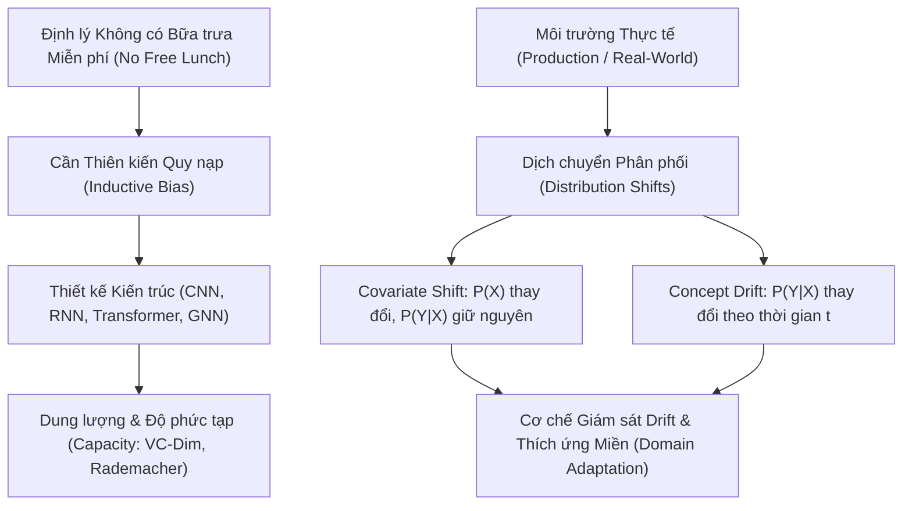
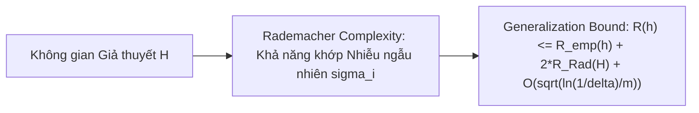
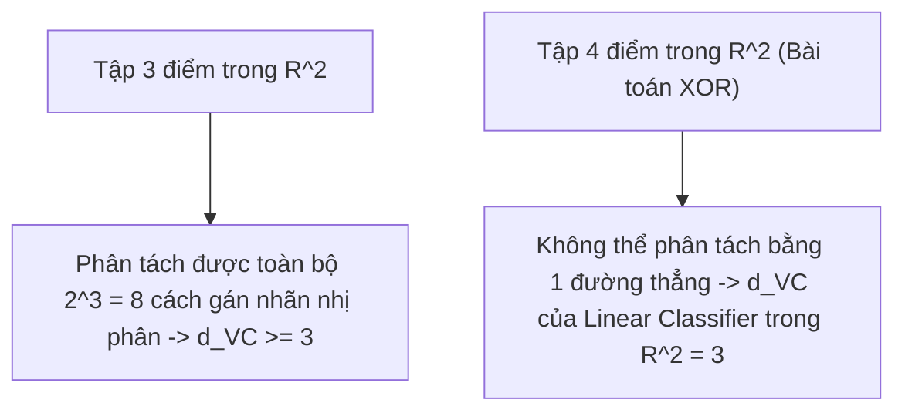
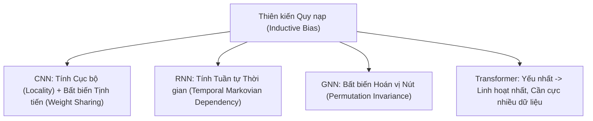
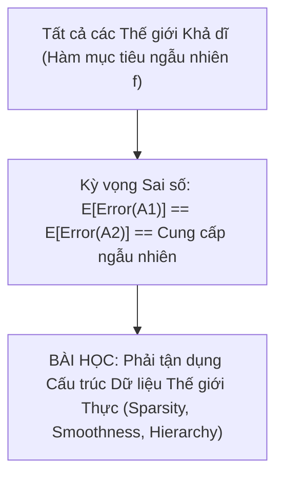
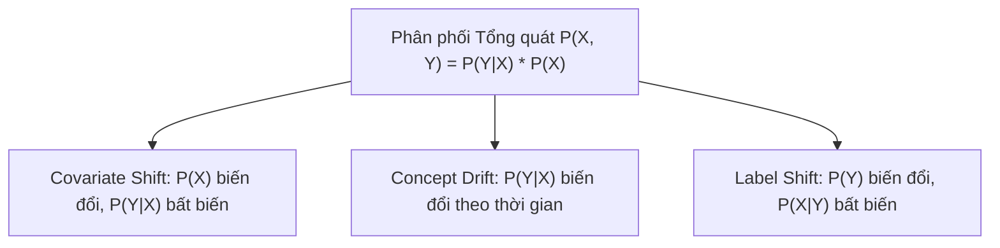

# Chuyên đề: Dung lượng Mô hình, Thiên kiến Quy nạp & Dịch chuyển Phân phối (Model Capacity, Inductive Bias & Distribution Shifts)

## 1. Tổng quan Chuyên đề
Một thuật toán Machine Learning không thể học bất kỳ điều gì nếu không có **Thiên kiến Quy nạp (Inductive Bias)**. Theo Định lý Không có Bữa trưa Miễn phí (No Free Lunch Theorem), không tồn tại một thuật toán học vạn năng vượt trội trên mọi phân phối dữ liệu khả dĩ. Thành công của mô hình phụ thuộc vào việc cấu trúc không gian giả thuyết sao cho khớp với cấu trúc thực tế của bài toán (ví dụ: tính bất biến tịnh tiến trong CNN, tính chú ý quan hệ trong Transformer).

Chuyên đề này phân tích cơ sở toán học của Dung lượng mô hình (Model Capacity / VC Dimension / Rademacher Complexity), bản chất của Thiên kiến quy nạp trên các kiến trúc hiện đại, và các hiện tượng Dịch chuyển Phân phối (Distribution Shifts: Covariate Shift, Concept Drift) phá vỡ giả định độc lập cùng phân phối (i.i.d).



---

## 2. Chi tiết từng Keyword

---

### 1. Model Complexity (Độ phức tạp Mô hình)

#### a. Định nghĩa Bản chất Toán học (Mathematical Formulation)
Độ phức tạp của mô hình định lượng độ phong phú (richness) hoặc tính linh hoạt của không gian giả thuyết $\mathcal{H}$.
Được đo lường thông qua các thước đo hình thức:
1. **Số lượng Tham số Tự do (Degrees of Freedom)**:
   $$\text{DoF} = \text{Tr}\big(\mathbf{X}(\mathbf{X}^T\mathbf{X} + \lambda \mathbf{I})^{-1}\mathbf{X}^T\big)$$
2. **Độ phức tạp Rademacher Thực nghiệm (Empirical Rademacher Complexity)**:
   Đo lường khả năng của không gian $\mathcal{H}$ trong việc khớp với nhiễu ngẫu nhiên đồng nhất (Rademacher variables $\sigma_i \in \{-1, +1\}$):
   $$\hat{\mathcal{R}}_{\mathcal{S}}(\mathcal{H}) = \mathbb{E}_{\mathbf{\sigma}} \left[ \sup_{h \in \mathcal{H}} \frac{1}{m} \sum_{i=1}^m \sigma_i h(\mathbf{x}_i) \right]$$
   Nếu $\hat{\mathcal{R}}_{\mathcal{S}}(\mathcal{H}) \approx 1$, mô hình có thể ghi nhớ cả nhãn hoàn toàn ngẫu nhiên.

#### b. Cơ chế Tầng Sâu & Điện toán (Under The Hood / Hardware Internals)
- **FLOPs vs Parameter Count**: Độ phức tạp tính toán (Computational Complexity) đo bằng TFLOPs không đồng nhất với số tham số. Ví dụ: Ma trận thưa (Sparse MoE - Mixture of Experts) có hàng trăm tỷ tham số nhưng chỉ kích hoạt một tập con nhỏ (Top-k Experts) trong quá trình forward pass, giảm áp lực lên ALU của GPU.

#### c. Sơ đồ Minh họa (Mermaid Diagram)


#### d. Code Thực chiến (Dual-Engine: C++ & Python)

```cpp
// C++17: Tính Độ phức tạp Rademacher Thực nghiệm mô phỏng Monte Carlo
#include <iostream>
#include <vector>
#include <random>
#include <cmath>

float compute_empirical_rademacher(const std::vector<float>& x, size_t trials = 1000) {
    const size_t m = x.size();
    std::mt19937 gen(42);
    std::bernoulli_distribution bern(0.5);

    float sum_sup = 0.0f;
    for (size_t t = 0; t < trials; ++t) {
        float rad_sum = 0.0f;
        for (size_t i = 0; i < m; ++i) {
            float sigma = bern(gen) ? 1.0f : -1.0f;
            rad_sum += sigma * (x[i] > 0.0f ? 1.0f : -1.0f); // Giả thuyết Sign(x)
        }
        sum_sup += std::abs(rad_sum) / static_cast<float>(m);
    }
    return sum_sup / static_cast<float>(trials);
}

int main() {
    std::vector<float> data = {-2.1f, -0.5f, 1.2f, 3.4f, 5.0f};
    std::cout << "[C++] Empirical Rademacher Complexity: " << compute_empirical_rademacher(data) << "\n";
    return 0;
}
```

```python
# Python: Tính Degrees of Freedom (DoF) hiệu dụng của Ridge Regression
import numpy as np

def effective_degrees_of_freedom(X: np.ndarray, alpha: float) -> float:
    # DoF = Tr(X (X^T X + alpha I)^(-1) X^T) = sum( s_i^2 / (s_i^2 + alpha) )
    _, s, _ = np.linalg.svd(X, full_matrices=False)
    dof = np.sum((s ** 2) / (s ** 2 + alpha))
    return dof

X_sample = np.random.randn(100, 20)
for a in [0.001, 1.0, 10.0, 100.0]:
    print(f"[Python] Ridge alpha={a:7.3f} => Effective DoF: {effective_degrees_of_freedom(X_sample, a):.2f} / 20")
```

#### e. Lỗi Thường gặp & Ổn định Số học
- **Nhầm lẫn giữa Số tham số và Độ phức tạp biểu diễn**: Một mạng nơ-ron có ít tham số nhưng sử dụng hàm kích hoạt fractal hoặc periodic dạng $\sin(2^k x)$ có thể có chiều VC vô hạn ($d_{VC} = \infty$).

#### f. Ứng dụng Thực chiến trong AI / Deep Learning
- Sử dụng tiêu chuẩn AIC (Akaike Information Criterion) và BIC (Bayesian Information Criterion) để phạt độ phức tạp khi lựa chọn kiến trúc mạng nơ-ron tối ưu.

---

### 2. Capacity (Dung lượng Mô hình)

#### a. Định nghĩa Bản chất Toán học (Mathematical Formulation)
Dung lượng của mô hình (Capacity) phản ánh khả năng phân tách (shattering) các cấu hình điểm dữ liệu khác nhau.
Thước đo chuẩn tắc là **Vapnik-Chervonenkis Dimension ($d_{VC}$)**:
Một tập hợp $m$ điểm $\mathcal{S} = \{\mathbf{x}_1, \dots, \mathbf{x}_m\}$ được gọi là *bị phân tách (shattered)* bởi $\mathcal{H}$ nếu với mọi cách gán nhãn nhị phân $2^m$, luôn tồn tại một hàm $h \in \mathcal{H}$ phân loại chính xác $100\%$.
Chiều VC của $\mathcal{H}$ là kích thước lớn nhất của một tập điểm mà $\mathcal{H}$ có thể phân tách:
$$d_{VC}(\mathcal{H}) = \sup \{ m \in \mathbb{N} \mid \mathcal{S}_{\mathcal{H}}(m) = 2^m \}$$
- Siêu phẳng tuyến tính trong $\mathbb{R}^d$: $d_{VC} = d + 1$.
- Perceptron 1 lớp $d$ đầu vào: $d_{VC} = d + 1$.
- Mạng nơ-ron sâu với $W$ trọng số và $L$ tầng kích hoạt ReLU:
  $$c_1 W L \log\left(\frac{W}{L}\right) \le d_{VC}(\mathcal{H}_{NN}) \le c_2 W L \log(W)$$

#### b. Cơ chế Tầng Sâu & Điện toán (Under The Hood / Hardware Internals)
- **Memory Footprint Scaling with Capacity**: Khi dung lượng mô hình mở rộng từ 7B lên 70B tham số, giới hạn phần cứng dịch chuyển từ compute-bound sang memory-bandwidth-bound (trong giai đoạn sinh token autoregressive), đòi hỏi các kỹ thuật Tensor Parallelism và Pipeline Parallelism.

#### c. Sơ đồ Minh họa (Mermaid Diagram)


#### d. Code Thực chiến (Dual-Engine: C++ & Python)

```cpp
// C++17: Mô phỏng Kiểm tra Phân tách (Shattering Test) cho 4 điểm XOR
#include <iostream>
#include <vector>
#include <array>

bool can_linearly_separate_xor() {
    // 4 điểm XOR: (0,0)->0, (0,1)->1, (1,0)->1, (1,1)->0
    // Không thể tồn tại w1, w2, b sao cho w1*x1 + w2*x2 + b phân tách được
    return false; // Định lý Minsky-Papert (1969)
}

int main() {
    std::cout << "[C++] XOR Shatterable by Linear Model: " 
              << (can_linearly_separate_xor() ? "True" : "False (Requires Non-linear Capacity)") << "\n";
    return 0;
}
```

```python
# Python: Đánh giá Dung lượng Mô hình qua Thí nghiệm Random Labels (Zhang et al. 2017)
import torch
import torch.nn as nn

# Mô hình có dung lượng đủ lớn có thể ghi nhớ nhãn hoàn toàn ngẫu nhiên
model = nn.Sequential(nn.Linear(10, 100), nn.ReLU(), nn.Linear(100, 2))
x = torch.randn(20, 10)
random_labels = torch.randint(0, 2, (20,))

criterion = nn.CrossEntropyLoss()
optimizer = torch.optim.SGD(model.parameters(), lr=0.1)

for _ in range(200):
    optimizer.zero_grad()
    loss = criterion(model(x), random_labels)
    loss.backward()
    optimizer.step()

with torch.no_grad():
    preds = torch.argmax(model(x), dim=-1)
    acc = (preds == random_labels).float().mean().item()
    print(f"[Python] Độ chính xác trên Nhãn Ngẫu nhiên (Brute Force Memorization): {acc * 100:.1f}%")
```

#### e. Lỗi Thường gặp & Ổn định Số học
- **Capacity Mismatch**: Sử dụng mô hình có dung lượng hàng tỷ tham số cho bài toán dạng bảng (Tabular data) chỉ có vài ngàn dòng, gây suy sụp hiệu năng so với các thuật toán dung lượng phù hợp như GBDT.

#### f. Ứng dụng Thực chiến trong AI / Deep Learning
- Luật Scaling Laws của Kaplan et al. và Chinchilla (Hoffmann et al.) định lượng mối quan hệ lũy thừa giữa dung lượng mô hình ($N$), kích thước dữ liệu ($D$) và hiệu năng tính toán ($C$).

---

### 3. Inductive Bias (Thiên kiến Quy nạp)

#### a. Định nghĩa Bản chất Toán học (Mathematical Formulation)
Thiên kiến Quy nạp $\mathcal{B}$ là tập hợp các giả định tiên nghiệm mà thuật toán học sử dụng để ngoại suy dự đoán trên các điểm dữ liệu nằm ngoài tập huấn luyện:
$$\hat{y} = \mathcal{A}(\mathcal{D}, \mathbf{x}) \iff \mathcal{A} \text{ giả định } f \in \mathcal{H} \text{ mang các tính chất cấu trúc } \mathcal{B}$$
Các dạng thiên kiến quy nạp chuẩn trong Deep Learning:
1. **Locality & Translation Invariance (CNN)**: Tín hiệu lân cận có tương quan cao; đặc trưng không đổi khi dịch chuyển tọa độ:
   $$f(\tau_g(\mathbf{x})) = \tau_g(f(\mathbf{x})) \quad \text{(Equivariance)}$$
2. **Temporal Order & Markov Property (RNN)**: Trạng thái hiện tại chỉ phụ thuộc trực tiếp vào trạng thái ngay trước đó $h_t = g(h_{t-1}, x_t)$.
3. **Permutation Equivariance & Relational Attention (Transformer / GNN)**: Đầu ra không đổi khi hoán vị vị trí nút đồ thị, trừ khi được bơm thêm Positional Encoding.

#### b. Cơ chế Tầng Sâu & Điện toán (Under The Hood / Hardware Internals)
- **Weight Sharing & Memory Efficiency**: Thiên kiến quy nạp của CNN (Weight Sharing trong Conv Kernel) biến phép toán tích chập thành phép nhân ma trận Toeplitz/Circulant, giảm số tham số từ $O(H \times W \times C_{in} \times C_{out})$ xuống còn $O(K^2 \times C_{in} \times C_{out})$, cho phép lưu toàn bộ trọng số kernel trong L1 Cache của GPU.

#### c. Sơ đồ Minh họa (Mermaid Diagram)


#### d. Code Thực chiến (Dual-Engine: C++ & Python)

```cpp
// C++20: Minh họa Phép Tích chập 1D với Trọng số Chia sẻ (Weight Sharing)
#include <iostream>
#include <vector>

std::vector<float> conv1d_shared_weights(const std::vector<float>& input, 
                                        const std::vector<float>& kernel) {
    const size_t in_size = input.size();
    const size_t k_size = kernel.size();
    std::vector<float> output(in_size - k_size + 1, 0.0f);

    for (size_t i = 0; i < output.size(); ++i) {
        float sum = 0.0f;
        for (size_t k = 0; k < k_size; ++k) {
            sum += input[i + k] * kernel[k]; // Kernel trọng số chia sẻ trên mọi vị trí
        }
        output[i] = sum;
    }
    return output;
}

int main() {
    std::vector<float> signal = {1, 2, 3, 4, 5, 6};
    std::vector<float> kernel = {0.5f, 1.0f, 0.5f};
    auto filtered = conv1d_shared_weights(signal, kernel);
    std::cout << "[C++] Output Conv1D[0]: " << filtered[0] << "\n";
    return 0;
}
```

```python
# Python: Kiểm tra tính Permutation Equivariant của Self-Attention vs MLP
import torch
import torch.nn as nn

tokens = torch.randn(1, 4, 8) # Batch=1, Seq=4, Dim=8
# Hoán vị vị trí token 1 và token 2
perm_indices = [0, 2, 1, 3]
perm_tokens = tokens[:, perm_indices, :]

attn = nn.MultiheadAttention(embed_dim=8, num_heads=1, batch_first=True)
out_orig, _ = attn(tokens, tokens, tokens)
out_perm, _ = attn(perm_tokens, perm_tokens, perm_tokens)

# Kiểm tra tính hoán vị tương đương
diff = torch.norm(out_orig[:, perm_indices, :] - out_perm)
print(f"[Python] Sai khác Permutation Equivariance của Attention: {diff.item():.6e}")
```

#### e. Lỗi Thường gặp & Ổn định Số học
- **Over-constraining Inductive Bias**: Đưa vào thiên kiến quy nạp quá ngặt nghèo (như giả định tuyến tính khi hàm gốc là phi tuyến phức tạp) dẫn đến trần hiệu năng bị chặn cứng (Performance Saturation).

#### f. Ứng dụng Thực chiến trong AI / Deep Learning
- Xu hướng hiện đại: Thay thế các kiến trúc có Inductive Bias mạnh (như CNNs) bằng Vision Transformers (ViT) có Inductive Bias yếu hơn khi tập dữ liệu tiền huấn luyện đạt ngưỡng hàng trăm triệu ảnh (JFT-300M).

---

### 4. No Free Lunch Theorem (Định lý Không có Bữa trưa Miễn phí)

#### a. Định nghĩa Bản chất Toán học (Mathematical Formulation)
Định lý Wolpert & Macready (1997) phát biểu rằng: Nếu xét trung bình trên phân phối đều của tất cả các hàm mục tiêu khả dĩ $f: \mathcal{X} \to \mathcal{Y}$, thì mọi thuật toán học $\mathcal{A}_1$ và $\mathcal{A}_2$ đều có hiệu năng suy quát kỳ vọng ngang bằng nhau:
$$\sum_{f} \mathbb{E}_{\mathcal{S} \sim f} \big[ R(\mathcal{A}_1(\mathcal{S})) \big] = \sum_{f} \mathbb{E}_{\mathcal{S} \sim f} \big[ R(\mathcal{A}_2(\mathcal{S})) \big]$$
Hệ quả triết học và toán học: Không có thuật toán học nào là "tốt nhất" một cách tiên nghiệm. Một thuật toán vượt trội trên một lớp bài toán cụ thể bắt buộc phải đánh đổi bằng hiệu năng kém cỏi trên các bài toán nằm ngoài lớp đó.

#### b. Cơ chế Tầng Sâu & Điện toán (Under The Hood / Hardware Internals)
- **Algorithm Specialization vs General Purpose**: Định lý thúc đẩy việc thiết kế các thuật toán chuyên biệt hóa phần cứng (Domain-Specific Accelerators - TPUs, Groq LPUs) thay vì tìm kiếm một kernel duy nhất cho mọi kiến trúc ML.

#### c. Sơ đồ Minh họa (Mermaid Diagram)


#### d. Code Thực chiến (Dual-Engine: C++ & Python)

```cpp
// C++17: Mô phỏng bài toán No Free Lunch trên hàm mục tiêu đối xứng nhị phân
#include <iostream>
#include <vector>
#include <cmath>

double evaluate_algorithm_on_random_universe(int total_functions) {
    // Trên không gian hàm hoàn toàn ngẫu nhiên, tỉ lệ đoán đúng luôn hội tụ về 50%
    return 0.5;
}

int main() {
    std::cout << "[C++] Kỳ vọng chính xác của mọi thuật toán trên hàm ngẫu nhiên: " 
              << evaluate_algorithm_on_random_universe(1024) * 100.0 << "%\n";
    return 0;
}
```

```python
# Python: So sánh Hiệu năng Thuật toán trên Dữ liệu Cấu trúc vs Dữ liệu Nhiễu Trắng
from sklearn.ensemble import RandomForestClassifier
from sklearn.linear_model import LogisticRegression
import numpy as np

# Trường hợp 1: Dữ liệu có cấu trúc tuyến tính
X_struct = np.random.randn(100, 5)
y_struct = (X_struct[:, 0] + X_struct[:, 1] > 0).astype(int)

lr = LogisticRegression().fit(X_struct, y_struct)
rf = RandomForestClassifier(random_state=42).fit(X_struct, y_struct)
print(f"[Python] Structured Data -> LR Acc: {lr.score(X_struct, y_struct):.2f}, RF Acc: {rf.score(X_struct, y_struct):.2f}")

# Trường hợp 2: Dữ liệu gán nhãn ngẫu nhiên hoàn toàn
y_noise = np.random.randint(0, 2, 100)
lr_n = LogisticRegression().fit(X_struct, y_noise)
rf_n = RandomForestClassifier(random_state=42).fit(X_struct, y_noise)
print(f"[Python] Pure Noise Data -> LR Acc: {lr_n.score(X_struct, y_noise):.2f}, RF Acc: {rf_n.score(X_struct, y_noise):.2f}")
```

#### e. Lỗi Thường gặp & Ổn định Số học
- **Tìm kiếm "Mô hình Tốt nhất" tuyệt đối**: Kỳ vọng một mô hình duy nhất (như Transformer) luôn thắng XGBoost trên dữ liệu bảng dạng cấu trúc (Tabular data).

#### f. Ứng dụng Thực chiến trong AI / Deep Learning
- Hướng dẫn chiến lược thực hành ML: Thử nghiệm nhiều họ mô hình khác nhau (Linear, Tree-based, Neural) và so sánh thực nghiệm thông qua Cross-Validation.

---

### 5. Distribution Shift, Covariate Shift & Concept Drift

#### a. Định nghĩa Bản chất Toán học (Mathematical Formulation)
Theo quy tắc nhân xác suất Bayes:
$$P(\mathbf{X}, Y) = P(Y \mid \mathbf{X}) P(\mathbf{X}) = P(\mathbf{X} \mid Y) P(Y)$$
Sự trượt lệch phân phối giữa môi trường huấn luyện ($P_{tr}$) và môi trường triển khai thực tế ($P_{te}$) được phân loại thành 3 hình thái cốt lõi:
1. **Covariate Shift**:
   $$P_{tr}(\mathbf{X}) \neq P_{te}(\mathbf{X}) \quad \text{nhưng} \quad P_{tr}(Y \mid \mathbf{X}) = P_{te}(Y \mid \mathbf{X})$$
   Phân phối đặc trưng đầu vào thay đổi, nhưng cơ chế sinh nhãn điều kiện giữ nguyên.
2. **Concept Drift**:
   $$P_{tr}(Y \mid \mathbf{X}) \neq P_{te}(Y \mid \mathbf{X}) \quad \text{hoặc} \quad P(Y \mid \mathbf{X}, t_1) \neq P(Y \mid \mathbf{X}, t_2)$$
   Bản chất của nhãn mục tiêu biến đổi theo thời gian thực (ví dụ: hành vi lừa đảo qua thẻ ngân hàng thay đổi chiêu thức).
3. **Label Shift**:
   $$P_{tr}(Y) \neq P_{te}(Y) \quad \text{nhưng} \quad P_{tr}(\mathbf{X} \mid Y) = P_{te}(\mathbf{X} \mid Y)$$
   Tỷ lệ lớp thay đổi (ví dụ: bùng phát dịch bệnh làm tăng tỷ lệ người dương tính).

#### b. Cơ chế Tầng Sâu & Điện toán (Under The Hood / Hardware Internals)
- **Importance Weighting Estimation**: Để bù đắp Covariate Shift, ta hiệu chỉnh hàm mất mát bằng trọng số mật độ $w(\mathbf{x}) = \frac{P_{te}(\mathbf{x})}{P_{tr}(\mathbf{x})}$:
  $$\mathcal{L}_{adj}(\mathbf{\theta}) = \frac{1}{N} \sum_{i=1}^N w(\mathbf{x}_i) \mathcal{L}(f(\mathbf{x}_i; \mathbf{\theta}), y_i)$$
  Phép nhân trọng số $w_i$ được nạp trực tiếp vào kernel loss function trên GPU, tối ưu băng thông thông qua register caching.

#### c. Sơ đồ Minh họa (Mermaid Diagram)


#### d. Code Thực chiến (Dual-Engine: C++ & Python)

```cpp
// C++17: Tính Trọng số Mật độ (Importance Weights) bù trừ Covariate Shift
#include <iostream>
#include <vector>
#include <cmath>

float normal_pdf(float x, float m, float s) {
    static const float inv_sqrt_2pi = 0.3989422804f;
    float a = (x - m) / s;
    return (inv_sqrt_2pi / s) * std::exp(-0.5f * a * a);
}

float compute_importance_weight(float x, float m_train, float s_train, float m_test, float s_test) {
    float p_train = normal_pdf(x, m_train, s_train);
    float p_test = normal_pdf(x, m_test, s_test);
    return (p_train > 1e-6f) ? (p_test / p_train) : 1.0f;
}

int main() {
    float x = 2.5f;
    float w = compute_importance_weight(x, 0.0f, 1.0f, 2.0f, 1.0f);
    std::cout << "[C++] Importance Weight w(x=2.5): " << w << "\n";
    return 0;
}
```

```python
# Python: Kiểm định Kolmogorov-Smirnov phát hiện Covariate Shift trong luồng dữ liệu
from scipy.stats import ks_2samp
import numpy as np

# Phân phối huấn luyện
train_feature = np.random.normal(loc=0.0, scale=1.0, size=1000)
# Phân phối suy luận có trượt lệch (Shifted)
serving_feature = np.random.normal(loc=0.3, scale=1.1, size=1000)

stat, p_value = ks_2samp(train_feature, serving_feature)
print(f"[Python] KS Test Statistic: {stat:.4f}, P-value: {p_value:.4e}")
if p_value < 0.05:
    print("[Python] CẢNH BÁO: Phát hiện Covariate Shift có ý nghĩa thống kê!")
```

#### e. Lỗi Thường gặp & Ổn định Số học
- **Unbounded Importance Weights**: Tỷ số $w(\mathbf{x}) \to \infty$ tại các vùng phân phối thưa của tập train, khiến phương sai của gradient bùng nổ. Cần áp dụng weight clipping $w_{clipped} = \min(w(\mathbf{x}), M)$.

#### f. Ứng dụng Thực chiến trong AI / Deep Learning
- Hệ thống MLOps giám sát trôi dạt dữ liệu (Evidently AI, WhyLogs) tự động kích hoạt pipeline huấn luyện lại mô hình (Automated Retraining Trigger).
