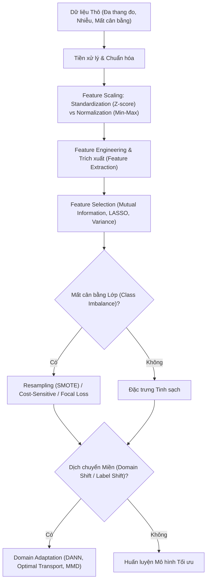
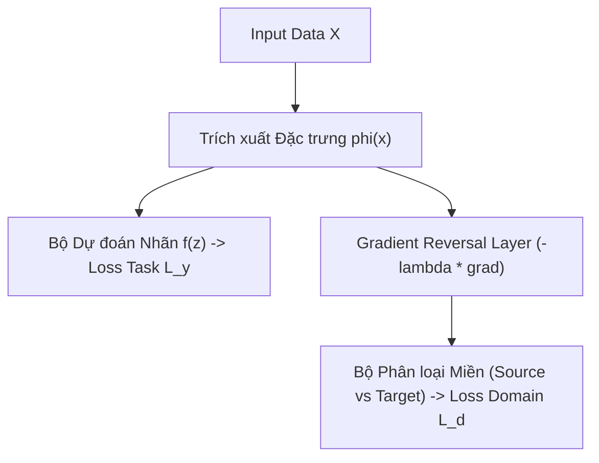
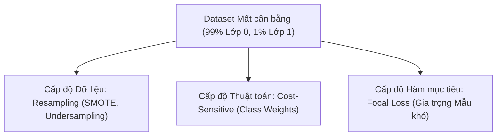
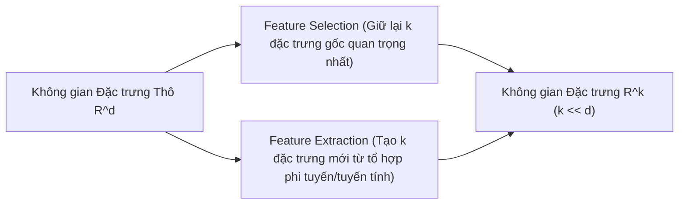
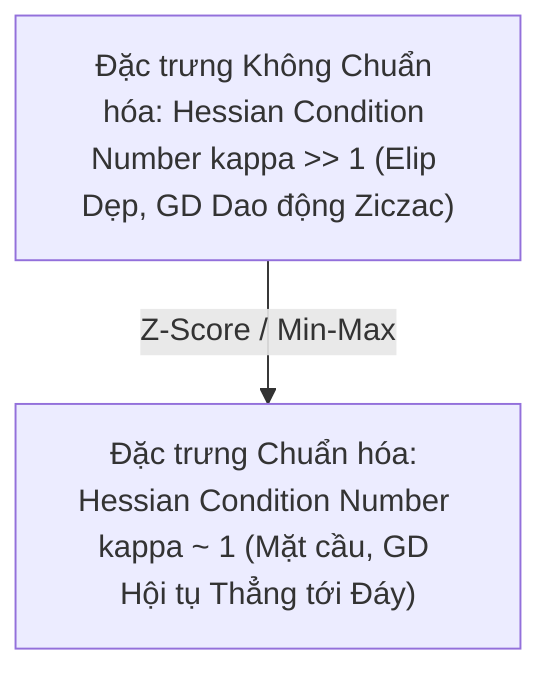

# Chuyên đề: Thích ứng Miền, Mất cân bằng Lớp & Kỹ thuật Đặc trưng (Domain Adaptation, Class Imbalance & Feature Engineering)

## 1. Tổng quan Chuyên đề
Hiệu năng thực tế của một hệ thống Machine Learning phụ thuộc quyết định vào chất lượng của không gian biểu diễn đặc trưng và khả năng thích ứng trước các biến đổi phân phối. Trong các bài toán sản xuất (production), dữ liệu hiếm khi thỏa mãn phân phối lý tưởng: nhãn có thể bị trượt (Label Shift), tỷ lệ mẫu giữa các lớp có thể chênh lệch hàng triệu lần (Class Imbalance), và các đặc trưng thô luôn chứa độ lệch tỷ lệ, nhiễu đo đạc hoặc chiều không gian dư thừa.

Chuyên đề này mổ xẻ các giải pháp toán học cho Thích ứng Miền (Domain Adaptation), kỹ thuật tái cân bằng mẫu và hàm mất mát (Focal Loss, Class-Weighted Loss), cùng các phép biến đổi đặc trưng cốt lõi (Standardization, Min-Max Normalization, Feature Selection & Extraction) được tối ưu hóa ở cấp độ thanh ghi SIMD và ma trận liên tục.



---

## 2. Chi tiết từng Keyword

---

### 1. Label Shift (Dịch chuyển Nhãn)

#### a. Định nghĩa Bản chất Toán học (Mathematical Formulation)
Label Shift (còn gọi là Prior Probability Shift) xảy ra khi phân phối biên của nhãn mục tiêu thay đổi giữa môi trường nguồn (source/training) và đích (target/test), trong khi phân phối có điều kiện của đặc trưng cho trước nhãn không đổi:
$$P_S(Y) \neq P_T(Y) \quad \text{nhưng} \quad P_S(\mathbf{X} \mid Y) = P_T(\mathbf{X} \mid Y)$$
Để điều chỉnh dự đoán không chệch tại môi trường đích, ta áp dụng quy tắc Bayes với hệ số hiệu chỉnh tỷ lệ tiên nghiệm $w(y) = \frac{P_T(y)}{P_S(y)}$:
$$P_T(Y = y \mid \mathbf{X} = \mathbf{x}) = \frac{P_S(\mathbf{x} \mid y) P_T(y)}{P_T(\mathbf{x})} = \frac{P_S(y \mid \mathbf{x}) \frac{P_T(y)}{P_S(y)}}{\sum_{y'} P_S(y' \mid \mathbf{x}) \frac{P_T(y')}{P_S(y')}} = \frac{w(y) P_S(y \mid \mathbf{x})}{\sum_{y'} w(y') P_S(y' \mid \mathbf{x})}$$

#### b. Cơ chế Tầng Sâu & Điện toán (Under The Hood / Hardware Internals)
- **Logit Adjustment in GPU Memory**: Thay vì huấn luyện lại toàn bộ mô hình khi $P_T(Y)$ thay đổi, ta hiệu chỉnh trực tiếp trên các giá trị Logits đầu ra trước hàm Softmax:
  $$z_{c}^{adjusted} = z_c + \log \left( \frac{P_T(Y=c)}{P_S(Y=c)} \right)$$
  Toán tử cộng vector này diễn ra trong GPU SRAM mà không phát sinh thêm phép tính lan truyền ngược.

#### c. Sơ đồ Minh họa (Mermaid Diagram)


#### d. Code Thực chiến (Dual-Engine: C++ & Python)

```cpp
// C++17: Hiệu chỉnh Logits chống Label Shift tức thì
#include <iostream>
#include <vector>
#include <cmath>

std::vector<float> adjust_logits_for_label_shift(const std::vector<float>& logits,
                                                const std::vector<float>& p_source,
                                                const std::vector<float>& p_target) {
    const size_t c = logits.size();
    std::vector<float> adjusted(c);
    for (size_t i = 0; i < c; ++i) {
        float ratio = p_target[i] / (p_source[i] + 1e-7f);
        adjusted[i] = logits[i] + std::log(ratio);
    }
    return adjusted;
}

int main() {
    std::vector<float> logits = {2.0f, 1.0f}; // Source phân phối 50-50
    std::vector<float> p_s = {0.5f, 0.5f};
    std::vector<float> p_t = {0.9f, 0.1f}; // Target dịch chuyển sang lớp 0 chiếm 90%
    auto adj = adjust_logits_for_label_shift(logits, p_s, p_t);
    std::cout << "[C++] Adjusted Logit 0: " << adj[0] << " | Logit 1: " << adj[1] << "\n";
    return 0;
}
```

```python
# Python: Điều chỉnh Logit Adjustment (Menon et al., 2021) trên PyTorch
import torch

def apply_logit_adjustment(logits: torch.Tensor, class_priors_target: torch.Tensor, class_priors_source: torch.Tensor) -> torch.Tensor:
    log_prior_ratio = torch.log(class_priors_target / class_priors_source)
    return logits + log_prior_ratio.unsqueeze(0)

raw_logits = torch.tensor([[1.5, 1.2]])
p_src = torch.tensor([0.5, 0.5])
p_tgt = torch.tensor([0.8, 0.2])
adj_logits = apply_logit_adjustment(raw_logits, p_tgt, p_src)
print(f"[Python] Softmax gốc: {torch.softmax(raw_logits, dim=-1)}")
print(f"[Python] Softmax sau Logit Adjustment: {torch.softmax(adj_logits, dim=-1)}")
```

#### e. Lỗi Thường gặp & Ổn định Số học
- **Tránh Logarit của 0**: Khi $P_T(y) \to 0$, số hạng $\log(P_T)$ tiến tới $-\infty$. Luôn thêm epsilon làm trơn: $\log(P_T(y) + \epsilon)$.

#### f. Ứng dụng Thực chiến trong AI / Deep Learning
- Chẩn đoán y khoa mùa dịch bệnh: Mô hình phát hiện bệnh huấn luyện trong điều kiện bình thường ($P(Y=1) = 0.01$) được thích ứng sang thời kỳ bùng phát ($P(Y=1) = 0.30$).

---

### 2. Domain Adaptation (Thích ứng Miền)

#### a. Định nghĩa Bản chất Toán học (Mathematical Formulation)
Domain Adaptation giải quyết bài toán chuyển giao tri thức từ miền nguồn $\mathcal{D}_S = \{(\mathbf{x}_i^S, y_i^S)\}_{i=1}^{N_S}$ sang miền đích $\mathcal{D}_T = \{\mathbf{x}_j^T\}_{j=1}^{N_T}$ (thường không có nhãn).
Mục tiêu là tìm hàm biểu diễn đặc trưng $\phi: \mathcal{X} \to \mathcal{Z}$ sao cho:
1. Dự đoán chính xác nhãn miền nguồn: $\min \mathcal{L}_S(f(\phi(\mathbf{X}_S)), \mathbf{Y}_S)$.
2. Triệt tiêu khoảng cách giữa hai phân phối đặc trưng $\phi(\mathcal{D}_S)$ và $\phi(\mathcal{D}_T)$ thông qua độ đo **Maximum Mean Discrepancy (MMD)** trong không gian RKHS $\mathcal{H}_k$:
   $$\text{MMD}^2(\mathcal{D}_S, \mathcal{D}_T) = \left\| \frac{1}{N_S} \sum_{i=1}^{N_S} \phi(\mathbf{x}_i^S) - \frac{1}{N_T} \sum_{j=1}^{N_T} \phi(\mathbf{x}_j^T) \right\|_{\mathcal{H}_k}^2$$
   Hoặc tối ưu hóa đối kháng (Domain-Adversarial Neural Networks - DANN) thông qua Gradient Reversal Layer (GRL).

#### b. Cơ chế Tầng Sâu & Điện toán (Under The Hood / Hardware Internals)
- **Gradient Reversal Layer (GRL) Runtime Mechanics**: Trong forward pass, GRL hoạt động như một toán tử danh tính thuần túy (Identity: $\mathbf{x} \mapsto \mathbf{x}$). Trong backward pass, nó đảo dấu gradient: $\frac{\partial \mathcal{L}}{\partial \mathbf{x}} = -\lambda \frac{\partial \mathcal{L}}{\partial \mathbf{x}}$. Điều này được triển khai dưới dạng một autograd function tùy chỉnh cực nhẹ.

#### c. Sơ đồ Minh họa (Mermaid Diagram)


#### d. Code Thực chiến (Dual-Engine: C++ & Python)

```cpp
// C++17: Tính toán Khoảng cách Maximum Mean Discrepancy (MMD) Lõi Tuyến tính
#include <iostream>
#include <vector>
#include <numeric>

float compute_linear_mmd(const std::vector<float>& src_means, const std::vector<float>& tgt_means) {
    float sum_sq = 0.0f;
    for (size_t i = 0; i < src_means.size(); ++i) {
        float diff = src_means[i] - tgt_means[i];
        sum_sq += diff * diff;
    }
    return sum_sq;
}

int main() {
    std::vector<float> mu_s = {0.1f, 0.5f, -0.2f};
    std::vector<float> mu_t = {0.15f, 0.48f, -0.18f};
    std::cout << "[C++] MMD^2 Distance: " << compute_linear_mmd(mu_s, mu_t) << "\n";
    return 0;
}
```

```python
# Python: Gradient Reversal Layer (GRL) và DANN Loss trên PyTorch
import torch
import torch.nn as nn
from torch.autograd import Function

class GradientReversalFn(Function):
    @staticmethod
    def forward(ctx, x, alpha):
        ctx.alpha = alpha
        return x.view_as(x)

    @staticmethod
    def backward(ctx, grad_output):
        return grad_output.neg() * ctx.alpha, None

class DANNModel(nn.Module):
    def __init__(self, in_features, hidden_dim):
        super().__init__()
        self.feature_extractor = nn.Linear(in_features, hidden_dim)
        self.class_classifier = nn.Linear(hidden_dim, 2)
        self.domain_classifier = nn.Linear(hidden_dim, 2)

    def forward(self, x, alpha=1.0):
        features = torch.relu(self.feature_extractor(x))
        reverse_features = GradientReversalFn.apply(features, alpha)
        class_preds = self.class_classifier(features)
        domain_preds = self.domain_classifier(reverse_features)
        return class_preds, domain_preds

model = DANNModel(16, 32)
sample = torch.randn(8, 16)
c_pred, d_pred = model(sample, alpha=0.5)
print(f"[Python] DANN Output Shapes: Class={c_pred.shape}, Domain={d_pred.shape}")
```

#### e. Lỗi Thường gặp & Ổn định Số học
- **Negative Transfer**: Khi hai miền nguồn và đích quá dị biệt (ví dụ ảnh siêu âm y tế và ảnh thiên nhiên ImageNet), việc ép buộc đồng nhất biểu diễn sẽ làm suy giảm nghiêm trọng hiệu năng của cả hai miền.

#### f. Ứng dụng Thực chiến trong AI / Deep Learning
- Chuyển giao mô hình xe tự hành được huấn luyện trong môi trường mô phỏng (GTA V / Carla) sang dữ liệu camera giao thông đường phố thực tế (Sim-to-Real).

---

### 3. Class Imbalance (Mất cân bằng Lớp)

#### a. Định nghĩa Bản chất Toán học (Mathematical Formulation)
Mất cân bằng lớp xảy ra khi phân phối biên của nhãn $P(Y)$ bị lệch nghiêm trọng:
$$N_{minority} \ll N_{majority} \quad (\text{ví dụ tỷ lệ } 1:1000 \text{ hoặc } 1:10^6)$$
Hàm mất mát truyền thống Cross-Entropy $\mathcal{L}_{CE} = -\log(p_t)$ bị chi phối hoàn toàn bởi các mẫu dễ phân loại của lớp đa số, dẫn đến gradient của lớp thiểu số bị chìm lấp.
Các kỹ thuật can thiệp toán học:
1. **Class-Balanced Loss (Inverse Frequency Weighting)**:
   $$w_c = \frac{1 - \beta}{1 - \beta^{N_c}} \quad (\text{với } \beta \in [0.9, 0.9999])$$
2. **Focal Loss (Lin et al., 2017)**:
   Thêm hệ số điều biến $(1 - p_t)^\gamma$ để làm giảm đóng góp của các mẫu dễ:
   $$\mathcal{L}_{FL}(p_t) = -\alpha_t (1 - p_t)^\gamma \log(p_t)$$

#### b. Cơ chế Tầng Sâu & Điện toán (Under The Hood / Hardware Internals)
- **Fused Class-Weighted Reduction**: Thay vì sinh mảng trọng số $w$ có cùng kích thước với batch (gây lãng phí VRAM), trọng số lớp được lưu trong bảng tra cứu (Lookup table) nhỏ trong Shared Memory hoặc constant cache của GPU, và được nhân trực tiếp trong phép tính reduction của kernel.

#### c. Sơ đồ Minh họa (Mermaid Diagram)


#### d. Code Thực chiến (Dual-Engine: C++ & Python)

```cpp
// C++20: Focal Loss Element-wise Kernel tối ưu
#include <iostream>
#include <cmath>
#include <vector>

float compute_focal_loss(float p_t, float alpha = 0.25f, float gamma = 2.0f) {
    p_t = std::max(1e-7f, std::min(p_t, 1.0f - 1e-7f)); // Kẹp chống tràn log
    float modulating_factor = std::pow(1.0f - p_t, gamma);
    return -alpha * modulating_factor * std::log(p_t);
}

int main() {
    float p_easy = 0.95f; // Mẫu đa số cực dễ đoán đúng
    float p_hard = 0.10f; // Mẫu thiểu số khó
    std::cout << "[C++] Loss Mẫu dễ (Focal): " << compute_focal_loss(p_easy) << "\n";
    std::cout << "[C++] Loss Mẫu khó (Focal): " << compute_focal_loss(p_hard) << "\n";
    return 0;
}
```

```python
# Python: Triển khai Focal Loss nguyên bản với PyTorch
import torch
import torch.nn as nn

class FocalLoss(nn.Module):
    def __init__(self, alpha: float = 0.25, gamma: float = 2.0):
        super().__init__()
        self.alpha = alpha
        self.gamma = gamma

    def forward(self, logits: torch.Tensor, targets: torch.Tensor) -> torch.Tensor:
        bce_loss = nn.functional.binary_cross_entropy_with_logits(logits, targets, reduction='none')
        probs = torch.sigmoid(logits)
        p_t = probs * targets + (1 - probs) * (1 - targets)
        focal_weight = self.alpha * (1.0 - p_t) ** self.gamma
        return (focal_weight * bce_loss).mean()

fl = FocalLoss()
sim_logits = torch.tensor([5.0, -3.0]) # Mẫu 1: p~0.99, target=1; Mẫu 2: p~0.05, target=1
sim_targets = torch.tensor([1.0, 1.0])
print(f"[Python] Focal Loss: {fl(sim_logits, sim_targets).item():.4f}")
```

#### e. Lỗi Thường gặp & Ổn định Số học
- **Đánh giá bằng Accuracy trên tập mất cân bằng**: Mô hình dự đoán $100\%$ nhãn 0 trên tập dữ liệu mất cân bằng tỷ lệ 99:1 sẽ đạt Accuracy 99% nhưng vô giá trị. Luôn sử dụng PR-AUC (Precision-Recall AUC), ROC-AUC, hoặc Macro F1-Score.

#### f. Ứng dụng Thực chiến trong AI / Deep Learning
- Phát hiện giao dịch gian lận (Credit Card Fraud), chẩn đoán khối u ác tính hiếm gặp, và phát hiện vật thể dạng một giai đoạn (RetinaNet).

---

### 4. Feature Engineering, Selection & Extraction

#### a. Định nghĩa Bản chất Toán học (Mathematical Formulation)
1. **Feature Engineering**: Tạo ra không gian biểu diễn mới $\mathbf{z} = g(\mathbf{x})$ bằng các phép kết hợp miền ứng dụng (domain-specific interactions, log-transforms, binning).
2. **Feature Selection**: Tìm tập con chỉ số $\mathcal{S}^* \subset \{1, \dots, d\}$ có kích thước $k < d$ tối ưu hóa lượng thông tin tương hỗ (Mutual Information):
   $$\mathcal{S}^* = \arg\max_{\mathcal{S}, |\mathcal{S}| = k} I(\mathbf{X}_{\mathcal{S}}; Y) = \arg\max_{\mathcal{S}} \iint p(\mathbf{x}_{\mathcal{S}}, y) \log \frac{p(\mathbf{x}_{\mathcal{S}}, y)}{p(\mathbf{x}_{\mathcal{S}}) p(y)} d\mathbf{x} dy$$
3. **Feature Extraction**: Chiếu từ không gian $\mathbb{R}^d$ sang không gian $\mathbb{R}^k$ ($k \ll d$) thông qua toán tử biến đổi liên tục $\mathbf{z} = \mathbf{W}^T \mathbf{x}$ (như PCA, Autoencoders, LDA).

#### b. Cơ chế Tầng Sâu & Điện toán (Under The Hood / Hardware Internals)
- **Variance Thresholding via SIMD**: Lọc bỏ đặc trưng có phương sai gần 0 ($\text{Var}(X_j) < \tau$) bằng cách tính đồng thời phương sai của 8 đặc trưng trên các thanh ghi AVX256, giảm độ rộng của Design Matrix trước khi chuyển qua GPU.

#### c. Sơ đồ Minh họa (Mermaid Diagram)


#### d. Code Thực chiến (Dual-Engine: C++ & Python)

```cpp
// C++20: Lọc đặc trưng có Phương sai thấp (Variance Threshold Filter)
#include <iostream>
#include <vector>
#include <numeric>

std::vector<size_t> select_features_by_variance(const std::vector<std::vector<float>>& data, float threshold) {
    const size_t rows = data.size();
    const size_t cols = data[0].size();
    std::vector<size_t> selected_indices;

    for (size_t c = 0; c < cols; ++c) {
        float sum = 0.0f;
        for (size_t r = 0; r < rows; ++r) sum += data[r][c];
        float mean = sum / rows;

        float sq_sum = 0.0f;
        for (size_t r = 0; r < rows; ++r) sq_sum += (data[r][c] - mean) * (data[r][c] - mean);
        float variance = sq_sum / rows;

        if (variance >= threshold) {
            selected_indices.push_back(c);
        }
    }
    return selected_indices;
}

int main() {
    std::vector<std::vector<float>> X = {
        {1.0f, 5.0f, 0.0f},
        {1.0f, 2.0f, 0.0f},
        {1.0f, 9.0f, 0.01f}
    };
    auto selected = select_features_by_variance(X, 0.1f);
    std::cout << "[C++] Cột được giữ lại: " << selected.size() << " (Cột " << selected[0] << ")\n";
    return 0;
}
```

```python
# Python: Lựa chọn Đặc trưng bằng Mutual Information
from sklearn.feature_selection import SelectKBest, mutual_info_classif
import numpy as np

X = np.random.randn(100, 6)
y = (X[:, 0] * X[:, 1] > 0).astype(int) # Feature 0 và 1 mang thông tin thực sự

selector = SelectKBest(score_func=mutual_info_classif, k=2)
X_new = selector.fit_transform(X, y)
print(f"[Python] Đặc trưng được chọn: {selector.get_support(indices=True)}")
```

#### e. Lỗi Thường gặp & Ổn định Số học
- **Target Leakage khi Feature Engineering**: Tính toán các thống kê gộp (aggregations) trên toàn bộ bảng dữ liệu bao gồm cả nhãn kiểm thử trước khi phân chia tập dữ liệu.

#### f. Ứng dụng Thực chiến trong AI / Deep Learning
- Trích xuất embedding bằng CLIP (ViT-B/32) phục vụ tìm kiếm ngữ nghĩa đa phương thức (Multimodal Semantic Search).

---

### 5. Feature Scaling, Normalization & Standardization

#### a. Định nghĩa Bản chất Toán học (Mathematical Formulation)
1. **Standardization (Z-Score Normalization)**:
   Ánh xạ phân phối đặc trưng về trung bình $\mu = 0$ và phương sai $\sigma^2 = 1$:
   $$z = \frac{x - \mu}{\sigma} \quad \text{với } \mu = \frac{1}{N} \sum_{i=1}^N x_i, \quad \sigma = \sqrt{\frac{1}{N} \sum_{i=1}^N (x_i - \mu)^2}$$
2. **Min-Max Normalization (Scaling)**:
   Ánh xạ giá trị về đoạn đóng $[0, 1]$:
   $$x_{norm} = \frac{x - x_{\min}}{x_{\max} - x_{\min}}$$
3. **Max-Abs Scaling**:
   $$x_{scaled} = \frac{x}{\max(|x_{\min}|, |x_{\max}|)} \in [-1, 1]$$

#### b. Cơ chế Tầng Sâu & Điện toán (Under The Hood / Hardware Internals)
- **Condition Number & Gradient Descent Speed**: Khi các đặc trưng có thang đo chênh lệch (ví dụ $x_1 \in [0, 1]$ và $x_2 \in [0, 10000]$), đường mức của hàm mất mát bị kéo giãn thành hình elip dẹp với ma trận Hessian có tỷ số trị riêng $\kappa = \frac{\lambda_{\max}(\mathbf{H})}{\lambda_{\min}(\mathbf{H})} \gg 1$. Quá trình Gradient Descent bị dao động ziczac nghiêm trọng. Chuẩn hóa đặc trưng giúp $\kappa \approx 1$, đường mức trở thành hình cầu, cho phép hội tụ theo đường thẳng ngắn nhất.

#### c. Sơ đồ Minh họa (Mermaid Diagram)


#### d. Code Thực chiến (Dual-Engine: C++ & Python)

```cpp
// C++20: Standardization SIMD-friendly Buffer
#include <iostream>
#include <vector>
#include <cmath>

void standardize_in_place(float* data, size_t n) {
    float sum = 0.0f;
    for (size_t i = 0; i < n; ++i) sum += data[i];
    float mean = sum / n;

    float sq_diff = 0.0f;
    for (size_t i = 0; i < n; ++i) sq_diff += (data[i] - mean) * (data[i] - mean);
    float inv_std = 1.0f / (std::sqrt(sq_diff / n) + 1e-7f);

    // Chuẩn hóa tại chỗ (In-place) không tốn thêm bộ nhớ
    for (size_t i = 0; i < n; ++i) {
        data[i] = (data[i] - mean) * inv_std;
    }
}

int main() {
    std::vector<float> features = {10.0f, 20.0f, 30.0f, 40.0f, 50.0f};
    standardize_in_place(features.data(), features.size());
    std::cout << "[C++] Sample 0 standardized: " << features[0] << "\n";
    return 0;
}
```

```python
# Python: So sánh Tác động của Scaling lên Điều kiện Ma trận Hiệp phương sai
import numpy as np

# Tạo ma trận có scale chênh lệch lớn
X_raw = np.column_stack([np.random.normal(0, 1, 100), np.random.normal(0, 1000, 100)])
cov_raw = np.cov(X_raw, rowvar=False)
kappa_raw = np.linalg.cond(cov_raw)

# Chuẩn hóa Z-Score
X_std = (X_raw - X_raw.mean(axis=0)) / X_raw.std(axis=0)
cov_std = np.cov(X_std, rowvar=False)
kappa_std = np.linalg.cond(cov_std)

print(f"[Python] Condition Number Ma trận thô: {kappa_raw:.2e}")
print(f"[Python] Condition Number Ma trận sau chuẩn hóa: {kappa_std:.2f}")
```

#### e. Lỗi Thường gặp & Ổn định Số học
- **Ngoại lai (Outliers) phá hủy Min-Max Scaling**: Một giá trị dị biệt cực lớn sẽ ép toàn bộ dữ liệu bình thường co cụm lại trong dải hẹp sát số 0. Khi có ngoại lai, bắt buộc dùng RobustScaler (dựa trên Median và Interquartile Range - IQR).

#### f. Ứng dụng Thực chiến trong AI / Deep Learning
- Lớp Layer Normalization và RMSNorm trong kiến trúc Transformer (Llama, GPT) chuẩn hóa trực tiếp activations trên trục ẩn (Hidden Dimension) để ổn định gradient trong các mô hình sâu hàng trăm tầng.
